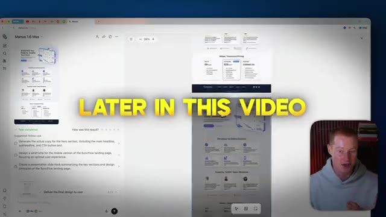
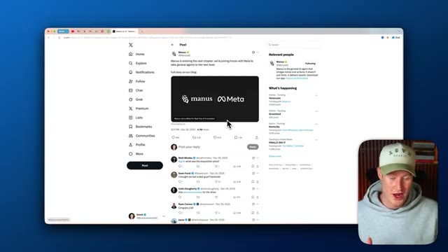

# 🎬 This Is the Most Powerful AI Agent I’ve Ever Used (Manus 1.6 Max)

> **Chaîne** : [Brock Mesarich | AI for Non Techies](https://www.youtube.com/@BrockMesarich)  
> **Lien YouTube** : [https://www.youtube.com/watch?v=Oh84cPhtmFA](https://www.youtube.com/watch?v=Oh84cPhtmFA)  
> **Date de publication** : 20260110  
> **Durée** : 00:13:47  
> **Identifiant vidéo** : `Oh84cPhtmFA`  
> **Transcription & Analyse** : `whisper-v3-large-turbo+gemini-3.5-flash-lite`  

---

## 📌 Synthèse Exécutive & Outils

### 💡 Résumé
Dans cette vidéo intitulée **This Is the Most Powerful AI Agent I’ve Ever Used (Manus 1.6 Max)**, Alex Carter détaille une approche stratégique et pratique du trading et de l'automatisation par agents IA.

### 🛠️ Outils, Modèles & Logiciels Présentés
- **TradingView & Claude Code** : Analyse technique avancée et automatisation algorithmique.

### 🔑 Points Clés & Enseignements Stratégiques
- Respect rigoureux du ratio risque/rendement et du money management.
- Automatisation méthodique des déclencheurs d'ordres via des agents intelligents.

---

## ⏱️ Chronologie & Transcription Complète Audio & Visuelle (Mot pour Mot)

### ⏱️ `[00:00:00 - 00:00:20]` | Segment #01

**🔊 Audio (Transcription Intégrale Mot pour Mot en Français) :**
> I think Manus might be the first AI tool that actually replaces most of my AI subscriptions. They just released Manus 1.6 Max, and this is the first time an AI agent has felt actually usable and not just impressive. It can build apps for you, operate inside of a real browser, and complete full workflows end-to-end without babysitting. And here is the wildest part.

**👁️ Analyse Visuelle d'Écran (gemini-3.5-flash-lite) :**
**Interface & Outils** : Présentation ou face-caméra explicatif du trader sans interface logicielle partagée.

**Contenu textuel & Code** : Explications orales des stratégies et mise en contexte méthodologique du marché.

**Action / Démonstration** : Explications face caméra et analyse conceptuelle des marchés.

---

### ⏱️ `[00:00:20 - 00:00:44]` | Segment #02

**🔊 Audio (Transcription Intégrale Mot pour Mot en Français) :**
> Meta just acquired Manus just a couple of days ago, and that tells you exactly where AI agents are headed. In this video, I'll show you what Manus 1.6 Max unlocks, why this change is how should be using AI in 2026 and how to let Manus work inside any browser you already use. All right guys, so quick side note, Meta just acquired Manus and you can see on this Twitter post that this is going viral across the AI space and this is a huge deal.

**👁️ Analyse Visuelle d'Écran (gemini-3.5-flash-lite) :**
**Interface & Outils** : Navigateur web, interface de l'agent IA Manus 1.6 Max, et réseau social X (Twitter).

**Contenu textuel & Code** : Publications sur l'acquisition de Manus par Meta, interface de génération de pages web et suggestions de tâches.

**Action / Démonstration** : Navigation sur le web et présentation des fonctionnalités de l'agent IA Manus et de son intégration.

*⏱️ 00:00:26 — Interface web montrant l'application Manus 1.6 Max avec aperçu de page de destination et options de suivi, et le présentateur en incrustation.*

*⏱️ 00:00:38 — Navigateur affichant un fil d'actualité X (Twitter) avec un message officiel concernant l'acquisition de Manus par Meta, et le présentateur en encadré.*

---

### ⏱️ `[00:00:44 - 00:01:08]` | Segment #03

**🔊 Audio (Transcription Intégrale Mot pour Mot en Français) :**
> Meta doesn't just buy tools unless they think they're foundational to the future of AI products and how we interact with AI. What Manus is building here, agents that can actually do work across apps in browsers, lines up perfectly with where Meta wants AI to go. So to me, this is a signal that autonomous AI agents are about to become mainstream to everyday users because Meta is such a meta company.

**👁️ Analyse Visuelle d'Écran (gemini-3.5-flash-lite) :**
**Interface & Outils** : Présentation ou face-caméra explicatif du trader sans interface logicielle partagée.

**Contenu textuel & Code** : Explications orales des stratégies et mise en contexte méthodologique du marché.

**Action / Démonstration** : Explications face caméra et analyse conceptuelle des marchés.

---

### ⏱️ `[00:01:08 - 00:01:28]` | Segment #04

**🔊 Audio (Transcription Intégrale Mot pour Mot en Français) :**
> You know, everybody knows about them. And I personally think understanding how we could use this tool is extremely powerful going into 2026. So that's what I'm going to show you in this video. All right. So just like that, a couple of minutes later, we now have this working prototype of our app. So let me quickly show you exactly how this works. Also, you can see that we have a QR code on the right hand side of our screen.

**👁️ Analyse Visuelle d'Écran (gemini-3.5-flash-lite) :**
**Interface & Outils** : Présentation ou face-caméra explicatif du trader sans interface logicielle partagée.

**Contenu textuel & Code** : Explications orales des stratégies et mise en contexte méthodologique du marché.

**Action / Démonstration** : Explications face caméra et analyse conceptuelle des marchés.

---

### ⏱️ `[00:01:28 - 00:01:48]` | Segment #05

**🔊 Audio (Transcription Intégrale Mot pour Mot en Français) :**
> This basically allows us to preview our app on our mobile phone to see what our mobile app will look like when we actually use it. So let me just use this right here. Let's go ahead and add a new goal workout every day. And there we go. It looks like we could easily just add, you know, a new goal here. This is a very simple app, but I just want to show you basically how this process works inside of Manus.

**👁️ Analyse Visuelle d'Écran (gemini-3.5-flash-lite) :**
**Interface & Outils** : Présentation ou face-caméra explicatif du trader sans interface logicielle partagée.

**Contenu textuel & Code** : Explications orales des stratégies et mise en contexte méthodologique du marché.

**Action / Démonstration** : Explications face caméra et analyse conceptuelle des marchés.

---

### ⏱️ `[00:01:48 - 00:02:07]` | Segment #06

**🔊 Audio (Transcription Intégrale Mot pour Mot en Français) :**
> And you could even see we could come here and edit the code with all of the files here with our app. So if you know how to code, you could actually make some changes here. And we also have our built-in database directly inside of Manus, as well as we could see all of our files that we have. And we could even add our API keys to whatever different AI service we want to use or connect with.

**👁️ Analyse Visuelle d'Écran (gemini-3.5-flash-lite) :**
**Interface & Outils** : Présentation ou face-caméra explicatif du trader sans interface logicielle partagée.

**Contenu textuel & Code** : Explications orales des stratégies et mise en contexte méthodologique du marché.

**Action / Démonstration** : Explications face caméra et analyse conceptuelle des marchés.

---

### ⏱️ `[00:02:07 - 00:02:42]` | Segment #07

**🔊 Audio (Transcription Intégrale Mot pour Mot en Français) :**
> For example, we could just tell Manus what we want to integrate and we could go ahead and do it. So for example, if we wanted to integrate with Stripe, we could say, I want to integrate Stripe, send this off, and our agent would begin building this directly into our application. and last of all what we could do is we could either save this to github to either make changes in cursor or cloud code if we wanted to or we could just simply publish our app and looks like we could even publish directly to the google play store which i know a lot of you guys ask about in my vibe coding tutorials all right so that is manis for building mobile apps directly in the platform the next thing i want to show you is how manis actually connects to the tools that you

**👁️ Analyse Visuelle d'Écran (gemini-3.5-flash-lite) :**
**Interface & Outils** : Présentation ou face-caméra explicatif du trader sans interface logicielle partagée.

**Contenu textuel & Code** : Explications orales des stratégies et mise en contexte méthodologique du marché.

**Action / Démonstration** : Explications face caméra et analyse conceptuelle des marchés.

---

### ⏱️ `[00:02:42 - 00:03:01]` | Segment #08

**🔊 Audio (Transcription Intégrale Mot pour Mot en Français) :**
> already use this is powered by something called mcp and don't worry you don't need to be technical to set this up or to understand what this is. I'm gonna walk you through this setup step-by-step and once it's connected, Manus can start reading your apps, trigger actions and run real workflows across any of the different apps you use with this simple hack.

**👁️ Analyse Visuelle d'Écran (gemini-3.5-flash-lite) :**
**Interface & Outils** : Présentation ou face-caméra explicatif du trader sans interface logicielle partagée.

**Contenu textuel & Code** : Explications orales des stratégies et mise en contexte méthodologique du marché.

**Action / Démonstration** : Explications face caméra et analyse conceptuelle des marchés.

---

### ⏱️ `[00:03:01 - 00:03:20]` | Segment #09

**🔊 Audio (Transcription Intégrale Mot pour Mot en Français) :**
> All right, so if we open up a new conversation inside of Manus, you could see this connect apps button here and we could toggle all of our apps on. So for example, let me show you exactly what I mean. So we have Gmail, which looks like it's already enabled in my account. We could connect our Google Calendar. We could connect Notion. We could connect to Google Drive, all these different platforms.

**👁️ Analyse Visuelle d'Écran (gemini-3.5-flash-lite) :**
**Interface & Outils** : Présentation ou face-caméra explicatif du trader sans interface logicielle partagée.

**Contenu textuel & Code** : Explications orales des stratégies et mise en contexte méthodologique du marché.

**Action / Démonstration** : Explications face caméra et analyse conceptuelle des marchés.

---

### ⏱️ `[00:03:20 - 00:03:40]` | Segment #10

**🔊 Audio (Transcription Intégrale Mot pour Mot en Français) :**
> You can now see every connector that Manus has directly baked into the platform. So let me show you exactly how to enable these now. Let's say you want to give access to your Google Calendar. So you could come into your Manus chat and basically say, help me schedule a meeting with John next week on Tuesday and send him an email with a link to the calendar booking.

**👁️ Analyse Visuelle d'Écran (gemini-3.5-flash-lite) :**
**Interface & Outils** : Présentation ou face-caméra explicatif du trader sans interface logicielle partagée.

**Contenu textuel & Code** : Explications orales des stratégies et mise en contexte méthodologique du marché.

**Action / Démonstration** : Explications face caméra et analyse conceptuelle des marchés.

---

### ⏱️ `[00:03:40 - 00:04:06]` | Segment #11

**🔊 Audio (Transcription Intégrale Mot pour Mot en Français) :**
> So what we could do is we could just come here, click on Google Calendar. We're going to click on Connect. and we can essentially just choose the account that we want to sign in with. And it's as simple as just granting access right here. And now we actually have access to use our Google Calendar inside of Manus. So let me test it out now. And I'm going to show you how to connect your Manus application to 8,000 plus apps, as well as 30,000 plus automations across those apps.

**👁️ Analyse Visuelle d'Écran (gemini-3.5-flash-lite) :**
**Interface & Outils** : Présentation ou face-caméra explicatif du trader sans interface logicielle partagée.

**Contenu textuel & Code** : Explications orales des stratégies et mise en contexte méthodologique du marché.

**Action / Démonstration** : Explications face caméra et analyse conceptuelle des marchés.

---

### ⏱️ `[00:04:06 - 00:04:29]` | Segment #12

**🔊 Audio (Transcription Intégrale Mot pour Mot en Français) :**
> And what it's doing is it's using this MCP tool now, accessing the Google Calendar. And we should be able to see our calendar events on our Google Calendar. All right. And just like that, you can see that Manus created this entire document that's showing all the capabilities using the Google Calendar connector. And it even fetched a couple of different meetings here that you can see Bangkok to Soul Flight, partnerships meeting, and even another meeting right there.

**👁️ Analyse Visuelle d'Écran (gemini-3.5-flash-lite) :**
**Interface & Outils** : Présentation ou face-caméra explicatif du trader sans interface logicielle partagée.

**Contenu textuel & Code** : Explications orales des stratégies et mise en contexte méthodologique du marché.

**Action / Démonstration** : Explications face caméra et analyse conceptuelle des marchés.

---

### ⏱️ `[00:04:29 - 00:04:49]` | Segment #13

**🔊 Audio (Transcription Intégrale Mot pour Mot en Français) :**
> And it even shows the attendees and their emails. So now I'm going to show you how to connect to 8,000 plus different applications using this one simple hack. All right. So I'm going to come to connectors. And next, I'm going to click on Zapier. If you don't know what Zapier is, it's an automation platform that has access to 8,000 plus different apps. And again, 30,000 plus actions that we can perform across those different apps.

**👁️ Analyse Visuelle d'Écran (gemini-3.5-flash-lite) :**
**Interface & Outils** : Présentation ou face-caméra explicatif du trader sans interface logicielle partagée.

**Contenu textuel & Code** : Explications orales des stratégies et mise en contexte méthodologique du marché.

**Action / Démonstration** : Explications face caméra et analyse conceptuelle des marchés.

---

### ⏱️ `[00:04:49 - 00:05:08]` | Segment #14

**🔊 Audio (Transcription Intégrale Mot pour Mot en Français) :**
> So what I'm going to do is I'm going to click on connect and then I'm going to go to Zapier MCP. And there's going to be a link in the description to access this. And what I'm going to do when I'm inside of this is I'm going to click on new MCP server. And for my MCP clients, I'm going to click on Manus. These two platforms connect extremely easily. This process is super easy to set up.

**👁️ Analyse Visuelle d'Écran (gemini-3.5-flash-lite) :**
**Interface & Outils** : Présentation ou face-caméra explicatif du trader sans interface logicielle partagée.

**Contenu textuel & Code** : Explications orales des stratégies et mise en contexte méthodologique du marché.

**Action / Démonstration** : Explications face caméra et analyse conceptuelle des marchés.

---

### ⏱️ `[00:05:08 - 00:05:27]` | Segment #15

**🔊 Audio (Transcription Intégrale Mot pour Mot en Français) :**
> So I'm going to create an MCP server. And again, if you don't understand the technical like terms of what an MCP server is, don't worry. It just connects. It's basically a bridge that connects all of your applications together in a simple in a simple way that non-technical people can understand. So what I'm going to do now is I'm going to enable any of the tools that I want to use.

**👁️ Analyse Visuelle d'Écran (gemini-3.5-flash-lite) :**
**Interface & Outils** : Présentation ou face-caméra explicatif du trader sans interface logicielle partagée.

**Contenu textuel & Code** : Explications orales des stratégies et mise en contexte méthodologique du marché.

**Action / Démonstration** : Explications face caméra et analyse conceptuelle des marchés.

---

### ⏱️ `[00:05:27 - 00:05:46]` | Segment #16

**🔊 Audio (Transcription Intégrale Mot pour Mot en Français) :**
> So there are so many different platforms that we could actually access. For example, if we want to connect our ClickUp, we could just come here and then select these tools. If you want to connect Notion, you can connect it as well. And then let me just look up SynthFlow, which is an AI voice calling platform that Manus actually doesn't integrate with directly in their platform. So we're going to use the Zapier MCP to do that.

**👁️ Analyse Visuelle d'Écran (gemini-3.5-flash-lite) :**
**Interface & Outils** : Présentation ou face-caméra explicatif du trader sans interface logicielle partagée.

**Contenu textuel & Code** : Explications orales des stratégies et mise en contexte méthodologique du marché.

**Action / Démonstration** : Explications face caméra et analyse conceptuelle des marchés.

---

### ⏱️ `[00:05:46 - 00:06:18]` | Segment #17

**🔊 Audio (Transcription Intégrale Mot pour Mot en Français) :**
> So I'm going to select all these tools and each of these tools are different actions that our agent has access to. For example, we could actually get the transcript from a call. We could create a booking, go high level action. We could create an AI assistant. All of these different things are actions that our agent can perform. So I'm going to click on connect. And now we have all of our tools for this synth flow setup. Let me click on Google Sheets. I'm going to select all these, click connect. And now our Manus application can access anything inside of our Google Spreadsheets, update spreadsheets, all those different things just by using this. And so next, what we're going

**👁️ Analyse Visuelle d'Écran (gemini-3.5-flash-lite) :**
**Interface & Outils** : Présentation ou face-caméra explicatif du trader sans interface logicielle partagée.

**Contenu textuel & Code** : Explications orales des stratégies et mise en contexte méthodologique du marché.

**Action / Démonstration** : Explications face caméra et analyse conceptuelle des marchés.

---

### ⏱️ `[00:06:18 - 00:06:57]` | Segment #18

**🔊 Audio (Transcription Intégrale Mot pour Mot en Français) :**
> to do, we're going to click on configure. We're going to click on copy URL and simply going to paste this into Manus. And now we have successfully connected our Zapier MCP and can begin performing these actions directly inside of Manus. All right. For example, I asked Manus to fetch info from yesterday in my following tracker spreadsheet in Google spreadsheets. Essentially, I have this spreadsheet that tracks my following across my Instagram, my TikTok, and my YouTube to see how much my channels are growing. And it was able to access this spreadsheet and provide this up-to-date information. So it showed yesterday I had 57,609 followers or subscribers. I had a 54 increase. And

**👁️ Analyse Visuelle d'Écran (gemini-3.5-flash-lite) :**
**Interface & Outils** : Présentation ou face-caméra explicatif du trader sans interface logicielle partagée.

**Contenu textuel & Code** : Explications orales des stratégies et mise en contexte méthodologique du marché.

**Action / Démonstration** : Explications face caméra et analyse conceptuelle des marchés.

---

### ⏱️ `[00:06:57 - 00:07:32]` | Segment #19

**🔊 Audio (Transcription Intégrale Mot pour Mot en Français) :**
> then it even explains the exact same thing for TikTok. Looks like I grew 116 followers on TikTok and let me see if that information is correct. And there we go. TikTok, we actually increased 116. So this is a way that we could instantly connect to a bunch of different applications using the MCP inside of Manus as well as the Zapier MCP that it easily connects with. All right, so the next feature I want to show you is design view. Not only can Manus generate images and videos, but it can act as a complete design tool. Instead of re-prompting over and over, you get a live canvas where you could click on specific parts of an image and tell Manus what you want to change. I'm going to show

**👁️ Analyse Visuelle d'Écran (gemini-3.5-flash-lite) :**
**Interface & Outils** : Présentation ou face-caméra explicatif du trader sans interface logicielle partagée.

**Contenu textuel & Code** : Explications orales des stratégies et mise en contexte méthodologique du marché.

**Action / Démonstration** : Explications face caméra et analyse conceptuelle des marchés.

---

### ⏱️ `[00:07:32 - 00:08:05]` | Segment #20

**🔊 Audio (Transcription Intégrale Mot pour Mot en Français) :**
> you how this works in real time, including precise edits, upscaling, and background removal, all directly inside of the design view inside of Manus. And this is one of those features that really does make Manus feel like a Swiss army knife that can do literally anything you want inside of one platform. All right, so in order to use design view, we're just going to come back to a new Manish Chat. And we're going to click on this design toggle button right here. You can see we can now use Nano Banana Pro, which is the Gemini in Google image generation tool, as well as we could use Chachapiti Image One. However, I'm going to use Nano Banana Pro because it's just

**👁️ Analyse Visuelle d'Écran (gemini-3.5-flash-lite) :**
**Interface & Outils** : Présentation ou face-caméra explicatif du trader sans interface logicielle partagée.

**Contenu textuel & Code** : Explications orales des stratégies et mise en contexte méthodologique du marché.

**Action / Démonstration** : Explications face caméra et analyse conceptuelle des marchés.

---

### ⏱️ `[00:08:05 - 00:08:42]` | Segment #21

**🔊 Audio (Transcription Intégrale Mot pour Mot en Français) :**
> simply better. So what we could do is we actually have these preset prompts. So let's actually generate a SaaS landing page design using Nano Banana Pro that we could actually even import and build into our mobile app with that first feature that I showed at the beginning of this video, but I'm going to show you exactly how we could not only generate these designs, but we could actually make iterations and changes using this canvas interface inside of Manus. All right, so just a couple of minutes later, we have this design here using Nano Banana Pro. And again, you could see this user interface that is like a canvas. And what we could do is we could either upscale this image or we could make edits to specific parts of this image directly inside of

**👁️ Analyse Visuelle d'Écran (gemini-3.5-flash-lite) :**
**Interface & Outils** : Présentation ou face-caméra explicatif du trader sans interface logicielle partagée.

**Contenu textuel & Code** : Explications orales des stratégies et mise en contexte méthodologique du marché.

**Action / Démonstration** : Explications face caméra et analyse conceptuelle des marchés.

---

### ⏱️ `[00:08:42 - 00:09:15]` | Segment #22

**🔊 Audio (Transcription Intégrale Mot pour Mot en Français) :**
> this platform. So what I'm going to do is I'm going to edit text. Let's say that I don't like this text here and I want to change it I could simply just edit it and go like this let's just change this and say let's change the text to say your data stored safely with AI click on save and apply and now it's going to generate a new mock-up and keep everything else the same and just like that we have that new design here with our new text and we could simply make any change we want using these precision edits features directly inside of design view inside of Manus all right so here's another use case inside of design view so I uploaded this image of me wearing this

**👁️ Analyse Visuelle d'Écran (gemini-3.5-flash-lite) :**
**Interface & Outils** : Présentation ou face-caméra explicatif du trader sans interface logicielle partagée.

**Contenu textuel & Code** : Explications orales des stratégies et mise en contexte méthodologique du marché.

**Action / Démonstration** : Explications face caméra et analyse conceptuelle des marchés.

---

### ⏱️ `[00:09:15 - 00:09:48]` | Segment #23

**🔊 Audio (Transcription Intégrale Mot pour Mot en Français) :**
> Dak Prescott jersey and let's say I want to wear this Tony Romo jersey because I want to go back 10 years Cowboys fan so what I could do is I could click on the image I could click this mark edit feature I could drag what I want to actually edit you could see that it actually is bringing this into the chat here and then I'm going to say let's change this image so I'm actually wearing this jersey instead of the Dak Prescott jersey and then I'm going to select this image and I'm going to click send and now it's basically going to combine these images and make edits directly inside of the canvas inside of design view in Manus. And just like that, you can now see I have this edit where

**👁️ Analyse Visuelle d'Écran (gemini-3.5-flash-lite) :**
**Interface & Outils** : Présentation ou face-caméra explicatif du trader sans interface logicielle partagée.

**Contenu textuel & Code** : Explications orales des stratégies et mise en contexte méthodologique du marché.

**Action / Démonstration** : Explications face caméra et analyse conceptuelle des marchés.

---

### ⏱️ `[00:09:48 - 00:10:23]` | Segment #24

**🔊 Audio (Transcription Intégrale Mot pour Mot en Français) :**
> I'm now wearing this Tony Romo jersey. What I could do is I could even upscale our image, which will just basically turn this into a 4k resolution. I'm going to click send and you can see that it's literally upgrading the quality of my image in real time. And then I could even go ahead and download it as well. Now let's try one more example inside of design view. So what I could do is let me just go ahead and take this image, but I want to remove the background of it. So I'm just simply going to click on remove background and it's now going to highlight me the subject in this image and just remove everything else in the background and just like that we now have this image of me that I could drag onto any image so let me pull up something I'm going to basically

**👁️ Analyse Visuelle d'Écran (gemini-3.5-flash-lite) :**
**Interface & Outils** : Présentation ou face-caméra explicatif du trader sans interface logicielle partagée.

**Contenu textuel & Code** : Explications orales des stratégies et mise en contexte méthodologique du marché.

**Action / Démonstration** : Explications face caméra et analyse conceptuelle des marchés.

---

### ⏱️ `[00:10:23 - 00:10:55]` | Segment #25

**🔊 Audio (Transcription Intégrale Mot pour Mot en Français) :**
> photoshop myself onto it so I could drag this anywhere on the canvas you can see that I'm actually dragging this onto this image here let's say I want to photoshop this image of me onto the back of my girlfriend I could just go like this and then what I could do I could simply just highlight this and then download this image. So guys, there is design view. You can get really creative with this. This is a really good way to use Nano Banana and Chachapiti image generation in directly inside of your Manus platform without having to leave this platform to use it for your other workflows. All right, so the last feature I'm going to show you is basically like having

**👁️ Analyse Visuelle d'Écran (gemini-3.5-flash-lite) :**
**Interface & Outils** : Présentation ou face-caméra explicatif du trader sans interface logicielle partagée.

**Contenu textuel & Code** : Explications orales des stratégies et mise en contexte méthodologique du marché.

**Action / Démonstration** : Explications face caméra et analyse conceptuelle des marchés.

---

### ⏱️ `[00:10:55 - 00:11:20]` | Segment #26

**🔊 Audio (Transcription Intégrale Mot pour Mot en Français) :**
> an AI-powered browser, but instead of switching to a new browser, it works inside the one you already use. With the Manus browser extension, the agent can see and interact with your tabs, your logins and any of the tools that you already work with. That means you can tell Manus what you want done and it will handle the browsing steps for you, such as clicking on websites, booking flights, any of those things can now be automated directly in your browser with this one extension.

**👁️ Analyse Visuelle d'Écran (gemini-3.5-flash-lite) :**
**Interface & Outils** : Présentation ou face-caméra explicatif du trader sans interface logicielle partagée.

**Contenu textuel & Code** : Explications orales des stratégies et mise en contexte méthodologique du marché.

**Action / Démonstration** : Explications face caméra et analyse conceptuelle des marchés.

---

### ⏱️ `[00:11:20 - 00:11:55]` | Segment #27

**🔊 Audio (Transcription Intégrale Mot pour Mot en Français) :**
> So let me show you how to download it and start using it right now. All right, so there's going to be a link in the description to actually download this. And what I could do is I could just simply click install. So this is a Manus browser operator and I'm using Dia Browser. if you're using Google Chrome, you could also add this and plenty of the other browsers you use. I'm simply going to click on add to Dia. And then we're going to see this new little Manus button up here on the top right hand side of our screen, as well as it's going to explain how to use it. So Manus will operate in a new tab to finish the task. Please supervise its actions to prevent errors and losses. All right. So in order to initiate the browser extension to go

**👁️ Analyse Visuelle d'Écran (gemini-3.5-flash-lite) :**
**Interface & Outils** : Présentation ou face-caméra explicatif du trader sans interface logicielle partagée.

**Contenu textuel & Code** : Explications orales des stratégies et mise en contexte méthodologique du marché.

**Action / Démonstration** : Explications face caméra et analyse conceptuelle des marchés.

---

### ⏱️ `[00:11:55 - 00:12:31]` | Segment #28

**🔊 Audio (Transcription Intégrale Mot pour Mot en Français) :**
> off and perform a task, I'm just going to click up here, click on start a new task. And then I'm basically going to now give it a prompt. So here is the prompt and the task that I'm going to give it. So go on TikTok, YouTube studio and Instagram and log my follower growth in the spreadsheet and add all of the calculations. I even gave it the spreadsheet link. And this is that spreadsheet I was talking about earlier on in the video. So what it'll do is it will manually update this spreadsheet without me having to touch a thing. It'll scrape my YouTube, my TikTok and my Instagram all without me having to touch anything. So what I'm going to do is I'm going to click send and it's going to open up these tabs and do this all without my hands being on the keyboard. So you

**👁️ Analyse Visuelle d'Écran (gemini-3.5-flash-lite) :**
**Interface & Outils** : Présentation ou face-caméra explicatif du trader sans interface logicielle partagée.

**Contenu textuel & Code** : Explications orales des stratégies et mise en contexte méthodologique du marché.

**Action / Démonstration** : Explications face caméra et analyse conceptuelle des marchés.

---

### ⏱️ `[00:12:31 - 00:12:50]` | Segment #29

**🔊 Audio (Transcription Intégrale Mot pour Mot en Français) :**
> could see it pulled up my TikTok. Whenever there's that blue ring, that means that the browser operator is off and performing a task. So it pulled the data from TikTok, then it switched over to my YouTube Studio Analytics, and it's now pulling my YouTube followers and subscriber count. One thing I want to mention is the best part about this is yes, there are AI browsers out there you could use.

**👁️ Analyse Visuelle d'Écran (gemini-3.5-flash-lite) :**
**Interface & Outils** : Présentation ou face-caméra explicatif du trader sans interface logicielle partagée.

**Contenu textuel & Code** : Explications orales des stratégies et mise en contexte méthodologique du marché.

**Action / Démonstration** : Explications face caméra et analyse conceptuelle des marchés.

---

### ⏱️ `[00:12:50 - 00:13:26]` | Segment #30

**🔊 Audio (Transcription Intégrale Mot pour Mot en Français) :**
> This works directly inside of any of the browsers you are already using. So if you're using Google Chrome, you don't need to download a new AI browser. That is just going to be a pain to set up, and you're going to have to maneuver around and figure out how to use because this is baked directly into whatever browser you're using because it's just an extension and honestly this feature alone is going to be so useful and honestly i'm really excited to see what meta and manis do because i really do think that's going to be an amazing partnership and it's going to really change the way we work because if i don't have to go into a spreadsheet anymore and manually do any of this data entry and i could just have it do it automatically just by giving it a simple

**👁️ Analyse Visuelle d'Écran (gemini-3.5-flash-lite) :**
**Interface & Outils** : Présentation ou face-caméra explicatif du trader sans interface logicielle partagée.

**Contenu textuel & Code** : Explications orales des stratégies et mise en contexte méthodologique du marché.

**Action / Démonstration** : Explications face caméra et analyse conceptuelle des marchés.

---

### ⏱️ `[00:13:26 - 00:13:47]` | Segment #31

**🔊 Audio (Transcription Intégrale Mot pour Mot en Français) :**
> prompt that would be game changing with the way that i work personally it would probably change things for you too all right guys so there we have it that is manis in the new 1.6 max update if you guys want to try this out there's a link in the description as well as in the top pinned comment with 1 000 free credits if you sign up using that link with that being said guys thank you for saying that in this video and i'm looking forward to seeing you in the next one

**👁️ Analyse Visuelle d'Écran (gemini-3.5-flash-lite) :**
**Interface & Outils** : Présentation ou face-caméra explicatif du trader sans interface logicielle partagée.

**Contenu textuel & Code** : Explications orales des stratégies et mise en contexte méthodologique du marché.

**Action / Démonstration** : Explications face caméra et analyse conceptuelle des marchés.

---

