# 🎬 NEW Claude Cowork Is Claude Code for Anyone (Finally)

> **Chaîne** : [Brock Mesarich | AI for Non Techies](https://www.youtube.com/@BrockMesarich)  
> **Lien YouTube** : [https://www.youtube.com/watch?v=PDLEvQ2_4Mg](https://www.youtube.com/watch?v=PDLEvQ2_4Mg)  
> **Date de publication** : 20260113  
> **Durée** : 00:06:39  
> **Identifiant vidéo** : `PDLEvQ2_4Mg`  
> **Transcription & Analyse** : `whisper-v3-large-turbo+gemini-3.5-flash-lite`  

---

## 📌 Synthèse Exécutive & Outils

### 💡 Résumé
Dans cette vidéo intitulée **NOUVEAU : Claude Cowork, c'est enfin Claude Code pour tout le monde**, Alex Carter détaille une approche stratégique et pratique du trading et de l'automatisation par agents IA.

### 🛠️ Outils, Modèles & Logiciels Présentés
- **TradingView & Claude Code** : Analyse technique avancée et automatisation algorithmique.

### 🔑 Points Clés & Enseignements Stratégiques
- Respect rigoureux du ratio risque/rendement et du money management.
- Automatisation méthodique des déclencheurs d'ordres via des agents intelligents.

---

## ⏱️ Chronologie & Transcription Complète Audio & Visuelle (Mot pour Mot)

### ⏱️ `[00:00:00 - 00:00:20]` | Segment #01

**🔊 Audio (Transcription Intégrale Mot pour Mot en Français) :**
> Anthropic vient de lancer Claude Cowork et ça va changer la façon dont les non-techniciens interagissent avec leurs ordinateurs. Claude Code était l'outil de référence pour les développeurs qui créent des applications et automatisent des flux de travail, mais les gens ont commencé à l'utiliser aussi pour les tâches quotidiennes. Le problème, c'est que ça se trouve à l'intérieur du terminal et ça peut être intimidant. Même pour moi, je n'utilise pas Claude Code parce que je déteste utiliser les terminaux.

**👁️ Analyse Visuelle d'Écran (gemini-3.5-flash-lite) :**
**Interface & Outils** : Terminal de commandes (Claude Code CLI / interface en ligne de commande) et incrustation vidéo du présentateur.

**Contenu textuel & Code** : Commandes textuelles, tâches d'analyse de code source d'une application Next.js, lecture de fichiers et invite de confirmation pour l'installation de paquets via npm.

**Action / Démonstration** : Navigation dans la structure d'un projet, analyse de fichiers de code et exécution de commandes de configuration de test.

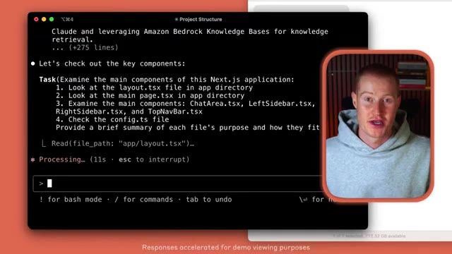
*⏱️ 00:00:10 — Terminal de commandes montrant Claude Code en train d'analyser la structure d'un projet Next.js avec le présentateur en incrustation vidéo.*

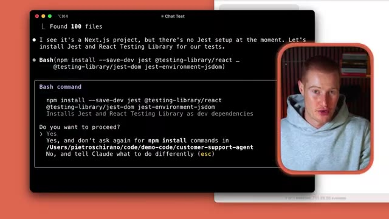
*⏱️ 00:00:15 — Terminal de commandes affichant l'exécution d'une commande Bash par Claude Code pour installer des dépendances de test (Jest et React Testing Library).*

---

### ⏱️ `[00:00:20 - 00:00:39]` | Segment #02

**🔊 Audio (Transcription Intégrale Mot pour Mot en Français) :**
> Mais Claude Cowork résout ce problème, alors dans cette vidéo je vais vous montrer ce que c'est, comment commencer à l'utiliser, et pourquoi je pense que c'est l'une des sorties d'IA les plus importantes que j'ai vues. Plongeons directement dans cette vidéo. Très bien, les gars. Alors très rapidement, allons à la source où cette nouvelle a été lancée. Donc si vous regardez Twitter en ce moment, ce lancement est devenu absolument fou. Tant de gens en parlent.

**👁️ Analyse Visuelle d'Écran (gemini-3.5-flash-lite) :**
**Interface & Outils** : Navigateur web (X / Twitter), application Claude.

**Contenu textuel & Code** : Publication officielle de Claude présentant "Claude Cowork" et expliquant ses fonctionnalités pour les tâches non techniques.

**Action / Démonstration** : Le présentateur présente l'interface du post X/Twitter tout en commentant l'annonce de Claude Cowork.

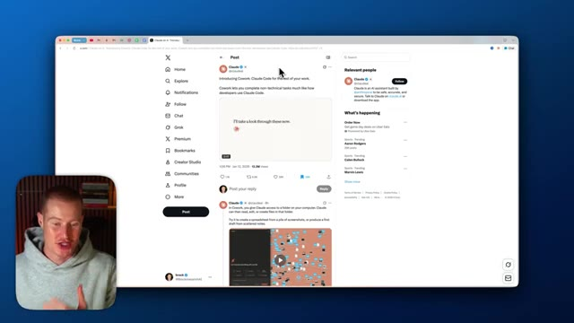
*⏱️ 00:00:34 — Capture d'écran du navigateur affichant une publication sur le réseau social X (Twitter) du compte officiel de Claude concernant "Claude Cowork".*

---

### ⏱️ `[00:00:39 - 00:01:02]` | Segment #03

**🔊 Audio (Transcription Intégrale Mot pour Mot en Français) :**
> Voici Claude Cowork. Claude code pour le reste de votre travail. Cowork vous permet d'accomplir des tâches non techniques, un peu de la même manière que les développeurs utilisent Claude code. Ainsi, par exemple, l'un des cas d'utilisation que Claude montre réellement dans ce fil Twitter est que vous pouvez donner à Claude accès à n'importe quel dossier sur votre ordinateur, et il peut aller de l'avant et organiser ces dossiers. Par exemple, vous pouvez voir Claude Cowork en action juste ici, et il est littéralement en train d'organiser tous ces fichiers sur ce bureau.

**👁️ Analyse Visuelle d'Écran (gemini-3.5-flash-lite) :**
**Interface & Outils** : Navigateur web affichant la plateforme X (Twitter) et une vidéo de démonstration de Claude Cowork.

**Contenu textuel & Code** : Publications du compte officiel de Claude (@claudeai) présentant les fonctionnalités de Cowork pour automatiser les tâches non techniques.

**Action / Démonstration** : Le présentateur commente la présentation officielle de Claude Cowork sur Twitter/X pour expliquer ses cas d'usage.

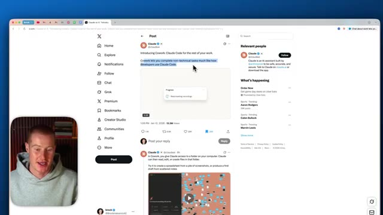
*⏱️ 00:00:45 — Capture d'écran montrant le fil Twitter de Claude présentant "Cowork: Claude Code for the rest of your work", avec le présentateur incrusté en bas à gauche.*

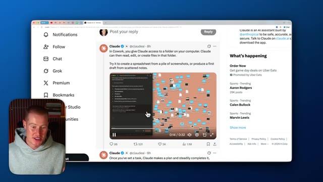
*⏱️ 00:00:56 — Capture d'écran montrant la suite du fil Twitter de Claude avec une vidéo de démonstration de Cowork interagissant avec des dossiers et des fichiers sur ordinateur.*

---

### ⏱️ `[00:01:02 - 00:01:22]` | Segment #04

**🔊 Audio (Transcription Intégrale Mot pour Mot en Français) :**
> Alors laissez-moi vous montrer maintenant ce qui est différent à ce sujet, et je vais vous montrer exactement comment vous pourriez commencer à l'utiliser dès maintenant aussi. Très bien, donc afin de commencer à utiliser ceci dès maintenant, vous allez devoir télécharger l'application de bureau Claude, et pour l'instant, Claude Cowork est uniquement disponible pour les utilisateurs Mac. Il va y avoir un lien dans la description si vous n'avez pas déjà l'application de bureau Claude. Assurez-vous de télécharger ceci sur votre ordinateur, et je vais vous montrer à quoi cela ressemble maintenant.

**👁️ Analyse Visuelle d'Écran (gemini-3.5-flash-lite) :**
**Interface & Outils** : Navigateur web affichant le site officiel de Claude (claude.ai).

**Contenu textuel & Code** : Page de téléchargement de l'application desktop Claude, options pour macOS et Windows.

**Action / Démonstration** : Présentation de la page de téléchargement de l'application de bureau Claude par le présentateur.

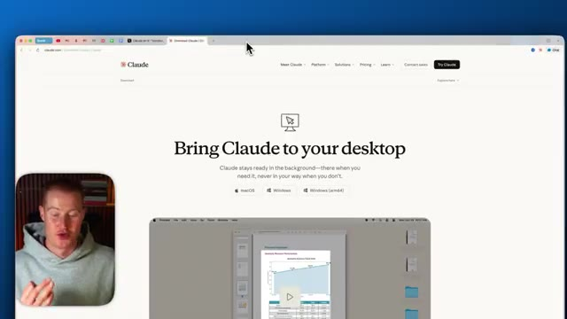
*⏱️ 00:01:07 — Page web officielle de téléchargement de l'application de bureau Claude avec le titre "Bring Claude to your desktop".*

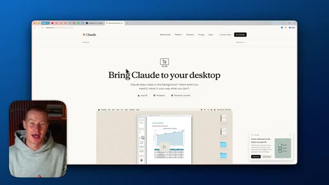
*⏱️ 00:01:12 — Même page web de téléchargement de Claude avec le curseur se positionnant sur les options de téléchargement.*

---

### ⏱️ `[00:01:22 - 00:01:44]` | Segment #05

**🔊 Audio (Transcription Intégrale Mot pour Mot en Français) :**
> Donc, comme vous pouvez le voir, j'ai maintenant Claude Desktop de téléchargé, et nous avons quelques onglets différents ici. Nous avons notre mode de chat normal juste ici. Nous avons notre mode Claude code sur le bureau que nous pourrions également utiliser juste ici. Activez cela. Et maintenant, nous avons cet onglet Cowork. Et vous pouvez voir que je l'ai même utilisé pour une tâche précédente. Et laissez-moi décomposer cela dès maintenant et parler de l'interface et de la façon dont nous pourrions commencer à l'utiliser.

**👁️ Analyse Visuelle d'Écran (gemini-3.5-flash-lite) :**
**Interface & Outils** : Claude Desktop application sur macOS

**Contenu textuel & Code** : Interface utilisateur de Claude Desktop avec le message d'accueil "Evening, brock", une barre de saisie de texte "How can I tip you today?", et un menu latéral affichant l'historique des discussions.

**Action / Démonstration** : Le présentateur survole l'onglet "Code" dans l'interface de Claude Desktop pour montrer les différentes options disponibles.

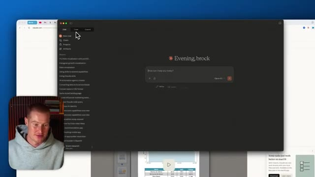
*⏱️ 00:01:27 — Capture d'écran montrant l'application Claude Desktop avec un curseur pointant sur les onglets du mode chat et code.*

---

### ⏱️ `[00:01:44 - 00:02:06]` | Segment #06

**🔊 Audio (Transcription Intégrale Mot pour Mot en Français) :**
> Voici donc un bref aperçu de ce que j'essayais exactement de faire faire à Claude Cowork. La consigne que je lui ai donnée est la suivante : va dans le dossier Shorts et donne-moi la transcription de toutes les vidéos qui s'y trouvent et qui sont dans le sous-dossier Shorts 1-9. Pour vous donner un exemple de ce que je veux dire, j'ai ce dossier qui est stocké sur mon bureau, sur mon ordinateur, où je mets toutes mes vidéos courtes lorsque mon monteur me les envoie et qu'elles sont prêtes à être publiées.

**👁️ Analyse Visuelle d'Écran (gemini-3.5-flash-lite) :**
**Interface & Outils** : Interface de l'application Claude Cowork et explorateur de fichiers macOS.

**Contenu textuel & Code** : Le prompt textuel demandant d'extraire la transcription des vidéos du sous-dossier "Shorts 1-9", ainsi que les étapes d'exécution de la tâche par l'IA.

**Action / Démonstration** : Affichage de la conversation avec l'assistant IA et visualisation des dossiers locaux contenant les vidéos à transcrire.

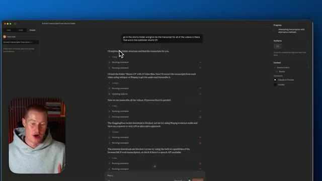
*⏱️ 00:01:49 — Interface de l'application montrant l'interaction avec Claude Cowork et la transcription en cours d'exécution suite au prompt.*

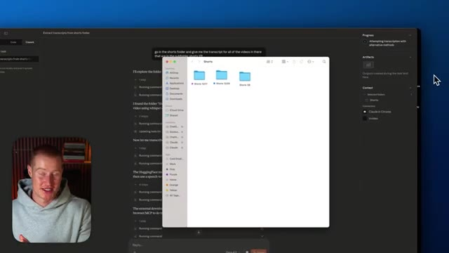
*⏱️ 00:02:00 — Interface de Claude Cowork avec une fenêtre de l'explorateur de fichiers macOS superposée montrant les dossiers "Shorts".*

---

### ⏱️ `[00:02:06 - 00:02:28]` | Segment #07

**🔊 Audio (Transcription Intégrale Mot pour Mot en Français) :**
> Et j'ai ces quelques sous-dossiers différents ici. Nous avons shorts 12-17, celui-ci aussi. Et ensuite nous avons shorts 1-9, qui est celui dont j'essaie d'extraire les transcriptions. Et nous avons toutes ces vidéos de contenu court. Donc, essentiellement, ce que j'ai fait, c'est que j'ai juste créé une nouvelle tâche. J'ai donné cette consigne et maintenant ce qu'il fait, c'est qu'il s'en va et essaie réellement d'exécuter cette tâche à l'intérieur de mon dossier.

**👁️ Analyse Visuelle d'Écran (gemini-3.5-flash-lite) :**
**Interface & Outils** : Présentation ou face-caméra explicatif du trader sans interface logicielle partagée.

**Contenu textuel & Code** : Explications orales des stratégies et mise en contexte méthodologique du marché.

**Action / Démonstration** : Explications face caméra et analyse conceptuelle des marchés.

---

### ⏱️ `[00:02:28 - 00:02:48]` | Segment #08

**🔊 Audio (Transcription Intégrale Mot pour Mot en Français) :**
> Vous pourriez donc accorder l'accès pour avoir essentiellement la possibilité d'exploiter n'importe lequel des différents dossiers et applications que vous utilisez sur votre ordinateur. Et il va aller de l'avant et essayer de travailler sur cette tâche. Très bien, alors allons de l'avant et essayons une autre tâche ici. Je vais vous montrer à quel point c'est facile à faire. Je vais donc cliquer sur nouvelle tâche en haut à gauche. Et puis il y a quelques tâches différentes pré-invitées que nous pourrions utiliser.

**👁️ Analyse Visuelle d'Écran (gemini-3.5-flash-lite) :**
**Interface & Outils** : Présentation ou face-caméra explicatif du trader sans interface logicielle partagée.

**Contenu textuel & Code** : Explications orales des stratégies et mise en contexte méthodologique du marché.

**Action / Démonstration** : Explications face caméra et analyse conceptuelle des marchés.

---

### ⏱️ `[00:02:48 - 00:03:07]` | Segment #09

**🔊 Audio (Transcription Intégrale Mot pour Mot en Français) :**
> Donc, cela rend les choses vraiment simples pour commencer à automatiser des choses dès le départ, même si vous ne savez pas quoi automatiser. Par exemple, nous pourrions créer un fichier, nous pourrions analyser des données, nous pourrions faire un prototype, nous pourrions organiser les fichiers. Laissez-moi donc cliquer sur organiser les fichiers. Et ce que je vais faire, c'est coller cette consigne : organiser et ranger mes images. Je veux que tu ajoutes toutes les images miniatures dans un dossier qui s'appelle miniatures terminées. Je vais donc cliquer sur c'est parti.

**👁️ Analyse Visuelle d'Écran (gemini-3.5-flash-lite) :**
**Interface & Outils** : Présentation ou face-caméra explicatif du trader sans interface logicielle partagée.

**Contenu textuel & Code** : Explications orales des stratégies et mise en contexte méthodologique du marché.

**Action / Démonstration** : Explications face caméra et analyse conceptuelle des marchés.

---

### ⏱️ `[00:03:07 - 00:03:30]` | Segment #10

**🔊 Audio (Transcription Intégrale Mot pour Mot en Français) :**
> It's using Opus 4.5 and it's now going to go ahead and begin doing this task. Also something I want to talk about inside the user interface of Claude Cowork is on the right hand side, you could see that we could see the progress as well as we have the ability to use artifacts. If you don't know what artifacts are, this is essentially a way to spin up quick user interfaces using Claude and begin building our own mini web apps that we could start using.

**👁️ Analyse Visuelle d'Écran (gemini-3.5-flash-lite) :**
**Interface & Outils** : Présentation ou face-caméra explicatif du trader sans interface logicielle partagée.

**Contenu textuel & Code** : Explications orales des stratégies et mise en contexte méthodologique du marché.

**Action / Démonstration** : Explications face caméra et analyse conceptuelle des marchés.

---

### ⏱️ `[00:03:30 - 00:03:52]` | Segment #11

**🔊 Audio (Transcription Intégrale Mot pour Mot en Français) :**
> Donc si j'ai un tas de données, par exemple, je pourrais alors dire, prends toutes ces données de ce fichier et ensuite je veux que tu crées un tableau de bord qui en quelque sorte visualise tout cela. C'est en quelque sorte quelque chose que nous pourrions faire maintenant en utilisant Claude Cowork. Donc il semble que Claude Cowork me demande maintenant ces étapes. Donc je ne vois aucun miniature dans votre dossier de shorts. Oh, et cela a du sens parce que je n'ai donné du contexte qu'au dossier de shorts que j'ai fait pour cette tâche précédente.

**👁️ Analyse Visuelle d'Écran (gemini-3.5-flash-lite) :**
**Interface & Outils** : Présentation ou face-caméra explicatif du trader sans interface logicielle partagée.

**Contenu textuel & Code** : Explications orales des stratégies et mise en contexte méthodologique du marché.

**Action / Démonstration** : Explications face caméra et analyse conceptuelle des marchés.

---

### ⏱️ `[00:03:52 - 00:04:28]` | Segment #12

**🔊 Audio (Transcription Intégrale Mot pour Mot en Français) :**
> Donc ce que je dois faire, c'est que je dois cliquer sur ajouter des fichiers ou des photos. Très bien. Donc juste comme ça, nous pouvons maintenant voir Claude Cowork en action. Il exécute ces commandes. Il est en train d'aller de l'avant, de trier ces images miniatures. Et on dirait qu'il est effectivement allé de l'avant et a terminé cette tâche en moins de 10 secondes, honnêtement. Boum. Et juste comme ça, si j'ouvre ce dossier d'images ici, avant, toutes les photos miniatures étaient ici, mais il a sélectionné chacune d'entre elles qui était une photo miniature et l'a ajoutée à un dossier appelé miniatures terminées. Et comme vous pouvez le voir, ce sont toutes de vraies miniatures. J'ai donc pu identifier laquelle était une miniature YouTube, laquelle ne l'était pas, par exemple, celle-ci est une adorable

**👁️ Analyse Visuelle d'Écran (gemini-3.5-flash-lite) :**
**Interface & Outils** : Interface Claude Cowork, application macOS, Finder.

**Contenu textuel & Code** : Liste textuelle de fichiers d'images à trier (« 7 free ai tools », « Zuck Evil Plan ») et interface de bureau.

**Action / Démonstration** : Démonstration de l'automatisation de tâches de tri de fichiers par l'intelligence artificielle.

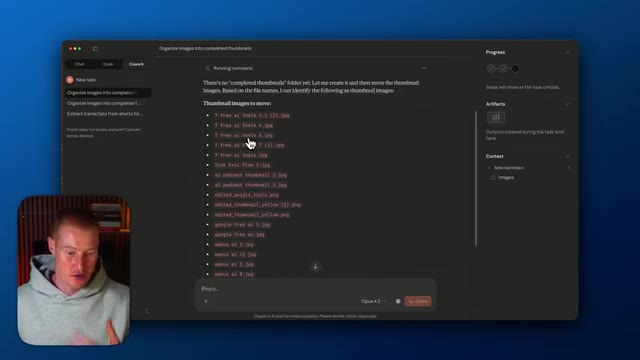
*⏱️ 00:04:01 — Interface de Claude Cowork affichant une liste de fichiers d'images identifiés et le présentateur en incrustation.*

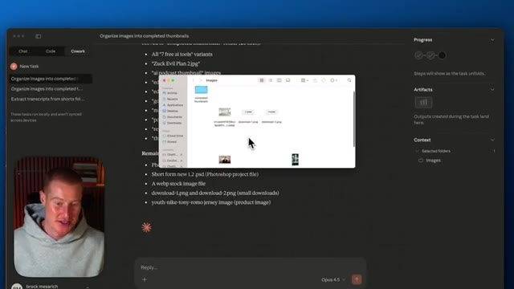
*⏱️ 00:04:10 — Claude Cowork en train d'exécuter des commandes de tri de fichiers avec une fenêtre du Finder macOS ouverte au centre.*

---

### ⏱️ `[00:04:28 - 00:05:03]` | Segment #13

**🔊 Audio (Transcription Intégrale Mot pour Mot en Français) :**
> logo que j'utilise réellement pour une vignette, mais ce n'est pas une vignette entièrement complète. J'ai donc pu réellement identifier cela et trier ceci en littéralement 10 secondes. C'est absolument dingue. Très bien. Je vais donc essayer une dernière tâche maintenant ici. Je vais cliquer sur nouvelle tâche. Et encore une fois, je dois aller sélectionner un dossier différent que je veux utiliser. Celui-ci s'appelle profit. J'ai donc essentiellement créé un faux fichier CSV d'un compte de résultat d'une entreprise. Et juste ici, je vais simplement cliquer sur autoriser. Pour qu'il ait accès à cela. Et ensuite, je vais dire, sur la base de ce dossier, je veux que tu crées réellement un artefact visuel de ce compte de résultat.

**👁️ Analyse Visuelle d'Écran (gemini-3.5-flash-lite) :**
**Interface & Outils** : Application de bureau (interface de type assistant IA / Cowork avec panneau latéral et zone de chat)

**Contenu textuel & Code** : Texte listant les fichiers déplacés vers un dossier « completed thumbnails » (20 fichiers) et les fichiers restants (7 fichiers), avec indication de l'utilisation d'Opus 4.5.

**Action / Démonstration** : Présentation du résumé textuel généré par l'IA confirmant le tri et l'organisation des fichiers d'images de miniatures.

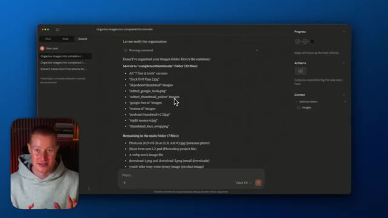
*⏱️ 00:04:36 — Une application de bureau affichant le résultat de l'organisation automatique d'un dossier d'images par une intelligence artificielle, avec le présentateur en médaillon dans le coin inférieur gauche.*

---

### ⏱️ `[00:05:03 - 00:05:35]` | Segment #14

**🔊 Audio (Transcription Intégrale Mot pour Mot en Français) :**
> donc je pouvais facilement voir ce que notre entreprise a fait cette année. Donc en temps réel, nous allons le voir en train d'aller dans ce dossier, d'extraire le fichier CSV, puis de le transformer directement en artefact dans cette interface à l'intérieur de Claude Cowork. Et les gars, c'est la première fois que je m'amuse vraiment avec Claude Code. J'ai honte de l'admettre, mais comme nous pouvons maintenant l'utiliser à l'intérieur de Claude Cowork, c'est tellement plus facile à utiliser au lieu d'avoir à aller dans quelque chose comme Cursor ou Windsurf ou l'un de ces IDE, parce que c'est beaucoup plus difficile pour une personne non technique alors que nous pouvons simplement basculer à l'intérieur de Claude ici même et simplement cliquer sur Cowork et commencer

**👁️ Analyse Visuelle d'Écran (gemini-3.5-flash-lite) :**
**Interface & Outils** : Présentation ou face-caméra explicatif du trader sans interface logicielle partagée.

**Contenu textuel & Code** : Explications orales des stratégies et mise en contexte méthodologique du marché.

**Action / Démonstration** : Explications face caméra et analyse conceptuelle des marchés.

---

### ⏱️ `[00:05:35 - 00:06:04]` | Segment #15

**🔊 Audio (Transcription Intégrale Mot pour Mot en Français) :**
> actually creating tasks and a task list for our agent to go off and do. It just becomes so much more simple. All right, guys. And just like that, about 30 seconds later, we now have this breakdown with an interactive visual dashboard of our 2024 profit and loss statement from this CSV file that was actually in a folder on my desktop. So I could just click on this. I could either open the code or I could just quickly open up this artifact here and we could begin playing around with this dashboard that actually went ahead and created based on all this data from the CSV file.

**👁️ Analyse Visuelle d'Écran (gemini-3.5-flash-lite) :**
**Interface & Outils** : Application de développement/assistant IA et tableau de bord financier interactif.

**Contenu textuel & Code** : KPIs financiers (chiffre d'affaires de 100M$, profit brut de 62,9M$, revenu net de 25,7M$), graphiques en barres et courbes de tendance trimestrielle.

**Action / Démonstration** : Présentation du tableau de bord interactif généré à partir d'un fichier CSV de compte de résultat.

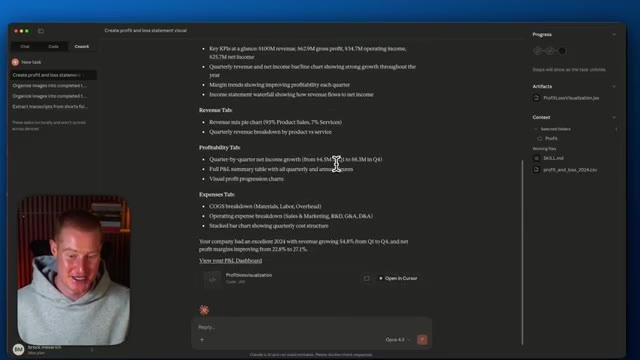
*⏱️ 00:05:50 — Interface d'un assistant IA listant un rapport financier détaillé avec KPI et onglets de revenus, profitabilité et dépenses.*

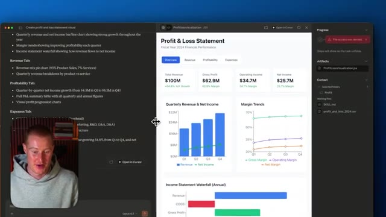
*⏱️ 00:05:57 — Tableau de bord financier interactif divisé en deux fenêtres affichant des graphiques de performance et des indicateurs clés (chiffre d'affaires, profit net).*

---

### ⏱️ `[00:06:05 - 00:06:23]` | Segment #16

**🔊 Audio (Transcription Intégrale Mot pour Mot en Français) :**
> So guys, there we have it. That is Claude Cowork. I wanted to quickly make a video on this. It's just released a couple of hours ago, but I wanted to show you the capabilities. If you're a non-technical person, you could start using Cloud Code in a very simple interface like this. If you wanna use this right now, you have to be a Cloud Max user. So I believe you have to pay about $100 per month to access this as of right now.

**👁️ Analyse Visuelle d'Écran (gemini-3.5-flash-lite) :**
**Interface & Outils** : Application macOS Claude Cowork.

**Contenu textuel & Code** : Options de tâches (« Create a file », « Crunch data », « Make a prototype », etc.) et zone de saisie pour les requêtes utilisateur.

**Action / Démonstration** : Navigation et démonstration de l'interface utilisateur de Claude Cowork.

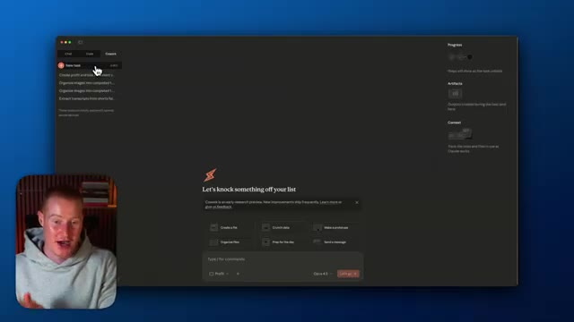
*⏱️ 00:06:09 — Interface principale de l'application Claude Cowork affichant des options de tâches et la bulle vidéo du présentateur en bas à gauche.*

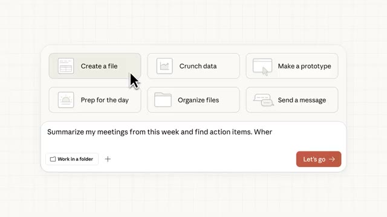
*⏱️ 00:06:14 — Gros plan sur les boutons de fonctionnalités et la zone de saisie de prompt de l'interface Claude Cowork.*

---

### ⏱️ `[00:06:23 - 00:06:39]` | Segment #17

**🔊 Audio (Transcription Intégrale Mot pour Mot en Français) :**
> This is of course a day of the release. So they should be rolling this out to hopefully free users, but users of the cheaper plans. So if you wanna use this, hopefully you'll be able to use this over the coming days. That being said, guys, hope you got some value. Let me know what you think in the comments, subscribe to the channel for more content like this, and I'll see you guys in the next video.

**👁️ Analyse Visuelle d'Écran (gemini-3.5-flash-lite) :**
**Interface & Outils** : Présentation vidéo standard sans graphique, terminal ou interface technique.

**Contenu textuel & Code** : Aucun code, indicateur technique, graphique de trading ou configuration affiché.

**Action / Démonstration** : Le présentateur conclut la vidéo en invitant les spectateurs à laisser des commentaires et à s'abonner.

---

