# 🎬 Master 99% of Claude Cowork in 26 Minutes (No Code)

> **Chaîne** : [Brock Mesarich | AI for Non Techies](https://www.youtube.com/@BrockMesarich)  
> **Lien YouTube** : [https://www.youtube.com/watch?v=EPfnhyjn78E](https://www.youtube.com/watch?v=EPfnhyjn78E)  
> **Date de publication** : 20260114  
> **Durée** : 00:26:13  
> **Identifiant vidéo** : `EPfnhyjn78E`  
> **Transcription & Analyse** : `whisper-v3-large-turbo+gemini-3.5-flash-lite`  

---

## 📌 Synthèse Exécutive & Outils

### 💡 Résumé

Cette vidéo, présentée par Brock Mesarich sur la chaîne *Brock Mesarich | AI for Non Techies*, explore en profondeur le lancement d'**Anthropic** et de son nouvel outil révolutionnaire : **Claude Cowork**. Conçu pour démocratiser l'accès à l'automatisation avancée sans nécessiter de compétences en programmation, Cowork se positionne comme un assistant personnel autonome capable de manipuler des fichiers, de contrôler le navigateur et d'interagir avec divers logiciels. Accompagné de l'expert en IA **Saman**, Brock décortique l'architecture de cet outil à travers une analogie Pokémon pédagogique, comparant **Claude Desktop** à un chatbot de base (niveau débutant), **Claude Cowork** à un agent polyvalent doté de "mains" et de connecteurs (niveau intermédiaire/avancé), et **Claude Code** à un système autonome et complexe orienté développement (super-utilisateur).

L'analyse démontre comment Claude Cowork révolutionne la productivité grâce à la création d'instances multiples exécutant des tâches en arrière-plan et pilotées par des listes de contrôle intelligentes. La démonstration pratique se concentre sur l'intégration de compétences (*skills*) persistantes, évitant ainsi aux utilisateurs de répéter les mêmes prompts complexes. Grâce à l'utilisation combinée de connecteurs natifs et de passerelles comme **Zapier MCP**, l'outil est capable de automatiser des flux de travail complexes — tels que la génération automatisée de présentations graphiques intégrant des logos, des éléments visuels et des données contextuelles extraites de dossiers locaux sans intervention humaine répétitive.

### 🛠️ Outils, Modèles & Logiciels Présentés

* **Claude Cowork** : Le nouvel agent autonome d'Anthropic conçu pour exécuter des tâches complexes de bout en bout, gérer des fichiers et contrôler le navigateur sans compétences en code.
* **Claude Code** : L'outil de niveau super-utilisateur orienté développement, fonctionnant via un terminal ou un EDI pour des processus autonomes de longue durée.
* **Claude Desktop** : L'interface de chatbot standard d'Anthropic, limitée à des interactions textuelles au tour par tour sans capacités d'exécution autonome approfondies.
* **Anthropic** : La société écosystémique à l'origine des modèles Claude et de la suite d'outils d'assistance intelligente.
* **Zapier MCP** : Une plateforme de connexion permettant d'étendre les super-pouvoirs de Claude en s'interfaçant avec des applications tierces (comme Google Slides) via des serveurs MCP dédiés.
* **Google Slides / Google Drive** : Des solutions de productivité et de stockage cloud intégrées aux flux de travail automatisés pour la création de documents et de présentations.
* **Make** : Une plateforme d'automatisation no-code souvent utilisée en parallèle pour connecter des flux de données complexes (mentionnée dans l'écosystème d'automatisation).
* **n8n** : Un outil d'automatisation open-source puissant pour orchestrer des flux de travail et des agents IA (mentionné dans l'écosystème global d'automatisation).
* **Gemini** : Le modèle concurrent de Google, évoqué dans le paysage global des intelligences artificielles conversationnelles.
* **ChatGPT** : L'assistant conversationnel d'OpenAI, utilisé comme étalon de comparaison pour les interfaces de type chatbot.
* **Grok** : L'intelligence artificielle développée par xAI, intégrée à l'écosystème global des LLM du marché.

### 🔑 Points Clés & Enseignements Stratégiques

* **Hiérarchie des outils d'IA** : Comprendre la distinction entre Claude Desktop (chatbot simple), Claude Cowork (agent exécutif multitâche avec interface graphique de type terminal) et Claude Code (système autonome de développement) pour adapter l'outil au niveau de complexité requis.
* **Autonomie par instances multiples** : Claude Cowork lance des sous-agents en arrière-plan qui travaillent en parallèle, gèrent des artefacts indépendants et suivent des barres de progression sans saturer l'attention de l'utilisateur.
* **Concept des "mains" et des connecteurs** : Contrairement au chatbot classique bloqué dans sa bulle textuelle, Cowork dispose d'extensions de navigateur et de connecteurs lui permettant d'interagir directement avec l'environnement de travail de l'utilisateur.
* **Apprentissage et persistance des compétences (*Skills*)** : La possibilité d'enseigner une méthode étape par étape à Claude une seule fois, éliminant ainsi la nécessité de réécrire des prompts répétitifs pour des tâches récurrentes.
* **Exécution de tâches non-API via le navigateur** : Capacité unique de Claude Cowork à exécuter des actions directement à travers le navigateur web grâce à une extension dédiée lorsque les applications cibles ne disposent pas d'API ouvertes.
* **Décomposition automatisée des workflows** : Lorsqu'un objectif global est assigné (ex. créer 10 diapositives), l'agent fragmente la directive en une sous-liste de contrôle granulaire (recherche de contenu, insertion d'images, formatage).
* **Intégration d'actifs multimédias contextuels** : Utilisation des dossiers locaux de l'utilisateur pour récupérer automatiquement des éléments graphiques (logos, emojis, GIFs) et les injecter de manière pertinente dans les livrables.
* **Pontage d'applications via Zapier MCP** : Contournement des limitations natives des connecteurs de Claude en configurant de nouveaux serveurs MCP (Model Context Protocol) pour piloter des outils tiers comme Google Slides.
* **Gain d'efficacité opérationnelle** : Passage d'un mode de travail itératif au tour par tour (style chat) à un mode de délégation intégrale où l'utilisateur valide le livrable final plutôt que les étapes intermédiaires.
* **Accessibilité pour les profils non-techniques** : Démocratisation de l'automatisation lourde, permettant à des professionnels sans background en programmation de piloter des agents virtuels complexes via une simple interface de chat avancée.

---

## ⏱️ Chronologie & Transcription Complète Audio & Visuelle (Mot pour Mot)

### ⏱️ `[00:00:00 - 00:00:23]` | Segment #01

**🔊 Audio (Transcription Intégrale Mot pour Mot en Français) :**
> Anthropic vient de lancer Claude Cowork et si vous êtes un peu comme moi, vous essayez encore de comprendre à quoi cet outil sert vraiment. Si vous étiez intimidé par Claude Code, en pensant qu'il faut être développeur pour l'utiliser, cela change tout. J'ai donc invité mon ami Saman, qui est un utilisateur expert de Claude Code, pour décortiquer tout ça et me montrer l'astuce de développement d'une compétence qui transforme Claude en un assistant personnel capable de faire presque n'importe quoi.

**👁️ Analyse Visuelle d'Écran (gemini-3.5-flash-lite) :**
**Interface & Outils** : Terminal de commandes CLI, interface de développement.

**Contenu textuel & Code** : Lignes de commande Bash, installation de packages npm (Jest, React Testing Library), messages d'interaction avec l'utilisateur.

**Action / Démonstration** : Exécution d'une commande d'installation et affichage de l'invite de confirmation dans l'outil de développement.

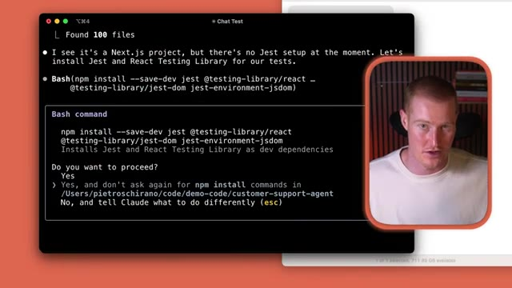
*⏱️ 00:00:12 — Terminal de commande montrant une interface de type CLI (Claude Code) avec une invite de commande Bash et du texte interactif.*

---

### ⏱️ `[00:00:23 - 00:00:45]` | Segment #02

**🔊 Audio (Transcription Intégrale Mot pour Mot en Français) :**
> Nous parlons de contrôler votre navigateur, de vous connecter à vos applications, de créer des présentations, des documents, etc. À la fin de cette vidéo, vous saurez exactement comment commencer à utiliser Claude Cowork mieux que 99 % des gens qui viennent de l'ouvrir pour la première fois. Alors, sans plus attendre, plongeons directement dans cet épisode. Très bien, comment ça va les gars ? Salman, je suis ravi de t'accueillir, mon vieux. Tu es un utilisateur avancé de Claude Code à mes yeux, donc je suis impatient de découvrir ce qu'est Claude Cowork.

**👁️ Analyse Visuelle d'Écran (gemini-3.5-flash-lite) :**
**Interface & Outils** : Interface utilisateur web générique / application de prise de notes.

**Contenu textuel & Code** : Options de résumé textuel avec les choix 'Quick summary' et 'Detailed notes'.

**Action / Démonstration** : Présentation des fonctionnalités de résumé et de configuration de niveau de détail de l'IA.

---

### ⏱️ `[00:00:46 - 00:01:10]` | Segment #03

**🔊 Audio (Transcription Intégrale Mot pour Mot en Français) :**
> Et j'espère qu'à la fin de cette vidéo, mon audience sera parfaitement au fait de la manière exacte dont elle peut commencer à l'utiliser si elle est intimidée par l'utilisation de Claude Code. Juste ici, nous avons cette publication sur Twitter d'Anthropic. C'est leur vidéo de sortie de Claude Cowork, qui est sortie hier et qui enflamme Internet. Alors allons-y et parlons de ce qu'est Claude Cowork, comparons-le à Claude Code, et commençons à imaginer quelques cas d'usage différents que nous pourrions commencer à appliquer dès maintenant avec lui.

**👁️ Analyse Visuelle d'Écran (gemini-3.5-flash-lite) :**
**Interface & Outils** : Navigateur web / application de visioconférence (type Zoom ou Google Meet).

**Contenu textuel & Code** : Publication Twitter floue d'Anthropic relative à Claude Code.

**Action / Démonstration** : Le présentateur présente et commente une publication sur les réseaux sociaux concernant Claude Code.

---

### ⏱️ `[00:01:10 - 00:01:31]` | Segment #04

**🔊 Audio (Transcription Intégrale Mot pour Mot en Français) :**
> Donc Anthropic a sorti beaucoup de choses vraiment cool récemment. Et ça devient un peu vraiment confus de savoir quand vous devriez utiliser quel outil, n'est-ce pas ? J'aime vraiment utiliser cette analogie pour expliquer aux gens comment vous devriez envisager ce genre de sorties. Donc normalement, la première chose avec laquelle vous voulez commencer si vous débutez tout juste, c'est Claude Desktop.

**👁️ Analyse Visuelle d'Écran (gemini-3.5-flash-lite) :**
**Interface & Outils** : Navigateur web affichant le tableau blanc Miro et fenêtres de visioconférence des intervenants.

**Contenu textuel & Code** : Schéma comparatif illustré avec les personnages de Pokémon (Salamèche, Reptincel, Dracaufeu) associés aux outils d'Anthropic (Claude Desktop, Claude Cowork, Claude Code).

**Action / Démonstration** : Le présentateur explique les différences entre les différents outils d'Anthropic à l'aide d'une analogie visuelle.

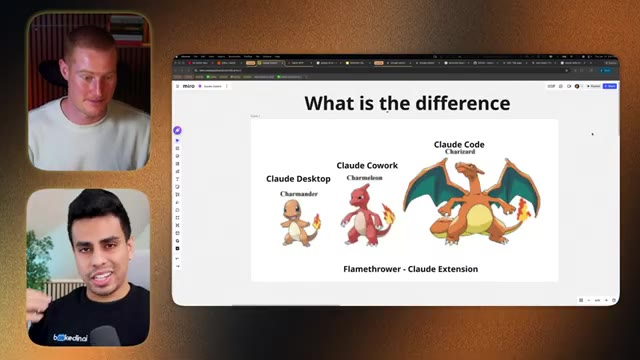
*⏱️ 00:01:15 — Capture d'écran montrant un tableau Miro avec une analogie Pokémon pour expliquer les différentes versions de Claude (Charmander pour Claude Desktop, Charmeleon pour Claude Cowork, et Charizard pour Claude Code).*

---

### ⏱️ `[00:01:32 - 00:02:05]` | Segment #05

**🔊 Audio (Transcription Intégrale Mot pour Mot en Français) :**
> Vous pouvez faire cela en allant simplement sur Cloud AI ou n'importe quoi d'autre, et ensuite vous pouvez simplement lui parler comme à ChatGPT. Et je suis un très grand fan de Pokémon, alors j'utilise cette petite analogie Pokémon pour vous montrer. Et imaginez cela comme le niveau d'utilisateur avancé que vous êtes. Très bien. Donc, Claude Desktop est fondamentalement quelque chose d'autonome. C'est un chatbot IA. Vous pouvez lui donner quelques pouvoirs ici et là avec des connecteurs, mais en général les gens ne font pas ça. Et il a un contexte limité de ce que vous essayez de faire. Ce qui s'est passé récemment, c'est qu'Anthropic a lancé ceci

**👁️ Analyse Visuelle d'Écran (gemini-3.5-flash-lite) :**
**Interface & Outils** : Navigateur web affichant une application de tableau blanc interactif (Miro) et une interface de visioconférence.

**Contenu textuel & Code** : Schéma comparatif titré "What is the difference" montrant l'évolution de Claude via les Pokémon : Claude Desktop (Charmander), Claude Cowork (Charmeleon), et Claude Code (Charizard).

**Action / Démonstration** : Le présentateur explique les différents niveaux d'interaction avec l'IA en utilisant une analogie Pokémon visuelle.

*⏱️ 00:01:40 — Capture d'écran montrant le présentateur et son invité en visioconférence à gauche, et un tableau Miro illustrant une analogie Pokémon pour expliquer les différents niveaux d'utilisation de Claude (Charmander pour Claude Desktop, Charmeleon pour Claude Cowork, et Charizard pour Claude Code).*

---

### ⏱️ `[00:02:05 - 00:02:27]` | Segment #06

**🔊 Audio (Transcription Intégrale Mot pour Mot en Français) :**
> chose appelée Claude Cowork. Et Claude Cowork a essentiellement accès à vos fichiers. Il peut contrôler votre navigateur avec cette extension vraiment cool qu'on vous montrera plus tard dans la vidéo. Et il peut essentiellement être un agent pour vous et considérez-le comme une paire de mains supplémentaire. Mais avec cela vient un tout petit peu plus de complexité ajoutée, mais ce n'est pas si énorme que ça.

**👁️ Analyse Visuelle d'Écran (gemini-3.5-flash-lite) :**
**Interface & Outils** : Navigateur web affichant un tableau blanc Miro avec des illustrations de Pokémon.

**Contenu textuel & Code** : Texte « What is the difference » et comparaison visuelle utilisant les évolutions de Pokémon pour illustrer les différents outils Claude (Desktop, Cowork, Code).

**Action / Démonstration** : Le présentateur explique les différences de capacités entre les différentes versions de Claude à l'aide d'une analogie Pokémon.

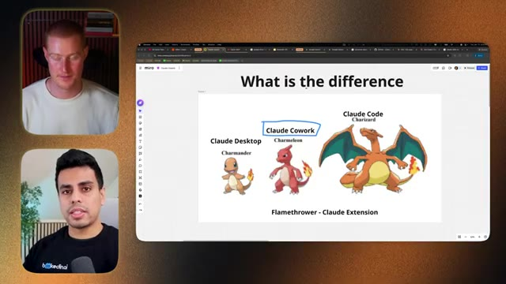
*⏱️ 00:02:11 — Un schéma explicatif sur le tableau blanc Miro comparant les versions de Claude aux évolutions de Pokémon (Charmander pour Claude Desktop, Charmeleon pour Claude Cowork et Charizard pour Claude Code).*

---

### ⏱️ `[00:02:27 - 00:02:46]` | Segment #07

**🔊 Audio (Transcription Intégrale Mot pour Mot en Français) :**
> Donc si vous apprenez juste quelques petites choses, vous devriez être capable d'en profiter. Et à l'opposé, là où vous voulez passer en mode super utilisateur, c'est là qu'on utilise Claude Code. Et c'est ce que j'envisage comme un Dracaufeu pour ainsi dire, où il peut faire plusieurs choses différentes. Il peut courir, voler partout pour toujours, de manière autonome pendant des jours.

**👁️ Analyse Visuelle d'Écran (gemini-3.5-flash-lite) :**
**Interface & Outils** : Navigateur web affichant un tableau blanc Miro avec des illustrations de Pokémon et du texte.

**Contenu textuel & Code** : Texte « What is the difference » et comparaison visuelle des versions : Claude Desktop (Charmander), Claude Cowork (Charmeleon), et Claude Code (Charizard).

**Action / Démonstration** : Le présentateur explique les différents niveaux d'utilisation de Claude en utilisant une analogie avec l'évolution des Pokémon.

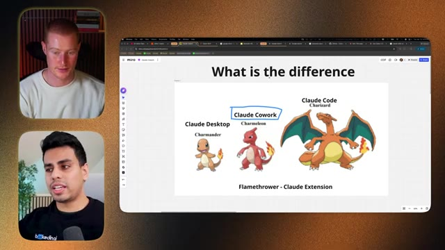
*⏱️ 00:02:32 — Présentation comparative illustrant l'évolution des outils Claude sous forme de Pokémon (Salamèche pour Claude Desktop, Reptincel pour Claude Cowork, et Dracaufeu pour Claude Code).*

---

### ⏱️ `[00:02:47 - 00:03:10]` | Segment #08

**🔊 Audio (Transcription Intégrale Mot pour Mot en Français) :**
> Et, vous savez, cela fait tout simplement qu'à sa tête. C'est donc ça la différence. Mais je pense que pour la plupart des professionnels qui nous écoutent, Anthropic a créé ce Claude Cowork. Donc, tous ceux qui ne sont pas techniques peuvent simplement aller sur une application très simple où vous avez juste une boîte de réception de chat et faire tout votre travail. Cela clarifie définitivement le genre de choses pour lesquelles nous utiliserions cela, parce que je suppose que pour mon audience, ils ont probablement entendu parler de Claude Cowork, ont vu Claude Cowork.

**👁️ Analyse Visuelle d'Écran (gemini-3.5-flash-lite) :**
**Interface & Outils** : Tableau blanc Miro et double vue webcam des intervenants.

**Contenu textuel & Code** : Texte et illustrations des évolutions de Pokémon représentant les différentes versions de Claude (Desktop, Cowork, Code).

**Action / Démonstration** : Présentation de l'analogie visuelle pour expliquer les différences de complexité et de puissance entre les versions de Claude.

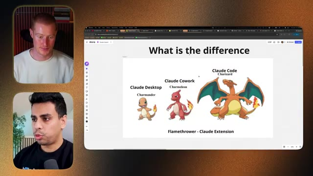
*⏱️ 00:02:53 — Capture d'écran montrant une présentation visuelle sur Miro avec le titre 'What is the difference' et une analogie Pokémon pour comparer Claude Desktop (Salamèche), Claude Cowork (Reptincel) et Claude Code (Dracaufeu).*

---

### ⏱️ `[00:03:10 - 00:03:30]` | Segment #09

**🔊 Audio (Transcription Intégrale Mot pour Mot en Français) :**
> Cloud Code, vous interagissez dans, genre, un terminal ou un EDI où vous faites réellement du codage. Donc si vous n'êtes pas un developpeur, parfois cela peut être un peu intimidant. Au lieu de cela, c'est presque comme utiliser Claude comme si vous utilisiez Claude sur le web, si vous êtes juste sur claude.ai et que vous interagissez avec comme si c'était ChatGPT. Mais l'interface a l'air un peu différente et juste pas aussi complexe que Cloud Code.

**👁️ Analyse Visuelle d'Écran (gemini-3.5-flash-lite) :**
**Interface & Outils** : Navigateur web affichant une application de tableau blanc (Miro) et une visioconférence avec deux participants à l'écran.

**Contenu textuel & Code** : Schéma explicatif titré "What is the difference" avec les analogies Pokémon : Claude Desktop (Charmander), Claude Cowork (Charmeleon), et Claude Code (Charizard), ainsi qu'une mention "Flamethrower - Claude Extension".

**Action / Démonstration** : Le présentateur explique et compare les différentes interfaces et utilisations possibles des outils Claude à l'aide d'un schéma visuel ludique.

*⏱️ 00:03:15 — Capture d'écran montrant le présentateur et un invité à gauche, et un tableau blanc Miro à droite illustrant les différences entre les versions de Claude comparées à des Pokémon (Charmander pour Claude Desktop, Charmeleon pour Claude Cowork, et Charizard pour Claude Code).*

---

### ⏱️ `[00:03:31 - 00:03:51]` | Segment #10

**🔊 Audio (Transcription Intégrale Mot pour Mot en Français) :**
> Donc je suis impatient de voir en quelque sorte quelles sont ses capacités, parce que tu as mentionné avant qu'on tourne ceci que c'est bien, mais ça ne peut pas t'emmener jusqu'au bout comme Claude Code peut le faire. Et juste comme tu l'as dit, c'est plutôt Reptincel, ou peu importe comment tu prononces son nom, et pas Dracaufeu. Tu l'as. Ouais. Ouais. Donc, par nature, la façon dont tous ces programmes fonctionnent est en quelque sorte différente.

**👁️ Analyse Visuelle d'Écran (gemini-3.5-flash-lite) :**
**Interface & Outils** : Tableau blanc Miro affiché dans un navigateur web, avec des vignettes vidéo des intervenants sur le côté gauche.

**Contenu textuel & Code** : Texte « What is the difference », représentations visuelles de Salamèche (Claude Desktop), Reptincel (Claude Cowork), et Dracaufeu (Claude Code), ainsi que la mention « Flamethrower - Claude Extension ».

**Action / Démonstration** : Présentation et explication d'un schéma conceptuel comparant les capacités de différentes interfaces et extensions de Claude.

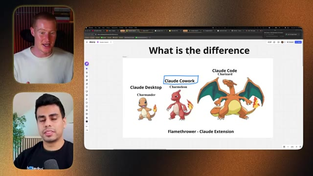
*⏱️ 00:03:36 — Capture d'écran montrant une interface Miro avec un diagramme comparatif illustrant différentes versions de l'outil Claude à l'aide de Pokémon (Salamèche pour Claude Desktop, Reptincel pour Claude Cowork, et Dracaufeu pour Claude Code).*

---

### ⏱️ `[00:03:51 - 00:04:10]` | Segment #11

**🔊 Audio (Transcription Intégrale Mot pour Mot en Français) :**
> Et à partir de là, je veux juste aborder la façon dont une personne utiliserait réellement Cloud Cowork, n'est-ce pas ? Et imaginez que c'est vous, ayant l'air plutôt bien. Et tout ce que vous avez à faire, c'est simplement d'utiliser ce terminal qu'ils ont. Et ce pour quoi Claude Cowork a vraiment été conçu, c'était pour faire en quelque sorte des tâches ponctuelles.

**👁️ Analyse Visuelle d'Écran (gemini-3.5-flash-lite) :**
**Interface & Outils** : Navigateur web affichant l'application Miro.

**Contenu textuel & Code** : Texte 'how you use it', un dessin de bonhomme allumette et une interface de terminal/application en dessous.

**Action / Démonstration** : Le présentateur explique visuellement comment un utilisateur interagit avec l'outil via un schéma explicatif.

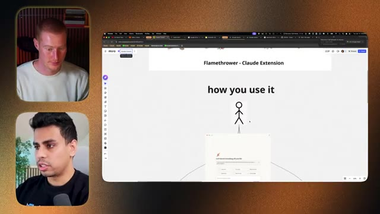
*⏱️ 00:03:56 — Un tableau blanc interactif Miro montrant un schéma intitulé 'Flamethrower - Claude Extension' avec un bonhomme allumette représentant l'utilisateur.*

---

### ⏱️ `[00:04:11 - 00:04:31]` | Segment #12

**🔊 Audio (Transcription Intégrale Mot pour Mot en Français) :**
> Donc, si je dézoomais un petit peu, vous voyez que vous pouvez lancer de multiples instances de ces collègues Claude, appelons-les ainsi, qui font tous leur tâche de manière indépendante. Ils ont leur propre contexte. Ils ont leurs propres artefacts qu'ils créent. Donc par exemple, ils vont créer leurs propres documents. Ils vont avoir leurs propres barres de progression, etc.

**👁️ Analyse Visuelle d'Écran (gemini-3.5-flash-lite) :**
**Interface & Outils** : Navigateur web affichant un tableau blanc Miro avec des schémas, et fenêtres vidéo des intervenants à gauche.

**Contenu textuel & Code** : Un diagramme montrant un utilisateur relié à plusieurs instances ou fenêtres de tâches représentées par des icônes d'éclair sur fond rouge, avec le texte "how you use it" et "Task".

**Action / Démonstration** : Le présentateur dé zoome sur le schéma Miro pour illustrer le fonctionnement de multiples instances indépendantes de Claude.

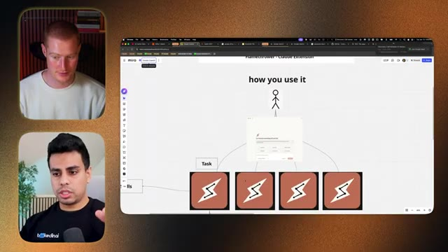
*⏱️ 00:04:16 — Un schéma heuristique sur le logiciel Miro illustrant l'utilisation de multiples instances d'IA connectées à un utilisateur central.*

---

### ⏱️ `[00:04:31 - 00:04:55]` | Segment #13

**🔊 Audio (Transcription Intégrale Mot pour Mot en Français) :**
> Et leur tâche est d'aller d'un point A à un point B. Genre, hé, vous avez toutes ces entrées, donnez-moi cette sortie. C'est chaque tâche, n'est-ce pas ? Et le facteur de différenciation entre Claude Desktop et Claude Cowork, c'est ceci. Si je prends un peu plus de recul, je vais vous montrer ceci. C'est le fait que Claude Cowork a accès à tous ces petits connecteurs en quelque sorte et à cette chose appelée compétences, n'est-ce pas ?

**👁️ Analyse Visuelle d'Écran (gemini-3.5-flash-lite) :**
**Interface & Outils** : Tableau blanc Miro et fenêtres de visioconférence.

**Contenu textuel & Code** : Schéma textuel et visuel avec les mentions "how you use it", "Task" et des icônes symbolisant des processus ou flux de travail.

**Action / Démonstration** : Le présentateur explique visuellement le concept de passage d'un point A à un point B à l'aide d'un schéma explicatif.

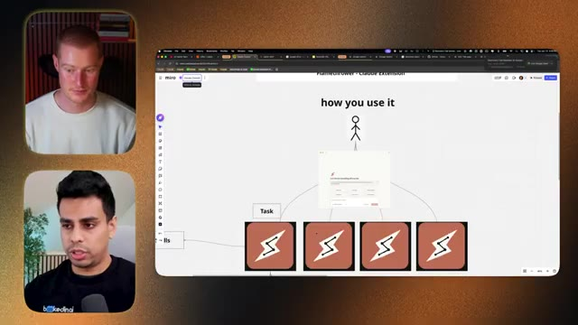
*⏱️ 00:04:37 — Un schéma heuristique sur le logiciel Miro illustrant le concept de tâches et d'utilisation, avec des icônes d'éclair, aux côtés de deux intervenants en visioconférence.*

---

### ⏱️ `[00:04:55 - 00:05:29]` | Segment #14

**🔊 Audio (Transcription Intégrale Mot pour Mot en Français) :**
> Et pour plonger dans ce que c'est en quelque sorte, c'est que Claude Desktop ne sait pas ce qu'il y a dans vos fichiers ou il ne sait pas ce qu'il y a dans votre Google Drive ou même ce que vous essayez de faire, il n'a aucun contexte, c'est comme, vous savez, un type vraiment intelligent qui n'a aucune idée de ce que vous essayez de faire, n'est-ce pas ? C'est un excellent point, ouais, littéralement, c'est comme s'il n'avait pas de mains pour aller de l'avant et vraiment, genre, faire des choses, attraper des choses, exécuter des tâches pour vous, il est juste, genre, bloqué à l'intérieur de cette petite bulle de chat en quelque sorte, n'est-ce pas ? Ouais, donc c'est comme bloqué à l'intérieur d'une bulle de chat et c'est un peu comme au tour par tour, vous savez, du genre, en fait, c'est peut-être une autre analogie avec Pokémon où, genre, vous faites

**👁️ Analyse Visuelle d'Écran (gemini-3.5-flash-lite) :**
**Interface & Outils** : Navigateur web affichant un tableau blanc Miro et une application de visioconférence.

**Contenu textuel & Code** : Schéma conceptuel comprenant les sections 'Task', 'Skills' et 'Connectors' avec des icônes d'applications comme Zapier, Google Drive et Chrome.

**Action / Démonstration** : Présentation et explication visuelle du fonctionnement des connecteurs et du contexte de l'IA.

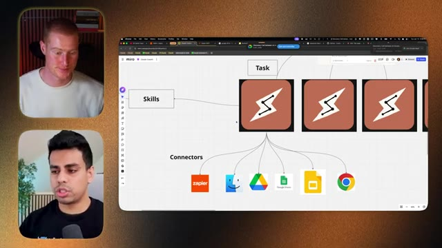
*⏱️ 00:05:04 — Capture d'écran montrant une visioconférence avec deux présentateurs à gauche et un tableau blanc Miro à droite illustrant des concepts d'IA, des tâches, des compétences et des connecteurs vers des applications.*

---

### ⏱️ `[00:05:29 - 00:06:07]` | Segment #15

**🔊 Audio (Transcription Intégrale Mot pour Mot en Français) :**
> un mouvement et ensuite ils font un mouvement et c'est comme ça. Donc ça c'est Cloud Co-Work d'un autre côté, ce que ça fait c'est que vous lui donnez une directive et ensuite Cloud Co-Work va lancer de multiples instances que vous ne verrez pas, mais il va essentiellement créer sa propre liste de tâches, n'est-ce pas ? Et ensuite il va lancer des sous-agents en arrière-plan, qui vont exécuter chacune de ces listes de tâches en utilisant davantage de capacités comme ces connecteurs. Comme par exemple, il va aller chercher un fichier, il va modifier vos Google Sheets. C'est peut-être là que se trouvent certaines informations. Il y a beaucoup d'informations stockées dans tous les endroits différents. Et disons que la chose que vous essayez de faire n'a pas d'API. Il

**👁️ Analyse Visuelle d'Écran (gemini-3.5-flash-lite) :**
**Interface & Outils** : Tableau blanc collaboratif en ligne (Miro), affichant le présentateur et son invité en miniatures vidéo sur le côté gauche.

**Contenu textuel & Code** : Schéma d'architecture visuel structuré en catégories : 'Task', 'Skills' et 'Connectors' reliés à différentes icônes d'outils bureautiques et web.

**Action / Démonstration** : Le présentateur explique le fonctionnement des agents et des intégrations logicielles à l'aide d'un schéma conceptuel.

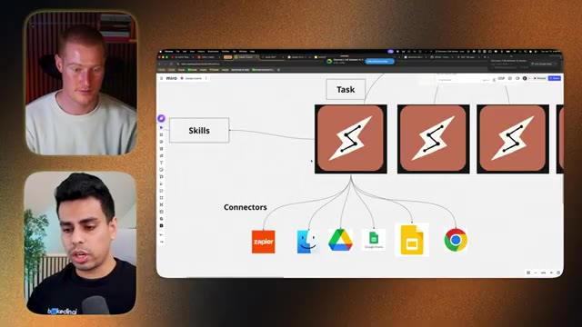
*⏱️ 00:05:39 — Un schéma heuristique sur Miro montrant les composants d'un workflow d'IA avec des blocs 'Task', 'Skills' et des connecteurs vers des applications (Zapier, Finder, Google Drive, Google Sheets, Google Slides, Chrome).*

---

### ⏱️ `[00:06:07 - 00:06:41]` | Segment #16

**🔊 Audio (Transcription Intégrale Mot pour Mot en Français) :**
> ne peut se faire que via votre navigateur. Donc Claude Cowork a en fait aussi accès à votre navigateur grâce à cette petite extension, sur laquelle nous reviendrons un peu plus tard. Et une autre partie intéressante de Cowork, c'est le fait que vous pouvez lui enseigner des compétences. C'est un peu comme, vous savez, quand j'ai dit donner des mains à Claude Desktop, je le pensais littéralement. Vous lui donnez des mains et vous lui dites, vous prenez ses mains et vous êtes genre, hé, c'est comme ça qu'on fait quelque chose. Souvenez-vous de ça. Et la prochaine fois que je vous demanderai de faire ça, allez le faire. C'est donc fondamentalement la différence entre Claude Desktop et Claude Cowork et le moment où vous devriez utiliser l'un ou l'autre. D'accord. Oui, tout à fait, c'est très logique.

**👁️ Analyse Visuelle d'Écran (gemini-3.5-flash-lite) :**
**Interface & Outils** : Logiciel de tableau blanc en ligne Miro, interface de visioconférence (type Google Meet ou Zoom).

**Contenu textuel & Code** : Schéma conceptuel expliquant l'apprentissage de compétences ("Skills"), les tâches ("Task") et les connecteurs vers divers outils (Zapier, Finder, Google Drive, Google Sheets, Google Slides, Chrome).

**Action / Démonstration** : Présentation et explication visuelle de l'architecture et des fonctionnalités de l'outil Claude Cowork à l'aide d'un mind map.

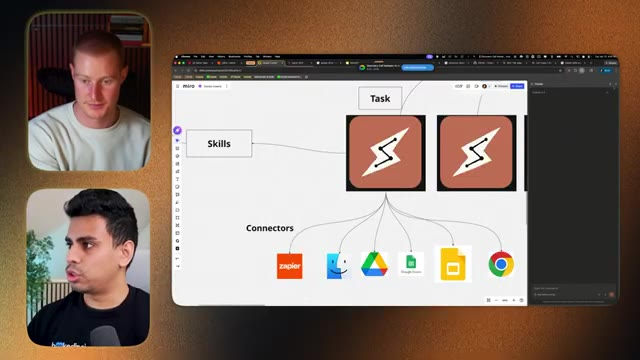
*⏱️ 00:06:15 — Vue d'un mind map sur Miro montrant l'architecture des tâches et les connecteurs (Zapier, Finder, Google Drive, Google Sheets, Google Slides, Chrome) avec les deux intervenants en visioconférence à gauche.*

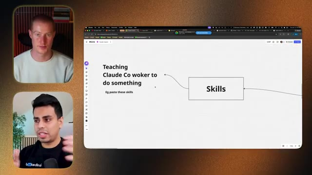
*⏱️ 00:06:24 — Vue du mind map sur Miro montrant la section "Teaching Claude Cowork to do something" et le bloc "Skills" avec les deux intervenants à gauche.*

---

### ⏱️ `[00:06:41 - 00:07:15]` | Segment #17

**🔊 Audio (Transcription Intégrale Mot pour Mot en Français) :**
> Et pour les compétences, c'est quelque chose où, une fois qu'ils ont cette compétence, tu n'as pas besoin de revenir en arrière et de lui réapprendre à le faire ou de lui donner un prompt spécifique à chaque fois. Quand tu lui donnes cette tâche, il sait tout simplement, d'accord, c'est déjà expliqué, tu sais, Salomon m'a déjà décomposé étape par étape comment exécuter ceci. Et il parcourt simplement cette liste de contrôle, n'est-ce pas ? Exactement. Ouais. Donc il crée la liste de contrôle et crée même une sous-liste de contrôle. Comme par exemple, je te le montrerai peut-être tout à l'heure, nous allons aborder un cas où essentiellement quelqu'un devrait, disons qu'on te confie la tâche de faire 10 diapositives différentes. Et il y a beaucoup de sous-étapes entre les deux.

**👁️ Analyse Visuelle d'Écran (gemini-3.5-flash-lite) :**
**Interface & Outils** : Miro (tableau blanc en ligne) et visioconférence à deux intervenants.

**Contenu textuel & Code** : Schéma avec les blocs 'how you use it', 'Task', 'Skills', et des icônes de connecteurs (Google Drive, Chrome, etc.).

**Action / Démonstration** : Le présentateur explique l'architecture d'utilisation des compétences et des tâches via un schéma visuel.

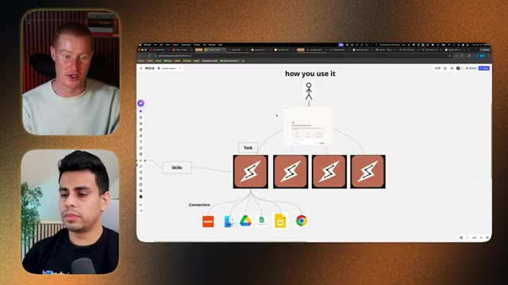
*⏱️ 00:06:50 — Schéma explicatif sur Miro illustrant l'utilisation des agents avec des tâches, des compétences ('Skills') et des connecteurs.*

---

### ⏱️ `[00:07:15 - 00:07:50]` | Segment #18

**🔊 Audio (Transcription Intégrale Mot pour Mot en Français) :**
> Si vous y pensez, vous devez créer la diapositive. Vous devez savoir quoi écrire dans la diapositive. Vous devez mettre un graphique dans toutes ces petites choses. Celles-ci sont réalisées par différents sous-agents du cowork que vous ne voyez pas réellement. Et cela se produit simplement en arrière-plan, mais Cloud Cowork étant vraiment cool. L'agent lui-même s'en charge. Oui. C'est fou. Maintenant que nous avons une sorte de compréhension de la façon exacte dont fonctionne Cloud Cowork, allons-y et trouvons concrètement quelques cas d'usage et montrons, d'accord, si vous êtes une personne tout à fait ordinaire au quotidien, à quoi pourriez-vous commencer à l'utiliser dès maintenant ? Et nous allons vous donner des cas d'usage tangibles que vous pourriez

**👁️ Analyse Visuelle d'Écran (gemini-3.5-flash-lite) :**
**Interface & Outils** : Navigateur web affichant un tableau blanc Miro avec des schémas, et interface de visioconférence.

**Contenu textuel & Code** : Schéma d'architecture de workflow montrant un utilisateur ("how you use it"), des tâches ("Task"), des sous-agents représentés par des icônes d'éclair, et des connecteurs vers des outils (Google Drive, Google Sheets, Chrome, etc.).

**Action / Démonstration** : Présentation et explication d'un schéma conceptuel sur l'utilisation des sous-agents et de l'automatisation en arrière-plan.

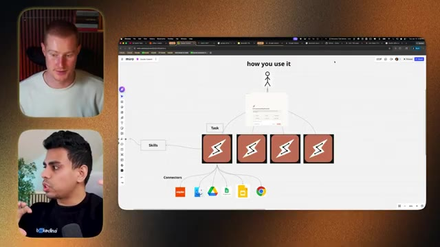
*⏱️ 00:07:23 — Capture d'écran montrant le présentateur et un invité en visioconférence à gauche, et un tableau blanc Miro au centre illustrant un schéma de workflow d'agents IA intitulé "how you use it".*

---

### ⏱️ `[00:07:50 - 00:08:23]` | Segment #19

**🔊 Audio (Transcription Intégrale Mot pour Mot en Français) :**
> soit partir et utiliser et quelqu'un a en fait un exemple plutôt sympa qu'il va nous montrer maintenant ouais euh merci brock donc je suppose que le premier cas d'utilisation que je vais vous montrer et c'est vraiment sympa et l'un de mes préférés c'est juste d'utiliser des connecteurs pour créer des diapositives n'est-ce pas et je vais vous montrer en quelque sorte le résultat final maintenant juste pour que vous ayez un petit aperçu rapide et c'est le genre de choses qu'on peut créer avec clot co-work n'est-ce pas et si je vais sur ma diapositive et vous voyez que pour mon entreprise elle a tous mes éléments comme mes logos, elle crée ces petits emojis, tout ça, ces petits gifs, elle les trouve depuis mon

**👁️ Analyse Visuelle d'Écran (gemini-3.5-flash-lite) :**
**Interface & Outils** : Tableau blanc Miro sur navigateur web, avec des fenêtres de visioconférence intégrées pour les intervenants.

**Contenu textuel & Code** : Schéma d'architecture ou mindmap comprenant des blocs "Task", "Skills", et plusieurs icônes de connecteurs (Zapier, Google Drive, Google Sheets, Chrome, etc.).

**Action / Démonstration** : Présentation visuelle d'un cas d'utilisation axé sur l'utilisation de connecteurs et d'automatisations.

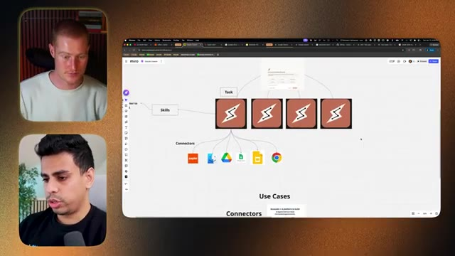
*⏱️ 00:07:58 — Un tableau blanc interactif Miro montrant une cartographie de cas d'utilisation avec des icônes d'automatisation et de connecteurs.*

---

### ⏱️ `[00:08:23 - 00:08:44]` | Segment #20

**🔊 Audio (Transcription Intégrale Mot pour Mot en Français) :**
> fichiers, mes dossiers d'actifs, les insère, et il a aussi du contexte. Vous pouvez construire toutes ces choses aléatoires qu'normalement vous devriez dire à Claude à chaque étape, n'est-ce pas ? Et pour construire ceci, c'est en fait vraiment simple. Donc étape un, ce que vous voulez faire, c'est d'aller sur zapier.com.mcp. Et ce que nous faisons ici, c'est juste pour me référer à mon diagramme.

**👁️ Analyse Visuelle d'Écran (gemini-3.5-flash-lite) :**
**Interface & Outils** : Google Slides et navigateur Chrome

**Contenu textuel & Code** : Texte marketing et statistiques sur le taux de réactualisation des rendez-vous ('30-40% of no-shows rebook') et la personnalisation de marque.

**Action / Démonstration** : Présentation de diapositives marketing illustrant les bénéfices et fonctionnalités de l'application.

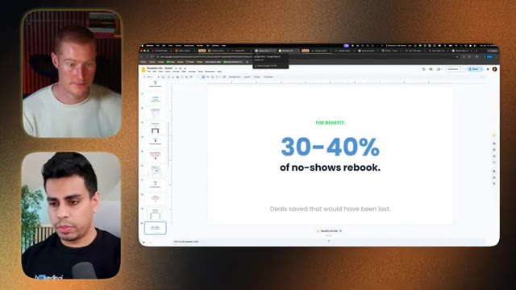
*⏱️ 00:08:28 — Une diapositive de présentation affichant le texte en gros caractères : '30-40% of no-shows rebook.' avec la mention 'Deals saved that would have been lost.' en dessous.*

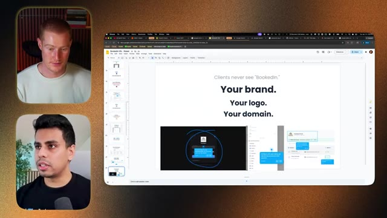
*⏱️ 00:08:33 — Une diapositive de présentation présentant les avantages de personnalisation avec les titres 'Clients never see "Bookedin."', 'Your brand.', 'Your logo.', 'Your domain.' accompagnés d'exemples visuels d'interfaces.*

---

### ⏱️ `[00:08:45 - 00:09:05]` | Segment #21

**🔊 Audio (Transcription Intégrale Mot pour Mot en Français) :**
> Nous donnons à Claude collègue une compétence ou un accès pour faire quelque chose, d'accord ? Comme Google Slides. Mais le problème ici, c'est que vous verrez que Claude n'a en fait pas accès à Google Slides. Pour obtenir des connecteurs ici même, si vous appuyez sur ce plus, puis sur connecteurs, puis sur gérer les connecteurs, vous verrez qu'il y a un tas de connecteurs, mais il n'a pas accès à Google Slides, n'est-ce pas ?

**👁️ Analyse Visuelle d'Écran (gemini-3.5-flash-lite) :**
**Interface & Outils** : Navigateur web affichant un tableau blanc Miro.

**Contenu textuel & Code** : Schéma visuel avec des icônes d'applications connectées (Zapier, Google Drive, Google Docs/Slides, Chrome) et deux vignettes vidéo des intervenants sur le côté gauche.

**Action / Démonstration** : Présentation du schéma conceptuel expliquant les connecteurs et les compétences attribuées aux agents IA.

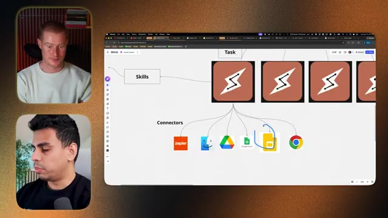
*⏱️ 00:08:50 — Capture d'écran montrant une interface de mind mapping (Miro) avec un schéma représentant des compétences ("Skills") et des connecteurs ("Connecteurs") vers divers outils (Zapier, Finder, Google Drive, Google Slides, Chrome).*

---

### ⏱️ `[00:09:05 - 00:09:25]` | Segment #22

**🔊 Audio (Transcription Intégrale Mot pour Mot en Français) :**
> Donc si vous voulez réellement donner à votre collègue virtuel des super-pouvoirs pour faire des choses qu'il n'a peut-être pas la capacité de faire, vous allez sur Zapier. Et puis juste ici, vous allez sur zapier.com slash MCP. Vous cliquez sur nouveau serveur MCP. Vous sélectionnez un client et ensuite, vous voyez, il y a littéralement cloud pour vous. Et il y a beaucoup de choses, mais vous pouvez simplement sélectionner cloud. C'est déjà utilisé, serveur MCP.

**👁️ Analyse Visuelle d'Écran (gemini-3.5-flash-lite) :**
**Interface & Outils** : Navigateur web affichant Miro et le site web de Zapier (zapier.com/mcp).

**Contenu textuel & Code** : Schémas d'architecture de flux de travail et interface de configuration de serveur MCP avec options de connecteurs.

**Action / Démonstration** : Navigation et présentation des outils de connexion et de création de serveurs MCP sur Zapier.

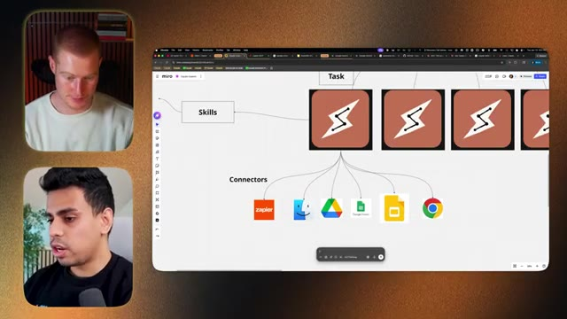
*⏱️ 00:09:10 — Vue d'un tableau blanc Miro montrant un schéma de connecteurs et de compétences IA.*

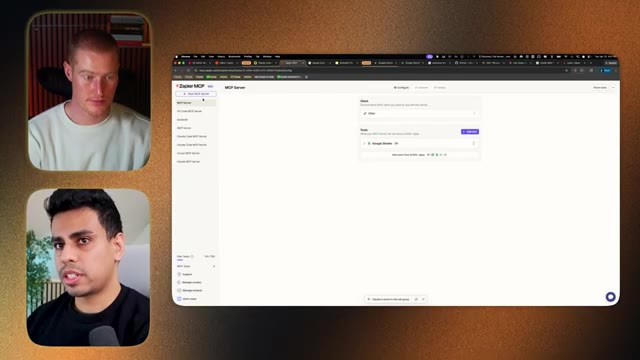
*⏱️ 00:09:15 — Interface Web de configuration d'un serveur MCP Zapier avec la sélection des clients et des outils.*

---

### ⏱️ `[00:09:25 - 00:10:00]` | Segment #23

**🔊 Audio (Transcription Intégrale Mot pour Mot en Français) :**
> Donc ça c'est celui que j'ai déjà construit. Et vous pouvez cliquer sur ajouter un outil et vous pouvez aller dans slides et cliquer sur Google Slides. Et vous voyez qu'il y a beaucoup de choses différentes que vous pouvez faire. Et tout ce que vous faites, c'est de cocher tout ça. Vous le connectez. Boum et c'est aussi simple que ça de connecter Google Slides en donnant l'accès à votre Cloud Code et ensuite vous le connectez juste comme ça donc vous voulez prendre votre jeton je ne veux pas montrer mon jeton pour l'instant mais c'est tout ce que vous avez à faire c'est juste ici vous allez là et ensuite vous allez sur Zapier dans Claude cliquez sur connecter et vous collez votre quelque part votre URL ici et cliquez sur continuer et ensuite vous lui demandez juste de faire des trucs et ça le fait pour vous ouais c'est dingue et une chose à mentionner donc Zapier connecte

**👁️ Analyse Visuelle d'Écran (gemini-3.5-flash-lite) :**
**Interface & Outils** : Navigateur web affichant l'interface de Zapier et les options Google Slides.

**Contenu textuel & Code** : Menu de sélection d'actions Google Slides ("Find Presentation", "Create Presentation from Template", "Add/Get Charts", "API Request (beta)").

**Action / Démonstration** : Sélection d'un outil d'intégration Zapier pour lier l'automatisation à Google Slides.

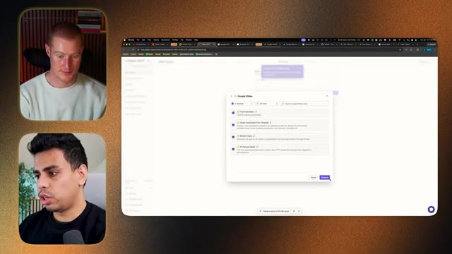
*⏱️ 00:09:34 — Capture d'écran montrant l'interface de Zapier avec une fenêtre modale de configuration pour Google Slides, affichant les différentes actions possibles comme créer une présentation.*

---

### ⏱️ `[00:10:00 - 00:10:35]` | Segment #24

**🔊 Audio (Transcription Intégrale Mot pour Mot en Français) :**
> à je crois plus de 8 000 applications différentes selon l'application que vous utilisez, il y a de grandes chances pour que Zapier se connecte avec. Et je pense qu'à travers cela, il y a plus de 30 actions qu'il peut exécuter. Oui, exactement. Ce que Salman vient d'entourer là. Vous pouvez donc simplement aller trouver n'importe quelle application que vous utilisez, l'activer. Et maintenant, à l'intérieur de Claude Cowork, il a fondamentalement la capacité d'aller soit en extraire des informations, soit d'aller exécuter différentes actions. Et bien sûr, selon l'application que vous utilisez, l'action peut être un tout petit peu différente, mais oui, c'est un, c'est un cas d'usage génial et une sorte de petite astuce que les gens peuvent commencer à utiliser quand ils utilisent Claude Cowork pour en quelque sorte, je ne sais pas, amplifier le

**👁️ Analyse Visuelle d'Écran (gemini-3.5-flash-lite) :**
**Interface & Outils** : Navigateur web affichant l'application Zapier MCP (Model Context Protocol).

**Contenu textuel & Code** : Configuration du serveur MCP avec des applications intégrées telles que Google Slides et Google Sheets.

**Action / Démonstration** : Présentation et démonstration de la connexion entre Zapier et différentes applications via le protocole MCP.

*⏱️ 00:10:09 — Capture d'écran montrant une interface de configuration Zapier MCP Server avec les intervenants en incrustation vidéo.*

---

### ⏱️ `[00:10:35 - 00:10:56]` | Segment #25

**🔊 Audio (Transcription Intégrale Mot pour Mot en Français) :**
> quantité de choses qu'il peut aller faire. Parce que pour l'instant, ça a l'air un petit peu limité si vous n'avez pas configuré de connecteurs MCP. Oui. Donc, en plongeant là-dedans, c'est vraiment génial. Alors maintenant, imaginez qu'il n'y ait pas de connecteur MCP, d'accord ? Ce que nous pouvons faire, c'est littéralement donner à Claude accès à votre navigateur grâce à cette extension. Donc, disons que je vais vous donner un exemple.

**👁️ Analyse Visuelle d'Écran (gemini-3.5-flash-lite) :**
**Interface & Outils** : Navigateur web affichant l'interface Zapier MCP.

**Contenu textuel & Code** : Panneau de configuration du serveur MCP avec la liste des applications connectées (Google Slides et Google Sheets).

**Action / Démonstration** : Présentation et explication de la configuration des connecteurs MCP sur Zapier.

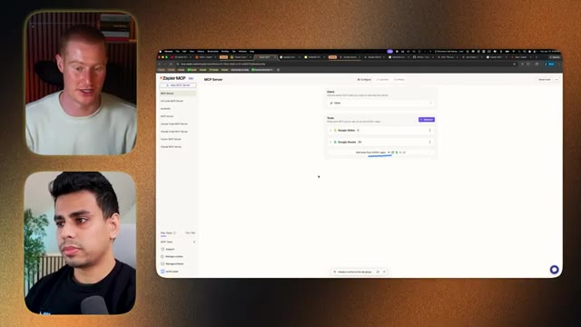
*⏱️ 00:10:40 — Capture d'écran montrant l'interface Web de Zapier MCP avec la configuration d'un serveur MCP et deux participants en visio dans les vignettes à gauche.*

---

### ⏱️ `[00:10:56 - 00:11:15]` | Segment #26

**🔊 Audio (Transcription Intégrale Mot pour Mot en Français) :**
> Claude ne veut évidemment pas que tu contrôles Gemini, n'est-ce pas ? Et disons que je veux utiliser mon Gemini pour faire beaucoup de présentations parce que leur Nano Banana Pro est incroyable. Donc ce que je pourrais faire, disons que quelqu'un me confie cette tâche, hé, voici un million de prompts différents que je veux que tu utilises pour générer des diapos à partir de ça, d'accord ?

**👁️ Analyse Visuelle d'Écran (gemini-3.5-flash-lite) :**
**Interface & Outils** : Navigateur web, interface Google Gemini, tableau blanc Miro.

**Contenu textuel & Code** : Interface utilisateur de Gemini avec invite de commande "Where should we start?", et diagramme de workflow sur Miro avec des blocs textuels et des icônes d'automatisation.

**Action / Démonstration** : Présentation et navigation à travers les différentes plateformes d'IA et outils de productivité (Gemini et Miro/Claude).

*⏱️ 00:11:01 — Vue sur l'interface de Google Gemini affichée sur le navigateur principal, avec les deux intervenants visibles dans les vignettes de la webcam.*

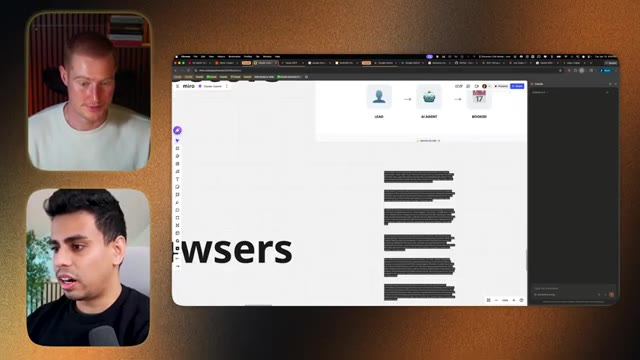
*⏱️ 00:11:10 — Affichage d'un tableau blanc interactif Miro montrant un flux de travail (Lead -> AI Agent -> Booked), avec un panneau latéral Claude à droite.*

---

### ⏱️ `[00:11:15 - 00:11:47]` | Segment #27

**🔊 Audio (Transcription Intégrale Mot pour Mot en Français) :**
> Je peux juste copier ça. Je peux aller sur Gemini, n'est-ce pas ? Et juste ici, plutôt que de le faire moi-même, je peux simplement coller tout ça ici et je peux dire, hé, crée une image de chacun de ceux-là et fais-le. En fait, non, laisse-moi te montrer ça d'abord. Donc d'abord, je veux te montrer ça. Donc en bas à droite ici, dans cette petite icône, tu peux enseigner à Claude. Donc tu cliques sur enseigner à Claude et je vais lancer l'enregistrement. Et juste ici, disons que j'ai mon— Il est littéralement en train de regarder ce que tu fais sur ton ordinateur en ce moment même.

**👁️ Analyse Visuelle d'Écran (gemini-3.5-flash-lite) :**
**Interface & Outils** : Navigateur web affichant l'interface de Google Gemini et une interface de chat (Claude).

**Contenu textuel & Code** : Interface utilisateur de Google Gemini avec la zone de saisie de texte et des suggestions de prompts ("Where should we start?").

**Action / Démonstration** : Le présentateur se prépare à coller ou utiliser du texte pour générer des images via Gemini.

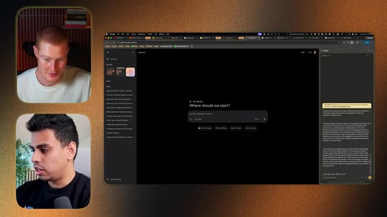
*⏱️ 00:11:23 — Capture d'écran montrant le navigateur avec l'interface de Google Gemini au centre et une autre conversation (probablement Claude) sur le côté droit, ainsi que deux participants en visioconférence à gauche.*

---

### ⏱️ `[00:11:47 - 00:12:23]` | Segment #28

**🔊 Audio (Transcription Intégrale Mot pour Mot en Français) :**
> Ça va émuler ça. C'est fou. Ça regarde littéralement ce que je fais. Donc là, disons que je retourne sur mon tableau Miro ici et je vais prendre ce premier prompt, puis je retourne ici. Oh, c'est le mauvais ici. Et ensuite je le colle. Et puis est-ce que tu le vois ici ? Ça dit littéralement ce qui se passe. Et ensuite je clique. Ouais. Donc ça enregistre littéralement ce que je fais. Ça apprend de mes actions. Claude n'est pas stupide. La prochaine fois que tu lui demandes de faire quelque chose, ça fait juste boum, boum, boum. C'est beaucoup plus rapide. Donc je recommande toujours, si tu veux qu'il fasse quelque chose souvent, tu lui apprends. OK, super, donc maintenant tu cliques juste sur terminé, maintenant il a cette compétence.

**👁️ Analyse Visuelle d'Écran (gemini-3.5-flash-lite) :**
**Interface & Outils** : Navigateur web, tableau blanc Miro, interface de Gemini / Claude.

**Contenu textuel & Code** : Prompts textuels détaillés pour la génération d'images ou de contenu, et étapes d'interaction affichées dans un panneau latéral.

**Action / Démonstration** : Copie d'un prompt depuis le tableau Miro pour le coller et l'exécuter dans l'outil d'IA Gemini.

*⏱️ 00:11:56 — Vue d'un tableau Miro avec du texte sélectionné en surbrillance, affiché à côté des webcams des participants.*

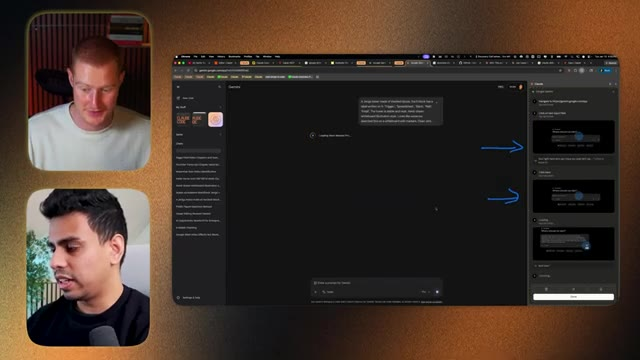
*⏱️ 00:12:05 — Interface de Gemini affichant le texte copié du tableau Miro et l'historique des actions à droite avec des flèches bleues.*

---

### ⏱️ `[00:12:23 - 00:12:56]` | Segment #29

**🔊 Audio (Transcription Intégrale Mot pour Mot en Français) :**
> d'accord c'est en train d'enregistrer la compétence c'est en train de générer le raccourci comment c'est d'accord c'est vraiment génial euh demande à Gemini n'est-ce pas et donc tu peux le nommer comme tu veux chaque fois que tu fais un slash ou un antislash peu importe ce que c'est un slash tu le tagues simplement et ensuite il sait simplement que cette compétence spécifique sera alors déclenchée pour ensuite s'exécuter de cette façon n'est-ce pas exactement oui donc tu peux simplement te dire si tu veux aller un peu plus loin tu vois il y a comme un petit bouton de planification ici et ce que tu peux faire c'est disons que tu dois faire ça tous les jours tu peux le planifier pour tous les jours ouais bon sang ouais c'est fou mec c'est fou là où on va avec cette histoire d'IA alors maintenant si je peux juste

**👁️ Analyse Visuelle d'Écran (gemini-3.5-flash-lite) :**
**Interface & Outils** : Navigateur web, Google Gemini, interface de création de raccourci.

**Contenu textuel & Code** : Génération d'un raccourci (Create shortcut) avec un prompt décrivant une étape pour interagir avec Gemini.

**Action / Démonstration** : Configuration et création d'un raccourci à partir d'une interaction sur Gemini.

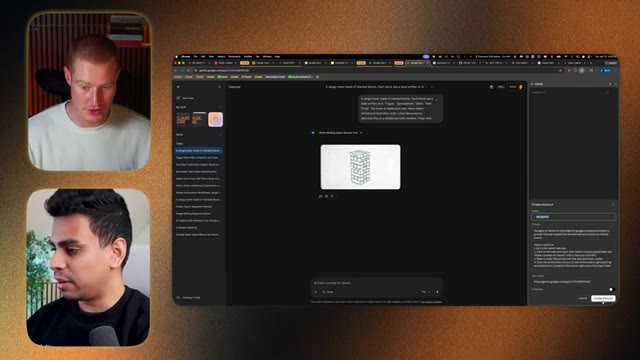
*⏱️ 00:12:31 — Capture d'écran montrant une interface de navigateur web avec l'utilisation de Google Gemini au centre, et le panneau de création de raccourci sur la droite, avec deux fenêtres de webcam des présentateurs à gauche.*

---

### ⏱️ `[00:12:56 - 00:13:30]` | Segment #30

**🔊 Audio (Transcription Intégrale Mot pour Mot en Français) :**
> genre, fait un slash demande à Gemini de faire des photos de tout ça, il va le faire et ensuite, espérons-le, comme tu vois, il contrôle mon ordinateur quand il y a cette lueur orange bizarre, il contrôle mon ordinateur et il va commencer à faire ces choses pour moi, donc c'est comme s'il examinait la tour Jenga générée, tu vois comment il prend une capture d'écran, il fait défiler vers le bas, vers le haut, tout ça, et pour gagner du temps, je veux te montrer, j'étais juste en train de jouer avec et là, il était juste en train de générer toutes ces diapositives pour moi parce que je ne veux pas faire ça, je veux juste

**👁️ Analyse Visuelle d'Écran (gemini-3.5-flash-lite) :**
**Interface & Outils** : Navigateur web Google Chrome, interface Gemini (Google), application de visioconférence.

**Contenu textuel & Code** : Une image générée représentant une tour de blocs empilés avec du texte et un prompt associé, ainsi que l'historique des discussions.

**Action / Démonstration** : Le présentateur montre l'interface de Gemini pour illustrer la génération d'images et l'interaction avec l'IA.

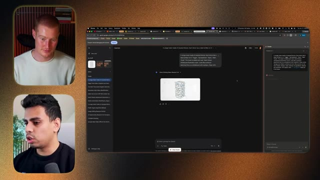
*⏱️ 00:13:05 — Capture d'écran montrant le navigateur Google Chrome avec l'interface de Gemini affichant une image générée d'une tour de blocs, aux côtés de deux intervenants en visioconférence.*

---

### ⏱️ `[00:13:30 - 00:13:49]` | Segment #31

**🔊 Audio (Transcription Intégrale Mot pour Mot en Français) :**
> je l'ai donné à Gemini et j'ai, tu sais, été me chercher une tasse de café ou d'eau, c'est fou et c'est un peu comme si, euh, il a un style spécifique auquel il s'en tient donc je suppose que tu as probablement prompté « je veux que ce soit dans ce style spécifique ». Pour que ce soit toujours en accord avec l'image de marque de n'importe quelle diapositive ou ressource que tu essaies de créer. C'est juste, mec, c'est tellement fou.

**👁️ Analyse Visuelle d'Écran (gemini-3.5-flash-lite) :**
**Interface & Outils** : Navigateur web affichant une interface d'IA (style Gemini) et double flux vidéo des interlocuteurs.

**Contenu textuel & Code** : Historique de discussion avec des prompts textuels et des illustrations générées au style dessin schématique en noir et blanc (diagrammes explicatifs).

**Action / Démonstration** : Le présentateur discute des résultats générés par l'IA et de la cohérence du style visuel des images produites.

*⏱️ 00:13:35 — Capture d'écran montrant une interface de chat d'intelligence artificielle avec des images générées et le présentateur en visioconférence sur le côté.*

---

### ⏱️ `[00:13:49 - 00:14:07]` | Segment #32

**🔊 Audio (Transcription Intégrale Mot pour Mot en Français) :**
> Genre, je pense que nous, en tant que personnes qui sommes dans le domaine de l'IA, on fait littéralement des recherches sur ces trucs toute la journée et on l'utilise. Pour les gens qui débutent dans l'IA et qui ont seulement entendu parler de ChatDBT ou l'ont utilisé deux ou trois fois, tu vois ça et tu te dis, c'est dingue. On pourrait vraiment faire ça dès maintenant. C'est juste, ça m'épate. C'est tellement cool à regarder.

**👁️ Analyse Visuelle d'Écran (gemini-3.5-flash-lite) :**
**Interface & Outils** : Navigateur web avec interface d'outil d'intelligence artificielle (type Google Gemini ou interface similaire).

**Contenu textuel & Code** : Schémas circulaires comparatifs (camemberts) illustrant le temps passé ou le processus 'Before / After', accompagnés de blocs de texte explicatifs et de prompts.

**Action / Démonstration** : Présentation visuelle et discussion sur l'utilisation et la compréhension des outils d'IA par les utilisateurs.

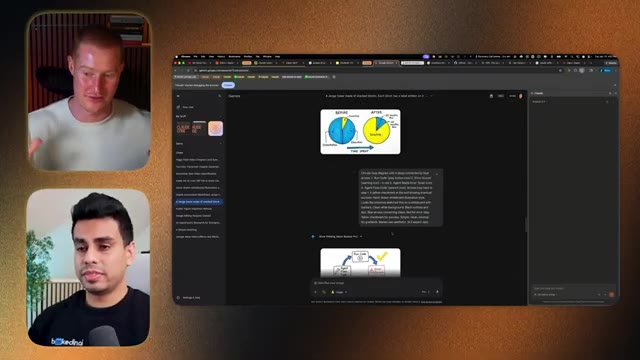
*⏱️ 00:13:53 — Capture d'écran montrant l'interface d'un navigateur web avec une discussion sur l'IA affichant des diagrammes comparatifs schématiques ('Before' et 'After').*

---

### ⏱️ `[00:14:07 - 00:14:40]` | Segment #33

**🔊 Audio (Transcription Intégrale Mot pour Mot en Français) :**
> ouais c'est c'est vraiment quand tu es créatif avec cette compétence de navigateur le monde s'offre à toi tu vois et la raison pour laquelle j'insiste sur ce euh navigateur juste ici c'est parce que tu peux littéralement aller sur Claude il connaît les compétences que tu lui as apprises tu vois et parce qu'il connaît toutes les compétences que tu lui as apprises il peut commencer à le faire genre tu n'as plus besoin de retourner sur ton navigateur ou et puis de taper ici tu peux juste taper ici lancer une nouvelle tâche et ça va juste le faire et c'est fou et euh je vais dire le dernier et je vais montrer c'est genre un truc qui est énorme c'est le fait

**👁️ Analyse Visuelle d'Écran (gemini-3.5-flash-lite) :**
**Interface & Outils** : Interface web de Claude / LLM, navigateur web, fenêtres modales de paramètres.

**Contenu textuel & Code** : Menus de configuration d'IA, interface de discussion avec des prompts relatifs à des diagrammes et des flux de travail.

**Action / Démonstration** : Navigation et configuration des paramètres d'un assistant IA dans le navigateur.

*⏱️ 00:14:15 — Vue d'un écran montrant une interface de chat (probablement Claude) avec un menu contextuel ouvert au centre affichant des options de partage ou d'intégration.*

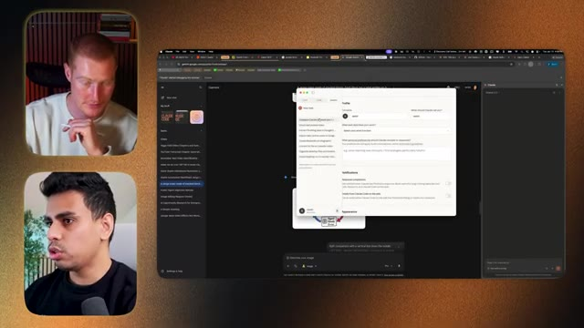
*⏱️ 00:14:24 — Affichage d'une fenêtre de configuration ou de profil d'un outil d'intelligence artificielle superposée à l'interface principale, avec des champs de saisie pour le nom et les préférences.*

---

### ⏱️ `[00:14:40 - 00:15:14]` | Segment #34

**🔊 Audio (Transcription Intégrale Mot pour Mot en Français) :**
> que le collègue Claude est si bon, c'est parce que vous pouvez lui faire faire des choses que tous les autres modèles peuvent faire, donc euh si vous avez regardé Avengers et que vous avez vu du genre Thanos avec les petites pierres d'infinité, vous pouvez penser à Claude et l'équiper de différentes pierres d'infinité en utilisant ce concept de compétences. Et par exemple, Google a le meilleur modèle d'images, n'est-ce pas ? Claude ne peut littéralement pas créer d'images. Donc ce que nous pouvons faire, c'est donner à Claude une compétence pour créer ces images. D'accord. Et je vais montrer

**👁️ Analyse Visuelle d'Écran (gemini-3.5-flash-lite) :**
**Interface & Outils** : Tableau blanc Miro et interface de visioconférence.

**Contenu textuel & Code** : Schéma textuel et visuel avec des icônes représentant les "Skills" (compétences), "Task" (tâches) et "Connectors" (connecteurs vers des applications tierces comme Zapier, Finder, Google Drive, Google Sheets).

**Action / Démonstration** : Présentation et explication d'un schéma explicatif sur l'utilisation des connecteurs et compétences avec l'IA.

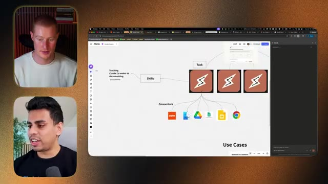
*⏱️ 00:14:49 — Une vue d'écran montrant un tableau blanc Miro avec un schéma conceptuel illustrant les compétences, les tâches et les connecteurs (Zapier, Google Drive, etc.) pour Claude, accompagné des deux intervenants en visioconférence à gauche.*

---

### ⏱️ `[00:15:14 - 00:15:47]` | Segment #35

**🔊 Audio (Transcription Intégrale Mot pour Mot en Français) :**
> vous comment j'ai fait ça. Et c'est grâce à cette chose appelée les compétences. J'espère que vous pouvez voir mon écran, mais juste ici, vous verrez que si vous allez juste ici et dans les paramètres, cliquez sur paramètres, puis allez dans capacités. Si vous faites défiler vers le bas, il y a cette chose appelée compétences et vous pouvez ajouter n'importe quelle compétence que vous voulez. Techniquement, vous n'avez pas besoin de faire cela vous-même parce que vous pouvez simplement dire, Hé, Claude, apprends ceci et ensuite fais-le pour moi. C'est ça. Donc, pour revenir un tout petit peu en arrière. Si vous expliquez à Claude comment faire quelque chose et qu'il le fait de la manière dont vous voulez qu'il le fasse, pouvez-vous simplement dire,

**👁️ Analyse Visuelle d'Écran (gemini-3.5-flash-lite) :**
**Interface & Outils** : Interface web de chatbot / assistant IA et tableau blanc/documents Miro.

**Contenu textuel & Code** : Instructions textuelles sur l'installation d'outils, gestion de clés API, et messages de journalisation ou d'erreurs (mentionnant une erreur 403 Forbidden).

**Action / Démonstration** : Navigation et explication d'une interface logicielle ou d'un flux de travail lié à des configurations d'API et de capacités.

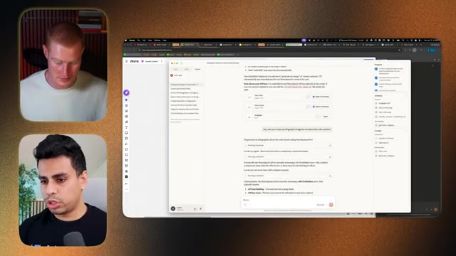
*⏱️ 00:15:22 — Capture d'écran montrant l'interface d'un outil de type chatbot/assistant (comme Claude ou un outil web similaire) avec du texte et des instructions affichées au centre, ainsi que deux flux vidéo des présentateurs sur le côté gauche.*

---

### ⏱️ `[00:15:48 - 00:16:10]` | Segment #36

**🔊 Audio (Transcription Intégrale Mot pour Mot en Français) :**
> Hé, je veux que tu te souviennes exactement de la façon dont tu as fait ça. Et créons une compétence à partir de ça. Ouais. C'est littéralement ce qui vient de se passer. D'accord. J'ai compris. C'est littéralement ce qui vient de se passer. Nous venons de créer une compétence qui consiste à se souvenir de la façon de faire quelque chose. Mais maintenant, cela va un peu plus loin, n'est-ce pas ? Il s'agit plutôt de le contrôler à partir d'un emplacement centralisé. Donc maintenant, par exemple, tu peux même acheter des compétences ou trouver des compétences sur Internet.

**👁️ Analyse Visuelle d'Écran (gemini-3.5-flash-lite) :**
**Interface & Outils** : Navigateur web, tableau blanc Miro, interface de discussion latérale (style Claude)

**Contenu textuel & Code** : Schéma d'architecture avec les sections Connectors, Browsers et Skills, ainsi qu'une invite textuelle concernant la création d'une image du système solaire.

**Action / Démonstration** : Discussion entre les intervenants et manipulation visuelle d'un schéma d'architecture logicielle.

---

### ⏱️ `[00:16:10 - 00:16:30]` | Segment #37

**🔊 Audio (Transcription Intégrale Mot pour Mot en Français) :**
> Donc c'est un dépôt aléatoire que j'ai trouvé sur GitHub où il est écrit compétences cloud géniales, n'est-ce pas ? Et vous pouvez voir que vous pouvez faire de la recherche de contenu. Donc il va utiliser perplexity, améliorer des images. Claude ne peut pas faire ces choses, mais vous pouvez lui injecter ces compétences. Genre, vous pouvez juste faire en sorte que, vous allez ici et vous allez sur Claude desktop et ensuite vous pouvez simplement retourner ici.

**👁️ Analyse Visuelle d'Écran (gemini-3.5-flash-lite) :**
**Interface & Outils** : Navigateur web affichant GitHub.

**Contenu textuel & Code** : Liste de fichiers et dossiers du dépôt GitHub (ex: check-plugin, brand-guidelines, image-enhancer, content-research-notes).

**Action / Démonstration** : Navigation et présentation du dépôt GitHub listant les différentes compétences et outils pour Claude.

*⏱️ 00:16:15 — Capture d'écran montrant un dépôt GitHub nommé 'awesome-claude-skills' avec une liste de compétences et d'outils disponibles.*

---

### ⏱️ `[00:16:30 - 00:16:52]` | Segment #38

**🔊 Audio (Transcription Intégrale Mot pour Mot en Français) :**
> Votre application de bureau Claude, vous pouvez la coller ici et faire du genre, hé, télécharge la compétence pour XYZ. C'est ça. Et je vais le faire. Et juste pour vous montrer, par exemple, Claude ne peut littéralement pas créer d'images. Donc ce que j'ai fait, c'est que je lui ai donné la compétence. J'étais du genre, il y a un truc qui s'appelle WaveSpeed. Brock, tu connais WaveSpeed ? Ouais, j'en ai entendu parler. Ouais. Ouais. Donc WaveSpeed, c'est cette API de génération d'images. C'est ça.

**👁️ Analyse Visuelle d'Écran (gemini-3.5-flash-lite) :**
**Interface & Outils** : Application de bureau Claude / Navigateur web

**Contenu textuel & Code** : Interface de discussion avec l'IA montrant des messages d'erreur d'API (403 Forbidden) et des liens de compétences GitHub.

**Action / Démonstration** : Démonstration de l'utilisation de Claude pour la génération d'images et des erreurs rencontrées avec l'API.

*⏱️ 00:16:35 — Vue d'écran principale montrant une application de bureau Claude en cours d'utilisation, avec des retours d'erreur liés à une API d'images et un lien GitHub visible en bas.*

---

### ⏱️ `[00:16:52 - 00:17:11]` | Segment #39

**🔊 Audio (Transcription Intégrale Mot pour Mot en Français) :**
> Je peux appeler Nano Banana Pro. Je peux faire des vidéos. Je peux faire toutes ces choses avec WaveSpeed. Et j'ai juste inséré ma clé API WaveSpeed dedans. Et j'ai dit à Claude, hé, crée une compétence telle que chaque fois que j'ai besoin qu'une image ou qu'une vidéo soit générée, tu vas appeler WaveSpeed et le faire. Et ensuite, tu vois juste ici, il a foncé et l'a fait pour moi.

**👁️ Analyse Visuelle d'Écran (gemini-3.5-flash-lite) :**
**Interface & Outils** : Navigateur web affichant une page GitHub, application de visioconférence.

**Contenu textuel & Code** : Documentation textuelle décrivant l'utilisation d'une compétence d'IA pour la génération d'images via une API (NanoBanana Pro / WaveSpeed), avec des exemples de fichiers et de code.

**Action / Démonstration** : Présentation et explication d'une compétence personnalisée configurée dans l'interface de l'outil d'IA pour générer automatiquement des images.

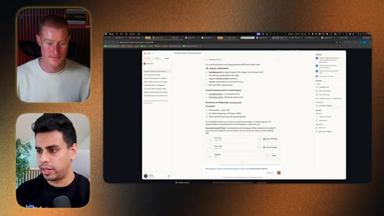
*⏱️ 00:16:56 — Capture d'écran montrant l'interface d'un navigateur web avec la documentation d'un projet GitHub et deux intervenants en visioconférence à gauche.*

---

### ⏱️ `[00:17:11 - 00:17:33]` | Segment #40

**🔊 Audio (Transcription Intégrale Mot pour Mot en Français) :**
> I don't want to show my API key, but it uses Nano Banana Pro. And now I can just open my files and I can see Claude generated these really cool images. Could you real quickly, I want to see, yeah, that's crazy. Could you real quickly show me like what wave speed looks like? Cause I've, I've played around with it a little bit, but I like, if I've never seen it before, I just want to know kind of exactly what it would look like if we were to begin using it.

**👁️ Analyse Visuelle d'Écran (gemini-3.5-flash-lite) :**
**Interface & Outils** : macOS Preview, Navigateur web (Google Chrome / GitHub) et double flux vidéo des présentateurs.

**Contenu textuel & Code** : Fichiers d'images générées (robot, paysage) et liste de scripts/compétences GitHub (« Claude Skills »).
[DESC_IMAGE_3] Navigation dans les fichiers et démonstration des images générées par l'API au cours de la discussion technique.

**Action / Démonstration** : Explications face caméra et analyse conceptuelle des marchés.

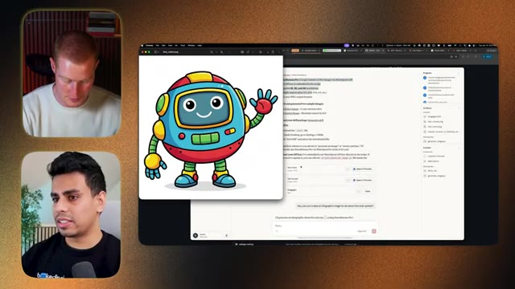
*⏱️ 00:17:16 — Aperçu d'une image générée par IA représentant un petit robot coloré affiché à l'écran par le présentateur.*

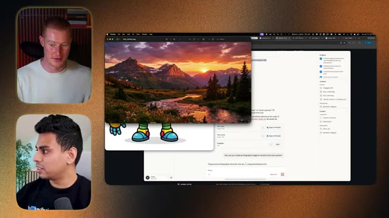
*⏱️ 00:17:22 — Aperçu d'une seconde image générée par IA montrant un paysage naturel montagneux avec une rivière au coucher du soleil.*

*⏱️ 00:17:27 — Affichage d'un navigateur internet montrant un répertoire de code source sur GitHub (dépôt Claude Skills).*

---

### ⏱️ `[00:17:33 - 00:17:51]` | Segment #41

**🔊 Audio (Transcription Intégrale Mot pour Mot en Français) :**
> Yeah. So you go to wavespeed.ai and I like wave speed because it's actually really reasonable for their image and models. And I have some credits. I'm just logging in right now. And you see, I have a bunch of credits and I made some stuff, but this is about it. So all I have to do is go to API keys, copy this API key right here. and I called it for agentic workflows.

**👁️ Analyse Visuelle d'Écran (gemini-3.5-flash-lite) :**
**Interface & Outils** : Navigateur web affichant le site WaveSpeedAI (wavespeed.ai)

**Contenu textuel & Code** : Page de connexion avec les boutons "Sign in with Google" et "Sign in with GitHub", ainsi qu'un aperçu des services et des modèles disponibles en bas de page.

**Action / Démonstration** : Le présentateur présente le site web wavespeed.ai et se prépare à se connecter pour accéder aux modèles d'intelligence artificielle et aux clés API.

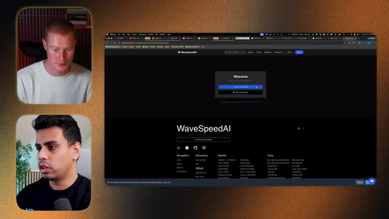
*⏱️ 00:17:37 — Capture d'écran montrant la page d'accueil de la plateforme WaveSpeedAI sur le navigateur, avec des options de connexion au centre et les flux vidéo des deux intervenants sur la gauche.*

---

### ⏱️ `[00:17:52 - 00:18:13]` | Segment #42

**🔊 Audio (Transcription Intégrale Mot pour Mot en Français) :**
> J'ai copié ça. Je suis retourné dans Cloud Desktop. J'ai collé ça. Et ensuite j'ai dit, hé, crée-moi cette vitesse d'onde. Et vous pouvez faire cela avec n'importe quel type d'API ou de connecteur auquel vous pouvez penser. Et ensuite, vous voyez sur le côté droit, si Cloud décide d'utiliser des outils sympas, il vous dira littéralement que, hé, je vais faire une recherche sur le Web.

**👁️ Analyse Visuelle d'Écran (gemini-3.5-flash-lite) :**
**Interface & Outils** : Application de bureau Claude Desktop (interface de chat avec panneau d'artefacts) et navigateur web.

**Contenu textuel & Code** : Instructions d'installation d'une compétence d'infographie, scripts Python, exemples d'images générées et un prompt utilisateur demandant de créer une infographie sur le système solaire.

**Action / Démonstration** : Navigation et explication de l'utilisation d'une compétence d'API tierce intégrée dans Claude Desktop.

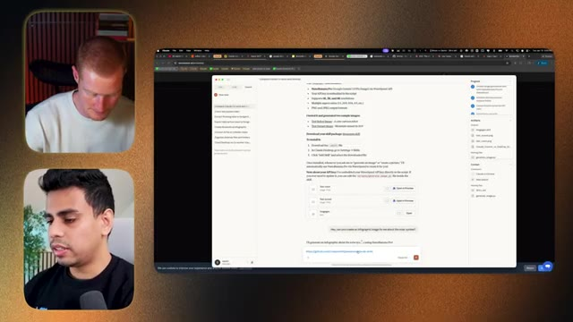
*⏱️ 00:17:57 — Capture d'écran montrant l'interface d'un assistant IA (Claude Desktop) affichant une conversation, des instructions de compétences et des artefacts générés sur le panneau latéral droit.*

---

### ⏱️ `[00:18:13 - 00:18:34]` | Segment #43

**🔊 Audio (Transcription Intégrale Mot pour Mot en Français) :**
> I'm going to build this markdown. I'm going to generate this image. and it's literally just executing code. So it's generating images by executing this Python file. But I don't need to know that. I just need to know that it generated my image. Yeah, dude, that's so crazy. Just by literally connecting it to one API and then it just has the ability to go off and generate these images for us.

**👁️ Analyse Visuelle d'Écran (gemini-3.5-flash-lite) :**
**Interface & Outils** : Interface web d'assistant IA / Navigateur web (Google Chrome)

**Contenu textuel & Code** : Documentation au format Markdown, instructions pour l'utilisation d'une API (Gemini/NanoBannerPro), scripts Python listés dans le volet latéral (ex: generate_image.py)

**Action / Démonstration** : Présentation et démonstration de la génération d'images automatisée par l'exécution de code Python via une interface d'assistant IA.

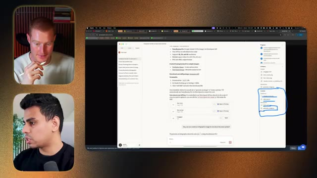
*⏱️ 00:18:18 — Capture d'écran montrant l'interface d'un assistant IA avec la génération de code Markdown, de scripts Python et de fichiers d'images de résultats, avec deux participants en visioconférence dans des encadrés à gauche.*

---

### ⏱️ `[00:18:35 - 00:18:53]` | Segment #44

**🔊 Audio (Transcription Intégrale Mot pour Mot en Français) :**
> Comme tu l'as dit, parce que Claude ne peut pas nativement, ils n'ont pas d'outil de génération d'images tout comme ChatGPT le fait ou Gemini le fait. Évidemment, NanoBananda est super, mais genre, comment est-ce qu'on commence seulement à utiliser ça ? Donc tu as trouvé une solution de contournement pour générer les images avec Nano Banana Pro sans, tu sais, t'intégrer directement dans Gemini, j'imagine. Donc ouais, c'est dingue.

**👁️ Analyse Visuelle d'Écran (gemini-3.5-flash-lite) :**
**Interface & Outils** : Interface web / Application de discussion (navigateur web)

**Contenu textuel & Code** : Texte explicatif, instructions d'installation, liste des artefacts générés et prévisualisations d'images avec des boutons "Open in Preview".

**Action / Démonstration** : Présentation de la solution de contournement pour permettre la génération d'images avec l'assistant Claude.

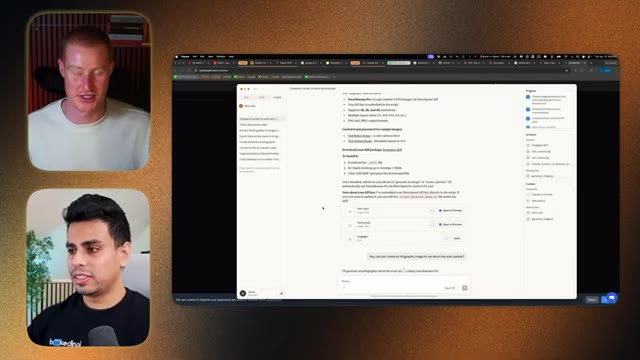
*⏱️ 00:18:39 — Capture d'écran montrant l'interface d'un navigateur avec une application ou un outil de génération d'images basé sur Claude, avec deux intervenants en visioconférence sur le côté gauche.*

---

### ⏱️ `[00:18:53 - 00:19:21]` | Segment #45

**🔊 Audio (Transcription Intégrale Mot pour Mot en Français) :**
> Exactement. Et c'est pourquoi, peut-être que je vais coller ça dedans, et c'est comme ça que je perçois plot code en ce moment, si vous voyez mon écran. Voyez, vous pouvez faire tellement de choses avec tellement d'outils, mais vous verrez des gens des deux côtés du spectre qui vont simplement utiliser plot code parce qu'une fois que vous comprenez que c'est tellement extensible et que vous pouvez faire tout ce que vous voulez avec parce que ça a accès partout comme une pieuvre, vous arrivez à n'utiliser qu'un seul outil et à annuler un million de vos abonnements.

**👁️ Analyse Visuelle d'Écran (gemini-3.5-flash-lite) :**
**Interface & Outils** : Tableau blanc collaboratif Miro et navigateur web.

**Contenu textuel & Code** : Schéma avec des logos et du texte humoristique (Claude Code, Codex CLI, Gemini CLI, Cursor, Google Antigravity) et des graphiques de distribution de compétences.

**Action / Démonstration** : Le présentateur partage son écran et commente un diagramme humoristique illustrant différents outils et assistants d'IA.

*⏱️ 00:19:00 — Capture d'écran montrant un tableau blanc Miro avec des schémas humoristiques et des mèmes sur les outils d'IA (Claude Code, Cursor, Codex CLI).*

---

### ⏱️ `[00:19:22 - 00:19:41]` | Segment #46

**🔊 Audio (Transcription Intégrale Mot pour Mot en Français) :**
> C'est exact. Ouais, c'est fou. J'adore le fait qu'ils aient sorti Cloud Coworker. Ou enfin, je continue à l'appeler Cloud Coworker parce qu'on a vraiment l'impression que c'est un collègue. Mais Cloud Cowork, parce qu'avant Cloud Code, ça avait l'air trop technique, c'était juste difficile à manipuler, à mon avis. Je déteste fixer un terminal. Ça me donne juste envie de m'arracher les yeux.

**👁️ Analyse Visuelle d'Écran (gemini-3.5-flash-lite) :**
**Interface & Outils** : Navigateur web affichant une application de tableau blanc collaboratif (Miro) et des flux vidéo de visioconférence.

**Contenu textuel & Code** : Schémas humoristiques avec des mèmes (wojak) et des étiquettes textuelles pour "CLAUDE CODE", "Codex CLI", "Gemini CLI", "CURSOR" et "Google Antigravity", ainsi qu'une zone de prompt en haut.

**Action / Démonstration** : Le présentateur commente le tableau blanc et discute des différents outils de codage et d'IA présentés graphiquement.

*⏱️ 00:19:27 — Capture d'écran montrant le présentateur et un invité en visioconférence à gauche, et un tableau blanc Miro affichant des mèmes et des graphiques humoristiques comparant des outils d'IA comme Claude Code, Cursor, Codex CLI et Gemini CLI sur la droite.*

---

### ⏱️ `[00:19:41 - 00:20:06]` | Segment #47

**🔊 Audio (Transcription Intégrale Mot pour Mot en Français) :**
> Donc, avoir une interface comme celle-ci maintenant, si vous pouviez revenir à l'interface à l'intérieur de Cloud Cowork, j'adorerais voir juste, genre, ouais, exactement. C'est une façon super simple de regarder cela. Et puis nous n'avons pas vraiment abordé les artefacts non plus. Mais genre, par exemple, si nous extrayons des données de fichiers ou quelque chose, si nous avons un fichier CSV de quelque chose, nous pourrions alors dire, je veux que vous créiez un tableau de bord pour visualiser toutes ces informations, par exemple.

**👁️ Analyse Visuelle d'Écran (gemini-3.5-flash-lite) :**
**Interface & Outils** : Navigateur web, application Miro, interface Cloud Cowork et visio-conférence.

**Contenu textuel & Code** : Interface utilisateur avec des options de sélection, des prompts textuels et une liste d'artefacts générés.

**Action / Démonstration** : Navigation et présentation des fonctionnalités de l'interface et des artefacts générés par l'IA.

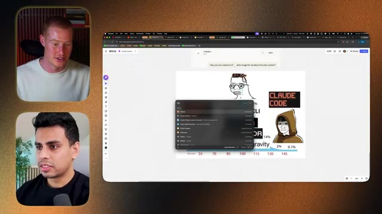
*⏱️ 00:19:48 — Vue d'un appel vidéo en cours avec un partage d'écran affichant une interface Miro et une petite fenêtre contextuelle avec des options de sélection.*

*⏱️ 00:19:54 — Vue de l'appel vidéo avec le partage d'écran affichant une interface de discussion de type Cloud Cowork avec des messages et des artefacts listés sur le côté droit.*

---

### ⏱️ `[00:20:07 - 00:20:31]` | Segment #48

**🔊 Audio (Transcription Intégrale Mot pour Mot en Français) :**
> Et il pouvait lancer dans VibeCode une véritable interface utilisateur pour que vous puissiez commencer à l'utiliser. C'est donc un peu, Claude Cowork combine Claude, Claude Code et en quelque sorte des artefacts pour pouvoir faire tout cela au sein d'un seul écosystème maintenant, ce qui est, vous savez, super simple à utiliser. Oui, c'est vraiment chouette. J'ai l'impression qu'on peut amener Claude Coworker et Code vers de tels sommets si on l'utilise simplement.

**👁️ Analyse Visuelle d'Écran (gemini-3.5-flash-lite) :**
**Interface & Outils** : Interface web de type application d'intelligence artificielle (Claude / plateforme de développement) et tableau blanc Miro ou similaire.

**Contenu textuel & Code** : Historique de conversation textuelle, messages d'erreur liés à une API (erreur 429), liste d'artefacts dans le panneau latéral droit et affichage d'une image générée représentant un robot astronaute sympathique.

**Action / Démonstration** : Démonstration de l'utilisation d'un outil d'intelligence artificielle générative et de son panneau d'artefacts/aperçus intégrés.

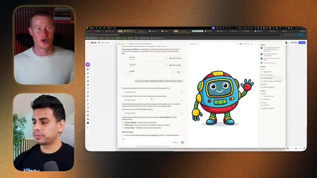
*⏱️ 00:20:13 — Capture d'écran principale montrant une interface de type assistant conversationnel générant des artefacts et une image colorée de robot, avec deux intervenants en vignettes vidéo à gauche.*

---

### ⏱️ `[00:20:31 - 00:20:50]` | Segment #49

**🔊 Audio (Transcription Intégrale Mot pour Mot en Français) :**
> C'est pour ça qu'ils ont littéralement juste créé trois onglets différents, Claude Code, Cowork, et ensuite Code. Et c'est fondamentalement la même chose. C'est juste pour, encore une fois, pour en revenir à cette chose, c'est pour trois types d'utilisateurs différents. C'est un peu comme une drogue douce, le bureau Claude vers le cloud cowork.

**👁️ Analyse Visuelle d'Écran (gemini-3.5-flash-lite) :**
**Interface & Outils** : Navigateur web, application Miro, interface de visioconférence

**Contenu textuel & Code** : Interface utilisateur avec des onglets ("Chat", "Code", "Cowork") et des panneaux de discussion textuelle et de gestion de tâches.

**Action / Démonstration** : Présentation visuelle et discussion autour de différentes interfaces ou modes d'utilisation d'un outil d'IA.

*⏱️ 00:20:35 — Capture d'écran montrant l'interface d'un navigateur avec une application web (Miro) et deux intervenants en visioconférence dans des cadres sur le côté gauche.*

---

### ⏱️ `[00:20:50 - 00:21:09]` | Segment #50

**🔊 Audio (Transcription Intégrale Mot pour Mot en Français) :**
> Maintenant, vous faites des tâches vraiment cool et ensuite vous allez dans Cloud Code et elles coûtent toutes la même chose. Donc, ça ne fait aucune différence. C'est vrai. Donc, si vous êtes quelqu'un qui utilise Cloud Cowork maintenant, parce que son interface est tout simplement plus facile à utiliser pour les personnes non techniques. Est-ce que, jusqu'où cela vous mène ? Est-ce que ça vaut quand même la peine d'apprendre à utiliser Cloud Code ?

**👁️ Analyse Visuelle d'Écran (gemini-3.5-flash-lite) :**
**Interface & Outils** : Tableau blanc Miro et fenêtres de visioconférence.

**Contenu textuel & Code** : Schéma explicatif comparant les outils Claude Desktop, Claude Cowork et Claude Code à l'évolution des Pokémon (Salamèche, Reptincel, Dracaufeu) avec le texte "What is the difference".

**Action / Démonstration** : Le présentateur et son invité discutent des différentes interfaces et versions de Claude en s'appuyant sur un visuel explicatif.

*⏱️ 00:20:55 — Capture d'écran montrant le présentateur et un invité à gauche, et un tableau blanc Miro à droite illustrant les différences entre les versions de Claude comparées à des Pokémon (Charmander pour Claude Desktop, Charmeleon pour Claude Cowork, et Charizard pour Claude Code).*

---

### ⏱️ `[00:21:09 - 00:21:41]` | Segment #51

**🔊 Audio (Transcription Intégrale Mot pour Mot en Français) :**
> Je veux savoir ce que tu en penses. Évidemment, c'est sorti depuis un jour seulement. Donc peut-être que tu ne connais pas toutes les limites que, tu vois, ça a, mais genre d'après ta première impression en l'essayant, parce que tu l'as pas mal testé. Qu'est-ce que tu en penses ? Genre, est-ce que ça vaut toujours le coup d'apprendre du code pour le cloud ? Est-ce que c'est juste pour un type de personne très précis qui ne veut pas avoir à toucher un terminal ? Qu'est-ce que tu en penses ? Hum, je pense en fait que ça dépend de tes objectifs et de ce que tu fais, tu vois ? Donc par exemple, si ton travail consiste simplement à, disons, rédiger du contenu, alors utiliser simplement le bureau de cloud est techniquement suffisant. Alors que disons maintenant que tu, tu vois, tu vas sur différents onglets,

**👁️ Analyse Visuelle d'Écran (gemini-3.5-flash-lite) :**
**Interface & Outils** : Présentation ou face-caméra explicatif du trader sans interface logicielle partagée.

**Contenu textuel & Code** : Explications orales des stratégies et mise en contexte méthodologique du marché.

**Action / Démonstration** : Explications face caméra et analyse conceptuelle des marchés.

---

### ⏱️ `[00:21:41 - 00:22:16]` | Segment #52

**🔊 Audio (Transcription Intégrale Mot pour Mot en Français) :**
> vous commencez à toucher à des choses, alors vous voudrez peut-être commencer à utiliser CloudCode work. Mais la plupart des gens n'ont probablement même pas besoin de CloudCode parce que la plupart des gens font juste des tâches ponctuelles. Je pense que vous allez naturellement, au fur et à mesure de vos besoins, comme ils sont tous dans un seul package, gravir les échelons. CloudCode, ce que les gens font avec ça, c'est en fait juste principalement du coder. Et c'est pourquoi ils, c'était un peu comme un échec marketing au départ, mais je comprends la façon dont ils s'y prenaient parce que c'est un peu comme euh vous savez comme Tesla a fait leur voiture la plus chère en premier et ensuite ils en ont fait une un peu moins chère comme le Model X et ensuite ils ont fait comme le Model 3

**👁️ Analyse Visuelle d'Écran (gemini-3.5-flash-lite) :**
**Interface & Outils** : Présentation ou face-caméra explicatif du trader sans interface logicielle partagée.

**Contenu textuel & Code** : Explications orales des stratégies et mise en contexte méthodologique du marché.

**Action / Démonstration** : Explications face caméra et analyse conceptuelle des marchés.

---

### ⏱️ `[00:22:16 - 00:22:51]` | Segment #53

**🔊 Audio (Transcription Intégrale Mot pour Mot en Français) :**
> c'est un peu le même modèle que Claude suit où ils ont tout jeté contre le mur avec Claude Code et puis maintenant ils le rendent plus facile et plus accessible au fur et à mesure, c'est bien ça ? et corrige-moi si je me trompe mais les gens utilisent Claude Code pour des choses que Claude ou Anthropic n'avaient pas forcément prévues et donc maintenant ils font presque de la rétro-ingénierie sur ce que les utilisateurs de Claude Code font, comment pouvons-nous ensuite rendre cela plus accessible aux personnes qui ne savent pas coder par exemple, et j'ai l'impression que c'est ça Claude Co-work, c'est tu vois le caméléon en the l'occurrence, c'est le juste milieu parfait, c'est intéressant de voir comment

**👁️ Analyse Visuelle d'Écran (gemini-3.5-flash-lite) :**
**Interface & Outils** : Présentation ou face-caméra explicatif du trader sans interface logicielle partagée.

**Contenu textuel & Code** : Explications orales des stratégies et mise en contexte méthodologique du marché.

**Action / Démonstration** : Explications face caméra et analyse conceptuelle des marchés.

---

### ⏱️ `[00:22:51 - 00:23:17]` | Segment #54

**🔊 Audio (Transcription Intégrale Mot pour Mot en Français) :**
> ils ont en quelque sorte fait de la rétro-ingénierie de ce que les gens construisent avec, tu sais, pour les personnes qui utilisent cloud code mais qui ne l'utilisent pas pour coder, si tu vois ce que je veux dire, donc exactement oui, des tâches uniques et cloud code c'est du genre, tu sais, avoir des agents, plusieurs agents et des instances en parallèle qui tournent en arrière-plan. La plupart des gens n'ont pas du tout besoin de ça. Donc je suppose que ma dernière question pour cloud cowork est, est-ce qu'on pourrait avoir plusieurs tâches ou agents différents qui fonctionnent en même temps ? Absolument.

**👁️ Analyse Visuelle d'Écran (gemini-3.5-flash-lite) :**
**Interface & Outils** : Tableau blanc Miro affiché sur un navigateur web, avec des vignettes vidéo des deux participants sur le côté gauche.

**Contenu textuel & Code** : Texte "What is the difference" et "how you use it", avec trois Pokémon illustrant l'évolution des outils : Charmander (Claude Desktop), Charmeleon (Claude Cowork), et Charizard (Claude Code).

**Action / Démonstration** : Le présentateur explique les différentes déclinaisons et niveaux de puissance des outils Claude en utilisant une analogie visuelle avec l'évolution de Pokémon.

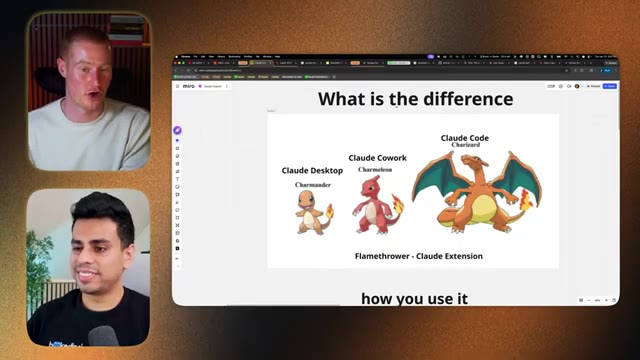
*⏱️ 00:22:58 — Un tableau blanc interactif Miro montrant une métaphore visuelle Pokémon pour expliquer les différences entre les versions de Claude (Desktop, Cowork, Code).*

---

### ⏱️ `[00:23:18 - 00:23:37]` | Segment #55

**🔊 Audio (Transcription Intégrale Mot pour Mot en Français) :**
> Yeah. So that is, that's the same thing as like how you have multiple of these running. Um, what you want to do is right here, right here, you see in cloud cowork, you can just open up, They literally call it tasks. Yeah. So you have, you make a task, you make a directive, you hit go, you make another task, you make a directive, you hit go, and then you sit back and then you judge.

**👁️ Analyse Visuelle d'Écran (gemini-3.5-flash-lite) :**
**Interface & Outils** : Tableau blanc Miro et interface de gestion de tâches / automatisation sur macOS.

**Contenu textuel & Code** : Liste de tâches textuelles, icônes d'automatisation, et interface de commande pour l'intelligence artificielle ou les agents virtuels.

**Action / Démonstration** : Navigation et sélection des tâches dans l'interface pour expliquer la gestion et l'exécution de processus multiples.

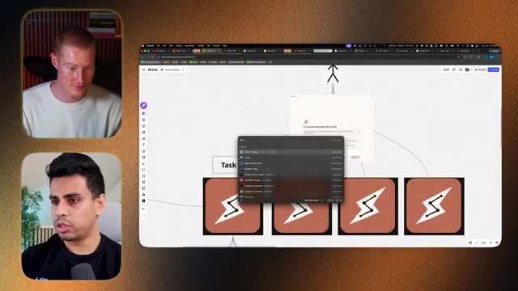
*⏱️ 00:23:23 — Vue d'un tableau blanc Miro en arrière-plan avec une fenêtre de recherche superposée montrant des applications et des tâches.*

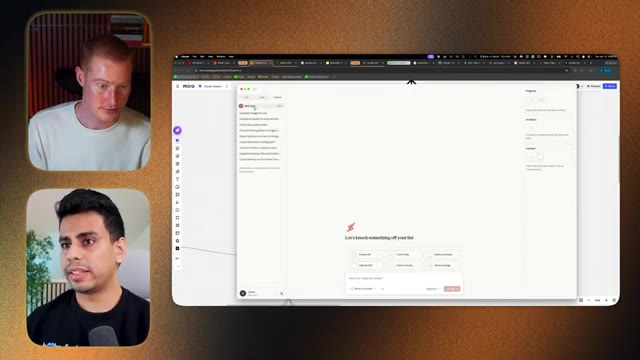
*⏱️ 00:23:27 — Interface d'une application de gestion de tâches ouverte sur le bureau, affichant une liste de tâches à gauche et un espace de travail à droite.*

---

### ⏱️ `[00:23:37 - 00:23:57]` | Segment #56

**🔊 Audio (Transcription Intégrale Mot pour Mot en Français) :**
> Ouais. Donc tu es en train de me dire que tu peux cliquer sur l'une de ces instructions préchargées. Tu pourrais préparer ta journée, aller de nouveau dans les suggestions. Les suggestions. Ouais, exactement. Tu pourrais cliquer sur préparer ta journée, puis aller, aller en haut à gauche à nouveau, créer une nouvelle tâche pendant que ça prépare ta journée. Ça traite aussi des données et ça crée aussi un prototype, tout ça. C'est fou de se dire qu'on peut simplement le lancer et qu'il fasse plusieurs choses différentes pour toi.

**👁️ Analyse Visuelle d'Écran (gemini-3.5-flash-lite) :**
**Interface & Outils** : Navigateur web affichant une application de type chat/IA intégrée à un espace de travail, avec deux fenêtres de webcam.

**Contenu textuel & Code** : Instructions préchargées et suggestions visibles dans un panneau latéral de l'interface d'intelligence artificielle.

**Action / Démonstration** : Navigation et explication des fonctionnalités de suggestions et d'instructions préchargées dans l'application.

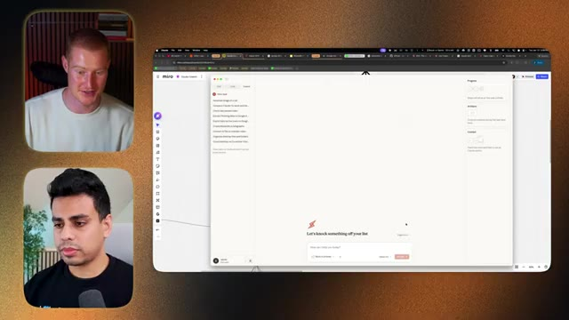
*⏱️ 00:23:42 — Capture d'écran montrant l'interface d'un outil de productivité ou d'intelligence artificielle avec deux interlocuteurs en visioconférence sur le côté gauche.*

---

### ⏱️ `[00:23:57 - 00:24:31]` | Segment #57

**🔊 Audio (Transcription Intégrale Mot pour Mot en Français) :**
> alors comme tu l'as dit tu vas chercher ton café ou tu sais tout ce dont tu as besoin de faire exactement ouais par exemple l'un d'eux s'occupe du suivi de tes réunions un autre s'occupe d'écrire ton emploi du temps et comme tu peux lui donner accès aux différentes instances de co-travail dans le cloud tu peux lui donner accès à différents connecteurs donc c'est un peu plus rapide quand il s'agit de faire ton travail ouais c'est logique euh je suppose que peut-être l'une de mes dernières questions ici c'est qu'une grande partie de mon audience a probablement utilisé quelque chose comme n8n est-ce que tu penses que cela pourrait remplacer le besoin pour beaucoup de gens d'utiliser n8n genre je sais que tu étais un utilisateur intensif est-ce que tu l'utilises encore tous les jours ou est-ce que

**👁️ Analyse Visuelle d'Écran (gemini-3.5-flash-lite) :**
**Interface & Outils** : Application web Miro, navigateur web, fenêtres de visioconférence des intervenants.

**Contenu textuel & Code** : Liste de tâches textuelles, options de préparation de réunion ("What kind of prep?"), prompts de gestion d'agenda et d'e-mails.

**Action / Démonstration** : Présentation d'un outil de co-travail et d'automatisation des tâches pour la gestion du calendrier et des réunions.

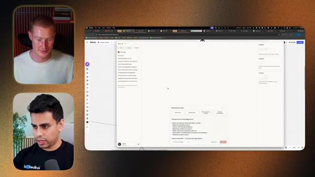
*⏱️ 00:24:06 — Capture d'écran montrant l'interface de l'application Miro avec des fenêtres de chat et des options d'automatisation des tâches ou de préparation de réunions.*

---

### ⏱️ `[00:24:31 - 00:24:58]` | Segment #58

**🔊 Audio (Transcription Intégrale Mot pour Mot en Français) :**
> maintenant en passant plus vers l'apprentissage de la compétence d'utiliser quelque chose comme Claude Code et Co-work dans vos flux de travail quotidiens, donc c'est un peu comme une épée à double tranchant, je pense que la plupart des gens vont lentement commencer à délaisser n8n, mais vous voyez juste ici, si vous allez dans les connecteurs, vous pouvez vous connecter au MCP de n8n, ouais, n8n a littéralement un MCP, donc vous pouvez simplement, vous savez, connecter ceci et ensuite dire : hé, collègue Claude, va me construire cette automatisation et ensuite il le fera.

**👁️ Analyse Visuelle d'Écran (gemini-3.5-flash-lite) :**
**Interface & Outils** : Tableau blanc Miro et interface de configuration de flux de travail / connecteurs.

**Contenu textuel & Code** : Listes de tâches automatisées, prompts de préparation de réunion et icônes de connecteurs logiciels (Jira, Notion, GitHub, etc.).

**Action / Démonstration** : Navigation et présentation des outils de flux de travail et des connecteurs d'intégration logicielle.

*⏱️ 00:24:38 — Vue d'un tableau blanc Miro avec une fenêtre contextuelle affichant des tâches automatisées et un prompt préparant une réunion, avec les deux interlocuteurs en vignettes à gauche.*

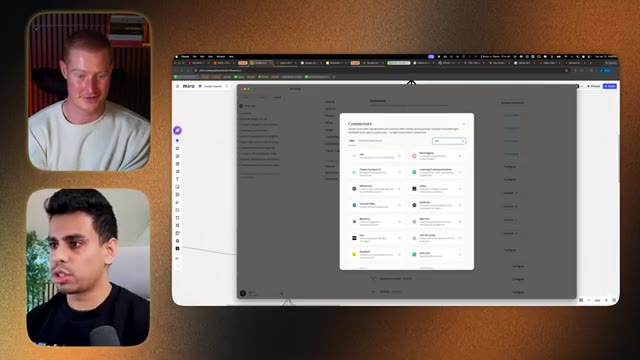
*⏱️ 00:24:51 — Vue de l'interface affichant une fenêtre de configuration des "Connectors" (intégrations d'applications) au sein de la plateforme, avec les deux intervenants à l'écran.*

---

### ⏱️ `[00:24:58 - 00:25:16]` | Segment #59

**🔊 Audio (Transcription Intégrale Mot pour Mot en Français) :**
> Compris. Ouais, donc ça dépend de ce que vous essayez de faire et de quels sont vos objectifs. Personnellement, j'ai un peu éloigné mes trucs de N8N et je les code moi-même. Mais je ne pense pas que tout le monde sache coder ou ait même besoin de savoir coder. C'est donc un type de scénario différent. Ouais, tout à fait.

**👁️ Analyse Visuelle d'Écran (gemini-3.5-flash-lite) :**
**Interface & Outils** : Claude Desktop, macOS, Miro

**Contenu textuel & Code** : Fenêtre modale "Connectors" listant diverses intégrations et outils connectables (comme GitHub, Jira, etc.) avec une barre de recherche.

**Action / Démonstration** : Navigation et présentation des options de connexion et d'intégration d'outils tiers au sein de l'application Claude.

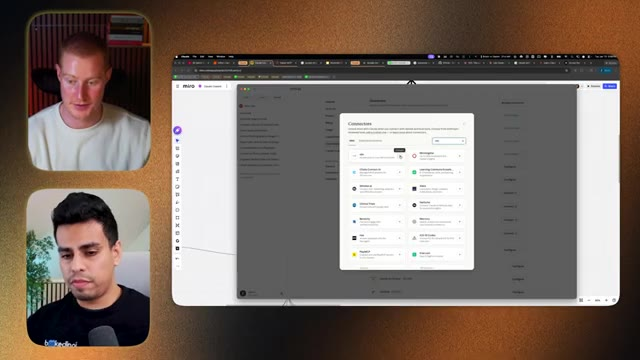
*⏱️ 00:25:02 — Capture d'écran montrant l'application Claude Desktop ouverte sur un tableau Miro en arrière-plan, avec une fenêtre modale affichant la liste des connecteurs disponibles.*

---

### ⏱️ `[00:25:16 - 00:25:36]` | Segment #60

**🔊 Audio (Transcription Intégrale Mot pour Mot en Français) :**
> Très bien, Salman, ça a été génial, mec. Je pense qu'on a vraiment montré aux gens les capacités de Claude Code et de Claude Cowork. Donc, si les gens aiment ce qu'ils ont entendu dans ce podcast et qu'ils veulent entrer en contact avec toi ou te suivre et en apprendre davantage grâce à toi, où peuvent-ils te trouver ? Oui, tout à fait. Donc, j'ai en fait ma propre chaîne YouTube où je publie beaucoup de contenu de type Claude.

**👁️ Analyse Visuelle d'Écran (gemini-3.5-flash-lite) :**
**Interface & Outils** : Interface web de Zapier et fenêtre modale de sélection de connecteurs.

**Contenu textuel & Code** : Liste de connecteurs ou intégrations logicielles affichée dans une fenêtre modale sur fond sombre.

**Action / Démonstration** : Navigation et présentation des options de connexion et d'intégration d'applications tierces.

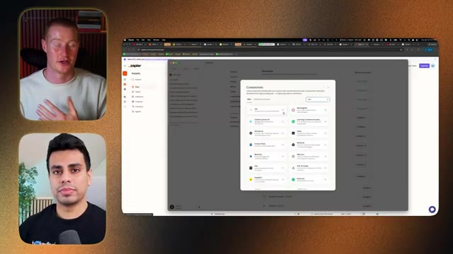
*⏱️ 00:25:21 — Capture d'écran montrant l'interface principale avec deux intervenants en visioconférence à gauche et une fenêtre de configuration d'application (Zapier / Connectors) au centre.*

---

### ⏱️ `[00:25:36 - 00:26:00]` | Segment #61

**🔊 Audio (Transcription Intégrale Mot pour Mot en Français) :**
> Et même, j'ai créé cette communauté. C'est si vous allez sur school.com slash Claude. Je n'arrive pas à croire que j'aie eu ça, mais j'en ai lancé une toute nouvelle sur la façon d'automatiser réellement les processus d'entreprise avec Claude Code ou Claude en général. Génial. Est-ce que c'est gratuit de s'inscrire en ce moment ? Oui, c'est gratuit de s'inscrire en ce moment. Alors allez-y. Posez-moi des questions parce qu'en ce moment, c'est juste, vous savez, explorer comment nous pouvons appliquer cette technologie pour dynamiser réellement notre travail.

**👁️ Analyse Visuelle d'Écran (gemini-3.5-flash-lite) :**
**Interface & Outils** : Navigateur web affichant la plateforme communautaire Skool, YouTube et un tableau de bord API.

**Contenu textuel & Code** : Page de la communauté Skool "Claude Co-workers" avec des visuels explicatifs sur l'utilisation de Claude Code, Codex CLI, Cursor et des flux d'automatisation.

**Action / Démonstration** : Présentation à l'écran de la page Skool de la communauté créée pour l'automatisation avec Claude.

*⏱️ 00:25:42 — Capture montrant une page web de la plateforme Skool dédiée à Claude Co-workers, présentant la communauté pour automatiser les processus d'entreprise.*

---

### ⏱️ `[00:26:01 - 00:26:12]` | Segment #62

**🔊 Audio (Transcription Intégrale Mot pour Mot en Français) :**
> 100 %. Et c'est pour ça que je voulais t'inviter. Donc je suis content qu'on ait pu le faire. Bien sûr, frangin. Ouais. Ravi d'être là, mec. Si vous avez trouvé ça utile, allez suivre Solomon, abonnez-vous à ma chaîne aussi. Cela dit, je vous remercie d'être restés jusqu'à la fin et on se voit dans la prochaine vidéo.

**👁️ Analyse Visuelle d'Écran (gemini-3.5-flash-lite) :**
**Interface & Outils** : Navigateur Web Google Chrome affichant YouTube.

**Contenu textuel & Code** : Page de la chaîne YouTube de Samin Yasar avec miniatures de vidéos et bannières promotionnelles.

**Action / Démonstration** : Présentation de la chaîne YouTube de l'invité en fin d'épisode.

*⏱️ 00:26:04 — Capture d'écran montrant une page de profil YouTube de Samin Yasar avec à gauche les flux vidéo des deux intervenants de l'appel.*

---

