# 🎬 This Claude Skill Just Changed EVERYTHING (Remotion)

> **Chaîne** : [Brock Mesarich | AI for Non Techies](https://www.youtube.com/@BrockMesarich)  
> **Lien YouTube** : [https://www.youtube.com/watch?v=FVrNRnfC8oM](https://www.youtube.com/watch?v=FVrNRnfC8oM)  
> **Date de publication** : 20260125  
> **Durée** : 00:17:20  
> **Identifiant vidéo** : `FVrNRnfC8oM`  
> **Transcription & Analyse** : `whisper-v3-large-turbo+gemini-3.5-flash-lite`  

---

## 📌 Synthèse Exécutive & Outils

### 💡 Résumé

Cette vidéo de la chaîne de Brock Mesarich met en lumière une révolution dans la création de contenus automatisés grâce à l'intégration des « compétences » (skills) dans l'écosystème Claude. L'invité, Salman, y démontre comment il est possible de générer des vidéos marketing complexes, incluant des graphiques animés, des interfaces logicielles et des voix off, de manière entièrement autonome et sans compétences en codage. En utilisant des environnements locaux et en injectant des répertoires de compétences spécifiques, les utilisateurs peuvent transformer une simple invite textuelle en un pipeline de production multimédia automatisé.

Au-delà de la simple génération de code, la discussion explore la transition vers des flux de travail agentiques où les modèles de langage agissent comme des chefs d'orchestre capables de coordonner des services tiers spécialisés. Des outils comme Remotion, combinés à des moteurs de synthèse vocale et d'avatars comme HeyGen, permettent d'envisager une automatisation marketing de niveau supérieur. Cette rupture technologique crée une opportunité d'arbitrage massive pour les créateurs et les entreprises capables d'adopter ces technologies avant qu'elles ne se démocratisent totalement.

La démonstration pratique prouve qu'un utilisateur non technique peut, à l'aide d'un simple dossier local et d'une URL de compétences, déléguer à Claude l'installation, la configuration et l'exécution d'un projet vidéo complet. En pointant l'intelligence artificielle vers des ressources existantes — telles qu'un site web d'entreprise —, le système récupère les éléments graphiques et structure une production visuelle sur mesure, illustrant parfaitement l'efficacité redoutable de ces nouvelles architectures d'agents autonomes.

### 🛠️ Outils, Modèles & Logiciels Présentés

* **Claude / Claude Code** : Modèle de langage avancé et environnement de développement assisté servant de chef d'orchestre central pour exécuter les instructions et installer des compétences dynamiques.
* **Remotion** : Framework de programmation vidéo permettant de générer et d'éditer des animations et des montages graphiques complexes directement via du code piloté par l'IA.
* **Nano Banana (et Nano Banana Pro)** : Outil de génération d'images et de composants visuels intégré pour enrichir les rendus graphiques des projets vidéo.
* **Eleven Labs** : Plateforme de synthèse vocale ultra-réaliste utilisée pour automatiser la création des voix off à partir de scripts textuels.
* **HeyGen** : Solution d'avatars parlants dotée d'une compétence Claude permettant de synchroniser des présentateurs virtuels avec des vidéos générées par Remotion.
* **Make** : Plateforme d'automatisation de flux de travail sans code pour connecter différentes applications entre elles.
* **Zapier** : Outil d'intégration et d'automatisation logicielle reliant divers services cloud pour piloter des tâches répétitives.
* **n8n** : Logiciel d'automatisation de flux de travail orienté technique et open-source pour orchestrer des architectures d'agents complexes.
* **Gemini** : Modèle d'intelligence artificielle multimodal développé par Google, mentionné dans l'écosystème des grands LLM actuels.
* **ChatGPT** : Modèle conversationnel d'OpenAI, utilisé comme référence comparative dans le paysage des IA génératives.
* **Grok** : Modèle de langage développé par xAI, intégré à l'écosystème des outils d'intelligence artificielle évoqués.

### 🔑 Points Clés & Enseignements Stratégiques

* **L'ère des agents augmentés par compétences** : L'utilisation de compétences modulaires permet de transformer un modèle de langage textuel (comparé à Thanos sans gant) en un système surpuissant capable d'interagir avec des outils externes spécialisés.
* **Disparition des barrières techniques** : Il n'est plus nécessaire de maîtriser le code ou des logiciels de montage complexes pour produire des démos produits ou des vidéos marketing de haute qualité, l'IA se chargeant de la traduction technique en arrière-plan.
* **Le concept de l'arbitrage technologique** : Une fenêtre d'opportunité majeure existe actuellement pour les pionniers capables d'exploiter ces outils avant qu'ils ne deviennent des standards grand public universellement adoptés.
* **Pipelines marketing en pilotage automatique** : La combinaison de LLM et de compétences logicielles permet de concevoir des équipes marketing entièrement automatisées, capables d'itérer et de produire du contenu en continu.
* **Injection simplifiée de compétences** : Il suffit de fournir une URL de dépôt (provenant par exemple de GitHub) directement dans l'interface de développement de Claude pour installer automatiquement de nouvelles capacités de production.
* **Extraction et réutilisation de ressources web** : L'IA est capable d'analyser un site web existant (palettes de couleurs, visuels, identité de marque) pour concevoir dynamiquement des vidéos alignées sur l'image de l'entreprise.
* **Industrialisation de la voix off et des avatars** : L'intégration native d'outils comme Eleven Labs et HeyGen permet d'automatiser la synchronisation labiale et la narration vocale sans intervention humaine manuelle.
* **Évolution du rôle du créateur de contenu** : Le métier de créateur et de monteur évolue vers une fonction de direction artistique et de supervision stratégique de systèmes autonomes générant le contenu brut.
* **Simplification de la configuration locale** : La création d'un simple dossier de projet et son association à l'application Claude suffisent pour initialiser un environnement de travail multimédia prêt à l'emploi.
* **L'effet de levier des écosystèmes interconnectés** : À mesure que de plus en plus d'éditeurs de logiciels intégreront des compétences pour Claude, la puissance des flux de travail agentiques croîtra de manière exponentielle, décuplant la productivité individuelle.

---

## ⏱️ Chronologie & Transcription Complète Audio & Visuelle (Mot pour Mot)

### ⏱️ `[00:00:00 - 00:00:35]` | Segment #01

**🔊 Audio (Transcription Intégrale Mot pour Mot en Français) :**
> Ça affole Internet en ce moment et c’est vraiment l’un des cas d’usage les plus fous que j’ai vus de l’IA. Les gens génèrent des vidéos entières avec des voix off, des motion graphics et des démos de produits, le tout à partir d’une simple invite textuelle dans Claude. Pas de montage et pas de code, juste en tapant ce que vous voulez et vous obtenez un résultat en moins de quelques minutes. Donc dans cet épisode, je reçois mon ami Salman pour nous montrer exactement comment il fait ça pour créer des vidéos de fou. Donc sans plus attendre, plongeons dans cette vidéo. Très bien, alors allons-y tout de suite rapidement. Je veux vous montrer ces publications sur Twitter parce que ça cartonne absolument en ce moment sur Twitter si vous ne l'avez pas

**👁️ Analyse Visuelle d'Écran (gemini-3.5-flash-lite) :**
**Interface & Outils** : AUCUNE

**Contenu textuel & Code** : AUCUNE

**Action / Démonstration** : AUCUNE

---

### ⏱️ `[00:00:35 - 00:01:08]` | Segment #02

**🔊 Audio (Transcription Intégrale Mot pour Mot en Français) :**
> vivez sous une roche. Remotion permet désormais apparemment de créer et d'éditer des vidéos directement dans Cloud Code, et voici juste quelques-uns des exemples que les gens ont partagés. Donc, par exemple, celui-ci, Solomon, si je ne me trompe pas, a été littéralement généré entièrement à l'intérieur de Cloud Code. Personne ne... aucun monteur n'édite cette vidéo. C'est littéralement tout Cloud Code qui génère les graphiques et tout le reste. Donc, ce que nous allons faire dans cette vidéo, c'est que nous allons montrer des choses que Salman a construites, car il a utilisé ceci ces derniers jours pour créer des choses plutôt cool. Et ensuite, il va réellement nous montrer comment nous pouvons commencer à faire cela dès maintenant, même si nous n'avons aucune compétence en codage ou technique. Alors Salman, plongeons là-dedans, mon vieux.

**👁️ Analyse Visuelle d'Écran (gemini-3.5-flash-lite) :**
**Interface & Outils** : Navigateur web affichant un tweet de Remotion avec un aperçu de code et de projet vidéo.

**Contenu textuel & Code** : Publication Twitter de @Remotion montrant le processus de création vidéo et l'historique des prompts associés.

**Action / Démonstration** : Le présentateur commente un exemple concret de génération de vidéo partagé sur les réseaux sociaux.

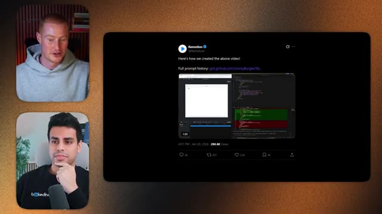
*⏱️ 00:00:52 — Capture d'un tweet du compte officiel Remotion affichant un exemple de code et d'interface de création vidéo, aux côtés des deux intervenants incrustés à gauche.*

---

### ⏱️ `[00:01:09 - 00:01:42]` | Segment #03

**🔊 Audio (Transcription Intégrale Mot pour Mot en Français) :**
> C'est clair, c'est clair. Ça va être amusant. Donc, un truc que je voulais montrer, c'est que, juste avec une ou deux instructions, j'avais une autre vidéo. Ça peut, je peux maintenant faire des vidéos où ça prend des composants de mon interface utilisateur et ça peut littéralement construire, ajouter des voix off et générer des démos de produits complètes. Je ne veux pas vous montrer tout le truc, mais par exemple ici, ça prend littéralement les composants de mon logiciel et ensuite ça génère une voix off, ça utilise Nano Banana pour faire une vidéo entière, n'est-ce pas ? C'est plutôt amusant à faire parce que maintenant ce que je peux

**👁️ Analyse Visuelle d'Écran (gemini-3.5-flash-lite) :**
**Interface & Outils** : Navigateur web affichant une interface utilisateur (UI) de type builder / Miro / outil no-code.

**Contenu textuel & Code** : Interface utilisateur de construction d'agent (« Create Your AI Sales Agent »), champs de texte, sélecteurs de voix et icônes de canaux de communication.

**Action / Démonstration** : Présentation et démonstration d'une interface de conception d'application ou d'agent IA interactif.

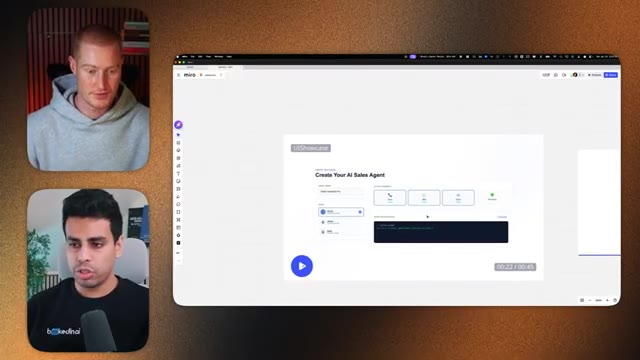
*⏱️ 00:01:17 — Vue d'ensemble de l'écran avec deux intervenants en visioconférence à gauche et une interface web interactive Miro affichant un outil de création d'agent commercial (« Create Your AI Sales Agent ») à droite.*

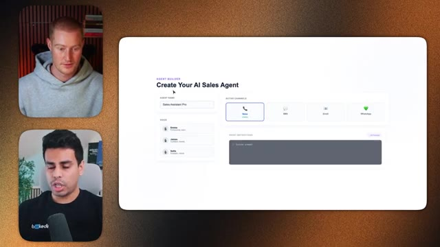
*⏱️ 00:01:33 — Gros plan sur l'interface de création d'agent (« Agent Builder ») montrant les options de configuration telles que le nom de l'agent, le choix de la voix et les canaux d'action (Voice, SMS, Email, Whatsapp).*

---

### ⏱️ `[00:01:42 - 00:02:02]` | Segment #04

**🔊 Audio (Transcription Intégrale Mot pour Mot en Français) :**
> ce que je peux faire, c'est que si je peux simplement commencer à réfléchir à d'autres cas d'usage sur d'autres vidéos marketing, je peux avoir un pipeline automatisé où c'est juste comme une équipe marketing en pilotage automatique, n'est-ce pas ? La raison pour laquelle nous pouvons faire ce genre de vidéos de type re-motion avec Claude, c'est parce que Claude peut utiliser cette chose, qui sont des compétences. Et à un haut niveau, vous pouvez concevoir les compétences comme ceci.

**👁️ Analyse Visuelle d'Écran (gemini-3.5-flash-lite) :**
**Interface & Outils** : Application web Miro et interface utilisateur de tableau de bord marketing.

**Contenu textuel & Code** : Graphiques d'engagement, métriques en temps réel ("Real-Time Metrics at a Glance"), flux d'activité et indicateurs chiffrés.

**Action / Démonstration** : Présentation du tableau de bord marketing automatisé et discussion sur les cas d'usage.

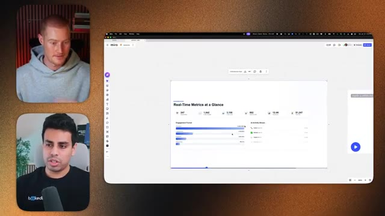
*⏱️ 00:01:47 — Vue d'un tableau Miro montrant un prototype de tableau de bord de métriques marketing en temps réel.*

---

### ⏱️ `[00:02:03 - 00:02:21]` | Segment #05

**🔊 Audio (Transcription Intégrale Mot pour Mot en Français) :**
> Alors imaginez que c'est Claude. C'est un petit diagramme de Thanos des Avengers. Je ne sais pas si vous avez vu, du genre il fait ce claquement de doigts pour éliminer tout le monde. Mais, vous savez, Thanos lui-même est cool. Il est plutôt faible, mais il n'est pas super fort. Mais Thanos avec le Gant de l'infini, il obtient tellement de choses qu'il peut faire, comme manipuler le temps, tout ça.

**👁️ Analyse Visuelle d'Écran (gemini-3.5-flash-lite) :**
**Interface & Outils** : Tableau blanc collaboratif Miro, affiché en plein écran à droite, avec deux flux vidéo des intervenants à gauche.

**Contenu textuel & Code** : Un diagramme visuel intitulé 'WEAK vs POWERFUL' représentant le personnage de Thanos et l'évolution de ses compétences à l'aide des éléments de l'infini.

**Action / Démonstration** : Le présentateur explique le concept de compétences et de puissance en utilisant une analogie visuelle basée sur le personnage de Thanos.

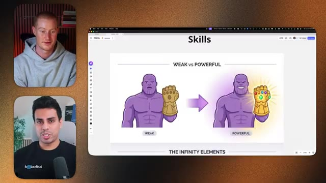
*⏱️ 00:02:07 — Capture d'écran montrant un tableau blanc Miro avec un schéma comparatif intitulé 'Skills' illustrant Thanos dans une version 'Weak' et une version 'Powerful' avec le gant de l'infini.*

---

### ⏱️ `[00:02:22 - 00:02:44]` | Segment #06

**🔊 Audio (Transcription Intégrale Mot pour Mot en Français) :**
> Pensez donc à donner des compétences à Claude de la même manière. Donc et les éléments comme la capacité de coder, d'utiliser Remotion pour créer des vidéos, d'utiliser Nano Banana pour en quelque sorte faire plus d'images, d'utiliser Eleven Labs pour générer une voix off. Ce sont tous des types de compétences différents que nous pouvons donner à Claude.

**👁️ Analyse Visuelle d'Écran (gemini-3.5-flash-lite) :**
**Interface & Outils** : Tableau blanc Miro affiché sur un navigateur web, avec deux vignettes vidéo des intervenants sur le côté gauche.

**Contenu textuel & Code** : Schéma visuel montrant un personnage (style Thanos) passant de "Weak" à "Powerful", avec une rangée de six gemmes de couleur (rouge, orange, jaune, vert, bleu, violet) représentant des capacités de compétences.

**Action / Démonstration** : Le présentateur explique les concepts visuels du diagramme Miro concernant l'ajout de compétences aux agents IA.

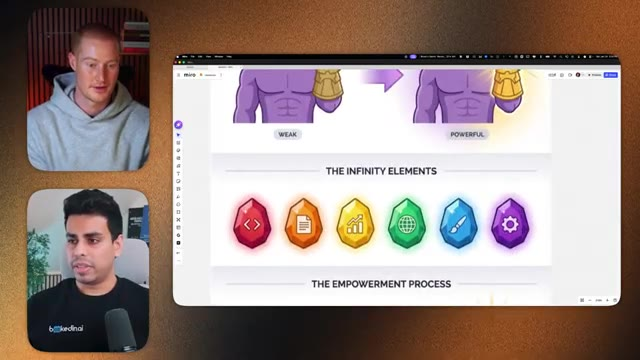
*⏱️ 00:02:27 — Un tableau Miro illustrant le concept des "éléments infinis" symbolisés par des gemmes colorées représentant différentes compétences d'IA.*

---

### ⏱️ `[00:02:44 - 00:03:04]` | Segment #07

**🔊 Audio (Transcription Intégrale Mot pour Mot en Français) :**
> donc il peut faire de très, très bonnes vidéos, n'est-ce pas ? C'est donc en quelque sorte un super-pouvoir, donner à Claude des super-pouvoirs pour le rendre beaucoup plus puissant. Claude, vous pouvez y intégrer beaucoup de compétences vides et vous assurer qu'à la fin, après avoir équipé Claude de toutes ces compétences, il peut faire des choses incroyables. Et c'est pourquoi tout le monde adore Claude. Sans compter que c'est aussi un modèle vraiment très puissant.

**👁️ Analyse Visuelle d'Écran (gemini-3.5-flash-lite) :**
**Interface & Outils** : Tableau blanc Miro

**Contenu textuel & Code** : Schéma comparatif « WEAK vs POWERFUL » avec un personnage ressemblant à Thanos (faible vs puissant avec le gant de l'infini) et la section « THE INFINITY ELEMENTS » représentant différentes compétences sous forme de gemmes colorées.

**Action / Démonstration** : Explication visuelle du concept d'ajout de compétences ou de modules (« super-pouvoirs ») à l'intelligence artificielle Claude.

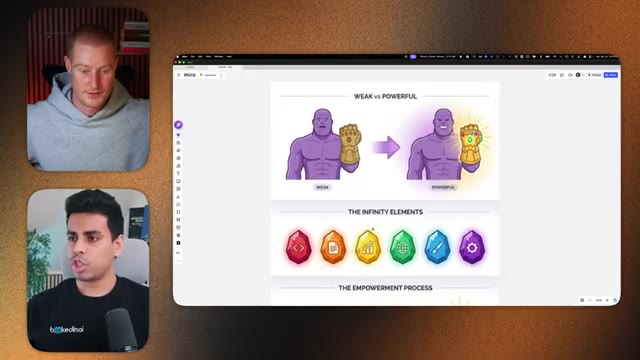
*⏱️ 00:02:49 — Capture d'écran montrant le présentateur et un invité à gauche, ainsi qu'un tableau blanc Miro à droite illustrant le concept de Claude doté de « super-pouvoirs » avec des gemmes de l'infini.*

---

### ⏱️ `[00:03:04 - 00:03:37]` | Segment #08

**🔊 Audio (Transcription Intégrale Mot pour Mot en Français) :**
> Donc c'est un peu comme juste ça, où Claude aura maintenant accès à Remotion et il peut aussi créer des images avec Nano Banana Pro et 11 Labs. Très bien, donc une chose que je veux mentionner avant qu'on continue et qu'on montre comment les gens peuvent réellement commencer à faire ça ainsi que certains des cas d'usage que tu as construits. Je veux rapidement mentionner que cette compétence Remotion est l'une des premières qui est en train de, en quelque sorte, casser Internet parce que les gens se disent, ou d'accord, nous donnons à Claude cette compétence d'aller générer des vidéos. Mais ce qui m'enthousiasme, c'est quand de plus en plus de ces applications et outils que nous utilisons au quotidien commenceront à implémenter ces compétences dans Claude, parce que ça va vraiment devenir insensé. Et c'est là qu'on va donner à Thanos des genres de

**👁️ Analyse Visuelle d'Écran (gemini-3.5-flash-lite) :**
**Interface & Outils** : Tableau blanc collaboratif en ligne (Miro) et interface de visioconférence.

**Contenu textuel & Code** : Schémas illustrés représentant "The Infinity Elements", "The Empowerment Process" et "Unleashed Potential" avec des icônes liées aux capacités des outils d'IA.

**Action / Démonstration** : Le présentateur présente et commente un schéma conceptuel ou un diagramme explicatif visuel hébergé sur Miro.

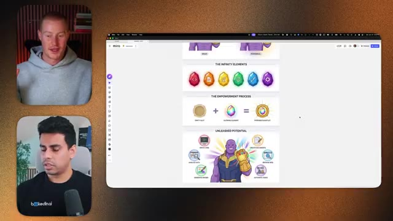
*⏱️ 00:03:12 — Capture d'écran montrant le présentateur et un invité en haut à gauche et en bas à gauche, ainsi qu'un tableau blanc Miro affichant des graphiques thématiques sur les éléments infinis et un personnage de style Thanos.*

---

### ⏱️ `[00:03:37 - 00:04:11]` | Segment #09

**🔊 Audio (Transcription Intégrale Mot pour Mot en Français) :**
> des super-pouvoirs parce que, en ce moment, on a peut-être genre une ou deux pierres d'infinité. Mais genre, qu'est-ce qui se passe quand la majorité de ces plateformes commencent maintenant à avoir ces compétences qui rendent nos flux de travail agentiques genre super productifs et capables de faire des choses assez cool au lieu de juste faire ce genre de tâches de codage basiques, ouais exactement, donc c'est comme passer au niveau supérieur où maintenant Claude peut non seulement coder, ce qui est cool, tu peux seulement écrire une certaine quantité de code, mais ensuite il peut exploiter d'autres services, des gens qui ont passé des milliers d'heures à construire leurs produits, genre je vais vous montrer, HeyGen a très récemment introduit sa compétence Claude où maintenant tu peux essentiellement

**👁️ Analyse Visuelle d'Écran (gemini-3.5-flash-lite) :**
**Interface & Outils** : Miro (tableau blanc interactif)

**Contenu textuel & Code** : Schéma visuel avec des icônes colorées représentant des pierres d'infinité ("The Infinity Elements"), un processus d'autonomisation et une illustration de Thanos portant le Gant de l'Infini avec diverses capacités d'IA listées autour (Write Code, Create Documents, Browse Web, Automate Tasks, Generate Images, Analyze Data).

**Action / Démonstration** : Le présentateur explique et commente le schéma conceptuel affiché à l'écran concernant l'évolution et l'impact des agents IA.

---

### ⏱️ `[00:04:11 - 00:04:45]` | Segment #10

**🔊 Audio (Transcription Intégrale Mot pour Mot en Français) :**
> créez votre propre avatar. Vous pouvez utiliser Remotion pour créer une vidéo et ensuite y faire parler votre avatar comme si vous étiez le créateur de contenu en train de la faire. Et cela ouvre tout un nouveau monde de possibilités, en particulier pour la création de contenu où, vous savez, à mesure que cette technologie ne cesse de s'améliorer, tout pourrait changer tel que nous le connaissons. Ouais, mec, c'est fou. Toi et moi, Salman, en tant que YouTubers, enfin je suis plutôt un YouTuber. Tu es, tu es, tu es aussi propriétaire d'entreprise, mais moi je m'identifie un peu comme un YouTuber. Mon travail pourrait bien disparaître d'ici peu. C'est donc vraiment intéressant à voir et honnêtement, je pense sincèrement que c'est la plus grande opportunité pour commencer à apprendre comment

**👁️ Analyse Visuelle d'Écran (gemini-3.5-flash-lite) :**
**Interface & Outils** : Navigateur web, tableau blanc Miro, interface de présentation vidéo.

**Contenu textuel & Code** : Graphique circulaire de pourcentage (65% of developers use AI assistants), diagrammes visuels et éléments graphiques de présentation.
[DESC_IMAGE_1] Le présentateur explique l'utilisation des assistants IA avec une illustration chiffrée.
[DESC_IMAGE_2] Le présentateur présente un schéma conceptuel sur Miro illustrant un flux de travail.

**Action / Démonstration** : Explications face caméra et analyse conceptuelle des marchés.

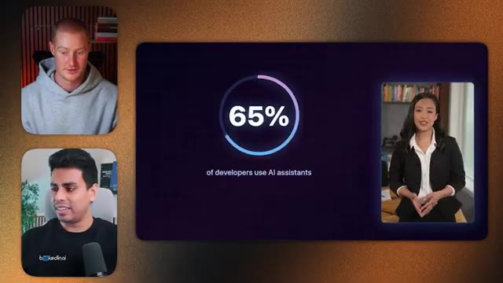
*⏱️ 00:04:20 — Vue d'une interface présentant une statistique de 65% avec un avatar vidéo parlant sur le côté droit.*

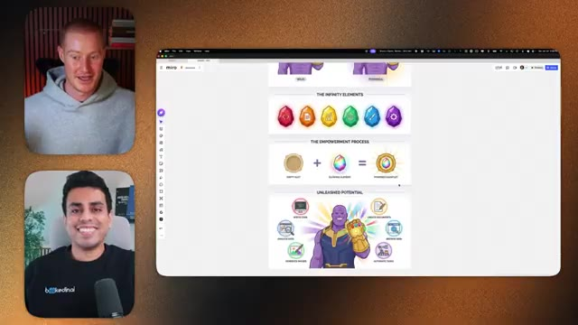
*⏱️ 00:04:36 — Capture d'un tableau blanc Miro illustrant un processus avec des illustrations thématiques de super-héros.*

---

### ⏱️ `[00:04:45 - 00:05:10]` | Segment #11

**🔊 Audio (Transcription Intégrale Mot pour Mot en Français) :**
> d'utiliser quelque chose comme Cloud Code et anti-gravity parce que ça va vraiment juste suralimenter les gens qui comprennent comment utiliser ces technologies oui absolument c'est un peu comme j'ai l'impression qu'il y a une si grande opportunité d'arbitrage dont nous pouvons profiter parce que c'est encore seulement comme une poignée de personnes qui peuvent faire ça en ce moment donc si vous apprenez vraiment cette technologie et qu'en fait même rien qu'en la connaissant, les possibilités auxquelles vous pouvez penser et que vous pouvez débloquer et dont vous pouvez profiter avant tout le monde sont vraiment insensées.

**👁️ Analyse Visuelle d'Écran (gemini-3.5-flash-lite) :**
**Interface & Outils** : Tableau blanc Miro affiché dans un navigateur web avec deux flux vidéo des intervenants.

**Contenu textuel & Code** : Schémas et graphiques représentant des éléments de surpuissance (pierres de l'infini, processus d'habilitation) et une métaphore visuelle avec le personnage de Thanos pour illustrer le potentiel libéré par l'IA.

**Action / Démonstration** : Présentation visuelle et explication des concepts d'autonomisation et d'opportunités d'arbitrage grâce aux technologies d'IA.

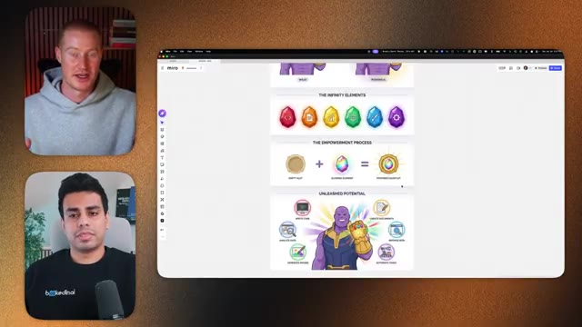
*⏱️ 00:04:51 — Capture d'écran montrant le présentateur principal et son invité à gauche, ainsi qu'un tableau blanc Miro partagé à droite illustrant le concept d'"Infinity Elements" et de "Potential Unleashed" avec des illustrations thématiques.*

---

### ⏱️ `[00:05:11 - 00:05:29]` | Segment #12

**🔊 Audio (Transcription Intégrale Mot pour Mot en Français) :**
> Oui, c'est sans fin. Très bien, alors Salman, on comprend en gros les compétences maintenant et pourquoi elles sont importantes et pourquoi elles vont être importantes à l'avenir, mais comment quelqu'un dans mon audience en ce moment qui n'a aucune idée de comment coder, n'utilise pas cursor, n'utilise pas anti-gravity, comment pourrait-il commencer à créer ces vidéos avec cette compétence Claude ? Pourrais-tu me guider à travers cette partie ? Oui, bien sûr.

**👁️ Analyse Visuelle d'Écran (gemini-3.5-flash-lite) :**
**Interface & Outils** : Navigateur web affichant l'application de tableau blanc collaboratif Miro, avec les flux vidéo des deux participants incrustés sur le côté gauche.

**Contenu textuel & Code** : Schéma visuel intitulé "The Infinity Elements" et "Unleashed Potential" représentant des compétences ou des capacités sous forme de pierres colorées autour d'un personnage (Thanos) portant un gant d'infinité.

**Action / Démonstration** : Présentation d'un concept métaphorique sur l'acquisition de compétences et le potentiel débloqué grâce à l'intelligence artificielle.

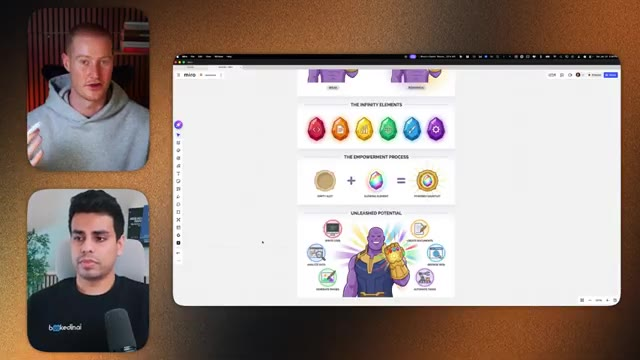
*⏱️ 00:05:15 — Capture d'écran montrant l'animateur en haut à gauche, l'invité en bas à gauche, et une grande fenêtre de navigateur affichant un tableau blanc Miro avec un schéma métaphorique inspiré de Thanos et des pierres d'infinité.*

---

### ⏱️ `[00:05:29 - 00:05:51]` | Segment #13

**🔊 Audio (Transcription Intégrale Mot pour Mot en Français) :**
> Donc je vais garder ça super simple. Tout ce dont nous avons besoin pour créer ces types de vidéos, c'est juste d'un abonnement à Claude et c'est tout. Donc après avoir pris l'abonnement à Claude, vous voyez, c'est juste une petite photo rapide que j'ai. C'est tout avec quoi nous allons interagir. Très bien. Donc si j'ouvre mon application Claude, d'abord, ce que vous voulez faire, c'est vraiment facile. Vous voulez ouvrir un nouveau dossier. Donc par exemple, je vais créer un nouveau dossier dans mes documents.

**👁️ Analyse Visuelle d'Écran (gemini-3.5-flash-lite) :**
**Interface & Outils** : Miro (tableau blanc virtuel), Claude AI (application Anthropic)

**Contenu textuel & Code** : Titre principal "How to build", capture d'écran montrant l'interface utilisateur de Claude AI avec son historique de conversations ("Create interactive AI product demos", "Document AI agent architecture") et sa fenêtre de saisie.

**Action / Démonstration** : Explication des prérequis techniques (simple abonnement et accès à Claude AI) pour développer et générer les vidéos/applications présentées.

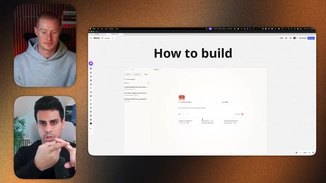
*⏱️ 00:05:34 — Un tableau virtuel Miro affichant le titre "How to build" et une capture d'écran intégrée de l'interface de l'application Claude AI.*

---

### ⏱️ `[00:05:51 - 00:06:11]` | Segment #14

**🔊 Audio (Transcription Intégrale Mot pour Mot en Français) :**
> Disons Remotion Brock. Très bien. Donc tout ce qu'on a fait là maintenant, c'est juste aller dans notre application Claude. J'ai cliqué sur ce bouton de code et j'ai sélectionné un dossier. C'est tout. Il n'y a rien d'extraordinaire que je fais en ce moment. Donc maintenant ce qu'on veut faire, c'est qu'on veut donner à ce dossier dans notre dossier, on devrait dire à Claude, hé, juste ici, nous allons créer des vidéos.

**👁️ Analyse Visuelle d'Écran (gemini-3.5-flash-lite) :**
**Interface & Outils** : Application Claude Desktop (Anthropic) sous macOS.

**Contenu textuel & Code** : Sélecteur de dossier contenant le répertoire `remotionbrock`, champ de saisie de prompt vide et panneau latéral avec l'historique des projets.

**Action / Démonstration** : Sélection d'un dossier de travail local dans Claude Desktop avant le lancement de la génération de code.

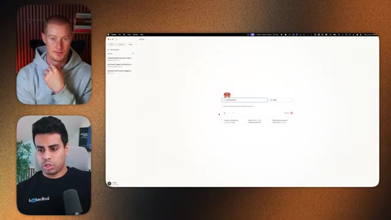
*⏱️ 00:05:56 — Interface de l'application Claude Desktop affichant la sélection du dossier projet "remotionbrock".*

---

### ⏱️ `[00:06:11 - 00:06:30]` | Segment #15

**🔊 Audio (Transcription Intégrale Mot pour Mot en Français) :**
> Donc, vous avez besoin de cette compétence Remotion, n'est-ce pas ? Et pour faire ça, ce qu'on va faire, c'est qu'on va prendre ce fichier juste ici, qui vient du créateur de Claude Code. Et on va prendre ça, tout ce que je fais, c'est simplement copier l'URL. Je la colle ici et je lui dis, hé, est-ce que tu peux installer cette compétence Claude pour moi ? On va créer des vidéos Remotion ici.

**👁️ Analyse Visuelle d'Écran (gemini-3.5-flash-lite) :**
**Interface & Outils** : Navigateur web, GitHub Gist, interface de développement / chat IA.

**Contenu textuel & Code** : Fichier Markdown nommé CLAUDE.md avec des exemples de code JSX et une URL GitHub collée dans une interface de chat.

**Action / Démonstration** : Copie de l'URL d'un fichier GitHub Gist pour l'intégrer dans l'outil de développement IA.

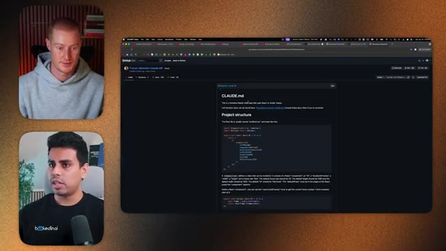
*⏱️ 00:06:16 — Vue d'un navigateur affichant un Gist GitHub contenant la documentation et du code React pour Remotion Claude.*

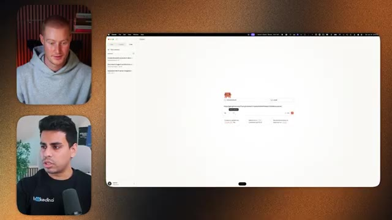
*⏱️ 00:06:25 — Vue d'une interface de chat (potentiellement Claude Code ou Cursor) où une URL GitHub est collée.*

---

### ⏱️ `[00:06:30 - 00:06:52]` | Segment #16

**🔊 Audio (Transcription Intégrale Mot pour Mot en Français) :**
> Et ensuite, est-ce que tu peux s'il te plaît créer une vidéo pour moi ? Ouais, eh bien, c'est facile. Et puis les gars, si vous voulez accéder à ça, il va y avoir un lien dans la description juste pour pouvoir cliquer là-dessus et, vous savez, pour que vous puissiez copier cette URL tout comme Solomon vient de le faire à l'instant. Ouais. Donc normalement, ce que vous auriez à faire, c'est de créer un fichier. Vous auriez à mettre le fichier à l'intérieur de toutes ces choses. Mais maintenant, étant donné que Cloud Code est devenu tellement intelligent, je n'ai même plus besoin de lire ou de savoir ce qui se passe.

**👁️ Analyse Visuelle d'Écran (gemini-3.5-flash-lite) :**
**Interface & Outils** : Interface web d'un chatbot/assistant IA, fenêtres de visioconférence.

**Contenu textuel & Code** : Un prompt textuel d'un utilisateur demandant de générer une vidéo basée sur un contenu précédent.

**Action / Démonstration** : Affichage de l'interface de l'assistant IA pendant la démonstration ou la discussion.

*⏱️ 00:06:36 — Capture d'écran montrant l'interface d'une application de type assistant IA (style Claude) à droite, avec deux intervenants en visioconférence sur le côté gauche.*

---

### ⏱️ `[00:06:53 - 00:07:26]` | Segment #17

**🔊 Audio (Transcription Intégrale Mot pour Mot en Français) :**
> Je peux juste lui donner un lien et je lui dis, hé, va comprendre tout ça. Je veux juste que ce soit fait. Ouais. Et le plus drôle, c'est que je pense que les gens en arrière-plan, sur le backend, je veux dire, les gens de l'extérieur qui regardent ne savent même pas ce que ça fait sur le backend. Et c'est un truc super complexe. mais genre je ne sais pas coder, je ne suis pas technique, je m'en fous, ça le fait juste pour moi, c'est ça la puissance du truc et le meilleur côté ouais c'est juste genre à peu près fais-moi juste une vidéo c'est ça, on pointe ça vers genre comme imagine si tu es un chef, tu peux utiliser des tonnes de trucs différents n'est-ce pas pour disons faire une vidéo, tu peux utiliser comme disons qu'on prépare un repas, on peut

**👁️ Analyse Visuelle d'Écran (gemini-3.5-flash-lite) :**
**Interface & Outils** : Interface web de l'outil Claude (Anthropic), affichée dans un navigateur avec une disposition en deux colonnes (historique des sessions et zone de chat).

**Contenu textuel & Code** : Un prompt contenant un lien (YouTube/vidéo) et une réponse structurée de l'IA comprenant des liens vers le Model Context Protocol (MCP), Sequential Thinking, et SQLite.

**Action / Démonstration** : Présentation d'une démonstration montrant comment donner un lien à l'IA pour qu'elle analyse et automatise des tâches de backend.

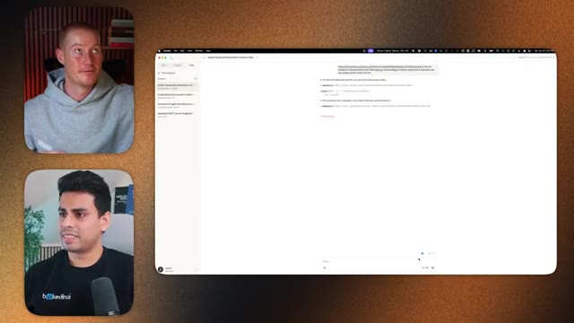
*⏱️ 00:07:01 — Capture d'écran montrant l'interface d'un outil d'IA (Claude) avec une liste de sessions à gauche et une conversation comprenant des liens et du texte généré à droite, ainsi que les deux intervenants en vignettes vidéo à gauche.*

---

### ⏱️ `[00:07:26 - 00:08:01]` | Segment #18

**🔊 Audio (Transcription Intégrale Mot pour Mot en Français) :**
> On peut faire quelque chose comme un plat au poulet, on peut faire un plat au bœuf, donc maintenant c'est un peu comme un ingrédient, on lui dit : « Hé, utilise ces ustensiles, utilise ces ingrédients pour me faire ce genre de... C'est ça. » Et si tu ne sais pas comment le faire, alors va et débrouille-toi pour trouver comment le faire. Et il va y aller et trouver comment assembler les ingrédients. Genre c'est dingue là. Il vient de récupérer toutes les compétences Claude et il vient de me demander la permission. Et il était genre : « Hé, est-ce que je peux mettre ça dans un fichier ? » Donc il est littéralement en train de télécharger toutes ces compétences qui étaient à l'intérieur de ce truc GitHub. Et donc maintenant, votre Claude a accès à la capacité d'aller faire plusieurs choses différentes, n'est-ce pas ? Sans même que nous ayons à lui donner cette compétence. Ouais. Donc là, maintenant il dit la remotion

**👁️ Analyse Visuelle d'Écran (gemini-3.5-flash-lite) :**
**Interface & Outils** : Interface de l'application Claude sur macOS avec double encadré vidéo des intervenants.

**Contenu textuel & Code** : Texte de prompt et réponses structurées de l'assistant concernant l'utilisation d'outils et de scripts.

**Action / Démonstration** : Présentation d'une démonstration textuelle d'un échange avec un assistant IA.

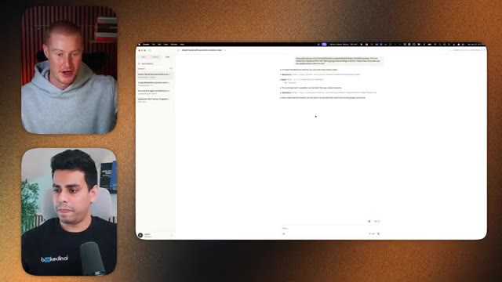
*⏱️ 00:07:35 — Capture d'écran montrant l'interface d'un assistant IA (Claude) avec une fenêtre de chat textuel affichant un prompt et des réponses générées.*

---

### ⏱️ `[00:08:01 - 00:08:20]` | Segment #19

**🔊 Audio (Transcription Intégrale Mot pour Mot en Français) :**
> la compétence est installée. Le répertoire du projet est vide. Je dois donc configurer un nouveau projet Motion. Avant de faire cela, quel genre de vidéo aimerais-tu que je construise ? Donc, il demande toutes ces choses. Brock, as-tu un site web ? Je n'ai pas de site web en fait. D'accord. Donc, parce que ce que je pourrais faire, c'est que je pourrais dire, hé, va sur ce site web, va récupérer ces ressources, puis construis une vidéo pour cela.

**👁️ Analyse Visuelle d'Écran (gemini-3.5-flash-lite) :**
**Interface & Outils** : Interface Claude Code / application de développement avec panneaux de discussion et webcams.

**Contenu textuel & Code** : Texte affiché indiquant l'état d'installation de la compétence Remotion, ainsi qu'une liste de propositions de types de vidéos (Intro/outro, Social media content, Explainer video, etc.).

**Action / Démonstration** : Affichage des suggestions de l'assistant de code pour configurer un nouveau projet Remotion en fonction des besoins de l'utilisateur.

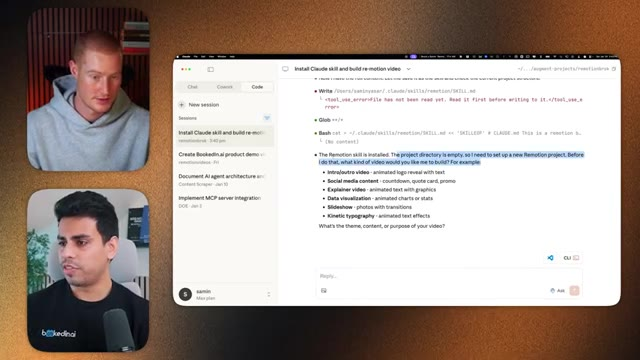
*⏱️ 00:08:06 — Vue d'écran partagée montrant l'interface d'une application de type assistant ou terminal de code (Claude) avec du texte généré à droite et les webcams des deux intervenants sur le côté gauche.*

---

### ⏱️ `[00:08:20 - 00:08:53]` | Segment #20

**🔊 Audio (Transcription Intégrale Mot pour Mot en Français) :**
> C'est ça. Bon, allons sur votre site web et voyons à quoi ressemble le vôtre. Parce que, je crois que vous avez fait quelque chose de similaire pour votre vidéo, n'est-ce pas ? Oui. Alors ici, donc par exemple, ceci est mon site web booked in that AI, j'ai une palette de couleurs et tout ça. J'ai quelques, vous savez, des images, et cetera. Donc ce que je peux faire, c'est que je peux copier ceci et y retourner et dire : pour ce site web, pouvez-vous aller chercher les ressources, utiliser les mêmes couleurs, comme le texte blanc, noir, les accents bleus, des trucs comme ça, et ensuite construire une vidéo pour une démonstration de produit pour ce SaaS ou cet outil exact ? Et je suis intentionnellement juste incroyablement vague dans ce que je dis, parce que je veux montrer que,

**👁️ Analyse Visuelle d'Écran (gemini-3.5-flash-lite) :**
**Interface & Outils** : Interface de l'application de développement Claude et navigateur web.

**Contenu textuel & Code** : Sessions de code, instructions d'installation de compétences Remotion et saisie de l'URL du site web bookedin.ai dans le champ de chat.

**Action / Démonstration** : Le présentateur présente l'outil de développement et saisit l'adresse du site web pour générer une vidéo promotionnelle basée sur son contenu.

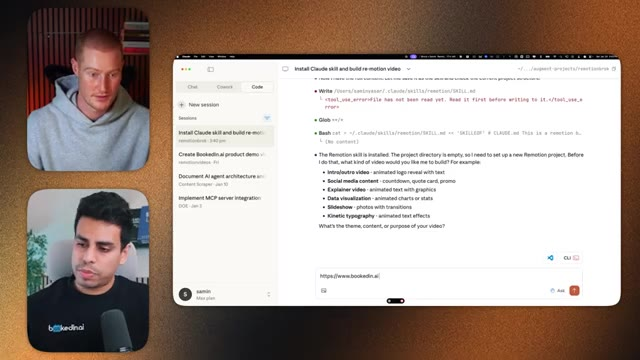
*⏱️ 00:08:37 — Capture d'écran montrant une interface de développement avec un assistant IA (Claude / code) et la saisie de l'URL "https://www.bookedinin.ai".*

---

### ⏱️ `[00:08:53 - 00:09:28]` | Segment #21

**🔊 Audio (Transcription Intégrale Mot pour Mot en Français) :**
> tu sais, tant que tu te contentes de parler à ce truc, c'est à peu près tout. C'est tout ce que tu as à faire, n'est-ce pas ? Et maintenant tu vois, maintenant ça dit "hé, est-ce que tu peux me permettre d'aller chercher ces trucs ?" je suis genre "ouais, vas-y, fais ton truc". Ouais, je pense que la barrière à l'entrée pour faire quoi que ce soit, honnêtement, baisse de plus en plus, de plus en plus, de plus en plus. C'est juste que, tu vois, tu dois en quelque sorte franchir cet obstacle initial, il y aura toujours un peu de vocabulaire bizarre que les gens utilisent parce que, euh, les gens techniques utilisent beaucoup de jargon, mais honnêtement, tu dois juste ignorer ce que les gens disent et si jamais tu as un doute, va juste sur Claude et colle-le et dis : "hé"

**👁️ Analyse Visuelle d'Écran (gemini-3.5-flash-lite) :**
**Interface & Outils** : Interface de l'application Claude / outil de développement avec panneau latéral pour les sessions et panneau principal de discussion, et flux vidéo des présentateurs.

**Contenu textuel & Code** : Texte du prompt demandant de récupérer les éléments d'un site web (https://www.bookedin.ai) pour construire une vidéo de démonstration de produit avec un thème visuel spécifique, suivi d'une action "WebFetch" en cours d'exécution.

**Action / Démonstration** : L'assistant analyse la demande de l'utilisateur et s'apprête à récupérer les ressources du site web mentionné pour générer le projet vidéo.

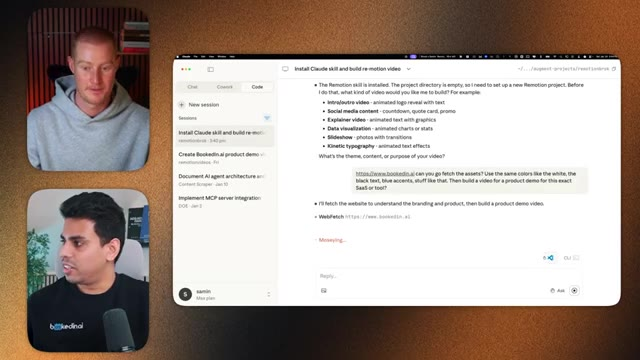
*⏱️ 00:09:02 — Capture d'écran montrant l'interface d'un assistant de code (Claude) avec une conversation en cours sur la création de vidéos Remotion, accompagnée de deux vignettes vidéo des intervenants sur le côté gauche.*

---

### ⏱️ `[00:09:28 - 00:10:00]` | Segment #22

**🔊 Audio (Transcription Intégrale Mot pour Mot en Français) :**
> trouve ça pour moi, c'est ça que je veux, qu'est-ce que je fais ensuite ? Oui, et je pense que moi, depuis que j'utilise Claude Code ces deux dernières semaines de façon assidue pour la toute première fois parce que je pensais que ce serait trop difficile, j'ai remarqué que c'est beaucoup plus facile que ça en a l'air. Je suis d'accord avec cette histoire de jargon technique, parce que ça a tendance à intimider tellement de gens et les empêche de faire ce premier pas, alors que si on ne s'inquiète pas du jargon technique et qu'on demande juste à Claude de faire quelque chose, et si on ne sait pas comment faire, qu'on lui demande de nous l'expliquer comme si on était en CM1, il est tellement doué pour simplifier les choses, pour rendre ça facile, et la plupart du temps, je n'ai même pas besoin de savoir ce qu'il fait en arrière-plan parce qu'il est capable de le faire tout seul et

**👁️ Analyse Visuelle d'Écran (gemini-3.5-flash-lite) :**
**Interface & Outils** : Interface de l'application Claude Code sur macOS avec double affichage vidéo des intervenants.

**Contenu textuel & Code** : Texte de prompt demandant de récupérer les éléments d'un site web (bookedin.ai) et liste de tâches (Update Todos) pour initialiser un projet Remotion.

**Action / Démonstration** : Utilisation de Claude Code pour automatiser la génération d'une vidéo de présentation produit à partir d'un site web.

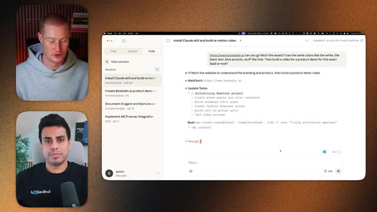
*⏱️ 00:09:36 — Capture d'écran montrant l'interface de Claude Code avec des instructions de prompt et une liste de tâches pour créer une vidéo de démonstration.*

---

### ⏱️ `[00:10:00 - 00:10:34]` | Segment #23

**🔊 Audio (Transcription Intégrale Mot pour Mot en Français) :**
> Travailler dessus, faire des itérations et trouver comment faire. Oui, c'est assez dingue la façon dont la trajectoire de tout évolue, parce que maintenant, je ne sais pas, il y a eu ce concept, je ne sais pas si tu as vu, de Ralph Wiggum. Et la raison pour laquelle ce genre de concept est né, c'est parce que Ralph Wiggum, en tant que personnage dans Les Simpson, est dépeint comme un personnage stupide, n'est-ce pas ? Mais ce qu'il fait, c'est qu'il a une ténacité illimitée et il fonce, tu vois, et essaie de s'attaquer aux problèmes, super persistant, c'est ça, exactement, oui. Donc c'est un peu comme une analogie amusante, mais on doit tous juste être des Ralph Wiggum, nous

**👁️ Analyse Visuelle d'Écran (gemini-3.5-flash-lite) :**
**Interface & Outils** : Interface de développement IA assisté par agent (session de code / terminal Claude Cowork ou outil similaire d'orchestration de code).

**Contenu textuel & Code** : Prompt utilisateur demandant d'extraire les assets et couleurs du site bookedin.ai pour créer une vidéo produit ; journal d'exécution de l'agent : `WebFetch`, liste de tâches ("Update Todos" pour initialiser le projet Remotion), commande Bash `npx create-video@latest --template=blank`, statut "Pondering...".

**Action / Démonstration** : Exécution automatisée d'un agent IA lançant des commandes bash et planifiant la création d'un projet vidéo Remotion basé sur l'analyse d'un site web.

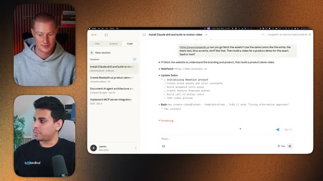
*⏱️ 00:10:08 — Interface d'un agent de développement IA en cours d'exécution d'une tâche pour créer une vidéo de démo de produit via Remotion à partir d'un site web, avec les deux intervenants en médaillons à gauche.*

---

### ⏱️ `[00:10:34 - 00:11:06]` | Segment #24

**🔊 Audio (Transcription Intégrale Mot pour Mot en Français) :**
> Il suffit de continuer à demander à Claude : « Hé, qu'est-ce que je fais ? » « Hé, fais ça pour moi », et à la fin, on va juste obtenir notre résultat. Ouais, très bien, donc cette chose vient juste de se terminer, alors ça dit juste d'ouvrir cette chose sur ton navigateur, ouvrons-la. D'accord, alors cliquons sur lecture, et tu vois, ça a littéralement pris mon titre, ça a pris tout le texte de notre site web, ouais, c'est en fait vraiment insensé, ça fait toutes ces animations graphiques, ça a même construit ces petits téléphones, c'est plutôt cool, ouais.

**👁️ Analyse Visuelle d'Écran (gemini-3.5-flash-lite) :**
**Interface & Outils** : Interface de discussion Claude et Remotion Studio en local (localhost:3000).

**Contenu textuel & Code** : Structure de vidéo en plusieurs scènes, palette de couleurs, commandes npm et rendu visuel du logo Bookedin.ai.

**Action / Démonstration** : Consultation du résultat généré par l'IA et ouverture de l'application web locale pour visualiser la vidéo.

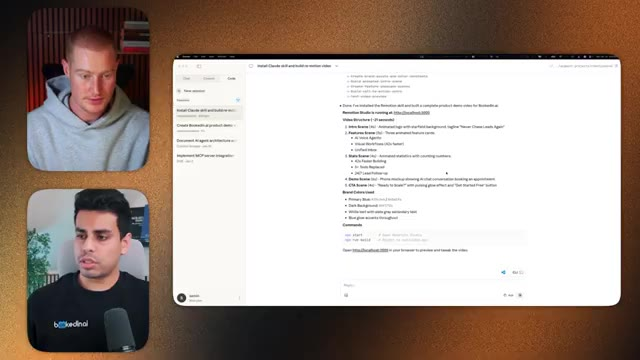
*⏱️ 00:10:42 — L'écran montre une application de type assistant IA (Claude) avec le résultat de la génération de code et la structure de la vidéo expliquée point par point.*

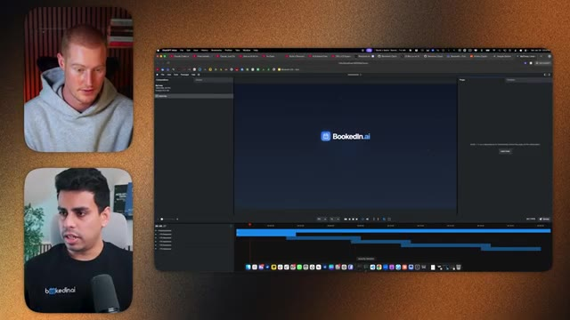
*⏱️ 00:10:50 — L'écran affiche l'interface d'un lecteur ou logiciel vidéo local en cours d'exécution (Remotion Studio) avec le rendu de la vidéo « Bookedin.ai ».*

---

### ⏱️ `[00:11:06 - 00:11:42]` | Segment #25

**🔊 Audio (Transcription Intégrale Mot pour Mot en Français) :**
> et bien sûr, tu sais, tu peux modifier plein de trucs super facilement en lui demandant simplement, et disons, par exemple, maintenant tu aimes cette vidéo ou tu l'approuves. Tu veux t'assurer qu'elle est automatiquement envoyée à mon patron pour qu'il puisse l'approuver ou la désapprouver, n'est-ce pas ? Ce que je pourrais faire maintenant, c'est de te montrer ce graphique qui pourrait rendre les choses plus faciles. Donc maintenant, disons que notre agent Cloud Code, celui-ci s'appelle agent anti-gravité, parce que la semaine prochaine, nous allons en fait vous montrer comment faire ces choses avec l'anti-gravité aussi. Restez à l'écoute pour ça. Mais nous venons juste de générer cette vidéo. Et ensuite, ce qu'on peut faire maintenant, c'est utiliser quelque chose comme Zapier pour nous envoyer un message Slack.

**👁️ Analyse Visuelle d'Écran (gemini-3.5-flash-lite) :**
**Interface & Outils** : Miro, application web de schématisation.

**Contenu textuel & Code** : Schéma d'architecture "Autopilot" illustrant les étapes : Agent IA (création) -> Génération de vidéo -> Pont Zapier (notification avec boutons d'approbation) -> Publication sur les plateformes.

**Action / Démonstration** : Présentation visuelle et explication du flux de travail automatisé avec validation humaine.

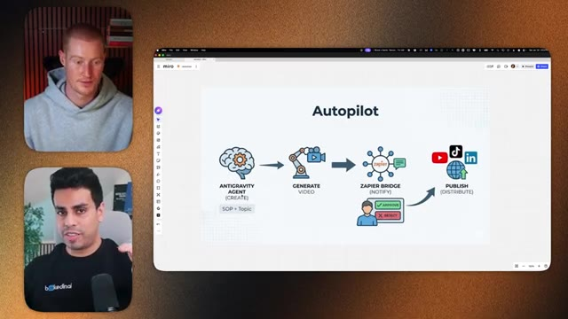
*⏱️ 00:11:33 — Schéma explicatif sur Miro montrant le workflow "Autopilot" avec un agent IA, la génération de vidéo, un pont Zapier avec validation humaine et la publication.*

---

### ⏱️ `[00:11:42 - 00:12:04]` | Segment #26

**🔊 Audio (Transcription Intégrale Mot pour Mot en Français) :**
> et la vidéo automatiquement une fois qu'elle est terminée. Et si nous donnons le feu vert, elle va automatiquement être publiée sur tous nos réseaux sociaux. La façon dont nous faisons cela est en utilisant Zapier et nous allons directement ici. Donc nous allons sur zapier.com slash MCP. Nous allons sur commencer à créer. Et ensuite, c'est déjà un serveur MCP, mais vous pouvez créer un nouveau serveur MCP. Vous pouvez sélectionner Claude ou Claude code, selon celui que vous voulez.

**👁️ Analyse Visuelle d'Écran (gemini-3.5-flash-lite) :**
**Interface & Outils** : Miro, navigateur web affichant l'interface Zapier MCP.

**Contenu textuel & Code** : Diagramme de flux d'automatisation (Autopilot) et interface de configuration de serveur Zapier MCP.

**Action / Démonstration** : Présentation du workflow d'automatisation de la création et publication de vidéos, suivie d'une navigation sur l'interface Zapier MCP.

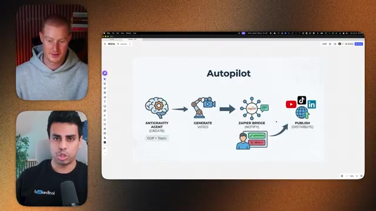
*⏱️ 00:11:48 — Schéma de workflow sur Miro intitulé 'Autopilot', montrant les étapes de création par un agent d'IA, génération vidéo, pont Zapier avec notification d'approbation, et publication sur les réseaux sociaux (YouTube, TikTok, LinkedIn).*

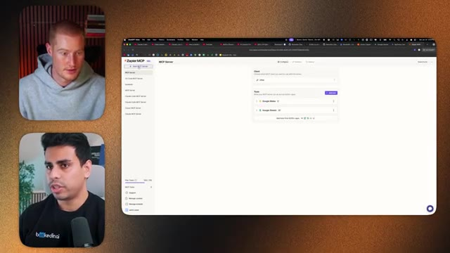
*⏱️ 00:11:58 — Interface de Zapier MCP Server affichant les configurations de serveur avec des outils connectés comme Google Slides et Google Sheets.*

---

### ⏱️ `[00:12:04 - 00:12:37]` | Segment #27

**🔊 Audio (Transcription Intégrale Mot pour Mot en Français) :**
> Exact. Donc, oh, il y a même cowork maintenant, en fait, c'est plutôt cool. Donc disons que vous créez ça. Et ensuite, après avoir ça, vous ajoutez n'importe quelle application dont vous avez besoin. Donc par exemple, nous pouvons ajouter quelque chose comme Slack. Et ici, nous pouvons demander des approbations à notre équipe ou à nos managers, et cetera. Vous pouvez donc ajouter ces choses-là. Vous pouvez toutes les sélectionner et cliquer sur connecter. Et ensuite, après avoir connecté votre Slack, vous pouvez faire quelque chose comme Metricool. Oui. Ensuite, vous pouvez utiliser quelque chose comme Metricool pour essentiellement, vous savez, ajouter vos publications ou planifier vos publications automatiquement. Et en faisant cela, donc disons que vous avez fait les deux, vous cliquez simplement sur connecter et ensuite vous copiez cette commande,

**👁️ Analyse Visuelle d'Écran (gemini-3.5-flash-lite) :**
**Interface & Outils** : Navigateur web (interface de configuration d'agent ou d'outil de type ChatGPT/Make/Zapier) avec deux intervenants en visioconférence sur le côté gauche.

**Contenu textuel & Code** : Fenêtre modale de sélection d'outils avec une barre de recherche et des icônes d'applications (Slack, Salesforce, etc.).

**Action / Démonstration** : Sélection ou ajout d'outils tiers (comme Slack) à l'environnement en cours de configuration.

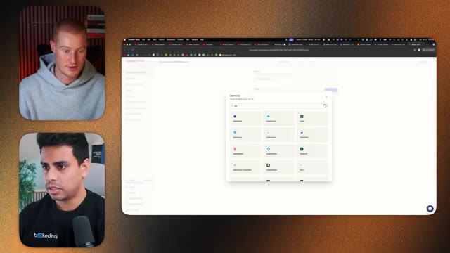
*⏱️ 00:12:12 — Interface web montrant une fenêtre contextuelle "Add tools" permettant d'intégrer différentes applications tierces.*

---

### ⏱️ `[00:12:37 - 00:13:11]` | Segment #28

**🔊 Audio (Transcription Intégrale Mot pour Mot en Français) :**
> donne-le à Claude et tu peux lui dire, hey, va demander à mon manager si je peux, si c'est approuvé pour publier. Et s'il dit oui, tu peux juste lui dire, ok, maintenant publie ceci avec Metricool et ensuite ça fera tout ça pour toi. Donc avec tout ça, tu peux voir que tu peux avoir un flux automatisé où tu peux faire une vidéo, tu peux la générer, et ensuite tu peux faire tes modifications facilement juste en faisant des requêtes à Claude, en disant, hey, change le mouvement de ceci ici et là. Et ensuite tu la connectes à Zapier et tu peux juste publier et faire tout ton travail depuis un seul endroit avec juste Claude desktop. Je suppose que c'est juste un exemple très simple de ce qu'on pourrait faire avec le MCP Zapier,

**👁️ Analyse Visuelle d'Écran (gemini-3.5-flash-lite) :**
**Interface & Outils** : Navigateur web affichant une documentation Zapier MCP Server.

**Contenu textuel & Code** : Instructions textuelles sur la configuration de Claude Code et la connexion du serveur MCP de Zapier avec une ligne de commande visible.

**Action / Démonstration** : Présentation de la configuration des outils d'automatisation et de l'intégration entre Claude Code et Zapier.

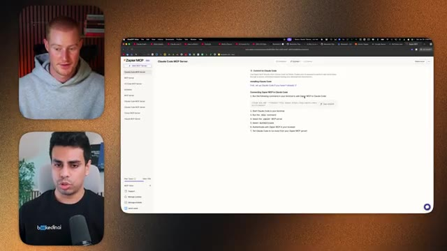
*⏱️ 00:12:46 — Capture d'écran montrant le présentateur et un invité à gauche, et une page Web de Zapier expliquant comment configurer et connecter le serveur MCP de Zapier à Claude Code.*

---

### ⏱️ `[00:13:11 - 00:13:44]` | Segment #29

**🔊 Audio (Transcription Intégrale Mot pour Mot en Français) :**
> parce que ça se connecte littéralement à plus de 8 000 applications différentes. Je pense qu'il y a plus de 30 000 actions qu'il peut exécuter à travers ces applications. Donc si vous utilisez un truc spécifique, comme vous pourriez envoyer un message Gmail à votre équipe, vous pourriez ajouter ce lien vidéo à Google Sheets ou mettre à jour votre page Notion, tout ce genre de choses, juste en lui donnant en quelque sorte ces mains pour qu'il puisse aller de l'avant et s'exécuter et, vous savez, utiliser différentes applications que vous utilisez. C'est donc une façon de combler ce fossé, comme vous l'avez dit. Exactement. Ouais. Franchement, le monde est à vous. C'est comme chaque fois que vous essayez de faire quelque chose, pensez simplement à ce que vous faites au jour le jour, à toutes les petites étapes, vous pouvez simplement faire en sorte qu'elles soient toutes connectées et pensez à ça comme donner à Zapier, pensez à Zapier.

**👁️ Analyse Visuelle d'Écran (gemini-3.5-flash-lite) :**
**Interface & Outils** : Interface logicielle de type éditeur ou assistant textuel avec des panneaux de code et de documentation.

**Contenu textuel & Code** : Texte descriptif d'une structure vidéo, listes à puces et instructions de commandes (`npm start`, `npm run build`).

**Action / Démonstration** : Affichage des résultats d'une session de travail ou d'une documentation générée par un outil d'intelligence artificielle.

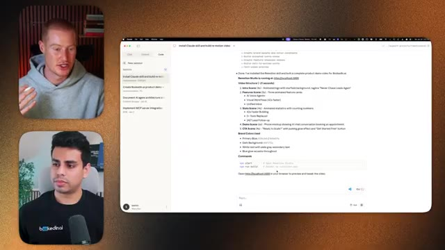
*⏱️ 00:13:19 — Capture d'écran montrant l'interface d'une application logicielle à droite, avec deux fenêtres vidéo des intervenants sur la gauche.*

---

### ⏱️ `[00:13:44 - 00:14:18]` | Segment #30

**🔊 Audio (Transcription Intégrale Mot pour Mot en Français) :**
> comme donner à Claude une compétence différente comme le gant de Thanos, c'est juste une autre compétence où tu peux dire hé Claude va faire ce truc pour moi il y a accès ouais non c'est fou bon Saman donc on a cette vidéo maintenant qui est générée avec Remotion mais comment est-ce qu'on peut maintenant ajouter une autre compétence et utiliser un autre outil comme ElevenLabs pour aller de l'avant et générer une voix off pour la vidéo donc non seulement on a une vidéo maintenant on a une vidéo entière avec une voix off dessus ouais donc c'est en fait vraiment simple donc de la même manière ce qu'on va faire c'est qu'on va lui donner une nouvelle compétence et la façon dont on donne de nouvelles compétences aux choses c'est donc par exemple pour ElevenLabs ce que j'aime utiliser

**👁️ Analyse Visuelle d'Écran (gemini-3.5-flash-lite) :**
**Interface & Outils** : Interface web de configuration d'assistant IA avec une fenêtre contextuelle "Add tools".

**Contenu textuel & Code** : Icônes d'applications et de services intégrables (Asana, Salesforce, Jira Software Cloud, ClickUp, monday.com, Confluence, Microsoft Excel, Microsoft Sharepoint, Zillow, Docker et autres).

**Action / Démonstration** : Sélection ou présentation des différentes compétences et intégrations logicielles connectables à l'IA.

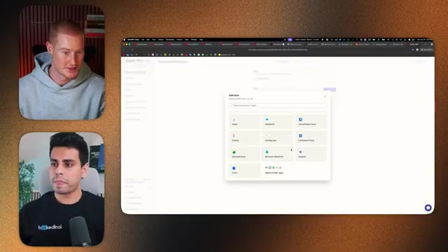
*⏱️ 00:13:52 — Capture d'écran montrant l'interface d'ajout d'outils et de compétences tierces sous forme de grille d'applications.*

---

### ⏱️ `[00:14:18 - 00:14:54]` | Segment #31

**🔊 Audio (Transcription Intégrale Mot pour Mot en Français) :**
> c'est cette chose qui s'appelle Wave Speed et avec Wave Speed ce que je peux faire c'est juste ici vous voyez qu'il y a beaucoup de modèles Eleven Labs n'est-ce pas et ce que je peux faire c'est que je peux générer ces voix off avec Claude et Wave Speed. Donc la façon de faire c'est que vous allez simplement dans clés API, vous copiez cette chose, et ensuite vous venez ici, vous collez votre clé, et ensuite vous dites, hé, est-ce que tu peux me créer un script de voix off en utilisant Wave Speed Eleven Labs V3, et ensuite l'attacher à cette vidéo. Et en ce moment je vais juste coller ma clé API Wave Speed, mais je vais la cacher pour que vous ne la voyiez pas. Mais très bien. Donc je viens juste

**👁️ Analyse Visuelle d'Écran (gemini-3.5-flash-lite) :**
**Interface & Outils** : Navigateur web, WaveSpeed AI, bureau macOS, Claude Code, Remotion Studio.

**Contenu textuel & Code** : Modèles de voix off Eleven Labs, structure de vidéo Remotion, commandes de build (npm start, npm run build).

**Action / Démonstration** : Navigation sur la plateforme WaveSpeed AI et explication du processus de génération de voix off avec Claude.

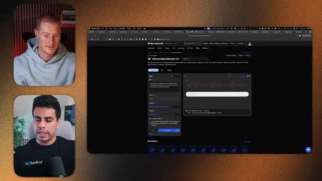
*⏱️ 00:14:27 — Capture montrant l'interface web de WaveSpeed AI avec le modèle elevenlabs/eleven-v3 sélectionné.*

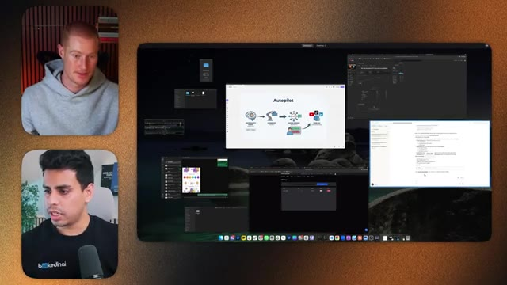
*⏱️ 00:14:36 — Vue d'ensemble du bureau avec plusieurs fenêtres ouvertes, dont une présentation 'Autopilot' et du code.*

*⏱️ 00:14:45 — Interface de Claude Code affichant des instructions de développement pour la création d'une vidéo avec Remotion.*

---

### ⏱️ `[00:14:54 - 00:15:12]` | Segment #32

**🔊 Audio (Transcription Intégrale Mot pour Mot en Français) :**
> j'ai ouvert le localhost, et ensuite j'ai téléchargé cette vidéo. Et vous pouvez voir en ce moment, je veux juste m'assurer que vous l'entendez et qu'il y aura une voix off. Donc par exemple, je vais juste aller au milieu. Le tunnel grandit alors que les agents IA travaillent 24 heures sur 24. Ensuite, le constructeur d'agents. Créez des agents commerciaux IA en quelques minutes.

**👁️ Analyse Visuelle d'Écran (gemini-3.5-flash-lite) :**
**Interface & Outils** : Navigateur web, interface de création d'agent IA (Agent Builder).

**Contenu textuel & Code** : Paramètres de configuration d'un agent IA (Agent Name : Sales Assistant Pro, canaux actifs : Voice, SMS, Email, sélection de voix et instructions système).

**Action / Démonstration** : Présentation de l'interface de création et de configuration d'un agent IA commercial.

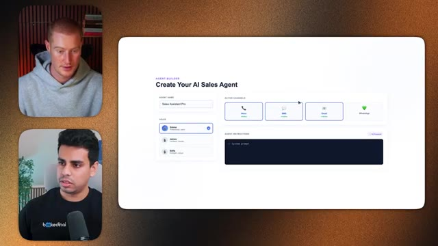
*⏱️ 00:15:07 — Interface d'un constructeur d'agent IA montrant les paramètres de création d'un agent commercial (Agent Builder, canaux de communication, voix).*

---

### ⏱️ `[00:15:12 - 00:15:30]` | Segment #33

**🔊 Audio (Transcription Intégrale Mot pour Mot en Français) :**
> C'est tellement fou. Choisissez une voix, configurez des canaux comme la voix, SM... Donc maintenant, ça peut parler. C'est littéralement une synthèse vocale en cours. Vous pouvez aussi, vous savez, lui donner des sous-titres. Vous pouvez dire des choses comme « supprime ça si tu n'aimes pas la voix » ou même si vous avez enregistré votre propre voix, vous pouvez simplement dire : « voici l'enregistrement, va l'attacher au projet remotion et tu seras prêt à partir de ce côté-là aussi ».

**👁️ Analyse Visuelle d'Écran (gemini-3.5-flash-lite) :**
**Interface & Outils** : Navigateur web affichant une application SaaS avec une liste de leads ("Track Every Lead's Journey").

**Contenu textuel & Code** : Tableau de suivi des prospects avec noms, e-mails, statuts et options de lecture audio intégrées (lecteur multimédia visible au premier plan de la fenêtre).

**Action / Démonstration** : Présentation et démonstration en direct d'une application web intégrant des fonctionnalités vocales ou de synthèse audio.

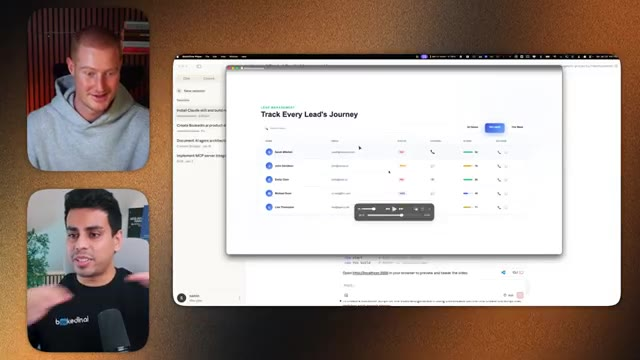
*⏱️ 00:15:17 — Capture d'écran montrant l'interface d'un tableau de bord de gestion de prospects avec une fenêtre de démonstration et les deux participants en visioconférence dans des cadres à gauche.*

---

### ⏱️ `[00:15:30 - 00:16:05]` | Segment #34

**🔊 Audio (Transcription Intégrale Mot pour Mot en Français) :**
> Ouais, donc tu dis que tu peux littéralement cloner ta propre voix et ensuite ajouter ta propre voix par-dessus. Littéralement tout généré par IA juste avec quelques invites simples dans Clog. C'est fou. Ouais, je veux dire, la barrière à l'entrée de tout ça devient tellement basse juste parce que tout ce que tu as à faire, c'est d'aller dans cette zone de texte et de taper ce que tu veux. Ouais, c'est fou mec. Je ne sais pas quoi dire d'autre à part ça. Bon les gars, c'est dingue. Salman, je suis ravi que tu nous aies montré comment utiliser ça. Je vais en fait aller commencer à créer des vidéos après cette vidéo et probablement me prendre la tête avec ça pendant les prochaines heures. Donc tout d'abord, où est-ce qu'on peut te trouver ? Et ensuite

**👁️ Analyse Visuelle d'Écran (gemini-3.5-flash-lite) :**
**Interface & Outils** : Application web de gestion de leads / CRM (Lead Management) affichée dans une fenêtre de navigateur.

**Contenu textuel & Code** : Tableau de suivi des leads avec des noms, statuts, icônes de contact et une barre de lecture multimédia intégrée.

**Action / Démonstration** : Démonstration visuelle d'une interface d'application web générée par IA pendant la discussion sur les outils de clonage vocal et d'IA.

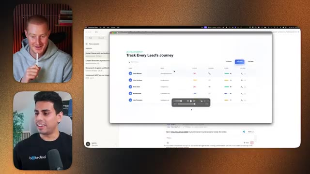
*⏱️ 00:15:39 — Capture d'écran montrant l'interface utilisateur d'une application web de gestion de leads (« Track Every Lead's Journey ») avec les deux intervenants en incrustation vidéo sur le côté gauche.*

---

### ⏱️ `[00:16:05 - 00:16:35]` | Segment #35

**🔊 Audio (Transcription Intégrale Mot pour Mot en Français) :**
> B, je veux te poser une question sur l'anti-gravité et savoir ce que tu en penses. Oh, donc si tu veux, tu peux me trouver sur ma chaîne YouTube. Je devrais être en collaboration avec le lien, mais c'est juste Saman Yassar. C'est mon nom. Mais la partie sur l'anti-gravité, c'est vraiment intéressant parce que tout ce qu'on vient de faire avec Cloud Code en ce moment, on peut aussi le faire avec l'anti-gravité. Le truc, c'est qu'on devrait apprendre les deux parce que cette course à l'intelligence artificielle est un peu folle. Cette semaine ou ce mois-ci, disons que ClotCode est en avance, mais tu ne sais pas ce qu'OpenAI ou Gemini va sortir de manière aléatoire.

**👁️ Analyse Visuelle d'Écran (gemini-3.5-flash-lite) :**
**Interface & Outils** : YouTube (profil de chaîne) et interface d'appel vidéo

**Contenu textuel & Code** : Vignettes de vidéos YouTube sur l'intelligence artificielle et les outils numériques.

**Action / Démonstration** : Conversation en visio-conférence et présentation du profil YouTube de l'invité.

---

### ⏱️ `[00:16:35 - 00:17:09]` | Segment #36

**🔊 Audio (Transcription Intégrale Mot pour Mot en Français) :**
> Ça va juste exploser en flèche. Donc anti-gravity nous permet en quelque sorte d'utiliser tout un tas de modèles différents. En ce moment, le seul problème, ce sont les limites de taux, mais c'est gratuit. Donc si vous voulez juste commencer avec tout ça gratuitement, plutôt que de payer 200 balles par mois pour ClotCode, je vous suggère d'utiliser anti-gravity pour commencer. Et ensuite, vous pouvez faire la même chose avec les compétences là-bas. Ouais, parfait. Et si vous êtes intéressés, abonnez-vous, on va en parler la semaine prochaine lors de notre prochain podcast. Mais Salman, merci mec, ces podcasts ont été amusants, je pense que mon audience en tire beaucoup de valeur. C'est amusant de parler à quelqu'un qui a un bagage en programmation mais qui est capable de l'expliquer d'une manière super simple à quelqu'un comme moi, et ensuite je peux poser les questions que mon audience se pose peut-être, alors

**👁️ Analyse Visuelle d'Écran (gemini-3.5-flash-lite) :**
**Interface & Outils** : Visioconférence ou interface de double caméra sans support technique, graphique ou code.

**Contenu textuel & Code** : Aucun code, graphique boursier, métrique ou élément technique affiché à l'écran.

**Action / Démonstration** : Discussion et échange en visioconférence entre deux intervenants sans manipulation d'outils techniques.

---

### ⏱️ `[00:17:09 - 00:17:20]` | Segment #37

**🔊 Audio (Transcription Intégrale Mot pour Mot en Français) :**
> Si vous appréciez ce format, faites-le-moi savoir dans les commentaires ci-dessous, j'apprécie vraiment d'entendre vos retours. Salman, les gens peuvent aller vous suivre, dans la description, il y aura un lien et ouais, merci d'être venu, mec. Génial, merci de m'avoir reçu, frérot, c'était super amusant. Ouais, bien sûr.

**👁️ Analyse Visuelle d'Écran (gemini-3.5-flash-lite) :**
**Interface & Outils** : Aucun logiciel, graphique ou terminal n'est affiché.

**Contenu textuel & Code** : Aucun code, indicateur technique ou donnée chiffrée n'est présent.

**Action / Démonstration** : Discussion de fin d'entretien et remerciements entre le présentateur et son invité.

---

