# 🎬 New Manus Skills Level Up Your AI Agents (INSTANTLY)

> **Chaîne** : [Brock Mesarich | AI for Non Techies](https://www.youtube.com/@BrockMesarich)  
> **Lien YouTube** : [https://www.youtube.com/watch?v=7ASCWheuTtc](https://www.youtube.com/watch?v=7ASCWheuTtc)  
> **Date de publication** : 20260128  
> **Durée** : 00:15:20  
> **Identifiant vidéo** : `7ASCWheuTtc`  
> **Transcription & Analyse** : `whisper-v3-large-turbo+gemini-3.5-flash-lite`  

---

## 📌 Synthèse Exécutive & Outils

### 💡 Résumé
La vidéo de Brock Mesarich met en lumière une avancée majeure dans l'écosystème des agents IA avec l'introduction des compétences natives sur Manus. Contrairement aux approches traditionnelles où l'utilisateur doit réinitialiser et réexpliquer chaque tâche à zéro, le système de compétences de Manus permet d'encapsuler des flux de travail complexes, des scripts et des ressources dans un fichier structuré `SKILL.MD`. Grâce à l'utilisation de déclencheurs par commandes obliques (slash commands), l'agent réexécute des séquences de tâches avec une constance algorithmique parfaite à chaque sollicitation.

Dans une démonstration appliquée au trading et à l'analyse financière, l'analyste présente le déploiement d'une compétence d'analyse boursière en temps réel. En combinant des outils de type MCP (Model Context Protocol) connectés à Yahoo Finance, l'agent extrait des données de marché actualisées pour des actifs cibles comme MicroStrategy, génère des rapports textuels et visuels approfondis, puis enchaîne automatiquement avec la création d'un tableau de bord interactif sur mesure. Ce dashboard intègre dynamiquement l'identité visuelle de l'entreprise analysée, transformant une simple requête textuelle en une application de suivi de marché pleinement fonctionnelle.

L'architecture présentée repose également sur la composabilité des compétences—la capacité d'enchaîner séquentiellement plusieurs modules (extraction de données, génération de supports visuels, exportation vers le cloud) où chaque étape transmet son résultat à la suivante. Couplée à des connecteurs d'automatisation (tels que Zapier ou Notion) et à l'application mobile de Manus, cette approche automatise de bout en bout des processus analytiques complexes, ouvrant la voie à une gestion de portefeuille et à une veille de marché hautement efficiente et sans friction technique.

### 🛠️ Outils, Modèles & Logiciels Présentés
* **Manus** : Agent IA conversationnel avancé doté d'un système de compétences modulaires, d'une vue de conception et d'une capacité de génération de tableaux de bord interactifs.
* **Claude** : Modèle de langage de pointe souvent cité pour ses capacités de raisonnement et d'ingénierie de code, précurseur des logiques d'agents avancés.
* **Grok** : Modèle d'intelligence artificielle conversationnelle orienté vers l'accès en temps réel aux données d'actualité et de marché.
* **Gemini** : Écosystème d'IA multimodale de Google utilisé pour le traitement et l'analyse de grands volumes de données.
* **ChatGPT** : Assistant conversationnel de référence basé sur les grands modèles de langage d'OpenAI pour la génération de contenu et le prompt engineering.
* **Make** : Plateforme d'automatisation de flux de travail No-Code permettant de connecter différentes applications entre elles.
* **Zapier** : Outil d'automatisation et de connectivité inter-applications offrant l'accès à plus de 30 000 intégrations logicielles.
* **n8n** : Outil d'automatisation de flux de travail orienté développeur, permettant l'orchestration de tâches complexes et l'intégration d'API.

### 🔑 Points Clés & Enseignements Stratégiques
* **Persistance des flux de travail** : Le concept de compétences permet d'encoder une méthode d'exécution parfaite une seule fois, éliminant la nécessité de réécrire des prompts complexes à chaque nouvelle session.
* **Architecture du fichier `SKILL.MD`** : Le système repose sur un fichier central d'instructions textuelles, couplé à des métadonnées (nom, description) et des ressources/scripts chargés dynamiquement à la demande.
* **Déclenchement par commandes obliques** : L'utilisation de commandes textuelles simples précédées d'une barre oblique (`/`) permet d'initialiser instantanément des protocoles d'exécution complexes.
* **Composabilité et chaînage de compétences** : Il est possible de lier plusieurs compétences à la suite (par exemple : extraction de données, génération de diapositives, exportation cloud), chaque module transmettant son livrable au maillon suivant.
* **Intégration de données de marché en temps réel** : La compétence d'analyse boursière s'interface via des protocoles MCP avec des sources financières externes comme Yahoo Finance pour récupérer des cours et des performances actualisés.
* **Génération dynamique de tableaux de bord** : L'agent ne se limite pas à produire du texte statique ; il peut concevoir et déployer un dashboard interactif complet et sur mesure pour le suivi d'un actif financier.
* **Respect de l'identité visuelle** : Lors de la création de rapports ou d'interfaces de suivi (ex. MicroStrategy), l'agent intègre automatiquement les codes couleurs et les éléments graphiques spécifiques à la marque analysée.
* **Interopérabilité via des connecteurs** : L'écosystème Manus intègre des connecteurs vers des outils tiers (Notion, Slack, Google Sheets, Zapier) pour automatiser la diffusion des résultats d'analyse.
* **Accessibilité mobile** : L'application mobile de Manus permet d'exécuter des flux de travail complexes et des agents IA en déplacement, s'inscrivant dans la lignée des assistants transactionnels modernes.
* **Automatisation de la recherche quantitative** : La standardisation des processus d'analyse boursière via des agents IA réduit drastiquement le temps de collecte et de mise en forme des données fondamentales et techniques.

---

## ⏱️ Chronologie & Transcription Complète Audio & Visuelle (Mot pour Mot)

### ⏱️ `[00:00:00 - 00:00:34]` | Segment #01

**🔊 Audio (Transcription Intégrale Mot pour Mot en Français) :**
> Manus vient d'ajouter des compétences et si vous avez été attentifs à l'IA ces derniers temps, vous savez exactement pourquoi c'est important. Les compétences changent la façon dont nous utilisons les agents IA. Au lieu de repartir de zéro à chaque fois en vous arrachant les cheveux, vous lui apprenez une seule fois et il se souvient de la façon d'exécuter des tâches pour toujours. Et maintenant, Manus les possède, ce qui le rend beaucoup plus puissant. Donc, dans cette vidéo, je vais décortiquer ce que sont les compétences de Manus, pourquoi elles sont importantes, et comment vous pouvez commencer à les utiliser dans vos flux de travail en quelques minutes, quelles que soient vos capacités techniques. Alors, sans plus attendre, plongeons dans le vif du sujet. Très bien, donc avant de vous montrer comment commencer à utiliser les compétences de Manus et les différents cas d'utilisation que j'ai utilisés et qui révolutionnent ma façon d'utiliser Manus.

**👁️ Analyse Visuelle d'Écran (gemini-3.5-flash-lite) :**
**Interface & Outils** : Présentation vidéo avec infographie graphique intégrée.

**Contenu textuel & Code** : Texte structuré en trois blocs thématiques concernant les compétences de l'agent Manus.

**Action / Démonstration** : Affichage à l'écran du plan de la vidéo pour structurer l'introduction.

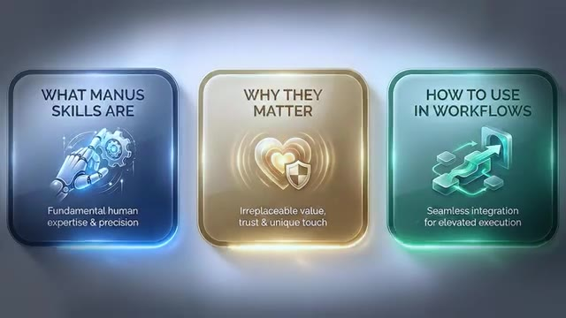
*⏱️ 00:00:17 — Une infographie présente les trois grands thèmes abordés : What Manus Skills Are, Why They Matter, How to Use in Workflows.*

---

### ⏱️ `[00:00:34 - 00:00:54]` | Segment #02

**🔊 Audio (Transcription Intégrale Mot pour Mot en Français) :**
> Je vais vous montrer exactement comment fonctionnent les compétences. Donc, si vous jetez un œil à ce diagramme, je l'analyse juste ici. Je vais analyser chacune d'elles individuellement. Cela ne va prendre peut-être qu'une minute. Donc, tout d'abord, nous pouvons créer une compétence. Alors, pensez-y de cette façon. À l'intérieur de Manus, vous pouvez accomplir une tâche et la réussir à la perfection. Et au lieu de devoir espérer et souhaiter que la prochaine fois que vous essayez d'exécuter cette tâche, il fasse la même chose.

**👁️ Analyse Visuelle d'Écran (gemini-3.5-flash-lite) :**
**Interface & Outils** : Navigateur web affichant un diagramme explicatif (type tableau blanc ou mindmap).

**Contenu textuel & Code** : Schéma structuré en sections détaillant le fonctionnement des compétences : 1. Create a Skill, 2. Inside a Skill (3 Layers), 3. Use a Skill, 4. Chain Multiple Skills, 5. Connectors.

**Action / Démonstration** : Le présentateur explique et zoome visuellement sur le diagramme pour décomposer chaque étape du fonctionnement des compétences.

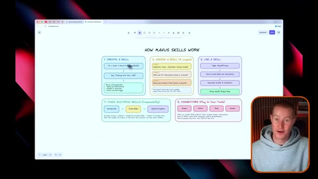
*⏱️ 00:00:39 — Un schéma explicatif intitulé "How Manus Skills Work" montrant les différentes étapes et composants des compétences, avec le présentateur visible en incrustation dans le coin inférieur droit.*

---

### ⏱️ `[00:00:54 - 00:01:13]` | Segment #03

**🔊 Audio (Transcription Intégrale Mot pour Mot en Français) :**
> Vous pourriez littéralement simplement dire, empaquetez ceci dans une compétence. Et ce que cela fait, c'est que cela génère automatiquement un fichier SKILL.MD, qui est essentiellement juste un ensemble d'instructions, que vous pouvez voir juste ici. Gérer SKILL.MD, ce sont juste des instructions. Et ensuite, cela va réellement générer ces scripts et ressources. Et puis ces déclencheurs de commandes obliques, qui rendent son utilisation vraiment facile.

**👁️ Analyse Visuelle d'Écran (gemini-3.5-flash-lite) :**
**Interface & Outils** : Excalidraw (tableau blanc en ligne)

**Contenu textuel & Code** : Schéma textuel détaillant : "Do a task in Manus", "Say: Package this into a Skill", et "Manus auto-generates: SKILL.md (instructions), Scripts & resources, Slash command trigger".

**Action / Démonstration** : Le présentateur explique visuellement le processus de création de compétences automatisées en s'appuyant sur un schéma de workflow.

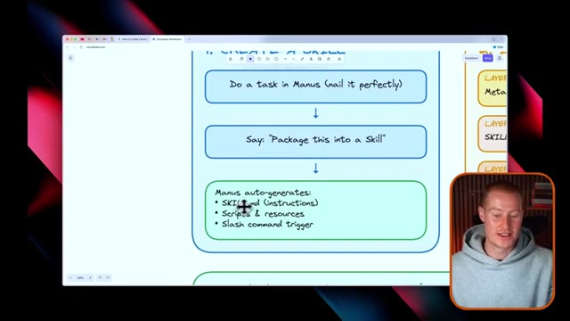
*⏱️ 00:00:59 — Un schéma explicatif (whiteboard) montrant les étapes pour créer une compétence dans Manus, avec en bas à droite le présentateur en médaillon.*

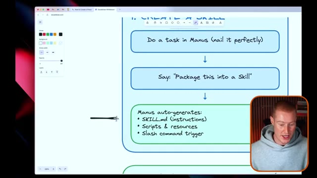
*⏱️ 00:01:03 — Le même schéma de workflow sur le tableau blanc avec les options de l'outil de dessin qui apparaissent à l'écran.*

---

### ⏱️ `[00:01:13 - 00:01:33]` | Segment #04

**🔊 Audio (Transcription Intégrale Mot pour Mot en Français) :**
> Et je vais vous montrer exactement ce qu'est un déclencheur de commande oblique plus tard dans cette vidéo. Ensuite, nous pouvons passer à l'intérieur d'une compétence et à son fonctionnement sur un plan fondamental. Tout d'abord, nous avons ces métadonnées, qui contiennent notre nom et notre description, qui sont toujours chargés. Ainsi, chaque fois que vous déclenchez cette commande, elle sait exactement comment fonctionner. Ensuite, nous avons à nouveau le skill MD, qui est constitué des instructions complètes qui se chargent sur commande.

**👁️ Analyse Visuelle d'Écran (gemini-3.5-flash-lite) :**
**Interface & Outils** : Logiciel de tableau blanc ou de prise de notes numérique interactif affichant un diagramme explicatif.

**Contenu textuel & Code** : Schéma détaillé des trois couches d'une compétence ("Layer 1: Metadata", "Layer 2: SKILL.md", "Layer 3: Resources") et explication de leur chargement à la demande.

**Action / Démonstration** : Le présentateur explique l'architecture en trois couches d'une compétence logicielle ou d'un agent IA en s'appuyant sur le schéma visuel.

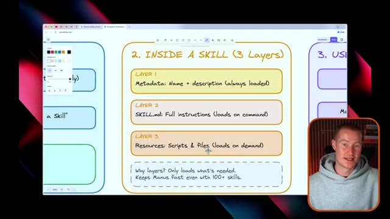
*⏱️ 00:01:18 — Un schéma explicatif structuré en trois couches ("Inside a Skill - 3 Layers") affiché à l'écran, avec une incrustation vidéo du présentateur en bas à droite.*

---

### ⏱️ `[00:01:33 - 00:01:53]` | Segment #05

**🔊 Audio (Transcription Intégrale Mot pour Mot en Français) :**
> Et ensuite, à partir de là, nous avons les ressources, qui sont nos scripts et nos fichiers qui, là encore, sont chargés à la demande. Et afin d'utiliser une compétence, c'est évidemment la partie importante et vous n'avez pas vraiment besoin de savoir pourquoi cela fonctionne. Mais parfois, il est utile de comprendre un peu mieux. Mais pour utiliser une compétence, vous tapez simplement slash, puis le nom de votre compétence. Et ensuite, Manus chargera les instructions de la compétence au format MD.

**👁️ Analyse Visuelle d'Écran (gemini-3.5-flash-lite) :**
**Interface & Outils** : Navigateur web affichant un tableau blanc ou un schéma illustré.

**Contenu textuel & Code** : Texte du diagramme : 'Type: /my-skill-name', 'Manus loads SKILL.md instructions', 'Executes scripts & connectors'.

**Action / Démonstration** : Présentation du processus d'activation et d'exécution d'une compétence par le système.

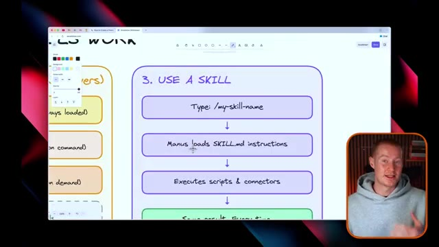
*⏱️ 00:01:38 — Schéma explicatif illustrant les étapes d'utilisation d'une compétence ('3. USE A SKILL') avec, en bas à droite, le présentateur dans un encadré.*

---

### ⏱️ `[00:01:53 - 00:02:13]` | Segment #06

**🔊 Audio (Transcription Intégrale Mot pour Mot en Français) :**
> Encore une fois, c'est fondamentalement un ensemble d'instructions expliquant exactement comment ce flux de travail doit fonctionner à chaque fois. Et ensuite, il s'exécutera et exécutera les scripts et les connecteurs. Et vous obtenez le même résultat à chaque fois. C'est un élément vraiment important ici. Et une chose qui distingue vraiment les compétences de Manus, c'est le fait que nous pouvons enchaîner plusieurs compétences ensemble.

**👁️ Analyse Visuelle d'Écran (gemini-3.5-flash-lite) :**
**Interface & Outils** : Tableau blanc numérique / outil de mindmapping et caméra de studio.

**Contenu textuel & Code** : Schéma textuel détaillant le processus : 'Type: /my-skill-name', 'Manus loads SKILL.md instructions', 'Executes scripts & connectors', 'Same result. Every time.'

**Action / Démonstration** : Le présentateur explique les étapes d'exécution d'une compétence d'IA à l'aide d'un schéma visuel.

---

### ⏱️ `[00:02:13 - 00:02:49]` | Segment #07

**🔊 Audio (Transcription Intégrale Mot pour Mot en Français) :**
> Donc vous pouvez voir ces trois compétences ici. Premièrement, nous avons la commande extraire un site web. Ensuite, nous avons créer des diapositives et puis exporter vers Google Drive. Pour cet exemple, vous pourriez extraire un site web, générer des diapositives aux couleurs de la marque, et ensuite exporter vers Google Drive. Et chaque compétence transmet son résultat à la section suivante du flux de travail. Si vous voyez les choses ainsi, une seule commande peut exécuter tout ce flux de travail. Donc ça fonctionne à chaque fois. Une chose que je tiens à mentionner, c'est que tout ce diagramme ici même a été créé avec une compétence « mana » que j'ai entraînée afin de, en gros, créer des diagrammes pour que je puisse vous les expliquer dans des vidéos. Et elle sait exactement comment je veux formater cela à chaque fois. Et c'est aussi simple que de dire

**👁️ Analyse Visuelle d'Écran (gemini-3.5-flash-lite) :**
**Interface & Outils** : Logiciel de tableau blanc ou de mind-mapping en ligne (type Excalidraw) avec un encart vidéo du présentateur en bas à droite.

**Contenu textuel & Code** : Commandes illustrées : /scrape-site, /make-slides, /export-to-gdrive, accompagnées d'un texte décrivant l'exemple de workflow.

**Action / Démonstration** : Le présentateur explique le concept de composition des compétences et le chaînage des actions automatisées.

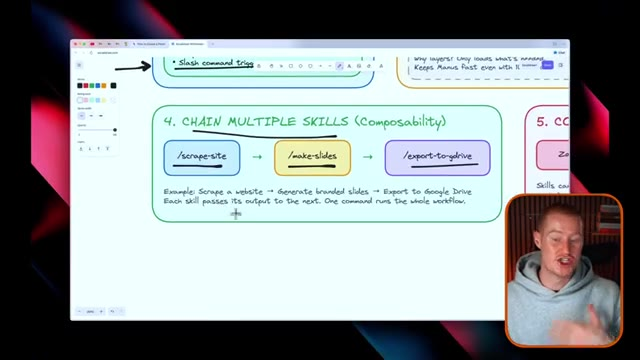
*⏱️ 00:02:22 — Un schéma explicatif montrant comment enchaîner plusieurs compétences (Chain Multiple Skills) avec des commandes telles que scrape-site, make-slides et export-to-gdrive.*

---

### ⏱️ `[00:02:49 - 00:03:26]` | Segment #08

**🔊 Audio (Transcription Intégrale Mot pour Mot en Français) :**
> diagramme des compétences de Manus et il s'en va le générer pour moi. Enfin, et c'est quelque chose qui élève vraiment les compétences de Manus à un niveau supérieur, ce sont les connecteurs. Nous pouvons donc brancher n'importe quel des outils que nous utilisons. Donc par exemple, si nous utilisons Zapier, ce que je vais vous montrer dans cette vidéo pour nous connecter à plus de 30 000 applications différentes, nous pourrions utiliser Notion, nous pourrions utiliser Slack, nous pourrions utiliser Google Sheets, n'importe lesquelles de ces fonctionnalités de connecteurs qui sont déjà présentes à l'intérieur de Manus. Comme nous pouvons le voir ici, quelques cas d'utilisation différents consistent à connecter les automatisations de Manus, à pousser vers Notion, à envoyer des messages Slack, à mettre à jour des feuilles de calcul, et tout cela est fait avec les compétences de Manus. Donc, mis tout cela de côté, maintenant que vous savez exactement comment elles fonctionnent, je vais vous montrer à quoi cela ressemble à l'intérieur de Manus.

**👁️ Analyse Visuelle d'Écran (gemini-3.5-flash-lite) :**
**Interface & Outils** : Tableau blanc interactif de type Excalidraw dans un navigateur web.

**Contenu textuel & Code** : Schéma sur les compétences de Manus centré sur les connecteurs : Zapier, Notion, Slack, Sheets, et le texte explicatif "Skills can include YOUR external tools... Manus becomes the brain. Your tools do the work."

**Action / Démonstration** : Le présentateur ou l'outil souligne les différentes options de connecteurs sur le schéma explicatif.

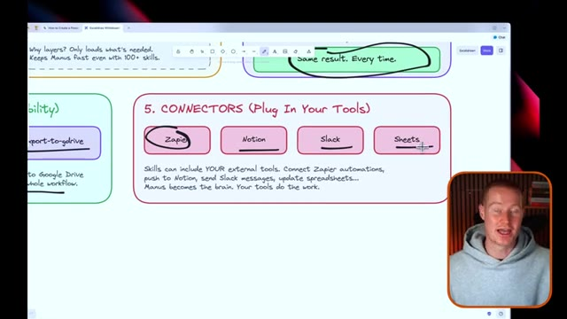
*⏱️ 00:03:08 — Le curseur trace des traits noirs sous les options Zapier, Notion, Slack et Sheets dans la section des connecteurs du diagramme de Manus.*

---

### ⏱️ `[00:03:26 - 00:04:01]` | Segment #09

**🔊 Audio (Transcription Intégrale Mot pour Mot en Français) :**
> et comment vous pouvez commencer à les créer vous-même. Très bien, alors maintenant nous sommes à l'intérieur de Manus. Et si vous voulez vous inscrire sur Manus, il y a un lien dans la description pour vous inscrire et obtenir mille crédits gratuits afin de pouvoir commencer à l'utiliser sans aucun frais pour vous. Tout d'abord, si vous n'êtes pas familier avec Manus, il y a tellement de choses que vous pouvez faire. Vous pouvez créer des présentations, vous pouvez créer des sites web, développer des applications mobiles, utiliser la vue de conception et générer des images et des vidéos en utilisant leurs outils de conception. Et ce que je vais faire maintenant, c'est vous montrer exactement comment vous pouvez commencer à utiliser les compétences. Alors tout d'abord, cliquons sur ce bouton du centre de personnalisation. Et ensuite, vous pouvez voir cette catégorie de compétences ici. À partir de là, ce que nous pouvons faire, c'est en fait ajouter à partir de leur bibliothèque officielle

**👁️ Analyse Visuelle d'Écran (gemini-3.5-flash-lite) :**
**Interface & Outils** : Navigateur web affichant la plateforme Manus.

**Contenu textuel & Code** : Barre de saisie centrale "What can I do for you?" avec suggestions de projets et outils de design.

**Action / Démonstration** : Navigation et présentation de l'interface utilisateur de Manus par le présentateur.

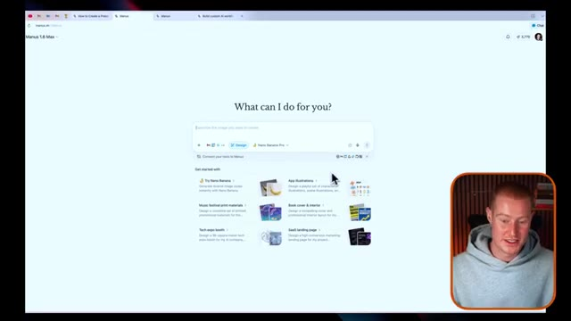
*⏱️ 00:03:43 — Vue de l'interface principale de la plateforme Manus avec la barre de recherche "What can I do for you?".*

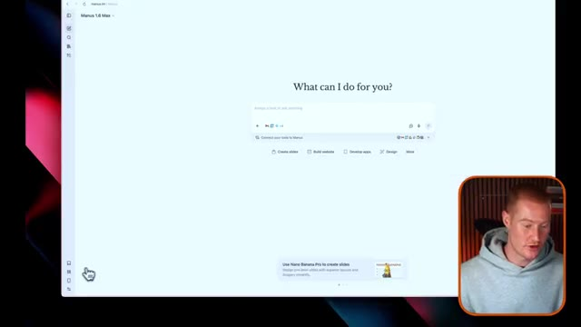
*⏱️ 00:03:52 — Vue de l'interface de Manus montrant les options de création et de développement d'applications.*

---

### ⏱️ `[00:04:01 - 00:04:34]` | Segment #10

**🔊 Audio (Transcription Intégrale Mot pour Mot en Français) :**
> de compétences qui sont déjà ajoutées dans Manus. Donc, laissez-moi regarder ça maintenant. Alors, par exemple, nous avons le créateur de compétences. Donc, c'est ce qui génère réellement les compétences pour nous. Ensuite, nous avons en fait le détecteur de compétences Internet, dont je peux imaginer qu'il va être une compétence vraiment percutante, donc vous pouvez voir ici qu'il recherche et recommande des compétences d'agent provenant de dépôts GitHub vérifiés. Nous pourrions instantanément l'ajouter et j'ai en fait ajouté cette compétence d'analyse boursière que je vais vous montrer exactement comment utiliser en ce moment. Ce que j'ai fait en préparation de cette vidéo, c'est que j'ai simplement tapé barre oblique analyse boursière, puis j'ai dit MicroStrategy, parce que MicroStrategy est une action que je regarde.

**👁️ Analyse Visuelle d'Écran (gemini-3.5-flash-lite) :**
**Interface & Outils** : Interface web de Manus (plateforme d'IA).

**Contenu textuel & Code** : Liste des compétences de la bibliothèque officielle de Manus (« Official library »), incluant notamment « skill-creator » et « internet-skill-finder ».

**Action / Démonstration** : Navigation et présentation de la bibliothèque de compétences sur la plateforme Manus.

*⏱️ 00:04:17 — L'interface de Manus montrant la bibliothèque officielle des compétences (Official library) avec les compétences « skill-creator », « github-gem-seeker », « internet-skill-finder », « similarweb-analytics » et « stock-analysis », avec le présentateur incrusté en bas à droite.*

---

### ⏱️ `[00:04:34 - 00:05:08]` | Segment #11

**🔊 Audio (Transcription Intégrale Mot pour Mot en Français) :**
> à investir dès maintenant et je vais vous montrer ce flux de travail exact par lequel il est passé donc ce qu'il a fait c'est qu'il charge cette compétence et il lit ce fichier donc ceci ici est le fichier skill.md et si vous ne savez pas ce que c'est ce sont essentiellement les instructions sur la façon exacte dont notre flux de travail est censé fonctionner donc analyse d'actions analyse complète d'actions et d'entreprises utilisant des données de marché en temps réel a des capacités de base des API disponibles de trading et de données de marché tout ça donc c'est une invite vraiment détaillée sur la façon exacte dont ce flux de travail devrait fonctionner et et gardez à l'esprit, tout ce que nous avons à faire pour déclencher cette invite,

**👁️ Analyse Visuelle d'Écran (gemini-3.5-flash-lite) :**
**Interface & Outils** : Interface web de l'assistant (Manus 1.0 Max) avec éditeur de texte/markdown et flux d'exécution.

**Contenu textuel & Code** : Fichier "skill.md" visible avec des sections décrivant les instructions d'analyse boursière ("stock-analyst", "Core Capabilities", "Available APIs").

**Action / Démonstration** : Le présentateur explique et montre le contenu du fichier de compétences (skill.md) utilisé pour configurer l'assistant IA.

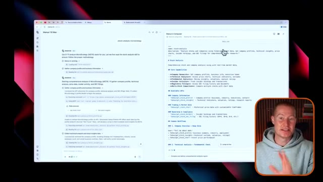
*⏱️ 00:04:42 — Capture d'écran montrant une interface de type assistant IA divisée en deux panneaux, avec le code markdown du fichier skill.md affiché à droite et la webcam du présentateur en incrustation en bas à droite.*

---

### ⏱️ `[00:05:08 - 00:05:27]` | Segment #12

**🔊 Audio (Transcription Intégrale Mot pour Mot en Français) :**
> si vous voulez l'appeler comme ça, cet ensemble d'instructions, c'est simplement de dire barre oblique stock analysis, et il commence à utiliser cette invite de flux de travail complète. À partir de là, ce qu'il fait, c'est qu'il utilise cet outil MCP pour réellement extraire les données de Yahoo Finance et pour réellement afficher ces informations boursières. Il passe par toute une série d'étapes ici. Je ne vais pas tout passer en revue, mais c'est un flux de travail vraiment complet.

**👁️ Analyse Visuelle d'Écran (gemini-3.5-flash-lite) :**
**Interface & Outils** : Interface web de l'agent d'IA Manus 1.6 Max avec fenêtre de terminal intégrée.

**Contenu textuel & Code** : Commandes MCP exécutées, scripts de récupération de données boursières et étapes d'analyse pour MicroStrategy (MSTR).

**Action / Démonstration** : Exécution d'un flux de travail automatisé d'analyse financière et boursière via des outils MCP et des scripts Python.

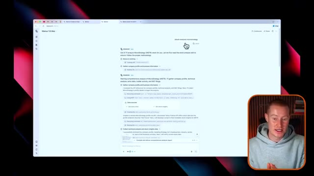
*⏱️ 00:05:13 — Interface de l'agent d'IA montrant le début de l'analyse de l'action MicroStrategy (MSTR) avec les étapes de chargement et de collecte des données.*

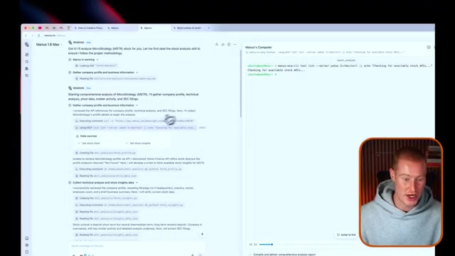
*⏱️ 00:05:17 — Affichage de l'interface en deux volets avec le terminal en cours d'exécution des commandes MCP et de l'agent d'analyse.*

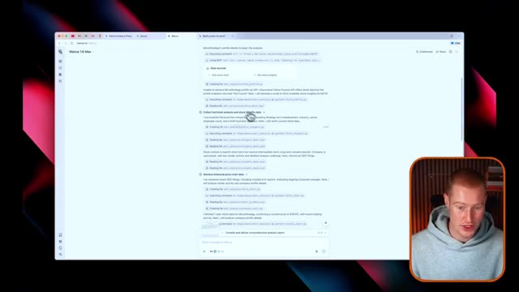
*⏱️ 00:05:22 — Suite du rapport d'analyse de l'agent détaillant la collecte des données techniques, boursières et l'extraction des données historiques.*

---

### ⏱️ `[00:05:27 - 00:05:46]` | Segment #13

**🔊 Audio (Transcription Intégrale Mot pour Mot en Français) :**
> Et ensuite, ce qu’il a fait, le résultat final ici est ce document, Analyse de l'action MicroStrategy. Il montre la date, il montre l'auteur, il montre un aperçu de l'entreprise. Il montre une analyse de la performance de l'action. Et il a même récupéré cette image ici provenant d'Internet montrant la performance de l'action MicroStrategy sur un an. Et ce sont des informations actualisées en temps réel sur cette action.

**👁️ Analyse Visuelle d'Écran (gemini-3.5-flash-lite) :**
**Interface & Outils** : Navigateur web affichant une application de traitement de texte/notes (Manus) avec le présentateur en médaillon vidéo.

**Contenu textuel & Code** : Document intitulé 'MicroStrategy (MSTR) Stock Analysis' détaillant la date, l'auteur, l'aperçu de l'entreprise avec des métriques et un graphique de performance boursière.

**Action / Démonstration** : Le présentateur commente le document généré automatiquement montrant l'analyse financière complète de MicroStrategy.

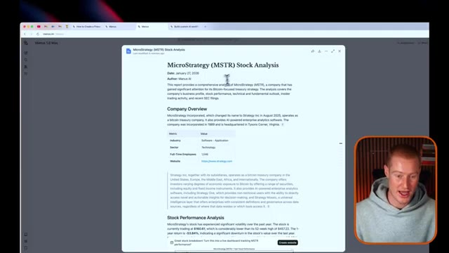
*⏱️ 00:05:32 — Capture d'écran montrant le document d'analyse de l'action MicroStrategy avec la section d'aperçu de l'entreprise.*

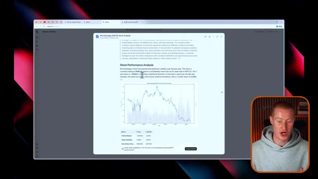
*⏱️ 00:05:37 — Capture d'écran montrant la suite du document avec l'analyse de la performance de l'action et un graphique de prix.*

---

### ⏱️ `[00:05:47 - 00:06:09]` | Segment #14

**🔊 Audio (Transcription Intégrale Mot pour Mot en Français) :**
> Il y a honnêtement tellement d'informations là-dedans que c'est un peu écrasant. Je ne vais pas tout passer en revue, mais la raison pour laquelle il a généré cela, c'est parce que c'est intégré dans la compétence et dans la façon dont nous voulons réellement que ce flux de travail fonctionne. Et ensuite, ce que je pourrais faire, c'est regarder, je pourrais même créer un site Web qui est interactif pour me permettre d'interagir avec cette action MicroStrategy. Et vous pouvez voir que c'est un site Web de tableau de bord en direct pour suivre la performance de l'action MicroStrategy sur la base de l'analyse.

**👁️ Analyse Visuelle d'Écran (gemini-3.5-flash-lite) :**
**Interface & Outils** : Navigateur web affichant un document d'analyse textuelle de type rapport d'entreprise.

**Contenu textuel & Code** : Document intitulé "MicroStrategy (MSTR) Stock Analysis" avec des sections sur les déclarations SEC (Recent SEC Filings), la conclusion (Conclusion) et les références (References).

**Action / Démonstration** : Le présentateur commente le rapport financier affiché à l'écran concernant MicroStrategy.

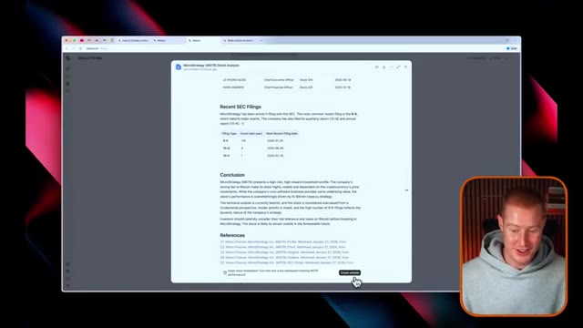
*⏱️ 00:05:58 — Capture d'écran d'un rapport textuel d'analyse financière de l'action MicroStrategy affiché à l'écran, avec une incrustation vidéo du présentateur en bas à droite.*

---

### ⏱️ `[00:06:09 - 00:06:31]` | Segment #15

**🔊 Audio (Transcription Intégrale Mot pour Mot en Français) :**
> Alors, laissons en fait ceci faire son travail et créer ce tableau de bord. Et ensuite, je vais vous montrer le résultat. Les gars, je veux dire, regardez ça. Après quelques minutes, j'ai maintenant ce tableau de bord interactif pour suivre l'action de MicroStrategy. Et le truc le plus fou là-dedans, c'est qu'il s'agit d'informations en direct et actualisées qui suivent le cours de l'action de MicroStrategy. Et il reprend même exactement l'identité visuelle et les couleurs de MicroStrategy.

**👁️ Analyse Visuelle d'Écran (gemini-3.5-flash-lite) :**
**Interface & Outils** : Interface web de tableau de bord financier (MSTR.DASH) avec panneau de code et de génération sur la gauche et aperçu graphique sur la droite.

**Contenu textuel & Code** : Prix actuel (150,93 $), volume (4,86M), avoirs en BTC (402,100), fourchette de prix, graphique de l'action en orange sur fond sombre et scores techniques.

**Action / Démonstration** : Présentation et visualisation du tableau de bord interactif nouvellement généré pour suivre les performances et l'action de MicroStrategy.

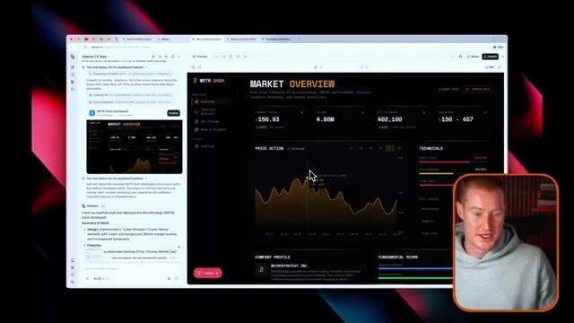
*⏱️ 00:06:15 — Capture montrant l'interface complète du tableau de bord "MSTR.DASH" de suivi de MicroStrategy avec des graphiques de prix et de volume.*

*⏱️ 00:06:26 — Capture quasi identique montrant le tableau de bord interactif de suivi de l'action MicroStrategy (MSTR) avec le curseur sur le graphique.*

---

### ⏱️ `[00:06:31 - 00:07:08]` | Segment #16

**🔊 Audio (Transcription Intégrale Mot pour Mot en Français) :**
> Il a tout cet arrière-plan. Les gars, c'est absolument phénoménal. Je suis franchement emballé par ça. Et le meilleur, c'est que j'ai ensuite ajouté ceci à notre compétence d'analyse boursière. Donc maintenant, chaque fois que j'utilise réellement cette commande de compétence et que je dis, je veux que tu analyses cette action, ou je n'ai même pas besoin de dire ça. Je dis juste analyste boursier et il va aller de l'avant et faire toutes ces recherches qu'il a faites auparavant, mais maintenant il va générer automatiquement un tableau de bord personnalisé comme celui-ci spécifique à l'action que nous analysons dans le flux de travail. Si vous comprenez ce qui se passe en arrière-plan, c'est vraiment insensé. Le fait que Manus fasse cela et que je puisse instantanément, encore une fois, afficher ceci et cliquer dessus, cliquer sur analyse boursière, taper dans

**👁️ Analyse Visuelle d'Écran (gemini-3.5-flash-lite) :**
**Interface & Outils** : Navigateur web affichant un tableau de bord de données financières et de trading.

**Contenu textuel & Code** : Graphiques de prix (Price Action), scores fondamentaux, métriques de volume et indicateurs techniques boursiers.

**Action / Démonstration** : Présentation et démonstration d'un outil de tableau de bord d'analyse boursière généré.

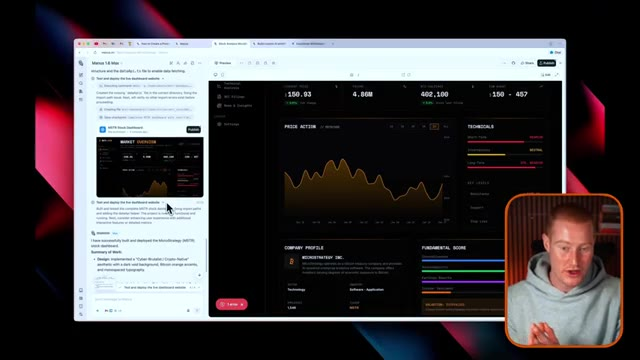
*⏱️ 00:06:41 — Interface d'un tableau de bord financier affichant les analyses boursières et graphiques de prix.*

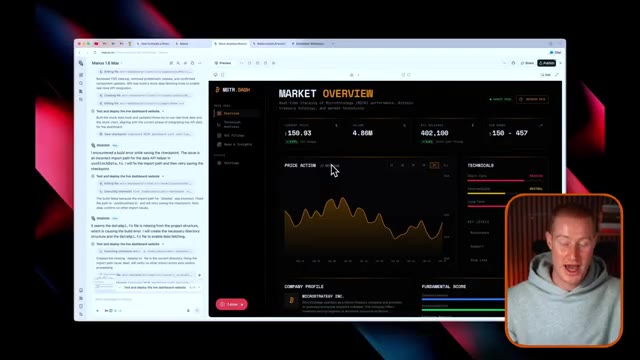
*⏱️ 00:06:59 — Vue similaire du tableau de bord interactif montrant les métriques de marché en temps réel et le cours de l'action.*

---

### ⏱️ `[00:07:08 - 00:07:42]` | Segment #17

**🔊 Audio (Transcription Intégrale Mot pour Mot en Français) :**
> le nom de l'action et il va s'exécuter et faire cela automatiquement en revenant à ce diagramme ici enchaîner plusieurs compétences ensemble a vraiment beaucoup d'impact et à mesure que nous commençons à construire plus de compétences à l'intérieur de Manus et à connecter celles-ci entre elles et à ajouter ce genre de composabilité de chaînes ici, cela va simplement changer la façon dont nous interagissons avec cela avant que nous continuions et que je vous montre comment réellement générer des compétences et aussi ajouter vos connecteurs à chacune de ces compétences. Je veux mentionner rapidement que Manus a une application mobile. Ainsi, nous pourrions commencer à utiliser notre agent et nos compétences littéralement lorsque nous sommes en déplacement. Donc, si vous êtes familier avec l'espace de l'IA, vous avez probablement été

**👁️ Analyse Visuelle d'Écran (gemini-3.5-flash-lite) :**
**Interface & Outils** : Logiciel de mind-mapping ou tableau blanc interactif affiché à l'écran.

**Contenu textuel & Code** : Schéma d'architecture montrant le workflow : /scrape-site -> /make-slides -> /export-to-gdrive avec un exemple textuel.

**Action / Démonstration** : Le présentateur explique et commente le diagramme montrant comment chaîner plusieurs compétences ensemble.

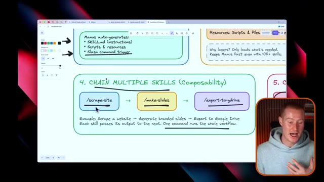
*⏱️ 00:07:17 — Diagramme schématique illustrant l'enchaînement de compétences (Chaining Multiple Skills) avec des commandes slash (/scrape-site, /make-slides, /export-to-gdrive), avec le présentateur en médaillon.*

---

### ⏱️ `[00:07:42 - 00:08:14]` | Segment #18

**🔊 Audio (Transcription Intégrale Mot pour Mot en Français) :**
> en entendant parler de Claudebot, qui vous permet essentiellement d'utiliser Claude code simplement en lui envoyant des messages sur Telegram. Et c'est comme votre assistant personnel. Donc, cela pourrait en fait fonctionner de la même manière. Ce n'est pas exactement pareil, mais nous pourrions réellement l'utiliser en déplacement en utilisant notre application mobile, avec Manus. Et j'adore cette idée. Très bien, alors parlons maintenant de ce que sont les connecteurs Manus et de la manière dont nous pouvons commencer à les ajouter à nos compétences pour multiplier littéralement par 10 la puissance de nos agents au sein de Manus. Laissez-moi vous expliquer rapidement ce que c'est avant de vous montrer comment vous pouvez commencer à les créer. Alors, que sont les connecteurs ? Les connecteurs permettent à Manus de communiquer avec vos outils externes. Au lieu de faire des choses uniquement à l'intérieur

**👁️ Analyse Visuelle d'Écran (gemini-3.5-flash-lite) :**
**Interface & Outils** : Navigateur web affichant un tableau blanc/diagramme explicatif avec incrustation vidéo du présentateur en bas à droite.

**Contenu textuel & Code** : Schéma intitulé "Manus Connectors" détaillant les connecteurs disponibles (Zapier, Notion, Slack, etc.) et un exemple de workflow d'automatisation.

**Action / Démonstration** : Le présentateur présente un diagramme conceptuel illustrant les connexions et intégrations logicielles possibles.

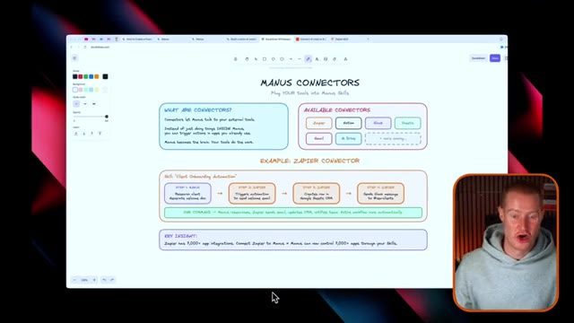
*⏱️ 00:07:58 — Un schéma explicatif sur un tableau blanc numérique montrant les "Manus Connectors" et l'intégration avec Zapier.*

---

### ⏱️ `[00:08:14 - 00:08:34]` | Segment #19

**🔊 Audio (Transcription Intégrale Mot pour Mot en Français) :**
> de Manus, vous pourriez déclencher des actions dans des applications que vous utilisez déjà. Et certains des connecteurs disponibles sont Zapier, Notion, Slack, Sheets, Gmail, Google Drive, et bien d'autres qui arrivent, et d'autres qui sont en fait intégrés à Manus. Et laissez-moi vous expliquer rapidement ce qu'un connecteur Zapier pourrait faire et pourquoi c'est puissant. Par exemple, cette compétence pourrait être l'automatisation de l'intégration des clients.

**👁️ Analyse Visuelle d'Écran (gemini-3.5-flash-lite) :**
**Interface & Outils** : Navigateur web affichant un document visuel ou un tableau blanc (type Miro ou similaire).

**Contenu textuel & Code** : Texte et blocs représentant les connecteurs : "AVAILABLE CONNECTORS", "Zapier", "Notion", "Slack", "Sheets", "Gmail", "G Drive", et "+ more coming...".

**Action / Démonstration** : Le présentateur illustre et commente les différentes applications et services tiers qu'il est possible de connecter à Manus.

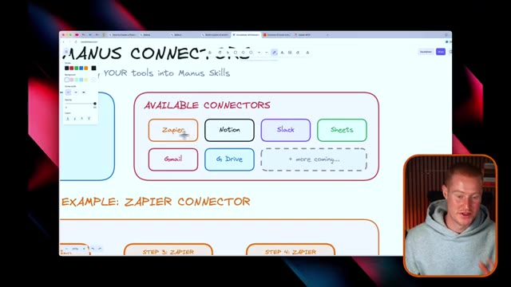
*⏱️ 00:08:19 — Un schéma explicatif présentant les différents connecteurs disponibles pour l'outil Manus, illustrant des intégrations avec Zapier, Notion, Slack, Sheets, Gmail et Google Drive.*

---

### ⏱️ `[00:08:35 - 00:08:55]` | Segment #20

**🔊 Audio (Transcription Intégrale Mot pour Mot en Français) :**
> Donc, première étape, Manus ferait des recherches sur le client et générerait un document de bienvenue. Et ensuite, on passerait à l'étape deux, qui est Zapier déclenchant une automatisation pour envoyer un e-mail de bienvenue. Et puis, à l'intérieur de Zapier, cela pourrait créer une ligne dans un CRM Google Spreadsheet et même envoyer un message Slack aux nouveaux clients. Et vous pourriez continuer à ajouter d'autres actions à cette commande unique en utilisant les connexions Zapier.

**👁️ Analyse Visuelle d'Écran (gemini-3.5-flash-lite) :**
**Interface & Outils** : Navigateur web affichant un outil de tableau blanc ou de mind mapping, avec la webcam du présentateur intégrée.

**Contenu textuel & Code** : Schéma intitulé "Skill: 'Client Onboarding Automation'" détaillant trois étapes : "Step 1: Manus" (Research client, Generate welcome doc), "Step 2: Zapier" (Triggers automation to send welcome email), et "Step 3: Zapier" (Creates row in Google Sheet).

**Action / Démonstration** : Le présentateur explique les différentes étapes du processus d'automatisation en pointant ou commentant le schéma affiché à l'écran.

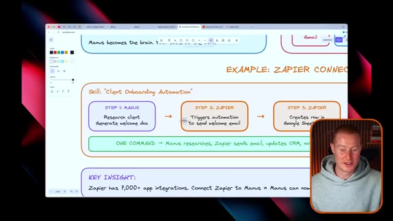
*⏱️ 00:08:40 — Un schéma explicatif sous forme de mind map montrant les étapes d'une automatisation d'intégration de client avec Manus et Zapier, accompagné d'une incrustation vidéo du présentateur en bas à droite.*

---

### ⏱️ `[00:08:55 - 00:09:16]` | Segment #21

**🔊 Audio (Transcription Intégrale Mot pour Mot en Français) :**
> Alors, voyons les choses ainsi. Une seule commande, Manus fait des recherches, Zapier envoie l'e-mail, met à jour un CRM, les avertit, et tout le flux de travail s'exécute automatiquement. Et l'un des points principaux ici et la raison pour laquelle vous utiliseriez le MCP de Zapier, c'est qu'il compte plus de 7 000 intégrations d'applications. Donc, essentiellement, si vous connectez Zapier à Manus, Manus peut désormais contrôler plus de 7 000 applications grâce aux compétences que vous créez.

**👁️ Analyse Visuelle d'Écran (gemini-3.5-flash-lite) :**
**Interface & Outils** : Excalidraw Whiteboard (application de tableau blanc en ligne) et vue webcam du présentateur.

**Contenu textuel & Code** : Schéma d'automatisation étape par étape et texte souligné décrivant l'intégration entre les fonctionnalités de recherche de Manus et les intégrations de Zapier (plus de 7 000 applications).

**Action / Démonstration** : Le présentateur explique et commente le schéma du flux de travail d'automatisation en surlignant les points clés à l'écran.

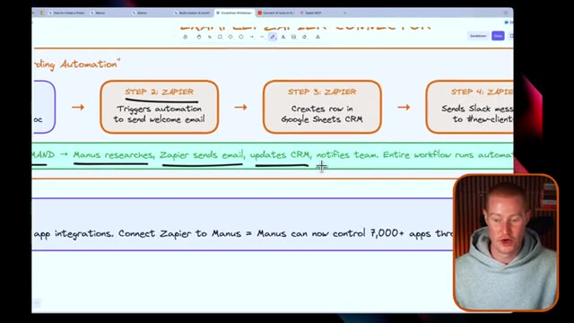
*⏱️ 00:09:00 — Un tableau blanc numérique (Excalidraw) illustrant un flux de travail d'automatisation avec Manus et Zapier, incluant les étapes d'e-mail, de CRM et de notifications.*

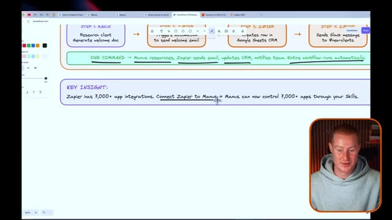
*⏱️ 00:09:10 — Le tableau blanc numérique avec un zoom sur la section "KEY INSIGHT" expliquant la connexion entre Zapier et Manus pour contrôler plus de 7 000 applications.*

---

### ⏱️ `[00:09:16 - 00:09:50]` | Segment #22

**🔊 Audio (Transcription Intégrale Mot pour Mot en Français) :**
> Et c'est pourquoi c'est si puissant. Laissez-moi donc vous montrer comment vous pourriez réellement faire cela dès maintenant. Tout d'abord, vous allez aller sur zapier.com slash mcp, il va y avoir un lien dans la description pour que vous puissiez réellement vous y inscrire, et ce que nous pouvons faire, c'est que nous pouvons réellement créer un nouveau serveur mcp. Si vous ne savez pas ce que c'est, ne vous inquiétez pas, c'est super simple à configurer. Vous allez cliquer sur client mcp et chercher simplement manis, nommez-le comme vous voulez, je vais juste l'appeler manis mcp, créez ce serveur mcp, et juste comme ça, nous pouvons commencer à ajouter chacune de ces applications et de ces outils à notre serveur mcp. Disons que nous voulions avoir accès à notion et pouvoir par exemple extraire des données de notion, ajouter des éléments à nos bases de données là-bas.

**👁️ Analyse Visuelle d'Écran (gemini-3.5-flash-lite) :**
**Interface & Outils** : Navigateur web affichant l'interface Zapier MCP.

**Contenu textuel & Code** : Menu déroulant de sélection des clients MCP (TypeScript, WindowsF, Microsoft Copilot Studio, Zed, Warp, Gemini CLI, etc.).

**Action / Démonstration** : Le présentateur montre l'interface de configuration pour l'intégration de Zapier avec un serveur MCP et la sélection des clients compatibles.

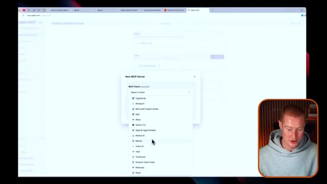
*⏱️ 00:09:33 — Capture d'écran du navigateur montrant le site web de Zapier avec une fenêtre modale de configuration "New MCP Server" et un menu déroulant listant différents clients MCP.*

---

### ⏱️ `[00:09:50 - 00:10:17]` | Segment #23

**🔊 Audio (Transcription Intégrale Mot pour Mot en Français) :**
> disons que c'est là où notre équipe interagit les uns avec les grammes, nous pourrions simplement connecter cette application entière donc maintenant elle est capable d'aller et d'exécuter des actions pour vous à l'intérieur de Notion et puis c'est la même chose disons que nous voulons faire cela avec Slack disons que nous avons un canal là-dedans où nous voulons réellement interagir avec notre équipe et être notifié chaque fois que quelque chose se produit dans notre pipeline de vente par exemple, vous pourriez simplement connecter votre compte Slack c'est aussi simple que quelques clics et puis maintenant elle a la capacité d'exécuter toutes ces actions elle peut obtenir des messages, elle peut trouver des messages, ajouter des rappels, elle peut envoyer des messages sur les canaux.

**👁️ Analyse Visuelle d'Écran (gemini-3.5-flash-lite) :**
**Interface & Outils** : Navigateur web affichant la plateforme Zapier MCP avec une fenêtre contextuelle « Add tools ».

**Contenu textuel & Code** : Liste d'applications populaires incluant Gmail, Google Calendar, Google Sheets, Google Docs, Google Forms, Notion, Google Drive, Airtable, Zapier Tables, Microsoft Outlook, HubSpot et Slack, ainsi qu'une barre de recherche d'applications.

**Action / Démonstration** : Le présentateur survole ou sélectionne des applications dans la liste pour les intégrer via le protocole MCP à l'application IA.

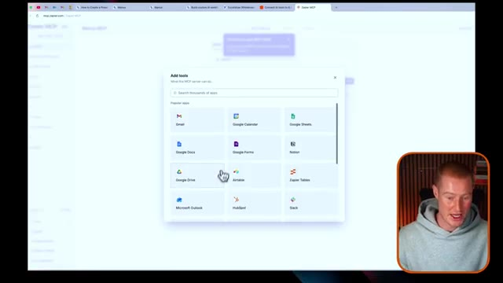
*⏱️ 00:09:56 — Capture d'écran montrant l'interface du site web de Zapier (mcp.zapier.com) avec une fenêtre modale de sélection d'outils et d'applications populaires à intégrer.*

---

### ⏱️ `[00:10:17 - 00:10:36]` | Segment #24

**🔊 Audio (Transcription Intégrale Mot pour Mot en Français) :**
> Toutes ces différentes choses sont possibles grâce au Zapier MCP. Ensuite, je vais cliquer sur connecter et cliquer sur générer un jeton. À partir de là, il va me donner un jeton à copier. Je ne vais pas l'afficher sur mon écran parce que sinon vous auriez accès à la possibilité de le voir. Et ensuite, je vais revenir sur Manus. Je clique simplement sur cette application de connecteurs ou ce bouton de connecteurs. Je clique sur ajouter des connecteurs.

**👁️ Analyse Visuelle d'Écran (gemini-3.5-flash-lite) :**
**Interface & Outils** : Navigateur web affichant l'interface de Zapier MCP et Manus.

**Contenu textuel & Code** : Instructions de configuration et liste des connecteurs (Google Calendar, HeyGen, Notion, Stripe, Zapier).

**Action / Démonstration** : Navigation et configuration des intégrations d'outils d'IA.

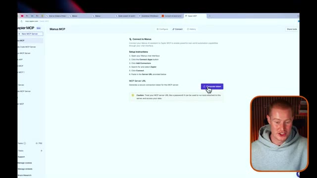
*⏱️ 00:10:22 — Interface web montrant la configuration de Zapier MCP avec le bouton 'Generate token'.*

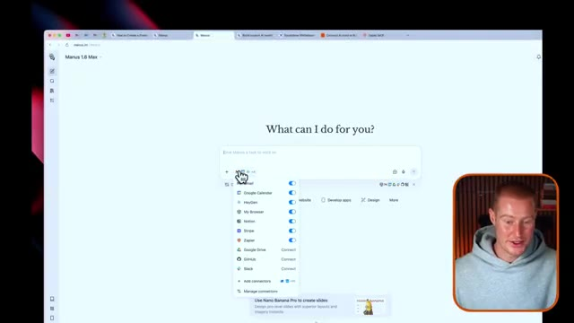
*⏱️ 00:10:31 — Interface de l'assistant Manus montrant les connecteurs disponibles incluant Zapier.*

---

### ⏱️ `[00:10:36 - 00:10:59]` | Segment #25

**🔊 Audio (Transcription Intégrale Mot pour Mot en Français) :**
> Mon Zapier est déjà configuré, mais pour mettre cela en place, vous collez simplement cette clé que Zapier vous a donnée, et ensuite il est réellement capable d'exécuter des actions pour vous. Très bien, donc une chose importante dont je n'ai même pas encore parlé, c'est le fait que Manus possède des capacités d'utilisation du navigateur. Il peut donc lancer un ordinateur virtuel, aller naviguer et faire des choses sur votre ordinateur, taper, cliquer sur des boutons, faire toutes ces choses que vous pourriez faire sur votre ordinateur sans que vous ayez à toucher au clavier ou à votre curseur.

**👁️ Analyse Visuelle d'Écran (gemini-3.5-flash-lite) :**
**Interface & Outils** : AUCUNE

**Contenu textuel & Code** : AUCUNE

**Action / Démonstration** : AUCUNE

---

### ⏱️ `[00:10:59 - 00:11:36]` | Segment #26

**🔊 Audio (Transcription Intégrale Mot pour Mot en Français) :**
> Nous pourrions ensuite transformer cela en compétences. Donc ce que je vais faire, c'est en fait lui donner cette consigne pour aller voir mes trois dernières vidéos sur YouTube et me donner les statistiques et pourquoi il pense que les vidéos ont bien ou mal marché. Je lui ai donné un lien vers mon YouTube et je vais envoyer ceci. Et le but de ceci est de créer ensuite une compétence une fois qu'il aura exécuté cette action comme nous le souhaitons. De cette façon, je pourrai lui donner une commande simple comme faire des recherches sur YouTube et il ira le faire automatiquement sans que j'aie à lui expliquer comment. Donc ce que je vais faire, c'est que je vais cliquer sur installer. Donc ceci va réellement ajouter cet opérateur de navigateur Manus AI à mon navigateur. Et cela donne à Manus la capacité d'aller utiliser mon navigateur préexistant peu importe ce que j'utilise. Ça pourrait être Google

**👁️ Analyse Visuelle d'Écran (gemini-3.5-flash-lite) :**
**Interface & Outils** : Navigateur web, interface de l'outil Manus, Chrome Web Store.

**Contenu textuel & Code** : Prompt utilisateur destiné à l'agent IA avec lien YouTube, journal d'exécution de l'agent, page d'extension Chrome.

**Action / Démonstration** : Saisie d'une consigne textuelle dans l'agent IA et navigation vers le Chrome Web Store.

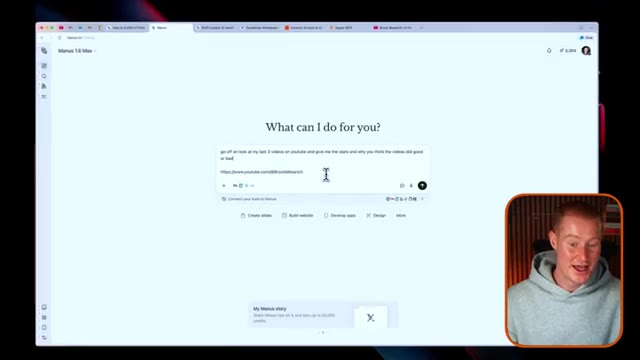
*⏱️ 00:11:08 — Interface de l'outil Manus affichant une consigne demandant d'analyser les trois dernières vidéos YouTube de la chaîne.*

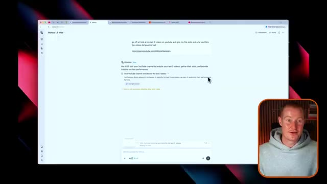
*⏱️ 00:11:17 — Réponse de l'agent IA de Manus confirmant la prise en compte de la demande pour analyser la chaîne YouTube.*

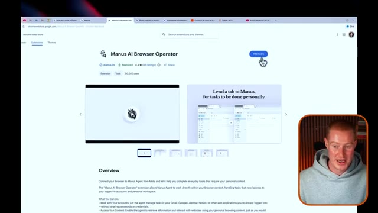
*⏱️ 00:11:26 — Page du Chrome Web Store présentant l'extension "Manus AI Browser Operator" avec le bouton d'installation.*

---

### ⏱️ `[00:11:36 - 00:11:54]` | Segment #27

**🔊 Audio (Transcription Intégrale Mot pour Mot en Français) :**
> Chrome, Safari, le navigateur Dia pour cet exemple, et cetera. Donc tout ce que j'ai à faire maintenant, c'est de cliquer sur ce bouton d'installation, de m'assurer qu'il est bien téléchargé, de revenir sur Manus et de cliquer simplement sur autoriser. Et ça va se lancer et littéralement ouvrir différents onglets sur mon navigateur. Et je vais vous montrer exactement ce que ça fait. Donc je pourrais cliquer sur ce petit bouton ici et c'est l'ordinateur de Manus.

**👁️ Analyse Visuelle d'Écran (gemini-3.5-flash-lite) :**
**Interface & Outils** : Navigateur web, Manus AI.

**Contenu textuel & Code** : Requête utilisateur demandant d'analyser les statistiques des trois dernières vidéos YouTube de @BrockMesarich.

**Action / Démonstration** : Navigation et interaction avec l'interface de l'assistant IA Manus.

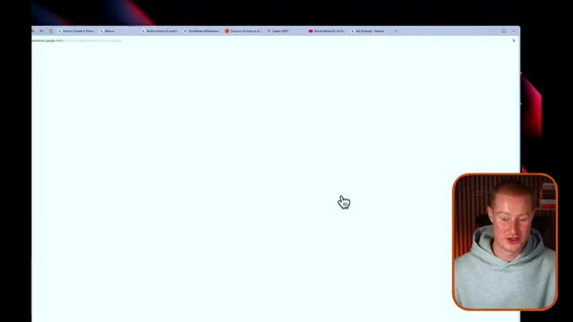
*⏱️ 00:11:40 — Page web blanche affichée dans un navigateur internet avec le présentateur en médaillon en bas à droite.*

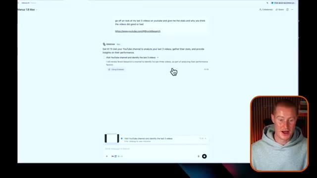
*⏱️ 00:11:45 — Interface de l'outil Manus montrant une requête d'analyse de chaîne YouTube avec le présentateur en médaillon.*

---

### ⏱️ `[00:11:54 - 00:12:26]` | Segment #28

**🔊 Audio (Transcription Intégrale Mot pour Mot en Français) :**
> Donc, il est littéralement en train d'aller, de cliquer et de naviguer sur ma chaîne YouTube juste ici. Vous pouvez le voir en temps réel effectuer cette action. Et si je clique sur cet onglet, vous pouvez voir qu'il a littéralement affiché ceci et ce cercle bleu autour d'ici. Cela signifie que c'est Manus qui contrôle mon ordinateur. Je ne touche à rien. Il va littéralement chercher ces informations depuis mes vidéos. Très bien. Donc, juste comme ça, quelques minutes plus tard, j'ai maintenant ce résultat ici où il a généré ce document entier qui est vraiment très complet. Il décompose fondamentalement tout ce qui concerne ma chaîne YouTube, indique la date de l'analyse, mon identifiant, mes abonnés, un résumé exécutif, explique

**👁️ Analyse Visuelle d'Écran (gemini-3.5-flash-lite) :**
**Interface & Outils** : Navigateur web, YouTube, rapport de performance textuel et interface de présentation.

**Contenu textuel & Code** : Métriques de performance de chaîne YouTube (abonnés, nombre de vidéos, vues, likes, commentaires, ratio).

**Action / Démonstration** : Navigation et présentation d'un rapport généré automatiquement sur les performances de la chaîne YouTube du présentateur.

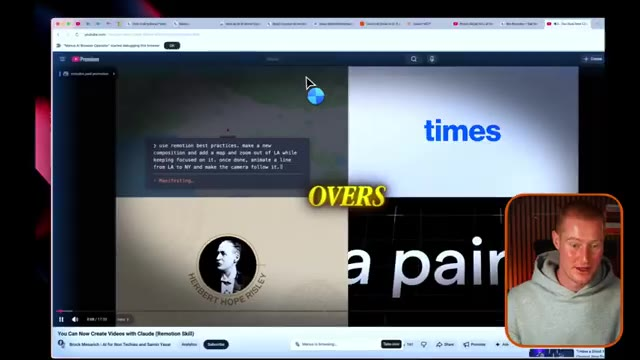
*⏱️ 00:12:02 — Capture montrant un navigateur web avec une vidéo YouTube en cours de lecture et une incrustation vidéo du présentateur en bas à droite.*

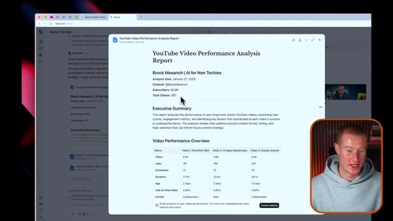
*⏱️ 00:12:18 — Capture affichant un rapport d'analyse de performance de vidéo YouTube à l'écran, avec le curseur de la souris pointant sur les statistiques de la chaîne.*

---

### ⏱️ `[00:12:26 - 00:12:59]` | Segment #29

**🔊 Audio (Transcription Intégrale Mot pour Mot en Français) :**
> les trois dernières vidéos. Donc ma vidéo sur la compétence Remotion a 6,3 mille vues. Ma masterclass sur les applications IA a 3,9 mille, ma cloud co-work a 9,4 mille, elle analyse le ratio de vues tout ça et les gars, je lui ai donné un prompt très simple au départ, si je lui avais donné un prompt vraiment spécifique, elle aurait généré un résultat encore meilleur que celui-ci, donc elle analyse littéralement un par un pourquoi ces vidéos ont sous-performé, pourquoi elles ont bien performé, et génère même des enseignements clés et des tendances ainsi que des recommandations pour le contenu futur. Les gars, c'est fou et encore, je pourrais littéralement

**👁️ Analyse Visuelle d'Écran (gemini-3.5-flash-lite) :**
**Interface & Outils** : Navigateur web affichant un rapport d'analyse de performance vidéo (Manus / document structuré).

**Contenu textuel & Code** : Tableaux de métriques YouTube (vues, likes, commentaires, ratios) et sections textuelles d'analyse (Executive Summary, Key Insights and Patterns).

**Action / Démonstration** : Navigation et présentation des résultats d'analyse de performance des vidéos YouTube par l'outil.

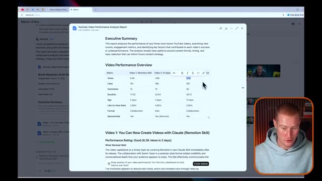
*⏱️ 00:12:34 — Affichage d'un rapport d'analyse de performance vidéo YouTube sur une interface web, montrant un tableau comparatif des vues, likes et commentaires.*

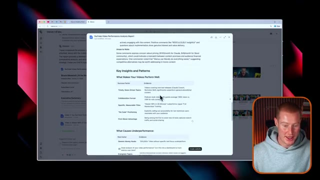
*⏱️ 00:12:51 — Vue sur la suite du rapport d'analyse web détaillant les "Key Insights and Patterns" et facteurs de performance des vidéos.*

---

### ⏱️ `[00:12:59 - 00:13:32]` | Segment #30

**🔊 Audio (Transcription Intégrale Mot pour Mot en Français) :**
> transformer cela en un site web interactif que je pourrais ensuite voir et commencer à utiliser pour voir comment je pourrais essentiellement améliorer ma chaîne YouTube pour vous les gars. D'accord, donc la partie importante à ce sujet est que j'ai réussi ce flux de travail. C'est phénoménal. C'est magnifique. Disons que je veux maintenant transformer cela en une compétence. C'est aussi simple que de venir chez Manus et de dire simplement, c'est phénoménal. Je veux que tu transformes cela en une compétence appelée recherche YouTube. Voilà. Je vais envoyer ça à Manus et cela va littéralement maintenant concevoir cela en une compétence. De cette façon, chaque fois que je viens sur Manus et que je tape recherche YouTube ou YouTube barre oblique recherche, cela va ensuite

**👁️ Analyse Visuelle d'Écran (gemini-3.5-flash-lite) :**
**Interface & Outils** : Application web Manus 1.6 Max et navigateur de démonstration affichant une chaîne YouTube.

**Contenu textuel & Code** : Rapport d'analyse de performance YouTube (Executive Summary, statistiques d'abonnés, métriques de vidéos, fichiers markdown générés).

**Action / Démonstration** : Interaction avec l'agent IA Manus pour examiner le rapport d'analyse et lui assigner la création d'une nouvelle compétence personnalisée.

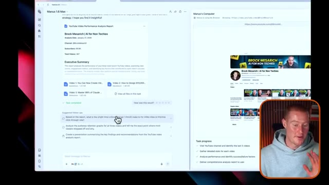
*⏱️ 00:13:07 — Capture d'écran montrant l'interface de Manus 1.6 Max avec un rapport de performance YouTube pour "Brock Mesarich | AI for Non Techies".*

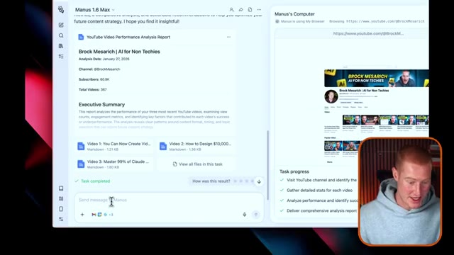
*⏱️ 00:13:16 — Vue de l'interface de l'outil Manus affichant l'achèvement d'une tâche d'analyse de chaîne YouTube et le champ de saisie de message.*

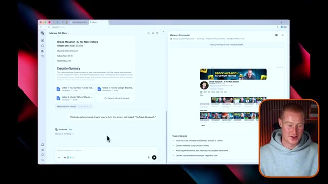
*⏱️ 00:13:24 — Interface de Manus montrant la saisie d'un nouveau prompt utilisateur demandant de transformer le flux en une compétence nommée "YouTube Research".*

---

### ⏱️ `[00:13:32 - 00:14:02]` | Segment #31

**🔊 Audio (Transcription Intégrale Mot pour Mot en Français) :**
> déclencher cette commande exacte ici en utilisant le fichier stats MD, puis répliquer tout ce flux de travail. Donc ça fait ça à chaque fois que je le déclenche. Et la raison pour laquelle je voulais montrer ce cas d'utilisation spécifique et la création de compétences avec browser use, c'est que cela ajoute toute une autre couche de fonctionnalités, pouvoir aller pointer, cliquer et voir des choses sur des sites web et utiliser réellement un ordinateur comme le ferait une personne, c'est là que les choses deviennent vraiment folles, et transformer cela en compétences au fil du temps va juste être extrêmement précieux pour vous de commencer à construire. Très bien, alors c'est parti.

**👁️ Analyse Visuelle d'Écran (gemini-3.5-flash-lite) :**
**Interface & Outils** : Interface web de Manus AI / Navigateur web.

**Contenu textuel & Code** : Fichier Markdown `video2_stats.md` contenant des métadonnées vidéo (format, commentaires, observations clés) et la génération de compétences YouTube.

**Action / Démonstration** : L'assistant virtuel exécute les requêtes de l'utilisateur pour automatiser la création de compétences et analyser les statistiques.

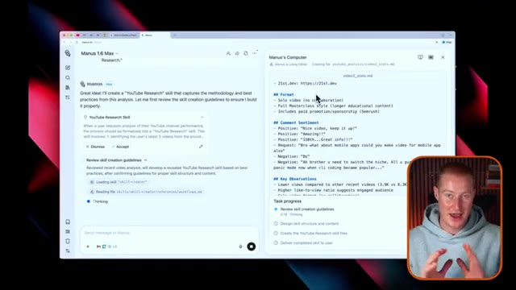
*⏱️ 00:13:40 — Interface du navigateur affichant l'assistant Manus AI en train de rédiger un fichier de statistiques et de créer des compétences YouTube.*

---

### ⏱️ `[00:14:02 - 00:14:35]` | Segment #32

**🔊 Audio (Transcription Intégrale Mot pour Mot en Français) :**
> Quelques minutes plus tard, nous avons désormais cette compétence. Donc il est indiqué que j'ai créé la compétence de recherche YouTube. Ce que fait cette compétence, c'est qu'elle fournit un flux de travail structuré en quatre étapes pour analyser les performances sur YouTube, elle guide la collecte de données pour les vues, les j'aime, les commentaires et les mesures d'engagement, elle comprend un modèle de rapport pour un résultat cohérent et professionnel, elle se concentre sur l'analyse comparative, des recommandations exploitables, et afin d'enregistrer cette compétence, tout ce que j'ai à faire est de cliquer sur l'ajouter à mes compétences et ensuite, maintenant, je peux taper barre oblique recherche YouTube et cela s'exécutera et fonctionnera automatiquement de cette exact manière à chaque fois.

**👁️ Analyse Visuelle d'Écran (gemini-3.5-flash-lite) :**
**Interface & Outils** : Interface web de l'outil d'IA Manus 1.6 Max avec une incrustation vidéo du présentateur en bas à droite.

**Contenu textuel & Code** : Texte décrivant la création de la compétence YouTube Research, incluant un flux de travail en 4 étapes, les métriques d'engagement et la liste de progression des tâches.

**Action / Démonstration** : Le présentateur commente le résultat de la tâche d'IA qui a généré et validé avec succès la nouvelle compétence de recherche YouTube.

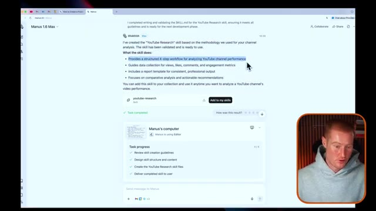
*⏱️ 00:14:11 — Interface de l'outil montrant la création réussie de la compétence de recherche YouTube avec un récapitulatif textuel détaillé et la progression des tâches en bas.*

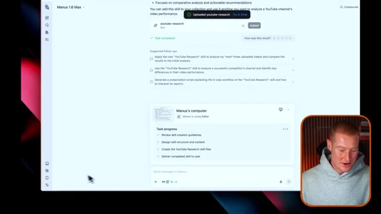
*⏱️ 00:14:27 — Interface montrant l'ajout de la compétence 'youtube-research' à la collection avec des suggestions de suivi pour analyser de nouvelles vidéos.*

---

### ⏱️ `[00:14:35 - 00:14:58]` | Segment #33

**🔊 Audio (Transcription Intégrale Mot pour Mot en Français) :**
> Très bien, les amis, voilà qui est fait. Ce sont les compétences de Manus. Je suis sincèrement et incroyablement impressionné par cette nouvelle fonctionnalité au sein de cette plateforme. Ça ne fait que décupler les capacités de Manus, même si Manus est déjà comme un couteau suisse en matière de capacités d'IA pour vos tâches quotidiennes si vous voulez commencer à utiliser l'IA. Si vous voulez utiliser Manus AI, il y aura un lien dans la description, comme je l'ai mentionné plus tôt dans cette vidéo, pour vous inscrire avec 1000 crédits gratuits.

**👁️ Analyse Visuelle d'Écran (gemini-3.5-flash-lite) :**
**Interface & Outils** : Interface web de la plateforme Manus (section Skills / gestion des capacités des agents).

**Contenu textuel & Code** : Menu latéral Manus affichant Account, Settings, Usage, Billing, Scheduled tasks, Mail Manus, Data controls, Cloud browser, Personalization, Skills, Connectors, Integrations, ainsi qu'une compétence listée (manus-brand-guidelines).

**Action / Démonstration** : Présentation de la section Skills de Manus et de la gestion des compétences des agents d'intelligence artificielle.

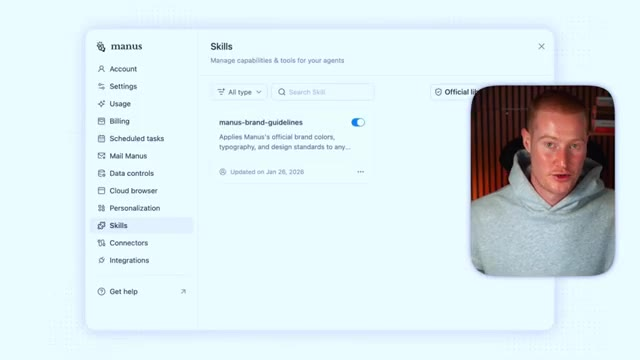
*⏱️ 00:14:47 — Interface de la plateforme Manus montrant la section des compétences (Skills) avec un encart vidéo du présentateur.*

---

### ⏱️ `[00:14:58 - 00:15:17]` | Segment #34

**🔊 Audio (Transcription Intégrale Mot pour Mot en Français) :**
> Alors, j'espère que cela vous donnera un coup de pouce pour pouvoir utiliser la plateforme sans avoir à débourser d'argent de votre poche. Les gars, j'espère que vous avez tiré de la valeur de cette vidéo. Assurez-vous de vous abonner pour plus de contenu de ce genre. J'en ai plein d'autres en préparation et l'intelligence artificielle s'accélère à un rythme fou, et vous avez besoin d'un endroit pour pouvoir vous tenir au courant. Et c'est la chaîne parfaite pour les personnes non techniques. Cela étant dit, les gars, merci beaucoup d'être restés jusqu'à la fin.

**👁️ Analyse Visuelle d'Écran (gemini-3.5-flash-lite) :**
**Interface & Outils** : YouTube (Interface de navigation de chaîne vidéo)

**Contenu textuel & Code** : Titres et miniatures de vidéos consacrées à l'intelligence artificielle (Claude, Manus 1.6 Max, Gemini, Lovable), compteur d'abonnés (60,3K).

**Action / Démonstration** : Présentation de la chaîne YouTube et incitation à s'abonner au contenu.

---

### ⏱️ `[00:15:18 - 00:15:20]` | Segment #35

**🔊 Audio (Transcription Intégrale Mot pour Mot en Français) :**
> Je vous souhaite de vous porter bien et je vous retrouve dans la prochaine vidéo.

**👁️ Analyse Visuelle d'Écran (gemini-3.5-flash-lite) :**
**Interface & Outils** : Aucune interface logicielle ou graphique affichée.

**Contenu textuel & Code** : Aucun indicateur, code ou donnée chiffrée.

**Action / Démonstration** : Le présentateur s'adresse directement au public pour conclure.

---

