# 🎬 I Hate OpenClaw… but I can’t stop using it (Clawdbot)

> **Chaîne** : [Brock Mesarich | AI for Non Techies](https://www.youtube.com/@BrockMesarich)  
> **Lien YouTube** : [https://www.youtube.com/watch?v=kairgvzdUpo](https://www.youtube.com/watch?v=kairgvzdUpo)  
> **Date de publication** : 20260129  
> **Durée** : 00:19:57  
> **Identifiant vidéo** : `kairgvzdUpo`  
> **Transcription & Analyse** : `whisper-v3-large-turbo+gemini-3.5-flash-lite`  

---

## 📌 Synthèse Exécutive & Outils

### 💡 Résumé

La vidéo de la chaîne *Brock Mesarich | AI for Non Techies* (animée par Brock et son invité Salman) explore l'un des phénomènes technologiques les plus viraux du moment : **Clawdbot** (initialement nommé *Clodbot* puis renommé *Moltbot* suite à des pressions juridiques d'Anthropic). Loin du simple gadget marketing, l'outil est présenté comme le précurseur de l'interaction future avec l'intelligence artificielle : un agent autonome doté de sa propre machine physique (ou d'un environnement isolé), d'une adresse e-mail dédiée et d'un accès étendu à divers outils, capable d'exécuter des tâches complexes à distance sur simple instruction textuelle ou vocale.

Au-delà de l'effet de mode, les intervenants partagent un retour d'expérience réaliste, oscillant entre l'enthousiasme face aux capacités quasi-magiques de l'agent et la frustration liée à l'instabilité inhérente aux versions précoces. Le cœur de la discussion s'articule autour des aspects pratiques de déploiement — notamment l'arbitrage entre l'achat d'un Mac Mini dédié ou l'utilisation d'un VPS — et de la sécurité. Les créateurs démontrent comment déléguer des flux de travail complets (comme la génération automatisée d'animations via l'intégration d'API) en pilotant l'agent à distance via des applications de messagerie comme Telegram, transformant ainsi un ordinateur de bureau en un assistant virtuel pilotable depuis une montre connectée.

### 🛠️ Outils, Modèles & Logiciels Présentés

* **Claude** : Modèle de langage central utilisé par l'agent autonome (à l'origine du nom initial *Clodbot* / *Clawdbot*) pour interpréter les instructions et piloter les flux de travail.
* **Grok** : Modèle d'intelligence artificielle alternatif évoqué dans l'écosystème global des LLMs concurrents.
* **Gemini** : Modèle d'IA de Google dont la clé API est exploitée par l'agent pour alimenter des fonctionnalités de génération multimédia (comme la voix et l'animation).
* **ChatGPT** : Modèle de référence d'OpenAI mentionné dans le panorama des assistants conversationnels actuels.
* **Make** : Plateforme d'automatisation no-code et d'intégration de flux de travail entre différentes applications logiques.
* **Zapier** : Outil historique d'automatisation et de connexion d'API pour déclencher des actions automatisées.
* **n8n** : Logiciel d'automatisation de flux de travail open-source et flexible, souvent privilégié pour des configurations techniques avancées.
* **Telegram** : Application de messagerie sécurisée utilisée comme interface principale de commande pour dialoguer avec l'agent et le piloter à distance.
* **TG Watch** : Application pour montre connectée permettant d'interagir avec Telegram et de contrôler l'ordinateur de l'agent par la voix ou de simples pressions.

### 🔑 Points Clés & Enseignements Stratégiques

* **Le paradigme du « second employé »** : Il convient de concevoir l'agent non pas comme un simple chatbot textuel ou un outil de génération de code brut (ses performances en programmation pure étant perfectibles), mais comme un collaborateur numérique autonome capable d'exécuter des tâches en arrière-plan.
* **Isolation rigoureuse de l'infrastructure** : Ne jamais installer ce type d'agent autonome sur sa machine personnelle principale, afin d'éviter des actions non sollicitées ou des prises de contrôle automatisées à grande échelle (comme l'envoi d'e-mails professionnels par erreur).
* **Arbitrage matériel (Mac Mini vs VPS)** : L'utilisation d'un Mac Mini dédié est recommandée pour les utilisateurs non techniques souhaitant une configuration simple et l'accès natif à certaines fonctionnalités (comme iMessage), tandis que le VPS s'adresse aux profils techniques maîtrisant l'administration de serveurs distants.
* **Recyclage technologique** : Une alternative économique et écologique consiste à réutiliser un vieux portatif délaissé au fond d'un placard, à condition de le formater entièrement et de s'assurer qu'aucune donnée personnelle sensible n'y réside.
* **Gestion du compromis accès/utilité** : Plus l'agent dispose de permissions et d'accès aux différents comptes et fichiers, plus il est efficace, mais plus le niveau de risque augmente ; un équilibre minutieux doit être trouvé selon les cas d'usage.
* **Interface de commande conversationnelle** : L'utilisation de messageries instantanées comme Telegram offre une alternative extrêmement sécurisée et intuitive pour piloter l'agent, s'affranchissant des interfaces de bureau complexes.
* **Contrôle ubiquitaire via les objets connectés** : L'intégration d'applications de messagerie sur des montres connectées (Apple Watch) permet de transformer l'agent en un assistant vocal opérationnel de type "James Bond", permettant d'exécuter des requêtes complexes sans même utiliser ses mains.
* **Délégation multimodale** : En connectant l'agent à des clés API tierces (comme Gemini), il devient possible d'automatiser des processus de création complexes, allant de la génération de scripts jusqu'à la production de supports visuels et animés.
* **Anticipation de l'obsolescence technologique** : Considérer l'outil dans sa version actuelle comme "la pire qu'il ne sera jamais" permet de relativiser les bugs rencontrés et de se positionner précocement sur les standards futurs de l'interaction homme-machine.

---

## ⏱️ Chronologie & Transcription Complète Audio & Visuelle (Mot pour Mot)

### ⏱️ `[00:00:00 - 00:00:20]` | Segment #01

**🔊 Audio (Transcription Intégrale Mot pour Mot en Français) :**
> Plodbot, autrement connu sous le nom de Multbot, est en train de casser internet en ce moment. Mais avant de faire rapidement une simple vidéo de plus pour créer le buzz, je voulais vraiment tester cet outil en conditions réelles. Alors, mon ami Saman et moi avons plongé en profondeur dans ce truc ces derniers jours. Nous avons décidé de faire un podcast pour tout décortiquer. Ce que c'est, six différentes manières dont nous l'utilisons, et si ça vaut vraiment le coup d'œil.

**👁️ Analyse Visuelle d'Écran (gemini-3.5-flash-lite) :**
**Interface & Outils** : Navigateur web / YouTube.

**Contenu textuel & Code** : Interface de la chaîne YouTube de Samin Yasar avec ses différentes vidéos sur l'intelligence artificielle.

**Action / Démonstration** : Présentation introductive du collaborateur Saman Yasar et de son contenu sur les outils d'IA.

---

### ⏱️ `[00:00:20 - 00:00:54]` | Segment #02

**🔊 Audio (Transcription Intégrale Mot pour Mot en Français) :**
> Et pour être honnête, cela ressemble vraiment à un aperçu du futur de la façon dont nous allons utiliser l'IA, mais il y a des choses incroyablement importantes que vous devez savoir avant de le faire. Alors sans plus attendre, plongeons dans cette vidéo. Très bien, Salmon, nous sommes de retour. Littéralement genre deux jours après avoir tourné notre dernier podcast. Je sais, c'est comme si je profitais littéralement de toi pour enregistrer ces podcasts, mais j'ai vraiment pris tellement de plaisir et c'est marrant de faire des geeks avec toi. Donc aujourd'hui, nous allons parler de Clodbot, Moldbot, ou peu importe comment vous voulez l'appeler maintenant. Salmon et moi avons joué avec ça. Nous avons chacun nos expériences individuelles et uniques en l'utilisant. Donc dans cette vidéo, nous allons parler de ce qu'est Clodbot ainsi que d'analyser certains des cas d'utilisation que j'ai

**👁️ Analyse Visuelle d'Écran (gemini-3.5-flash-lite) :**
**Interface & Outils** : Tableau blanc Miro, visioconférence à deux participants.

**Contenu textuel & Code** : Titre de présentation "What is ClawdBot/MoltBot?" illustré par des icônes (globe, cloche, engrenage, microphone) et un personnage rouge stylisé.

**Action / Démonstration** : Introduction du sujet de la vidéo par les intervenants avec un support visuel explicatif sur Miro.

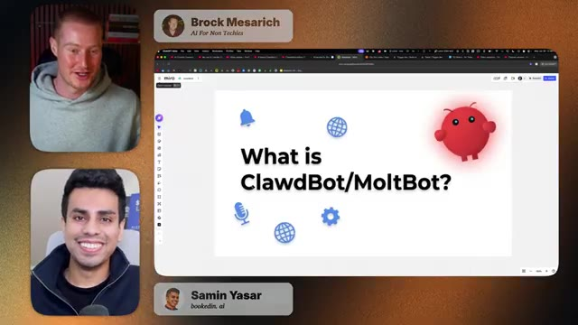
*⏱️ 00:00:37 — Écran partagé montrant Brock Mesarich en haut à gauche, Samin Yasar en bas à gauche, et au centre un tableau blanc Miro avec le titre "What is ClawdBot/MoltBot?".*

---

### ⏱️ `[00:00:54 - 00:01:31]` | Segment #03

**🔊 Audio (Transcription Intégrale Mot pour Mot en Français) :**
> ainsi que Salmon. Donc Salmon, plongeons dedans. Neurasthénisons un peu là-dessus et montrons au public de quoi il s'agit, bien sûr. Eh bien, je suis ravi d'être de retour, merci de m'avoir invité sur ce Clod Pod, euh mais tu sais, je voulais vraiment aborder ce qu'est Clod Bot, mais en fait, on devrait l'appeler Molt Bot parce qu'Anthropic a apparemment poursuivi ces gars en justice pour avoir utilisé Clod dans leur nom, n'est-ce pas ? Euh ouais, mais essentiellement, quand on pense à ce que cette chose est vraiment et pourquoi elle fait autant de bruit, c'est à cause de ce qu'elle nous permet de faire. Et c'est un peu comme un aperçu du futur, de la façon dont nous utilisons

**👁️ Analyse Visuelle d'Écran (gemini-3.5-flash-lite) :**
**Interface & Outils** : Miro, application de visioconférence

**Contenu textuel & Code** : Texte 'What is ClawdBot/MoltBot?' avec des icônes explicatives et un personnage rouge stylisé.

**Action / Démonstration** : Présentation du sujet principal de la discussion par les intervenants.

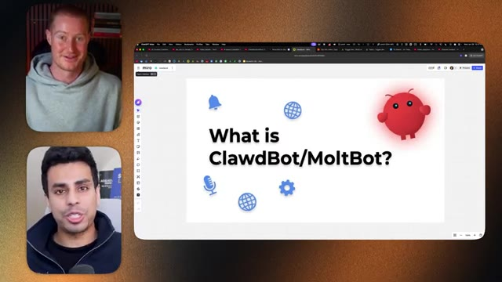
*⏱️ 00:01:03 — Capture d'écran montrant le présentateur principal et son invité en visioconférence, avec au centre un tableau blanc Miro affichant la question 'What is ClawdBot/MoltBot?'.*

---

### ⏱️ `[00:01:31 - 00:01:51]` | Segment #04

**🔊 Audio (Transcription Intégrale Mot pour Mot en Français) :**
> la technologie et la façon dont nous allons interagir avec des agents d'intelligence artificielle, n'est-ce pas ? Donc, à l'heure actuelle, vous pouvez voir CloudBot, de la manière la plus simple, comme si vous installiez un bot, que vous lui donniez son propre ordinateur, sa propre adresse e-mail et un accès à tout. Vous le traitez comme sa propre entité capable de faire des choses. Et puis, vous savez, vous pouvez simplement lui envoyer des SMS comme à un collègue et il fera le travail pour vous.

**👁️ Analyse Visuelle d'Écran (gemini-3.5-flash-lite) :**
**Interface & Outils** : Navigateur web affichant une interface Miro avec une présentation visuelle.

**Contenu textuel & Code** : Texte 'What is ClawdBOT/MoltBot?' accompagné d'icônes illustratives (cloche, icônes web, engrenage, micro) et d'un personnage rouge en forme de robot.

**Action / Démonstration** : Présentation du sujet et introduction des concepts de ClawdBOT et MoltBot lors d'une discussion en visioconférence.

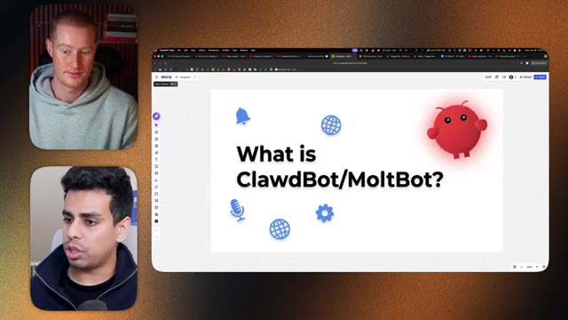
*⏱️ 00:01:36 — Capture d'écran montrant le présentateur et un invité en haut à gauche, ainsi qu'une interface web Miro affichant le titre explicatif 'What is ClawdBOT/MoltBot?'.*

---

### ⏱️ `[00:01:51 - 00:02:24]` | Segment #05

**🔊 Audio (Transcription Intégrale Mot pour Mot en Français) :**
> Peu importe l'interface que vous utilisez. Vous pouvez envoyer un mémo vocal, ou autre. Et j'ai l'impression que c'est la manière la plus simple de se faire une idée de ce qu'est vraiment ce truc. Bien sûr, il y a quelques bugs ici et là, mais ce truc est tout neuf et il ne va faire que s'améliorer avec le temps. C'est littéralement la pire version qu'il ne sera jamais. Oui, c'est un bon point. Et je tiens à préciser, nous ne allons pas juste rester là à encenser la chose dans cette vidéo, comme vous l'avez probablement déjà vu partout sur YouTube ou sur Twitter. Vous en avez sans doute assez, mais nous allons parler de notre vraie expérience avec ça, car personnellement, j'ai configuré cet outil il y a quelques jours. J'ai eu de superbes expériences avec. Cependant, j'ai aussi été tellement énervé contre lui. Je me suis dit, mon Dieu, pourquoi est-ce que ça continue de

**👁️ Analyse Visuelle d'Écran (gemini-3.5-flash-lite) :**
**Interface & Outils** : Application de visioconférence et tableau blanc Miro.

**Contenu textuel & Code** : Présentation du sujet 'What is ClawdBot/MoltBot?' avec des icônes illustratives (cloche, globe, microphone, engrenage) et un personnage rouge stylisé.

**Action / Démonstration** : Présentation du sujet principal de la vidéo par les intervenants.

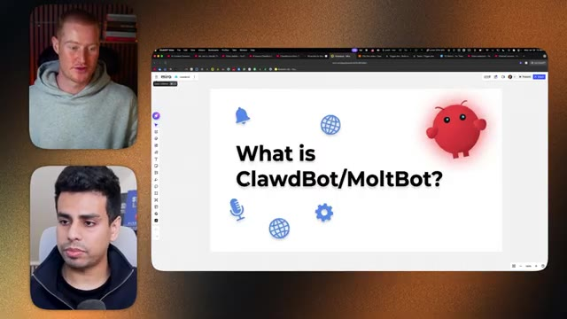
*⏱️ 00:02:08 — Capture d'écran montrant le présentateur et son invité en visioconférence à gauche, et une interface Miro avec une présentation intitulée 'What is ClawdBot/MoltBot?' à droite.*

---

### ⏱️ `[00:02:24 - 00:02:58]` | Segment #06

**🔊 Audio (Transcription Intégrale Mot pour Mot en Français) :**
> qui plante tous les trois messages que j'envoie. Donc tout n'est pas rose, mais oui, je suis d'accord. C'est une nouvelle façon dont nous allons interagir avec l'IA. Alors Salman, plongeons dans le vif du sujet et parlons un peu plus de ce que c'est. Et ensuite, nous pourrons montrer concrètement comment nous l'utilisons tous les deux. Bien sûr. Donc en fait, au début, je me rappelle que les gens se demandaient ce qu'était CloudBot et les gens pensaient juste que c'était comme CloudCode sur votre téléphone, mais ce n'est pas vraiment ça, n'est-ce pas ? C'est, c'est un peu comme un deuxième employé. Donc si vous y pensez de cette façon, je pense que vous pouvez l'utiliser beaucoup mieux, car honnêtement, ce n'est pas le meilleur pour coder. Donc ça en soi, c'est juste la première chose que j'ai remarquée en l'utilisant. Bien sûr, vous pouvez, vous savez, avoir vos astuces pour contourner le moment où

**👁️ Analyse Visuelle d'Écran (gemini-3.5-flash-lite) :**
**Interface & Outils** : Tableau blanc interactif (Miro) et interface de visioconférence.

**Contenu textuel & Code** : Le titre "What is ClawdBot/MoltBot?" accompagné d'icônes vectorielles (cloche, globes, micro, engrenage) et d'un personnage rouge animé.

**Action / Démonstration** : Présentation du sujet principal de la discussion et introduction de ClawdBot/MoltBot par les animateurs.

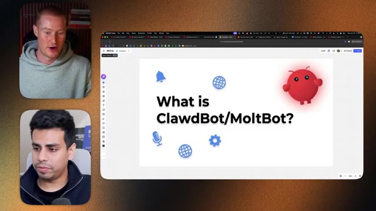
*⏱️ 00:02:32 — Un tableau blanc interactif Miro affichant la question "What is ClawdBot/MoltBot?" avec des icônes explicatives et une petite mascotte rouge, tandis que les deux intervenants apparaissent en vignettes vidéo sur le côté.*

---

### ⏱️ `[00:02:58 - 00:03:44]` | Segment #07

**🔊 Audio (Transcription Intégrale Mot pour Mot en Français) :**
> Il s'occupe de tout le code et de tout le reste. Mais ce que je tiens à préciser, c'est que ce truc n'est qu'une sorte d'assistant, et plus vous lui donnez de compétences, mieux il s'en sortira. C'est vrai. Et c'est pourquoi vous voyez des gens acheter des Mac minis par lots pour y installer leur Clodbot, parce que cela devient la machine personnelle du Clodbot, là où vous mettez votre adresse e-mail et tout le reste. C'est clair. Et Salman, Salman et moi tous les deux, pour préciser, nous avons tous les deux acheté le Mac mini pour nos propres raisons. Genre, j'aime avoir de nouveaux produits Apple brillants. Je n'en ai probablement pas besoin. Vous savez, les gens disent qu'on peut faire tourner ça sur un VPS et tout le reste. Donc Salman, si tu pouvais expliquer maintenant à mon audience, genre, est-ce qu'ils devraient se ruer pour s'acheter un Mac mini comme toi et moi l'avons fait ? Ou penses-tu que c'est un peu exagéré ? Parce que je suis sûr et je sais qu'il y a des solutions de contournement que vous pourriez utiliser pour ne pas avoir à utiliser un Mac mini. Et ensuite, peut-être expliquer rapidement pourquoi les gens font tourner ça sur un ordinateur complètement séparé.

**👁️ Analyse Visuelle d'Écran (gemini-3.5-flash-lite) :**
**Interface & Outils** : Miro (tableau blanc en ligne)

**Contenu textuel & Code** : Schéma comparatif entre "What people think" (une simple appli mobile avec une icône de téléphone) et "What it actually is" (un ordinateur de bureau complet avec automatisation active).

**Action / Démonstration** : Explication visuelle de la différence conceptuelle entre une application mobile simple et un système d'automatisation de bureau complet.

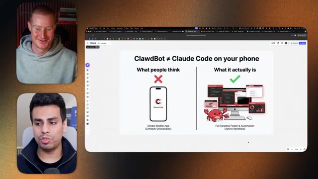
*⏱️ 00:03:10 — Présentation comparative sur Miro montrant "ClawdBot ≠ Claude Code on your phone" avec des illustrations explicatives.*

---

### ⏱️ `[00:03:44 - 00:04:05]` | Segment #08

**🔊 Audio (Transcription Intégrale Mot pour Mot en Français) :**
> parce que je pense que c'est une distinction vraiment importante à faire au début de cette vidéo. Pour que les gens n'aillent pas configurer ça sur leur ordinateur personnel, qu'ils n'envoient pas un e-mail à leur patron pour démissionner en pilotage automatique, tu vois, et qu'après, tu te retrouves avec des gens qui nous rejettent la faute. Alors, décompose un peu ces points pour nous. Pour que mon audience puisse mieux comprendre cela. Bien sûr. Alors ouais, il y a ce débat en ce moment en ligne et c'est assez fou, où certaines personnes se disent, oh, utilisons simplement un Mac Mini.

**👁️ Analyse Visuelle d'Écran (gemini-3.5-flash-lite) :**
**Interface & Outils** : Navigateur web affichant un tableau blanc Miro avec un mème et appel vidéo (deux intervenants).

**Contenu textuel & Code** : Graphique de distribution normale (courbe de Gauss) annoté avec des mèmes aux extrémités ("MacMini Good Sir").

**Action / Démonstration** : Le présentateur commente le mème illustrant les différents niveaux d'utilisation technique.

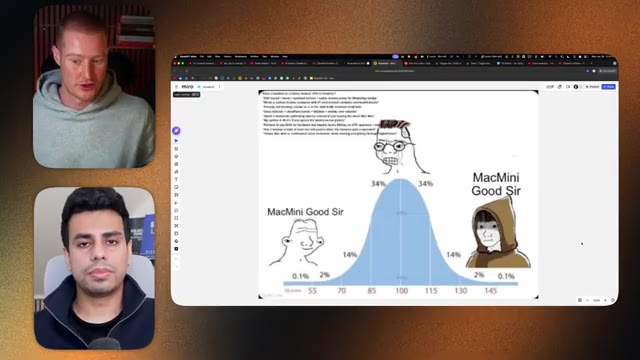
*⏱️ 00:03:50 — Capture d'écran montrant le présentateur à gauche et un mème de courbe de Gauss (distribution normale) illustrant le niveau de compétence technique à droite.*

---

### ⏱️ `[00:04:05 - 00:04:26]` | Segment #09

**🔊 Audio (Transcription Intégrale Mot pour Mot en Français) :**
> Et d'autres personnes disent, oh, vous pouvez configurer ça sur un VPS. Honnêtement, si vous êtes assez doué pour le configurer sur un VPS, faites-le par tous les moyens. Mais je pense que pour la majorité des gens, ils ne savent pas ce que c'est. Ils ne savent même pas ce que signifient les lettres VPS ou ce qu'est un serveur ou même comment utiliser le cloud. Donc pour eux, utiliser un Mac mini ou même vous pouvez être un peu plus économe.

**👁️ Analyse Visuelle d'Écran (gemini-3.5-flash-lite) :**
**Interface & Outils** : Navigateur web affichant un tableau blanc Miro et un appel vidéo multi-fenêtres.

**Contenu textuel & Code** : Un mème humoristique basé sur une courbe de distribution normale avec des notes et des illustrations représentant les avis sur l'utilisation d'un VPS par rapport à un Mac Mini.

**Action / Démonstration** : Le présentateur commente le mème illustrant l'utilisation des VPS et des configurations matérielles.

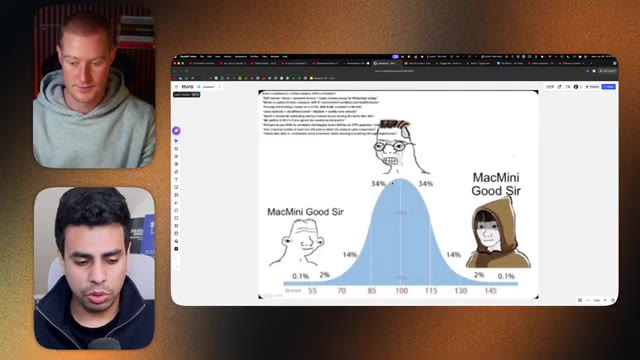
*⏱️ 00:04:16 — Capture d'écran montrant une interface Miro avec un mème en forme de courbe de Gauss (courbe normale) illustrant le choix entre VPS et Mac Mini, avec deux intervenants dans des vignettes vidéo sur le côté.*

---

### ⏱️ `[00:04:26 - 00:04:45]` | Segment #10

**🔊 Audio (Transcription Intégrale Mot pour Mot en Français) :**
> Si vous avez un vieux vieil ordinateur portable qui pourrit dans votre placard, vous pouvez simplement y installer cloud bot. Assurez-vous simplement qu'il n'y a rien de personnel dessus. Nettoyez-le complètement et ensuite vous pourrez le faire tourner. C'est fondamentalement, vous savez, nous pouvons réellement recycler notre vieille technologie avec ça. Et j'ai l'impression que c'est la meilleure utilisation possible. Mais disons que vous n'avez rien ou que vous en voulez un. Honnêtement, si vous voulez juste avoir l'air cool, c'est là que vous utilisez le Mac mini.

**👁️ Analyse Visuelle d'Écran (gemini-3.5-flash-lite) :**
**Interface & Outils** : Tableau blanc Miro et interface de visioconférence.

**Contenu textuel & Code** : Un mème humoristique basé sur une courbe de Gauss (courbe en cloche) et du texte technique en haut à gauche concernant des configurations matérielles et serveurs.

**Action / Démonstration** : Présentation d'une illustration humoristique pour appuyer les explications sur le choix du matériel informatique.

*⏱️ 00:04:36 — Capture d'écran montrant le présentateur et un invité en visioconférence à gauche, et un tableau blanc Miro affichant un mème sur une courbe de distribution gaussienne (courbe en cloche) avec "MacMini Good Sir" à gauche et à droite, illustrant des concepts techniques liés au matériel.*

---

### ⏱️ `[00:04:46 - 00:05:05]` | Segment #11

**🔊 Audio (Transcription Intégrale Mot pour Mot en Français) :**
> Donc encore une fois, si vous avez un vieux ordinateur, utilisez-le en premier. Si vous ne savez pas ce qu'est un VPS, si vous savez comment faire tout le cloud VPS, tout ce truc, faites-le. Mais si vous voulez juste les points cool et utiliser iMessage, alors vous avez besoin en gros d'un Mac mini. Bien sûr. Et personnellement, VPS me, genre je veux dire ces mots ne vont pas vraiment ensemble. Je ne comprends pas totalement. J'ai une vague idée peut-être.

**👁️ Analyse Visuelle d'Écran (gemini-3.5-flash-lite) :**
**Interface & Outils** : Miro, application de visioconférence.

**Contenu textuel & Code** : Un mème avec une courbe de distribution normale (courbe de Gauss) illustrant le concept 'MacMini Good Sir'.

**Action / Démonstration** : Discussion et présentation visuelle d'un mème sur l'utilisation du Mac mini par rapport aux solutions VPS complexes.

*⏱️ 00:04:55 — Écran partagé montrant deux intervenants en visioconférence et un graphique de distribution normale (courbe de Gauss) humoristique sur le Mac mini.*

---

### ⏱️ `[00:05:05 - 00:05:23]` | Segment #12

**🔊 Audio (Transcription Intégrale Mot pour Mot en Français) :**
> Mais pour moi, genre si j'avais eu un vieux vieil ordinateur portable, ç'aurait probablement été le plus pratique pour moi d'utiliser ça à la place. Mais à la place, je n'en avais pas. J'étais genre, j'ai d'autres cas d'utilisation pour mon Mac mini. Donc je vais juste aller en acheter un. Donc vous n'en avez pas besoin, c'est ce que Solomon est en train de dire. Ne faites tout simplement pas tourner ça sur votre ordinateur personnel à moins que vous ne vouliez, genre, frôler la limite, vous savez, genre, vous savez, marcher sur des œufs. Ouais.

**👁️ Analyse Visuelle d'Écran (gemini-3.5-flash-lite) :**
**Interface & Outils** : Logiciel de visioconférence et tableau blanc en ligne (Miro)

**Contenu textuel & Code** : Un mème humoristique basé sur la distribution normale (courbe de Gauss) avec des illustrations de type "wojak" et le texte "MacMini Good Sir".

**Action / Démonstration** : Présentation et explication d'un mème humoristique illustrant le choix du matériel informatique.

*⏱️ 00:05:09 — Capture d'écran montrant une visioconférence avec deux intervenants et une application de tableau blanc Miro affichant un mème humoristique sur une courbe de Gauss comparant l'utilisation d'un Mac Mini.*

---

### ⏱️ `[00:05:23 - 00:05:42]` | Segment #13

**🔊 Audio (Transcription Intégrale Mot pour Mot en Français) :**
> Donc ne le faites pas, c'est bien la seule chose que je dirai, genre, ne lui donnez pas accès à vos affaires personnelles, mais ce que vous pouvez faire, c'est lui donner un accès en lecture seule ou quelque chose comme ça. Pour qu'il puisse, genre, vous parler de trucs. Mais il y a aussi, genre, vous savez, la limite entre l'utilité et l'accessibilité, où plus vous lui donnez d'accès, plus il est utile, mais moins vous lui donnez d'accès, moins il est utile.

**👁️ Analyse Visuelle d'Écran (gemini-3.5-flash-lite) :**
**Interface & Outils** : Navigateur web avec l'outil de tableau blanc Miro et un outil de visioconférence.

**Contenu textuel & Code** : Un mème humoristique basé sur une courbe gaussienne (distribution normale) avec différents archétypes de personnages (cerveau lisse, wojak, personnage encapuchonné) et le texte "MacMini Good Sir".

**Action / Démonstration** : Partage d'écran d'un mème humoristique illustrant le sujet discuté par les intervenants lors de la réunion.

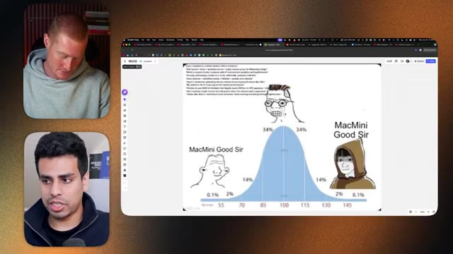
*⏱️ 00:05:28 — Capture d'écran montrant une visioconférence avec deux intervenants à gauche et un tableau Miro partagé à droite affichant un mème sur une courbe de distribution normale.*

---

### ⏱️ `[00:05:42 - 00:06:04]` | Segment #14

**🔊 Audio (Transcription Intégrale Mot pour Mot en Français) :**
> Il y a donc un équilibre à trouver. Très bien, Salman. Maintenant que les gens comprennent à peu près comment cela fonctionne, pourquoi ils ne devraient pas faire tourner ceci sur leurs ordinateurs personnels, et comment ils peuvent, vous savez, utiliser une solution de contournement pour le faire tourner sur autre chose, quels sont les cas d'utilisation clés ici ? Parce que j'ai vu des gens faire monter la sauce et montrer certaines choses, en disant qu'ils donnaient littéralement le contrôle total à ce truc pour qu'il réponde à leur femme, à leur famille et fasse toutes ces choses insensées.

**👁️ Analyse Visuelle d'Écran (gemini-3.5-flash-lite) :**
**Interface & Outils** : Application de tableau blanc Miro et flux vidéo de visioconférence.

**Contenu textuel & Code** : Un diagramme en cloche (courbe de distribution normale) annoté avec le texte "MacMini Good Sir" et des mèmes associés aux différentes sections statistiques.

**Action / Démonstration** : Présentation d'un concept technique sous forme d'humour visuel (mème de la courbe de Gauss) pour illustrer le choix du matériel informatique.

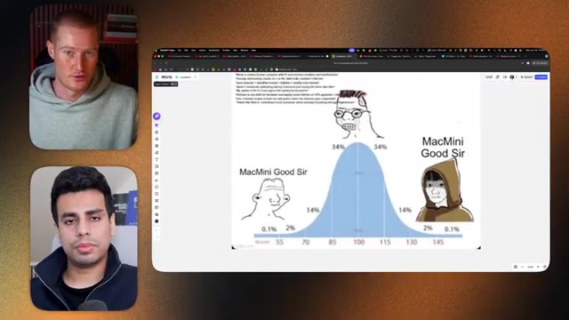
*⏱️ 00:05:47 — Capture montrant les deux présentateurs à gauche et un tableau blanc Miro affichant un graphique de distribution normale (courbe de Gauss) illustrant le mème "MacMini Good Sir".*

*⏱️ 00:05:58 — Capture similaire à l'image 1 montrant la suite de la discussion avec les deux intervenants et le diagramme humoristique sur l'utilisation d'un Mac Mini.*

---

### ⏱️ `[00:06:04 - 00:06:36]` | Segment #15

**🔊 Audio (Transcription Intégrale Mot pour Mot en Français) :**
> Alors, quels sont les cas d'usage pratiques que vous observez en ce moment et que les gens peuvent commencer à mettre en œuvre pour se simplifler un peu la vie ? Alors oui, passons en revue quelques cas d'usage différents. J'ai en fait réalisé une petite vidéo sympa et quelques animations pour cela afin que vous puissiez avoir une idée de ce que nous faisons. Mais en fait, pendant que nous préparions ce podcast, je me suis dit, hé, je devrais peut-être montrer quelques animations de ce à quoi ressemblerait ce CloudBot et de ce que c'est visuellement de travailler avec lui. Et, vous savez, j'ai simplement demandé à mon CloudBot de me préparer quelques vidéos. Et parce que je lui ai donné accès à ma clé API Gemini.

**👁️ Analyse Visuelle d'Écran (gemini-3.5-flash-lite) :**
**Interface & Outils** : Tableau blanc Miro et fenêtres de visioconférence.

**Contenu textuel & Code** : Un graphique statistique (courbe de distribution normale) illustré par des mèmes internet.

**Action / Démonstration** : Présentation visuelle et explication des cas d'usage ou d'un mème illustratif.

*⏱️ 00:06:12 — Capture d'écran montrant l'intervenant en bas à gauche et un tableau Miro affichant un mème sur une courbe de Gauss avec les mentions 'MacMini Good Sir'.*

---

### ⏱️ `[00:06:36 - 00:06:55]` | Segment #16

**🔊 Audio (Transcription Intégrale Mot pour Mot en Français) :**
> Ce qu'il a fait, c'est d'utiliser l'IA vocale pour créer ces animations. C'est juste un premier cas d'usage. C'est donc comme une vidéo expliquant un peu ce qu'est CloudBot, vous voyez le Mac mini là. Vous pouvez voir que cette personne est en train d'envoyer un message à CloudBot et que celui-ci s'en va et vérifie sur l'ordinateur, le fait pour vous. Et puis Salman, une chose que je veux mentionner aussi, c'est où est-ce que tu interagissais même avec CloudBot ?

**👁️ Analyse Visuelle d'Écran (gemini-3.5-flash-lite) :**
**Interface & Outils** : Tableau blanc Miro et interface de lecteur vidéo.

**Contenu textuel & Code** : Texte explicatif et illustration vidéo présentant des cas d'usage pratiques de l'IA.

**Action / Démonstration** : Navigation et présentation des cas d'usage sur un tableau Miro avec lecture d'une vidéo explicative.

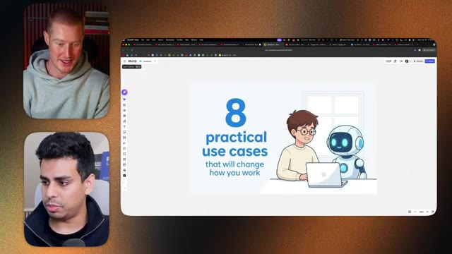
*⏱️ 00:06:41 — Capture montrant l'écran de l'ordinateur avec un tableau Miro affichant le texte "8 practical use cases that will change how you work" illustré par un personnage et un robot devant un ordinateur portable.*

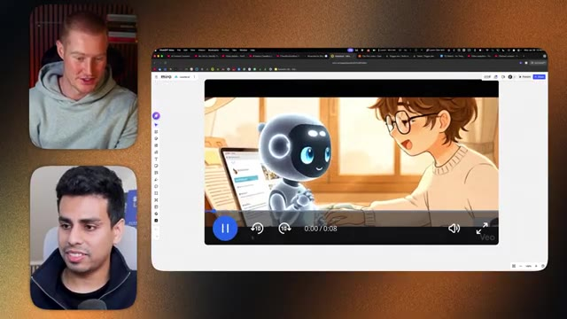
*⏱️ 00:06:46 — Capture montrant le tableau Miro avec la lecture d'une vidéo animée mettant en scène le robot et le personnage.*

---

### ⏱️ `[00:06:55 - 00:07:14]` | Segment #17

**🔊 Audio (Transcription Intégrale Mot pour Mot en Français) :**
> Corrige-moi si je me trompe, mais tu viens de lui envoyer un message sur Telegram comme si tu envoyais un message à un ami et ensuite ça a généré ça ? Exactement, ouais. Donc tout ce que tu vois peut être fait via Telegram. Tu peux aussi simplement l'envoyer par iMessage, WhatsApp. Il y a une douzaine de façons différentes. Je dirais que si tu es débutant ou non technique, configure simplement Telegram parce que Telegram est la chose la plus sûre que tu puisses faire.

**👁️ Analyse Visuelle d'Écran (gemini-3.5-flash-lite) :**
**Interface & Outils** : Navigateur web affichant le tableau blanc Miro et interface de visioconférence avec deux intervenants.

**Contenu textuel & Code** : Visuels de démonstration d'animations générées par IA intégrés dans un tableau blanc Miro.

**Action / Démonstration** : Présentation d'exemples de générations visuelles et d'automatisations d'intelligence artificielle.

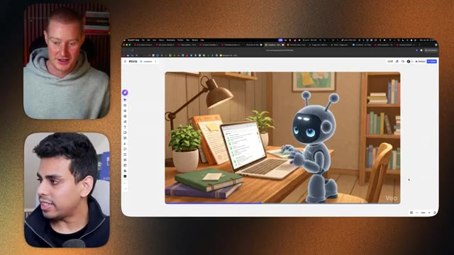
*⏱️ 00:07:00 — Image montrant une discussion en visioconférence à deux et un navigateur affichant un tableau blanc Miro avec l'animation d'un robot bleu sur un bureau en bois.*

*⏱️ 00:07:05 — Image montrant la même visioconférence et le navigateur avec le tableau blanc Miro affichant cette fois une animation style anime d'un personnage sur une plage utilisant un smartphone.*

---

### ⏱️ `[00:07:14 - 00:07:34]` | Segment #18

**🔊 Audio (Transcription Intégrale Mot pour Mot en Français) :**
> Et avec Telegram, après avoir configuré cela, vous lui donnez simplement accès à tout ce dont vous avez besoin. Donc, par exemple, voici il y a une application sympa que j'utilise où sur Telegram, vous pouvez réellement obtenir une application sur votre montre. Et maintenant, un peu comme, je ne sais pas si c'est comme James Bond ou autre, mais je peux simplement faire genre, hé, fais ces trucs pour moi. Je peux cliquer dessus grâce à cette application juste ici, TG Watch pour Telegram.

**👁️ Analyse Visuelle d'Écran (gemini-3.5-flash-lite) :**
**Interface & Outils** : Navigateur web, plateforme Miro.

**Contenu textuel & Code** : Vidéo intitulée "Anime_Video_Generation_Beach_to_Robot" d'une durée de 00:08 avec un logo Veo.

**Action / Démonstration** : Le présentateur présente ou commente une vidéo générée par une IA sur une plage.

*⏱️ 00:07:19 — Un écran partagé montrant deux présentateurs (en haut et en bas à gauche) et un navigateur affichant une application web (probablement Miro) avec une vidéo animée montrant un personnage sur une plage utilisant un smartphone.*

---

### ⏱️ `[00:07:34 - 00:07:56]` | Segment #19

**🔊 Audio (Transcription Intégrale Mot pour Mot en Français) :**
> Et je peux contrôler mon bureau entier avec ma montre juste en lui parlant. Je n'ai même pas besoin de taper. Et j'ai l'impression que ça a été vraiment amusant à concocter juste à cause de son côté futuriste, tu vois ? Ouais, nous avons exactement la même Apple Watch, ce qui est drôle, même le même bracelet. Donc, genre, j'aurais souhaité pouvoir avoir un truc comme ça depuis si longtemps, parce qu'en fait, genre, si tu y penses, c'est un peu comme Siri, ce que tu aurais souhaité que ce soit.

**👁️ Analyse Visuelle d'Écran (gemini-3.5-flash-lite) :**
**Interface & Outils** : AUCUNE

**Contenu textuel & Code** : AUCUN

**Action / Démonstration** : AUCUNE

---

### ⏱️ `[00:07:56 - 00:08:31]` | Segment #20

**🔊 Audio (Transcription Intégrale Mot pour Mot en Français) :**
> C'est que Siri devrait hypothétiquement être capable de partir et de faire toutes ces choses sur votre téléphone et votre ordinateur. Mais il ne le peut tout simplement pas, il n'est tout simplement pas assez bon. Alors je me demande si, dans six mois, Siri sera peut-être assez bon. Mais on dirait que Claudepot est peut-être une solution de contournement pour commencer à construire cette utilité sans avoir cette fonctionnalité native à l'intérieur des produits Apple et tout ça. Donc j'adore l'idée de l'Apple Watch, c'est juste une façon super créative d'interagir avec ça. Oui, alors j'aime juste être euh créatif de cette façon. En fait, c'est plutôt cool et euh c'est quelque chose auquel la plupart des gens n'ont pas pensé, mais ce que vous pouvez faire, c'est euh Brock, tu te souviens de mes lunettes Meta ? Oui, oui. Vous pouvez en fait contrôler Claudepot depuis vos

**👁️ Analyse Visuelle d'Écran (gemini-3.5-flash-lite) :**
**Interface & Outils** : Visioconférence (gauche) et tableau blanc Miro (centre/droite).

**Contenu textuel & Code** : Une vidéo de démonstration animée intitulée "Anime_Video_Generation_Beach_to_Robot" intégrée dans un tableau Miro.

**Action / Démonstration** : Les intervenants discutent pendant qu'une vidéo de génération d'anime est affichée à l'écran.

---

### ⏱️ `[00:08:31 - 00:09:08]` | Segment #21

**🔊 Audio (Transcription Intégrale Mot pour Mot en Français) :**
> les lunettes Meta aussi mec c'est génial tu peux même prendre des photos j'ai vu des gens les utiliser et tu peux prendre des photos et dire genre hé va commander ça sur Amazon si c'est moins cher et je vais faire ça pour toi aussi c'est tellement fou mec ouais on se dirige vers des époques intéressantes on a l'impression que c'est juste le début de cette nouvelle façon d'interagir avec ces trucs comme je l'ai dit avant Salman on sait maintenant exactement comment utiliser Claudbot quelques cas d'usage différents que tu utilises tu l'utilises aussi et un gros truc que j'ai remarqué depuis que je l'utilise personnellement c'est le fait que ce n'est pas seulement réactif donc ce n'est pas comme ChatGPT où tu dois poser une question ou lui donner un certain prompt tu peux le laisser agir et être proactif faire des choses

**👁️ Analyse Visuelle d'Écran (gemini-3.5-flash-lite) :**
**Interface & Outils** : Tableau blanc numérique interactif (Miro) affichant un diagramme explicatif.

**Contenu textuel & Code** : Schéma comparatif divisé en deux parties : 'REACTIVE AI (Most Agents)' avec des flux de commande basiques et 'PROACTIVE AI (The Goal!)' illustrant l'anticipation des besoins et les bénéfices pour l'utilisateur.

**Action / Démonstration** : Le présentateur explique les différences conceptuelles entre les agents d'IA réactifs et proactifs à l'aide d'un schéma explicatif visuel.

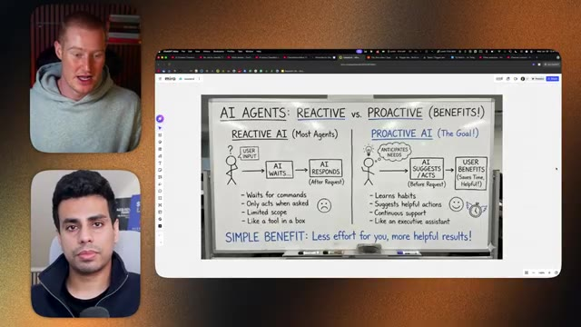
*⏱️ 00:08:58 — Présentation d'un tableau comparatif sur l'intelligence artificielle intitulé 'AI AGENTS: REACTIVE vs. PROACTIVE (BENEFITS!)' montrant les différences de fonctionnement et de bénéfices utilisateur.*

---

### ⏱️ `[00:09:08 - 00:09:41]` | Segment #22

**🔊 Audio (Transcription Intégrale Mot pour Mot en Français) :**
> tu parce qu'il comprend exactement les processus que tu veux qu'il suive et qu'il te revient. Alors Salman, genre explique, genre c'est quoi la différence entre cette IA qui est réactive par rapport à proactive ? D'accord. Alors celui-ci est honnêtement le plus simple, mais mon cas d'usage préféré parce que moi, comme la plupart des gens, j'aime bien scroller machinalement parfois. Et tu sais, j'ai mon bot Telegram qui, si je fais des trucs stupides, m'envoie un message pour me dire, hé, est-ce que tu as fait ton travail pour la journée ? Et il m'envoie aussi des messages la nuit avant que je me détende, il m'envoie, hé, quelles sont tes trois principales choses que tu veux accomplir

**👁️ Analyse Visuelle d'Écran (gemini-3.5-flash-lite) :**
**Interface & Outils** : Tableau blanc Miro affiché à l'écran, interface de visioconférence.

**Contenu textuel & Code** : Schéma comparatif « AI AGENTS: REACTIVE vs. PROACTIVE (BENEFITS!) » détaillant le fonctionnement de l'IA réactive (attend les commandes, agit uniquement sur demande) et de l'IA proactive (anticipe les besoins, suggère des actions).

**Action / Démonstration** : Explication théorique et visuelle des concepts d'agents IA réactifs et proactifs par l'intervenant.

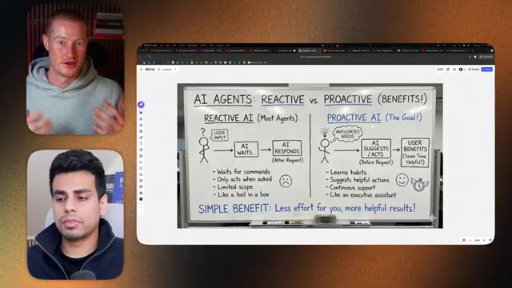
*⏱️ 00:09:16 — Un tableau blanc illustre la différence entre l'IA réactive et proactive, avec deux intervenants en visioconférence sur le côté gauche.*

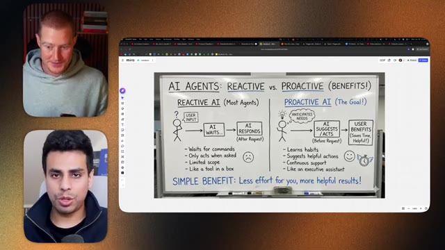
*⏱️ 00:09:32 — Vue similaire montrant le schéma explicatif sur l'IA réactive versus proactive partagé à l'écran, avec les deux interlocuteurs.*

---

### ⏱️ `[00:09:41 - 00:10:13]` | Segment #23

**🔊 Audio (Transcription Intégrale Mot pour Mot en Français) :**
> fait demain ? Et ensuite, il continue de faire le point périodiquement. J'ai trouvé que cela m'a vraiment gardé super concentré. Et c'est pourquoi j'ai pu sortir autant de vidéos récemment, parce que j'ai littéralement quelqu'un qui veille sur moi et qui me court après si je ne fais pas les choses. Même de petites choses, par exemple, si ma femme me dit de, je ne sais pas, aller chercher du lait ou autre, plutôt que ce soit elle qui doive me rappeler de faire les choses, je peux juste lui dire de me le rappeler et il le fait pour moi, et c'est donc un endroit de moins où il y a des sollicitations, et c'est tellement facile à configurer, car tout ce que vous avez à faire, c'est juste de dire à CloudBot : hé, rappelle-moi de faire ceci à chaque fois, au rythme que tu souhaites, et il le fait tout simplement.

**👁️ Analyse Visuelle d'Écran (gemini-3.5-flash-lite) :**
**Interface & Outils** : Navigateur web affichant un tableau blanc explicatif avec deux intervenants en visioconférence à gauche.

**Contenu textuel & Code** : Schéma comparatif entre "REACTIVE AI" (attend les commandes, n'agit que sur demande) et "PROACTIVE AI" (anticipe les besoins, suggère des actions, support continu, comme un assistant exécutif).

**Action / Démonstration** : Le présentateur explique les concepts d'agents IA réactifs versus proactifs à l'aide d'un schéma explicatif.

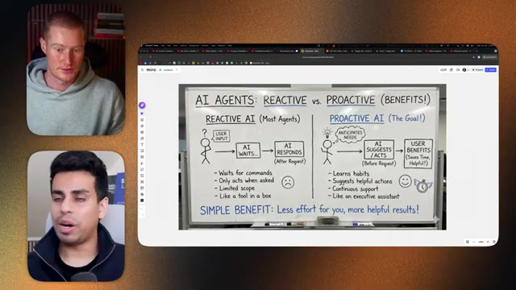
*⏱️ 00:09:49 — Un tableau blanc illustrant la différence entre agents IA réactifs et proactifs.*

---

### ⏱️ `[00:10:13 - 00:10:46]` | Segment #24

**🔊 Audio (Transcription Intégrale Mot pour Mot en Français) :**
> c'est c'est un peu comme de la magie si on y pense. C'est ça donc on n'a pas besoin de plonger trop profondément là-dedans genre la technicité derrière mais techniquement ça utilise genre du code cloud en arrière-plan pour ensuite créer ces genres de compétences ces compétences pour qu'il comprenne exactement comment fonctionner et donc tout comme le code cloud ou cloud co-work on peut juste lui donner genre une commande et il sait exactement genre chaque étape du processus pour que ce flux de travail soit fait c'est bien ça exactement donc comme par exemple juste ici n'est-ce pas tu vois il me dit mes priorités pour aujourd'hui parce que j'avais déjà eu une discussion parfois je je le dis la nuit mais j'ai oublié hé quelles sont les grandes choses que je veux faire aujourd'hui j'ai dit filmer un podcast avec

**👁️ Analyse Visuelle d'Écran (gemini-3.5-flash-lite) :**
**Interface & Outils** : Miro, Telegram, navigateur web

**Contenu textuel & Code** : Schéma comparatif « REACTIVE vs PROACTIVE (BENEFITS!) » et flux de messages sur l'application Telegram.

**Action / Démonstration** : Présentation des concepts d'IA proactive par rapport aux agents réactifs traditionnels.

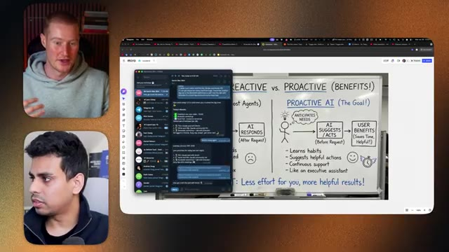
*⏱️ 00:10:21 — Capture d'écran montrant l'interface Miro avec un tableau blanc explicatif sur l'intelligence artificielle réactive versus proactive, ainsi qu'une superposition de l'application Telegram.*

---

### ⏱️ `[00:10:46 - 00:11:19]` | Segment #25

**🔊 Audio (Transcription Intégrale Mot pour Mot en Français) :**
> Brock et tu vois ça m'a rappelé juste ici il y a deux ou trois autres choses que je veux faire mais tu sais ça me garde super bien cadré c'est littéralement ok genre en tant qu'entrepreneur solo n'importe qui qui est là et qui est du genre entrepreneur n'a pas de patron tu sais est dans ce monde des affaires ou peu importe genre tu comprends tu adores avoir la liberté mais parfois j'aimerais avoir quelqu'un qui me dise ce que je dois faire tu vois ce que je veux dire genre parfois cette structure fait du bien donc c'est marrant parce que c'est comme si les entrepreneurs veulent vraiment cette liberté mais genre ensuite je vois ça et je me dis mec c'est tellement génial d'avoir un truc qui est presque juste comme en train de me coacher à travers tout ce dont j'ai besoin

**👁️ Analyse Visuelle d'Écran (gemini-3.5-flash-lite) :**
**Interface & Outils** : Miro (tableau blanc interactif en ligne) et visioconférence à deux participants.

**Contenu textuel & Code** : Schéma comparatif sur tableau blanc : "AI AGENTS: REACTIVE vs PROACTIVE (BENEFITS!)" détaillant le fonctionnement de l'IA réactive (attend les commandes) versus l'IA proactive (anticipe les besoins et suggère des actions).

**Action / Démonstration** : Présentation et explication visuelle des différences entre les agents IA réactifs et proactifs lors d'une discussion en direct.

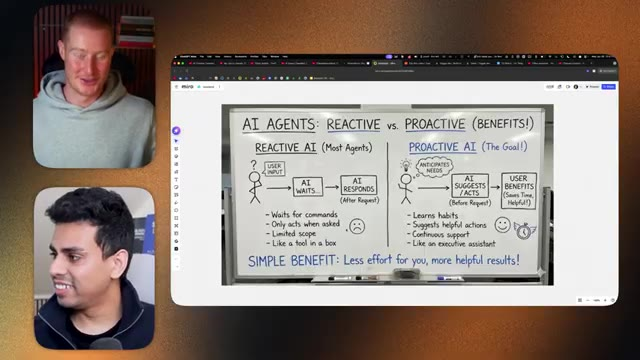
*⏱️ 00:10:55 — Vue en incrustation montrant un tableau blanc Miro comparant l'IA réactive et l'IA proactive, avec deux intervenants en vidéo sur le côté.*

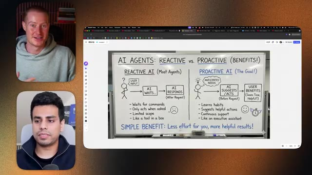
*⏱️ 00:11:11 — Vue identique à l'image 1 montrant le diagramme explicatif des agents IA (réactif vs proactif) sur le tableau blanc partagé à l'écran.*

---

### ⏱️ `[00:11:19 - 00:11:52]` | Segment #26

**🔊 Audio (Transcription Intégrale Mot pour Mot en Français) :**
> pour le faire, ça a été genre ça a été mon cas d'usage préféré aussi pour ça, genre la nuit dernière, je lui ai donné une note vocale de cinq minutes et demie, juste via Telegram, j'ai juste envoyé une note vocale et j'ai pratiquement découpé tout ce sur quoi je travaille, tout ce qui me stresse, tout ce que j'ai fait hier, les choses que je dois accomplir aujourd'hui, et ça a littéralement genre tout découpé et genre découpé chaque tâche, expliqué l'urgence, si c'était urgent à faire aujourd'hui ou genre, je ne sais pas, c'est juste dingue ce que ça peut faire. C'est juste amusant de jouer avec. Genre par exemple, en ce moment, euh, je vais vous montrer ça. C'est un cas d'usage vraiment cool, c'est que maintenant je l'utilise en quelque sorte comme mon chef de projet parce que

**👁️ Analyse Visuelle d'Écran (gemini-3.5-flash-lite) :**
**Interface & Outils** : ClickUp, navigateur web, tableau blanc de présentation.

**Contenu textuel & Code** : Listes de tâches, tableaux de projets et organisation de flux de travail.
[DESC_ACTION] Navigation dans l'application de gestion de tâches pour illustrer l'organisation du travail.

**Action / Démonstration** : Explications face caméra et analyse conceptuelle des marchés.

*⏱️ 00:11:44 — Vue détaillée d'un gestionnaire de tâches (ClickUp) montrant des listes de projets et des tâches planifiées.*

---

### ⏱️ `[00:11:52 - 00:12:26]` | Segment #27

**🔊 Audio (Transcription Intégrale Mot pour Mot en Français) :**
> CloudBot n'oublie pas. C'est exact. Donc, il me gère. Comme vous voyez, il gère certaines de mes tâches personnelles, celles que je vous ai montrées, et il gère mon équipe. Je ne vais pas montrer ça, mais ouais. Donc, c'est comme rappeler aux gens ce qu'ils ont à faire. Il nettoie nos tickets, nos tâches pour la journée et nous n'avons pas à y toucher. Je peux juste dire : Hé, j'ai fait X, Y, Z aujourd'hui. Et ensuite, il va, il gère mon ClickUp. Ouais, non, c'est, c'est fou. D'accord. Donc, nous avons parlé de la façon dont CloudBot ou MultiBot est proactif. Maintenant, passons peut-être au, au processus suivant ici. Ouais. Donc, il y a une tonne de cas d'utilisation que nous pouvons couvrir, mais je voudrais vraiment vous montrer ceci. Donc, pour

**👁️ Analyse Visuelle d'Écran (gemini-3.5-flash-lite) :**
**Interface & Outils** : Interface web de gestion de tâches / tableau de bord (type Jira, Miro ou similaire).

**Contenu textuel & Code** : Listes de tâches, tickets et colonnes de gestion de projet (comme "To Do", "In Progress", "Done").

**Action / Démonstration** : Présentation et démonstration de l'interface de gestion des tâches gérée ou nettoyée par l'agent IA.

*⏱️ 00:12:00 — Capture d'écran montrant une interface de gestion de tâches (style Kanban/tableau) avec des tickets ou des cartes de tâches organisées en colonnes.*

---

### ⏱️ `[00:12:26 - 00:12:58]` | Segment #28

**🔊 Audio (Transcription Intégrale Mot pour Mot en Français) :**
> Par exemple, récemment, je viens juste de mettre en ligne cette vidéo sur CloudBot et vous voyez, elle décolle. Euh, d'accord. Elle décolle, mais le point positif, c'est qu'elle s'en sort bien, mais sans que j'aie à faire quoi que ce soit. Vous pouvez voir qu'il y a des shorts qui s'en sortent plutôt bien aussi. Vous voyez, ça me rapporte des vues, ces shorts. Je n'y touche absolument pas. Ce qui se passe, c'est que j'ai dit à CloudBot : « Hé, chaque fois que je sors une vidéo, fais-en des extraits et publie-les. » Donc ce qui s'est passé, c'est qu'elle est sortie, elle est allée sur Zapier parce que Opus Clip n'a pas d'API.

**👁️ Analyse Visuelle d'Écran (gemini-3.5-flash-lite) :**
**Interface & Outils** : YouTube Studio (interface web de gestion de chaîne et d'analyse de contenu).

**Contenu textuel & Code** : Métriques de performance vidéo : 923 vues, indicateur « Great job! Views are 2.9 times higher », graphiques de croissance des vues au fil du temps et statistiques de trafic par source (Shorts feed à 54,9%, YouTube search à 39,4%).

**Action / Démonstration** : Analyse des statistiques de performance et de l'engagement d'une vidéo publiée récemment.

*⏱️ 00:12:42 — Le présentateur présente un tableau de bord analytique YouTube Studio affichant les performances d'une vidéo récente (« CloudBot »), avec des graphiques de vues et de rétention d'audience.*

---

### ⏱️ `[00:12:58 - 00:13:33]` | Segment #29

**🔊 Audio (Transcription Intégrale Mot pour Mot en Français) :**
> Donc il utilise Zapier pour, tu sais, attraper chaque fois que je fais une vidéo, je ne sais pas ce qui se passe bordel ici. Donc il découpe les vidéos, il a écrit du code dans trigger dev, je ne suis pas sûr de ce qui se passe non plus, et ensuite, tu sais, il les publie sur mon YouTube, mon Instagram, mon Twitter, et ça me rapporte juste beaucoup plus de visibilité que ce que j'aurais voulu, donc c'est plutôt cool de voir comment on assiste à ça en temps réel. Mec, c'est de la folie, en tant que créateur de contenu, genre, je détesterais avoir ça moi-même, le fait que ça puisse simplement réutiliser automatiquement ça. Donc une chose à noter ici, et je suis curieux de savoir comment ça fonctionne, c'est comment ça fait pour aller réellement publier sur ton YouTube Studio.

**👁️ Analyse Visuelle d'Écran (gemini-3.5-flash-lite) :**
**Interface & Outils** : Navigateur web affichant l'interface de Trigger.dev, avec deux flux vidéo des intervenants en incrustation.

**Contenu textuel & Code** : Liste de tâches automatisées en cours d'exécution dans le panneau principal, avec des identifiants de tâches (task ID), des durées et des statuts (Running, Queued).

**Action / Démonstration** : Présentation de l'interface de l'outil d'automatisation Trigger.dev pour illustrer le traitement et le découpage automatisé des vidéos.

*⏱️ 00:13:07 — Capture d'écran montrant l'interface du tableau de bord de Trigger.dev avec les deux participants visibles dans des encarts vidéo à gauche.*

---

### ⏱️ `[00:13:33 - 00:14:07]` | Segment #30

**🔊 Audio (Transcription Intégrale Mot pour Mot en Français) :**
> donc je suppose qu'il utilise peut-être l'accès au navigateur et qu'il va cliquer littéralement sur votre ordinateur ou est-ce que je me trompe donc ce que je lui ai dit de faire c'est qu'il y a ce euh truc appelé blowtato et avec blowtato j'avais déjà un compte donc je lui ai juste donné la clé API et je suis genre hé utilise ce truc c'est déjà connecté à tous mes comptes va utiliser ça pour publier parce que blowtato fait en sorte que ce soit facile tu sais tu peux programmer ça jour par jour ça le met juste en file d'attente pour le jour suivant et tout est pris en charge donc je vais m'assurer que lorsque vous faites des automatisations avec thoughtbot ce que vous faites c'est que ce que vous faites c'est aussi de trouver des services qu'il peut utiliser pour rendre son travail beaucoup plus facile

**👁️ Analyse Visuelle d'Écran (gemini-3.5-flash-lite) :**
**Interface & Outils** : Navigateur Web affichant la page d'accueil de la plateforme Blowtato.

**Contenu textuel & Code** : Le titre principal de la page web "Scale your brand with organic Social SEO", ainsi que des exemples de visuels et de publications marketing.

**Action / Démonstration** : Présentation visuelle de la plateforme Blowtato mentionnée dans l'audio.

*⏱️ 00:13:41 — Capture d'écran montrant la page d'accueil du site Web "Blowtato" avec deux intervenants en visioconférence sur le côté gauche.*

---

### ⏱️ `[00:14:07 - 00:14:28]` | Segment #31

**🔊 Audio (Transcription Intégrale Mot pour Mot en Français) :**
> parce que quand vous pouvez faire ça et si vous pouvez transformer la chose que vous faites en une automatisation directe où elle n'a pas besoin de réfléchir, alors votre automatisation va être cohérente parce qu'elle ne suit même pas un ensemble d'étapes, mais elle déclenche simplement un script Python ou quelque chose comme ça. C'est vrai, ouais, c'est fou. Et le fait que vous ayez dit, hé, je veux que tu, comme vous expliquez le flux de travail et qu'ensuite il a compris que la meilleure façon de faire cela était de créer un Zap dans Zapier.

**👁️ Analyse Visuelle d'Écran (gemini-3.5-flash-lite) :**
**Interface & Outils** : Navigateur web affichant un outil d'automatisation de type Zapier / Make.

**Contenu textuel & Code** : Workflow d'automatisation composé de deux blocs : "1. Catch Hook" (Webhooks by Zapier) et "2. Clip Your Video" (OpusClip), reliés par une flèche.

**Action / Démonstration** : Présentation d'un flux d'automatisation reliant un webhook à un outil de découpage vidéo.

*⏱️ 00:14:23 — Un schéma d'automatisation montrant un workflow avec Webhooks by Zapier (Catch Hook) connectant vers OpusClip (Clip Your Video).*

---

### ⏱️ `[00:14:28 - 00:15:05]` | Segment #32

**🔊 Audio (Transcription Intégrale Mot pour Mot en Français) :**
> Et je suppose que c'est une sorte de bonne transition pour, genre, ajouter un peu plus de fonctionnalité à notre CloudBus. Donc une façon simple de faire ça, n'est-ce pas, ce serait d'utiliser quelque chose comme Zapier mcp, qui en gros, si vous ne savez pas ce qu'est mcp, ne vous inquiétez pas, ce n'est pas aussi effrayant que ça en a l'air, ça permet essentiellement, genre, de connecter vos flux de travail agentiques, dans ce cas-ci, à n'importe quelle application avec laquelle Zapier se connecte ou peu importe ce que cet-te serveur mcp est. Donc ouais, Solomon juste ici a ça, genre, d'ouvert et littéralement, vous pouvez juste cliquer sur « ajouter un outil » et vous avez toutes ces applications différentes à choisir, vous en avez, genre, plus de 8 000 juste là, et ça peut réellement exécuter des actions à travers n'importe laquelle de ces applications. Ouais, j'adore utiliser ça, ça me rend la vie tellement plus facile et

**👁️ Analyse Visuelle d'Écran (gemini-3.5-flash-lite) :**
**Interface & Outils** : Navigateur web affichant une interface d'automatisation (Zapier/OpusClip)

**Contenu textuel & Code** : Workflow d'intégration comprenant une étape de réception de webhook ('Catch Hook') connectée à une action de traitement vidéo ('Clip Your Video').

**Action / Démonstration** : Présentation d'un flux de travail automatisé reliant des webhooks à un outil de découpage vidéo.

*⏱️ 00:14:37 — Capture d'écran montrant une interface de workflow d'automatisation avec deux blocs reliés : Webhooks by Zapier ('Catch Hook') et OpusClip ('Clip Your Video'). Le présentateur et un invité apparaissent dans des encadrés sur le côté gauche.*

---

### ⏱️ `[00:15:05 - 00:15:30]` | Segment #33

**🔊 Audio (Transcription Intégrale Mot pour Mot en Français) :**
> Et la vie de mon CloudBot est tellement plus facile parce qu'il n'a pas à comprendre tout un tas de trucs. Ouais, littéralement. Ouais, et ça rend juste tout cohérent et ça ne plante pas parce que, tu sais, techniquement l'IA ne produit pas le même résultat à chaque fois, mais une automatisation, quand elle est simplement écrite en code, si. Il y a donc ce grand concept de flux de travail agentiques qui cartonnent en ce moment où, par exemple, tu peux amener Cloud à créer ces automations et ensuite à les exécuter aussi.

**👁️ Analyse Visuelle d'Écran (gemini-3.5-flash-lite) :**
**Interface & Outils** : Application CloudBot / Interface web avec fenêtre modale d'intégration d'outils.

**Contenu textuel & Code** : Liste d'applications et d'outils logiciels connectables affichés dans une fenêtre modale (Asana, Salesforce, Jira, ClickUp, Microsoft Excel, etc.).

**Action / Démonstration** : Navigation et sélection d'outils pour configurer les intégrations d'un bot cloud.

*⏱️ 00:15:17 — Capture montrant l'écran de l'application CloudBot avec une fenêtre pop-up permettant d'ajouter des outils et des intégrations.*

---

### ⏱️ `[00:15:30 - 00:15:49]` | Segment #34

**🔊 Audio (Transcription Intégrale Mot pour Mot en Français) :**
> Mais ces automatisations ne sont essentiellement que des fichiers Python. Donc si vous fabriquez quelque chose avec, disons, N8N ou autre, tout cela à la fin n'est que du code, n'est-ce pas ? Et quand nous faisons des flux de travail agentiques, c'est la même chose. Nous sommes juste, nous sommes retournés à la case départ et nous écrivons simplement le code parce que Claude est tellement meilleur pour écrire le code. Il est juste hébergé à l'intérieur de votre Mac mini, par exemple. Donc vous n'avez pas besoin de le déployer ou quoi que ce soit. Il tourne juste en permanence.

**👁️ Analyse Visuelle d'Écran (gemini-3.5-flash-lite) :**
**Interface & Outils** : Navigateur web affichant une interface d'automatisation ou de workflow avec une boîte de dialogue d'intégration d'outils.

**Contenu textuel & Code** : Fenêtre modale "Add tools" montrant des icônes d'applications tierces (Asana, Salesforce, Jira, etc.).

**Action / Démonstration** : Navigation et présentation d'une plateforme d'intégration ou d'automatisation de flux de travail.

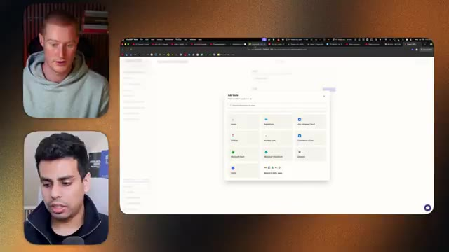
*⏱️ 00:15:34 — Capture montrant l'écran partagé avec une interface web affichant une fenêtre modale d'ajout d'outils, accompagnée des deux intervenants en vignette vidéo.*

---

### ⏱️ `[00:15:49 - 00:16:07]` | Segment #35

**🔊 Audio (Transcription Intégrale Mot pour Mot en Français) :**
> Et Claudebot a accès à tout. C'est vrai. Ouais, non, c'est génial. Très bien, Salman. Donc on a pas mal parlé de ce qu'est Claudebot, à qui il s'adresse, comment vous pouvez commencer à l'utiliser, le booster avec quelque chose comme un MCP et des cas d'usage différents qu'on a trouvés pour ça. Donc une question que je veux poser, parce que je ne veux pas faire cette vidéo juste pour faire du ऑफ़ de ça... Enfin, c'est évident que c'est cool. C'est nouveau.

**👁️ Analyse Visuelle d'Écran (gemini-3.5-flash-lite) :**
**Interface & Outils** : Navigateur web affichant une application web de type assistant ou intégration d'outils (MCP) avec une modale "Add tools".

**Contenu textuel & Code** : Fenêtre modale listant divers outils d'applications professionnelles (Asana, Salesforce, Jira, ClickUp, Notion, Confluence, Microsoft Excel, Microsoft SharePoint, Zendesk, etc.).

**Action / Démonstration** : Présentation visuelle des intégrations d'applications tierces disponibles pour connecter l'outil d'IA.

*⏱️ 00:15:54 — Une vue d'écran d'un navigateur web montrant une interface de configuration avec une fenêtre modale d'ajout d'outils, accompagnée des fenêtres vidéo des deux interlocuteurs sur le côté gauche.*

---

### ⏱️ `[00:16:07 - 00:16:27]` | Segment #36

**🔊 Audio (Transcription Intégrale Mot pour Mot en Français) :**
> C'est amusant de l'utiliser. Selon vous, dans quels domaines cet outil excelle-t-il ? Où pensez-vous qu'il est bon ? Mais aussi, où pensez-vous qu'il n'est peut-être pas le meilleur et qu'il est un peu trop surestimé ? Et je veux qu'on discute un peu plus de la direction que prend l'interaction avec ce genre de technologie, parce qu'on a vraiment l'impression que c'est l'avenir, que ce soit ClaudeBot ou non. Ouais. C'est donc vraiment fou de voir comment les choses évoluent actuellement.

**👁️ Analyse Visuelle d'Écran (gemini-3.5-flash-lite) :**
**Interface & Outils** : Interface web de configuration d'assistant virtuel / application d'IA, avec intégration d'outils professionnels.

**Contenu textuel & Code** : Fenêtre modale "Add tools" présentant des applications et services connectables (Asana, Salesforce, Jira Software Cloud, ClickUp, Monday.com, Confluence, Microsoft Excel, Microsoft SharePoint, Zendesk, Box).

**Action / Démonstration** : Navigation et présentation des options d'intégration d'outils et de connecteurs tiers au sein d'une plateforme d'intelligence artificielle.

*⏱️ 00:16:17 — Écran partagé montrant une visioconférence avec deux intervenants à gauche et une interface de configuration logicielle affichant un menu "Add tools" avec des intégrations tierces (Salesforce, Jira, etc.) au centre.*

---

### ⏱️ `[00:16:27 - 00:16:47]` | Segment #37

**🔊 Audio (Transcription Intégrale Mot pour Mot en Français) :**
> En fait, A16Z a fait un grand pari sur la transformation agentique du web, et peut-être que je vais vous montrer un petit graphique. En ce trop moment, vous savez, ce qu'on faisait, c'est juste utiliser nos ordinateurs et tout était fait par ici. Maintenant, on arrive un peu au point où, vous savez, la bande passante est une chose importante, donc la vitesse à laquelle nous pouvons accomplir les choses et utiliser le levier.

**👁️ Analyse Visuelle d'Écran (gemini-3.5-flash-lite) :**
**Interface & Outils** : Navigateur web affichant une illustration explicative sur l'évolution du web.

**Contenu textuel & Code** : Illustration en trois parties montrant la transition du PC Web à l'ère mobile, puis à l'ère du web agentique (Agentic Web Era).

**Action / Démonstration** : Le présentateur commente l'évolution technologique et illustre l'ère agentique du web à l'aide d'un schéma visuel.

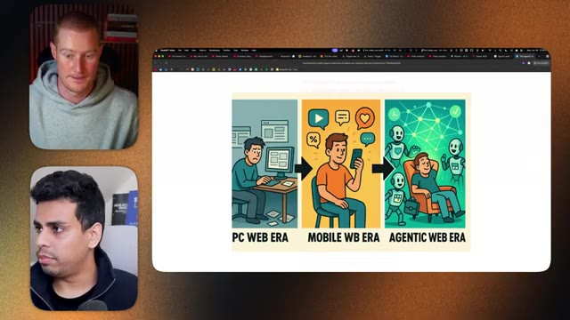
*⏱️ 00:16:32 — Capture d'écran montrant le présentateur et un invité en haut à gauche et en bas à gauche, ainsi qu'une illustration centrale divisée en trois étapes : PC WEB ERA, MOBILE WB ERA et AGENTIC WEB ERA.*

---

### ⏱️ `[00:16:48 - 00:17:21]` | Segment #38

**🔊 Audio (Transcription Intégrale Mot pour Mot en Français) :**
> Maintenant, ce que nous pouvons faire essentiellement, c'est lorsque nous interagissons avec le Web. Donc, par exemple, je veux acheter un billet d'avion pour ce voyage que moi, Brock, et un groupe de personnes allons faire, n'est-ce pas ? Et pour faire ça en ce moment, je devrais aller sur Google Flights. Je devrais chercher un tas de vols. Je devrais acheter toutes ces différentes petites étapes, n'est-ce pas ? La façon dont nous voyons le Web évoluer, c'est qu'en fait, les sites Web seront optimisés au départ pour les agents. Cela signifie donc que je peux dire à mon CloudBot ou à n'importe quel agent, par exemple : Hé, va me trouver le vol le moins cher pour Le Cap. Et ce qu'il va faire, c'est qu'il va me donner quelques options. Je vais simplement les parcourir et ensuite je clique sur « c'est parti ».

**👁️ Analyse Visuelle d'Écran (gemini-3.5-flash-lite) :**
**Interface & Outils** : Navigateur web affichant une infographie explicative.

**Contenu textuel & Code** : Schéma en trois étapes illustrant l'évolution technologique vers l'ère des agents autonomes.

**Action / Démonstration** : Présentation visuelle des différentes ères d'interaction avec internet.

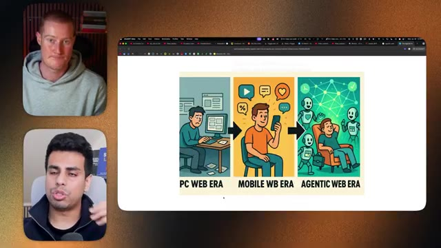
*⏱️ 00:16:56 — Une illustration schématique comparant trois époques du web : PC Web Era, Mobile Web Era et Agentic Web Era.*

---

### ⏱️ `[00:17:21 - 00:17:53]` | Segment #39

**🔊 Audio (Transcription Intégrale Mot pour Mot en Français) :**
> Et ensuite il l'achète pour moi. C'est donc une façon un peu différente d'interagir avec le web. Bien sûr, il y aura des interfaces utilisateur, de jolies choses et tout ça. Mais ce qu'on voit en ce moment, c'g'est que la bande passante avec laquelle nous effectuons des tâches sur notre ordinateur diminue radicalement parce que notre agent contrôle l'ordinateur, ce qui signifie que toute l'infrastructure d'internet doit changer et s'adapter de cette manière. C'est exact. 100 %. On a un peu l'impression que CloudBot n'est peut-être pas le premier du genre. Pour moi, j'ai l'impression que c'est la première chose tangible du genre : ok, je vois vraiment où tout cela nous mène maintenant et comment je vais interagir.

**👁️ Analyse Visuelle d'Écran (gemini-3.5-flash-lite) :**
**Interface & Outils** : Navigateur web affichant une infographie explicative et fenêtres de visioconférence.

**Contenu textuel & Code** : Illustration schématique comparant l'ère du PC (bureau), l'ère du mobile et l'ère des agents autonomes (Agentic Web Era) où l'utilisateur se détend pendant que des agents IA travaillent pour lui.

**Action / Démonstration** : Le présentateur et son invité commentent l'évolution des interfaces et de l'interaction avec le web vers l'automatisation par agents IA.

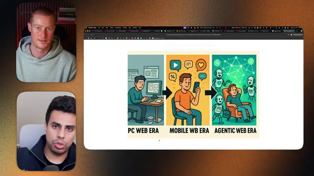
*⏱️ 00:17:37 — Écran partagé montrant les deux interlocuteurs à gauche et une illustration centrale représentant l'évolution du web en trois ères : PC Web Era, Mobile WB Era et Agentic Web Era.*

---

### ⏱️ `[00:17:53 - 00:18:13]` | Segment #40

**🔊 Audio (Transcription Intégrale Mot pour Mot en Français) :**
> avec mes ordinateurs, ma technologie et mes agents IA, au lieu de devoir aller dans quelque chose comme N8N et de connecter tous ces nœuds qui se rompent probablement de temps en temps, à la place, je pourrais simplement utiliser quelque chose comme ça, lui donner accès à des serveurs MCP ou à certaines API. Et il est capable d'aller simplement interagir, d'extraire des choses et de créer des choses sans même que j'aie besoin de savoir comment il fait cela.

**👁️ Analyse Visuelle d'Écran (gemini-3.5-flash-lite) :**
**Interface & Outils** : Navigateur web affichant une infographie sur l'évolution du web.

**Contenu textuel & Code** : Schéma illustratif divisé en trois époques : ordinateur fixe, smartphone, et agents intelligents automatisés.

**Action / Démonstration** : Présentation de la vision et de l'évolution vers l'ère des agents IA.

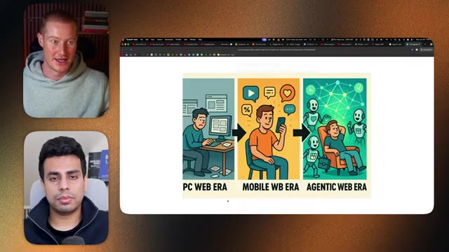
*⏱️ 00:17:58 — Une illustration en trois parties montrant l'évolution technologique : PC Web Era, Mobile Web Era et Agentic Web Era, avec les deux intervenants en médaillon.*

---

### ⏱️ `[00:18:13 - 00:18:34]` | Segment #41

**🔊 Audio (Transcription Intégrale Mot pour Mot en Français) :**
> Donc ouais, ça a été intéressant à voir. Je suppose que ma dernière question pour toi c'est du genre, est-ce que tu as rencontré des problèmes avec CloudBot ? Parce que moi personnellement, genre, je l'ai fait bien fonctionner hier pendant une bonne demi-heure à une heure, et puis je n'arrête pas de rencontrer des problèmes. Donc ce n'est pas tout rose, mais on a vraiment l'impression que c'est le début de quelque chose d'intéressant. Ouais, donc en fait, tu vas rencontrer énormément de problèmes quand tu utilises CloudBot.

**👁️ Analyse Visuelle d'Écran (gemini-3.5-flash-lite) :**
**Interface & Outils** : Navigateur Web (Chrome)

**Contenu textuel & Code** : Illustration synthétique représentant l'évolution des interfaces utilisateur vers l'ère des agents IA autonome.

**Action / Démonstration** : Présentation conceptuelle et discussion autour de l'évolution des outils IA sans manipulation technique ni démonstration de code/terminal à l'écran.

---

### ⏱️ `[00:18:34 - 00:18:56]` | Segment #42

**🔊 Audio (Transcription Intégrale Mot pour Mot en Français) :**
> Principalement parce que souvenez-vous, ce sont des technologies open source. Je veux dire, un type dans sa cave, probablement, je ne plaisante pas. Je ne sais pas, en fait, c'est un ingénieur estimé, mais il a juste concocté ça lui-même. Et puis maintenant, tout le monde du monde entier y contribue lentement. Donc cette chose évolue sous nos yeux. Et vous verrez probablement beaucoup plus d'entreprises se précipiter pour essayer de créer une interface facile pour cela ou pour le rendre encore plus facile.

**👁️ Analyse Visuelle d'Écran (gemini-3.5-flash-lite) :**
**Interface & Outils** : Navigateur Web (Google Chrome)

**Contenu textuel & Code** : Diagramme visuel montrant trois étapes de l'informatique : l'utilisateur sur PC ("PC WEB ERA"), l'utilisateur sur smartphone ("MOBILE WEB ERA"), et l'utilisateur assisté par des agents autonomes IA ("AGENTIC WEB ERA").

**Action / Démonstration** : Présentation et explication conceptuelle de la transition vers le Web fondé sur les agents IA.

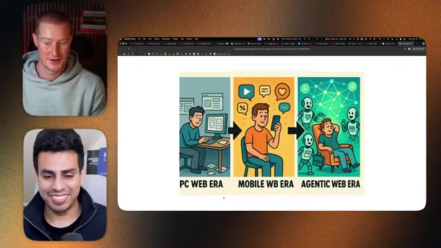
*⏱️ 00:18:39 — Illustration schématique comparant l'évolution des étapes technologiques : "PC WEB ERA", "MOBILE WEB ERA" et "AGENTIC WEB ERA".*

---

### ⏱️ `[00:18:57 - 00:19:32]` | Segment #43

**🔊 Audio (Transcription Intégrale Mot pour Mot en Français) :**
> Donc en ce moment c'est probablement le plus dur que ça ne le sera. C'est toujours faisable. Si tu as vu ma vidéo, c'est un peu du genre, je te montre comment déboguer où tu fais juste copier et coller, copier et coller, mais c'est juste comprendre comment tu fais ça qui est la clé dont tu as besoin pour commencer à utiliser cette technologie. À cent pour cent. Salman, ça a été sympa, mec. Pour mon audience, s'ils entendent ça, ils se disent, hé, je veux prendre le risque. Je veux commencer à jouer avec ça et à tester ça parce que je vois ça comme le futur et je veux apprendre à, tu vois, interagir avec l'IA comme ça, quelle est la première chose que tu leur suggérerais d'aller faire ? Franchement, j'ai beaucoup réfléchi à la vidéo que je viens de faire, euh, et j'ai essayé, j'ai littéralement configuré un tout nouvel ordinateur, alors jetez peut-être un œil à cette vidéo, c'est probablement le meilleur endroit pour commencer, si tu peux faire ça, tu peux tout faire.

**👁️ Analyse Visuelle d'Écran (gemini-3.5-flash-lite) :**
**Interface & Outils** : Navigateur web Google Chrome affichant un schéma illustré.

**Contenu textuel & Code** : Illustration synthétique découpée en trois panneaux ("PC WEB ERA", "MOBILE WB ERA", "AGENTIC WEB ERA") représentant la transition d'un travail manuel sur PC vers une utilisation smartphone, puis vers la prise en charge des tâches par des agents IA autonomes.

**Action / Démonstration** : Présentation explicative et échange entre les intervenants sur la transition actuelle vers l'automatisation par les agents IA.

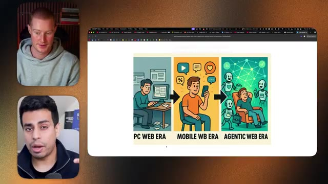
*⏱️ 00:19:06 — Infographie explicative comparant l'évolution technologique à travers trois étapes : l'ère PC Web, l'ère Mobile Web et l'ère Web Agentique.*

---

### ⏱️ `[00:19:32 - 00:20:01]` | Segment #44

**🔊 Audio (Transcription Intégrale Mot pour Mot en Français) :**
> Parfait, eh bien Salman, ça a été génial mec, merci d'avoir encore une fois rejoint ce podcast, j'ai tellement aimé simplement geeker sur ces ces nouvelles sorties, les choses vont tellement vite donc merci infiniment d'être venu, je te vois dans une semaine et ça a été super de faire ça mec, c'est clair ouais, peut-être que pour la prochaine folle avancée on sera en personne pour tourner le podcast, je sais, ce serait génial, ce serait tellement génial, je ne douterais pas que ça arrive, ouais, bon les gars, merci de m'avoir reçu Brox, ça a été super sympa, ouais, je vous vois les gars dans la prochaine vidéo.

**👁️ Analyse Visuelle d'Écran (gemini-3.5-flash-lite) :**
**Interface & Outils** : Aucun

**Contenu textuel & Code** : Aucun

**Action / Démonstration** : Aucun

---

