# 🎬 I Fixed One of OpenClaw's Biggest Problems...

> **Chaîne** : [Brock Mesarich | AI for Non Techies](https://www.youtube.com/@BrockMesarich)  
> **Lien YouTube** : [https://www.youtube.com/watch?v=XulRkTy7xCE](https://www.youtube.com/watch?v=XulRkTy7xCE)  
> **Date de publication** : 20260201  
> **Durée** : 00:07:36  
> **Identifiant vidéo** : `XulRkTy7xCE`  
> **Transcription & Analyse** : `whisper-v3-large-turbo+gemini-3.5-flash-lite`  

---

## 📌 Synthèse Exécutive & Outils

### 💡 Résumé
La présente intervention, ancrée dans l'écosystème de l'intelligence artificielle pour non-techniciens, s'attaque à un écueil majeur de l'utilisation des agents autonomes et des bots de code (tels que ClaudeBot ou Claude Code) : l'opacité opérationnelle. Lorsqu'un opérateur délègue des tâches complexes à un agent via des interfaces mobiles comme Telegram, le manque de visibilité en temps réel sur l'exécution des processus, l'état d'avancement des livrables et la localisation des fichiers générés engendre une friction cognitive importante. Pour y remédier, la vidéo démontre la construction de bout en bout d'un centre de commande centralisé, capable de s'interfacer avec un environnement local (`localhost`) et d'être piloté par la voix depuis n'importe quel terminal mobile.

La stratégie présentée repose sur un pont technologique fluide entre l'interaction conversationnelle et le déploiement applicatif sans code (*no-code*). En extrayant le code source HTML d'un tableau de bord initial hébergé localement, l'auteur utilise la plateforme de développement rapide Mocha pour générer instantanément une application cloud dotée d'une base de données intégrée. Cette architecture permet à l'agent IA d'injecter en direct les flux de données (files d'attente de tâches, statuts d'urgence, actifs multimédias générés) vers une interface web publique accessible via une URL personnalisée, sranchoumillant ainsi des contraintes de l'infrastructure locale.

Enfin, la démonstration s'élève d'un cran en abordant l'intégration des protocoles de communication avancés, notamment les serveurs MCP (*Model Context Protocol*). En connectant l'agent à des écosystèmes applicatifs tiers via des passerelles automatisées (similaires à des logiques de type Zapier ou Make), l'agent IA acquiert la capacité d'exécuter des actions concrètes à travers des dizaines d'applications logicielles (comme Slack ou Airtable). Cette approche transforme un simple assistant textuel en un véritable système d'exécution multi-agent capable de orchestrer des flux de travail complexes à distance, en toute transparence et sans aucune ligne de code traditionnelle.

### 🛠️ Outils, Modèles & Logiciels Présentés
* **Claude / ClaudeBot / Claude Code** : Assistant conversationnel et agent IA avancé utilisé pour exécuter des tâches, transcrire des commandes vocales et automatiser des flux de travail locaux ou distants.
* **Telegram** : Application de messagerie instantanée mobile servant d'interface de commande principale pour interagir par messages vocaux et textuels avec l'agent IA.
* **Mac Mini** : Infrastructure matérielle locale hébergeant l'environnement d'exécution de l'agent et le serveur de développement initial (`localhost`).
* **Mocha (getmocha.com)** : Plateforme de développement d'applications sans code avec bases de données intégrées, utilisée pour transformer un code source HTML en une application web interactive et publiable.
* **Zapier MCP / Client MCP** : Protocole et connecteur d'intégration permettant d'interfacer les agents IA avec des centaines d'applications tierces pour exécuter des actions automatisées.
* **Airtable** : Outil de base de données relationnelle cloud mentionné comme exemple d'application connectable via le serveur MCP pour la gestion des flux de données.
* **Slack** : Application de messagerie d'équipe intégrable via les protocoles MCP pour automatiser l'envoi de notifications de mise à jour de projets.
* **Make / Zapier** : Outils d'automatisation de référence évoqués pour l'interconnexion de services et l'optimisation des architectures d'agents.

### 🔑 Points Clés & Enseignements Stratégiques
* **Résolution de l'opacité agentique** : La création d'un centre de commande centralisé pallie le manque de visibilité inhérent à l'utilisation des agents IA autonomes, permettant de suivre en temps réel les tâches en cours, les files d'attente et les statuts d'exécution.
* **Commandes multimodales et vocales** : L'utilisation de Telegram combinée à des capacités de transcription permet d'injecter des instructions complexes ou des ajouts de tâches à distance, directement depuis un terminal mobile sans friction technique.
* **Extraction et portabilité d'interface** : La méthodologie d'exportation repose sur la récupération du code source HTML d'une interface locale (`localhost`) pour l'injecter instantanément dans un générateur d'applications cloud.
* **Affranchissement des environnements locaux** : Le passage d'une structure hébergée en local à une URL publique via une application cloud permet d'emporter son tableau de bord sur n'importe quel appareil (tablette, smartphone, PC tiers) ou de le partager avec des collaborateurs.
* **Persistance des données en temps réel** : L'intégration d'une base de données native au sein de la plateforme de déploiement garantit la synchronisation instantanée des informations poussées par l'agent IA (tâches, priorités, états d'avancement).
* **Centralisation des livrables multimédias** : Le tableau de bord intègre un système d'affichage direct des actifs générés par l'IA (images, mèmes, documents), évitant à l'opérateur de fouiller manuellement dans les dossiers de l'ordinateur hôte.
* **Personnalisation visuelle assistée par IA** : Les interfaces générées sans code peuvent être modifiées soit par des ajustements visuels directs (curseur, édition de texte), soit par des instructions textuelles en langage naturel pour modifier l'ambiance graphique.
* **Publication instantanée et sécurisée** : Le déploiement d'une application se résume à une action un-clic sur un bouton de publication, générant immédiatement une URL dédiée et fonctionnelle sans configuration de serveur complexe.
* **Exploitation des serveurs MCP (*Model Context Protocol*)** : L'intégration de clients MCP permet d'octroyer à l'agent IA des capacités d'action directe sur l'ensemble de la stack logicielle de l'utilisateur (bases de données, messageries, outils de productivité).
* **Passage d'un assistant passif à un système exécutif** : En connectant l'agent à des dizaines d'actions tierces via des connecteurs modulaires, l'opérateur transforme une simple interface de chat en un véritable orchestrateur de workflows opérationnels.

---

## ⏱️ Chronologie & Transcription Complète Audio & Visuelle (Mot pour Mot)

### ⏱️ `[00:00:00 - 00:00:19]` | Segment #01

**🔊 Audio (Transcription Intégrale Mot pour Mot en Français) :**
> Je viens de résoudre l'un des plus grands problèmes de Claudebot. Chaque fois que je lui confie une tâche, je n'ai aucune idée de ce qu'il est train de faire. Est-ce que ça fonctionne ? A-t-il terminé ? Et où est passé ce fichier ? J'ai donc construit un centre de commande qui me montre tout ce qu'il fait en un seul endroit. Il m'affiche mes tâches, les livrables qu'il m'a fournis, ce qu'il est en train d'exécuter en ce moment, et tout cela, je peux le faire fonctionner depuis mon téléphone.

**👁️ Analyse Visuelle d'Écran (gemini-3.5-flash-lite) :**
**Interface & Outils** : Interface de tableau de bord / diagramme de flux et application mobile conceptuelle.

**Contenu textuel & Code** : Menus interactifs de suivi (« Tasks », « Deliverables », « Running Now ») et diagrammes de processus.

**Action / Démonstration** : Présentation conceptuelle du centre de commande et illustration du suivi des tâches automatisées.

*⏱️ 00:00:09 — Un homme assis à son bureau face à un grand écran incurvé affichant un diagramme ou un flux de travail, avec le texte « so i built » en bas à gauche.*

*⏱️ 00:00:14 — Illustration en gros plan d'un smartphone affichant trois icônes tactiles translucides et lumineuses nommées « TASKS », « DELIVERABLES » et « RUNNING NOW ».*

---

### ⏱️ `[00:00:19 - 00:00:40]` | Segment #02

**🔊 Audio (Transcription Intégrale Mot pour Mot en Français) :**
> Dans cette vidéo, je vais vous montrer exactement comment j'ai construit ceci sans absolument aucun codage nécessaire. Laissez-moi donc vous montrer exactement ce que je veux dire, et je vais vous montrer comment le faire vous-même. Très bien, je vais donc vous montrer rapidement comment cela fonctionne en ce moment en utilisant CloudBot sur mon téléphone via Telegram, ce qui est la façon dont je souhaite réellement interagir avec mon assistant CloudBot, et c'est super simple à utiliser. Donc cette vidéo ne va pas montrer comment vous pourriez configurer CloudBot ou tout le reste.

**👁️ Analyse Visuelle d'Écran (gemini-3.5-flash-lite) :**
**Interface & Outils** : Navigateur web affichant le tableau de bord "Clawd Dashboard" sur localhost.

**Contenu textuel & Code** : Tableaux de suivi de tâches, listes de tâches actives ("Active Tasks", "Completed Today"), files d'attente ("Queue", "In Progress", "Waiting", "Done Today") et sections de livrables ("Deliverables").

**Action / Démonstration** : Présentation et explication du tableau de bord d'automatisation et de gestion de tâches sans code.

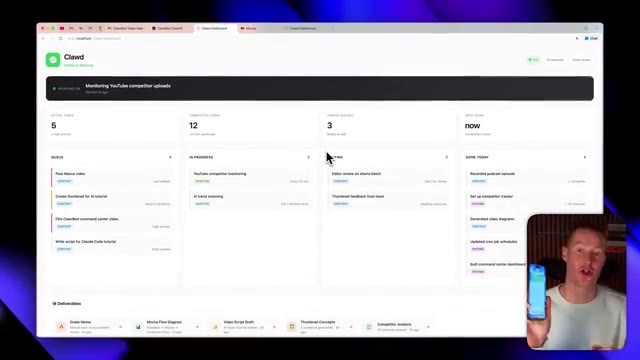
*⏱️ 00:00:30 — Interface Web d'un tableau de bord (Clawd Dashboard) montrant des tâches actives, complétées et en cours, avec une incrustation vidéo du présentateur tenant un smartphone.*

---

### ⏱️ `[00:00:40 - 00:01:16]` | Segment #03

**🔊 Audio (Transcription Intégrale Mot pour Mot en Français) :**
> Je vais plutôt simplement vous montrer ce centre de commande que j'ai construit et comment vous pouvez le construire et l'utiliser sur votre téléphone. Tout d'abord, ce que je vais faire, c'est simplement envoyer un message vocal à CloudBot et il sera capable de le transcrire. Et puis à partir de là, d'exécuter des tâches pour moi sur mon Mac mini. Hé, Claude, donc je veux que tu ajoutes quelque chose à ma liste de tâches. Je dois créer la vignette Manus pour ma prochaine vidéo YouTube. Donc, s'ajoute ça. Donc essentiellement, j'ai littéralement just envoyé ce message vocal et il va maintenant recevoir ce message vocal, l'écouter, puis l'ajouter réellement à mon tableau de bord que j'ai créé sur localhost. Très bien. Donc juste comme ça, vous pouvez voir dans notre file d'attente maintenant nous avons cette nouvelle tâche, créer la vignette Manus. Et ça

**👁️ Analyse Visuelle d'Écran (gemini-3.5-flash-lite) :**
**Interface & Outils** : Navigateur web affichant l'interface du tableau de bord Clawd Dashboard.

**Contenu textuel & Code** : Métriques de suivi des tâches (Active tasks : 5, Completed today : 12, Videos queued : 3) organisées en colonnes kanban (Queue, In progress, Waiting, Done today) avec des vignettes de livrables en bas.

**Action / Démonstration** : Présentation de l'interface du centre de commande par le créateur.

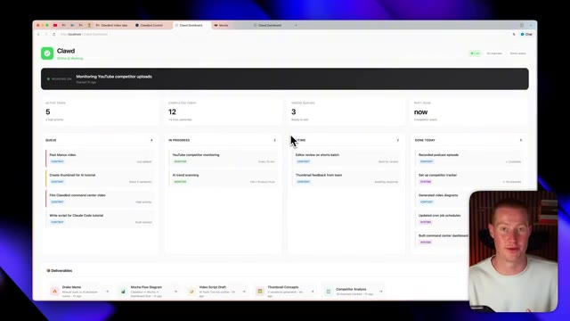
*⏱️ 00:00:49 — Capture d'écran montrant le tableau de bord principal de Clawd, un centre de commande pour la gestion de tâches et de projets.*

---

### ⏱️ `[00:01:16 - 00:01:37]` | Segment #04

**🔊 Audio (Transcription Intégrale Mot pour Mot en Français) :**
> essentiellement parce que Claude mettra à jour ce tableau de bord avec toutes ces informations. Mais encore une fois, c'est un serveur local et je ne peux pas vraiment y accéder sur mon téléphone, ni même sur mon ordinateur portable ou ma tablette, alors que je veux vraiment pouvoir l'emporter partout et utiliser mon assistant IA. Je vais donc vous montrer très rapidement comment nous pouvons maintenant le transformer en une application fonctionnelle, puis la publier afin de pouvoir l'utiliser sur nos différents appareils.

**👁️ Analyse Visuelle d'Écran (gemini-3.5-flash-lite) :**
**Interface & Outils** : Navigateur web affichant un tableau de bord local hébergé sur "http://localhost:3000/dashboard".

**Contenu textuel & Code** : Métriques de productivité et de suivi de tâches (Active tasks: 5, Completed today: 12, Videos queued: 3), avec des colonnes de gestion de projet (Queue, In Progress, Waiting, Done Today) et un aperçu vidéo du présentateur en bas à droite.

**Action / Démonstration** : Le présentateur montre l'interface de son tableau de bord local piloté par Claude pour illustrer la gestion de ses tâches et workflows.

*⏱️ 00:01:21 — Capture d'écran montrant le tableau de bord local "Clawd Dashboard" hébergé sur localhost, affichant des tâches actives, complétées et en file d'attente.*

---

### ⏱️ `[00:01:37 - 00:01:58]` | Segment #05

**🔊 Audio (Transcription Intégrale Mot pour Mot en Français) :**
> Alors tout d'abord, pour parler rapidement de la façon dont j'ai construit ceci avec CloudBot, puisque j'ai simplement dit sur Telegram, hé, je veux créer ce tableau de bord de centre de commande qui montre essentiellement toutes mes tâches en un seul endroit, ainsi qu'il montre absolument tout sur quoi tu travailles. Et ensuite, ajoute aussi ces livrables ici. Encore une fois, je pouvais voir ce mème de Drake ici. Donc n'importe quel actif qu'il génère pour moi, je pouvais le voir directement sur mon tableau de bord.

**👁️ Analyse Visuelle d'Écran (gemini-3.5-flash-lite) :**
**Interface & Outils** : Navigateur web affichant une application locale sur 'localhost' nommée 'Clawd Dashboard'.

**Contenu textuel & Code** : Tableaux de bord de gestion de tâches ('Active tasks', 'Completed today', 'Video queues'), colonnes de suivi (Queue, In Progress, Waiting, Done Today) et mème explicatif.

**Action / Démonstration** : Présentation et explication visuelle du tableau de bord de centre de commande construit avec l'aide de CloudBot.

*⏱️ 00:01:42 — Capture montrant le tableau de bord principal 'Clawd' affichant les tâches actives, l'état d'avancement et les livrables.*

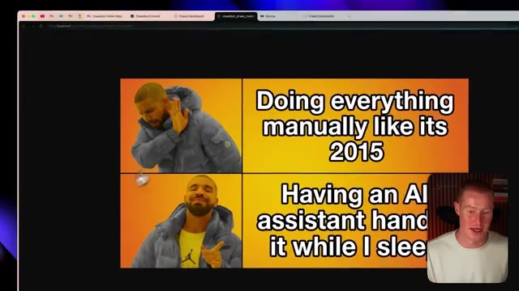
*⏱️ 00:01:53 — Capture affichant un mème humoristique 'Drake' illustrant le contraste entre le travail manuel et l'automatisation par assistant IA.*

---

### ⏱️ `[00:01:58 - 00:02:17]` | Segment #06

**🔊 Audio (Transcription Intégrale Mot pour Mot en Français) :**
> Mais ce que je veux faire maintenant, c'est simplement faire un clic droit sur cette interface ici, et je vais cliquer sur afficher le code source de la page. Et cela va me donner ce code HTML. Ne vous inquiétez pas, vous n'avez pas besoin de savoir coder. Je vais littéralement juste coller ou copier ce code ici. Et ensuite, ce que je vais faire, c'est que je vais aller sur getmocha.com. Je vais m'inscrire pour créer un compte si vous n'en avez pas déjà un.

**👁️ Analyse Visuelle d'Écran (gemini-3.5-flash-lite) :**
**Interface & Outils** : Navigateur web affichant le tableau de bord local "Clawd Dashboard".

**Contenu textuel & Code** : Tableau de bord de gestion de tâches et de monitoring ("Active Tasks", "Completed Today", "Videos Queued"), menu contextuel de navigation web.

**Action / Démonstration** : Clic droit sur l'interface utilisateur web pour afficher le code source de la page.

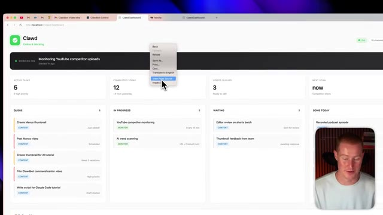
*⏱️ 00:02:03 — Interface du tableau de bord Clawd avec un clic droit affichant le menu contextuel et l'option "View Page Source" sélectionnée, en bas à droite le présentateur à l'écran.*

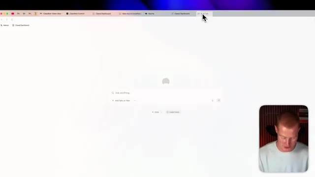
*⏱️ 00:02:12 — Navigateur affichant une page blanche avec une barre de recherche "Ask anything" et une nouvelle vue d'onglet en cours de création.*

---

### ⏱️ `[00:02:17 - 00:02:45]` | Segment #07

**🔊 Audio (Transcription Intégrale Mot pour Mot en Français) :**
> Si vous n'en avez pas déjà un, il y a un lien dans la description pour le faire. Je vais cliquer sur ajouter une application. Et à partir de là, ce que je vais faire, c'est simplement coller ce code. Vous pouvez voir qu'il a collé ce markdown. Et ensuite, je vais juste dire, littéralement, je vais juste dire, construis ceci et clique sur envoyer. Et maintenant, Mocha va commencer à construire notre application. Quelques points clés que je tiens à mentionner ici. Donc, la raison pour laquelle nous utilisons Mocha, c'est non seulement pour que nous puissions publier ceci et commencer réellement à l'utiliser sur différents appareils, le partager avec nos amis, et cetera, mais cela possède également des bases de données intégrées.

**👁️ Analyse Visuelle d'Écran (gemini-3.5-flash-lite) :**
**Interface & Outils** : Navigateur web affichant la plateforme de développement no-code Mocha (getmocha.com) avec le présentateur en incrustation vidéo en bas à droite.

**Contenu textuel & Code** : Champ de saisie contenant du texte markdown collé (« pasted_text...md »), options d'attachement, boutons « Inspiration », « Templates », et message « Working on it... Your app is being created ».

**Action / Démonstration** : Collage d'un contenu markdown dans l'outil no-code, validation de la création et affichage de l'écran de chargement de l'application en cours de génération par l'IA.

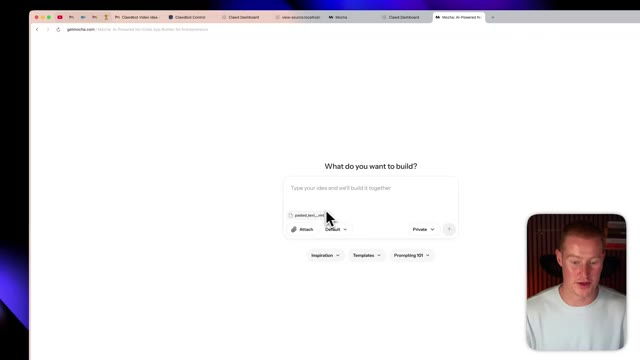
*⏱️ 00:02:24 — Interface de l'application no-code Mocha affichant le champ de saisie avec le texte collé et le curseur de la souris.*

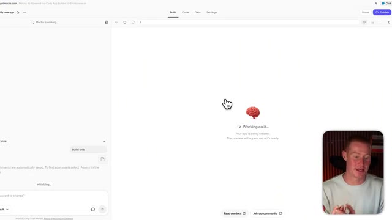
*⏱️ 00:02:31 — L'interface passe en mode génération avec une icône de cerveau animée indiquant que l'application est en cours de création.*

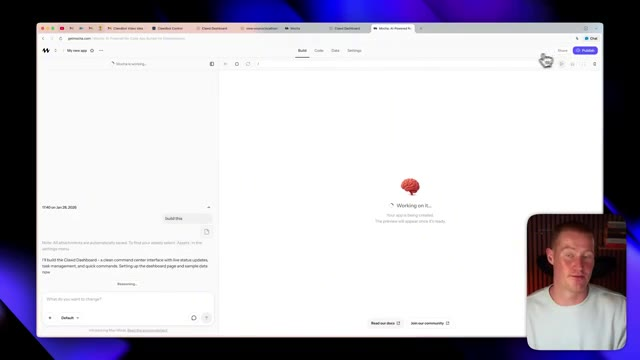
*⏱️ 00:02:38 — Vue complète du panneau de génération de l'application Mocha montrant les détails de la tâche en cours avec un aperçu en chargement.*

---

### ⏱️ `[00:02:45 - 00:03:20]` | Segment #08

**🔊 Audio (Transcription Intégrale Mot pour Mot en Français) :**
> Donc, afin de peupler réellement ce tableau de bord avec des informations réelles et à jour provenant de mon CloudBot avec lequel j'interagis tout au long de la journée, nous avons évidemment besoin d'avoir des informations réelles, en direct et à jour dans notre application. Donc, utiliser la base de données à l'intérieur de Mocha est la façon dont cela fonctionne réellement, car mon CloudBot va automatiquement pousser toutes les données que je lui donne à travers cette base de données. Vous n'avez pas besoin de savoir comment cela fonctionne. Ça fonctionne tout simplement pour vous. Et il y a quelques autres cas d'utilisation à l'intérieur de Mocha qui rendent cela vraiment utile au lieu d'avoir réellement à coder au feeling une application sur localhost en utilisant le CloudBot. Très bien, donc maintenant, juste environ 30 secondes plus tard, nous avons maintenant

**👁️ Analyse Visuelle d'Écran (gemini-3.5-flash-lite) :**
**Interface & Outils** : Navigateur web affichant une application de type No-Code / générateur d'IA (Mocha).

**Contenu textuel & Code** : Texte de génération d'interface utilisateur en cours de traitement ("Working on it...", "I'll build the Clawd Dashboard...").

**Action / Démonstration** : Le créateur présente la génération automatique de l'interface utilisateur pour intégrer les données en direct du bot.

*⏱️ 00:02:54 — Interface de création d'application avec un panneau latéral montrant un assistant textuel générant une interface de tableau de bord, et une incrustation vidéo du présentateur en bas à droite.*

---

### ⏱️ `[00:03:20 - 00:03:52]` | Segment #09

**🔊 Audio (Transcription Intégrale Mot pour Mot en Français) :**
> avons ce tableau de bord interactif ici qui fonctionne de manière très similaire à celui qui était sur localhost. Et nous pourrions aller de l'avant et effectivement apporter quelques modifications à cela avant de vouloir aller le publier sur notre site Web. Afin de commencer à apporter des modifications, je pourrais même venir ici, cliquer sur cette petite flèche ici, la flèche du curseur, et je pourrais modifier individuellement des parties de ce site Web. Donc si je veux juste changer le texte, je pourrais simplement changer, comme supprimer ceci ici, cliquer sur mettre à jour, et cela changera automatiquement cela juste là. Donc cela rend vraiment très facile de commencer à apporter des modifications à notre application au lieu de devoir faire cela à l'intérieur de Claudevot. Et nous pourrions même simplement venir ici et expliquer différentes choses que nous voulons changer. Très bien, donc je pense

**👁️ Analyse Visuelle d'Écran (gemini-3.5-flash-lite) :**
**Interface & Outils** : Navigateur web affichant l'interface de création/gestion d'application "Clawd".

**Contenu textuel & Code** : Tableau de bord interactif affichant différentes métriques (tâches actives, complétées, file d'attente) et un panneau de chat latéral pour modifier le code.

**Action / Démonstration** : Présentation et explication du tableau de bord interactif et de sa structure de gestion de tâches.

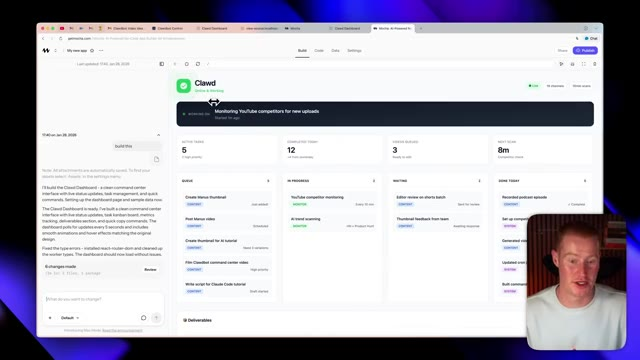
*⏱️ 00:03:28 — Capture d'écran montrant l'interface complète du tableau de bord "Clawd" avec des colonnes de gestion des tâches et le présentateur visible en incrustation.*

---

### ⏱️ `[00:03:52 - 00:04:26]` | Segment #10

**🔊 Audio (Transcription Intégrale Mot pour Mot en Français) :**
> Ça a l'air vraiment bien. Cependant, je veux que tu changes le truc de surveillance façon Claude en haut à gauche de notre site. Je veux que tu lui mettes un logo Claude sympa qui correspond un peu à l'ambiance de notre bot Claude. Aussi, je veux que notre site fasse plus futuriste, en accord avec cette ambiance qu'on recherche avec genre un agent IA qui fait des trucs pour nous. Très bien, voilà ce que ça a généré. C'est définitivement plus futuriste, ça a l'air un peu plus « vibe codé ». Donc je ne suis pas un très grand fan personnellement, mais vous pouvez voir qu'on a maintenant ce logo Claude là-haut. Du coup, je vais en fait revenir en arrière et rétablir l'autre interface juste parce que je trouve ça plus facile à regarder.

**👁️ Analyse Visuelle d'Écran (gemini-3.5-flash-lite) :**
**Interface & Outils** : Navigateur web affichant l'outil de développement No-Code Mocha et un tableau de bord de gestion de tâches / agent IA.

**Contenu textuel & Code** : Panneau de chat latéral contenant des instructions textuelles de modification de design, listes de tâches actives, complétées, en attente ("Queue", "In Progress", "Waiting", "Done Today") et métriques du projet.

**Action / Démonstration** : Modification en temps réel de l'interface utilisateur du tableau de bord via le panneau de chat de l'assistant IA (changement de design vers un style plus futuriste et mise à jour du logo).

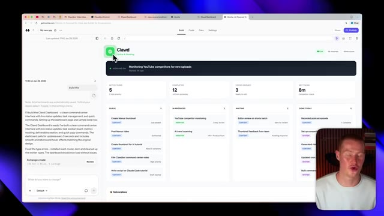
*⏱️ 00:04:01 — Capture d'écran montrant l'interface de développement d'un tableau de bord de gestion de tâches avec un logo d'application simple en haut à gauche et un panneau de chat latéral à gauche.*

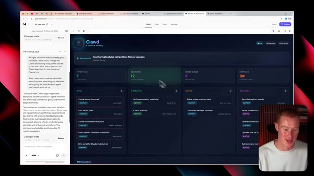
*⏱️ 00:04:18 — Capture d'écran montrant le même tableau de bord après modification, avec un design futuriste en mode sombre et un logo mis à jour en haut à gauche conformément aux instructions vocales.*

---

### ⏱️ `[00:04:26 - 00:04:58]` | Segment #11

**🔊 Audio (Transcription Intégrale Mot pour Mot en Français) :**
> à. Donc laissez-moi faire ça maintenant. Très bien, alors c'est parti, nous avons notre interface précédente et ensuite je tiens également à mentionner que j'ai effectivement configuré ma base de données. Donc maintenant, cela devrait fonctionner correctement. Alors ce que je vais faire, c'est que je vais tester mon bot Claude maintenant. Je vais maintenant envoyer un message sur Telegram en disant à mon bot Claude que j'ai effectivement quelques trucs à faire pour qu'il puisse l'ajouter à notre liste de tâches. Très bien, alors je viens d'envoyer le message sur mon téléphone à l'instant. Attendons quelques secondes et nous devrions voir cela s'afficher sur notre centre de commande. Et juste comme ça, j'ai en gros dit que je dois tourner la courte vidéo de Manish et envoyer les publications de la newsletter.

**👁️ Analyse Visuelle d'Écran (gemini-3.5-flash-lite) :**
**Interface & Outils** : Navigateur web affichant l'interface de gestion de projet / tableau de bord 'Clawd' (getmocha.com).

**Contenu textuel & Code** : Métriques de productivité (Active Tasks: 5, Completed Today: 12, Videos Queued: 3, Next Scan: 9m) et colonnes de gestion de tâches (Queue, In Progress, Waiting, Done Today).

**Action / Démonstration** : Le présentateur commente l'interface utilisateur et présente le fonctionnement des tâches et de la base de données configurée.

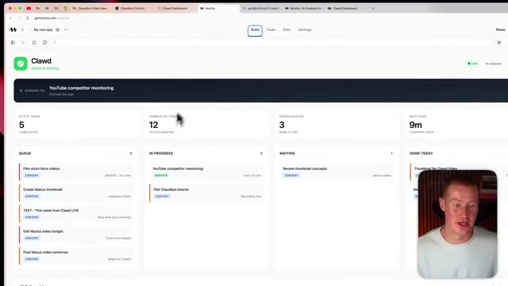
*⏱️ 00:04:34 — Interface principale du tableau de bord 'Clawd' montrant les tâches actives, les tâches complétées et les files d'attente.*

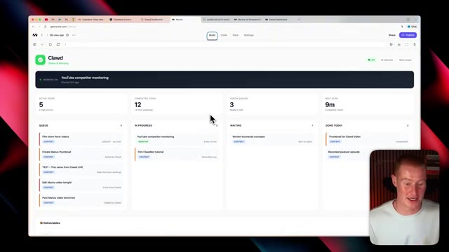
*⏱️ 00:04:42 — Vue légèrement actualisée du tableau de bord 'Clawd' montrant l'état des tâches avec la webcam du présentateur en bas à droite.*

---

### ⏱️ `[00:04:58 - 00:05:33]` | Segment #12

**🔊 Audio (Transcription Intégrale Mot pour Mot en Français) :**
> Et j'ai dit que les deux étaient urgents. J'ai donc ajouté les deux. Et une autre chose que je tiens à mentionner, c'est que nous avons nos livrables ici. Donc, chaque fois que cela génère réellement quelque chose pour moi, disons que cela génère une image ou un mème, je peux en fait cliquer dessus et cela ouvrira ce mème directement sur mon écran. De cette façon, je n'ai pas besoin d'aller dans mes dossiers sur mon bureau pour voir réellement les résultats que cela me donne. Si vous avez utilisé Claudecode ou Claudebot, cela peut être assez pénible de devoir faire ça. Le fait d'avoir tout cela centralisé dans un seul tableau de bord a donc vraiment été un véritable্ভ salut. Très bien, maintenant que notre centre de commande fonctionne pour notre Claudebot, il ne me reste plus qu'à le partager pour pouvoir commencer à l'utiliser sur mon téléphone, ma tablette ou mon

**👁️ Analyse Visuelle d'Écran (gemini-3.5-flash-lite) :**
**Interface & Outils** : Navigateur web affichant une application de tableau de bord de gestion de tâches.

**Contenu textuel & Code** : Tableau de bord avec statistiques (Active tasks: 5, Completed today: 12, Videos queued: 3, Next scan: 9m) et colonnes de tâches avec badges d'urgence.

**Action / Démonstration** : Présentation et navigation dans l'interface du tableau de bord de l'application Clawd.

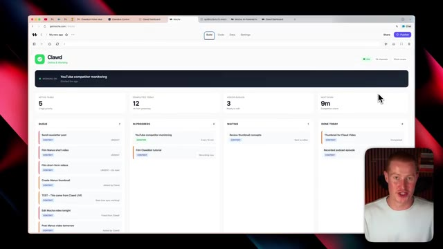
*⏱️ 00:05:16 — Interface de gestion de projets nommée Clawd avec un tableau de bord affichant des tâches en file d'attente (queue, in progress, waiting, done) et le présentateur visible en incrustation vidéo en bas à droite.*

---

### ⏱️ `[00:05:33 - 00:06:08]` | Segment #13

**🔊 Audio (Transcription Intégrale Mot pour Mot en Français) :**
> autre ordinateur ou fondamentalement l'envoyer à un ami pour qu'il puisse l'utiliser aussi. Donc ce que je vais faire, c'est simplement cliquer sur ce bouton de publication violet. Je vais changer ceci pour publier, cliquer sur ce bouton de publier en bas, et ça va effectivement le faire pour moi maintenant. Et juste comme ça, j'ai maintenant cette URL personnalisée sur laquelle je peux accéder à mon site. Je vais l'ouvrir dès maintenant. Très bien. Donc juste comme ça, nous pouvons maintenant effectivement copier ce lien, le coller dans notre navigateur ou l'envoyer à un ami, et nous pouvons maintenant accéder à notre application directement via cette URL au lieu de passer par localhost. Très bien. Donc maintenant, une chose dont je veux parler, c'est si vous utilisez CloudBot, en lui donnant accès à quelque chose comme Zapier MCP,

**👁️ Analyse Visuelle d'Écran (gemini-3.5-flash-lite) :**
**Interface & Outils** : Navigateur web affichant l'interface de la plateforme de développement d'applications Mocha (getmocha.com).

**Contenu textuel & Code** : URL de l'application générée, lien de partage et icônes de réseaux sociaux (X, LinkedIn, Facebook, Reddit).

**Action / Démonstration** : Partage de l'application et copie du lien dans le presse-papier pour permettre à d'autres utilisateurs de l'utiliser.

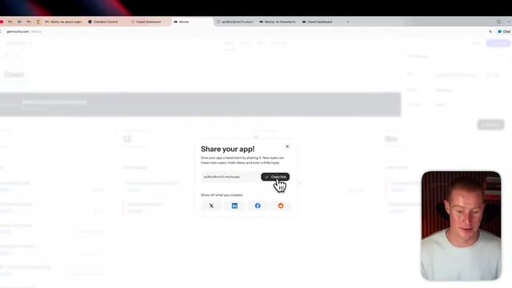
*⏱️ 00:05:50 — Interface de la plateforme Mocha avec une boîte de dialogue pop-up "Share your app!" affichant le lien de l'application et des options de partage sur les réseaux sociaux. Le curseur survole le bouton "Copy link".*

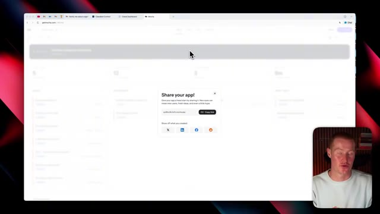
*⏱️ 00:05:59 — Vue similaire de l'interface Mocha montrant le pop-up de partage d'application avec le lien et les boutons de réseaux sociaux.*

---

### ⏱️ `[00:06:08 - 00:06:29]` | Segment #14

**🔊 Audio (Transcription Intégrale Mot pour Mot en Français) :**
> ce qui permet fondamentalement à votre agent d'aller effectuer différentes actions à travers les applications que vous utilisez est super puissant. Donc je vais vous montrer très rapidement comment vous pouvez faire cela maintenant et comment je le fais personnellement pour amplifier mon expérience CloudBot. Donc tout d'abord, pour faire cela, vous venez juste ici, vous cliquez sur le client MCP. Je vais cliquer sur Cloud Code ici, puis lui donner simplement un nom de serveur.

**👁️ Analyse Visuelle d'Écran (gemini-3.5-flash-lite) :**
**Interface & Outils** : Navigateur Web affichant la plateforme Zapier MCP et son tableau de bord de configuration.

**Contenu textuel & Code** : Titres de pages promotionnels et interfaces de configuration d'outils d'automatisation (Slack, Notion, Manus MCP).

**Action / Démonstration** : Navigation et présentation de l'interface de connexion d'un agent IA à des applications via Zapier MCP.

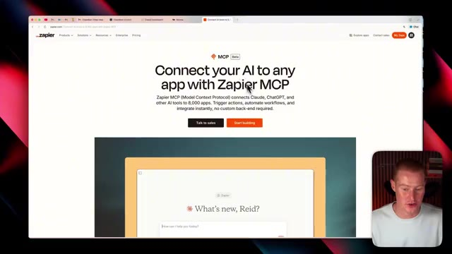
*⏱️ 00:06:13 — Page d'accueil du site Web Zapier présentant l'intégration Zapier MCP pour connecter une intelligence artificielle à n'importe quelle application.*

*⏱️ 00:06:18 — Interface de configuration du serveur Zapier MCP affichant les clients et les outils connectés tels que Slack et Notion.*

---

### ⏱️ `[00:06:29 - 00:06:48]` | Segment #15

**🔊 Audio (Transcription Intégrale Mot pour Mot en Français) :**
> Donc je vais juste appeler ça CloudBot et ensuite créer le serveur MCP. Et puis à partir d'ici, ce qu'on va faire, c'est qu'on pourrait littéralement connecter ceci à n'importe quelle application que nous utilisons. Donc par exemple, si j'utilise Airtable pour les bases de données ou Slack, disons que je veux envoyer un message à mon équipe sur Slack chaque fois que quelque chose est mis à jour dans Google Sheets, je peux simplement cliquer là-dessus, sélectionner ce bouton ici qui sélectionne tous ces outils.

**👁️ Analyse Visuelle d'Écran (gemini-3.5-flash-lite) :**
**Interface & Outils** : Navigateur web affichant l'interface de Zapier MCP avec une fenêtre modale de sélection d'applications tierces (Gmail, Google Calendar, Google Sheets, Airtable, Slack, etc.).

**Contenu textuel & Code** : Liste d'applications populaires compatibles avec le serveur MCP : Gmail, Google Calendar, Google Sheets, Google Docs, Notion, Airtable, Slack, HubSpot, etc.

**Action / Démonstration** : Le présentateur navigue et sélectionne des applications dans la liste pour les connecter au serveur MCP.

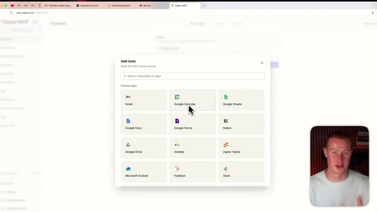
*⏱️ 00:06:34 — Interface web de Zapier MCP montrant une fenêtre contextuelle pour ajouter des outils, avec le curseur sur l'application Google Calendar, et le présentateur en incrustation vidéo en bas à droite.*

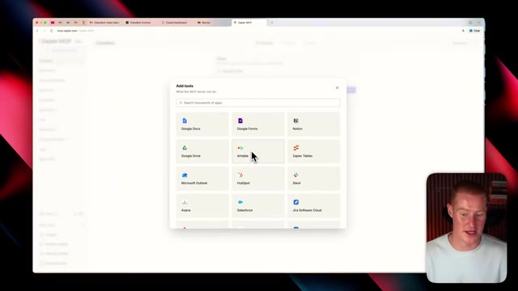
*⏱️ 00:06:38 — Interface web de Zapier MCP montrant la sélection de l'application Airtable dans la liste des outils disponibles à ajouter au serveur MCP.*

---

### ⏱️ `[00:06:48 - 00:07:06]` | Segment #16

**🔊 Audio (Transcription Intégrale Mot pour Mot en Français) :**
> Et maintenant nous avons accès à ces 34 actions à travers cette application et il suffit de cliquer sur connecter. Et maintenant ceci est ajouté à notre serveur MCP. Et c'est un moyen facile pour nous de configurer un serveur qui a la capacité d'aller et de réellement exécuter un tas d'actions différentes à travers toutes les applications que nous utilisons. Disons que nous ajoutons tout ce que nous voulons ajouter ici pour ce serveur spécifique.

**👁️ Analyse Visuelle d'Écran (gemini-3.5-flash-lite) :**
**Interface & Outils** : Interface web Zapier MCP, navigateur web, vue incrustée du présentateur.

**Contenu textuel & Code** : Liste d'actions/outils disponibles pour Slack (Find message, Find user, etc.), statut de connexion au client Claude Code.

**Action / Démonstration** : Connexion et ajout d'actions d'une application (Slack) au serveur MCP pour permettre leur exécution automatique.

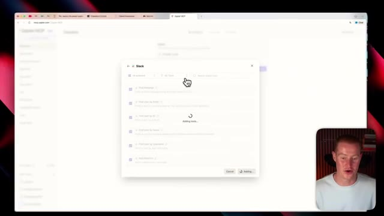
*⏱️ 00:06:53 — Fenêtre modale montrant l'ajout d'outils Slack à l'application avec un indicateur de chargement « Adding tools... ».*

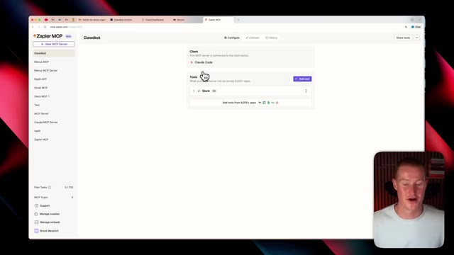
*⏱️ 00:06:57 — Interface Zapier MCP montrant la configuration d'un serveur relié à Claude Code avec l'outil Slack ajouté avec succès.*

---

### ⏱️ `[00:07:07 - 00:07:30]` | Segment #17

**🔊 Audio (Transcription Intégrale Mot pour Mot en Français) :**
> Je peux cliquer sur ce bouton de connexion. Et ensuite, à partir d'ici, je vais simplement cliquer sur copier la commande. Et ensuite, je vais aller sur Cloud Code ou même donner ceci à mon Cloud Bot qui se trouve dans mon Telegram et simplement coller cette commande. Et il va aller de l'avant et réellement implémenter ceci dans notre flux de travail Argentic. Très bien, les gars, voilà. Nous avons construit tout ce tableau de bord de centre de commande Cloud Bot. Et nous pouvons désormais y accéder sur tous nos appareils parce que nous l'avons publié sur une URL publique.

**👁️ Analyse Visuelle d'Écran (gemini-3.5-flash-lite) :**
**Interface & Outils** : Navigateur web affichant l'interface Zapier MCP / Clawdbot.

**Contenu textuel & Code** : Instructions de configuration et commande textuelle pour connecter Zapier MCP au terminal Claude Code.

**Action / Démonstration** : Copie de la commande de configuration depuis l'interface web pour l'utiliser dans le terminal ou l'assistant.

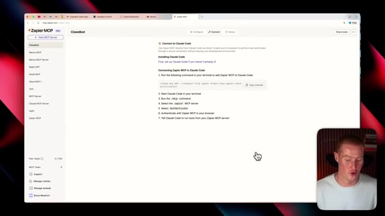
*⏱️ 00:07:12 — Interface de configuration affichant les instructions de connexion de Zapier MCP à Claude Code avec un bouton de copie de commande.*

---

### ⏱️ `[00:07:30 - 00:07:36]` | Segment #18

**🔊 Audio (Transcription Intégrale Mot pour Mot en Français) :**
> Donc vous avez retiré de la valeur de cette vidéo. Assurez-vous de vous abonner à cette chaîne pour plus de contenu comme celui-ci. Dites-moi ce que vous en pensez dans les commentaires et je vous vois, les gars, dans la prochaine vidéo.

**👁️ Analyse Visuelle d'Écran (gemini-3.5-flash-lite) :**
**Interface & Outils** : AUCUNE

**Contenu textuel & Code** : AUCUN

**Action / Démonstration** : AUCUNE

---

