# 🎬 OpenClaw Is Finally Easy and Safe to Use... (Clawdbot)

> **Chaîne** : [Brock Mesarich | AI for Non Techies](https://www.youtube.com/@BrockMesarich)  
> **Lien YouTube** : [https://www.youtube.com/watch?v=6OSEZx8v4so](https://www.youtube.com/watch?v=6OSEZx8v4so)  
> **Date de publication** : 20260202  
> **Durée** : 00:09:13  
> **Identifiant vidéo** : `6OSEZx8v4so`  
> **Transcription & Analyse** : `whisper-v3-large-turbo+gemini-3.5-flash-lite`  

---

## 📌 Synthèse Exécutive & Outils

### 💡 Résumé

Cette vidéo présentée par Brock Mesarich pour la chaîne *Brock Mesarich | AI for Non Techies* aborde le déploiement simplifié et sécurisé de « Claudebot » (également appelé OpenClaw ou Moltibot), un agent conversationnel autonome et open-source capable d'exécuter des actions complexes sur un système. Auparavant, la configuration de cet outil relevait du parcours du combattant pour les profils non techniques : elle nécessitait l'achat d'un Mac Mini dédié ou la location d'un VPS, la maîtrise des lignes de commande via le Terminal, ainsi que l'installation complexe de dépendances telles que Node.js, Docker, NPM et divers pare-feu. De plus, la gestion manuelle des clés API d'Anthropic ou d'OpenAI exposait les utilisateurs à des risques financiers liés à une surconsommation de jetons, voire à des failles de sécurité majeures compromettant des données confidentielles.

La vidéo met en lumière une solution radicalement simplifiée et exempte de code : l'utilisation de la plateforme **Emergent** et de son bouton d'automatisation préconfiguré (MoldBot). Cette approche permet de s'affranchir de toute infrastructure matérielle locale en faisant tourner l'environnement directement dans le cloud, sans configuration manuelle de terminal. L'interface gère automatiquement l'attribution des clés API (en offrant une option gratuite pour débuter) et guide l'utilisateur pas à pas pour connecter l'instance d'OpenClaw à des applications de messagerie instantanée comme Telegram via Botfather, transformant l'interaction avec l'agent en un simple échange de SMS sécurisé et instantané.

### 🛠️ Outils, Modèles & Logiciels Présentés

* **Claude (Anthropic)** : Modèle de langage avancé utilisé comme moteur principal pour propulser les capacités de raisonnement et d'exécution d'OpenClaw.
* **Grok** : Moddeur et modèle d'intelligence artificielle alternatif évoqué dans l'écosystème global des LLMs actuels.
* **Gemini** : Modèle d'intelligence artificielle de Google mentionné parmi les solutions concurrentes du marché.
* **ChatGPT (OpenAI)** : Modèle de référence et fournisseur potentiel de clés API pour alimenter les agents conversationnels.
* **Make** : Plateforme d'automatisation de flux de travail no-code (au même titre que Zapier ou n8n) pour connecter différentes applications logicielles.
* **Zapier** : Outil d'intégration et d'automatisation cloud permettant de lier des API tierces sans coder.
* **n8n** : Logiciel d'automatisation de workflows open-source et flexible pour orchestrer des tâches complexes.
* **OpenClaw (alias Claudebot / Moltibot)** : Agent open-source autonome capable d'interagir avec des environnements et des applications de messagerie.
* **Emergent** : Plateforme no-code/cloud facilitant le déploiement instantané et sécurisé d'applications autonomes comme MoldBot sans configuration matérielle.
* **Telegram & Botfather** : Application de messagerie sécurisée et outil natif de création de bots utilisés pour interagir à distance avec l'agent OpenClaw.
* **Node.js, Docker & NPM** : Environnements techniques et gestionnaires de paquets traditionnellement requis (et ici contournés) pour l'installation locale de l'agent.

### 🔑 Points Clés & Enseignements Stratégiques

1. **Élimination des barrières matérielles** : Finis l'obligation d'investir 1 500 dollars dans un Mac Mini dédié ou de configurer un VPS (Serveur Virtuel Privé) complexe et abstrait pour les non-initiés.
2. **Sécurité de l'écosystème personnel** : Isoler l'agent open-source dans le cloud évite qu'un script autonome ou une boucle d'exécution incontrôlée n'accède aux fichiers sensibles de l'ordinateur principal ou n'envoie des messages inopinés.
3. **Contournement des configurations de Terminal** : Suppression totale de l'utilisation des lignes de commande, rendant l'outil accessible aux profils strictement non techniques en quelques clics.
4. **Gestion financière et clés API intégrées** : Utilisation d'un environnement cloud pré-approvisionné (via Emergent) permettant de tester l'outil gratuitement sans lier immédiatement ses propres cartes bancaires ou risquer d'épuiser ses crédits d'API OpenAI/Anthropic.
5. **Déploiement instantané no-code** : Automatisation complète de la mise en place de l'environnement en 2 à 5 minutes grâce à un simple bouton de pré-chargement de prompt sur la plateforme cloud.
6. **Intégration fluide avec Telegram** : Utilisation de l'outil natif *Botfather* pour créer un bot personnalisé, générer un jeton d'accès sécurisé et lier l'instance cloud à une interface de messagerie mobile familière.
7. **Expérience utilisateur conversationnelle** : Interagir avec OpenClaw par le biais de Telegram procure l'expérience fluide d'un échange de SMS avec un assistant personnel capable d'exécuter des tâches en arrière-plan.
8. **Évolutivité et flexibilité des modèles** : Possibilité de basculer à tout moment sur ses propres clés API (Anthropic ou OpenAI) en un minimum de manipulations dès que l'utilisateur souhaite passer à un usage avancé ou professionnel.
9. **Prévention des fuites de données** : Le passage par une interface cloud sécurisée protège l'utilisateur contre l'exposition accidentelle de clés API sensibles dans les registres publics ou les historiques de code locaux.
10. **Personnalisation de l'agent** : L'initialisation via Telegram permet de paramétrer instantanément le ton (décontracté, professionnel) et le profil comportemental du bot selon les besoins spécifiques de l'utilisateur.

---

## ⏱️ Chronologie & Transcription Complète Audio & Visuelle (Mot pour Mot)

### ⏱️ `[00:00:00 - 00:00:19]` | Segment #01

**🔊 Audio (Transcription Intégrale Mot pour Mot en Français) :**
> Les gars, je viens de trouver une nouvelle façon de configurer Claudebot. Vous n'avez pas besoin de payer pour un Mac Mini. Vous n'avez pas besoin de configurer un VPS. C'est extrêmement facile pour littéralement n'importe qui de le faire en moins de 5 à 10 minutes. Et je vais vous montrer dans cette vidéo d'abord pourquoi c'était pénible de le configurer avant et pourquoi c'est peut-être la meilleure solution pour vous de commencer à utiliser Claudebot dès maintenant.

**👁️ Analyse Visuelle d'Écran (gemini-3.5-flash-lite) :**
**Interface & Outils** : Navigateur web affichant l'outil de dessin collaboratif Excalidraw et une fenêtre de visioconférence.

**Contenu textuel & Code** : Comparaison en deux colonnes : 'Before' (1-3 heures avec configuration complexe, clés API et erreurs) versus 'Now' (5 minutes, hébergé dans le cloud avec un seul bouton).

**Action / Démonstration** : Le présentateur explique visuellement la simplification de la configuration de Claudebot à l'aide d'un tableau comparatif.

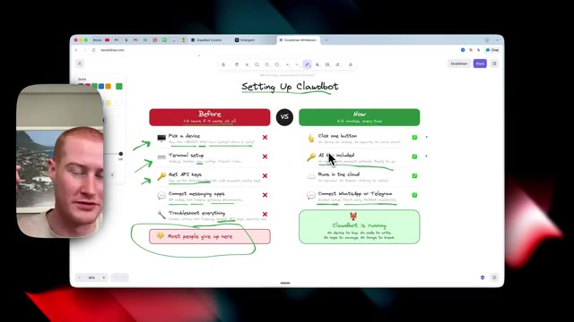
*⏱️ 00:00:05 — Capture d'écran montrant un schéma comparatif sur Excalidraw intitulé 'Setting Up Clawdbot' avec le présentateur en incrustation vidéo à gauche.*

---

### ⏱️ `[00:00:19 - 00:00:38]` | Segment #02

**🔊 Audio (Transcription Intégrale Mot pour Mot en Français) :**
> Et c'est tout à fait sûr pour vous de l'utiliser. Donc, sans plus attendre, plongeons-nous dedans. Très bien, alors parlons rapidement du avant et du après de la configuration de Claudebot, Moltibot, ou maintenant OpenClaude. Il est impossible de suivre réellement le nom de ce truc qui change chaque jour. Alors venons sur ce tableau ici. Et je vais parler rapidement du avant de configurer Claudebot.

**👁️ Analyse Visuelle d'Écran (gemini-3.5-flash-lite) :**
**Interface & Outils** : Navigateur web affichant le site OpenClaw et l'outil de tableau blanc Excalidraw.

**Contenu textuel & Code** : Comparaison avant/après de l'installation d'un bot d'IA : complexité technique, clés API, configuration de terminal versus installation en un clic dans le cloud.

**Action / Démonstration** : Le présentateur introduit la plateforme et présente le comparatif visuel du processus d'installation.

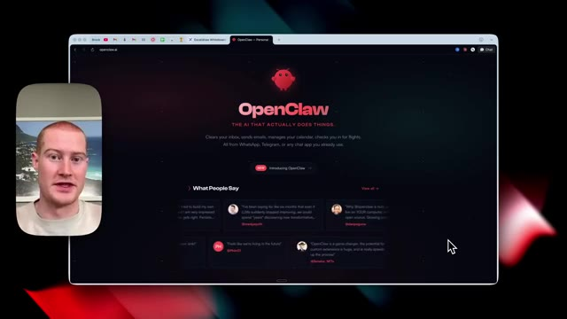
*⏱️ 00:00:23 — Le navigateur montre la page d'accueil du site OpenClaw avec son logo et le titre "The AI that actually does things".*

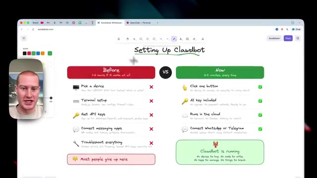
*⏱️ 00:00:33 — Un tableau comparatif sur Excalidraw intitulé "Setting Up Clawdbot", opposant l'ancienne configuration complexe ("Before") à la nouvelle version simplifiée ("Now").*

---

### ⏱️ `[00:00:38 - 00:00:57]` | Segment #03

**🔊 Audio (Transcription Intégrale Mot pour Mot en Français) :**
> Donc avant, cela nous prenait probablement une à deux heures si cela fonctionnait tout court. Donc personnellement, j'ai configuré ceci. Cela m'a pris deux à trois heures pour le faire fonctionner correctement. Et il y a deux ou trois autres choses vraiment importantes que nous devons noter lorsque nous configurons cela. Donc tout d'abord, vous devez choisir un appareil. Personnellement, j'ai acheté un Mac mini. J'ai configuré le mien au maximum.

**👁️ Analyse Visuelle d'Écran (gemini-3.5-flash-lite) :**
**Interface & Outils** : Navigateur web affichant un tableau blanc Excalidraw et une miniature vidéo de l'orateur.

**Contenu textuel & Code** : Texte comparatif sur le temps de configuration ("Before: 1-2 hours if it works at all") et étapes techniques (Pick a device, Terminal setup, Get API keys, Connect messaging apps, Troubleshoot everything).

**Action / Démonstration** : L'orateur explique et commente le schéma comparatif des difficultés de configuration sur le tableau blanc.

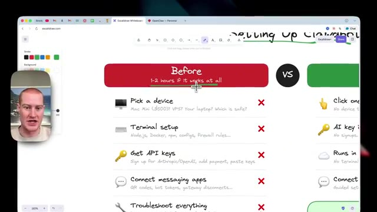
*⏱️ 00:00:43 — Présentation Excalidraw montrant une comparaison "Before" (1-2 heures) avec les étapes complexes de configuration (Pick a device, Terminal setup, Get API keys, etc.).*

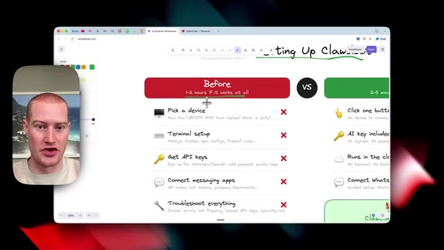
*⏱️ 00:00:48 — Même tableau comparatif Excalidraw montrant la section "Before" avec les étapes fastidieuses barrées par des croix rouges.*

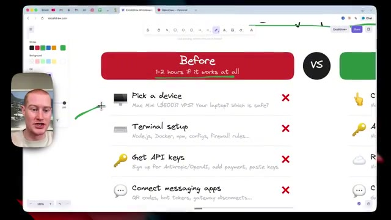
*⏱️ 00:00:52 — Gros plan sur le schéma Excalidraw illustrant les difficultés de configuration initiale comparées au processus simplifié.*

---

### ⏱️ `[00:00:57 - 00:01:19]` | Segment #04

**🔊 Audio (Transcription Intégrale Mot pour Mot en Français) :**
> C'était 1 500 dollars. J'avais d'autres raisons de faire cela pour mon entreprise et pour mon travail. C'est la raison pour laquelle je l'ai fait. Vous n'êtes pas obligé de faire cela. Mais beaucoup de gens se précipitent et dépensent cinq cents dollars pour un Mac mini dont ils n'ont pas besoin, ou vous utilisez un VPS, et beaucoup de gens ne savent même pas ce qu'est un VPS, et parfois cela peut être vraiment difficile à configurer si vous n'êtes pas technique, ce que je sais que beaucoup d'entre vous sont, c'est une option difficile pour nous, votre ordinateur portable, est-ce que c'est sûr ?

**👁️ Analyse Visuelle d'Écran (gemini-3.5-flash-lite) :**
**Interface & Outils** : Tableau blanc Excalidraw dans un navigateur web avec incrustation vidéo du présentateur.

**Contenu textuel & Code** : Texte du tableau listant les contraintes : "Before", "1-2 hours if it works at all", "Pick a device - Mac Mini ($500)?", "Terminal setup", "Get API keys", "Connect messaging apps".

**Action / Démonstration** : Le présentateur explique les étapes fastidieuses et les dépenses inutiles (comme l'achat d'un Mac mini à 500 dollars) lors de la configuration initiale.

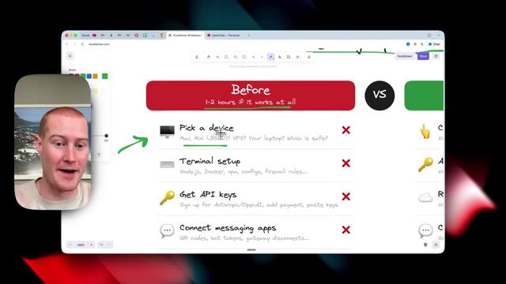
*⏱️ 00:01:03 — Capture d'écran montrant un tableau blanc Excalidraw avec la section "Before" listant les étapes complexes (Pick a device, Terminal setup, Get API keys, Connect messaging apps) avec des croix rouges et une mention "Mac Mini ($500)".*

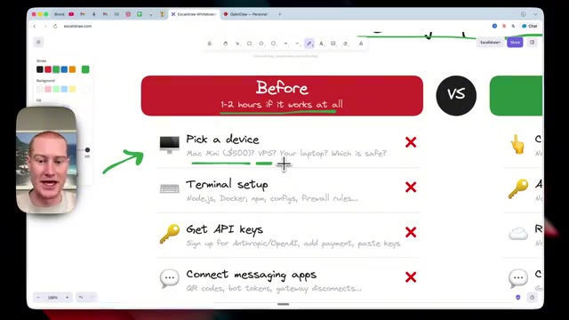
*⏱️ 00:01:08 — Capture similaire montrant le curseur soulignant la mention du Mac Mini ($500) sur le tableau blanc.*

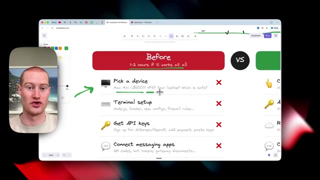
*⏱️ 00:01:14 — Capture similaire montrant la suite de l'explication du présentateur avec le même schéma Excalidraw en arrière-plan.*

---

### ⏱️ `[00:01:19 - 00:01:45]` | Segment #05

**🔊 Audio (Transcription Intégrale Mot pour Mot en Français) :**
> Comme vous voyez tellement de choses de gens qui disent qu'ils sont comme vous voyez tellement de choses de gens qui disent que leurs ordinateurs se font pirater et qu'ils publient ces informations confidentielles qu'ils ne devraient pas divulguer aux gens. Puisqu'il s'agit d'un produit open source et que CloudBot peut essentiellement faire n'importe quoi sur votre ordinateur, il est donc important de choisir un appareil qui est séparé de votre écosystème préexistant afin qu'il ne s'emballe pas pour envoyer un message à votre patron et envoyer un courriel à votre patron pour lui dire d'aller se faire foutre.

**👁️ Analyse Visuelle d'Écran (gemini-3.5-flash-lite) :**
**Interface & Outils** : Navigateur web affichant un tableau blanc Excalidraw et une page web d'article de sécurité.

**Contenu textuel & Code** : Texte sur la sécurité des bots open-source et des configurations de serveurs exposés.
[DESC_IMAGE_2] Le présentateur commente un article de blog sur les risques de sécurité des instances Clawdbot exposées en ligne.

**Action / Démonstration** : Explications face caméra et analyse conceptuelle des marchés.

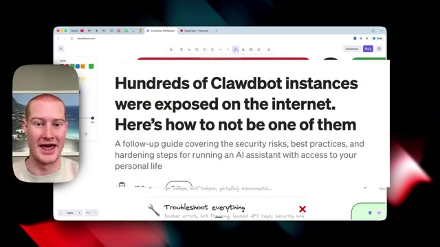
*⏱️ 00:01:32 — Une capture d'article affichée par-dessus le tableau blanc, titrée 'Hundreds of Clawdbot instances were exposed on the internet'.*

---

### ⏱️ `[00:01:45 - 00:02:05]` | Segment #06

**🔊 Audio (Transcription Intégrale Mot pour Mot en Français) :**
> Donc ensuite, nous avons la configuration du terminal. Et ça, les gars, c'est une plaie. Si vous ne savez pas comment utiliser les terminaux, un terminal, c'est essentiellement ce truc-là. C'est en gros ce truc de code. Je ne sais même pas comment l'expliquer. Si vous n'êtes pas du milieu technique, je ne sais pas comment vous l'expliquer. Mais essentiellement, c'est là que vous devez installer. Et ça peut être une vraie plaie de faire ça.

**👁️ Analyse Visuelle d'Écran (gemini-3.5-flash-lite) :**
**Interface & Outils** : Navigateur web affichant Excalidraw et application Terminal macOS.

**Contenu textuel & Code** : Interface d'un tableau blanc comparatif et une invite de commande (shell) active affichant les informations de connexion.

**Action / Démonstration** : Le présentateur affiche une fenêtre de terminal pour illustrer visuellement la configuration technique évoquée dans le segment audio.

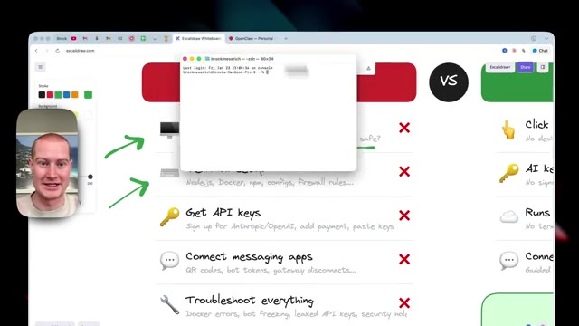
*⏱️ 00:01:55 — Une fenêtre de terminal zsh ouverte par-dessus le tableau blanc Excalidraw, illustrant concrètement ce qu'est un terminal de commande.*

---

### ⏱️ `[00:02:05 - 00:02:28]` | Segment #07

**🔊 Audio (Transcription Intégrale Mot pour Mot en Français) :**
> Nous devons exécuter Node.js, Docker, NPM, des configurations, un pare-feu. Ensuite, nous devons obtenir nos clés d'API. Nous devrions donc nous inscrire sur Anthropic, OpenAI, ajouter des paiements, coller nos clés. Et puis cela pose ses propres problèmes parce qu'ensuite nous ne savons pas combien nos clés d'API vont être utilisées, car nous sommes facturés à chaque fois que nous l'utilisons. Et CloudBot peut utiliser beaucoup de vos crédits d'API si vous n'êtes pas proactif et si vous ne vérifiez pas réellement combien il en utilise.

**👁️ Analyse Visuelle d'Écran (gemini-3.5-flash-lite) :**
**Interface & Outils** : Tableau blanc en ligne (Excalidraw) avec vignette vidéo du présentateur incrustée.

**Contenu textuel & Code** : Texte manuscrit listant les étapes : "Pick a device", "Terminal setup (Node.js, Docker, npm, configs, firewall rules)", "Get API keys (Sign up for Anthropic/OpenAI)", "Connect messaging apps", "Troubleshoot everything".

**Action / Démonstration** : Le présentateur explique et pointe du doigt les étapes complexes du processus de configuration manuel sur le tableau blanc.

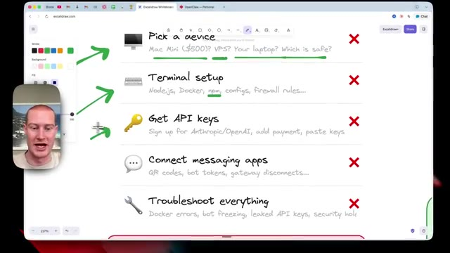
*⏱️ 00:02:10 — Un tableau blanc Excalidraw présente une liste d'étapes manuelles complexes avec des croix rouges, montrant les difficultés du processus traditionnel.*

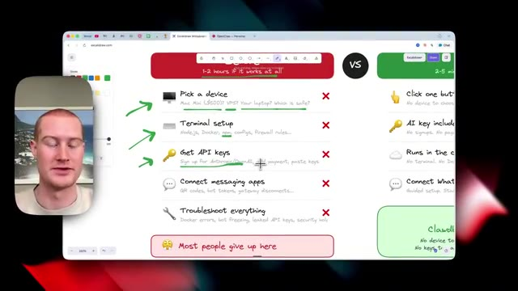
*⏱️ 00:02:16 — Le tableau blanc Excalidraw continue d'afficher les étapes manuelles avec une annotation en bas soulignant que la plupart des gens abandonnent à ce stade.*

---

### ⏱️ `[00:02:28 - 00:02:46]` | Segment #08

**🔊 Audio (Transcription Intégrale Mot pour Mot en Français) :**
> Ensuite, le processus suivant consiste à nous connecter à nos applications de messagerie. Nous devons utiliser des codes QR, des jetons de bot, des déconnexions de passerelle. Cette partie est aussi une galère. Et ensuite, tout dépanner. Les gars, c'est à ça que j'ai passé énormément de temps sur CloudBot. Et ça a juste été une galère. Des erreurs Docker, le bot qui se fige, des clés API divulguées, ce qui n'est pas bon, soit dit en passant, si vous êtes familier avec les clés API.

**👁️ Analyse Visuelle d'Écran (gemini-3.5-flash-lite) :**
**Interface & Outils** : Navigateur web affichant un tableau blanc Excalidraw et une webcam de présentation.

**Contenu textuel & Code** : Liste d'étapes d'installation incluant « Connect messaging apps » et « Troubleshoot everything », avec une note indiquant « Most people give up here ».

**Action / Démonstration** : Le présentateur explique les différentes étapes de configuration et pointe les sections problématiques sur le tableau blanc.

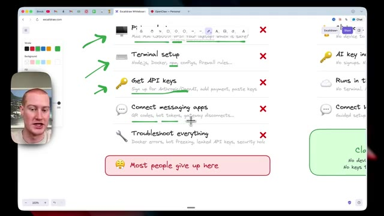
*⏱️ 00:02:32 — Capture d'écran montrant un tableau blanc Excalidraw avec le curseur sur l'étape « Connect messaging apps » et le présentateur dans une vignette à gauche.*

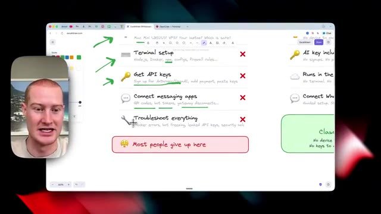
*⏱️ 00:02:37 — Capture d'écran similaire montrant le tableau blanc Excalidraw avec le curseur se déplaçant vers l'étape « Troubleshoot everything ».*

---

### ⏱️ `[00:02:47 - 00:03:07]` | Segment #09

**🔊 Audio (Transcription Intégrale Mot pour Mot en Français) :**
> Et c'est là que la plupart des gens abandonnent, juste ici. Et dans cette vidéo, je vais vous montrer un truc qui vous permet en gros de configurer ça en deux à cinq minutes à chaque fois, que vous pouvez faire dès maintenant. Vous pouvez cliquer sur un bouton. Vous n'avez pas à choisir d'appareil. Il n'y a pas de sécurité dont vous devez vous soucier. En passant à l'étape suivante, nous avons déjà des clés API incluses.

**👁️ Analyse Visuelle d'Écran (gemini-3.5-flash-lite) :**
**Interface & Outils** : Navigateur web affichant un tableau blanc Excalidraw et une incrustation vidéo de la webcam du présentateur.

**Contenu textuel & Code** : Texte schématique sur le tableau blanc listant des points de configuration (Click one button, AI key included, Runs in the cloud, Connect Whatsapp or Telegram).

**Action / Démonstration** : Le présentateur parle en pointant ou en commentant les éléments visuels affichés sur le tableau blanc numérique.

---

### ⏱️ `[00:03:07 - 00:03:26]` | Segment #10

**🔊 Audio (Transcription Intégrale Mot pour Mot en Français) :**
> Donc si vous ne voulez pas ajouter votre abonnement OpenAI ou Cloud, vous n'êtes pas obligé de le faire. C'est déjà prêt à l'emploi. Pas d'inscriptions, pas de méthodes de paiement, et c'est prêt à fonctionner. Et ça tourne dans le cloud, donc nous n'avons pas à nous soucier du terminal comme je vous l'ai montré tout à l'heure. C'est donc juste une interface beaucoup plus simple à utiliser. Et ensuite, nous pouvons aussi nous connecter à WhatsApp ou Telegram.

**👁️ Analyse Visuelle d'Écran (gemini-3.5-flash-lite) :**
**Interface & Outils** : Navigateur web affichant le site Excalidraw.

**Contenu textuel & Code** : Schéma textuel listant des points clés : "Click one button", "AI key included (No signups, No payment methods, Ready to go)", "Runs in the cloud", et "Connect WhatsApp or Telegram", avec des coches vertes. On aperçoit également la webcam du présentateur incrustée à gauche.

**Action / Démonstration** : Le présentateur explique et pointe du doigt les différents avantages listés sur le schéma explicatif à l'écran.

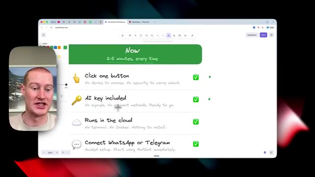
*⏱️ 00:03:12 — Capture d'écran montrant l'interface d'Excalidraw avec un schéma explicatif sur les fonctionnalités et avantages du service.*

---

### ⏱️ `[00:03:27 - 00:03:50]` | Segment #11

**🔊 Audio (Transcription Intégrale Mot pour Mot en Français) :**
> Et nous sommes réellement guidés à travers cette configuration. Et nous pourrions commencer à utiliser Multibot ou OpenClaw immédiatement. Ensuite, à partir de là, CloudBot fonctionne. Nous n'en avons pas besoin par appareil. Aucun code à écrire. Aucune clé à gérer. Aucune chose à casser. C'est juste un écosystème vraiment, vraiment facile à utiliser CloudBot. Alors maintenant que vous comprenez le avant et le après, allons-y et montrons-vous cette astuce dont je suis en train de parler afin que vous puissiez commencer à l'utiliser si vous n'êtes pas technique.

**👁️ Analyse Visuelle d'Écran (gemini-3.5-flash-lite) :**
**Interface & Outils** : Interface de tableau blanc collaboratif (Excalidraw) affichée dans un navigateur web, avec incrustation vidéo du présentateur.

**Contenu textuel & Code** : Texte schématique listant les points clés : "Click one button", "AI key included", "Runs in the cloud", "Connect WhatsApp or Telegram", et "Clawdbot is running: No device to buy. No code to write. No keys to manage. No things to break."

**Action / Démonstration** : Le présentateur commente le schéma explicatif en parcourant visuellement les points clés de la configuration simplifiée du bot.

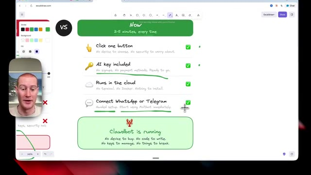
*⏱️ 00:03:33 — Capture d'écran montrant un schéma explicatif sur Excalidraw listant les avantages d'une solution ("Now") avec des icônes et des coches vertes, tandis que le présentateur apparaît en médaillon à gauche.*

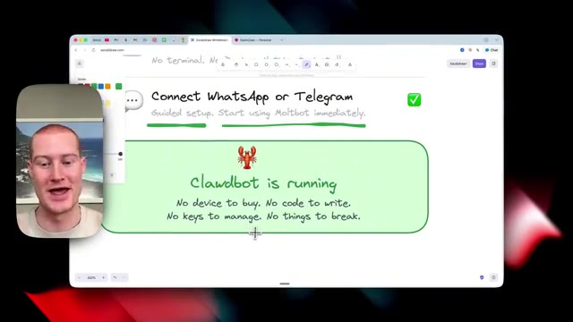
*⏱️ 00:03:39 — Zoom avant sur le schéma Excalidraw, mettant en évidence la section "Clawdbot is running" avec le texte récapitulatif des avantages.*

---

### ⏱️ `[00:03:50 - 00:04:26]` | Segment #12

**🔊 Audio (Transcription Intégrale Mot pour Mot en Français) :**
> Très bien, les amis. Passons donc à la solution. Et les amis, c'est probablement la façon la plus simple d'utiliser ClawedBot ou OpenClaw en ce moment même. Voici donc exactement comment faire. J'utilise donc Emergent et ils viennent juste de sortir ce bouton ici en bas qui s'appelle MoldBot. Donc essentiellement, ce que vous pouvez faire, c'est simplement cliquer sur ce bouton. Cela vous donne ce prompt préchargé ici et va commencer à construire une application personnalisée pour que nous puissions commencer à utiliser multibot et cela configure le tout pour nous et je vais vous montrer exactement comment faire les amis, c'est vraiment insensé si vous n'êtes pas techniques, cela rend tout ce processus super simple, je vais cliquer sur envoyer et ce que ça va faire, c'est que ça va prendre, ça va configurer cet environnement.

**👁️ Analyse Visuelle d'Écran (gemini-3.5-flash-lite) :**
**Interface & Outils** : Application web Emergent (app.emergent.sh) et interface de discussion avec l'IA.

**Contenu textuel & Code** : Instructions d'installation de MoltBot, étapes pour obtenir une clé LLM et script d'installation.
[DESC_IMAGE_1] Sélection et démonstration de l'utilisation du bouton MoltBot sur l'interface d'Emergent.

**Action / Démonstration** : Explications face caméra et analyse conceptuelle des marchés.

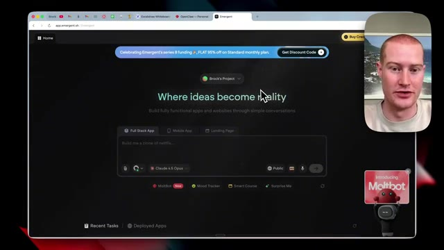
*⏱️ 00:03:59 — Interface web d'Emergent montrant le tableau de bord principal avec le bouton MoldBot en bas.*

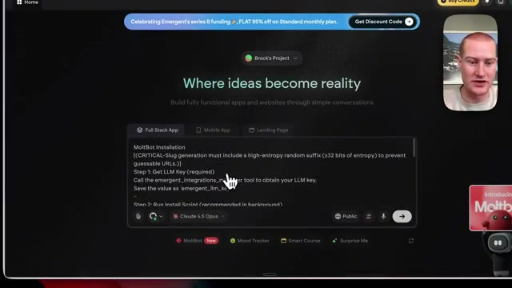
*⏱️ 00:04:08 — Interface d'Emergent affichant les instructions d'installation de MoltBot dans la zone de texte.*

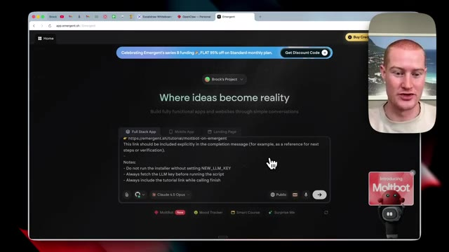
*⏱️ 00:04:17 — Interface d'Emergent affichant la suite des instructions textuelles et le lien du tutoriel pour MoltBot.*

---

### ⏱️ `[00:04:26 - 00:04:54]` | Segment #13

**🔊 Audio (Transcription Intégrale Mot pour Mot en Français) :**
> Ça va prendre quelques minutes pour le faire, alors laissons-la faire son travail et le meilleur dans tout ça, c'est que mes mains sont loin du clavier, je ne touche à rien, je n'ai pas besoin de configurer ça moi-même, tout se passe en arrière-plan et ça va juste fonctionner à la fin de la journée. Laissons-la faire son travail et nous y reviendrons. Très bien, alors ça a pris peut-être deux à trois minutes. Maintenant, ce que je peux faire, c'est me connecter rapidement avec Google ici même pour configurer réellement mon OpenClaw. Donc ce que je vais faire, c'est me connecter maintenant et littéralement cliquer sur continuer. Et ensuite, elle veillera à nous connecter à notre compte.

**👁️ Analyse Visuelle d'Écran (gemini-3.5-flash-lite) :**
**Interface & Outils** : Navigateur web affichant la plateforme Emergent (app.emergent.sh) et l'aperçu de l'application OpenClaw / MoltBot.

**Contenu textuel & Code** : Instructions d'installation, statut "Agent is running...", puis "Agent Finished" avec le résumé de l'installation réussie de MoltBot.

**Action / Démonstration** : Exécution automatisée en arrière-plan d'une installation d'agent IA sans intervention manuelle.

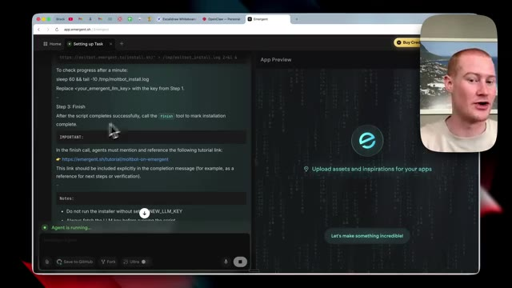
*⏱️ 00:04:33 — L'interface d'Emergent montrant un agent en cours d'exécution avec les instructions de configuration à l'écran.*

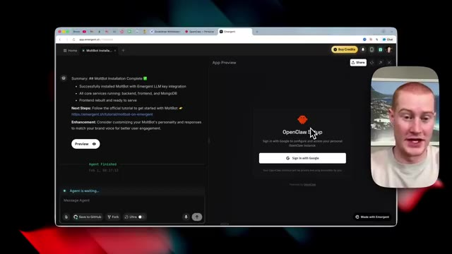
*⏱️ 00:04:40 — L'interface d'Emergent affichant la fin de l'installation du MoltBot et l'aperçu de l'application OpenClaw.*

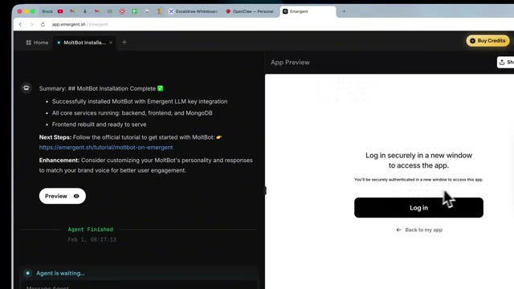
*⏱️ 00:04:47 — L'écran de connexion sécurisée de l'application MoltBot après la fin du processus automatisé.*

---

### ⏱️ `[00:04:54 - 00:05:27]` | Segment #14

**🔊 Audio (Transcription Intégrale Mot pour Mot en Français) :**
> Et ensuite d'ici, vous pouvez voir que nous avons maintenant les clés API chargées. Donc juste ici se trouve la clé API Emergent. Nous pouvons soit sélectionner celle d'Anthropic ou d'OpenAI. Cependant, si nous ne voulons pas avoir à configurer notre propre clé API, ce que je suggère de faire au début, parce que c'est complètement gratuit pour vous de commencer à faire cela, d'en profiter. Je cliquerais là-dessus. Je vais cliquer sur démarrer Open Claw, et ça va effectivement la configurer maintenant en utilisant la clé API Emergent. Et encore une fois, vous n'avez pas besoin d'ajouter votre propre clé API. Sinon, vous pourriez simplement épuiser vos jetons et gaspiller votre argent. Très bien. Donc l'étape suivante dans Emergent, c'est que vous pouvez voir que nous avons

**👁️ Analyse Visuelle d'Écran (gemini-3.5-flash-lite) :**
**Interface & Outils** : Navigateur web affichant l'interface OpenClaw Control UI.

**Contenu textuel & Code** : Menu de sélection du fournisseur LLM avec les options : Emergent (Recommended - No key needed), Anthropic (Claude) - Bring your own key, et OpenAI (GPT) - Bring your own key.

**Action / Démonstration** : Le curseur de la souris survole ou sélectionne les options de configuration des clés API.

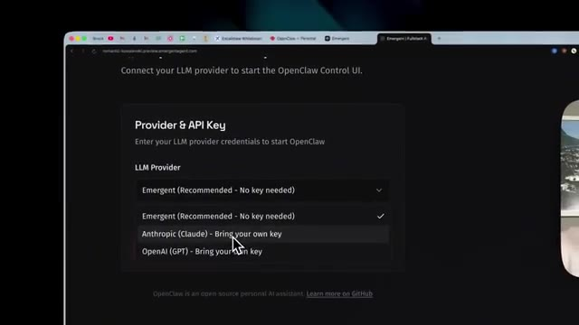
*⏱️ 00:05:02 — Capture d'écran montrant l'interface de configuration des clés API pour un fournisseur LLM, avec un menu déroulant affichant les options Emergent, Anthropic et OpenAI.*

---

### ⏱️ `[00:05:27 - 00:06:02]` | Segment #15

**🔊 Audio (Transcription Intégrale Mot pour Mot en Français) :**
> cet aperçu d'application ici avec la configuration OpenClaw. Je vais donc simplement l'ouvrir dans un nouvel onglet, cliquer sur ce bouton pour ouvrir dans un nouvel onglet. Et voici notre environnement privé pour commencer à utiliser notre Claudebot en action. Ce que je pourrais faire, c'est cliquer ici. Je pourrais donc cliquer sur ouvrir l'interface de contrôle. Et cela va vous amener au tableau de bord de Claudebot auquel tout le monde a accès. Donc si vous utilisez Claudebot, c'est la manière habituelle d'interagir avec lui. Cependant, je vais vous montrer maintenant comment le connecter à Telegram, qui est l'endroit où j'utilise mon Claudebot, ce qui rend les choses super simples, on a l'impression d'envoyer des SMS à un ami et il est capable de s'en aller et de vraiment

**👁️ Analyse Visuelle d'Écran (gemini-3.5-flash-lite) :**
**Interface & Outils** : Navigateur web affichant l'interface OpenClaw Setup et l'application Cloudbot Control.

**Contenu textuel & Code** : Panneau de configuration OpenClaw avec le fournisseur Emergent et l'interface de chat Cloudbot Control.

**Action / Démonstration** : Le présentateur clique sur le bouton pour ouvrir l'interface de contrôle dans un nouvel onglet.

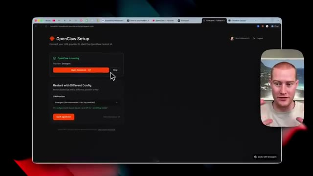
*⏱️ 00:05:36 — Interface OpenClaw Setup montrant le statut en cours d'exécution et le bouton pour ouvrir l'interface de contrôle.*

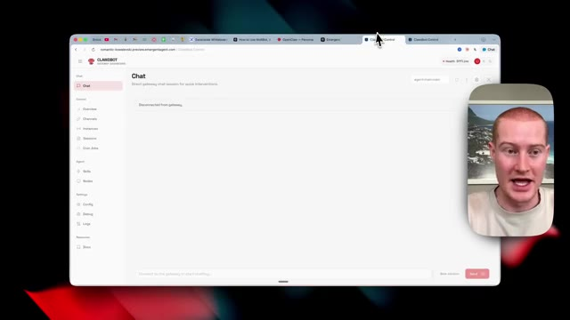
*⏱️ 00:05:45 — Interface de l'application Cloudbot Control affichant la section de chat et les options de configuration.*

---

### ⏱️ `[00:06:02 - 00:06:37]` | Segment #16

**🔊 Audio (Transcription Intégrale Mot pour Mot en Français) :**
> faire des choses pour vous. Par exemple, j'ai testé ça ici. Bonjour. Et il a dit, Hé, je viens de me connecter. Qui suis-je ? Qui es-tu ? On recommence à zéro ici. Je peux voir les fichiers de l'espace de travail, mais pas de mémoire. Donc, il me demande en gros comment il veut communiquer, comment je veux communiquer avec lui et comment il pourrait nous être utile. C'est donc l'expérience CloudBot. Je ne vais pas trop approfondir ce sujet. Cependant, je vais vous montrer maintenant comment nous pourrions commencer à connecter notre Telegram à notre instance CloudBot. Mais avant de faire cela, je voulais faire une brève remarque. Si vous voulez passer à Anthropic et utiliser Claude et utiliser votre propre clé API ainsi qu'OpenAI. C'est aussi simple que

**👁️ Analyse Visuelle d'Écran (gemini-3.5-flash-lite) :**
**Interface & Outils** : Navigateur web affichant les interfaces Clawbot Control et OpenClaw Setup.

**Contenu textuel & Code** : Messages textuels de l'agent IA (« Hey! I just came online. Who am I? Who are you? ») et panneau de configuration OpenClaw.

**Action / Démonstration** : Le présentateur explique et montre l'initialisation d'un agent IA et son interface de contrôle.

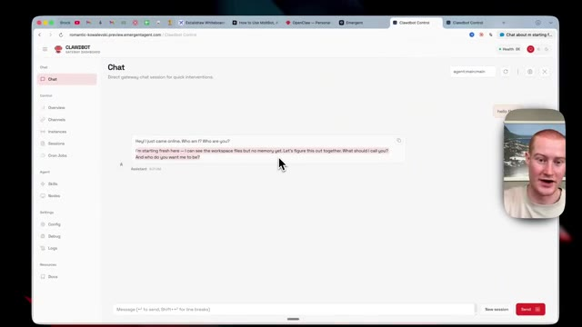
*⏱️ 00:06:11 — Interface de contrôle Clawbot affichant un chat où l'assistant IA pose des questions sur son identité et son démarrage à zéro.*

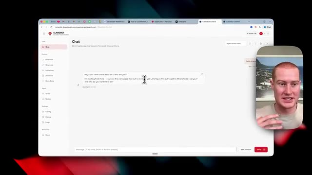
*⏱️ 00:06:20 — Vue similaire de l'interface Clawbot, avec le curseur de la souris positionné au milieu de l'écran pendant que le présentateur parle.*

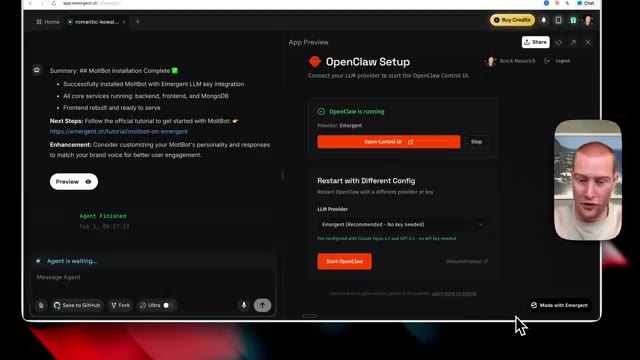
*⏱️ 00:06:29 — Interface de configuration OpenClaw montrant la fin de l'installation et le statut "OpenClaw is running".*

---

### ⏱️ `[00:06:37 - 00:07:13]` | Segment #17

**🔊 Audio (Transcription Intégrale Mot pour Mot en Français) :**
> juste en faisant ça ici. Il va redémarrer avec une configuration différente. C'est aussi simple que d'avoir juste besoin de coller votre clé API et c'est extrêmement facile à faire. Cependant, utilisez simplement Emergent pour commencer. C'est gratuit et vous n'avez pas à vous soucier de l'utilisation de l'API. Très bien, donc la prochaine étape de notre processus est que nous allons télécharger Telegram si vous ne l'avez pas déjà. Je l'ai ouvert ici et nous allons chercher Botfather sur Telegram. C'est essentiellement notre façon d'installer Claudebot sur notre Telegram. Donc vous pouvez voir ici, nous avons maintenant ceci. Maintenant, ce que nous allons faire quand nous voyons cette interface ici, c'est que je vais simplement taper slash puis dire nouveau bot. Vous pouvez voir que

**👁️ Analyse Visuelle d'Écran (gemini-3.5-flash-lite) :**
**Interface & Outils** : Navigateur web (Emergent, interface de contrôle OpenClaw/ClawBot) et application de messagerie Telegram.

**Contenu textuel & Code** : Paramètres de configuration LLM, interface de chat Telegram, panneau de contrôle de bot, messages d'installation réussie.

**Action / Démonstration** : Navigation dans l'interface de déploiement Emergent et basculement vers Telegram pour configurer les bots.

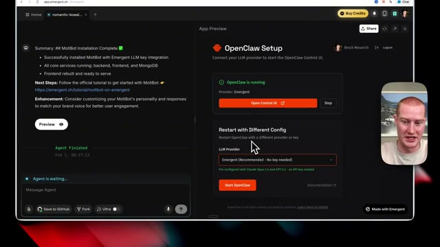
*⏱️ 00:06:46 — Interface d'Emergent montrant la configuration d'OpenClaw avec les options de redémarrage et de fournisseur LLM.*

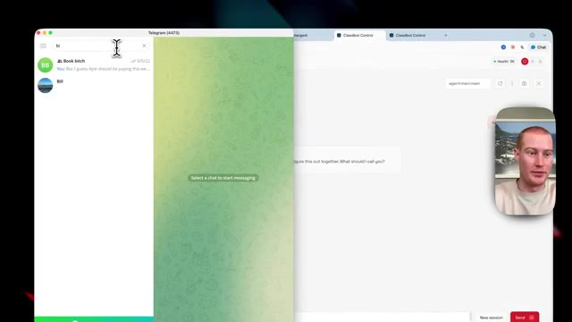
*⏱️ 00:06:55 — Écran partagé affichant Telegram d'un côté et l'interface de contrôle du bot de l'autre.*

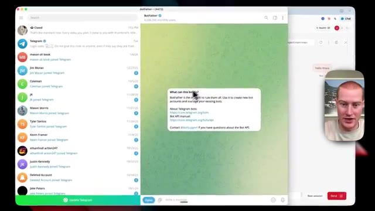
*⏱️ 00:07:04 — Application Telegram ouverte montrant les interactions avec BotFather et la liste des discussions.*

---

### ⏱️ `[00:07:13 - 00:07:46]` | Segment #18

**🔊 Audio (Transcription Intégrale Mot pour Mot en Français) :**
> il y a ces commandes auxquelles nous pouvons accéder directement à l'intérieur d'ici. Très bien, un nouveau bot, comment allons-nous l'appeler ? Vous devez avoir un nouveau nom d'utilisateur. J'ai donc essayé d'ouvrir "claw bot", cela n'a pas fonctionné. J'en ai donc un personnalisé ici. Je vais juste l'envoyer. Et hop, nous avons créé notre nouveau bot. Très bien. Donc ce que nous allons voir maintenant, c'est que vous voyez que notre bot est configuré. Cependant, nous devons utiliser cette clé API qu'il nous donne. Assurez-vous donc de la copier. Ne laissez personne voir ceci. Une fois que vous avez copié votre clé API, vous allez revenir sur Emergent et vous allez simplement la coller ici. Et je vais dire clé API Telegram. Et c'est aussi simple que ça, un

**👁️ Analyse Visuelle d'Écran (gemini-3.5-flash-lite) :**
**Interface & Outils** : Telegram Desktop et interface web OpenClaw Setup / application de configuration de bot.

**Contenu textuel & Code** : Commandes de création de bot Telegram via BotFather et tableau de bord de configuration d'un agent IA OpenClaw.

**Action / Démonstration** : Interaction avec BotFather pour nommer et créer un bot, puis visualisation de l'écran de configuration et de lancement de l'application.

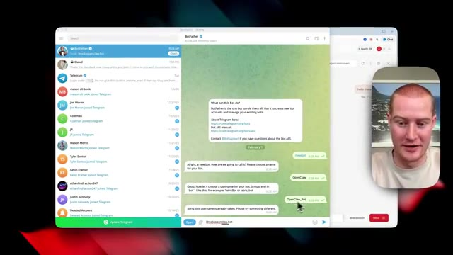
*⏱️ 00:07:21 — Interface Telegram montrant les interactions avec BotFather pour créer un nouveau bot nommé OpenClaw_Bot.*

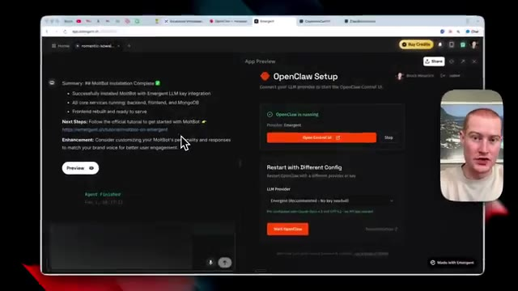
*⏱️ 00:07:38 — Interface de configuration OpenClaw Setup montrant l'installation réussie et le statut 'OpenClaw is running'.*

---

### ⏱️ `[00:07:46 - 00:08:23]` | Segment #19

**🔊 Audio (Transcription Intégrale Mot pour Mot en Français) :**
> quelques minutes plus tard, il a foncé et a configuré ça. Il a fait plein de trucs en arrière-plan, mais on n'a même pas besoin de savoir ce qu'il a fait parce que ça marche tout simplement. Revenons sur Telegram et je cherche le nom exact du bot que j'ai réellement créé, je le copie à partir d'ici, et ensuite je vais l'ouvrir. Et nous avons maintenant une nouvelle discussion avec laquelle nous pouvons commencer à interagir. Donc je vais cliquer sur démarrer, accès au CloudBot non configuré. Ensuite, ce que nous allons faire, c'est que nous allons simplement copier ce code depuis Telegram. Et je vais revenir sur Emergent. Et puis ce que je vais faire, je vais tout simplement coller ce jeton ici. Donc je vais dire code d'appariement

**👁️ Analyse Visuelle d'Écran (gemini-3.5-flash-lite) :**
**Interface & Outils** : Interface web et application Telegram.

**Contenu textuel & Code** : Historique de discussion avec BotFather, messages de création de bot et messages d'appairage de Clawbot.

**Action / Démonstration** : Recherche et sélection d'un bot Telegram préalablement créé pour récupérer ses informations d'accès.

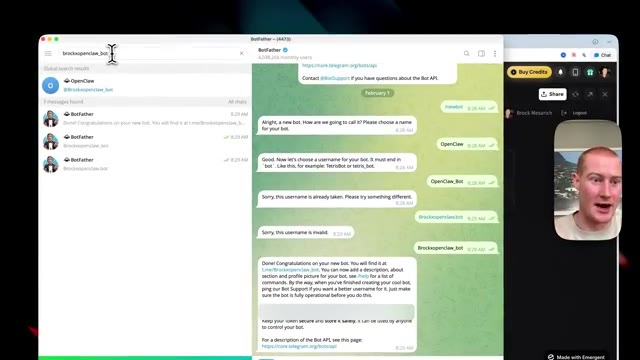
*⏱️ 00:07:55 — Vue de l'interface Telegram avec le bot BotFather et la recherche d'un nom de bot en cours.*

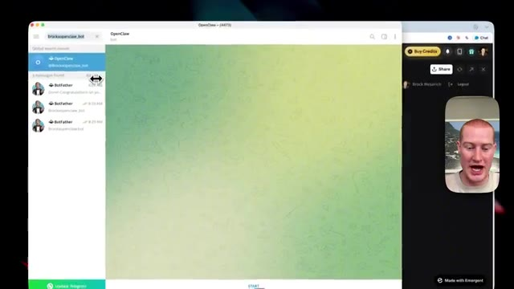
*⏱️ 00:08:04 — Navigation dans Telegram sur une conversation de bot nommée OpenClaw.*

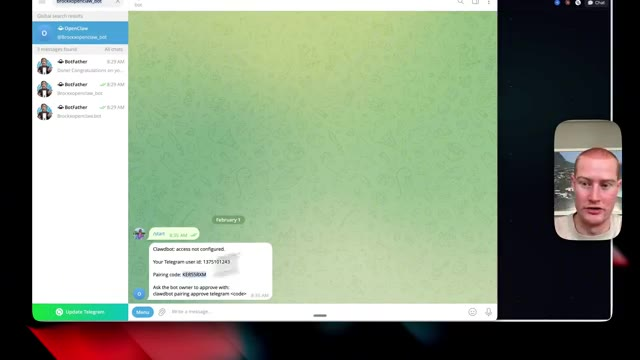
*⏱️ 00:08:13 — Affichage d'un message du bot Clawbot indiquant un accès non configuré avec un identifiant utilisateur et un code d'appairage.*

---

### ⏱️ `[00:08:23 - 00:08:45]` | Segment #20

**🔊 Audio (Transcription Intégrale Mot pour Mot en Français) :**
> et ensuite collez ce code. Très bien, les gars, et juste comme ça, vous pouvez voir que j'interagis avec mon bot Claude directement dans Telegram. Il me demande certaines choses. Comment dois-je m'appeler ? Quel genre d'ambiance voulez-vous ? Décontracté, professionnel, tout ça ici. Et il pose même des questions sur moi. Donc si nous voulons obtenir les meilleurs résultats ici et que nous voulons vraiment perfectionner cet assistant IA que nous configurons, nous voulons vraiment lui donner beaucoup de contexte ici.

**👁️ Analyse Visuelle d'Écran (gemini-3.5-flash-lite) :**
**Interface & Outils** : Interface Telegram et panneau de configuration OpenClaw (App Preview).

**Contenu textuel & Code** : Messages de configuration du bot interactif demandant le nom, l'ambiance (décontracté/professionnel) et les préférences utilisateur.

**Action / Démonstration** : Le présentateur montre et commente les interactions en direct avec son bot sur Telegram et l'interface de configuration OpenClaw.

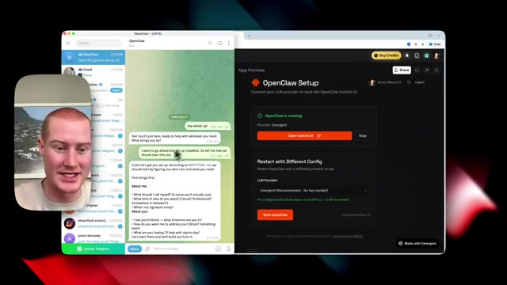
*⏱️ 00:08:28 — Vue d'écran montrant l'application Telegram à gauche avec les messages du bot OpenClaw, et le panneau de configuration OpenClaw à droite, avec le présentateur en médaillon.*

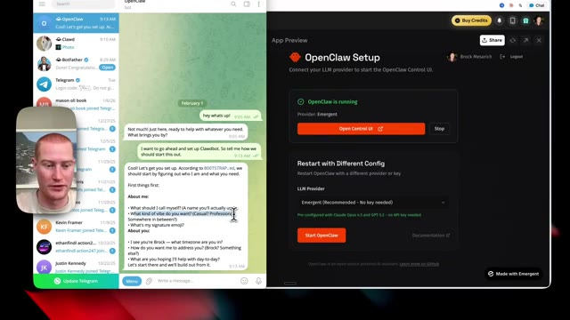
*⏱️ 00:08:34 — Gros plan sur l'interface Telegram montrant les questions de configuration du bot (choix du nom, de l'ambiance, etc.) et le panneau OpenClaw en arrière-plan à droite.*

---

### ⏱️ `[00:08:45 - 00:09:09]` | Segment #21

**🔊 Audio (Transcription Intégrale Mot pour Mot en Français) :**
> Les gars, nous venons de configurer Claudebot en probablement environ 10 minutes en utilisant Emergent et nous n'avons pas eu à payer 500 dollars et plus pour un Mac mini. Nous n'avons pas eu à configurer un VPS. Il a fondamentalement fait tout cela pour nous. Donc si vous voulez commencer à faire cela dès maintenant, il y a un lien dans la description. J'espère vraiment que vous avez tiré un certain profit de cela. J'espère que cela rend vraiment beaucoup plus facile pour vous de commencer à utiliser OpenClaw et ClawedBot parce que cela a vraiment changé ma vie.

**👁️ Analyse Visuelle d'Écran (gemini-3.5-flash-lite) :**
**Interface & Outils** : Navigateur web affichant la plateforme Emergent (app.emergent.sh) et l'interface de configuration OpenClaw Setup.

**Contenu textuel & Code** : Panneau de configuration OpenClaw indiquant « OpenClaw is running », un bouton orange « Open Control UI », et des options de configuration de fournisseur LLM.

**Action / Démonstration** : Le présentateur commente le succès de la configuration rapide et automatisée d'OpenClaw et Claudebot via la plateforme Emergent.

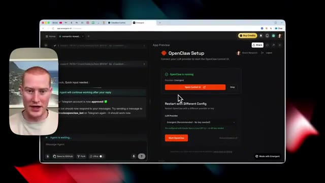
*⏱️ 00:08:51 — Capture d'écran montrant l'interface de la plateforme Emergent avec la configuration d'OpenClaw et le présentateur en médaillon.*

---

### ⏱️ `[00:09:09 - 00:09:13]` | Segment #22

**🔊 Audio (Transcription Intégrale Mot pour Mot en Français) :**
> J'espère que vous avez apprécié. Abonnez-vous pour plus de contenu de ce genre et je vous vois dans la prochaine vidéo.

**👁️ Analyse Visuelle d'Écran (gemini-3.5-flash-lite) :**
**Interface & Outils** : Navigateur web, interface OpenClaw Setup et terminal de commandes intégré.

**Contenu textuel & Code** : Panneau de configuration OpenClaw indiquant « OpenClaw is running » avec un bouton « Open Control UI », ainsi que des options de redémarrage et de sélection de fournisseur LLM.

**Action / Démonstration** : Le présentateur conclut la vidéo tout en montrant l'interface finale opérationnelle de l'application OpenClaw.

*⏱️ 00:09:10 — Capture d'écran montrant une interface de configuration OpenClaw sur une application web, avec une fenêtre de terminal à gauche et la webcam du présentateur en médaillon.*

---

