# 🎬 How to Build and Sell Mobile Apps with AI (INSTANTLY)

> **Chaîne** : [Brock Mesarich | AI for Non Techies](https://www.youtube.com/@BrockMesarich)  
> **Lien YouTube** : [https://www.youtube.com/watch?v=lNfK-jQeUa8](https://www.youtube.com/watch?v=lNfK-jQeUa8)  
> **Date de publication** : 20260212  
> **Durée** : 00:08:24  
> **Identifiant vidéo** : `lNfK-jQeUa8`  
> **Transcription & Analyse** : `whisper-v3-large-turbo+gemini-3.5-flash-lite`  

---

## 📌 Synthèse Exécutive & Outils

### 💡 Résumé

Cette vidéo immersive explore la création, l'optimisation et la monétisation accélérée d'une application mobile entièrement pilotée par l'intelligence artificielle, illustrant le concept de « vibe coding » appliqué au développement logiciel no-code. Grâce à des interfaces de programmation intuitive, l'auteur démontre comment concevoir un produit fonctionnel — en l'occurrence une application de retouche et de génération de photos par IA — en combinant des grands modèles de langage de pointe pour le design et le raisonnement logique, sans écrire manuellement une seule ligne de code.

Au-delà de la simple génération visuelle et du prototypage testé en direct via des outils de simulation mobile (Expo Go), la démonstration aborde l'infrastructure technique indispensable à la viabilité d'un produit numérique : l'intégration d'un backend complet (gestion des utilisateurs et bases de données) et la mise en place d'un système d'abonnement payant récurrent (modèle SaaS à 1 dollar par mois) via RevenueCat. L'analyse met en lumière la fluidité des boucles de rétroaction itératives pour corriger les bugs de génération d'images et la gestion des environnements de test (bac à sable) pour valider les tunnels de conversion avant un déploiement public.

Enfin, la vidéo met l'accent sur l'automatisation intégrale du cycle de vie du produit, depuis la structuration initiale du prompt stratégique jusqu'à la publication finale sur l'App Store ou via une URL dédiée. Cette approche démontre l'abaissement drastique des barrières techniques et financières pour lancer des micro-SaaS, permettant à des non-développeurs de valider rapidement des hypothèses de marché et de générer des flux de revenus récurrents (MRR/ARR) automatisés.

### 🛠️ Outils, Modèles & Logiciels Présentés

* **Claude (Anthropic, notamment Opus 4.5)** : Modèle de langage de pointe utilisé pour ses capacités supérieures de raisonnement logique et d'exécution des tâches complexes de codage.
* **ChatGPT (OpenAI)** : Outil conversationnel employé en amont pour concevoir et structurer le prompt initial détaillant l'architecture et les fonctionnalités de l'application.
* **Gemini (Google, notamment Gemini 3 Pro)** : Modèle sélectionné pour sa grande précision dans la conception graphique et le rendu des interfaces utilisateur en programmation intuitive.
* **Rourke** : Plateforme de développement d'applications mobiles no-code et de « vibe coding » permettant de piloter la création, l'intégration backend et le déploiement par simple interaction textuelle.
* **Expo Go** : Application mobile compagnon permettant de tester et de prévisualiser en temps réel l'application en cours de développement via un simple scan de code QR.
* **Nano Banana Pro** : Moteur d'intelligence artificielle intégré ou associé pour la génération d'images, de logos et le traitement des angles de prises de vue virtuelles.
* **RevenueCat** : Solution unifiée d'infrastructure d'achats in-app et d'abonnements, connectée pour gérer la monétisation, le suivi des transactions et les métriques financières.
* **Make / Zapier / n8n** : Outils d'automatisation de flux de travail mentionnés dans l'écosystème global d'intelligence artificielle et d'optimisation de processus sans code.

### 🔑 Points Clés & Enseignements Stratégiques

* **Ingénierie de prompt initiale** : L'utilisation de ChatGPT en amont pour rédiger un cahier des charges textuel extrêmement précis garantit que le modèle de génération comprend la structure globale, de l'UI aux fonctionnalités principales.
* **Spécialisation des LLMs par tâche** : Combinaison stratégique de modèles (ex: Gemini 3 Pro pour l'excellence du design visuel et Opus 4.5 pour la robustesse du raisonnement) pour maximiser la qualité du code généré.
* **Prototypage et test instantané** : Validation immédiate de l'expérience utilisateur sur un terminal mobile réel grâce à l'association d'un code QR, d'Expo Go et de l'environnement de développement Rourke.
* **Correction itérative par « Vibe Coding »** : Correction des anomalies de comportement de l'application (comme le mauvais rendu des angles de photos) par de simples instructions textuelles correctives directement depuis le smartphone.
* **Déploiement d'infrastructure Backend en un clic** : Activation instantanée de la couche base de données, des clés API et de la gestion des profils utilisateurs sans intervention sur des serveurs distants.
* **Intégration d'un tunnel de monétisation SaaS** : Connexion fluide de RevenueCat pour transformer une application gratuite en un service payant basé sur un abonnement mensuel ou annuel.
* **Gestion des variables d'environnement automatisée** : Délégation complète au système de la configuration technique complexe (variables d'environnement), rendant la création accessible aux non-programmeurs.
* **Validation via environnement bac à sable (Sandbox)** : Test rigoureux des scénarios de transaction (achats validés ou échecs simulés) pour s'assurer de l'étanchéité du tunnel de paiement avant la mise en production.
* **Suivi des métriques financières en temps réel** : Visualisation centralisée des indicateurs clés de performance (revenus récurrents mensuels MRR, ARR, abonnements actifs et données analytiques par utilisateur).
* **Canaux de distribution multiples** : Possibilité de publier l'application instantanément soit via une URL web partageable, soit par un déploiement direct et automatisé sur l'App Store.

---

## ⏱️ Chronologie & Transcription Complète Audio & Visuelle (Mot pour Mot)

### ⏱️ `[00:00:00 - 00:00:35]` | Segment #01

**🔊 Audio (Transcription Intégrale Mot pour Mot en Français) :**
> Je viens de créer toute cette application mobile avec l'IA en quelques minutes et je pourrais même faire payer pour cela et j'ai ajouté des abonnements payants à mon application. Dans cette vidéo, je vais vous montrer non seulement comment créer une application mobile avec l'IA, mais je vais vous montrer comment vous pourriez commencer à gagner de l'argent avec en 2026 en seulement quelques étapes simples. Alors sans plus attendre, plongeons directement dans cette vidéo. Très bien les gars, voici donc l'interface de Rourke, c'est ici que nous allons créer notre application mobile, c'est un outil de programmation intuitive spécifique aux applications mobile. Donc ce que je vais faire, c'est que je vais coller mon prompt pour mon application ici, c'est un prompt très spécifique, j'ai en fait utilisé ChatGPT pour m'aider à le concevoir. Et il détaille tout, de la conception aux fonctionnalités principales.

**👁️ Analyse Visuelle d'Écran (gemini-3.5-flash-lite) :**
**Interface & Outils** : Navigateur web affichant la plateforme Rork (rork.com)

**Contenu textuel & Code** : Page d'accueil de Rork avec le slogan 'Build native mobile apps, fast.' et un champ de saisie de prompt utilisant Claude 3.5.

**Action / Démonstration** : Navigation et présentation de la plateforme de création d'applications mobiles par IA Rork.

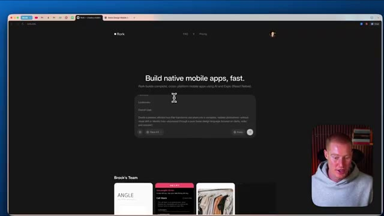
*⏱️ 00:00:26 — Capture d'écran du site web de l'outil Rork avec le texte principal 'Build native mobile apps, fast.' et le présentateur visible en incrustation.*

---

### ⏱️ `[00:00:35 - 00:01:09]` | Segment #02

**🔊 Audio (Transcription Intégrale Mot pour Mot en Français) :**
> Si vous voulez ce prompt pour recréer cette application, il y aura un lien dans la description pour le faire. Et une chose que je veux mentionner ici, c'est que nous avons la possibilité de sélectionner n'importe quel grand modèle de langage que nous voulons utiliser pour réellement construire notre application. Et je vais personnellement cliquer sur Gemini 3 Pro pour concevoir notre application, car j'ai remarqué que Gemini 3 crée les meilleures conceptions en matière de programmation intuitive. Et ensuite, à partir de là, je vais passer à Opus 4.5, qui est le meilleur modèle d'Anthropic pour les tâches de raisonnement. Très bien, voici donc notre résultat. Nous avons maintenant notre application sur le côté droit. Je pourrais même la tester sur mon téléphone avec ce code QR, ce que je vais vous montrer exactement.

**👁️ Analyse Visuelle d'Écran (gemini-3.5-flash-lite) :**
**Interface & Outils** : Interface web Rork (rork.com) dédiée à la création d'applications mobiles natives par IA.

**Contenu textuel & Code** : Liste des modèles de langage disponibles incluant Sonnet 4.5, Opus 4.5, GPT-5.2 et Gemini 3 Pro.

**Action / Démonstration** : Sélection et démonstration du choix du modèle de langage pour la génération de l'application mobile.

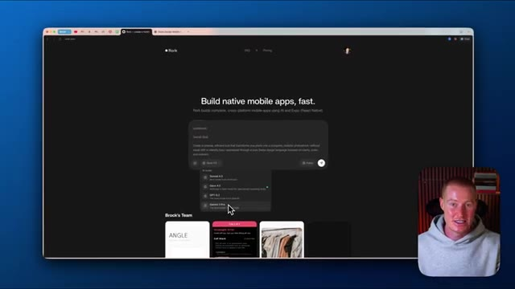
*⏱️ 00:00:44 — Capture montrant l'interface de l'application web Rork avec un menu déroulant permettant de sélectionner différents grands modèles de langage (LLM).*

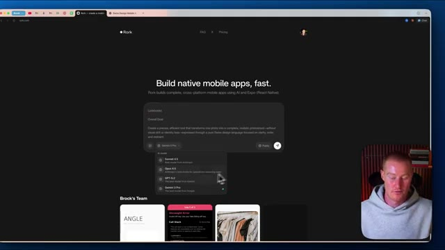
*⏱️ 00:01:00 — Capture montrant la suite de la sélection des LLM dans l'interface de Rork avec le curseur sur les options disponibles.*

---

### ⏱️ `[00:01:09 - 00:01:41]` | Segment #03

**🔊 Audio (Transcription Intégrale Mot pour Mot en Français) :**
> comment le faire et à quoi ça ressemble. Mais je veux souligner ceci sur le côté gauche. Donc, si vous regardez notre chat, vous pouvez voir que Rourke a réellement généré ces images. Il a donc généré notre logo et il a généré cette image de séance photo virtuelle ici. Je suppose qu'il utilise probablement Nano Banana Pro pour faire cela, mais c'est tellement cool. Très bien, alors utilisons maintenant mon téléphone ici et testons réellement notre application pour voir à quoi elle ressemblera sur un téléphone mobile. Donc ce que je vais faire, c'est que je vais ouvrir ma caméra ici. Je vais ensuite scanner ce code QR et j'ai besoin d'avoir l'application Expo Go, que vous pouvez télécharger. Comme vous pouvez le voir, je peux ouvrir ceci ici. Et ce

**👁️ Analyse Visuelle d'Écran (gemini-3.5-flash-lite) :**
**Interface & Outils** : Interface web de développement (Bolt / outil de génération d'application) et simulation d'interface mobile.

**Contenu textuel & Code** : Code source, panneau de chat IA, logo généré, aperçu d'application mobile "Virtual Photoshoot" et code QR de test.

**Action / Démonstration** : Le présentateur commente le code et les images générées automatiquement par l'IA (le chat) affichées à l'écran.

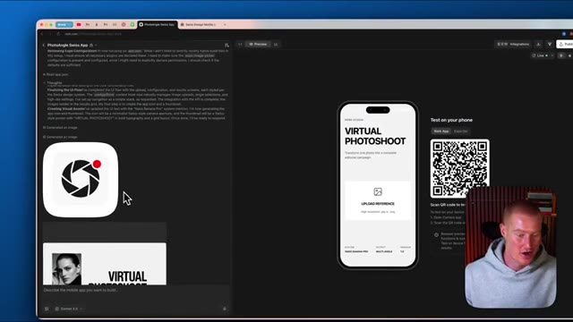
*⏱️ 00:01:17 — Capture d'écran montrant l'interface de développement d'application avec le chat de l'assistant IA à gauche, affichant le logo et l'image générés, un aperçu de l'application mobile au centre et la webcam du présentateur en bas à droite.*

---

### ⏱️ `[00:01:41 - 00:02:12]` | Segment #04

**🔊 Audio (Transcription Intégrale Mot pour Mot en Français) :**
> va maintenant nous emmener vers l'application de séance photo virtuelle que j'ai construite directement à l'intérieur de Rourke. Elle a ce design de style suisse. Je trouve que ça a vraiment l'air bien, vraiment propre. Je peux donc maintenant télécharger une référence. Laissez-moi donc aller de l'avant et sélectionner une image ici. J'ai donc cette image de cette dame provenant d'une séance photo et ensuite je peux sélectionner n'importe lequel de ces différents angles que je veux pour cette séance photo par IA si vous voulez l'appeler ainsi. Je vais donc cliquer sur ceux-ci juste ici. Faisons 45 degrés à gauche, 45 degrés à droite, profil latéral, angle en plongée, angle en contre-plongée, et nous n'avons pas besoin de faire de face parce qu'elle montre déjà un angle de face. Je vais donc simplement cliquer sur générer la séance photo.

**👁️ Analyse Visuelle d'Écran (gemini-3.5-flash-lite) :**
**Interface & Outils** : Application mobile de séance photo virtuelle (Rourke Studio).

**Contenu textuel & Code** : Interface utilisateur avec le titre 'VIRTUAL PHOTOSHOOT', un bouton 'UPLOAD REFERENCE' et des paramètres de configuration en bas.

**Action / Démonstration** : Présentation de l'application de création de séances photo par IA et préparation au téléchargement d'une image de référence.

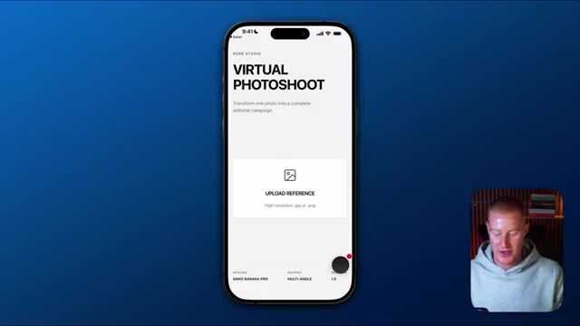
*⏱️ 00:01:49 — Capture d'écran montrant l'interface mobile de l'application 'Virtual Photoshoot' avec un design épuré, comportant une zone pour télécharger une image de référence.*

---

### ⏱️ `[00:02:12 - 00:02:48]` | Segment #05

**🔊 Audio (Transcription Intégrale Mot pour Mot en Français) :**
> Il commence maintenant à rendre et à générer ceux-ci en utilisant Nano Banana Pro. Je suis curieux de voir à quel point le résultat est bon. Très bien, alors c'est parti. Voici notre résultat initial. On dirait qu'il n'a pas compris en quelque sorte la dynamique de la façon dont nous voulions que ces angles soient, vous pouvez voir que l'angle gauche ne montre pas depuis l'angle gauche, l'angle droit montre bien depuis l'angle droit, euh le profil latéral a l'air vraiment bien, c'est solide, et l'angle haut montre un angle bas, donc nous pouvons aller de l'avant et juste corriger cela dans nos instructions à l'intérieur de work, alors laissez-moi aller de l'avant et faire cela maintenant, et ensuite une fois que nous aurons réglé cela, je vais vous montrer comment nous pourrions maintenant ajouter des paiements à notre application afin que nous puissions commencer à facturer pour une application comme celle-ci. Très bien, alors en revenant à work en ce moment, laissez-moi aller de l'avant et

**👁️ Analyse Visuelle d'Écran (gemini-3.5-flash-lite) :**
**Interface & Outils** : Application mobile de génération d'images affichée sur un écran de smartphone, avec une incrustation vidéo du présentateur.

**Contenu textuel & Code** : Interface utilisateur mobile montrant un résultat de génération d'image étiqueté "45° Left".

**Action / Démonstration** : Le présentateur présente et commente le résultat visuel initial généré par l'application mobile.

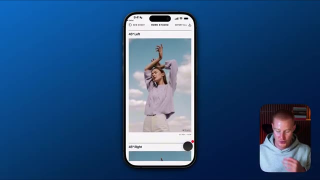
*⏱️ 00:02:21 — Un smartphone affichant l'interface d'une application de génération d'images, avec une photo générée d'une femme posant, et le présentateur visible en incrustation (picture-in-picture) dans le coin inférieur droit.*

---

### ⏱️ `[00:02:48 - 00:03:21]` | Segment #06

**🔊 Audio (Transcription Intégrale Mot pour Mot en Français) :**
> apporter quelques modifications afin qu'il génère réellement les bons résultats et les bons angles pour notre application, et ensuite cela fonctionnera correctement. Je veux que tu t'assures qu'il affiche le bon angle pour chacun des résultats générés de ces images. Donc s'il est écrit 45 degrés à gauche, assure-toi que c'est bel et bien un angle de 45 degrés par la gauche, tout comme s'il est écrit angle en contre-plongée ou angle en plongée, qu'il s'agisse du bon angle. Très bien, alors je vais envoyer ça à Rourke et ça devrait être une correction vraiment simple. Allons voir à quoi ressemble le résultat dans une petite seconde. Très bien, alors une autre fonctionnalité dont je veux parler à l'intérieur de Rourke. Donc nous pourrions soit scanner cela

**👁️ Analyse Visuelle d'Écran (gemini-3.5-flash-lite) :**
**Interface & Outils** : Interface de développement web / éditeur de code d'application mobile et aperçu de simulation d'appareil mobile.

**Contenu textuel & Code** : Code source, logs de débogage, messages d'erreur, et un QR code de test d'application (« Test on your phone »).

**Action / Démonstration** : Développement et configuration de l'application, vérification des erreurs et préparation du test sur appareil mobile.

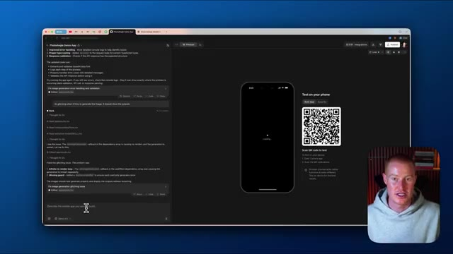
*⏱️ 00:02:57 — Capture d'écran montrant l'interface de développement d'une application mobile avec un panneau latéral de code/logs et un aperçu interactif de l'application sur smartphone avec un QR code, ainsi qu'une incrustation vidéo du présentateur en bas à droite.*

---

### ⏱️ `[00:03:21 - 00:03:54]` | Segment #07

**🔊 Audio (Transcription Intégrale Mot pour Mot en Français) :**
> code QR et cela nous mènera vers Expo Go, ou nous pourrions utiliser l'application Rourke elle-même, qui est ce que vous voyez juste ici. Si je clique sur ce bouton noir, cela fera apparaître cette boîte de saisie pour l'IA ici, et je peux aller de l'avant et décrire réellement quels changements je veux apporter, et je pournerais faire du « vibe coding » directement depuis mon téléphone, et c'est l'une des raisons pour lesquelles j'aime tant Rourke. Très bien, alors allons-y pour tester notre application maintenant, donc je vais téléverser cette image de cette dame. Utilisons exactement la même image, et ensuite générons simplement ces quatre angles différents et voyons à quel point ils ont l'air bien. Très bien, et juste comme ça, nous avons l'angle à 45 degrés depuis la droite. Nous avons le profil de côté qui a l'air

**👁️ Analyse Visuelle d'Écran (gemini-3.5-flash-lite) :**
**Interface & Outils** : Application mobile Rourke Studio sur iOS affichée sur fond bleu.

**Contenu textuel & Code** : Interface utilisateur d'une application mobile avec des blocs de texte, une zone de saisie pour l'IA et des menus de configuration de prise de vue.

**Action / Démonstration** : Navigation et démonstration des fonctionnalités de l'application mobile Rourke Studio, montrant l'utilisation de l'IA pour modifier l'application.

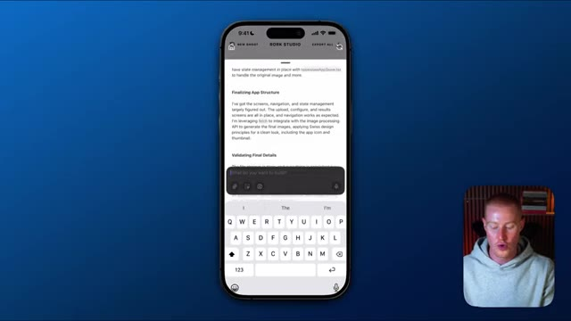
*⏱️ 00:03:29 — Aperçu de l'application mobile Rourke Studio sur iPhone montrant une interface de code avec une boîte de saisie pour l'IA en bas.*

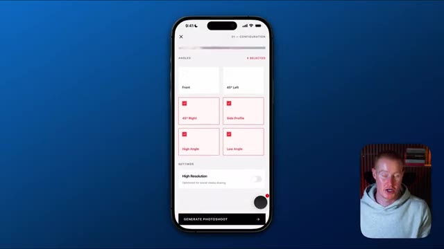
*⏱️ 00:03:46 — Écran de configuration de l'application Rourke Studio sur iPhone affichant des options de sélection d'angles de prise de vue et un bouton noir en bas à droite.*

---

### ⏱️ `[00:03:54 - 00:04:31]` | Segment #08

**🔊 Audio (Transcription Intégrale Mot pour Mot en Français) :**
> Parfait. Nous avons l'angle en plongée et ensuite nous avons l'angle en contre-plongée. Donc notre application génère ces images correctement maintenant. Ce que je veux faire, c'est en fait ajouter un système dorsal, un backend, à notre application. Comme ça, nous pourrions avoir des utilisateurs, nous pourrions stocker chacune de ces différentes séances photo et les utilisateurs peuvent même les télécharger depuis leurs profils. Pour faire cela, tout ce que nous avons à faire est de venir ici en haut à droite de notre écran, de cliquer sur intégrations et de cliquer sur backend. Donc je peux simplement l'activer et cela va maintenant configurer les utilisateurs et les bases de données, les clés API, et tout ce dont nous aurions besoin pour notre application. Très bien. Donc juste comme ça, vous pouvez voir dans notre chat ici que cela a activé tout le backend de notre application. Donc maintenant, allons de l'avant et passons à l'ajout de paiements à

**👁️ Analyse Visuelle d'Écran (gemini-3.5-flash-lite) :**
**Interface & Outils** : Navigateur web affichant un outil de développement d'application no-code/low-code.

**Contenu textuel & Code** : Menu déroulant des intégrations affichant les options pour le backend, GitHub et RevenueCat.

**Action / Démonstration** : Navigation dans l'interface de développement pour ajouter un système dorsal (backend) à l'application.

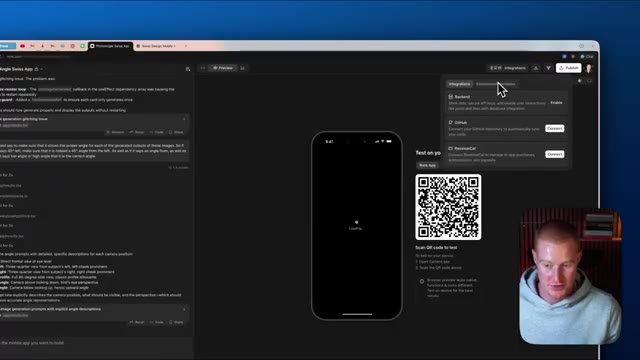
*⏱️ 00:04:13 — Interface de développement web montrant l'application mobile en cours de chargement et le menu des intégrations avec l'option backend.*

---

### ⏱️ `[00:04:31 - 00:05:06]` | Segment #09

**🔊 Audio (Transcription Intégrale Mot pour Mot en Français) :**
> notre application. Donc nous allons cliquer à nouveau sur ce bouton intégrations. Nous allons descendre sur revenue cat ici et nous allons simplement sélectionner connecter. Et si vous n'avez pas encore de profil revenue cat configuré, vous allez tout simplement vous inscrire avec votre email et créer un mot de passe. Et ensuite, vous pouvez voir ici, nous avons juste besoin d'autoriser tout cela afin qu'il puisse réellement apporter des modifications à notre application Rourke. Donc je vais cliquer sur autoriser. Cela va nous ramener sur notre application Rourke ici. Et ensuite, nous allons tout simplement sélectionner projet, qui va être ce projet juste ici. Donc je vais sélectionner projet, cliquer sur ce bouton là, et vous pouvez voir que notre application est maintenant connectée. Nous pouvons ensuite cliquer sur ce lien gérer dans le tableau de bord revenue cat. Vous pouvez voir que

**👁️ Analyse Visuelle d'Écran (gemini-3.5-flash-lite) :**
**Interface & Outils** : Navigateur web, plateforme de développement d'application avec panneau d'intégrations et interface RevenueCat.

**Contenu textuel & Code** : Demande d'accès et permissions RevenueCat (Projects, Apps, Products, Entitlements, Offerings, Packages) et options d'intégration (Backend, GitHub, RevenueCat).

**Action / Démonstration** : Connexion et autorisation de l'intégration RevenueCat avec l'application en cours de configuration.

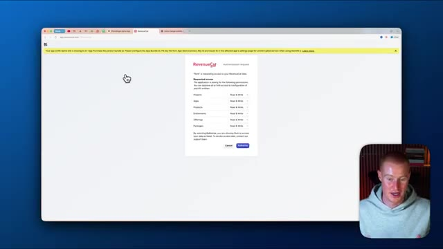
*⏱️ 00:04:40 — Fenêtre de navigateur affichant une demande d'autorisation de RevenueCat pour l'application avec les permissions de lecture et écriture.*

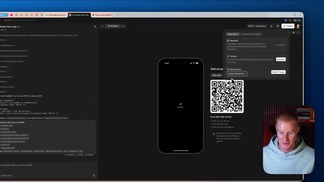
*⏱️ 00:04:57 — Interface de développement avec un aperçu mobile, un QR code de test et le panneau latéral affichant les options d'intégration dont RevenueCat.*

---

### ⏱️ `[00:05:06 - 00:05:42]` | Segment #10

**🔊 Audio (Transcription Intégrale Mot pour Mot en Français) :**
> nous avons maintenant les statistiques de notre application et tout ça directement ici. Maintenant, ce que je vais faire, c'est que je vais revenir vers Rourke et lui expliquer fondamentalement ce que nous voulons connecter. Je veux essentiellement m'assurer que les utilisateurs doivent payer pour pouvoir utiliser l'application. Je vais donc simplement expliquer cela à Rourke. Très bien, nous venons donc d'ajouter RevenueCat pour les paiements de notre application. Je veux m'assurer que désormais, si vous voulez utiliser l'application et générer des images, vous devez être un utilisateur payant de notre application. Et je veux que notre application coûte 1 dollar par mois. L'une de mes choses préférées avec Rourke, c'est que vous pouvez voir chacune des tâches au fur et à mesure qu'elles sont exécutées ici même. Vous pouvez voir qu'il vient de cocher celle-ci juste ici. Trois de nos neuf tâches ont maintenant été cochées.

**👁️ Analyse Visuelle d'Écran (gemini-3.5-flash-lite) :**
**Interface & Outils** : Interface de développement web / éditeur de code avec aperçu mobile et QR code.

**Contenu textuel & Code** : Lignes de code, instructions de backend, et un simulateur d'application mobile avec un QR code pour tester sur téléphone.

**Action / Démonstration** : Le présentateur montre l'état actuel de l'application et de son interface de développement avant d'expliquer les prochaines étapes d'intégration.

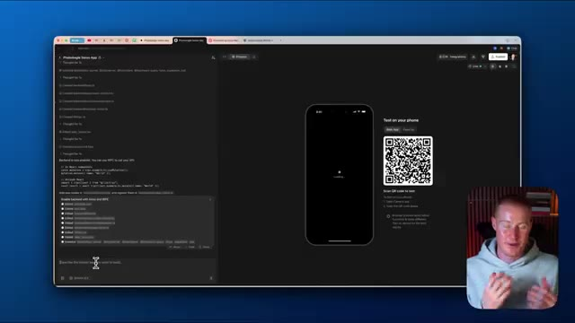
*⏱️ 00:05:15 — Un écran d'ordinateur montrant une interface de développement avec du code et un aperçu d'application mobile à côté, avec le présentateur incrusté en bas à droite.*

---

### ⏱️ `[00:05:42 - 00:06:19]` | Segment #11

**🔊 Audio (Transcription Intégrale Mot pour Mot en Français) :**
> et il va traiter chacun d'eux individuellement. Il va les analyser, trouver la meilleure façon d'aborder ces tâches. Vous pouvez voir ici, il me demande en fait de configurer des variables d'environnement. En tant que non-programmeur, je ne sais même pas ce que cela signifie, mais je vais simplement sélectionner oui, les configurer. Et c'est toute la beauté d'utiliser Rourke pour coder vos applications mobiles au feeling. Très bien. Donc, en quelques étapes seulement, nous avons maintenant notre RevenueCat ajouté. Laissez-moi donc tester cela maintenant à l'intérieur d'Aurora. Je vais télécharger une image sur notre application de séance photo virtuelle et je vais simplement choisir chacun de ces angles ici, tout comme avant. Je vais cliquer sur générer la séance photo et maintenant nous voyons ceci ici. Nous devons passer à la version pro, donc nous pouvons soit passer à la version annuelle, soit nous

**👁️ Analyse Visuelle d'Écran (gemini-3.5-flash-lite) :**
**Interface & Outils** : Interface web de développement mobile (type Bolt/v0), simulateur de smartphone et webcam du présentateur.

**Contenu textuel & Code** : Configuration des variables d'environnement, journaux d'exécution de l'IA (Thought process) et aperçu d'application React Native/mobile.

**Action / Démonstration** : Configuration des variables d'environnement et test interactif de l'application mobile générée par l'IA.

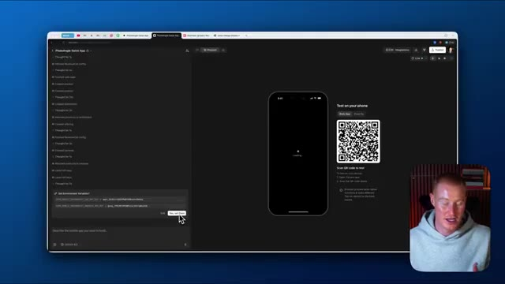
*⏱️ 00:05:51 — Interface de développement avec un panneau de configuration demandant de configurer des variables d'environnement, et un aperçu mobile à droite.*

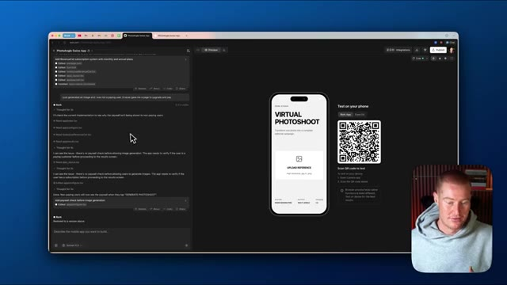
*⏱️ 00:06:00 — Panneau latéral affichant les réflexions et étapes d'exécution de l'IA, avec un aperçu d'application mobile affichant 'Virtual Photoshoot'.*

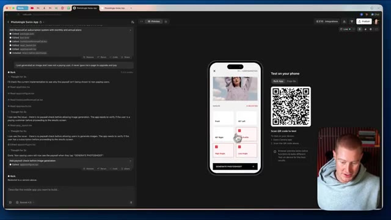
*⏱️ 00:06:09 — Interface montrant l'interaction avec l'application mobile virtuelle et le code source édité dans le panneau de gauche.*

---

### ⏱️ `[00:06:19 - 00:06:51]` | Segment #12

**🔊 Audio (Transcription Intégrale Mot pour Mot en Français) :**
> pourrait passer à un abonnement mensuel, donc je vais cliquer sur mensuel et étant donné qu'il s'agit d'un environnement de test dans Revenue Cat et que ce n'est pas un vrai achat que je vais sélectionner, nous devons choisir si nous voulons tester un échec d'achat ou un achat valide. Testons donc un achat valide pour les besoins de cette vidéo. Et c'est aussi simple que ça, nous avons maintenant accès au compte pro. Et ensuite, nous devrions être capables de générer notre séance photo. Jetons un coup d'œil maintenant, mais cela devrait fonctionner de manière 100 % fluide. Boum. Et c'est aussi simple que ça, nous avons cette photo de profil de notre sujet dans cette image. Et nous avons effectivement dû payer pour utiliser notre application. Laissez-moi donc venir

**👁️ Analyse Visuelle d'Écran (gemini-3.5-flash-lite) :**
**Interface & Outils** : Simulateur d'application mobile et interface de test (RevenueCat / environnement de développement).

**Contenu textuel & Code** : Interface de test d'achat in-app avec options de test de paiement et message de succès.

**Action / Démonstration** : Sélection d'un test d'achat valide et validation de l'abonnement dans l'environnement de test.

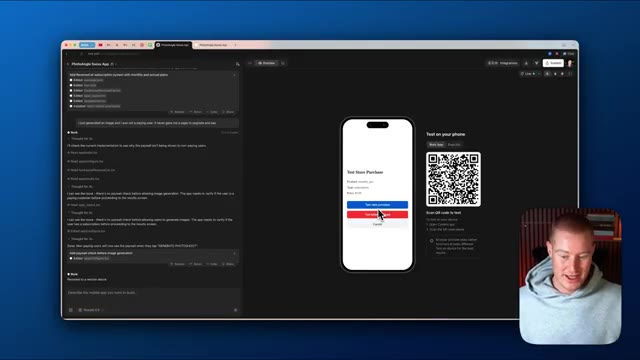
*⏱️ 00:06:27 — Interface de simulation affichant une fenêtre modale de test d'achat d'abonnement sur l'application mobile testée.*

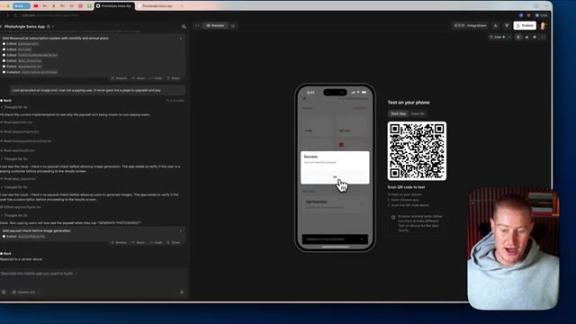
*⏱️ 00:06:35 — Message de confirmation de succès indiquant que l'achat fictif a bien été validé.*

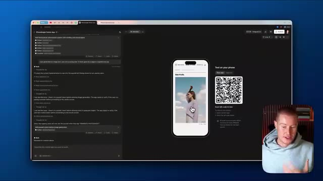
*⏱️ 00:06:43 — Affichage de l'application mobile avec une image générée après la validation de l'abonnement.*

---

### ⏱️ `[00:06:51 - 00:07:27]` | Segment #13

**🔊 Audio (Transcription Intégrale Mot pour Mot en Français) :**
> vers RevenueCat. Et je veux juste m'assurer que cela s'affiche bien dans mon profil ici. Donc si je clique sur les données bac à sable, cela va nous montrer cet environnement bac à sable qui est essentiellement l'endroit où cette fausse transaction passe pour s'assurer que notre application fonctionne correctement et comme nous pouvons le voir, nous avons un abonnement actif, nous avons dix dollars de revenus récurrents mensuels, nous avons soixante dollars de revenus sur les 28 derniers jours parce que j'ai testé cela quelques fois pour m'assurer que ça fonctionne et nous pourrions effectivement cliquer là-dessus pour regarder les abonnements actifs et toutes ces informations avec tous nos utilisateurs et le montant des revenus que nous avons, que ce soit l'ARR, le MRR, tout ça, vont

**👁️ Analyse Visuelle d'Écran (gemini-3.5-flash-lite) :**
**Interface & Outils** : Navigateur web affichant la plateforme de gestion d'achats in-app RevenueCat.

**Contenu textuel & Code** : Tableaux de bord de gestion d'applications, métriques financières (MRR, abonnements actifs, revenus), graphiques d'analyse d'abonnements.
[DESC_IMAGE_2] Navigation dans les menus analytiques et présentation des graphiques de suivi des abonnements actifs.

**Action / Démonstration** : Explications face caméra et analyse conceptuelle des marchés.

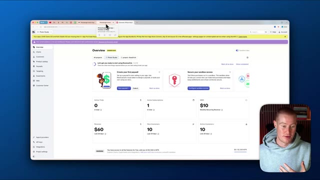
*⏱️ 00:07:00 — Vue d'ensemble du tableau de bord RevenueCat affichant les métriques d'abonnements, les revenus et les options de configuration du bac à sable.*

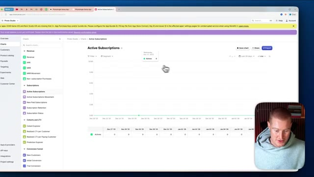
*⏱️ 00:07:18 — Graphique des abonnements actifs ('Active Subscriptions') sur le tableau de bord RevenueCat avec navigation dans les rapports analytiques.*

---

### ⏱️ `[00:07:27 - 00:07:55]` | Segment #14

**🔊 Audio (Transcription Intégrale Mot pour Mot en Français) :**
> être directement dans la limite des revenus pour que nous puissions réellement l'examiner pour notre application. Ensuite, ce que nous pourrions faire puisque notre application fonctionne désormais correctement avec toutes ses fonctionnalités, nous pourrions maintenant publier notre application. Nous pourrions donc soit la publier et y accéder via une URL. Donc si vous voulez voir à quoi cela ressemble, ce sera comme ceci. Elle a même généré cette image pour nous, séance photo virtuelle. Nous pourrions la scanner sur notre téléphone et commencer réellement à utiliser notre application directement sur notre téléphone. Ou ce que nous pourrions faire, c'est même publier directement sur l'App Store à l'intérieur de Rourke, ce qui est l'une des fonctionnalités qui rend cette plateforme si précieuse.

**👁️ Analyse Visuelle d'Écran (gemini-3.5-flash-lite) :**
**Interface & Outils** : Navigateur web, interface de développement d'application (Rork / environnement de test).

**Contenu textuel & Code** : QR code de test, aperçu d'application mobile, logs de génération de code et de vérification d'abonnement.

**Action / Démonstration** : Navigation et présentation de l'application prête à être testée ou publiée.

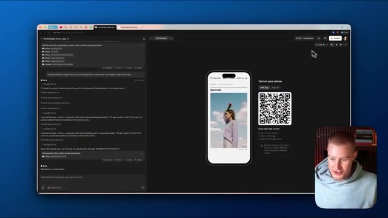
*⏱️ 00:07:34 — Interface du navigateur affichant le tableau de bord de l'application de développement "PhotoAngle Swiss App", avec un aperçu mobile et un QR code.*

---

### ⏱️ `[00:07:56 - 00:08:16]` | Segment #15

**🔊 Audio (Transcription Intégrale Mot pour Mot en Français) :**
> Donc si vous voulez que je montre comment publier réellement vos applications Rourke sur l'App Store pour les applications mobiles, alors assurez-vous de commenter dans la section des commentaires ci-dessous et de me faire savoir que vous voulez cela et peut-être que je pourrais faire une vidéo là-dessus. Mais je vais juste cliquer sur publier et maintenant nous pouvons aller de l'avant et utiliser notre application. Très bien, les gars, voilà. Nous avons construit une application en utilisant l'intelligence artificielle avec Rourke et avons même ajouté des paiements à nos applications.

**👁️ Analyse Visuelle d'Écran (gemini-3.5-flash-lite) :**
**Interface & Outils** : Interface de développement d'application web/mobile avec panneau d'aperçu, QR code de test et options de publication (App Store, Google Play).

**Contenu textuel & Code** : Journal de l'assistant IA (« Add RevenueCat subscription system »), code configuré, et options de publication (« photoangle-swiss-app mini app »).

**Action / Démonstration** : Navigation et présentation de l'interface de publication d'une application mobile sur l'App Store.

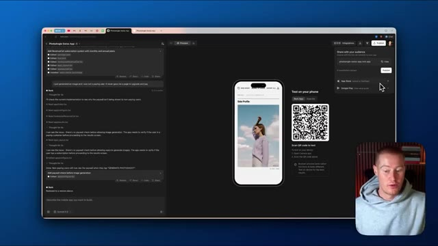
*⏱️ 00:08:01 — Interface d'une application de développement mobile affichant un aperçu de smartphone, des options de publication sur l'App Store et un assistant IA textuel sur le panneau de gauche.*

---

### ⏱️ `[00:08:16 - 00:08:26]` | Segment #16

**🔊 Audio (Transcription Intégrale Mot pour Mot en Français) :**
> Si vous avez tiré un peu de valeur de cette vidéo, laissez un pouce bleu. Dites-moi ce que vous en pensez dans les commentaires. Abonnez-vous à cette chaîne pour plus de contenu de ce genre. Cela étant dit, les gars, j'espère que vous passez une bonne journée et je vous vois dans la prochaine vidéo. Donc

**👁️ Analyse Visuelle d'Écran (gemini-3.5-flash-lite) :**
**Interface & Outils** : YouTube

**Contenu textuel & Code** : Aucun graphique, code ou interface technique pertinente (simple conclusion de vidéo).

**Action / Démonstration** : Conclusion de la vidéo et appel à l'action pour s'abonner.

---

