# 🎬 You Don’t Need OpenClaw Anymore (Use This)

> **Chaîne** : [Brock Mesarich | AI for Non Techies](https://www.youtube.com/@BrockMesarich)  
> **Lien YouTube** : [https://www.youtube.com/watch?v=XkzM6hBdvIA](https://www.youtube.com/watch?v=XkzM6hBdvIA)  
> **Date de publication** : 20260213  
> **Durée** : 00:11:48  
> **Identifiant vidéo** : `XkzM6hBdvIA`  
> **Transcription & Analyse** : `whisper-v3-large-turbo+gemini-3.5-flash-lite`  

---

## 📌 Synthèse Exécutive & Outils

### 💡 Résumé
La vidéo de la chaîne *Brock Mesarich | AI for Non Techies* présente une alternative moderne, cloud et no-code à OpenClaw prénommée **Lindy**, un agent conversationnel intelligent capable d'interagir directement via iMessage et des SMS. Alors qu'OpenClaw exige des compétences techniques avancées (installation de Node.js, manipulation du terminal, gestion des ports, configuration de VPS et risques de sécurité liés aux clés API), Lindy se déploie en moins de 60 secondes sans aucune ligne de code. Cette accessibilité démocratise l'utilisation d'assistants personnels autonomes pour automatiser des flux de travail quotidiens complexes.

L'analyste démontre la puissance de Lindy à travers des cas d'usage concrets en temps réel : la lecture et le résumé automatisé des e-mails, le filtrage intelligent avec l'ajout dynamique d'étiquettes (« à répondre », « pour info », « newsletter »), et surtout la rédaction de réponses contextuelles capables de imiter parfaitement le ton, le style et le vocabulaire de l'utilisateur. Grâce à l'intégration native de plus de 5 000 applications tierces (Gmail, Slack, Notion, Google Sheets, CRM), l'agent peut exécuter des tâches avancées sur le web (recherche, remplissage de formulaires, navigation) et traiter des notes vocales, s'affranchissant ainsi de la contrainte d'un ordinateur personnel alloué 24h/24 et 7j/7.

Bien qu'OpenClaw conserve des avantages spécifiques pour les développeurs recherchant une confidentialité 100 % locale et une gratuité totale via des modèles open-source comme Ollama, Lindy s'impose comme la solution idéale pour le grand public et les professionnels non techniques. Elle offre une sécurité de niveau professionnel, un écosystème d'intégrations riche et une expérience utilisateur fluide gérée entièrement dans le cloud, transformant radicalement la gestion de la productivité personnelle et de la messagerie par de simples SMS.

---

### 🛠️ Outils, Modèles & Logiciels Présentés
* **Lindy** : Agent conversationnel IA cloud et no-code qui se configure en moins de deux minutes et s'intègre nativement à plus de 5 000 applications.
* **OpenClaw** : Solution d'agent IA open-source et locale, puissante mais complexe, nécessitant des compétences techniques avancées, un terminal et un VPS.
* **Claude** : Modèle de langage conversationnel de pointe utilisé pour les tâches de raisonnement et de génération de texte de haut niveau.
* **Grok** : Modèle d'intelligence artificielle conversationnelle développé par xAI, orienté vers l'analyse en temps réel et l'interaction textuelle.
* **Gemini** : Suite de modèles multimodaux de Google intégrée aux écosystèmes cloud et bureautiques pour le traitement d'informations variées.
* **ChatGPT** : Modèle conversationnel de référence d'OpenAI exploité pour la génération de contenu et l'assistance textuelle générale.
* **Make** : Plateforme d'automatisation de flux de travail visuelle et sans code pour connecter des applications complexes.
* **Zapier** : Outil d'automatisation pionnier permettant de relier des milliers d'applications web entre elles pour exécuter des tâches répétitives.
* **n8n** : Logiciel d'automatisation de flux de travail orienté automatisation avancée, offrable en auto-hébergement ou sur le cloud.

---

### 🔑 Points Clés & Enseignements Stratégiques
* **Accessibilité No-Code vs Complexité Technique** : Lindy s'installe en moins de 60 secondes sans terminal ni compétences en programmation, s'opposant directement à OpenClaw qui exige l'installation de Node.js, une configuration par fichiers et une gestion ardue des clés API.
* **Infrastructure Cloud vs Locale** : Lindy fonctionne entièrement dans le cloud, s'affranchissant du besoin d'un VPS ou d'un ordinateur dédié tournant 24h/24 et 7j/7, contrairement à OpenClaw qui privilégie la confidentialité 100 % locale.
* **Écosystème d'Intégrations Massif** : La plateforme propose plus de 5 000 connecteurs natifs (Gmail, Slack, Notion, Google Sheets, CRM), permettant une interopérabilité immédiate avec la quasi-totalité des outils logiciels du marché.
* **Canal d'Interaction par SMS / iMessage** : L'utilisation de Lindy se fait de manière transparente via des SMS textuels classiques ou iMessage, offrant une expérience utilisateur aussi familière que de parler à un ami.
* **Mimétisme Stylistique et Rédactionnel** : L'agent possède la capacité d'analyser l'historique des e-mails sortants de l'utilisateur pour reproduire fidèlement son ton, son niveau de franchise et son vocabulaire lors de la rédaction de réponses automatisées.
* **Classification et Étiquetage Automatique** : Lindy trie et étiquette de manière autonome les e-mails entrants selon leur criticité ou leur nature (ex. : « à répondre », « pour info », « newsletter »), simplifiant drastiquement la gestion de la boîte de réception.
* **Traitement Multimodal des Notes Vocales** : La prise en charge de messages vocaux permet à l'utilisateur de dicter des bilans journaliers ou des listes de tâches, que l'agent structure et planifie instantanément.
* **Sécurité et Conformité de Niveau Professionnel** : En tant que solution cloud établie, Lindy sécurise les données et gère la conformité, éliminant les risques de compromission de clés API ou de failles inhérentes aux configurations locales mal maîtrisées.
* **Capacités de Navigation Web (Browser Use)** : L'agent peut exécuter des actions complexes en ligne, telles que le remplissage de formulaires, la recherche d'informations ou la gestion de commandes, tout en permettant un suivi visuel de ses actions en temps réel.
* **Arbitrage Économique et Temporel** : Bien qu'OpenClaw puisse être opéré à coût nul via des modèles locaux (comme Ollama), le coût temporel et la complexité technique de sa mise en place justifient pleinement l'adoption d'une solution payante mais clé en main comme Lindy pour les utilisateurs non techniques.

---

## ⏱️ Chronologie & Transcription Complète Audio & Visuelle (Mot pour Mot)

### ⏱️ `[00:00:00 - 00:00:24]` | Segment #01

**🔊 Audio (Transcription Intégrale Mot pour Mot en Français) :**
> Lindy vient de sortir une alternative à OpenClaw. Et honnêtement, la plupart des gens n'ont probablement plus besoin d'OpenClaw. J'ai passé six heures à configurer OpenClaw. Lindy m'a pris moins de deux minutes. Pas de terminal, pas de VPS, et c'est totalement sûr à utiliser. Vous pouvez littéralement échanger des SMS avec via iMessage et lui faire faire des choses pour vous. Donc dans cette vidéo, je vais décortiquer les principales différences, comment le configurer, et les cas d'usage que j'utilise moi-même ces derniers jours.

**👁️ Analyse Visuelle d'Écran (gemini-3.5-flash-lite) :**
**Interface & Outils** : Présentation vidéo avec graphismes textuels et incrustations d'images.

**Contenu textuel & Code** : Texte publicitaire et promotionnel concernant l'alternative à OpenClaw (Lindy).

**Action / Démonstration** : Le présentateur introduit le sujet et illustre les avantages de l'outil avec des éléments visuels à l'écran.

---

### ⏱️ `[00:00:24 - 00:00:43]` | Segment #02

**🔊 Audio (Transcription Intégrale Mot pour Mot en Français) :**
> Si vous n'avez pas configuré OpenClaw ou si vous voulez une alternative sûre, c'est celle-ci. Donc, sans plus attendre, plongeons-nous dedans. Très bien, alors avant de plonger et de vous montrer réellement comment utiliser l'agent Lindy, je vais vous montrer les principaux facteurs de différenciation entre Lindy AI et OpenClaw. Tout d'abord, Lindy AI prend environ 60 secondes à configurer et vous n'avez pas besoin de terminal.

**👁️ Analyse Visuelle d'Écran (gemini-3.5-flash-lite) :**
**Interface & Outils** : Navigateur web affichant un tableau blanc comparatif (Excalidraw).

**Contenu textuel & Code** : Tableau comparatif entre Lindy AI (vert) et OpenClaw (rouge) listant le temps de configuration, les intégrations, les fonctionnalités téléphoniques et la sécurité.

**Action / Démonstration** : Présentation comparative des avantages et différences entre Lindy AI et OpenClaw.

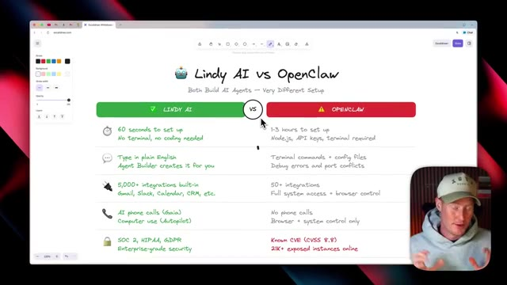
*⏱️ 00:00:33 — Capture d'écran d'un tableau blanc numérique comparant Lindy AI et OpenClaw, avec le présentateur incrusté en bas à droite.*

---

### ⏱️ `[00:00:43 - 00:01:05]` | Segment #03

**🔊 Audio (Transcription Intégrale Mot pour Mot en Français) :**
> Tandis que pour OpenClaw, j'ai vu des gens prendre entre une et même cinq heures pour le configurer. Vous devez installer Node.js, utiliser des clés API, le terminal est requis, toutes ces choses qui sont assez difficiles à faire pour une personne non technique. Pour Lindy AI, vous pouvez taper en anglais simple et le créateur d'agents va le créer pour vous. Et pour revenir à OpenClaw, vous devez utiliser des commandes de terminal, des fichiers de configuration, déboguer des erreurs et gérer des conflits de ports.

**👁️ Analyse Visuelle d'Écran (gemini-3.5-flash-lite) :**
**Interface & Outils** : Logiciel de tableau blanc Excalidraw et incrustation vidéo du présentateur.

**Contenu textuel & Code** : Tableau comparatif en anglais intitulé « Lindy AI vs OpenClaw », détaillant le temps de configuration, l'utilisation du terminal, les intégrations, la sécurité et les coûts.

**Action / Démonstration** : Le présentateur explique et compare les caractéristiques des deux outils d'IA en pointant ou commentant le tableau affiché à l'écran.

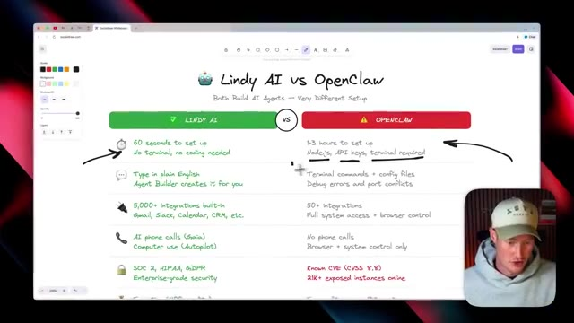
*⏱️ 00:00:54 — Un tableau comparatif sur Excalidraw entre Lindy AI (rapide et simple) et OpenClaw (complexe, requérant Node.js et terminal), avec le présentateur en incrustation vidéo en bas à droite.*

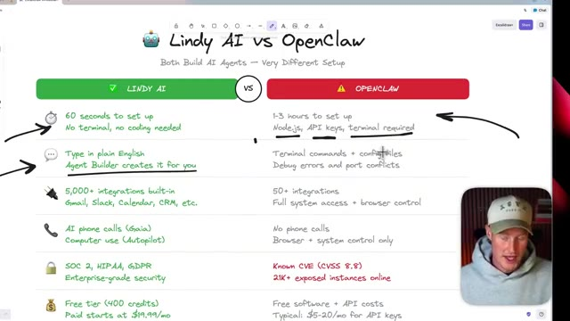
*⏱️ 00:00:59 — Vue détaillée du tableau comparatif Excalidraw, soulignant les différences de configuration, d'intégrations et de sécurité entre Lindy AI et OpenClaw.*

---

### ⏱️ `[00:01:05 - 00:01:23]` | Segment #04

**🔊 Audio (Transcription Intégrale Mot pour Mot en Français) :**
> C'est tout simplement une vraie corvée si vous ne savez pas ce que vous faites dès le départ. Et ici, OpenClaw propose plus de 50 intégrations, un accès complet au système ainsi qu'un contrôle du navigateur, ce qui est cool. Mais au sein de Lindy AI, nous avons plus de 5 000 intégrations intégrées, qui incluent des choses comme Gmail, Slack, Calendar, quel que soit le CRM que vous utilisez, etc.

**👁️ Analyse Visuelle d'Écran (gemini-3.5-flash-lite) :**
**Interface & Outils** : Excalidraw (tableau blanc virtuel) avec incrustation vidéo du présentateur en bas à droite.

**Contenu textuel & Code** : Comparaison structurée sous forme de tableau : temps de configuration (60 secondes vs 1-3 heures), intégrations (5 000+ vs 50+), sécurité et tarification.

**Action / Démonstration** : Le présentateur compare visuellement Lindy AI et OpenClaw en pointant du curseur les avantages de Lindy AI par rapport à OpenClaw.

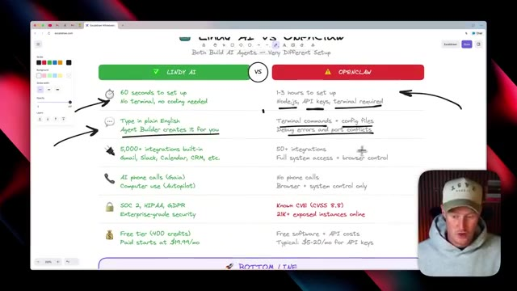
*⏱️ 00:01:10 — Tableau comparatif sur Excalidraw entre Lindy AI et OpenClaw, montrant les différences de configuration, d'intégrations et de sécurité.*

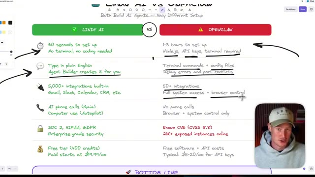
*⏱️ 00:01:14 — Vue rapprochée du tableau comparatif avec le curseur soulignant les spécificités d'OpenClaw (contrôle du navigateur et accès système).*

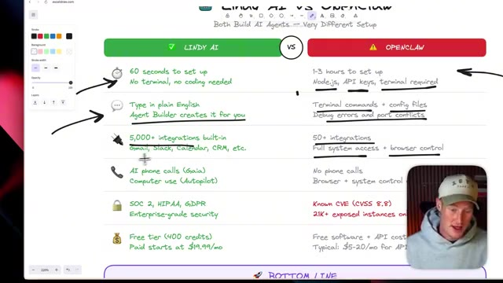
*⏱️ 00:01:19 — Gros plan sur le tableau comparatif où le curseur pointe vers les intégrations intégrées de Lindy AI (plus de 5 000).*

---

### ⏱️ `[00:01:23 - 00:01:44]` | Segment #05

**🔊 Audio (Transcription Intégrale Mot pour Mot en Français) :**
> Et puis, en passant à la sécurité, à l'intérieur de Lindy, nous avons une sécurité de niveau professionnel parce que c'est une plateforme très bien connue et populaire dans tout l'espace de l'automatisation. Alors qu'à l'intérieur de Clawedbot, il y a des tonnes de problèmes de sécurité différents que vous allez probablement rencontrer. Passant à notre conclusion. Tous les deux sont des agents IA. Lindy, cela vous prendra 60 secondes et aucun code.

**👁️ Analyse Visuelle d'Écran (gemini-3.5-flash-lite) :**
**Interface & Outils** : Tableau blanc numérique (type Excalidraw) affichant des comparaisons de caractéristiques techniques.

**Contenu textuel & Code** : Texte comparatif sur les critères d'installation, les intégrations, la sécurité (SOC 2, HIPAA vs CVE) et les coûts des agents IA.

**Action / Démonstration** : Le présentateur compare les aspects de sécurité et les spécifications techniques des deux plateformes d'IA.

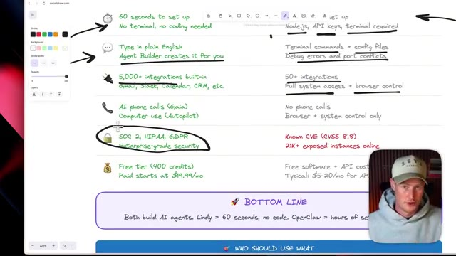
*⏱️ 00:01:28 — Un tableau comparatif sur fond blanc montrant les fonctionnalités de deux outils d'IA, avec un panneau de configuration à gauche et le présentateur en médaillon en bas à droite.*

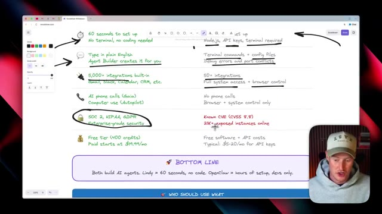
*⏱️ 00:01:34 — Le même tableau comparatif avec le curseur de la souris pointant sur la section de sécurité et des annotations manuscrites.*

---

### ⏱️ `[00:01:44 - 00:02:04]` | Segment #06

**🔊 Audio (Transcription Intégrale Mot pour Mot en Français) :**
> Tandis qu'OpenClaw, ça va prendre des heures de configuration. Et c'est vraiment réservé aux développeurs, à moins que vous ne vouliez vraiment faire des sacrifices et, vous savez, avoir des problèmes de sécurité. Je tiens à dire qu'il y a quelques cas où OpenClaw va réellement l'emporter, mais je pense que la majorité des gens n'ont pas besoin d'utiliser OpenClaw et de passer par tous ces tracas. Bien sûr, vous bénéficiez d'une confidentialité 100 % locale, de sorte que vos données ne quittent jamais votre machine.

**👁️ Analyse Visuelle d'Écran (gemini-3.5-flash-lite) :**
**Interface & Outils** : Navigateur web affichant un outil de tableau blanc collaboratif (Excalidraw).

**Contenu textuel & Code** : Texte comparatif structuré : comparaison entre Lindy (utilisateurs non techniques, sans code) et OpenClaw (développeurs, contrôle total, vie privée locale). Liste des avantages d'OpenClaw : vie privée locale à 100%, gratuité avec des modèles locaux, contrôle total du système, choix du modèle d'IA et open source personnalisable.

**Action / Démonstration** : Le présentateur explique et commente visuellement les avantages concurrentiels d'OpenClaw par rapport aux solutions cloud grand public à l'aide d'un schéma explicatif.

*⏱️ 00:01:54 — Un tableau blanc virtuel (whiteboard) présentant une comparaison entre Lindy et OpenClaw, avec en-dessous la section intitulée "WHERE OPENCLAW ACTUALLY WINS" listant 5 points clés (100% Local Privacy, Truly Free, Full System Control, Pick Any AI Model, Open Source + Customizable). Le présentateur apparaît en médaillon dans le coin inférieur droit.*

---

### ⏱️ `[00:02:04 - 00:02:24]` | Segment #07

**🔊 Audio (Transcription Intégrale Mot pour Mot en Français) :**
> Et Linde stocke effectivement cela sur leur serveur cloud, vous pouvez donc faire confiance à Linde avec ces informations. Cependant, si vous souhaitez vraiment avoir tout cela sur votre ordinateur local, c'est ce que propose OpenClaw. Et ensuite, à l'intérieur d'OpenClaw, c'est vraiment gratuit si vous décidez d'utiliser des modèles locaux. Vous pouvez donc exécuter Olama localement, ce qui coûte 0 dollar par mois pour toujours. Et à l'intérieur de Lindy, vous devrez payer pour leur plateforme.

**👁️ Analyse Visuelle d'Écran (gemini-3.5-flash-lite) :**
**Interface & Outils** : Interface de prise de notes ou tableau blanc numérique (Excalidraw).

**Contenu textuel & Code** : Texte comparatif listant les points forts d'OpenClaw (100% Local Privacy, Truly Free, Full System Control, Pick Any AI Model, Open Source).

**Action / Démonstration** : Le présentateur explique et commente le tableau comparatif entre OpenClaw et Lindy.

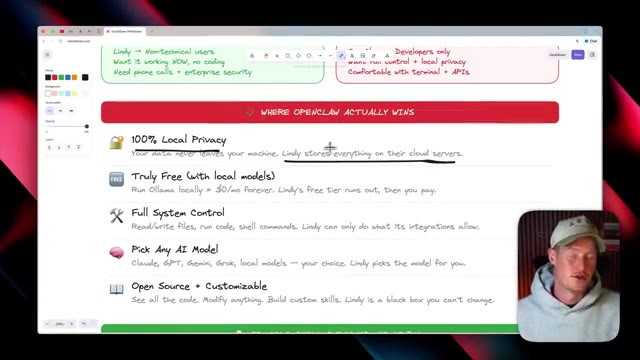
*⏱️ 00:02:09 — Comparatif visuel illustrant les avantages d'OpenClaw, affichant les points forts comme la confidentialité locale et la gratuité.*

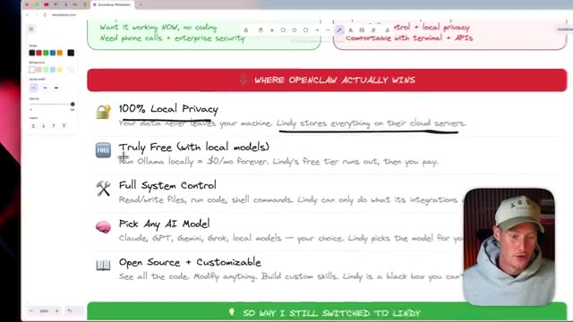
*⏱️ 00:02:14 — Suite du comparatif affichant les avantages d'OpenClaw avec une annotation soulignant la comparaison avec Lindy.*

---

### ⏱️ `[00:02:25 - 00:02:43]` | Segment #08

**🔊 Audio (Transcription Intégrale Mot pour Mot en Français) :**
> Mais encore une fois, si vous n'êtes pas technique et que vous voulez commencer à utiliser quelque chose comme ça, c'est une excellente alternative pour vous de le faire sans risque pour la sécurité. Voici donc pourquoi j'utilise personnellement Lindy en ce moment même. Je voulais des agents maintenant, pas le week-end prochain. Je ne voulais pas rencontrer d'erreurs lors de la configuration de mon CloudBot. La sécurité est gérée pour moi, ce qui est un point vraiment très important.

**👁️ Analyse Visuelle d'Écran (gemini-3.5-flash-lite) :**
**Interface & Outils** : Excalidraw (tableau blanc en ligne)

**Contenu textuel & Code** : Texte manuscrit comparant les avantages de Lindy : "Open Source + Customizable", "So why I still switched to Lindy", "I wanted agents NOW", "Security is handled FOR me", "Don't need a separate computer running 24/7", "Phone calls + computer use", "I'm not a developer".

**Action / Démonstration** : Présentation visuelle des arguments expliquant pourquoi l'auteur utilise Lindy.

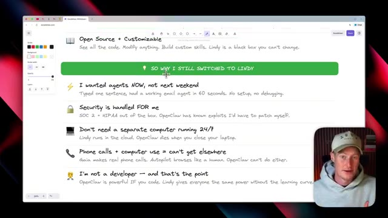
*⏱️ 00:02:34 — Capture d'écran d'un tableau blanc numérique (Excalidraw) listant les raisons de l'utilisation de Lindy, avec la webcam du présentateur incrustée en bas à droite.*

---

### ⏱️ `[00:02:43 - 00:03:08]` | Segment #09

**🔊 Audio (Transcription Intégrale Mot pour Mot en Français) :**
> Je n'ai pas à m'inquiéter des clés API compromises ou d'informations de ce genre. Et je n'ai pas besoin d'un ordinateur séparé qui tourne 24 heures sur 24, 7 jours sur 7. Étant donné que Lindy s'exécute dans le cloud, je n'ai pas besoin d'aller acheter un Mac mini pour y faire tourner Open Claw, car je ne veux pas qu'il ait accès à mon ordinateur personnel. Ce n'est donc pas un problème si vous utilisez Lindy. Maintenant que nous avons compris ces différences clés, plongeons-nous dans la façon dont vous pouvez commencer à utiliser l'agent IA Lindy et pourquoi je pense que c'est véritablement un outil révolutionnaire.

**👁️ Analyse Visuelle d'Écran (gemini-3.5-flash-lite) :**
**Interface & Outils** : Excalidraw (tableau blanc en ligne)

**Contenu textuel & Code** : Texte manuscrit listant les avantages de Lindy par rapport à OpenClaw, notamment la gestion de la sécurité, l'exécution dans le cloud 24/7 et l'absence de code requis.

**Action / Démonstration** : Le présentateur commente les points écrits sur le tableau blanc pour justifier son choix de plateforme.

---

### ⏱️ `[00:03:09 - 00:03:31]` | Segment #10

**🔊 Audio (Transcription Intégrale Mot pour Mot en Français) :**
> Très bien, donc passons à Lindy et à la manière dont nous pourrions réellement commencer à l'utiliser dès maintenant. Voici une page d'atterrissage. Si vous voulez vous inscrire, il y a un lien dans la description pour le faire. Donc vous pouvez voir juste ici, envoyez un SMS à votre assistant IA, obtenez des réponses, faites les choses. Et comme nous le voyons juste ici sur la page d'atterrissage, vous pouvez envoyer un SMS via SMS sur iMessage. Donc par exemple, la façon dont j'ai utilisé ceci, c'est que je lui envoie littéralement un SMS comme si j'envoyais un SMS à un ami et il peut s'occuper de planifier des choses pour moi.

**👁️ Analyse Visuelle d'Écran (gemini-3.5-flash-lite) :**
**Interface & Outils** : Navigateur web affichant la page d'accueil de l'outil d'intelligence artificielle Lindy.ai.

**Contenu textuel & Code** : Présentation des fonctionnalités de l'assistant IA Lindy (gestion d'e-mails, planification, automatisation des tâches).

**Action / Démonstration** : Navigation sur la page web de présentation du service Lindy pour illustrer l'utilisation de l'assistant IA.

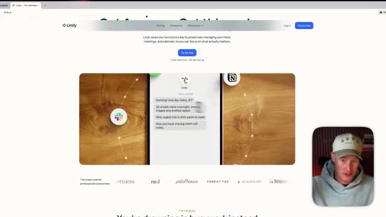
*⏱️ 00:03:14 — Page d'atterrissage du site Lindy.ai affichant un aperçu de l'assistant intelligent avec le présentateur en médaillon.*

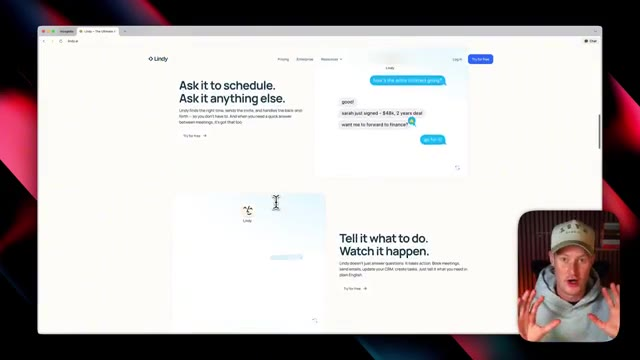
*⏱️ 00:03:26 — Suite de la page d'atterrissage de Lindy.ai illustrant les fonctionnalités de planification et d'automatisation.*

---

### ⏱️ `[00:03:31 - 00:03:53]` | Segment #11

**🔊 Audio (Transcription Intégrale Mot pour Mot en Français) :**
> Il peut lire tous mes e-mails. Il me donne un résumé chaque matin de tous les e-mails que j'ai manqués et propose même des brouillons de réponses pour moi. Pour que nous puissions commencer à utiliser ceci dès maintenant, nous avons juste besoin de nous connecter à un compte. Laissez-moi aller sur mon compte maintenant. Et une fois que vous êtes dans votre compte, vous allez cliquer sur accueil. Et c'est juste ici que nous pouvons le configurer. Et les gars, dommage que ce tutoriel ne soit pas long, moi expliquant exactement comment le configurer.

**👁️ Analyse Visuelle d'Écran (gemini-3.5-flash-lite) :**
**Interface & Outils** : Navigateur web affichant la plateforme SaaS Lindy (lindy.ai).

**Contenu textuel & Code** : Interface utilisateur avec des sections d'aide (« How can I help? »), des suggestions de requêtes textuelles et les options de configuration du compte (« Complete your setup »).

**Action / Démonstration** : Navigation sur le site web de Lindy puis visualisation de l'interface principale de l'application connectée.

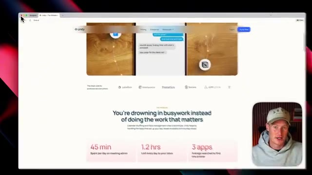
*⏱️ 00:03:37 — Page d'accueil du site web de l'outil d'IA Lindy, montrant le titre « You're drowning in busywork instead of doing the work that matters » avec des statistiques de productivité.*

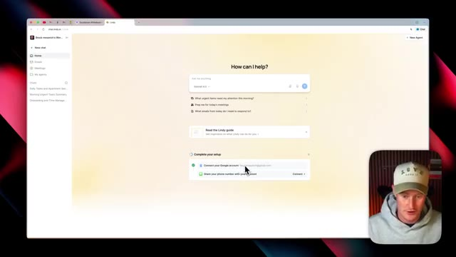
*⏱️ 00:03:42 — Interface de l'application Lindy montrant les options de configuration initiale, notamment la connexion à un compte Google pour la gestion des e-mails.*

---

### ⏱️ `[00:03:53 - 00:04:12]` | Segment #12

**🔊 Audio (Transcription Intégrale Mot pour Mot en Français) :**
> Mais c'est très, très simple et je ne le dirai jamais assez. Donc tout ce que vous avez à faire, c'est de cliquer ici, de connecter votre compte Google, ce que j'ai déjà fait. Extrêmement facile à faire. Et ensuite, partagez simplement votre numéro de téléphone avec l'assistant. Laissez-moi faire ça tout de suite. Je ne veux pas que vous voyiez mon numéro de téléphone pour le bombarder, mais je vais ajouter mon numéro de téléphone et ensuite je pourrai commencer à envoyer des SMS avec mon agent. Très bien.

**👁️ Analyse Visuelle d'Écran (gemini-3.5-flash-lite) :**
**Interface & Outils** : Navigateur web affichant l'interface de l'assistant IA Lindy AI.

**Contenu textuel & Code** : Options de configuration du compte incluant la connexion du compte Google et le partage du numéro de téléphone.

**Action / Démonstration** : Le présentateur clique sur l'option pour partager son numéro de téléphone avec l'assistant, ouvrant la boîte de dialogue de saisie.

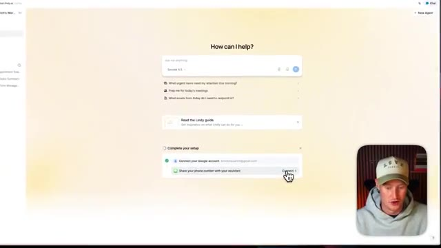
*⏱️ 00:03:58 — Interface web montrant les options de configuration avec le curseur sur le bouton de connexion du numéro de téléphone.*

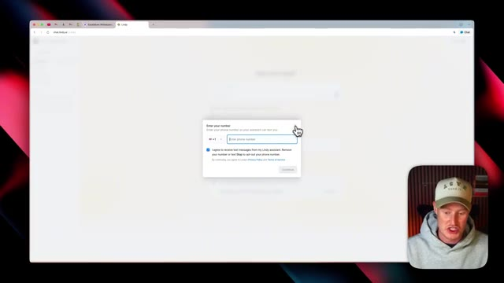
*⏱️ 00:04:03 — Fenêtre modale demandant la saisie du numéro de téléphone avec une case à cocher pour accepter de recevoir des SMS.*

---

### ⏱️ `[00:04:12 - 00:04:45]` | Segment #13

**🔊 Audio (Transcription Intégrale Mot pour Mot en Français) :**
> Donc, comme ça, ça m'a littéralement pris 10 secondes à configurer et je pouvais commencer à chatter avec ici même. Mais ensuite, je vais vous montrer comment vous pourrez chatter avec par SMS d'ici peu. Laissez-moi juste dire : Salut. Donc maintenant, nous avons notre agent configuré ici. Je veux tester les fonctionnalités et je compare ça à OpenClaw. Donc j'essaie juste de me faire une idée de ce en quoi tu peux m'aider. Très bien. Donc ça détaille tout ça ici. Ça peut donc m'aider pour la planification. Ça peut m'aider pour les e-mails, les réunions, la recherche. Ça peut donc réellement faire de la recherche web, de l'analyse de la concurrence, trouver des informations de contact et l'utilisation de l'ordinateur. C'est un point vraiment important ici que je vais vous montrer plus tard dans cette vidéo.

**👁️ Analyse Visuelle d'Écran (gemini-3.5-flash-lite) :**
**Interface & Outils** : Navigateur web affichant l'interface de discussion de l'assistant IA Lindy (chat.lindy.ai).

**Contenu textuel & Code** : Liste numérotée des fonctionnalités de l'assistant (scheduling, email, meetings, research, computer use, summarization, image generation, etc.) et messages de test textuels.
[DESC_IMAGE_1] Test de communication textuelle avec l'agent d'IA nouvellement configuré.

**Action / Démonstration** : Explications face caméra et analyse conceptuelle des marchés.

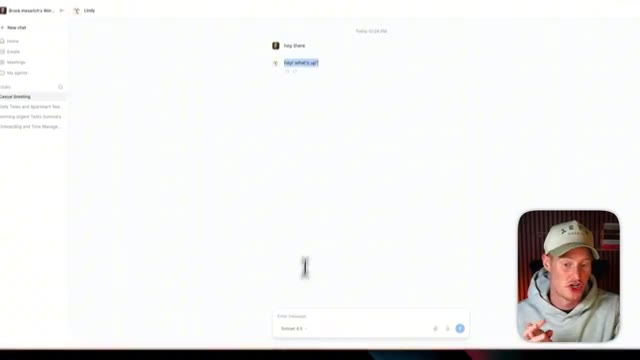
*⏱️ 00:04:20 — Interface de chat web (chat.lindy.ai) montrant un échange initial avec un assistant virtuel configuré.*

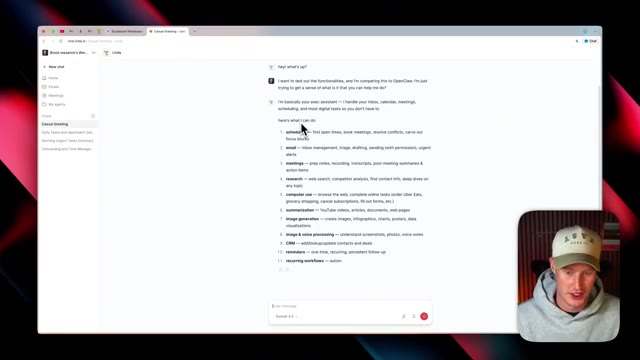
*⏱️ 00:04:28 — L'assistant virtuel liste ses fonctionnalités principales (scheduling, email, meetings, research, computer use, etc.) en réponse à une question de test.*

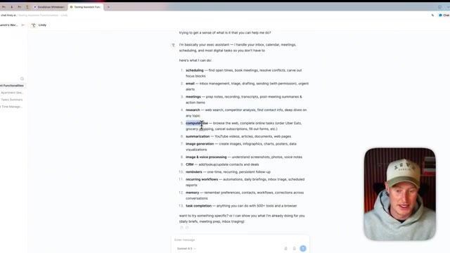
*⏱️ 00:04:36 — Vue détaillée de la liste des capacités de l'agent d'IA, avec le curseur soulignant la fonction "computer use".*

---

### ⏱️ `[00:04:45 - 00:05:05]` | Segment #14

**🔊 Audio (Transcription Intégrale Mot pour Mot en Français) :**
> il pouvait naviguer sur le web. Il pouvait réellement accomplir des tâches en ligne comme commander sur Uber Eats ou faire des courses, annuler des abonnements, remplir des formulaires, et cetera. C'est donc insensé si l'on y réfléchit vraiment. Il pouvait générer des images tout comme il pouvait également comprendre nos notes vocales. Je vais donc vous montrer plus tard comment je pouvais simplement déposer une note vocale par SMS et il sera capable de tout comprendre.

**👁️ Analyse Visuelle d'Écran (gemini-3.5-flash-lite) :**
**Interface & Outils** : Interface web de chat (chat.lindy.ai) et incrustation vidéo du présentateur.

**Contenu textuel & Code** : Liste détaillée des capacités de l'assistant numérique (scheduling, email, meetings, research, computer use, summarization, image generation, image & voice processing, CRM, reminders, workflows, memory, task completion).

**Action / Démonstration** : Le présentateur présente et survole les différentes fonctionnalités listées par l'assistant virtuel à l'écran.

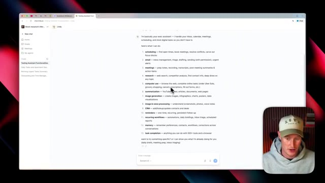
*⏱️ 00:04:50 — Vue de l'interface chat.lindy.ai listant les fonctionnalités de l'assistant virtuel, avec le curseur pointant sur la tâche 'computer use'.*

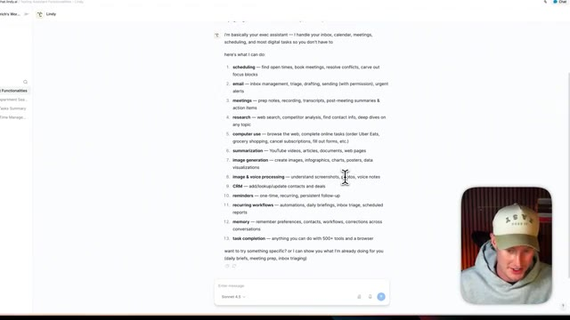
*⏱️ 00:04:55 — Poursuite de la présentation des fonctionnalités de l'assistant sur chat.lindy.ai, le curseur se déplaçant vers 'image & voice processing'.*

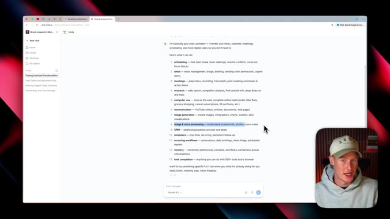
*⏱️ 00:05:00 — Sélection du texte 'image & voice processing' sur l'interface chat.lindy.ai, illustrant les capacités multimodales de l'outil.*

---

### ⏱️ `[00:05:05 - 00:05:24]` | Segment #15

**🔊 Audio (Transcription Intégrale Mot pour Mot en Français) :**
> Donc j'utilise ceci tous les jours pour décomposer toutes les choses que j'ai faites dans cette journée et tout ce qui me stresse à faire pour demain. Et ça fait gagner tellement de temps. Donc maintenant que nous avons ceci ici, nous pouvons interagir avec cela directement à l'intérieur de Lindy si nous voulons. Mais là où ça devient vraiment intéressant et la partie la plus incroyable de tout cela, c'est que je peux envoyer un SMS à mon agent IA via mon téléphone.

**👁️ Analyse Visuelle d'Écran (gemini-3.5-flash-lite) :**
**Interface & Outils** : Interface web de Lindy (chat.lindy.ai) et encart vidéo du présentateur.

**Contenu textuel & Code** : Liste détaillée des capacités de l'assistant virtuel (scheduling, email, meetings, research, computer use, summarization, etc.) et sélection du modèle (Sonnet 4.5).

**Action / Démonstration** : Navigation et lecture de la liste des fonctionnalités proposées par l'assistant IA Lindy.

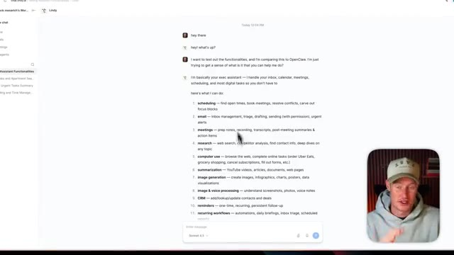
*⏱️ 00:05:10 — Capture d'écran montrant l'interface de l'assistant IA Lindy avec une conversation listant ses fonctionnalités, et la webcam du présentateur en bas à droite.*

*⏱️ 00:05:14 — Capture d'écran montrant la suite de la liste des fonctionnalités de l'assistant IA Lindy dans l'interface de chat, avec la webcam du présentateur.*

---

### ⏱️ `[00:05:24 - 00:05:42]` | Segment #16

**🔊 Audio (Transcription Intégrale Mot pour Mot en Français) :**
> Donc je vais vous montrer ça tout de suite. Très bien. Donc pour tester ça maintenant, j'ai ouvert mon chat textuel par SMS ici sur iMessages. Donc ce que je peux faire maintenant, c'est que je peux réellement taper avec. Disons que je vais dire, hé, quoi de neuf, Lindy ? Et ensuite, vous pouvez aussi voir sur le côté gauche, nous avons cette instance de Lindy en cours d'exécution.

**👁️ Analyse Visuelle d'Écran (gemini-3.5-flash-lite) :**
**Interface & Outils** : Application de messagerie / iMessages.

**Contenu textuel & Code** : Historique de discussion textuelle avec des messages de test ("hey! testing testing", "if you're seeing this, we're all good").

**Action / Démonstration** : Le présentateur montre l'interface de messagerie texte pour démontrer le fonctionnement de l'IA par SMS.

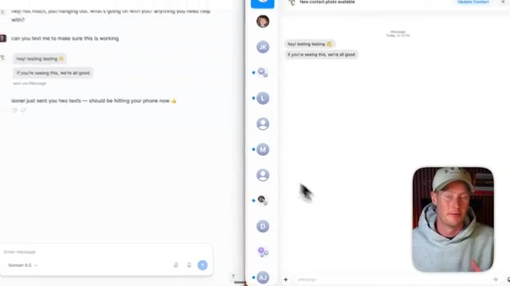
*⏱️ 00:05:29 — Capture d'écran montrant une interface de messagerie (iMessages / application de chat) avec une conversation textuelle, accompagnée d'un encart vidéo du présentateur en bas à droite.*

---

### ⏱️ `[00:05:42 - 00:06:00]` | Segment #17

**🔊 Audio (Transcription Intégrale Mot pour Mot en Français) :**
> Donc nous pourrions, encore une fois, interagir avec ceci sur Lindy si nous voulons, ou nous pourrions en fait envoyer des SMS avec. Mais la raison pour laquelle j'ai ceci affiché sur le côté gauche, c'est parce que nous pouvons voir exactement ce qu'il fait en arrière-plan. Donc par exemple, si je lui dis d'utiliser browser use et d'aller remplir des formulaires pour moi en ligne, je peux voir cela en temps réel pour voir ce qu'il est en train de faire.

**👁️ Analyse Visuelle d'Écran (gemini-3.5-flash-lite) :**
**Interface & Outils** : Interface web de Lindy (chat.lindy.ai) et interface de messagerie/SMS.

**Contenu textuel & Code** : Historique de discussion textuelle simulant des tests de SMS (« hey testing testing », « I've confirmed the SMS functionality is working! ») et interface de l'assistant IA Lindy.

**Action / Démonstration** : Démonstration et explication de l'interaction avec l'agent IA Lindy via des messages textuels et des SMS, en affichant l'arrière-plan de l'application à l'écran.

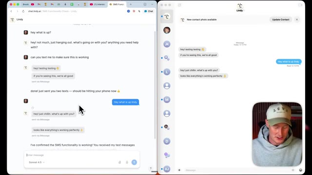
*⏱️ 00:05:51 — Interface de la plateforme d'intelligence artificielle Lindy divisée en deux fenêtres, montrant des discussions par messages (chat et SMS) avec une petite vidéo du présentateur en bas à droite.*

---

### ⏱️ `[00:06:01 - 00:06:38]` | Segment #18

**🔊 Audio (Transcription Intégrale Mot pour Mot en Français) :**
> Très bien. Donc ce que je vais faire, c'est que je vais simplement envoyer un message texte ici et dire, c'est incroyable. Peux-tu vérifier mes derniers e-mails pour moi ? Donc je vais envoyer ça maintenant. Et ce que ça fait sur le côté gauche ici sur l'écran de Lindy, vous pouvez voir que ça recherche dans tous mes e-mails parce que ceci a déjà accès à mes e-mails à l'intérieur de Lindy, car Lindy se connecte à plus de 5 000 intégrations et applications. Et c'est pourquoi c'est une utilisation phénoménale. Si vous utilisez des choses comme Notion, Gmail, Google Sheets, et littéralement n'importe quelle application que vous utilisez, parce qu'il y a de fortes chances que Lindy s'y connecte. Très bien. Donc c'est plutôt cool en fait. Vous pouvez voir que j'ai résumé mes cinq derniers e-mails. Et ensuite, ce que je vais dire, c'est simplement, je veux que tu ailles répondre à l'e-mail de Sentry et que tu leur donnes une suite.

**👁️ Analyse Visuelle d'Écran (gemini-3.5-flash-lite) :**
**Interface & Outils** : Navigateur web affichant l'application chat.lindy.ai et application de messagerie macOS, avec une incrustation vidéo du présentateur.

**Contenu textuel & Code** : Texte de conversation avec demande de vérification d'e-mails et résumé des 5 derniers e-mails reçus (rappels d'événements Skool, promos, notifications).

**Action / Démonstration** : Envoi d'un message textuel à l'assistant Lindy pour tester la fonctionnalité de vérification automatique des e-mails.

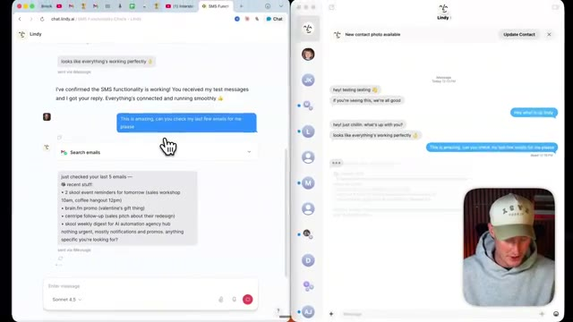
*⏱️ 00:06:10 — Vue d'écran partagée montrant l'interface web de Lindy à gauche et l'application de messagerie à droite, avec le présentateur en incrustation.*

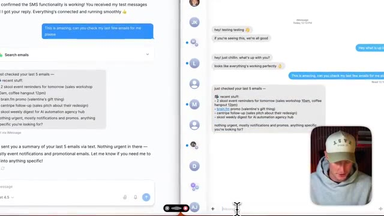
*⏱️ 00:06:29 — Vue détaillée de l'écran partagé montrant les résultats de la recherche d'e-mails effectuée par l'assistant IA dans l'interface de messagerie.*

---

### ⏱️ `[00:06:38 - 00:06:59]` | Segment #19

**🔊 Audio (Transcription Intégrale Mot pour Mot en Français) :**
> en utilisant le style de mes réponses d'e-mails normales. Donc il a en fait la capacité de voir mes e-mails précédents que j'ai envoyés pour reproduire mon style et en quelque sorte le langage que j'utilise afin de répondre à tous mes e-mails. Disons que je veux répondre à l'un de mes collègues, par exemple, il y a de fortes chances que quelqu'un ne puisse même pas faire la différence entre si c'est moi ou si c'est moi qui envoie un SMS à mon agent windy pour qu'il parte et réponde à ma place.

**👁️ Analyse Visuelle d'Écran (gemini-3.5-flash-lite) :**
**Interface & Outils** : Interface web et application de messagerie de Lindy (chat.lindy.ai).

**Contenu textuel & Code** : Résumé des derniers e-mails (rappels d'événements Skool, promo brain.fm, suivi Centripe) et prompt demandant à l'IA d'utiliser le style d'écriture personnel pour répondre.

**Action / Démonstration** : Démonstration de l'utilisation de l'agent IA Lindy pour analyser les e-mails récents et rédiger une réponse automatisée personnalisée.

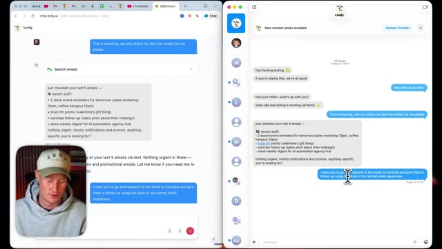
*⏱️ 00:06:49 — Interface de l'application Lindy affichant une conversation textuelle où l'IA résume les 5 derniers e-mails et où l'utilisateur lui demande de répondre à un e-mail dans son style habituel.*

---

### ⏱️ `[00:06:59 - 00:07:19]` | Segment #20

**🔊 Audio (Transcription Intégrale Mot pour Mot en Français) :**
> Très bien, et juste comme ça, il a littéralement répondu à mon e-mail pour moi. Vous pouvez voir qu'il a ouvert le fil de discussion ici et a réellement envoyé cet e-mail. Laissez-moi donc ouvrir cet e-mail exact pour vous montrer ce qu'il a envoyé. Voici donc la réponse par e-mail. Merci pour le suivi. J'apprécie les détails de la refonte, mais je suis plutôt engagé dans mon flux de travail actuel pour le moment. Ce n'est pas le bon moment pour changer, mais je garderai certainement Sentripe à l'esprit si cela change à l'avenir.

**👁️ Analyse Visuelle d'Écran (gemini-3.5-flash-lite) :**
**Interface & Outils** : Gmail et interface de chat Lindy AI.

**Contenu textuel & Code** : Un e-mail de réponse rédigé automatiquement par une IA (« Thanks for the follow-up... ») et l'historique de chat de l'assistant IA Lindy.

**Action / Démonstration** : Le présentateur montre l'e-mail effectivement rédigé et envoyé par l'IA en réponse au message de Centripe.

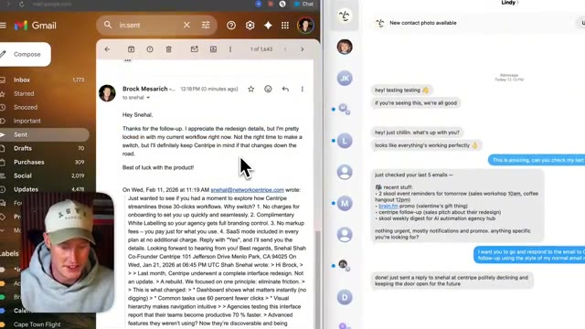
*⏱️ 00:07:09 — Écran divisé montrant à gauche un fil de discussion Gmail avec une réponse automatique envoyée, et à droite une application de chat (Lindy AI) affichant la conversation et la confirmation de l'action.*

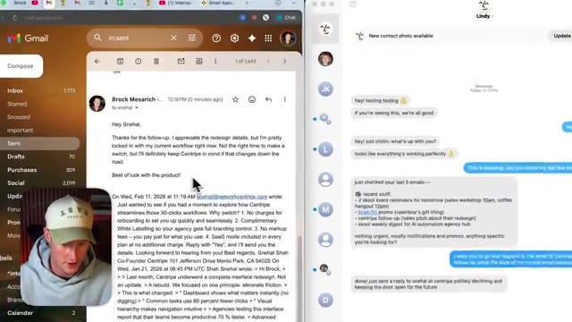
*⏱️ 00:07:14 — Vue similaire de l'écran partagé avec Gmail à gauche et le chatbot Lindy AI à droite montrant le résumé des e-mails et la validation de la réponse automatique.*

---

### ⏱️ `[00:07:20 - 00:07:39]` | Segment #21

**🔊 Audio (Transcription Intégrale Mot pour Mot en Français) :**
> Bonne chance avec le produit. Et c'est très franc. C'est exactement comme ça que je réponds à mes e-mails. C'est donc un excellent cas d'usage, de pouvoir répondre à vos différents e-mails simplement en disant à Lindy de le faire. Autre chose que je tiens à mentionner et qui rend l'utilisation de cet agent Lindy dans mon e-mail super fluide et super facile à utiliser, c'est que vous pouvez peut-être voir ces étiquettes ici. Et je n'ai pas ajouté ces étiquettes.

**👁️ Analyse Visuelle d'Écran (gemini-3.5-flash-lite) :**
**Interface & Outils** : Navigateur web, interface Gmail et interface de chat de l'assistant IA Lindy.

**Contenu textuel & Code** : Échanges de messages de chat avec l'IA résumant les derniers e-mails et confirmant l'envoi d'une réponse automatisée.

**Action / Démonstration** : Démonstration de l'utilisation d'un agent IA (Lindy) pour analyser et répondre automatiquement aux e-mails de manière personnalisée.

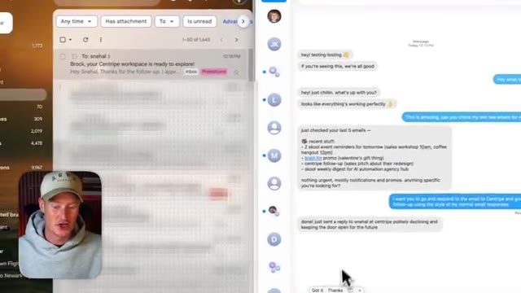
*⏱️ 00:07:24 — Capture d'écran montrant une interface double avec une boîte de réception d'e-mails à gauche et une application de messagerie de type chatbot (Lindy) à droite, illustrant l'automatisation de la gestion des e-mails.*

---

### ⏱️ `[00:07:39 - 00:07:59]` | Segment #22

**🔊 Audio (Transcription Intégrale Mot pour Mot en Français) :**
> Lindy ajoute automatiquement des étiquettes à ceux-ci en se basant sur l'e-mail que je reçois. Donc par exemple, celui-ci juste ici, il y a écrit « à répondre ». C'est donc quelque chose auquel je dois répondre. « Pour info » juste ici, c'est essentiellement un peu comme, vous savez, un fait intéressant. Celui-ci juste ici, il y a écrit « pour info ». Ce sont fondamentalement juste des faits intéressants. Ça ne me concerne probablement pas. C'est donc pour cela que j'ai ajouté l'étiquette « pour info ».

**👁️ Analyse Visuelle d'Écran (gemini-3.5-flash-lite) :**
**Interface & Outils** : Interface web de Gmail (messagerie électronique).

**Contenu textuel & Code** : Liste d'e-mails avec des badges d'étiquettes personnalisés et colorés générés automatiquement par l'IA (Lindy).

**Action / Démonstration** : Le présentateur survole et commente les étiquettes automatiques dans sa boîte de réception.

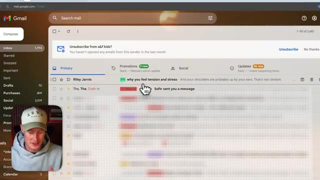
*⏱️ 00:07:49 — Capture d'écran montrant la boîte de réception Gmail avec des étiquettes colorées (« FY!» et « To Respond ») ajoutées aux e-mails.*

---

### ⏱️ `[00:07:59 - 00:08:33]` | Segment #23

**🔊 Audio (Transcription Intégrale Mot pour Mot en Français) :**
> Vous pouviez voir que celui-ci était étiqueté comme newsletter parce que c'est le récapitulatif de l'IA. Donc ça a été formidable pour filtrer automatiquement tous ces e-mails pour moi. Ça rend les choses tellement plus simples quand j'ai besoin d'aller dans ma boîte de réception e-mail. Comme par exemple, juste ici, il y a une facture pour Apify que j'ai effectivement payée. Donc ensuite, je peux suivre tous mes paiements en utilisant ceci parce que ça étiquette tout automatiquement. Très bien. Donc je viens de trouver un cas d'usage plutôt sympa pour mon agent Lindy. Je viens de faire une session de tableau blanc sur mon tableau blanc juste ici. Vous pouvez voir que j'ai décomposé toutes les tâches que je dois faire. J'ai décomposé mon travail d'agence. J'ai écrit des factures. Je dois rassembler différentes tâches que je dois faire à travers mon entreprise pour la création de contenu.

**👁️ Analyse Visuelle d'Écran (gemini-3.5-flash-lite) :**
**Interface & Outils** : Lindy.ai, macOS, interface de chat d'agent IA.

**Contenu textuel & Code** : Automatisation d'e-mails, résumés de boîte de réception, listes de tâches organisationnelles.

**Action / Démonstration** : Démonstration de l'automatisation des e-mails et du traitement des tâches par l'assistant IA.

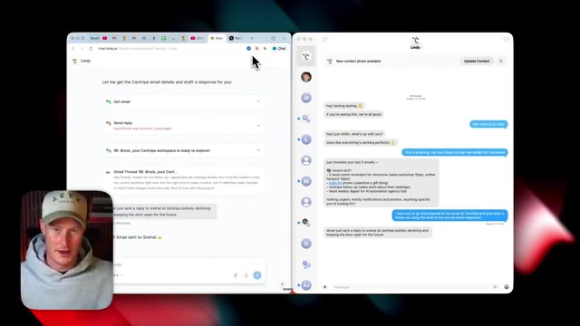
*⏱️ 00:08:16 — Interface de l'outil d'IA Lindy affichant des automatisations de gestion d'e-mails et de réponses automatiques.*

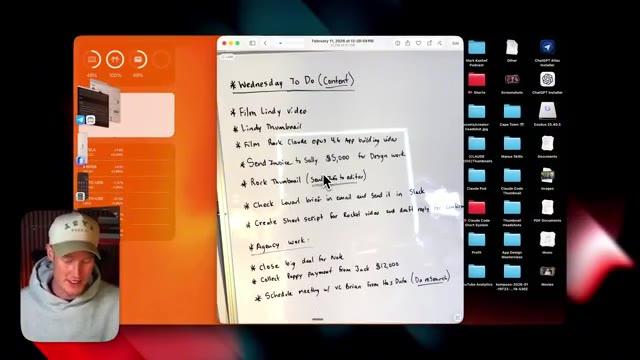
*⏱️ 00:08:25 — Bureau d'ordinateur montrant une photo de liste de tâches manuscrite ("Wednesday To Do") et des dossiers de fichiers.*

---

### ⏱️ `[00:08:34 - 00:08:54]` | Segment #24

**🔊 Audio (Transcription Intégrale Mot pour Mot en Français) :**
> Et donc ce que je vais faire, c'est que je vais maintenant déposer ça dans Lindy ici. Donc je vais ouvrir les photos et je vais essentiellement déposer ça dedans. Et je ne vais pas juste déposer ça dedans. Ce que je vais faire, c'est que je vais lui envoyer un message vocal et fondamentalement exposer mes pensées et tout ça, lui déverser mon flux de pensées. Et ensuite, je vais lui demander de catégoriser tout ça et même d'exécuter des tâches pour moi en mon nom.

**👁️ Analyse Visuelle d'Écran (gemini-3.5-flash-lite) :**
**Interface & Outils** : Application Lindy (chat.lindy.ai) et interface de messagerie.

**Contenu textuel & Code** : Historique de discussion textuelle et tâches automatisées de gestion d'e-mails ("Get email", "Send reply") avec intégration d'images.

**Action / Démonstration** : Interaction avec l'assistant IA Lindy pour automatiser le traitement et la réponse à des e-mails.

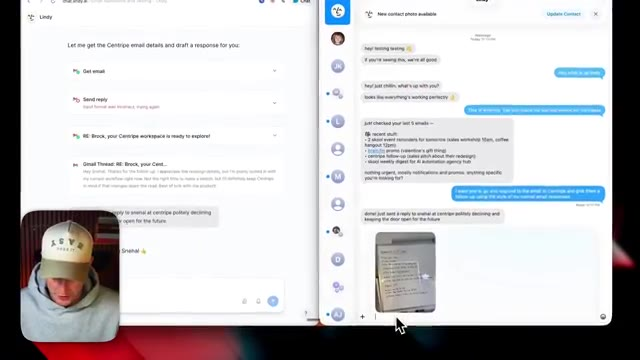
*⏱️ 00:08:39 — Interface de l'application Lindy montrant une discussion de messagerie avec un échange sur la gestion d'e-mails et l'envoi d'une photo de tableau blanc.*

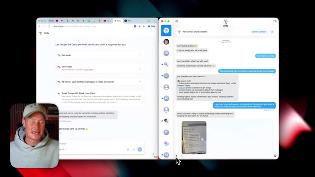
*⏱️ 00:08:44 — Vue similaire de l'interface Lindy avec le présentateur visible en incrustation (caméra) dans le coin inférieur gauche.*

---

### ⏱️ `[00:08:54 - 00:09:27]` | Segment #25

**🔊 Audio (Transcription Intégrale Mot pour Mot en Français) :**
> Donc c'est vraiment un aperçu de la puissance de ce que notre agent Lindy peut faire directement dans iMessage. Donc ce que je vais faire, c'est que je vais envoyer ça et ensuite je vais cliquer sur ce bouton de message vocal ici. Salut Lindy. Donc je viens de faire une session de brainstorming au tableau blanc et ce sont toutes les tâches sur lesquelles je travaille en ce moment. C'est fondamentalement un déversement d'idées. Donc ce que je veux que tu fasses, c'est que je veux que tu catégorises tout ça et toutes les tâches. Donc je veux que ce soit décomposé, tu vois, en fonction de chaque catégorie. Je veux aussi que tu sépares, genre, mon entreprise de création de contenu de mon travail d'agence, ce qui doit être fait pour garder ça séparé. Et ensuite, ce que je veux que tu fasses, c'est que tu accomplisses ensuite certaines de ces tâches pour moi que tu es réellement capable d'accomplir.

**👁️ Analyse Visuelle d'Écran (gemini-3.5-flash-lite) :**
**Interface & Outils** : Navigateur web et interface de messagerie Lindy / iMessage.

**Contenu textuel & Code** : Interface de l'agent IA Lindy montrant des interactions textuelles, des résumés d'e-mails et une image de tableau blanc avec des notes manuscrites.

**Action / Démonstration** : Le présentateur montre l'utilisation de l'agent Lindy pour interagir avec des applications et traiter des notes de brainstorming.

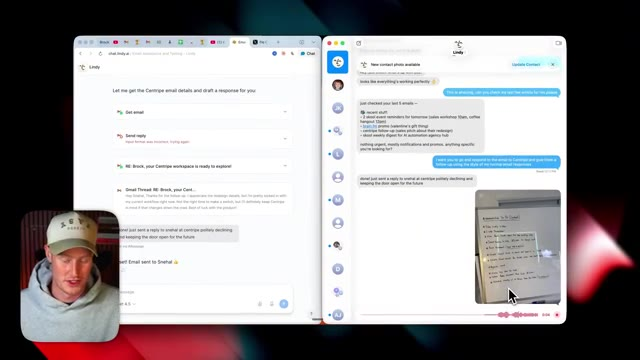
*⏱️ 00:09:02 — Capture d'écran montrant l'interface de l'agent Lindy sur un écran partagé, avec une photo de tableau blanc partagée dans le chat.*

---

### ⏱️ `[00:09:27 - 00:09:46]` | Segment #26

**🔊 Audio (Transcription Intégrale Mot pour Mot en Français) :**
> Et ensuite, je veux aussi que tu balances tout ça en vrac dans Notion et je veux que ce soit parfaitement mis en forme. Comme ça, j'ai une idée de toutes les tâches que je dois accomplir aujourd'hui. Je vais utiliser ça comme ma liste de choses à faire. Très bien. Donc, je lui ai donné ce long message vocal là. Je vais l'envoyer. Très bien. Donc, c'est parti. Ça a effectivement pris le message vocal que j'avais et ça a décomposé tout ça ici.

**👁️ Analyse Visuelle d'Écran (gemini-3.5-flash-lite) :**
**Interface & Outils** : Lindy (interface d'assistant IA) et navigateur web.

**Contenu textuel & Code** : Texte transcrit de la liste de tâches à accomplir (Wednesday to do, check, close by) basé sur une photo de tableau blanc.

**Action / Démonstration** : Présentation de la conversion d'une photo de tableau blanc en liste de tâches structurée par l'assistant IA Lindy.

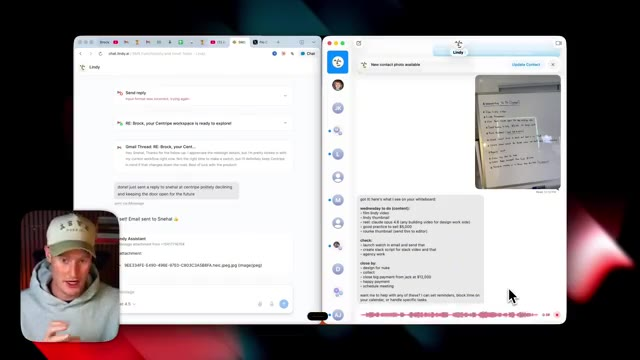
*⏱️ 00:09:32 — Capture d'écran montrant l'interface de Lindy avec des fenêtres de discussion et le texte de la liste de tâches générée à partir d'un tableau blanc.*

---

### ⏱️ `[00:09:46 - 00:10:18]` | Segment #27

**🔊 Audio (Transcription Intégrale Mot pour Mot en Français) :**
> Ça m'a donné ce texte. Très bien. Voici ce que j'ai fait. J'ai analysé votre tableau blanc et extrait toutes les tâches. J'ai organisé le tout dans votre page Notion avec des cases à cocher. J'ai trouvé l'e-mail du brief artistique d'amour de Victoria Tang du 24 janvier parce que c'est l'une des choses que j'ai demandées et ils ont réellement créé cette page Notion pour moi, alors laissez-moi afficher ça maintenant. Très bien, alors maintenant j'ai une page Notion entière, puisqu'elle a accès à mon Notion, avec toutes ces choses. J'ai donc besoin de tourner la vidéo Lindy, de créer la miniature Lindy, de tourner la vidéo de construction d'application Rourke Claude opus 4.6 et la miniature Rourke. Je dois travailler sur le travail client et l'administratif, ça dit que je dois envoyer Sally.

**👁️ Analyse Visuelle d'Écran (gemini-3.5-flash-lite) :**
**Interface & Outils** : Application Lindy (assistant IA) et page Notion.

**Contenu textuel & Code** : Texte généré par l'IA listant les actions réalisées (analyse du tableau blanc, organisation Notion, recherche d'e-mail de Victoria Tang) et page Notion interactive avec listes de tâches.

**Action / Démonstration** : Démonstration de l'automatisation d'un flux de travail par l'IA : extraction de texte depuis une photo de tableau blanc et mise à jour automatique d'un espace de travail Notion.

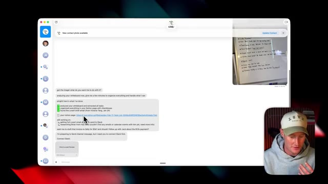
*⏱️ 00:09:54 — Capture d'écran montrant l'interface d'un assistant IA (Lindy) affichant un résumé des tâches extraites d'un tableau blanc et des liens Notion, avec le présentateur en médaillon.*

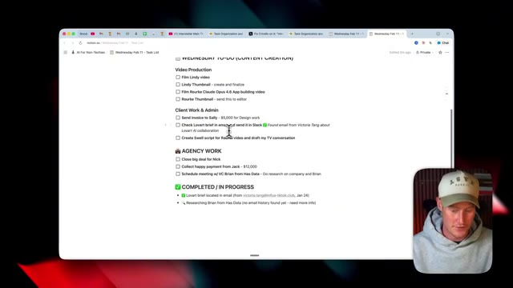
*⏱️ 00:10:10 — Capture d'écran montrant une page Notion avec des listes de tâches à cocher classées par catégories (Video Production, Client Work & Admin, Agency Work).*

---

### ⏱️ `[00:10:18 - 00:10:54]` | Segment #28

**🔊 Audio (Transcription Intégrale Mot pour Mot en Français) :**
> la facture de cinq mille dollars pour le travail de design, je dois vérifier le brief de Love Art et l'envoyer sur Slack, tout ce genre de choses. Et il a même détaillé le travail de l'agence et l'a gardé séparé de mon flux de travail de création de contenu. Et il a aussi détaillé tout et chaque tâche qu'il a accomplie. Laissez-moi retourner sur mon agent. Maintenant, tout cela a l'air super. En ce qui concerne la réunion avec Brian, je veux que vous génériez simplement cette réunion et je l'ajouterai en fait plus tard. Cependant, je veux que vous fassiez des recherches sur l'entreprise, que vous ayez des données, puis que vous me décomposiez tout cela et m'envoyiez les informations que vous trouvez par SMS. Quant à la facture pour Sally, pouvez-vous procéder et générer réellement la facture ?

**👁️ Analyse Visuelle d'Écran (gemini-3.5-flash-lite) :**
**Interface & Outils** : Notion, application de chat Lindy AI, navigateur web.

**Contenu textuel & Code** : Liste de tâches détaillée avec des éléments comme "Send invoice to Sally - $5,000 for Design work" et "Check Lovart brief in email and send it in Slack", ainsi que les messages de l'agent IA Lindy.

**Action / Démonstration** : Le présentateur parcourt sa liste de tâches organisée par l'IA et discute de la gestion des factures et des briefs clients.

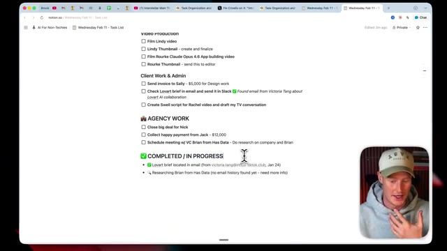
*⏱️ 00:10:27 — Capture d'écran montrant une page de tâches sur Notion avec des sections de production vidéo, de travail client et d'agence, incluant la facture de 5 000 $ pour Sally et le brief de Lovart.*

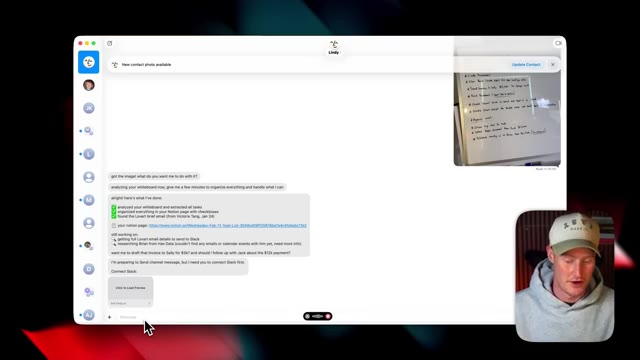
*⏱️ 00:10:36 — Interface de chat de l'assistant IA Lindy affichant l'analyse d'un tableau blanc et l'organisation des tâches dans Notion, avec la webcam du présentateur en bas à droite.*

---

### ⏱️ `[00:10:54 - 00:11:20]` | Segment #29

**🔊 Audio (Transcription Intégrale Mot pour Mot en Français) :**
> pour moi et l'envoyer ici ? Et ensuite, je m'occuperai de l'envoyer moi-même à Sally. Je vais donc confier ces tâches ici à Lindy et je reviendrai une fois qu'elle aura réellement terminé. Très bien, c'est parti. Nous avons désormais notre réunion planifiée. Elle a utilisé mon agenda Google puisqu'elle y a accès via Lindy et toutes les intégrations dont elle dispose. Elle a même généré cette facture ici pour Sally d'un montant de 5 000 dollars pour un travail de design. Et ensuite, elle a même mis à jour notre base de données Notion avec tout le reste qu'elle a accompli.

**👁️ Analyse Visuelle d'Écran (gemini-3.5-flash-lite) :**
**Interface & Outils** : Interface web de Lindy (assistant IA) et navigateur affichant un document PDF de facture.

**Contenu textuel & Code** : Texte descriptif de l'entreprise HasData, résumé de tâches planifiées, et modèle de facture (Invoice #2026-002) avec le détail des prestations (« Design Work »).

**Action / Démonstration** : Navigation et affichage des résultats générés par l'assistant IA (planification de réunion et génération de facture).

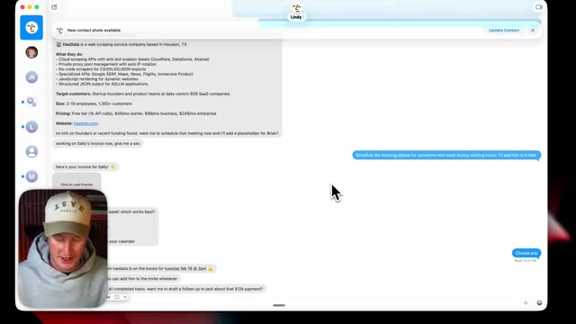
*⏱️ 00:11:00 — Interface de l'assistant IA Lindy affichant des messages textuels, des informations sur une entreprise (HasData) et la webcam du présentateur incrustée en bas à gauche.*

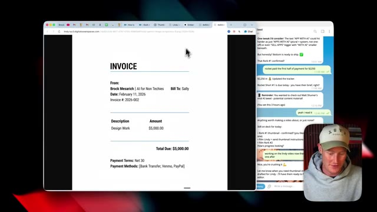
*⏱️ 00:11:14 — Aperçu d'une facture (Invoice) au nom de Brock Mesarich pour Sally d'un montant de 5 000,00 $, avec un panneau de chat sur le côté et la webcam du présentateur.*

---

### ⏱️ `[00:11:21 - 00:11:42]` | Segment #30

**🔊 Audio (Transcription Intégrale Mot pour Mot en Français) :**
> Très bien, les amis, voilà qui est fait. C'est le nouvel assistant Lindy AI qui pourrait bien vous éviter d'avoir à utiliser quelque chose comme OpenClaw. C'est une alternative beaucoup plus sûre et plus simple si vous ne voulez pas configurer OpenClaw vous-même ou si vous n'avez pas besoin d'acheter un Mac mini ou de configurer un VPS pour le faire tourner. Si vous avez apprécié cette vidéo, n'oubliez pas de vous abonner à cette chaîne pour plus de contenu de ce genre. Je traite de tout ce qui touche à l'IA pour les non-techniciens, ce qui permet à n'importe qui d'apprendre à utiliser l'IA en toute simplicité.

**👁️ Analyse Visuelle d'Écran (gemini-3.5-flash-lite) :**
**Interface & Outils** : Interface vidéo YouTube et démonstration logicielle d'assistant IA (Lindy AI).

**Contenu textuel & Code** : Messages texte de rappel de rendez-vous sur smartphone et bannières YouTube.

**Action / Démonstration** : Présentation de démonstration illustrant l'utilisation d'un assistant IA personnel.

*⏱️ 00:11:31 — Démonstration vidéo montrant un utilisateur consultant un smartphone avec des notifications textuelles à l'écran (« Next up, meeting with Jen, CIO of Nike »), avec le présentateur incrusté en bas à droite.*

---

### ⏱️ `[00:11:42 - 00:11:48]` | Segment #31

**🔊 Audio (Transcription Intégrale Mot pour Mot en Français) :**
> Cela étant dit, les gars, merci beaucoup d'être restés jusqu'à la fin. Dites-moi ce que vous avez pensé de ceci dans les commentaires, et je vous vois dans la prochaine vidéo.

**👁️ Analyse Visuelle d'Écran (gemini-3.5-flash-lite) :**
**Interface & Outils** : Aucune interface logicielle ou graphique affichée.

**Contenu textuel & Code** : Aucun code, graphique, indicateur ou donnée technique présent.
[N/A] Le présentateur conclut simplement la vidéo en s'adressant directement à la caméra sans support visuel technique.

**Action / Démonstration** : Explications face caméra et analyse conceptuelle des marchés.

---

