# 🎬 How to Use Claude Code Better Than 99% of People

> **Chaîne** : [Brock Mesarich | AI for Non Techies](https://www.youtube.com/@BrockMesarich)  
> **Lien YouTube** : [https://www.youtube.com/watch?v=9owy-NV5l6k](https://www.youtube.com/watch?v=9owy-NV5l6k)  
> **Date de publication** : 20260216  
> **Durée** : 00:47:26  
> **Identifiant vidéo** : `9owy-NV5l6k`  
> **Transcription & Analyse** : `whisper-v3-large-turbo+gemini-3.5-flash-lite`  

---

## 📌 Synthèse Exécutive & Outils

### 💡 Résumé

Cette transcription de la chaîne *Brock Mesarich | AI for Non Techies* explore le potentiel révolutionnaire de **Claude Code** et de sa nouvelle interface d'accès grand public, **Claude Cowork**, démystifiant l'utilisation des outils de développement pour les profils non techniques. À travers l'intervention de Mark, expert reconnu de l'écosystème Claude, la discussion lève le voile sur un outil souvent perçu à tort comme une exclusivité pour codeurs, mais qui se révèle en réalité être un assistant d'automatisation puissant capable de lire, d'analyser et de structurer des fichiers locaux en autonomie complète.

L'analyse démontre comment passer d'un blocage psychologique face au terminal à l'exploitation d'une « drogue passerelle » (Claude Cowork) vers la véritable puissance de feu des agents autonomes locaux. Bien que Cowork offre une interface graphique intuitive en un clic pour trier des dossiers ou générer des présentations, ses limitations techniques et sa propension aux bugs rappellent l'importance de s'initier aux outils sous-jacents. Le véritable saut qualitatif réside dans l'utilisation de Claude Code et de ses capacités d'interaction directe avec le bureau, permettant d'automatiser des flux de travail chronophages (tels que des tâches de 20 heures par semaine) par osmose et apprentissage progressif.

### 🛠️ Outils, Modèles & Logiciels Présentés

* **Claude / Claude Code** : Assistant de pointe d'Anthropic fonctionnant dans un terminal, capable de lire des fichiers locaux, de retenir les préférences et d'exécuter des scripts complexes sur l'ordinateur de l'utilisateur.
* **Claude Cowork** : Nouvelle surcouche de l'application de bureau Claude agissant comme une passerelle non technique, proposant des boutons en un clic pour organiser des dossiers ou traiter des données sans manipuler directement le code.
* **Grok** : Modèle d'intelligence artificielle conversationnelle (mentionné dans le contexte de l'écosystème global des LLM et des retours d'expérience sur les réseaux sociaux).
* **Gemini** : Modèle linguistique de Google utilisé comme point de comparaison dans le paysage concurrentiel des intelligences artificielles génératives.
* **ChatGPT** : Modèle conversationnel d'OpenAI, référence historique du secteur et concurrent direct des solutions d'Anthropic.
* **Make** : Plateforme d'automatisation de flux de travail no-code permettant de connecter différentes applications web entre elles (mentionnée dans l'écosystème global de l'automatisation).
* **Zapier** : Outil pionnier d'intégration et d'automatisation d'API et de micro-services sans code.
* **n8n** : Outil d'automatisation de workflows open-source et extensible, souvent utilisé pour des architectures techniques avancées.

### 🔑 Points Clés & Enseignements Stratégiques

* **Dépasser le blocage psychologique du terminal** : Le principal frein à l'adoption de Claude Code réside dans l'association mentale erronée « terminal = code = incompétence », un obstacle que de nouvelles interfaces comme Cowork permettent de contourner progressivement.
* **Claude Cowork comme « drogue passerelle »** : Considéré comme un outil d'entrée de gamme offrant environ 30 à 40 % de la puissance réelle, Cowork simplifie l'accès aux flux de travail agentiques grâce à des fonctionnalités préconfigurées en un clic.
* **La réalité des applications codées au feeling (*vibe coding*)** : Les fonctionnalités développées en un temps record par les équipes elles-mêmes (comme Cowork à ses débuts) comportent intrinsèquement des bugs lorsqu'elles passent à l'échelle pour des millions d'utilisateurs.
* **Un malentendu persistant sur l'usage** : Claude Code a été originellement conçu pour les développeurs, mais son véritable potentiel pour les non-techies réside dans sa capacité à créer des bases de données locales, à interagir avec des fichiers et à exécuter des tâches sur mesure.
* **Apprentissage par osmose** : Les utilisateurs non techniques n'ont pas besoin de maîtriser le code Python affiché à l'écran ; l'observation passive et répétée des processus permet une montée en compétences naturelle et inconsciente.
* **Planification itérative et gestion du risque** : Les meilleures pratiques exigent de configurer les agents pour qu'ils posent des questions de clarification et élaborent un plan avant d'agir, évitant ainsi des modifications destructrices sur le bureau de l'utilisateur.
* **Accès aux API externes simplifié** : Claude Code peut guider l'utilisateur pas à pas dans la récupération de clés d'API (comme pour Nano Banana) et configurer l'automatisation de tâches créatives, telles que la génération de miniatures YouTube.
* **Automatisation de processus lourds** : La transition vers ces outils permet d'absorber des charges de travail répétitives chronophages, réduisant des tâches hebdomadaires de 20 heures à des processus entièrement automatisés.

---

## ⏱️ Chronologie & Transcription Complète Audio & Visuelle (Mot pour Mot)

### ⏱️ `[00:00:00 - 00:00:26]` | Segment #01

**🔊 Audio (Transcription Intégrale Mot pour Mot en Français) :**
> J'évitais Claude Code depuis des mois. Ça semblait trop technique et trop compliqué. Cependant, mon ami Mark me suppliait de commencer à l'utiliser. C'est incontestablement la meilleure personne pour apprendre à se servir de Claude Code. Je l'ai donc invité dans cet épisode pour m'apprendre à l'utiliser à partir de zéro. Et je vais être honnête, après cet épisode, je suis tombé dans le terrier du lapin de Claude Code et j'ai passé tout le week-end à construire un système qui me prenait littéralement 20 heures chaque semaine et je l'utilise en ce moment même. Voici ce que personne ne m'avait dit à propos de Claude Code.

**👁️ Analyse Visuelle d'Écran (gemini-3.5-flash-lite) :**
**Interface & Outils** : Éditeur de code Cursor (VS Code fork).

**Contenu textuel & Code** : Fichier Markdown 'THE_PLAN.md', arborescence de projet avec les dossiers 'data', 'db', 'scripts', et des blocs de commande Bash.

**Action / Démonstration** : Exécution d'un plan d'implémentation par l'assistant IA dans l'éditeur de code.

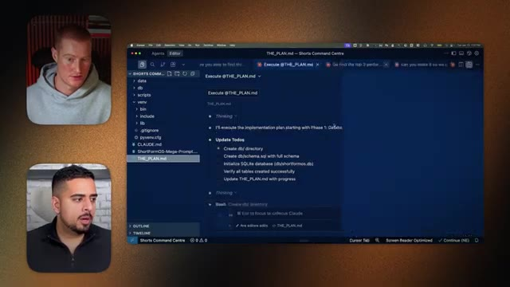
*⏱️ 00:00:13 — Interface de l'éditeur de code Cursor montrant le fichier 'THE_PLAN.md' en cours d'exécution avec des sections de 'Thinking' et de 'Bash'.*

---

### ⏱️ `[00:00:26 - 00:00:45]` | Segment #02

**🔊 Audio (Transcription Intégrale Mot pour Mot en Français) :**
> Il lit vos fichiers, il retient vos préférences et il apprend votre façon de travailler. Donc, plus vous l'utilisez, plus il devient intelligent. Et il ne se contente pas de vous donner des réponses, il construit réellement des choses pour vous et les enregistre sur votre ordinateur. Donc, d'ici la fin de cet épisode, vous allez savoir exactement comment configurer ceci, commencer à l'utiliser vous-même, même si vous n'avez jamais écrit une seule ligne de code, et commencer à automatiser tous les aspects de votre travail.

**👁️ Analyse Visuelle d'Écran (gemini-3.5-flash-lite) :**
**Interface & Outils** : Interface logicielle de gestion de tâches ou assistant IA.

**Contenu textuel & Code** : Étapes de progression : 'Read meeting recordings', 'Pull out key points', 'Find action items', 'Write summary'.

**Action / Démonstration** : Affichage visuel d'une liste de tâches en cours d'exécution.

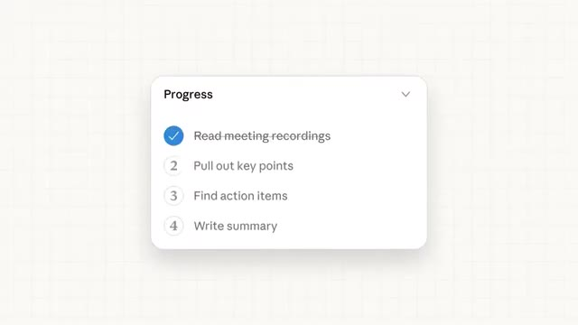
*⏱️ 00:00:35 — Une interface graphique montrant une liste de tâches intitulée 'Progress' avec des étapes comme 'Read meeting recordings'.*

---

### ⏱️ `[00:00:45 - 00:01:05]` | Segment #03

**🔊 Audio (Transcription Intégrale Mot pour Mot en Français) :**
> Croyez-moi, si vous aviez l'intention d'essayer Cloud Code et de commencer à l'utiliser vous-même, mais que cela vous semblait trop technique, c'est absolument la meilleure vidéo que vous devriez regarder pour savoir comment débuter. Cela étant dit, entrons dans le vif du sujet. Très bien, comment ça va les gars ? Je suis ravi de cet épisode. Personnellement, je voulais utiliser Claude Code depuis un certain temps déjà. Je tiens à inviter le GOAT de Claude Code à mes yeux, Mark.

**👁️ Analyse Visuelle d'Écran (gemini-3.5-flash-lite) :**
**Interface & Outils** : Aucune interface technique, graphique ou terminal présent.

**Contenu textuel & Code** : Aucun code, prompt ou configuration affiché.

**Action / Démonstration** : Présentation orale et introduction du sujet par l'intervenant.

---

### ⏱️ `[00:01:05 - 00:01:23]` | Segment #04

**🔊 Audio (Transcription Intégrale Mot pour Mot en Français) :**
> Alors oui, j'espère qu'aujourd'hui on pourra, primo, me mettre à niveau sur l'utilisation de Claude Code, mettre mon audience à niveau et construire quelque chose de cool dans ce podcast. Donc voilà, ravi de t'avoir, Mark. Oui, bien sûr. C'est un plaisir d'être ici. Je sais que ça fait un moment qu'on ne s'était pas contactés. On était probablement plus dans le monde du "vibe coding" avant. Maintenant, on entre dans le monde du vrai "coding".

**👁️ Analyse Visuelle d'Écran (gemini-3.5-flash-lite) :**
**Interface & Outils** : Visioconférence / Podcast vidéo sans interface technique ni graphique.

**Contenu textuel & Code** : Aucun code, graphique, indicateur technique ou donnée financière affichée.

**Action / Démonstration** : Conversation introductive entre les intervenants du podcast.

---

### ⏱️ `[00:01:24 - 00:01:43]` | Segment #05

**🔊 Audio (Transcription Intégrale Mot pour Mot en Français) :**
> Donc c'est bien. Ouais, à 100 %. Donc je suis ravi de voir ce qu'on peut construire avec Claude Code. Je n'ai en fait jamais pu rien construire avec. Donc pour lancer les choses, je veux poser une question. Et c'est : Claude Cowork vient juste de sortir littéralement hier avant qu'on ne tourne ce podcast. Donc pour mon audience, qu'en penses-tu ? Est-ce que Claude Cowork est quelque chose qui remplace le besoin d'apprendre Claude Code ?

**👁️ Analyse Visuelle d'Écran (gemini-3.5-flash-lite) :**
**Interface & Outils** : Visioconférence / enregistrement vidéo (vue double avec incrustation).

**Contenu textuel & Code** : Aucun code, graphique, terminal ou élément technique affiché, uniquement les intervenants.

**Action / Démonstration** : Discussion et échange entre le présentateur et son invité sans démonstration technique à l'écran.

---

### ⏱️ `[00:01:43 - 00:02:19]` | Segment #06

**🔊 Audio (Transcription Intégrale Mot pour Mot en Français) :**
> Tu penses que c'est comme une entrée, un truc de drogue passerelle ? Donne-moi ton résumé là-dessus. Parce que j'aime bien t'utiliser comme filtre pour les outils d'IA pour voir, est-ce que je dois prêter attention à ça ? Est-ce que c'est surévalué ? Quoi d'autre ? Alors donne-moi ton résumé. Ouais, c'est clair. Tu as volé ma description, d'abord. Donc mettons ça au clair comme avertissement. C'est la drogue passerelle. Jusqu'à présent, la personne moyenne regarde un terminal et peu importe combien de fois quelqu'un comme moi crie, hurle et pleure, on ne peut pas convaincre les gens de sauter dans un terminal parce qu'il y a comme ce blocage mental que terminal égale code, code égale je ne sais pas comment faire, alors je m'en vais. Donc ça te donne une sorte de goût du haut de l'entonnoir de ce que Cloud Code peut faire.

**👁️ Analyse Visuelle d'Écran (gemini-3.5-flash-lite) :**
**Interface & Outils** : Visioconférence entre deux intervenants.

**Contenu textuel & Code** : Aucun graphique, code, terminal, indicateur technique ou donnée financière n'est affiché à l'écran.

**Action / Démonstration** : Discussion en visioconférence, échange d'avis sur les outils d'IA.

---

### ⏱️ `[00:02:19 - 00:02:39]` | Segment #07

**🔊 Audio (Transcription Intégrale Mot pour Mot en Français) :**
> Donc Cloud Code ou Cowork plutôt est un ajustement plutôt convenable pour gérer des flux de travail agentiques plus pratiques sans avoir à gérer toute la configuration, le téléchargement, le curseur qui clignote sur votre écran. Si vous utilisez un terminal, c'est encore plein de bugs, mais c'est quand même un grand pas en avant par rapport à l'utilisation de l'IA Cloud normale.

**👁️ Analyse Visuelle d'Écran (gemini-3.5-flash-lite) :**
**Interface & Outils** : Aucun

**Contenu textuel & Code** : Aucun

**Action / Démonstration** : Aucun

---

### ⏱️ `[00:02:40 - 00:03:00]` | Segment #08

**🔊 Audio (Transcription Intégrale Mot pour Mot en Français) :**
> J'ai compris. Donc on ne l'utilise pas à l'intérieur d'un IDE, par exemple. Où est-ce qu'on utilise ça ? On utilise ça à l'intérieur de l'application de bureau Claude, n'est-ce pas ? Donc c'est quelque chose qui est comme plus accessible pour la plupart des gens parce que beaucoup de gens pourraient avoir Claude Desktop téléchargé. Vous pouvez simplement basculer entre le mode chat et le mode co-work au lieu d'avoir à aller dans votre IDE. Donc je pense que ce serait utile de montrer un petit aperçu de ce à quoi ressemble l'interface utilisateur très rapidement.

**👁️ Analyse Visuelle d'Écran (gemini-3.5-flash-lite) :**
**Interface & Outils** : Aucun (simple appel vidéo/enregistrement de discussion).

**Contenu textuel & Code** : Aucun contenu technique, code ou indicateur.

**Action / Démonstration** : Discussion entre le présentateur et son invité sur l'accessibilité des outils d'IA.

---

### ⏱️ `[00:03:00 - 00:03:23]` | Segment #09

**🔊 Audio (Transcription Intégrale Mot pour Mot en Français) :**
> Et ensuite, cela va nous mener vers notre prochaine section qui consiste à utiliser réellement Claude Code pour construire quelque chose. Bien sûr. Donc voilà à quoi ça ressemble. Sur Claude Desktop, vous avez le chat, vous avez le code, et maintenant vous avez le co-work. Donc le tout premier objectif du co-work, comme nous l'avons dit avant, c'est qu'ils ont essentiellement pris les choses non techniques les plus courantes qui passent par Claude Code et les ont rendues disponibles sous forme de boutons en un clic.

**👁️ Analyse Visuelle d'Écran (gemini-3.5-flash-lite) :**
**Interface & Outils** : Application Claude Desktop (mode Co-work) et interface de visioconférence

**Contenu textuel & Code** : Interface utilisateur de Claude affichant les options "Chat", "Code", "Cowork", un champ de saisie "How can I help you today?" et des suggestions de tâches (Create a file, Crunch data, Make a prototype, etc.).

**Action / Démonstration** : Présentation des différentes fonctionnalités de l'interface Claude Desktop, en se focalisant sur le mode Co-work.

*⏱️ 00:03:06 — Capture d'écran montrant l'interface de l'application Claude Desktop avec l'onglet Co-work actif, ainsi que deux vignettes vidéo des participants.*

---

### ⏱️ `[00:03:24 - 00:03:45]` | Segment #10

**🔊 Audio (Transcription Intégrale Mot pour Mot en Français) :**
> Et quand vous cliquez sur ces boutons, au lieu que vous ayez à réfléchir au prompt, il fait le "prompt engineering" pour vous. Donc si vous dites organiser des fichiers, qui est le cas d'usage principal que tout le monde partage sur X, vous pouvez simplement dire d'aller réparer ce dossier. Vous lui indiqueriez dans quel dossier vous voulez travailler. Et ensuite, vous voulez spécifier si vous voulez la façon dont vous voulez qu'il l'organise ou spécifiquement quel est le nom du dossier.

**👁️ Analyse Visuelle d'Écran (gemini-3.5-flash-lite) :**
**Interface & Outils** : Application de type assistant IA / interface de bureau (navigateur Google Chrome).

**Contenu textuel & Code** : Boutons d'interaction rapide pour des actions courantes comme organiser des fichiers, créer un fichier ou analyser des données, accompagnés d'une zone de saisie de prompt ("How can I help you today?").

**Action / Démonstration** : Présentation de l'interface utilisateur et explication du fonctionnement des boutons de raccourci pour l'automatisation de tâches.

*⏱️ 00:03:29 — Capture d'écran montrant l'interface d'une application d'intelligence artificielle avec des boutons de suggestion de tâches ("Create a file", "Organize files", "Crunch data", etc.) et les deux intervenants en vignettes vidéo à gauche.*

---

### ⏱️ `[00:03:45 - 00:04:08]` | Segment #11

**🔊 Audio (Transcription Intégrale Mot pour Mot en Français) :**
> Ils vous donnent des valeurs par défaut comme mon dossier de téléchargements, mes photos, quelques anciens projets, etc. Et ensuite, lorsque vous suivez la procédure, vous pouvez choisir l'un des modèles de langage de votre choix et tout ce qui se passe apparaîtra sur le côté droit. Dans le monde du code cloud, tout est très monotone et se produit une chose à la fois. Donc, si vous avez besoin de cet aspect d'artefact esthétique, cela vous aidera à suivre exactement ce qui se passe.

**👁️ Analyse Visuelle d'Écran (gemini-3.5-flash-lite) :**
**Interface & Outils** : Interface logicielle de type assistant IA / espace de travail avec menu déroulant de sélection de modèles et panneaux latéraux (Progress, Artifacts, Context).

**Contenu textuel & Code** : Menus déroulants affichant les versions de modèles (Opus 4.5, Sonnet 4.5, Haiku 4.5) et des boutons de raccourcis pour les dossiers (Downloads, photos).

**Action / Démonstration** : Sélection ou configuration du modèle de langage et choix du dossier de travail dans l'interface.

*⏱️ 00:03:51 — Capture d'écran montrant l'interface d'un assistant IA (similaire à Claude) avec une liste de modèles déroulante (Opus, Sonnet, Haiku) et des boutons de sélection de dossiers par défaut.*

---

### ⏱️ `[00:04:09 - 00:04:37]` | Segment #12

**🔊 Audio (Transcription Intégrale Mot pour Mot en Français) :**
> D'accord, donc tu dis qu'on pourrait faire des modifications sur nos dossiers, des dossiers organisés, tout ça, créer des présentations à partir de dossiers, et ensuite même lancer une sorte d'interface utilisateur, un peu comme une interface utilisateur codée par le « vibe » directement à l'intérieur de l'application Cloud Desktop maintenant en utilisant Cowork, c'est bien ça ? Exactement. Donc avant, tu pouvais déjà créer les applications codées par le « vibe » avec des artefacts tout seuls, mais maintenant ils ont fait en sorte que ce soit tellement plus facile de pouvoir garder une trace de tous les fichiers, de tous les contacts utilisés, et tu peux toujours utiliser des connecteurs et ajouter des connecteurs. Donc tu ne perds pas cette touche MCP.

**👁️ Analyse Visuelle d'Écran (gemini-3.5-flash-lite) :**
**Interface & Outils** : Application de bureau Claude (mode Cowork) et interface de visioconférence.

**Contenu textuel & Code** : Interface utilisateur affichant des suggestions de tâches telles que "Create a file", "Crunch data", "Make a prototype", "Organize files", "Prep for the day", et "Send a message", avec une barre de saisie pour interagir avec l'IA.

**Action / Démonstration** : Présentation de l'interface de travail de Claude et de ses fonctionnalités de gestion de fichiers et de prototypage.

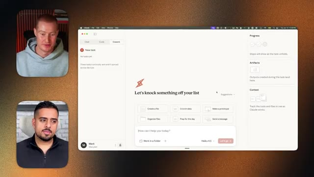
*⏱️ 00:04:16 — Capture d'écran montrant l'interface de l'application Claude (mode Cowork) sur macOS, avec deux intervenants en visioconférence sur le côté gauche.*

---

### ⏱️ `[00:04:37 - 00:05:12]` | Segment #13

**🔊 Audio (Transcription Intégrale Mot pour Mot en Français) :**
> tu peux superposer les couches et tout le monde n'aura pas besoin de réorganiser le même dossier 10 fois donc nous devons trouver de meilleurs cas d'utilisation n'est-ce pas ce ne sont là que quelques exemples que les gens peuvent assimiler mais quand tu fais l'expérience par exemple j'ai testé le traitement des données il va aller dans le dossier élaborer un plan et tu remarqueras que lorsque tu cliques dessus tu obtiens cette invite ici qui dit poser toutes les questions de clarification donc ils essaient de t'encourager à l'encourager à réfléchir et à planifier avant de faire les choses pour réduire la probabilité que tu casses quelque chose. Parce que dans Cloud Code, si tu ne sais pas ce que tu fais, parfois tu peux complètement anéantir ton

**👁️ Analyse Visuelle d'Écran (gemini-3.5-flash-lite) :**
**Interface & Outils** : Claude Cowork / Interface logicielle de bureau

**Contenu textuel & Code** : Options visibles : Create a file, Crunch data, Make a prototype, Organize files, Prep for the day, Send a message, avec un champ de saisie prompt en bas.

**Action / Démonstration** : Présentation des fonctionnalités de productivité de l'outil et de son interface de travail collaborative (Cowork).

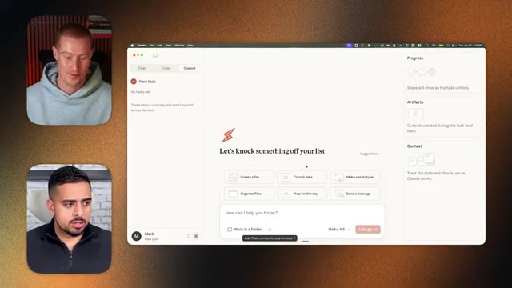
*⏱️ 00:04:46 — Interface de l'application Claude Cowork affichant des suggestions de tâches pour l'utilisateur.*

---

### ⏱️ `[00:05:12 - 00:05:44]` | Segment #14

**🔊 Audio (Transcription Intégrale Mot pour Mot en Français) :**
> bureau si vous ne donnez pas réellement les bonnes instructions. Oui, c'est logique. D'accord. Alors maintenant, passons à l'utilisation concrète de Claude Code, parce qu'évidemment, Claude Cowork est bien pour les personnes vraiment non techniques. J'ai un peu joué avec. C'est super jusqu'à présent. Ça a été une bonne introduction à Claude Code, mais je veux savoir, est-ce que ça vous amène à environ 90 % du chemin ? Est-ce que vous pensez que ça vous amène à 50 % du chemin ? Où est-ce que vous pensez que ça laisse les personnes non techniques en ce qui concerne Claude Code ? Est-ce qu'on devrait quand même apprendre Claude Code ? Si on pousse l'analogie de la drogue passerelle, avec un accent mis sur « drogue », ça, selon moi, ça vous donne 30 à 40 %. On n'en est même pas proche

**👁️ Analyse Visuelle d'Écran (gemini-3.5-flash-lite) :**
**Interface & Outils** : Visioconférence entre deux interlocuteurs.

**Contenu textuel & Code** : Aucun code, graphique, terminal ou élément technique affiché, uniquement les intervenants en visioconférence.

**Action / Démonstration** : Discussion en visioconférence entre les participants de la vidéo.

---

### ⏱️ `[00:05:44 - 00:06:20]` | Segment #15

**🔊 Audio (Transcription Intégrale Mot pour Mot en Français) :**
> la puissance de feu de Claude et il est plein de bugs. Pourquoi ? Parce qu'ils ont utilisé Claude Code pour le coder au feeling en l'espace d'une semaine. L'équipe d'Anthropic elle-même a admis cela sur X. Donc avec n'importe quelle application codée au feeling, que vous connaissiez ou non, vous allez avoir des tonnes de bugs, surtout quand vous passez en production pour des milliers et des millions de personnes. Amusez-vous avec, jouez avec, sachez qu'il y a des bugs, mais c'est censé être seulement un aperçu de ce que vous obtenez avec toute la puissance de feu. Compris. C'est logique. Cool. Donc je veux passer à quelques questions avant d'aller de l'avant, de vous montrer comment télécharger Claude Code et de construire réellement quelque chose avec. Mark a effectivement construit quelque chose

**👁️ Analyse Visuelle d'Écran (gemini-3.5-flash-lite) :**
**Interface & Outils** : Aucune interface logicielle, graphique de trading ou terminal de commande n'est affiché.

**Contenu textuel & Code** : Aucun code source, indicateur technique, prompt ou donnée chiffrée n'est visible.

**Action / Démonstration** : Aucune manipulation technique, backtest ou analyse graphique n'est effectuée.

---

### ⏱️ `[00:06:20 - 00:06:55]` | Segment #16

**🔊 Audio (Transcription Intégrale Mot pour Mot en Français) :**
> pour moi, un cas d'usage sympa que je voulais pour moi-même. Et nous allons passer en revue le processus étape par étape, comment nous avons fait cela. Et puis aussi le produit fini de cela. Donc ma première question pour toi est, quel est le plus grand malentendu avec Claude Code ? Parce que quand j'entends ça, je pense, ok, si je ne code pas d'application ou si je ne l'utilise pas dans mon environnement de codage, à quoi bon utiliser Claude Code ? Donc, décortique un peu quel est le plus grand malentendu ou, tu sais, les quelques malentendus que tu vois. Oui. Donc, évidemment, c'était une plateforme conçue à l'origine pour les développeurs, c'est pourquoi ils l'ont appelée Claude Code. Mais au fil du temps, beaucoup de gens non techniques et beaucoup de cas d'usage non techniques ont fait surface, ce qui, à mon avis, je parle à beaucoup de gens, je dis qu'ils auraient dû l'appeler

**👁️ Analyse Visuelle d'Écran (gemini-3.5-flash-lite) :**
**Interface & Outils** : Aucun outil technique, terminal ou graphique affiché.

**Contenu textuel & Code** : Aucun code source, métrique ou indicateur technique visible.

**Action / Démonstration** : Discussion en visioconférence entre le présentateur et l'invité.

---

### ⏱️ `[00:06:55 - 00:07:15]` | Segment #17

**🔊 Audio (Transcription Intégrale Mot pour Mot en Français) :**
> que Claude crée, car ensuite il peut créer du code et des artefacts. Mais l'idée reçue est que vous l'utilisez uniquement pour le développement, la création de code ou le codage intuitif. En réalité, parce qu'il a accès à votre bureau et à vos fichiers, et que vous pouvez créer une base de données locale qui s'exécute sur votre ordinateur, ce que nous allons vous montrer aujourd'hui, il peut faire tout ce que vous voulez.

**👁️ Analyse Visuelle d'Écran (gemini-3.5-flash-lite) :**
**Interface & Outils** : Visioconférence / Interface vidéo.

**Contenu textuel & Code** : Aucun élément technique, graphique ou code source visible.

**Action / Démonstration** : Discussion et présentation parlée sans démonstration à l'écran.

---

### ⏱️ `[00:07:15 - 00:07:35]` | Segment #18

**🔊 Audio (Transcription Intégrale Mot pour Mot en Français) :**
> Genre, la limite, c'est votre imagination et votre capacité à apprendre simplement par osmose. Donc, quand vous lui demandez ici : « Va sur l'API Nano Banana, fais-moi une miniature pour YouTube », il peut faire des recherches, chercher l'API Nano Banana, vous dire : « Hé, écoute, j'ai besoin d'une clé d'API. Voici l'URL pour aller chercher la clé d'API, donne-la-moi et on continue à partir d'ici. »

**👁️ Analyse Visuelle d'Écran (gemini-3.5-flash-lite) :**
**Interface & Outils** : Aucune interface technique, graphique ou de terminal affichée.

**Contenu textuel & Code** : Aucun code, indicateur ou donnée chiffrée visible.

**Action / Démonstration** : Présentation orale et discussion en visio-conférence (pas d'action de trading ou de démonstration logicielle).

---

### ⏱️ `[00:07:35 - 00:07:55]` | Segment #19

**🔊 Audio (Transcription Intégrale Mot pour Mot en Français) :**
> Vous allez voir du Python à l'écran. Vous n'avez pas besoin de vous plonger dans ce Python. Vous devez juste être conscient que quelque chose se passe pour faire fonctionner cette fonctionnalité. Ainsi, moins vous vous inquiétez de ce qui se passe à l'écran tout en y jetant un coup d'œil, même si vous n'êtes pas un profil technique, vous commencerez à voir de petits schémas par osmose et vous serez surpris dans trois, six, neuf mois, vous serez capable de monter en compétences par accident.

**👁️ Analyse Visuelle d'Écran (gemini-3.5-flash-lite) :**
**Interface & Outils** : Visioconférence / capture de flux vidéo (interview en double écran)

**Contenu textuel & Code** : Aucun code source, graphique de trading ou métrique technique visible.

**Action / Démonstration** : Discussion et présentation orale sans démonstration technique à l'écran.

---

### ⏱️ `[00:07:55 - 00:08:23]` | Segment #20

**🔊 Audio (Transcription Intégrale Mot pour Mot en Français) :**
> D'accord, ouais, j'adore ça. Et puis je suppose que ma question suivante serait : est-ce que tu aurais des success stories de profils non-techniques, par exemple quelqu'un... parce que tu diriges une assez grande communauté, je n'appellerais pas ça une communauté Claude Code, mais ta communauté est construite... disons qu'un bon nombre de tes utilisateurs là-bas ou de tes membres de communauté veulent tout savoir sur Claude Code et sur tous les cas d'usage que tu trouves pour cet outil. Est-ce que tu aurais donc des exemples de personnes non-techniques, ou peu importe, quelqu'un qui serait peut-être un peu réfractaire ou archaïque en matière de technologie, et qui serait passé de grand débutant complet à quelqu'un capable de construire des choses vraiment utiles avec ?

**👁️ Analyse Visuelle d'Écran (gemini-3.5-flash-lite) :**
**Interface & Outils** : Visioconférence / Interface de discussion vidéo à deux participants.

**Contenu textuel & Code** : Aucun code, graphique, terminal ou élément technique visible à l'écran, uniquement les deux interlocuteurs.

**Action / Démonstration** : Le présentateur s'exprime et gesticule lors de l'échange en visioconférence.

---

### ⏱️ `[00:08:23 - 00:08:44]` | Segment #21

**🔊 Audio (Transcription Intégrale Mot pour Mot en Français) :**
> Oui, alors évidemment j'ai une communauté d'une taille plutôt moyenne, mais nous avons beaucoup de gens non techniques qui arrivent et qui ont décidé, ça y est. Je vais m'accrocher, je paye pour le forfait maximum, et je vais créer des choses. Et nous avons récemment eu quelqu'un qui a en fait 70 ans, à la retraite, qui a pratiquement construit une application mobile complète en l'espace de trois ou quatre mois en utilisant n8n et Cloud Code.

**👁️ Analyse Visuelle d'Écran (gemini-3.5-flash-lite) :**
**Interface & Outils** : Aucune interface logicielle, graphique ou de trading n'est affichée.

**Contenu textuel & Code** : Aucun code, indicateur technique, prompt ou donnée chiffrée n'est visible.

**Action / Démonstration** : Discussion et présentation parlée sans manipulation technique ni démonstration visuelle.

---

### ⏱️ `[00:08:45 - 00:09:04]` | Segment #22

**🔊 Audio (Transcription Intégrale Mot pour Mot en Français) :**
> Et des choses comme ça me rendent, en tant que super intello, super enthousiaste, parce que j'adore voir ce progrès et des gens briser des croyances limitantes, car les gens viendront toujours en n'étant pas techniques et en disant : hé, écoute, tu as quelque chose pour moi qui n'est pas Cloud Code ? Est-ce que je peux juste utiliser, genre, chat ? Tu peux mieux voir ? Parce qu'ils ont tellement peur de simplement se lancer et de se heurter à ces premiers problèmes.

**👁️ Analyse Visuelle d'Écran (gemini-3.5-flash-lite) :**
**Interface & Outils** : Visioconférence (aucun outil technique, graphique ni terminal affiché).

**Contenu textuel & Code** : Aucun contenu technique, code source ou indicateur financier visible.

**Action / Démonstration** : Le présentateur s'exprime et fait un geste de la main, sans effectuer de manipulation logicielle ou graphique.

---

### ⏱️ `[00:09:04 - 00:09:37]` | Segment #23

**🔊 Audio (Transcription Intégrale Mot pour Mot en Français) :**
> Mais dès que vous franchissez cette difficulté où, un, vous l'avez téléchargé, deux, vous passez par l'épreuve du feu, vous essayez de construire quelque chose et quelque chose ne fonctionne pas. Et puis vous réalisez que vous pouvez techniquement demander à Claude Code dans une nouvelle fenêtre de vous aider à réparer Claude Code. Et que vous comprenez cette petite boucle de rétroaction, alors ils sont libérés. Et puis une fois que l'imagination est ouverte, ils commencent à construire à partir de cas d'utilisation très précis jusqu'à des choses dont ils sont fiers et ensuite à empiler ces compétences par-dessus. Oui, j'adore ça. Et vous venez littéralement de m'expliquer, je n'avais pas utilisé Claude Code parce que, peu importe, j'ai une sorte de barrière mentale à ce sujet. Et j'avais cela au début avec l'IA en général. Et c'est pourquoi j'ai créé cette chaîne YouTube

**👁️ Analyse Visuelle d'Écran (gemini-3.5-flash-lite) :**
**Interface & Outils** : Visioconférence (affichage en grille avec incrustation PiP).

**Contenu textuel & Code** : Aucun élément visuel technique, graphique, code ou interface de trading n'est affiché.
[DESC_IMAGE_3] Échange en visioconférence entre deux interlocuteurs, sans support visuel technique.

**Action / Démonstration** : Explications face caméra et analyse conceptuelle des marchés.

---

### ⏱️ `[00:09:37 - 00:09:57]` | Segment #24

**🔊 Audio (Transcription Intégrale Mot pour Mot en Français) :**
> chaîne pour en quelque sorte montrer aux gens non techniques qu'on peut utiliser des outils d'IA et devenir en fait pour ainsi dire un locuteur de cette langue. Donc oui, j'adore creuser un peu ce sujet, je crois que ma dernière question avant de passer au téléchargement de Cloud Code et à la création concrète de notre cas d'usage pour cela, c'est : selon toi, quel est l'inconvénient ou quels sont les inconvénients de ne pas utiliser Cloud Code aujourd'hui ?

**👁️ Analyse Visuelle d'Écran (gemini-3.5-flash-lite) :**
**Interface & Outils** : Visioconférence / enregistrement vidéo (vue de deux participants)

**Contenu textuel & Code** : Aucun contenu technique ou graphique pertinent, simple discussion en visioconférence.

**Action / Démonstration** : Conversation entre le présentateur et son invité sans manipulation d'outil.

---

### ⏱️ `[00:09:57 - 00:10:17]` | Segment #25

**🔊 Audio (Transcription Intégrale Mot pour Mot en Français) :**
> Parce qu'il semble que c'est vers là que va l'espace de l'IA. Et c'est juste que, si vous voulez être capable de multiplier par 10 votre productivité, par cent, ou peu importe, genre, est-ce que vous pensez que, si nous n'utilisons pas Cloud Code, nous passons à côté d'une opportunité ici. Et ce n'est peut-être pas seulement Cloud Code. Ça pourrait être des choses comme Anti-Gravity, ça pourrait être en quelque sorte un langage transférable que nous pourrions utiliser pour ces autres outils. Alors, quels sont selon vous les inconvénients de ne pas apprendre cela ? Ouais.

**👁️ Analyse Visuelle d'Écran (gemini-3.5-flash-lite) :**
**Interface & Outils** : Aucun (visioconférence ou interview en double écran)

**Contenu textuel & Code** : Aucun contenu technique, graphique ou de code source affiché

**Action / Démonstration** : Conversation ou discussion entre le présentateur et son invité

---

### ⏱️ `[00:10:17 - 00:10:54]` | Segment #26

**🔊 Audio (Transcription Intégrale Mot pour Mot en Français) :**
> C'est bien que tu aies fait cette mise au point, parce que j'allais la faire à ton audience. De un, ce n'eût pas été une vidéo à la gloire de Claude Code. J'aime utiliser Claude Code parce que j'ai testé plusieurs produits, et c'est celui qui correspond le mieux à mon style de développement. Mais vous avez Cursor, vous avez Windsurf, vous avez OpenCode maintenant, qui devient compétitif ; je crois qu'ils ont environ un million d'utilisateurs actifs qui utilisent des modèles open source. Vous pouvez utiliser ce que vous voulez. C'est l'idée d'utiliser des modèles de langage dans un terminal, où vous êtes dépourvu de toutes ces petites icônes jolies sur une interface utilisateur et où vous allez directement à la source. C'est le thème de cet épisode. Donc je pense que si vous ne vous lancez pas dans le monde du terminal, pas nécessairement le

**👁️ Analyse Visuelle d'Écran (gemini-3.5-flash-lite) :**
**Interface & Outils** : Visioconférence (aucun outil de trading, terminal ou code affiché).

**Contenu textuel & Code** : Aucun indicateur technique, code source, prompt ou donnée chiffrée.

**Action / Démonstration** : Discussion et échange en visioconférence entre les intervenants.

---

### ⏱️ `[00:10:54 - 00:11:27]` | Segment #27

**🔊 Audio (Transcription Intégrale Mot pour Mot en Français) :**
> monde du cloud code, vous passez à côté de quelque chose parce que vous allez directement à la source. Donc, quand vous allez à la source, vous réalisez que c'est un peu comme se réveiller d'un rêve. Vous regardez autour de vous environ 90 % des outils d'IA et vous vous dites : « Oh, je n'ai pas besoin de tout ça. Je peux résilier des centaines d'abonnements. » Et j'ai résilié il y a quelques mois pour 1 200 dollars par mois d'abonnements, tout simplement parce que j'ai réalisé que je n'en avais plus besoin. Si je voulais compresser des vidéos, je n'ai pas besoin de payer pour le service qui le fait. Je peux juste le lui demander et il crée un script Python qui le fait pour moi. Vous pouvez commencer à vous attaquer à chaque abonnement de votre temps, ce qui est la raison pour laquelle je peux justifier mon abonnement très coûteux

**👁️ Analyse Visuelle d'Écran (gemini-3.5-flash-lite) :**
**Interface & Outils** : Visioconférence ou interview en double écran.

**Contenu textuel & Code** : Aucun graphique, code source, terminal ou donnée technique affiché.

**Action / Démonstration** : Le présentateur parle face caméra.

---

### ⏱️ `[00:11:27 - 00:11:50]` | Segment #28

**🔊 Audio (Transcription Intégrale Mot pour Mot en Français) :**
> vers Cloud Code. Donc il s'agit de l'utiliser dès le premier jour pour des activités à fort retour sur investissement. Compris. Dernière question. J'ai menti. Ma dernière question n'est pas ma dernière. Alors, quel genre de cas d'usage as-tu construit toi-même que tu utilises pour Cloud Code et qui, sans intervention de ta part, t'a fait gagner énormément de temps ? Je sais que toi et moi en avons parlé hors caméra. Alors, quelle est la chose que tu as construite où tu te dis : « Ça me prenait des heures ou ça prenait des heures à un membre de l'équipe, et maintenant c'est en quelque sorte fait tout seul avec Cloud Code » ?

**👁️ Analyse Visuelle d'Écran (gemini-3.5-flash-lite) :**
**Interface & Outils** : Visioconférence / Interface vidéo classique.

**Contenu textuel & Code** : Aucun graphique, terminal, code source ou élément technique visible.

**Action / Démonstration** : Conversation en visio entre le présentateur et son invité sans démonstration technique à l'écran.

---

### ⏱️ `[00:11:50 - 00:12:11]` | Segment #29

**🔊 Audio (Transcription Intégrale Mot pour Mot en Français) :**
> Ouais, il y a une chose qui n'était pas impossible, mais qui aurait été super pénible à faire pour moi avec le peu de temps que j'ai. Et il y a une chose qui a été un déclic majeur. Donc le déclic majeur, c'est que j'ai un centre de commande YouTube, qui est incroyable maintenant. Ça m'a pris probablement, j'ai investi une centaine d'heures dans ce centre de commande où je fais des allers-retours et ça va chercher des choses qui font le buzz, des choses qui sont nouvelles.

**👁️ Analyse Visuelle d'Écran (gemini-3.5-flash-lite) :**
**Interface & Outils** : Visioconférence / Appel vidéo.

**Contenu textuel & Code** : Aucun élément visuel technique, graphique ou de code source affiché à l'écran.

**Action / Démonstration** : Discussion et échange verbal entre les intervenants.

---

### ⏱️ `[00:12:11 - 00:12:46]` | Segment #30

**🔊 Audio (Transcription Intégrale Mot pour Mot en Français) :**
> Nous avons un peu de conversation. Et puis, une fois que nous arrêtons notre choix sur un sujet, je lui donne en quelque sorte mes idées sur la direction que je veux lui faire prendre et où je veux aller. Et puis, à partir de cette idée, il s'en va créer 15 miniatures, de très haute qualité. Il prend des images de moi, les transforme pour aller avec cette miniature, crée un cahier des charges pour la miniature. Il crée un cahier des charges pour le montage et le script destiné à mon équipe de montage, et crée des balises SEO, des titres, des descriptions, tout à partir d'une seule entrée, ce qui fait que pour moi, une fois que j'ai commencé cette drogue, je suis devenu accro, parce qu'une fois qu'on peut avoir une seule entrée et qu'on a non pas des sorties infinies, mais de nombreuses sorties en résultat de cette unique entrée. C'est la définition même du levier. Alors une fois que j'ai fait ça,

**👁️ Analyse Visuelle d'Écran (gemini-3.5-flash-lite) :**
**Interface & Outils** : Aucun outil technique, graphique ou terminal affiché (simple visioconférence).

**Contenu textuel & Code** : Aucun code, prompt ou indicateur technique visible.

**Action / Démonstration** : Conversation en visioconférence entre le présentateur et son invité.

---

### ⏱️ `[00:12:46 - 00:13:08]` | Segment #31

**🔊 Audio (Transcription Intégrale Mot pour Mot en Français) :**
> dans chaque partie de ma vie, j'ai commencé à créer ce que j'appelle des centres de commande. Donc voici mon centre de commande pour la rédaction publicitaire. J'ai commencé sur LinkedIn. Donc je voulais comprendre comment rédiger des textes sur LinkedIn sans utiliser l'IA, mais plutôt en comprenant les principes, comment faire un cours intensif sur tout ? Créons un centre de commande. Donc créer ces centres de commande m'a aidé à progresser parce que, même en tant que développeur, j'arrive à apprendre des choses auxquelles je n'aurais jamais été exposé autrement.

**👁️ Analyse Visuelle d'Écran (gemini-3.5-flash-lite) :**
**Interface & Outils** : Aucun outil technique, graphique ou terminal affiché à l'écran (simple visioconférence / interview).

**Contenu textuel & Code** : Aucun code, indicateur, prompt ou donnée chiffrée n'est présent dans ce segment.

**Action / Démonstration** : Conversation et échange entre le présentateur et son invité sans démonstration logicielle.

---

### ⏱️ `[00:13:08 - 00:13:42]` | Segment #32

**🔊 Audio (Transcription Intégrale Mot pour Mot en Français) :**
> Ouais, à 100 %. En tant que personne qui fait des vidéos YouTube, je passe littéralement 15 heures et plus par semaine, probablement là-dessus, et ça coince absolument tout le reste quand il s'agit de mon entreprise, genre mon esprit créatif ne fonctionne pas parce que je dois y aller et je dois trouver ces idées de miniatures, ces idées de titres. Je pense qu'une chose, et je pourrais me tromper ici, mais ce qui le différencie, c'est que tu ne dis pas juste, va faire cette chose. Et ça fait tout. Il faut jouer avec parce que si tu ne venais pas à cette idée ou, tu sais, quel que soit le titre, genre tu devais en quelque sorte jouer avec pour obtenir ce titre. Tu vois ce que je veux dire, au lieu de dire simplement, hé, va me créer un titre sur n'importe quoi, peu importe ce que tu penses

**👁️ Analyse Visuelle d'Écran (gemini-3.5-flash-lite) :**
**Interface & Outils** : Aucun outil technique, graphique de trading ou terminal visible (simple interface de visioconférence).

**Contenu textuel & Code** : Aucun code, indicateur ou donnée chiffrée affiché.

**Action / Démonstration** : Discussion et échange verbal entre le présentateur et son invité.

---

### ⏱️ `[00:13:42 - 00:14:16]` | Segment #33

**🔊 Audio (Transcription Intégrale Mot pour Mot en Français) :**
> qui va bien fonctionner. Donc il faut qu'il y ait un peu de cet échange, mais je pense qu'une fois que c'est bien établi, il peut alors s'en emparer, foncer et aller de l'avant pour, vous savez, créer certains de ces éléments pour vous et tout le reste. C'est donc vraiment important pour votre audience, car vous venez de soulever un point extraordinaire. Il y a cette tendance en ce moment concernant un truc appelé une boucle de Ralph, n'est-ce pas ? C'est un concept extrêmement abrutissant pour la plupart des gens qui ne sont pas développeurs. C'est fondamentalement cette idée illusoire qu'on se contente de donner des tâches, qu'on s'en va, qu'on va à la plage, et qu'on revient une fois qu'un tas de tâches ont été exécutées. C'est une chose d'exécuter cent tâches. C'en est une autre que ces tâches aient du sens et génèrent une réelle valeur. Donc si vous lanciez un processus en disant : « Fais-m'en un millier »

**👁️ Analyse Visuelle d'Écran (gemini-3.5-flash-lite) :**
**Interface & Outils** : AUCUNE

**Contenu textuel & Code** : AUCUNE

**Action / Démonstration** : AUCUNE

---

### ⏱️ `[00:14:16 - 00:14:50]` | Segment #34

**🔊 Audio (Transcription Intégrale Mot pour Mot en Français) :**
> miniatures et un millier de titres, mais 80 % sont des déchets. C'est comme une perte nette. Vous avez perdu de l'argent sur l'utilisation des jetons. Vous avez perdu du temps, gaspillé des efforts et de l'électricité. L'humain dans la boucle combiné au code dans le cloud, c'est la combinaison la plus surpuissante. On va couper ça pour l'intro parce que ça, ouais, c'est du lourd. Cool. Du coup, c'est une transition parfaite pour montrer ce qu'on va construire, parce qu'on va construire quelque chose de plutôt similaire. Je suppose qu'avant de faire ça, rapidement, on devrait montrer comment on télécharge ça rapidement ? Si vous êtes une personne non technique, où est-ce qu'on fait ça ? Comment on fait ça en genre deux minutes ? Montrons ça. Et ensuite, on va passer à la création et montrer ce que Mark a construit pour nous. Très bien. Ça marche. OK. Donc, quand vous allez sur

**👁️ Analyse Visuelle d'Écran (gemini-3.5-flash-lite) :**
**Interface & Outils** : AUCUNE

**Contenu textuel & Code** : AUCUNE

**Action / Démonstration** : AUCUNE

---

### ⏱️ `[00:14:50 - 00:15:09]` | Segment #35

**🔊 Audio (Transcription Intégrale Mot pour Mot en Français) :**
> le magnifique domaine, claw.com slash product slash claw dash code, vous verrez quelque chose comme ça. Et oui, c'est un terminal. Résistez à l'envie de pleurer. Tout ce que vous avez à faire si vous n'êtes pas technique, c'est d'utiliser cette seule commande dans votre terminal. Et si cela vous donne immédiatement une erreur, la plupart des gens, beaucoup de gens, collent ceci.

**👁️ Analyse Visuelle d'Écran (gemini-3.5-flash-lite) :**
**Interface & Outils** : Navigateur web (Google Chrome) affichant la page de présentation de Claude Code et flux vidéo des participants.

**Contenu textuel & Code** : URL du site 'claude.ai/product/claude-code', le titre 'Built for... invento', et un champ de commande d'installation rapide (`npm install...` ou script d'installation).

**Action / Démonstration** : Présentation du site web officiel de Claude Code et de sa méthode d'installation rapide par le présentateur.

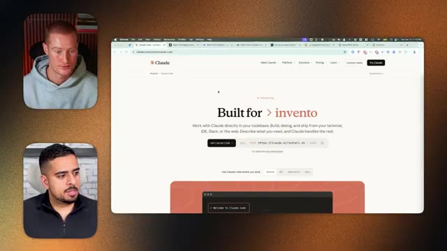
*⏱️ 00:14:55 — Capture d'écran montrant le site web de Claude (claude.ai) présentant le produit 'Claude Code' avec la commande d'installation et deux intervenants en visioconférence sur le côté gauche.*

---

### ⏱️ `[00:15:10 - 00:15:28]` | Segment #36

**🔊 Audio (Transcription Intégrale Mot pour Mot en Français) :**
> Il y a une forme d'erreur parce que peut-être que votre ordinateur est différent, votre environnement est différent. Il y a quelque chose qui doit être réorganisé pour rendre cela possible. Si cela représente un obstacle pour vous, vous pouvez installer quelque chose appelé Warp. Aucun de nous deux n'y est affilié. C'est un terminal que vous pouvez utiliser pratiquement gratuitement. Il intègre un peu d'IA avec un petit niveau gratuit. Vous pouvez simplement lui donner cette même commande.

**👁️ Analyse Visuelle d'Écran (gemini-3.5-flash-lite) :**
**Interface & Outils** : Navigateur web affichant les sites officiels de Claude Code et du terminal Warp.

**Contenu textuel & Code** : URL d'installation de Claude Code et commande Homebrew `brew install --cask warp` visible sur le site de Warp.

**Action / Démonstration** : Présentation des outils logiciels recommandés pour pallier les erreurs de terminal ou d'environnement de développement.

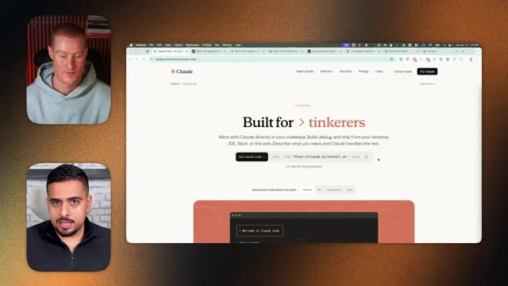
*⏱️ 00:15:14 — Capture d'écran du site officiel de Claude Code montrant l'interface de présentation de l'outil et la commande d'installation.*

*⏱️ 00:15:19 — Capture d'écran du site officiel du terminal Warp montrant la page d'accueil avec son slogan "The terminal with agents built in".*

---

### ⏱️ `[00:15:28 - 00:15:47]` | Segment #37

**🔊 Audio (Transcription Intégrale Mot pour Mot en Français) :**
> Vous copiez-collez cette chose spécifique juste ici. Et ensuite, s'il y a une erreur, il dira qu'il y a une erreur. Mais au lieu de vous la renvoyer pour que vous le découvriez, il ira le découvrir pour vous à votre place, demandera la permission et installera Cloud Code pour vous. Et puis, une fois que ce sera fait, vous verrez votre petit amigo et il apparaîtra. Vous verrez quelque chose comme ça.

**👁️ Analyse Visuelle d'Écran (gemini-3.5-flash-lite) :**
**Interface & Outils** : Navigateur web affichant les sites warp.dev et la page Claude Code.

**Contenu textuel & Code** : Pages web de présentation de logiciels de terminal avec agents IA et options d'abonnement Claude Code.
[DESC_IMAGE_1] Navigation sur le site web de Warp pour présenter le terminal intelligent.
[DESC_IMAGE_2] Présentation des forfaits tarifaires pour l'utilisation de Claude Code.

**Action / Démonstration** : Explications face caméra et analyse conceptuelle des marchés.

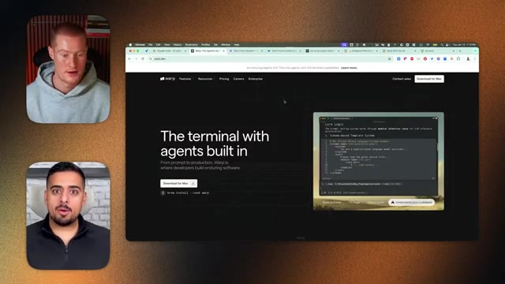
*⏱️ 00:15:33 — Capture d'écran montrant le site web de Warp (warp.dev) avec le slogan 'The terminal with agents built in'.*

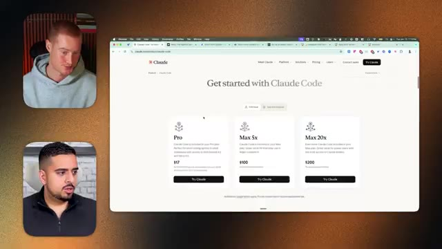
*⏱️ 00:15:42 — Capture d'écran montrant la page de tarification et de démarrage de Claude Code avec différentes offres (Pro, Max 5x, Max 20x).*

---

### ⏱️ `[00:15:47 - 00:16:19]` | Segment #38

**🔊 Audio (Transcription Intégrale Mot pour Mot en Français) :**
> Et ensuite vous serez prêts. Vous verrez un écran exactement comme celui-ci. Parfait. Assez facile. Ouais. Donc ce sera votre autoroute. Encore une fois, non affilié, mais c'est un moyen gratuit pour, un, utiliser un terminal. Si jamais vous avez besoin d'installer CloudCode, de supprimer CloudCode, de mettre à jour CloudCode, c'est vraiment un très bon moyen. Et vous pouvez faire ça pour toutes sortes de choses. Vous pouvez même lui demander, d'ailleurs, d'organiser des fichiers sur votre ordinateur. Tous ces IDE, tant qu'ils ont accès à votre ordinateur, vous êtes prêts. Donc voilà pour la partie installation. Est-ce qu'on est bon pour passer au concept ? Attends, avant de passer à ça, parlons de l'endroit où les utilisateurs vont réellement commencer à interagir avec CloudCode. Ouais,

**👁️ Analyse Visuelle d'Écran (gemini-3.5-flash-lite) :**
**Interface & Outils** : Navigateur web affichant le site de Claude (claude.ai/product/claude-code).

**Contenu textuel & Code** : Présentation des fonctionnalités de Claude Code : "Start in your terminal", "Integrate with your editor", et "Access anywhere", avec des liens d'installation.

**Action / Démonstration** : Le présentateur montre la page web officielle pour présenter l'outil Claude Code et son installation dans le terminal.

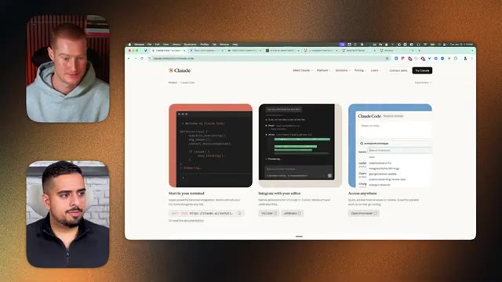
*⏱️ 00:15:55 — Capture d'écran montrant le site officiel de Claude affichant la page de présentation de Claude Code avec des options de terminal, d'intégration et d'accès.*

---

### ⏱️ `[00:16:19 - 00:16:39]` | Segment #39

**🔊 Audio (Transcription Intégrale Mot pour Mot en Français) :**
> vous pouvez donc utiliser ceci dans n'importe quel terminal. Vous pourriez utiliser Warp comme je vous l'ai montré. J'aime l'utiliser dans Cursor. Vous pouvez utiliser Anti-Gravity. Il y a tellement d'IDE que je n'ai même pas mentionnés. Un IDE est simplement un éditeur. Vous pouvez simplement ouvrir n'importe quel terminal. Et une fois que vous avez installé ceci et que vous utilisez les mots magiques Claude, vous devriez voir votre petit ami l'icône de crabe apparaître et vous êtes prêt à partir à partir de là.

**👁️ Analyse Visuelle d'Écran (gemini-3.5-flash-lite) :**
**Interface & Outils** : Navigateur web (Google Chrome), site officiel de Claude (claude.com/product/claude-code) et application de visioconférence.

**Contenu textuel & Code** : Documentation et présentation des fonctionnalités de Claude Code pour le terminal, l'intégration aux éditeurs (VS Code, Cursor, JetBrains) et l'accès multiplateforme.

**Action / Démonstration** : Présentation et navigation sur la page produit de Claude Code pour illustrer ses intégrations possibles avec différents EDI et terminaux.

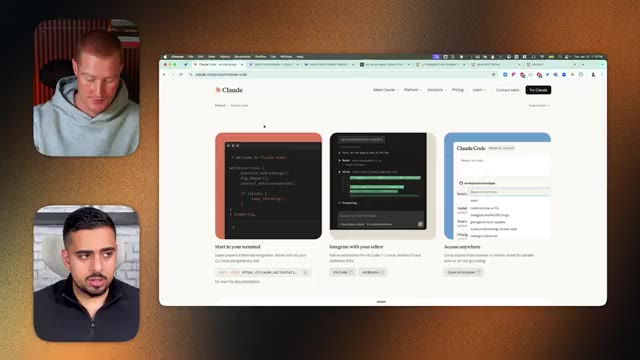
*⏱️ 00:16:24 — Capture d'écran montrant le site web de Claude Code avec trois blocs de fonctionnalités : "Start in your terminal", "Integrate with your editor", et "Access anywhere", ainsi que deux intervenants en visioconférence sur le côté gauche.*

---

### ⏱️ `[00:16:39 - 00:17:12]` | Segment #40

**🔊 Audio (Transcription Intégrale Mot pour Mot en Français) :**
> Parfait. Assez simple. Cool. Maintenant passons, parlons d'un, de ce que je veux automatiser en premier. Et ensuite nous allons montrer ce que nous avons réellement, ou ce que Mark a réellement construit après ça. Donc laissez-moi, je vais aller de l'avant et partager mon écran maintenant. Très bien. Donc en regardant mon écran, ce que je veux automatiser, c'est mon contenu format court. Donc pour certaines de ces personnes ou la majorité d'entre vous qui ne le savent pas, j'ai plutôt fondé sur le contenu format court. C'est un objectif pour 2026. Je veux vraiment exploiter cette plateforme ici, à la fois sur Instagram, YouTube Shorts, et TikTok. Très bien. Donc il y a environ une semaine, j'ai eu cette vidéo ici qui est devenue absolument folle. Elle a environ près de 825 000 vues,

**👁️ Analyse Visuelle d'Écran (gemini-3.5-flash-lite) :**
**Interface & Outils** : Navigateur web Google Chrome affichant le site Claude Code et un profil Instagram, avec fenêtres de visioconférence.

**Contenu textuel & Code** : Page de présentation de Claude Code avec des exemples d'intégration et interface de profil Instagram avec publications vidéo.

**Action / Démonstration** : Le présentateur navigue entre différents onglets de son navigateur après avoir partagé son écran.

---

### ⏱️ `[00:17:12 - 00:17:44]` | Segment #41

**🔊 Audio (Transcription Intégrale Mot pour Mot en Français) :**
> beaucoup d'engagement. Et j'ai en fait grandi, genre j'avais environ trois ou quatre cents abonnés avant ça. Cette vidéo unique est comme le déblocage de toute cette nouvelle chaîne que je pourrais exploiter. Et encore une fois, c'est un énorme objectif pour moi en allant vers 2026. Et puis voici un Short YouTube aussi. J'ai posté ça il y a trois jours et celui-ci, je vais juste rafraîchir, cartonne totalement. Donc l'objectif pour ce que je veux construire est que je veux mettre en place un système qui pourrait m'aider à automatiser cela. Et de cette façon, je n'ai pas besoin d'être super impliqué dedans. Parce que maintenant j'ai quelqu'un qui écrit réellement des scripts pour moi. Je dois approuver ces scripts. Je vais en fait et j'analyse quelles vidéos ont bien marché.

**👁️ Analyse Visuelle d'Écran (gemini-3.5-flash-lite) :**
**Interface & Outils** : Navigateur web affichant le tableau de bord de YouTube Studio et Instagram, avec les deux participants visibles en incrustation vidéo (PiP).

**Contenu textuel & Code** : Graphiques de performance vidéo, statistiques d'audience, nombre de vues (38.7K), abonnés gagnés (+148), revenus estimés et graphiques de rétention.

**Action / Démonstration** : Présentation et analyse des performances d'une vidéo spécifique sur YouTube Studio pour illustrer la croissance de la chaîne.

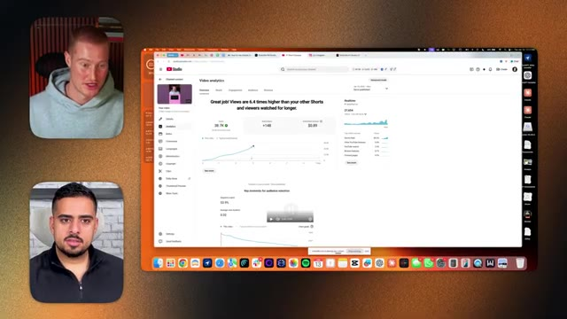
*⏱️ 00:17:28 — Capture d'écran de YouTube Studio affichant les analytiques détaillées d'une vidéo (statistiques de vues, abonnés gagnés, revenus et taux de rétention).*

---

### ⏱️ `[00:17:44 - 00:18:10]` | Segment #42

**🔊 Audio (Transcription Intégrale Mot pour Mot en Français) :**
> Donc je pourrais essayer de recréer le succès de cette vidéo. Donc si j'avais un système Claude Code que je pourrais juste genre mettre en pilote automatique ou je suppose que je, vous savez, il y aurait un petit peu d'humain dans la boucle pour m'aider à systématiser ce processus. Ce serait absolument, genre, la chose la plus précieuse au monde. Donc Mark a réellement construit ça. Donc examinons cela un peu plus en détail. Et si vous voyez à l'écran là, avant qu'il ne partage plus son écran, il avait 89 cents grâce à cette vidéo. Donc en échange de 89 cents qu'il me paie, j'ai construit le système pour lui.

**👁️ Analyse Visuelle d'Écran (gemini-3.5-flash-lite) :**
**Interface & Outils** : YouTube Studio et navigateur web.

**Contenu textuel & Code** : Statistiques de vues (38.7K), abonnés gagnés (+148), revenus estimés ($0.89) et métriques de rétention d'audience.

**Action / Démonstration** : Analyse des performances de la vidéo pour comprendre les facteurs de succès et envisager leur systématisation.

*⏱️ 00:17:51 — Capture d'écran montrant le tableau de bord YouTube Studio avec les analyses de performance d'une vidéo courte (Shorts) ainsi que les deux présentateurs en incrustation.*

---

### ⏱️ `[00:18:11 - 00:18:43]` | Segment #43

**🔊 Audio (Transcription Intégrale Mot pour Mot en Français) :**
> Alors, entrons dans le vif du sujet sur le plan conceptuel pour le public. Donc, pour ne pas vous perdre. Le concept de base, c'est que Brock, comme il l'a dit, veut passer en mode célébrité sur les formats courts, nous voulions nous concentrer principalement sur Instagram. Donc, la première façon d'y parvenir, c'est de scraper. Maintenant, si nous demandons simplement à Claude Code d'aller scraper Instagram, c'est une tâche absolument gigantesque, car il y a de nombreuses couches de sécurité par proxy, toutes ces choses-là. Et pour effectuer réellement le scraping, nous allons utiliser une marketplace appelée Apify. Vous pouvez voir cela comme l'App Store où vous pouvez trouver des tonnes de scrapers.

**👁️ Analyse Visuelle d'Écran (gemini-3.5-flash-lite) :**
**Interface & Outils** : Navigateur web Google Chrome affichant une application de tableau blanc ou de prise de notes (ex: Excalidraw).

**Contenu textuel & Code** : Schéma avec les icônes des réseaux sociaux (Instagram, TikTok, YouTube) pointant vers une étape "scrape", puis vers une base de données ("database"), et enfin vers la création de contenu ("create content").

**Action / Démonstration** : Présentation du concept architectural du système de scraping et de génération de contenu automatisé.

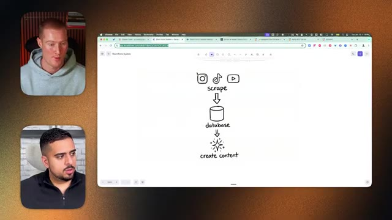
*⏱️ 00:18:19 — Un schéma explicatif affiché à l'écran montrant le flux conceptuel du système de création de contenu pour les formats courts.*

---

### ⏱️ `[00:18:43 - 00:19:01]` | Segment #44

**🔊 Audio (Transcription Intégrale Mot pour Mot en Français) :**
> Il y en a qui sont littéralement conçus pour Instagram, TikTok, et ainsi de suite. Et vous pouvez essentiellement les louer pour exécuter vos tâches moyennant une petite redevance à l'utilisation. Nous allons donc utiliser cela. Nous allons le stocker dans une base de données. Et ensuite, nous l'utiliserons pour aider à créer ces idées pour Brock. Donc encore une fois, nous allons nous concentrer principalement sur Instagram.

**👁️ Analyse Visuelle d'Écran (gemini-3.5-flash-lite) :**
**Interface & Outils** : Navigateur web affichant une application de tableau blanc ou de prise de notes (ex: Miro, Excalidraw ou équivalent).

**Contenu textuel & Code** : Icônes de réseaux sociaux (Instagram, TikTok, YouTube), flèches de flux, icône de base de données (« database ») et icône d'étoiles scintillantes (« create content »).

**Action / Démonstration** : Présentation visuelle du système automatisé d'extraction et de création de contenu par le présentateur.

*⏱️ 00:18:47 — Schéma explicatif illustrant le flux de travail pour la création de contenu court, montrant le scraping à partir des réseaux sociaux (Instagram, TikTok, YouTube), le stockage dans une base de données, puis la génération de contenu.*

---

### ⏱️ `[00:19:01 - 00:19:21]` | Segment #45

**🔊 Audio (Transcription Intégrale Mot pour Mot en Français) :**
> Et au lieu de payer 10 dollars à chaque fois comme vous avez l'habitude de le faire, en utilisant des plateformes comme Lovable et Bolt et tout le reste, nous pouvons simplement utiliser quelque chose appelé SQLite. Et ce qu'est SQLite, c'est littéralement une base de données gratuite que vous pouvez faire tourner localement sur votre ordinateur. Cela vous libère parce qu'à chaque fois que je devais expérimenter avant, je devais débourser encore 10 balles pour Supabase.

**👁️ Analyse Visuelle d'Écran (gemini-3.5-flash-lite) :**
**Interface & Outils** : Navigateur web affichant un outil de dessin ou de tableau blanc numérique.

**Contenu textuel & Code** : Diagramme schématique représentant le flux de données des réseaux sociaux (Instagram, TikTok, YouTube) convergent vers une base de données SQLite.

**Action / Démonstration** : Illustration visuelle du concept de stockage de données centralisé pour les plateformes de contenu.

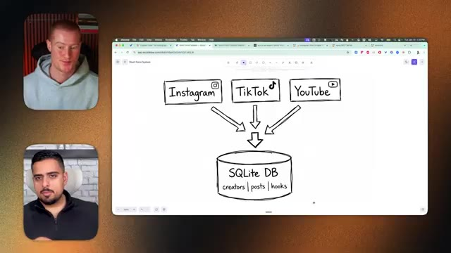
*⏱️ 00:19:06 — Schéma explicatif dessiné sur une application web montrant l'intégration des flux d'Instagram, TikTok et YouTube vers une base de données SQLite DB (avec les tables creators, posts, hooks).*

---

### ⏱️ `[00:19:21 - 00:19:57]` | Segment #46

**🔊 Audio (Transcription Intégrale Mot pour Mot en Français) :**
> Donc cela vous permet de construire Vibecode gratuitement. Si vous voulez passer au niveau supérieur et ensuite mettre à niveau vers Supabase, c'est toujours quelque chose que vous pouvez faire après. C'est donc la base de données que nous allons utiliser et là-dedans nous allons publier ou héberger des choses comme les créateurs, les publications, et les accroches que nous extrayons. En termes de flux de travail, si vous vous souvenez avant, mon centre de commande YouTube, j'ai une entrée et plusieurs sorties dans ce cas, Brock veut juste prononcer les mots rends-moi viral comme une seule commande et ensuite écrire un sujet ou un lien où Claude peut aller lire sur n'importe quel outil et ensuite générer 20 accroches puis classer ces accroches par un score de viralité cette viralité

**👁️ Analyse Visuelle d'Écran (gemini-3.5-flash-lite) :**
**Interface & Outils** : Navigateur web affichant un outil de dessin de type diagramme (Excalidraw).

**Contenu textuel & Code** : Schéma d'architecture de données avec un cylindre représentant une base de données SQLite DB contenant les tables : creators, posts, hooks.

**Action / Démonstration** : Le présentateur explique l'architecture de la base de données SQLite utilisée pour le projet.

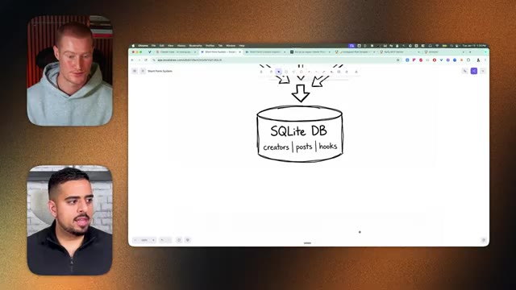
*⏱️ 00:19:30 — Un schéma dessiné à la main montrant une base de données SQLite DB avec les tables creators, posts et hooks, accompagné de deux intervenants en vignette vidéo.*

---

### ⏱️ `[00:19:57 - 00:20:29]` | Segment #47

**🔊 Audio (Transcription Intégrale Mot pour Mot en Français) :**
> score, je vais en parler juste en dessous et ensuite nous en choisirons trois meilleurs et nous créerons des légendes pour cela, Brock peut avoir une entrée, une idée et ensuite avoir de multiples sorties. Attends, question, donc remonte un peu. Donc sur le plan des sujets, le contexte est vraiment important ici, n'est-ce pas ? Parce que si je donne un petit paragraphe sur ce que je veux que soit le contexte, ce ne sera probablement pas le meilleur résultat, n'est-ce pas ? Ça ne va pas générer les meilleurs accroches parce que ça n'aura pas de contexte, ou bien est-ce que ça va le prendre, puis faire des recherches sur le web, et ensuite trouver la bonne quantité de contexte et l'utiliser, ou est-ce que je me trompe là-dessus ? Pourrais-tu m'expliquer cela ?

**👁️ Analyse Visuelle d'Écran (gemini-3.5-flash-lite) :**
**Interface & Outils** : Navigateur web affichant un tableau blanc ou un outil de mindmapping/schématisation (Miro ou similaire).

**Contenu textuel & Code** : Schéma séquentiel avec des icônes et du texte : 1. topic (ampoule), 2. generate 20 hooks, 3. rank by viral score (graphique), 4. pick top 3 (coche), 5. create captions (document) avec la mention "OUTPUT: 3 hooks, 9 captions".

**Action / Démonstration** : Présentation visuelle et explication du processus de génération de contenu automatisé basé sur l'IA par les deux intervenants visibles en incrustation vidéo.

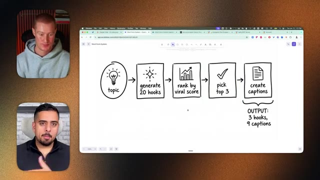
*⏱️ 00:20:05 — Schéma de workflow pour un système de contenu court montrant les étapes allant du sujet initial à la création de légendes finales.*

---

### ⏱️ `[00:20:29 - 00:20:58]` | Segment #48

**🔊 Audio (Transcription Intégrale Mot pour Mot en Français) :**
> Non, c'est sûr. Donc la première fois que vous utilisez ceci, tout ce que nous utilisons est un modèle de langage. Les modèles de langage ne sont pas magiques. Ils ne sont pas super intelligents. Ils cherchent des motifs. Donc si vous dites, allez voir ce code cloud ou cette fonctionnalité co-work, et voici le lien, et que vous ne dites rien d'autre, et qu'il n'y a pas de préférences ou d'exemples de la façon dont Brock écrit ses scripts, il ira regarder dans la base de données où nous avons scrapé d'autres créateurs et se dira, ok, je pense que je vais faire un remix entre les différents créateurs et mes connaissances sur la façon d'écrire des accroches à partir de, je ne sais pas, 2024 ou 2025.

**👁️ Analyse Visuelle d'Écran (gemini-3.5-flash-lite) :**
**Interface & Outils** : Application web de type tableau blanc / mind mapping affichée dans un navigateur Google Chrome.

**Contenu textuel & Code** : Un flux logique séquentiel avec des icônes : 1. Topic (Sujet), 2. Generate 20 hooks (Générer 20 accroches), 3. Rank by viral score (Classer par score viral), 4. Pick top 3 (Sélectionner les 3 meilleures), 5. Create captions (Créer les légendes). Section de sortie indiquée en bas à droite : "OUTPUT: 3 hooks, 9 captions".

**Action / Démonstration** : Le présentateur explique visuellement le workflow et le processus automatisé de génération de contenu à l'aide d'un schéma explicatif.

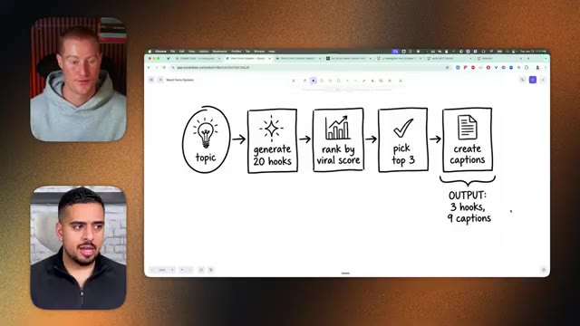
*⏱️ 00:20:36 — Un schéma explicatif étape par étape montrant le processus de création de contenu court, de l'idée (« topic ») jusqu'à la production finale.*

---

### ⏱️ `[00:20:58 - 00:21:34]` | Segment #49

**🔊 Audio (Transcription Intégrale Mot pour Mot en Français) :**
> Ce sera votre première production. Ensuite, au fur et à mesure que vous itérez et dites, non, non, ce n'est pas comme ça que j'aime rédiger les accroches, voici l'exemple de cette vidéo à 800 000 vues, essayez de imiter davantage ce style et dites à ClaudeMD, qui est comme le cerveau du centre de commande, de mettre cela à jour dans sa mémoire, c'est donc ainsi que cela s'améliore progressivement, compris ? Oui, donc ça va littéralement devenir de plus en plus intelligent au fur et à mesure que je l'utilise, hypothétiquement, c'est ça ? Oui, tant que vous continuez à lui dire, écoutez, euh, cette fois, c'était votre erreur ou votre défaut, enregistrons cela en mémoire pour éviter de refaire la même chose à l'avenir, donc vous devez être proactif pour vous assurer qu'il apprend, à 100 %, et en ce qui concerne le score de viralité, nous avons en quelque sorte inventé ça, Brock et moi, juste pour trouver quelque chose là-bas

**👁️ Analyse Visuelle d'Écran (gemini-3.5-flash-lite) :**
**Interface & Outils** : Navigateur web affichant un outil de tableau blanc ou de prise de notes (type Miro ou équivalent).

**Contenu textuel & Code** : Diagramme avec les étapes suivantes : "topic", "generate 20 hooks", "rank by viral score", "pick top 3", "create captions" menant à une sortie ("OUTPUT: 3 hooks, 9 captions").

**Action / Démonstration** : Présentation visuelle et explication étape par étape du système de génération de contenu et de choix des accroches virales.

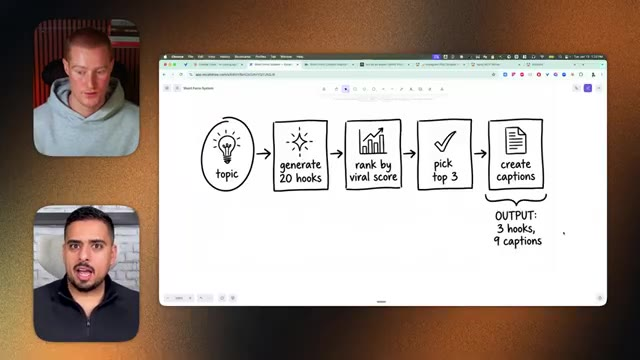
*⏱️ 00:21:07 — Un schéma explicatif dessiné à la main (style flux de travail ou mindmap) montrant les étapes de génération de contenu, accompagné de deux flux vidéo incrustés des interlocuteurs.*

---

### ⏱️ `[00:21:34 - 00:22:10]` | Segment #50

**🔊 Audio (Transcription Intégrale Mot pour Mot en Français) :**
> il y a certains critères donc ce score de viralité est basé sur la curiosité, l'émotion, la brièveté, la pertinence — la pertinence étant le degré de tendance du sujet, ce qui, sur les formats courts, même si je ne suis pas un spécialiste des formats courts, semble être rarement important —, et ensuite vous avez l'unicité et l'adéquation à la plateforme. Ces ratios peuvent être faussés, donc ces pondérations peuvent être mises à jour, vous voulez juste être capable de concevoir le système de telle sorte que si vous avez besoin de les mettre à jour, vous le puissiez. Et ensuite, cela mène à un aperçu global du processus, qui consiste à scraper les concurrents, à obtenir de l'inspiration, peut-être à ajouter vos propres exemples également, à y ajouter un peu de magie, et à générer le contenu. Et puis la dernière partie du cycle de vie, que nous ne

**👁️ Analyse Visuelle d'Écran (gemini-3.5-flash-lite) :**
**Interface & Outils** : Navigateur web affichant un outil de mind mapping / tableau blanc interactif.

**Contenu textuel & Code** : Schéma avec les pourcentages et libellés des différents critères de viralité (Viral Score).

**Action / Démonstration** : Le présentateur explique les composantes du score de viralité en pointant ou illustrant chaque critère.

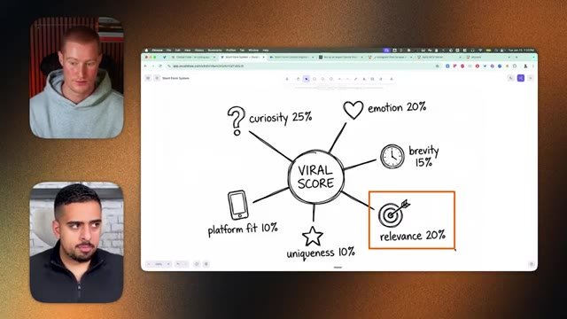
*⏱️ 00:21:43 — Schéma heuristique (mind map) détaillant les critères du 'Viral Score' (curiosity 25%, emotion 20%, brevity 15%, relevance 20%, uniqueness 10%, platform fit 10%).*

---

### ⏱️ `[00:22:10 - 00:22:43]` | Segment #51

**🔊 Audio (Transcription Intégrale Mot pour Mot en Français) :**
> couvrir dans cette vidéo, mais ce que vous pourriez faire plus tard, c'est qu'après avoir créé la chose, lui dire d'aller scraper votre propre Instagram pour voir comment il s'en est sorti afin qu'il puisse réellement apprendre de ce qui a bien fonctionné et de ce qui n'a pas bien fonctionné. C'est là que vous avez cette boucle de rétroaction complète. Oui, cette partie d'analyse est la partie qui m'excite le plus, honnêtement, genre, scraper les concurrents, c'est super. Trouver des idées, comprendre mon style d'accroche, tout ça, mais genre, analyser ce qui fonctionne, parce qu'en réalité ce que j'ai remarqué, au moins dans le contenu court, vous trouvez, genre, les accroches et, genre, le format de ce qui fonctionne et vous doublez, vous triplez la mise là-dessus, au lieu d'essayer tout un tas de

**👁️ Analyse Visuelle d'Écran (gemini-3.5-flash-lite) :**
**Interface & Outils** : Navigateur web affichant un tableau blanc ou un outil de mind mapping.

**Contenu textuel & Code** : Schéma en boucle avec des blocs représentant les étapes du processus de création et de suivi de contenu.

**Action / Démonstration** : Le présentateur explique le cycle itératif de création de contenu automatisé.

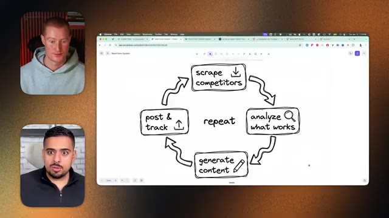
*⏱️ 00:22:18 — Un schéma circulaire dessiné à la main montrant un système de contenu en quatre étapes : 'scrape competitors', 'analyze what works', 'generate content', 'post & track', avec 'repeat' au centre.*

---

### ⏱️ `[00:22:43 - 00:23:16]` | Segment #52

**🔊 Audio (Transcription Intégrale Mot pour Mot en Français) :**
> différentes choses, voir ce qui fonctionne. Et une fois que vous trouvez quelque chose qui est vraiment important, cette partie d'analyse de tout ça est probablement ce qui m'enthousiasme le plus. Oui, monsieur. Ouais. Donc, en ce ce qui concerne les liens, ce sont les liens que Brock m'a fournis de différents créateurs dont il veut s'inspirer pour les formats courts. Donc c'étaient, nous y reviendrons brièvement. Et pour ce qui est de la création proprement dite, une chose que j'aime faire, encore une fois, parce que je suis paresseux, c'est que vous pouvez utiliser l'outil de recherche que vous voulez. Dans mon cas, j'aime utiliser Perplexity Labs. C'est cette icône juste ici. Ils ont aussi une fonctionnalité plutôt généreuse. Et ce que ça vous permet de faire, c'est de lui donner une idée. Donc pour moi, j'utilise juste

**👁️ Analyse Visuelle d'Écran (gemini-3.5-flash-lite) :**
**Interface & Outils** : Navigateur web affichant un outil de mindmapping ou de dessin collaboratif (style Excalidraw).

**Contenu textuel & Code** : Schéma sous forme de boucle avec quatre étapes clés : 1) scraper les concurrents, 2) analyser ce qui fonctionne, 3) générer du contenu, 4) publier et suivre les performances, avec la mention centrale 'repeat'.

**Action / Démonstration** : Présentation du processus itératif et du workflow pour la création et l'optimisation de contenu court.

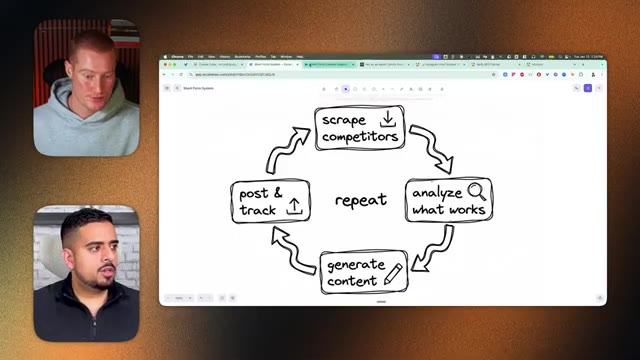
*⏱️ 00:22:51 — Un schéma circulaire manuscrit décrivant un système de contenu court, avec les étapes 'scrape competitors', 'analyze what works', 'generate content', 'post & track' et 'repeat' au centre.*

---

### ⏱️ `[00:23:16 - 00:23:49]` | Segment #53

**🔊 Audio (Transcription Intégrale Mot pour Mot en Français) :**
> Whisperflow. Je m'emballe pendant environ cinq minutes sur ce que j'essaie de construire. Et ensuite, je jette ça dans quelque chose comme Claude ou ChatGPT et je lui dis : est-ce que tu peux transformer ça en un prompt plus raffiné pour quelque chose comme Replexi Labs ? Et ensuite, on obtient un truc légendaire comme ça, où il n'y a aucune chance que je l'aurais réellement écrit moi-même, où on ne va pas tout lire, mais ça dit simplement : agis en tant qu'expert, chef de produit senior et ingénieur de prompt. J'ai besoin que tu écrives un méga-prompt très détaillé conçu pour la toute dernière version la plus performante de Claude code disponible aujourd'hui. Pourquoi est-ce que je dis ça ? Je voulais en savoir plus sur les derniers progrès de Claude code.

**👁️ Analyse Visuelle d'Écran (gemini-3.5-flash-lite) :**
**Interface & Outils** : Navigateur web affichant l'interface de Perplexity Pro.

**Contenu textuel & Code** : Interface utilisateur avec la barre de recherche ("Ask anything...") et quatre suggestions de prompts en dessous.

**Action / Démonstration** : Présentation de l'outil Perplexity Pro utilisé pour affiner ou exécuter des prompts.

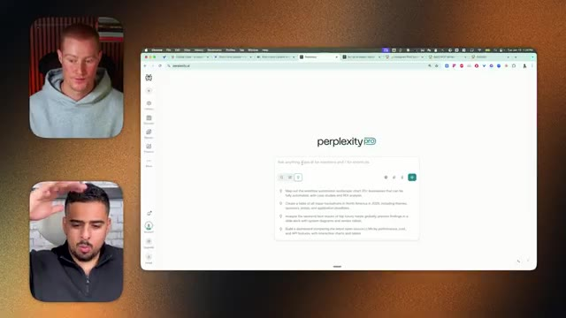
*⏱️ 00:23:24 — Capture d'écran montrant l'interface web de Perplexity Pro avec le champ de recherche central et des exemples de requêtes suggérées en dessous.*

---

### ⏱️ `[00:23:49 - 00:24:09]` | Segment #54

**🔊 Audio (Transcription Intégrale Mot pour Mot en Français) :**
> ainsi il peut affiner le prompt en conséquence. Donc je n'ai pas à me soucier de ce qui a changé dans cette version. Comment dois-je lui parler maintenant ? Il fait ce travail ingrat pour moi. Et je dis, s'il te plaît, utilise tes capacités de navigation pour vérifier exactement quelle version est à la pointe de la technologie. Ensuite, je lui dis quel est l'objectif. Nous voulons faire un aspirateur de concurrents. Nous voulons des analyses internes. Nous voulons un tableau de bord de centre de commande plus tard, ce n'est pas une priorité.

**👁️ Analyse Visuelle d'Écran (gemini-3.5-flash-lite) :**
**Interface & Outils** : Navigateur web (Google Chrome) et interface de visioconférence.

**Contenu textuel & Code** : Texte d'un prompt détaillé demandant à agir comme un Product Manager et Prompt Engineer senior pour la dernière version de Claude Code, incluant des fonctionnalités clés comme un Competitor Scraper et un Internal Analytics Engine.

**Action / Démonstration** : Affichage et lecture d'un exemple de méga-prompt destiné à l'intelligence artificielle pour la conception de produit.

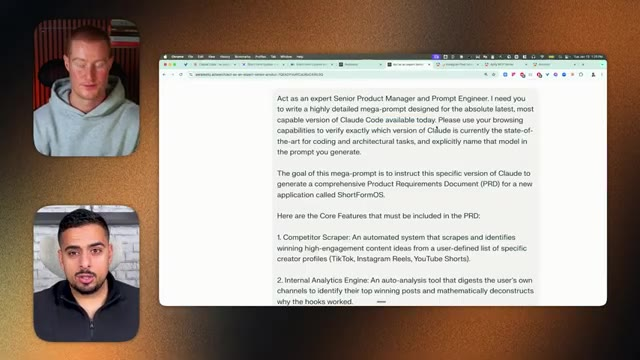
*⏱️ 00:23:54 — Capture d'écran montrant un navigateur web affichant un long méga-prompt destiné à Claude pour générer un PRD pour une application nommée ShortFormOS, avec deux intervenants en visioconférence sur la gauche.*

---

### ⏱️ `[00:24:09 - 00:24:44]` | Segment #55

**🔊 Audio (Transcription Intégrale Mot pour Mot en Français) :**
> Et ensuite, nous parcourons le flux de travail. Donc, une fois que je fais ça, ça revient. Nous faisons un zoom arrière ici avec un exemple de prompt. Et je lui dis, est-ce que tu peux simplement transformer ça en un fichier markdown ? pour que je puisse simplement le glisser-déposer dans un tout nouveau dossier Claude vierge, ce n'est même pas un dossier Claude, c'est un dossier que tu importes et que tu utilises Claude Code pour lire ce qu'il y a dans ce dossier, donc tu ajoutes simplement ça à, genre, ton dossier sur ton bureau essentiellement, c'est aussi simple que ça, littéralement, juste pour montrer à ton audience, tu irais sur « ouvrir le dossier », d'accord, tu créerais un nouveau dossier et ensuite, quand tu l'ouvres dans Cursor ici, tu n'auras absolument rien à part le nom du dossier, ça va

**👁️ Analyse Visuelle d'Écran (gemini-3.5-flash-lite) :**
**Interface & Outils** : Navigateur web, Éditeur de code Cursor, Interface de terminal Claude Code.

**Contenu textuel & Code** : Fichier Markdown généré, commandes de terminal, configuration de serveur MCP, intégration d'API.

**Action / Démonstration** : Génération d'un fichier markdown à partir d'un prompt et configuration d'un outil MCP dans le terminal.

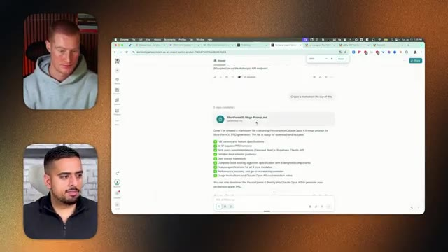
*⏱️ 00:24:18 — Une interface de navigateur web montrant un fichier markdown généré (.md) suite à une requête utilisateur.*

*⏱️ 00:24:35 — L'éditeur de code Cursor affichant une ligne de commande Claude Code avec l'ajout d'un serveur MCP Apify.*

---

### ⏱️ `[00:24:44 - 00:25:20]` | Segment #56

**🔊 Audio (Transcription Intégrale Mot pour Mot en Français) :**
> vide. Donc pour moi, c'est là que j'ai fait un glisser-déposer du fichier exact que je viens de vous montrer ici. C'était le seul fichier dans mon curseur et rien d'autre n'existait. Tout le reste est venu de l'utilisation de Cloud Code. Ouais, en utilisant F. Ouais. Donc c'ذest la base. Maintenant, j'aurais dû être un peu plus intentionnel pour parcourir le prompt et m'assurer que toutes les fonctionnalités proposées par l'IA sont celles qui m'intéressent. Mais j'ai utilisé ça pour faire ça rapidement et grossièrement. C'est tout. En ce qui concerne Appify, l'un des scrapers que nous louons s'appelle un scraper de publications Instagram. Celui-ci extrait les publications réelles, les légendes, etc. Mais il ne prend pas la transcription des vidéos Instagram elles-mêmes.

**👁️ Analyse Visuelle d'Écran (gemini-3.5-flash-lite) :**
**Interface & Outils** : Éditeur de code Cursor et interface web de navigateur.

**Contenu textuel & Code** : Structure de projet, commandes bash d'intégration MCP, et génération d'un fichier markdown "ShortFormOS-Mega-Prompt.md".

**Action / Démonstration** : Configuration d'un outil MCP et génération d'un fichier de prompt par l'IA.

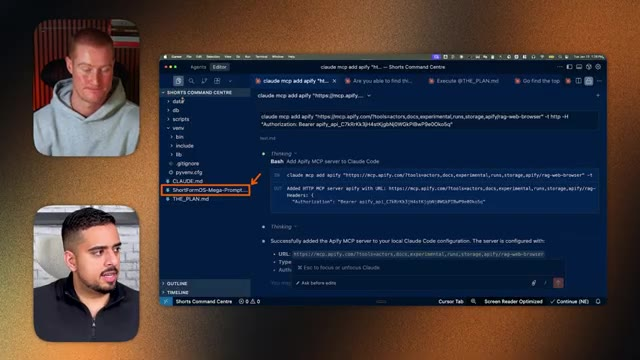
*⏱️ 00:24:53 — Vue de l'interface de l'éditeur Cursor montrant la structure des dossiers du projet "SHORTS COMMAND CENTRE" et une commande bash pour ajouter le serveur MCP Apify.*

*⏱️ 00:25:02 — Capture d'écran d'un navigateur affichant l'interface web d'un assistant IA montrant un fichier markdown généré nommé "ShortFormOS-Mega-Prompt.md".*

---

### ⏱️ `[00:25:20 - 00:25:45]` | Segment #57

**🔊 Audio (Transcription Intégrale Mot pour Mot en Français) :**
> Si tu n'as pas envie d'aller faire du shopping pour voir quelle application dans cet Appify App Store peut faire ça, tu peux utiliser leur serveur MCP qui peut simplement aller naviguer dans leur base de données pour toi. Donc si tu lui dis, écoute, j'ai besoin de faire X, Y et Z au coût le plus bas, il ira regarder tous ce qu'on appelle des Acteurs dans l'App Store. Il choisira les moins chers et ceux qui sont les mieux notés et te les recommandera. Et ensuite, tu construis ton flux de travail après. Ouais, ça rend les choses tellement faciles.

**👁️ Analyse Visuelle d'Écran (gemini-3.5-flash-lite) :**
**Interface & Outils** : Navigateur web affichant la plateforme Apify.

**Contenu textuel & Code** : Documentation de l'API Instagram Post Scraper avec un exemple de code Python (`from apify_client import ApifyClient`) et les onglets de configuration (Python, JavaScript, CLI, OpenAPI, HTTP, MCP).

**Action / Démonstration** : Le présentateur commente l'utilisation de l'App Store d'Apify et de son serveur MCP pour automatiser la recherche d'outils et de bases de données.

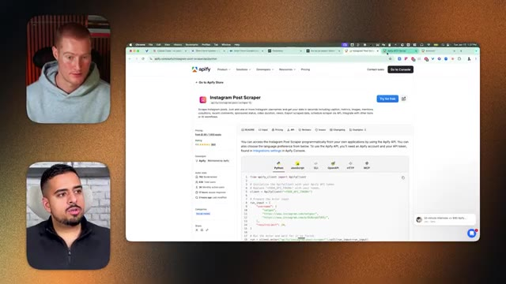
*⏱️ 00:25:26 — Capture d'écran montrant le site web d'Apify avec la page de l'outil "Instagram Post Scraper" et du code source Python affiché en bas de page.*

---

### ⏱️ `[00:25:45 - 00:26:18]` | Segment #58

**🔊 Audio (Transcription Intégrale Mot pour Mot en Français) :**
> Il faut adorer le MCP. Oui, monsieur. Et puis en ce qui concerne l'utilisation et l'installation du MCP, c'est là que les personnes non techniques pourraient tout simplement jeter l'éponge. Ils ont rendu les choses faciles aussi. Donc, si vous allez simplement sur mcp.appify.com, l'URL exacte, vous verrez quelque chose comme ça. Vous pouvez choisir ce qui compte pour vous. Je cliquerais simplement sur des éléments liés au stockage de données. Je choisirais tout simplement tout si vous débutez. Vous ne savez pas ce que vous faites. Et puis tout en bas, sur les intégrations, tout ce que vous avez à faire, c'est de choisir quelque chose comme Cursor ou Claude Code, et ensuite cela vous donnera la commande d'une seule ligne. Et si vous cliquez sur « ajouter un jeton API », cela mettra un espace réservé. Tout ce que vous avez à

**👁️ Analyse Visuelle d'Écran (gemini-3.5-flash-lite) :**
**Interface & Outils** : Navigateur web Google Chrome affichant la page mcp.apify.com.

**Contenu textuel & Code** : URL mcp.apify.com visible dans la barre d'adresse, options de configuration du serveur MCP, outils "Actor management" (Search Actors, Actor details, Call Actor) et options de documentation.

**Action / Démonstration** : Navigation sur le site web du serveur MCP d'Apify pour présenter sa configuration aux utilisateurs.

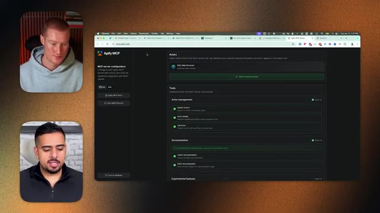
*⏱️ 00:25:54 — Capture d'écran montrant le site web "Apify MCP" avec la configuration du serveur MCP et la liste des outils disponibles (Acteurs, Documentation).*

---

### ⏱️ `[00:26:18 - 00:26:40]` | Segment #59

**🔊 Audio (Transcription Intégrale Mot pour Mot en Français) :**
> ce qu'il faut faire c'est aller récupérer votre clé API Appify depuis votre compte, laquelle si vous allez sur votre compte est littéralement juste ici, vous la récupérez, vous la collez exactement ici, juste là, à la place de ces petites accolades, vous prenez cette commande, vous ouvrez une toute nouvelle session de terminal avec cloud code et vous la collez. Donc je vais vous montrer dans une seconde après avoir masqué ma clé API, à quoi ça ressemble.

**👁️ Analyse Visuelle d'Écran (gemini-3.5-flash-lite) :**
**Interface & Outils** : Navigateur web affichant le tableau de bord de la plateforme Apify et une fenêtre contextuelle d'intégration Claude Code.

**Contenu textuel & Code** : URL de l'API, en-tête d'autorisation Bearer et jeton personnel masqué.

**Action / Démonstration** : Récupération de la clé API Apify depuis les paramètres du compte pour l'insérer dans la commande d'intégration de Claude Code.

*⏱️ 00:26:24 — Vue sur les paramètres du compte Apify montrant la section des jetons d'API personnels (Personal API tokens).*

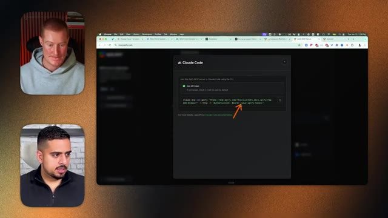
*⏱️ 00:26:29 — Affichage d'une fenêtre modale contextuelle avec une commande CLI pour Claude Code contenant un espace réservé pour le jeton API.*

---

### ⏱️ `[00:26:40 - 00:27:08]` | Segment #60

**🔊 Audio (Transcription Intégrale Mot pour Mot en Français) :**
> Et on partira de là. Ouais. J'ai un truc à dire là-dessus. Parce que j'ai utilisé Apify par le passé pour certains développements et au final, par exemple, pour essayer de créer la même chose, et trouver un "acteur" qui fonctionne vraiment était parfois une galère parce que ça marchait avant, puis un truc a cassé et ce n'était plus à jour. Ils ne faisaient plus la maintenance, ou peu importe. Je ne sais même pas, mais je pense que le truc du MCP rend les choses tellement plus simples. Et je suis bien content que tu aies soulevé la question, parce qu'ainsi il ira directement trouver celui qui fonctionne en ce moment. Donc tu n'as pas besoin d'aller le faire toi-même. Ou alors il va carrément les tester. Donc il va l'exécuter en mode celui-là est nul.

**👁️ Analyse Visuelle d'Écran (gemini-3.5-flash-lite) :**
**Interface & Outils** : Navigateur web (Google Chrome), site Apify (mcp.apify.com), fenêtres de visioconférence.

**Contenu textuel & Code** : Documentation d'intégration pour Claude Code, ligne de commande (`claude mcp add apify ...`), champ pour ajouter un jeton API.

**Action / Démonstration** : Présentation de la configuration d'un serveur MCP Apify pour Claude Code.

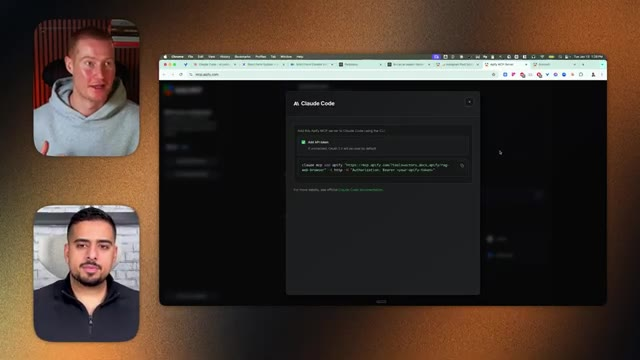
*⏱️ 00:26:47 — Capture d'écran montrant le site web d'Apify avec une fenêtre modale d'intégration pour Claude Code, ainsi que deux participants en visio.*

---

### ⏱️ `[00:27:08 - 00:27:28]` | Segment #61

**🔊 Audio (Transcription Intégrale Mot pour Mot en Français) :**
> Laisse-moi aller en chercher un autre. Celui-là est nul. Je vais aller en chercher un autre. Il fait le travail ingrat à ta place, c'est pour ça que j'aime bien. Donc voilà à quoi ça ressemble dans Kurser. Évidemment, j'ai masqué mes clés API. J'ai collé cette commande exacte que je vous ai montré avant. Donc ce `clawed MCP add appify`. J'avais juste à ajouter ma clé API juste ici. Et ensuite, ça y est allé, ça a exécuté cette commande.

**👁️ Analyse Visuelle d'Écran (gemini-3.5-flash-lite) :**
**Interface & Outils** : Cursor (éditeur de code/IDE) avec intégration de terminal de commandes et interface utilisateur en incrustation montrant les présentateurs.

**Contenu textuel & Code** : Lignes de commande pour ajouter un serveur MCP Apify (`claude mcp add apify ...`), avec des clés d'autorisation masquées en orange et des retours de terminal (Bash / Thinking).

**Action / Démonstration** : Le présentateur montre l'exécution d'une commande d'intégration et la configuration réussie d'un serveur MCP dans l'environnement de développement.

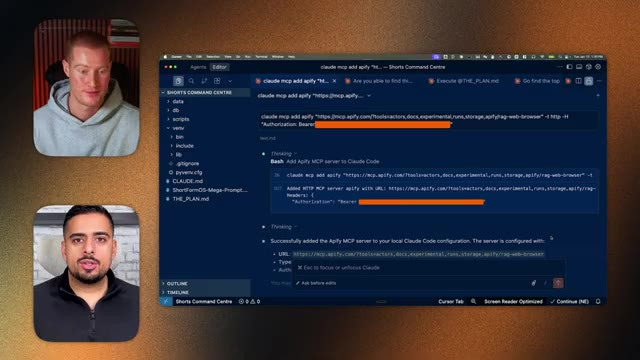
*⏱️ 00:27:13 — Capture d'écran montrant l'interface du logiciel Cursor avec un terminal de commande et les flux d'exécution d'un script d'intégration MCP (Model Context Protocol).*

---

### ⏱️ `[00:27:28 - 00:27:47]` | Segment #62

**🔊 Audio (Transcription Intégrale Mot pour Mot en Français) :**
> Et ensuite, ça revient en bas en disant ajouté avec succès. Et tout ce que vous avez à faire, c'est de redémarrer une toute nouvelle session dans Cloud Code et cela prendra effet. Et je vais vous montrer comment vous pouvez vérifier que vous avez ce serveur MCP. Quand vous avez un tout nouvel onglet, vous avez juste à écrire MCP, puis à mettre statut MCP. Vous verrez juste ici, nous avons ceci de connecté.

**👁️ Analyse Visuelle d'Écran (gemini-3.5-flash-lite) :**
**Interface & Outils** : Éditeur de code (Cursor / Terminal intégré)

**Contenu textuel & Code** : Commande `claude mcp add apify` et message de confirmation « Successfully added the Apify MCP server to your local Claude Code configuration ».

**Action / Démonstration** : Ajout d'un serveur MCP dans l'environnement de développement via la ligne de commande.

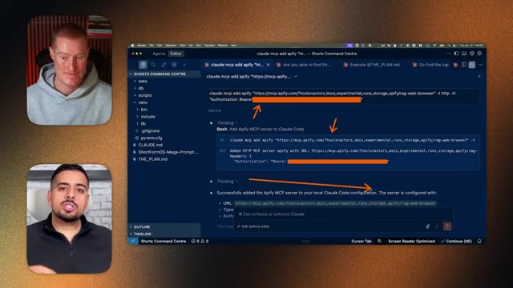
*⏱️ 00:27:33 — Un écran d'ordinateur montrant l'éditeur de code Cursor avec des lignes de commande pour ajouter un serveur MCP Apify, avec des flèches orange pointant vers les résultats de la configuration et le message de succès.*

---

### ⏱️ `[00:27:48 - 00:28:07]` | Segment #63

**🔊 Audio (Transcription Intégrale Mot pour Mot en Français) :**
> Donc nous savons que nous sommes au Valhalla. Nous sommes parés. Nous sommes dans la terre promise. Et au-delà de ça, tout ce que vous avez à faire c'est, comme je viens de le dire, es-tu capable de trouver ceci ? Donc je lui ai dit, va chercher ce scraper Appify. Je voulais juste vérifier une dernière fois que ça fonctionne. Vous pouvez voir juste ici, dès que vous voyez cette petite icône verte et que vous voyez MCP underscore quelque chose, le MCP fonctionne.

**👁️ Analyse Visuelle d'Écran (gemini-3.5-flash-lite) :**
**Interface & Outils** : Éditeur de code Cursor, interface de l'outil Claude Code.

**Contenu textuel & Code** : Arborescence de projet "Shorts Command Centre" (dossiers data, db, scripts, venv, fichiers CLAUDE.md, THE_PLAN.md) et la fenêtre de chat Claude Code affichant le logo en forme de pixel art et le prompt "Type /model to pick the right tool for the job." avec le champ de saisie en bas.

**Action / Démonstration** : Navigation et configuration du projet dans l'éditeur de code pour utiliser Claude Code.

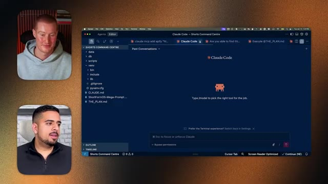
*⏱️ 00:27:52 — Vue d'écran partagée montrant l'éditeur Cursor avec l'interface de Claude Code active, aux côtés des deux intervenants dans des cadres vidéo à gauche.*

---

### ⏱️ `[00:28:07 - 00:28:28]` | Segment #64

**🔊 Audio (Transcription Intégrale Mot pour Mot en Français) :**
> Donc il l'a trouvé et il m'en parle. Il me parle du taux de réussite, du nombre total d'utilisateurs, ce qui est génial. Parce que comme l'a dit Brock, il est toujours conscient de ce qui est utilisé. Il peut donc classer les acteurs par utilisation et par taux de réussite. Et il vous dit ce qu'il fait, la tarification, les paramètres d'entrée de ce dont il a besoin et de ce que vous pouvez lui offrir. Et ensuite j'ai dit, est-ce que je peux extraire la transcription de vidéos ?

**👁️ Analyse Visuelle d'Écran (gemini-3.5-flash-lite) :**
**Interface & Outils** : Éditeur de code (type VS Code / Cursor) avec une fenêtre de résultats montrant les informations sur l'outil « apify/instagram-post-scraper ».

**Contenu textuel & Code** : Tableau de métriques affichant un taux de réussite (Success Rate) de 99,9 % et un nombre total d'utilisateurs (Total Users) de 63 355, ainsi qu'une description des fonctionnalités du scraper.

**Action / Démonstration** : Présentation et analyse des performances d'un outil d'automatisation et de scraping trouvé via l'assistant IA.

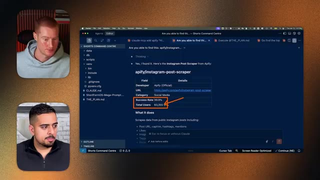
*⏱️ 00:28:12 — Capture d'écran montrant l'interface d'un éditeur de code et de projet avec un panneau affichant les détails d'un scraper Apify pour Instagram, soulignant le taux de réussite et le nombre total d'utilisateurs.*

---

### ⏱️ `[00:28:28 - 00:28:47]` | Segment #65

**🔊 Audio (Transcription Intégrale Mot pour Mot en Français) :**
> Et ça dit, non, tu ne peux pas, ce qui est là où j'ai découvert ça. Donc nous pouvons faire la performance des métadonnées, mais ça ne peut pas faire ça. Donc ensuite, il est allé trouver trois alternatives avec leurs taux de succès respectifs et leur tarification, ce qui est la raison pour laquelle c'est tellement génial. C'est très autonome. Tu es le patron et ça te dit quel est le meilleur choix et pourquoi. Une fois que tu fais ça, je dis, cool, est-ce qu'on peut le tester sur ceci ?

**👁️ Analyse Visuelle d'Écran (gemini-3.5-flash-lite) :**
**Interface & Outils** : Éditeur de code (Cursor / VS Code) avec les webcams des intervenants sur le côté gauche.

**Contenu textuel & Code** : Texte listant les métadonnées extraites (Video URL, Duration, View counts, Thumbnail image) et des alternatives pour les transcripts (OpenAI Whisper, AssemblyAI, Deepgram), ainsi qu'une requête d'outil MCP (`mcp__apify__search-actors`).

**Action / Démonstration** : Présentation et lecture des alternatives pour obtenir des transcriptions vidéo par un assistant de code.

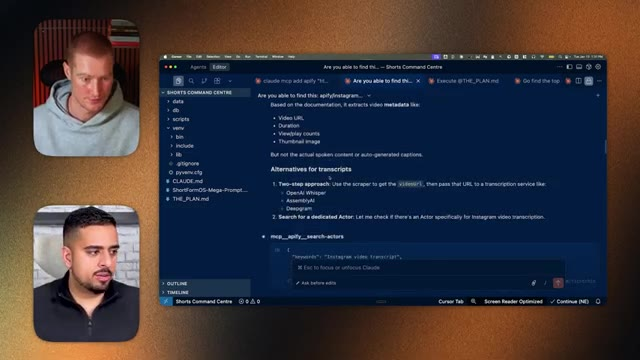
*⏱️ 00:28:32 — Capture d'écran montrant l'éditeur de code Cursor avec des notes sur l'extraction de métadonnées et des alternatives pour les transcriptions.*

---

### ⏱️ `[00:28:47 - 00:29:11]` | Segment #66

**🔊 Audio (Transcription Intégrale Mot pour Mot en Français) :**
> Nous prenons le format court de Nexarev. Nous lui demandons, disons, les trois premières vidéos. Ça ne marche pas, puis ça plante. Et ensuite, j'essaie fondamentalement de comprendre pourquoi ça plante jusqu'à ce que ça revienne enfin avec ce qui suit. C'est donc la légende. C'est tout ce qui concerne cette vidéo. Je me dis donc : cool. Maintenant, les choses sérieuses commencent. Nous essayons quelques publications de plus et je dis : peux-tu essayer trois publications en même temps et voir ce qui se passe ?

**👁️ Analyse Visuelle d'Écran (gemini-3.5-flash-lite) :**
**Interface & Outils** : Éditeur de code (Cursor / VS Code), interface de chat avec agent IA (Claude Code / MCP).

**Contenu textuel & Code** : Code JSON de configuration d'appel Apify (`apify/instagram-post-scraper`), message d'erreur `MCP error -32001: AbortError: The operation was interrupted`, et l'arborescence d'un projet nommé "Shorts Command Centre".

**Action / Démonstration** : Présentation d'un bug ou d'une erreur d'exécution lors d'un appel d'API de scraping via un agent IA.

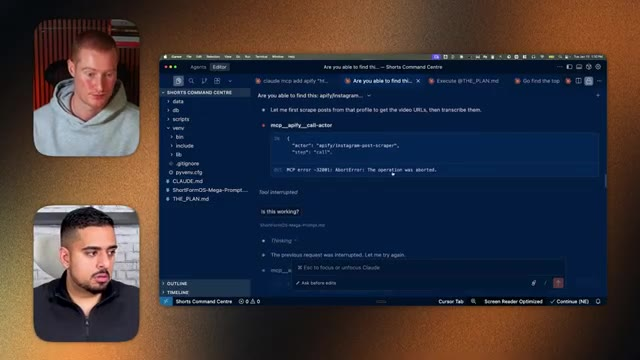
*⏱️ 00:28:53 — Capture d'écran montrant l'interface d'un éditeur de code avec l'arborescence des fichiers à gauche et une fenêtre de chat textuel affichant un appel d'outil MCP d'Apify qui a échoué (erreur d'abandon d'opération).*

---

### ⏱️ `[00:29:11 - 00:29:46]` | Segment #67

**🔊 Audio (Transcription Intégrale Mot pour Mot en Français) :**
> Donc le premier fonctionne parfaitement. Vous pouvez voir ici, c'est l'URL source. Si je fais défiler tout à fait vers la droite et que je saisis ceci, vous pouvez voir, laissez-moi voir ici, de zéro à 40 secondes, de zéro à huit secondes. D'accord. Arrêtez de créer vos automatisations à partir de zéro. Utilisez plutôt cet outil d'IA. Donc maintenant je sais, super, c'est un script. Et notre prochain travail à un moment donné sera de savoir comment extraire ce que nous pensons être l'accroche ? Parce que le format court est court. Alors comment savez-vous laquelle est l'accroche si vous ne voyez pas les cinq premières secondes ou la première ligne ou les deux premières lignes ? Il va donc y avoir un certain jugement là-dedans et il y a une certaine nuance, ce qui explique pourquoi ce n'est pas parfait. Une chose que j'ai remarquée, c'est

**👁️ Analyse Visuelle d'Écran (gemini-3.5-flash-lite) :**
**Interface & Outils** : IDE Cursor / Éditeur de code (Shorts Command Centre).

**Contenu textuel & Code** : Sortie de l'outil mcp__apify_call-actor au format JSON montrant des segments textuels et temporels (ex: 2.56s - 6.08s, "Stop building your automated automations from scratch").

**Action / Démonstration** : Examen des résultats d'automatisation et de transcription vidéo dans l'éditeur de code.

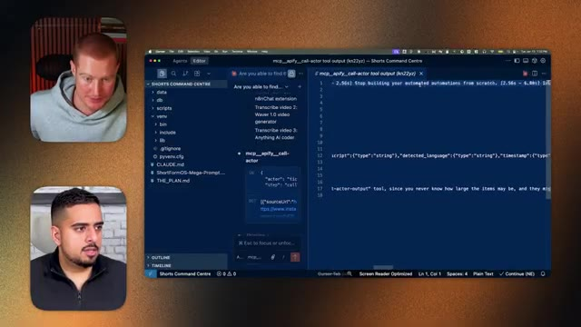
*⏱️ 00:29:20 — Vue de l'interface de développement Cursor affichant un fichier de sortie JSON de transcription vidéo avec des codes temporels, aux côtés des webcams des intervenants.*

---

### ⏱️ `[00:29:46 - 00:30:20]` | Segment #68

**🔊 Audio (Transcription Intégrale Mot pour Mot en Français) :**
> que le MCP a fait un anévrisme quand j'ai essayé de lui en faire faire trois en même temps. Il s'avère donc, du moins pour cet acteur, qu'il doit en faire un à la fois, et non pas tous en même temps. Une fois qu'il a fait ça, il a pu en faire un, un, un, et ensuite c'était bon. Et puis vous pouvez voir ici, c'est la transcription qui revient de chaque vidéo ainsi que l'URL d'origine. C'est donc un peu la fin de la première session. Et je dis essentiellement ce qui suit, car chaque session dans Claude code est une toute nouvelle page blanche, pour la plupart, en dehors de tout ce que vous avez dans ce fichier appelé Claude MD. Vous pouvez considérer Claude MD comme votre banque de mémoire, de la même manière que vous auriez

**👁️ Analyse Visuelle d'Écran (gemini-3.5-flash-lite) :**
**Interface & Outils** : IDE Cursor / Éditeur de code avec fenêtres des intervenants dans la marge de gauche.

**Contenu textuel & Code** : Arborescence de fichiers du projet, fenêtres de terminal/sortie montrant les résultats d'exécution des outils MCP (`mcp__apify__call-actor`) et la liste des tâches à accomplir (Update Todos).

**Action / Démonstration** : Exécution d'un script d'automatisation via MCP pour transcrire des vidéos et affichage des résultats dans l'éditeur.

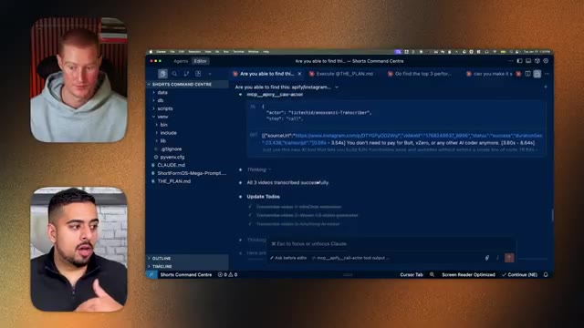
*⏱️ 00:29:55 — Capture d'écran montrant l'interface de l'éditeur de code Cursor avec l'arborescence du projet et le résultat d'une exécution de script MCP.*

---

### ⏱️ `[00:30:20 - 00:30:53]` | Segment #69

**🔊 Audio (Transcription Intégrale Mot pour Mot en Français) :**
> la mémoire dans le chat. La seule chose que nous devons savoir, c'est que je ne veux pas avoir à repasser par un écran vide à chaque fois et dire : va me chercher la transcription de cette vidéo, pour qu'il doive tourner en rond afin de réaliser, un, qu'il n'a pas un acteur pour faire ça, qu'il doit en utiliser deux. Et puis deux, qu'il doit le faire un par un. Donc, au lieu d'avoir à m'inquiéter de ça, je dis simplement : prends note de la manière dont tu arrives à extraire ces transcriptions et des acteurs que tu as utilisés, et crée un fichier Claude MD pour que j'aie une compréhension complète de la façon d'exécuter cela. Comme ça, je n'ai pas à me répéter à chaque fois. Donc, tu n'as même pas l'habitude, par exemple, si tu interagis

**👁️ Analyse Visuelle d'Écran (gemini-3.5-flash-lite) :**
**Interface & Outils** : Éditeur de code Cursor, panneau latéral de fichiers, interface de discussion avec l'IA.

**Contenu textuel & Code** : Affichage d'un prompt demandant de créer un fichier "CLAUDE.md" basé sur le scraping de transcriptions Instagram, avec des sections de réflexion ("Thinking") et d'écriture de code.

**Action / Démonstration** : L'utilisateur configure l'agent IA pour automatiser la récupération de transcriptions de vidéos Instagram via des outils et des scripts.

*⏱️ 00:30:29 — Capture d'écran montrant l'interface de l'éditeur Cursor avec un panneau de chat d'IA et la structure d'un projet nommé "Shorts Command Centre", ainsi que deux intervenants en visioconférence dans des cadres à gauche.*

---

### ⏱️ `[00:30:53 - 00:31:12]` | Segment #70

**🔊 Audio (Transcription Intégrale Mot pour Mot en Français) :**
> avec genre l'IA, ChatGPT, Claude, peu importe, tu dirais que, oh, donne-moi un prompt à utiliser pour savoir ensuite toujours comment accomplir cette tâche. Mais à l'intérieur de Claude Code, c'est ça qui me saute aux yeux, c'est qu'il est littéralement allé créer ça, on pourrait appeler ça une compétence, non ? Est-ce que c'est considéré comme une compétence dans Claude Code ? Je ne vais pas te laisser dire compétence parce que ce sera trompeur. Donc ce n'est pas une compétence.

**👁️ Analyse Visuelle d'Écran (gemini-3.5-flash-lite) :**
**Interface & Outils** : Éditeur de code (type Cursor/VS Code) avec panneau latéral de fichiers et assistant IA intégré (Claude Code).

**Contenu textuel & Code** : Arborescence de projet ("Shorts Command Centre") affichant des répertoires (data, db, venv), des fichiers de configuration (CLAUDE.md, THE_PLAN.md) et une conversation avec l'IA montrant un prompt utilisateur demandant de créer un guide persistant ("CLAUDE.md") sur le scraping de transcriptions Instagram avec des acteurs Apify.

**Action / Démonstration** : L'assistant IA rédige et crée automatiquement le fichier de documentation/compilation de consignes "CLAUDE.md" suite à la demande de l'utilisateur pour automatiser une tâche récurrente.

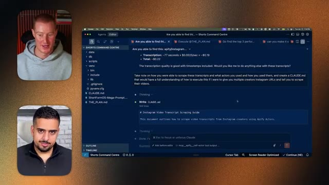
*⏱️ 00:30:58 — Capture d'écran montrant l'interface d'un éditeur de code (probablement Cursor ou VS Code) avec une fenêtre de terminal et de discussion Claude Code, aux côtés de deux intervenants en visioconférence.*

---

### ⏱️ `[00:31:12 - 00:31:47]` | Segment #71

**🔊 Audio (Transcription Intégrale Mot pour Mot en Français) :**
> C'est juste, ça crée cette base de connaissances. Appelons ça une base de connaissances. Oui. D'accord. Compris. Ouais. C'est cool. Ça a littéralement créé ce fichier au lieu de simplement donner une sorte de prompt que vous obtenez habituellement et que vous devriez utiliser, genre, enregistrer quelque part dans vos notes, l'utiliser quand, tu sais, quand vous utilisez un GPT personnalisé par exemple, mais ouais, si vous cliquez dessus, ils en font comme un hyperlien, surtout dans Cursor, vous pouvez voir, genre, la priorité absolue est, genre, la commande « fais-moi devenir viral », c'est après qu'on l'ait vraiment construit, mais au fur et à mesure, ça prend des notes sur les différents modèles de données que vous avez, l'algorithme de classement des accroches, on a fini par tout créer dont il a besoin pour l'utiliser, donc il a une section ici sur les acteurs utilisés, alors maintenant il sait que c'est l'apify

**👁️ Analyse Visuelle d'Écran (gemini-3.5-flash-lite) :**
**Interface & Outils** : Éditeur de code (Cursor / VS Code), interface de l'assistant IA

**Contenu textuel & Code** : Arborescence de projet ("Shorts Command Centre"), arborescence de dossiers (data, db, scripts, venv), fichiers de configuration et le fichier généré "CLAUDE.md" contenant un guide sur le scraping de transcriptions de vidéos Instagram.

**Action / Démonstration** : Présentation de la création automatique d'un fichier de documentation (base de connaissances) par l'assistant IA à partir d'une tâche de scraping.

*⏱️ 00:31:21 — Vue d'une interface de développement (Cursor Editor) montrant un espace de travail avec l'arborescence des fichiers à gauche et une fenêtre de terminal ou d'assistant virtuel à droite qui a généré un fichier de documentation (CLAUDE.md). Les deux intervenants apparaissent en vignettes vidéo de part et d'autre.*

---

### ⏱️ `[00:31:47 - 00:32:19]` | Segment #72

**🔊 Audio (Transcription Intégrale Mot pour Mot en Français) :**
> acteur nom, ça c'est le coût et le deuxième que nous utilisons pour récupérer la transcription de la vidéo est celui-ci, donc ça garde cette mémoire active, ce qui fait que c'est puissant et idéalement, ça va être beaucoup plus rapide, du moins après ce temps initial, parce que maintenant il sait exactement quoi faire donc il n'a pas besoin de passer par ce processus de pensée répétitif pour essayer de comprendre. Ouais, donc si vous comparez ça à quelque chose comme ChatGPT, à chaque fois que vous échouez dans ChatGPT, si vous n'êtes pas proactif pour aller documenter et éviter que ça se produise, ça continuera de se produire encore et encore. Mais dans Claude code, à chaque fois que quelque chose ne se passe pas comme prévu, vous pouvez dire,

**👁️ Analyse Visuelle d'Écran (gemini-3.5-flash-lite) :**
**Interface & Outils** : Éditeur de code Cursor (environnement de développement)

**Contenu textuel & Code** : Fichier Markdown nommé 'CLAUDE.md' expliquant le guide de scraping des transcriptions de vidéos Instagram, incluant les acteurs utilisés ('apify/instagram-post-scraper' et 'tictechid/anoxvanzi-Transcriber') avec leurs coûts respectifs et les étapes du workflow.

**Action / Démonstration** : Le présentateur explique la documentation du projet liée au workflow de scraping et de transcription de vidéos.

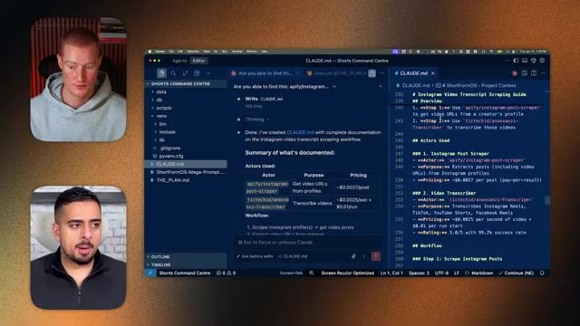
*⏱️ 00:31:55 — Capture d'écran de l'éditeur de code Cursor affichant un fichier de documentation Markdown (CLAUDE.md) détaillant les outils de scraping et de transcription vidéo, avec les deux présentateurs visibles dans de petites fenêtres vidéo sur le côté gauche.*

---

### ⏱️ `[00:32:20 - 00:32:54]` | Segment #73

**🔊 Audio (Transcription Intégrale Mot pour Mot en Français) :**
> va et apprends de cette erreur dès que tu arrives enfin au point où cela a fait la bonne chose. C'est là que tu as cette boucle de rétroaction. Maintenant, pour rendre cela beaucoup plus tactique, cette session portait sur l'exécution du plan. Donc pour moi, si tu vas ici, c'est le plan. C'est une version adaptée de ce que j'ai créé dans Perplexity Labs. C'est l'original. Et ce que j'ai demandé dans une autre conversation, c'était : est-ce que tu peux faire en sorte que cette chose, au lieu d'être juste une liste de demandes de fonctionnalités et une liste de souhaits, est-ce que tu peux en faire un plan et faire en sorte qu'il y ait des cases à cocher pour que tu puisses garder une trace de ce que tu fais au fur et à mesure que tu accomplis chaque tâche. Maintenant, pourquoi ai-je fait cela ? Premièrement, ce n'est pas

**👁️ Analyse Visuelle d'Écran (gemini-3.5-flash-lite) :**
**Interface & Outils** : Éditeur de code (Cursor / VS Code), interface de visioconférence

**Contenu textuel & Code** : Fichiers du projet dont THE_PLAN.md, CLAUDE.md, un dossier venv, et des lignes de texte listant des tâches d'exécution ("Create db/ directory", "Create db/schema.sql with full schema", "Initialize SQLite database").

**Action / Démonstration** : Présentation de l'exécution d'un plan d'implémentation de projet à l'aide d'un assistant de code IA.

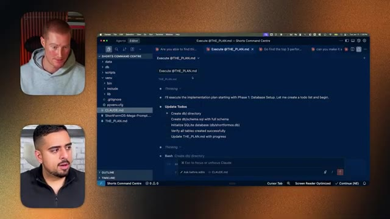
*⏱️ 00:32:28 — Capture d'écran montrant l'interface d'un éditeur de code avec l'arborescence d'un projet nommé "Shorts Command Centre" et un fichier d'exécution de plan ("Execute @THE_PLAN.md"), ainsi que deux intervenants en visioconférence dans des encarts à gauche.*

---

### ⏱️ `[00:32:54 - 00:33:31]` | Segment #74

**🔊 Audio (Transcription Intégrale Mot pour Mot en Français) :**
> secret que Claude a une fenêtre de contexte, au moment de cet enregistrement, de 200 000 jetons. Les serveurs MCP en utilisent une grande partie. Cela peut donc représenter entre 2 et 15 % de cette session. Donc, au lieu d'atteindre une limite de fenêtre à chaque fois et de m'en soucier, s'il continue à cocher les tâches lorsqu'elles sont terminées, je peux toujours revenir en arrière et lui dire : écoute, reprends là où tu en étais dans le plan. Tu peux ainsi voir que, c'est super, je n'ai pas encore commencé la phase 2.3. Continuons à partir de là. Oui. C'est logique. Oui. C'est donc super utile, et c'est pourquoi j'ai fini par créer ce plan, et le plan que vous verrez ici, au fur et à mesure qu'il termine les choses, il vous dira : c'est

**👁️ Analyse Visuelle d'Écran (gemini-3.5-flash-lite) :**
**Interface & Outils** : Éditeur de code Cursor, interface de l'assistant Claude intégré.

**Contenu textuel & Code** : Fichier Markdown nommé THE_PLAN.md contenant un plan d'implémentation pour l'application ShortFormOS, incluant les phases de configuration de base de données (SQLite) et de scraping Instagram avec des cases à cocher de suivi des tâches.

**Action / Démonstration** : Affichage et exécution d'un plan d'implémentation de projet par l'assistant IA dans l'éditeur de code.

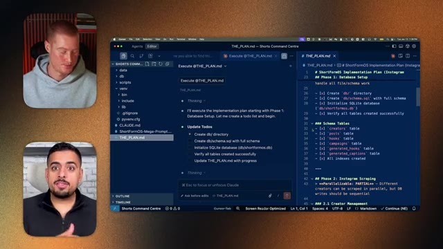
*⏱️ 00:33:04 — Capture d'écran montrant l'éditeur de code Cursor avec un plan de projet (THE_PLAN.md) et des fenêtres de discussion avec l'assistant IA Claude.*

---

### ⏱️ `[00:33:31 - 00:34:05]` | Segment #75

**🔊 Audio (Transcription Intégrale Mot pour Mot en Français) :**
> terminé. Ce n'est pas terminé. Et il va continuer à modifier le plan source jusqu'à ce que nous soyons prêts. Et vous pouvez voir ici, il utilise le serveur MCP pour tester à nouveau, le scraping de différents messages Appify et ensuite si nous allons tout en bas ici, il utilise et crée ce qu'on appelle la base de données SQLite donc comme je l'ai dit avant, si vous cliquez sur base de données et sur format court, voilà à quoi ça ressemble en coulisses donc vous n'avez pas besoin d'utiliser un Supabase, il crée toute votre base de données gratuitement vous voyez toutes les colonnes ici et si c'est trop moche pour vous, j'ai eu une autre discussion où j'ai dit est-ce que tu peux faire en sorte qu'on puisse avoir une sorte d'interface utilisateur pour

**👁️ Analyse Visuelle d'Écran (gemini-3.5-flash-lite) :**
**Interface & Outils** : Éditeur de code (Cursor / VS Code) avec panneaux latéraux et terminal intégré.

**Contenu textuel & Code** : Liste de tâches de développement, notamment "Scrape posts using apify/instagram-post-scraper", "Parse and insert posts into database", et des appels de fonction MCP (`mcp__apify__call_actor`).

**Action / Démonstration** : Suivi de l'exécution du plan de développement et du scraping de données de réseaux sociaux via le serveur MCP.

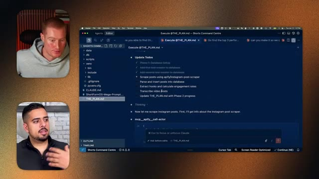
*⏱️ 00:33:39 — Capture d'écran montrant l'interface d'un éditeur de code avec la liste des tâches (Todos) liées au scraping de publications Instagram via Apify.*

---

### ⏱️ `[00:34:05 - 00:34:41]` | Segment #76

**🔊 Audio (Transcription Intégrale Mot pour Mot en Français) :**
> regarde ça, donc c'était le chat, j'ai dit : est-ce que tu peux faire en sorte qu'on ait une interface utilisateur ? Je déteste regarder ça ici. Donc je lui ai parlé comme à mon ami et tu peux lui parler aussi. Et tu obtiens quelque chose comme ça où tu peux cliquer dessus. Et quand je le recharge, tu pourras voir différentes tables comme des hooks et des posts, et cetera. C'est fondamentalement... tu pourras interagir avec sur un navigateur. Ouais. C'est beaucoup plus facile à regarder que l'IDE qu'on regarde ici. Ouais. C'est fondamentalement comme avoir Google Sheets sous stéroïdes. Et le plus important, comme je l'ai dit, c'est que c'est gratuit. Donc une chose que je voulais faire maintenant, c'est de mettre tout en pratique. Et j'ai remarqué qu'on a rencontré un bug. Je pensais que les choses se passaient super bien. On a le MCP, il a appris

**👁️ Analyse Visuelle d'Écran (gemini-3.5-flash-lite) :**
**Interface & Outils** : Navigateur Google Chrome et éditeur de code Cursor (avec interface de terminal/chat IA).

**Contenu textuel & Code** : URL locale (127.0.0.1) dans le navigateur ; requêtes SQL et commandes `sqlite3` dans Cursor pour inspecter le schéma de la base de données `shortformos.db`.

**Action / Démonstration** : Tentative d'accès à une interface utilisateur locale défaillante et démonstration de la création d'une interface web via un agent IA.

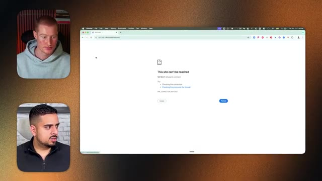
*⏱️ 00:34:14 — Capture montrant un navigateur web affichant une erreur de connexion (This site can't be reached) sur une adresse locale 127.0.0.1.*

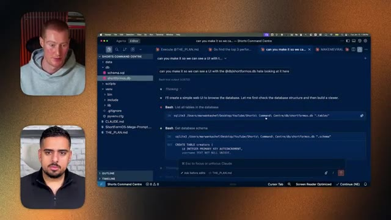
*⏱️ 00:34:23 — Capture de l'éditeur de code Cursor affichant une session de chat avec Claude et l'exécution de commandes Bash pour explorer une base de données SQLite.*

---

### ⏱️ `[00:34:41 - 00:35:14]` | Segment #77

**🔊 Audio (Transcription Intégrale Mot pour Mot en Français) :**
> comment scraper, et j'ai commencé à stocker des choses dans notre base de données et j'ai commencé à créer l'algorithme de crochets viraux afin de pouvoir créer ce créateur de publications. Et puis j'ai réalisé qu'il y avait un défaut fondamental. Et je vais juste attendre pour l'afficher afin que votre audience n'ait pas à me regarder faire défiler. Ouais, ça a l'air bien. D'accord, donc ici, à un moment donné, j'ai réalisé qu'il faisait une erreur fondamentale. Il scrapait tout. Ils mettaient la légende dans la colonne des transcriptions. Et vous pourriez dire, pourquoi est-ce que ça m'importe ? Eh bien, ça vous importe parce qu'il s'entraînait sur ces crochets qui étaient en fait

**👁️ Analyse Visuelle d'Écran (gemini-3.5-flash-lite) :**
**Interface & Outils** : Éditeur de code Cursor (avec l'agent Claude intégré) et terminal de commandes.

**Contenu textuel & Code** : Commandes SQLite, arborescence du projet (`db/schema.sql`, `shortformos.db`), requêtes SQL, et journalisation textuelle de nettoyage de base de données (posts supprimés, restants, hooks et créateurs).

**Action / Démonstration** : Exécution d'une commande de base de données pour analyser les publications et les créateurs stockés dans le cadre du projet de création de contenu.

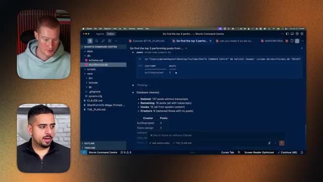
*⏱️ 00:34:49 — Capture d'écran montrant l'interface de l'éditeur de code Cursor avec l'arborescence du projet 'Shorts Command Centre', une base de données SQLite et des interactions avec l'assistant Claude.*

---

### ⏱️ `[00:35:14 - 00:35:39]` | Segment #78

**🔊 Audio (Transcription Intégrale Mot pour Mot en Français) :**
> la légende. Donc ça a appris à dire commente X et je t'enverrai Y au lieu du véritable crochet des vidéos. Et je me suis embrouillé parce que j'ai commencé à recevoir des dizaines de crochets qui commençaient tous par commente Y pour X. Et je me suis dit, ce n'est pas un crochet. Alors je suis allé regarder dans la base de données et je me suis dit, vous avez littéralement mis les légendes dans la transcription et vous n'avez jamais réellement capturé et sauvegardé la transcription. Donc à ce stade, c'est ce que j'ai dit. Je viens juste de remarquer que vos crochets sont les légendes.

**👁️ Analyse Visuelle d'Écran (gemini-3.5-flash-lite) :**
**Interface & Outils** : Éditeur de code (type Cursor ou VS Code) et interface d'appel vidéo.

**Contenu textuel & Code** : Fichiers du projet (schema.sql, shortformos.db, CLAUDE.md, THE_PLAN.md) et un document markdown détaillant l'analyse des messages utilisateurs, des tâches en cours et des hooks extraits.

**Action / Démonstration** : Navigation et affichage des résultats du traitement des transcriptions et de l'extraction des hooks dans l'interface de développement.

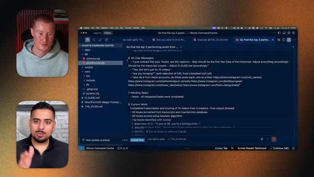
*⏱️ 00:35:20 — Capture d'écran montrant l'interface d'un éditeur de code avec l'arborescence des fichiers du projet Shorts Command Centre à gauche et un contenu textuel markdown à droite, ainsi que deux flux vidéo des intervenants dans des cadres circulaires à gauche.*

---

### ⏱️ `[00:35:39 - 00:35:59]` | Segment #79

**🔊 Audio (Transcription Intégrale Mot pour Mot en Français) :**
> C'est faux. Donc c'est passé par là, ça a supprimé toutes les choses qui étaient incorrectes. Et ensuite, ça a rechargé et c'est repassé pour garder uniquement les publications. Et ensuite, nous avons commencé à ajouter les transcriptions. Donc quand nous passons enfin à l'étape suivante, qui est : ok, maintenant que nous avons des transcriptions dedans, nous arrivons à un score de viralité.

**👁️ Analyse Visuelle d'Écran (gemini-3.5-flash-lite) :**
**Interface & Outils** : Éditeur de code Cursor / IDE, terminal intégré et fenêtres de visioconférence.

**Contenu textuel & Code** : Commandes SQLite, statistiques affichées : 153 total posts, 137 posts without transcripts, 16 posts with transcripts, et requêtes SQL en cours d'exécution.

**Action / Démonstration** : Exécution de commandes de nettoyage et de comptage des publications dans la base de données via le terminal.

*⏱️ 00:35:44 — Capture d'écran montrant l'interface d'un éditeur de code et d'un terminal avec les statistiques des publications (posts totaux, avec et sans transcriptions) et les deux participants en incrustation vidéo.*

---

### ⏱️ `[00:35:59 - 00:36:23]` | Segment #80

**🔊 Audio (Transcription Intégrale Mot pour Mot en Français) :**
> Il passe en revue et crée comme un classement de tous les messages dans la base de données. Donc si nous allons dans la base de données et que vous vérifiez les scores, vous pourrez voir qu'ils sont réellement implémentés et calculés à la volée. Cela nous permet donc de faire ce qui suit. Si je vais ici. Donc si nous disons, rends-moi viral, cette nouvelle fonctionnalité, c'est la commande que dans CloudMD, notre banque de mémoire ou base de connaissances, comme nous l'appelons maintenant.

**👁️ Analyse Visuelle d'Écran (gemini-3.5-flash-lite) :**
**Interface & Outils** : Application Cursor / IDE

**Contenu textuel & Code** : Base de données `shortformos.db`, arborescence du projet, et statistiques de nettoyage textuelles (Deleted: 137 posts, Remaining: 16 posts, table des créateurs avec le nombre de posts).

**Action / Démonstration** : Présentation de la structure de la base de données et du nettoyage des messages sans transcription.

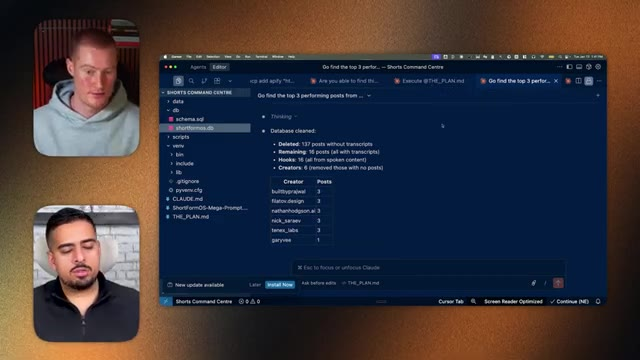
*⏱️ 00:36:05 — Vue de l'interface de l'application Cursor affichant l'explorateur de fichiers de la base de données et les résultats d'un nettoyage de données.*

---

### ⏱️ `[00:36:23 - 00:36:44]` | Segment #81

**🔊 Audio (Transcription Intégrale Mot pour Mot en Français) :**
> Je viens juste de dire, allez voir cette fonctionnalité et préparez du matériel. Vous remarquerez que malgré cela, nous en avons encore quelques-uns qui étaient biaisés par rapport à avant. Je crois que ClaudeMD ne s'était pas encore mis à jour. Il est écrit : « commentez co-work pour obtenir un accès gratuit ». Mais nous avions quand même de véritables accroches pour la plupart. Donc, règle du 80-20, 80 % étaient de vraies accroches, mais nous voulions quand même que ce soit 100 %.

**👁️ Analyse Visuelle d'Écran (gemini-3.5-flash-lite) :**
**Interface & Outils** : Éditeur de texte/code (Cursor ou VS Code) avec explorateur de fichiers à gauche et interface de chat en bas.

**Contenu textuel & Code** : Document Markdown affichant « Step 2: Generating 20 Hooks for Claude Cowork » avec des exemples de textes orientés marketing et viralité (ex: « Comment COWORK to get free access... »).

**Action / Démonstration** : Affichage des résultats générés par l'intelligence artificielle pour la création de contenu et de stratégies d'engagement.

*⏱️ 00:36:28 — Capture d'écran montrant l'interface d'un éditeur de code et de texte avec une liste de crochets (hooks) générés pour Claude Cowork, aux côtés des fenêtres vidéo des intervenants.*

---

### ⏱️ `[00:36:44 - 00:37:06]` | Segment #82

**🔊 Audio (Transcription Intégrale Mot pour Mot en Français) :**
> Ici, remonte encore une fois. Ouais. Je veux souligner l'un de ceux-là. Genre, par exemple, le numéro deux, ce crochet, plutôt solide. Claude vient de devenir ton collègue IA qui termine vraiment les tâches sans toi. Genre c'est quelque chose que j'utiliserais vraiment dans une de mes vidéos courtes. Donc c'est, je veux dire, ça prouve que ça marche au moins. Ouais. Et peut-être que tu pourrais utiliser le collègue de commentaires et c'est solide pour la légende tant qu'il sait quoi faire.

**👁️ Analyse Visuelle d'Écran (gemini-3.5-flash-lite) :**
**Interface & Outils** : Éditeur de code Cursor, explorateur de fichiers (Shorts Command Centre), tableau de données Markdown.

**Contenu textuel & Code** : Tableau interactif affichant 15 suggestions de crochets (hooks) pour les réseaux sociaux axés sur Claude et les agents IA (ex: "Claude just became your AI coworker that actually finishes tasks without you."), avec la colonne "Pattern Used".

**Action / Démonstration** : Le présentateur survole et commente les différentes suggestions d'accroches textuelles générées par l'IA dans l'éditeur.

*⏱️ 00:36:50 — Capture d'écran montrant l'interface de l'éditeur de code Cursor avec un tableau listant des accroches pour des vidéos courtes (hooks) et leurs motifs associés, tandis que les intervenants discutent à l'écran.*

---

### ⏱️ `[00:37:06 - 00:37:40]` | Segment #83

**🔊 Audio (Transcription Intégrale Mot pour Mot en Français) :**
> Mais je voulais juste montrer ça parce qu'il est important de savoir que, surtout si vous allez sur X, en particulier dans les profondeurs sombres de X, les gens diront que cette chose va remplacer les ingénieurs logiciels, genre supprimer tout de l'existence. Ça fait encore des erreurs. Ça aurait dû être assez intelligent. Si vous pouvez utiliser un serveur MCP pour voir quel acteur nous avons besoin, ça devrait être capable de le regarder et de se dire oh ce n'est probablement pas un hook mais vous devez être conscient que, genre, vous ne pouvez pas juste partir à la plage et revenir et vous attendre à de bons résultats, surtout si vous n'êtes pas un non-technophile, donc l'humain dans la boucle pour surveiller ça est essentiel, ouais c'est un peu le mot-clé de cet épisode je pense, c'est l'humain dans la boucle, parce que sinon nous pourrions construire ce système si nous ne sommes pas constamment

**👁️ Analyse Visuelle d'Écran (gemini-3.5-flash-lite) :**
**Interface & Outils** : Éditeur de code (type Cursor ou VS Code) avec explorateur de fichiers et tableau de données textuelles.

**Contenu textuel & Code** : Un tableau de contenu structuré montrant des lignes numérotées avec des "Hooks" et des "Pattern Used" (stratégies de contenu/marketing), ainsi qu'un explorateur de fichiers dans la barre latérale gauche (db, scripts, venv, CLAUDE.md).

**Action / Démonstration** : Présentation et navigation dans l'interface de développement ou de gestion de contenu assistée par IA.

*⏱️ 00:37:15 — Capture d'écran montrant l'interface d'un éditeur de code et de gestion de projet (Cursor / VS Code) avec deux participants en incrustation vidéo sur le côté gauche.*

---

### ⏱️ `[00:37:40 - 00:38:15]` | Segment #84

**🔊 Audio (Transcription Intégrale Mot pour Mot en Français) :**
> itérer avec ça, ça ne va probablement pas être le meilleur donc c'est pourquoi c'est un bon point de départ pour nous et pour moi pour commencer à l'utiliser, j'ai hâte de voir à quoi ça ressemble un mois après avoir joué avec ça, après avoir testé différentes vidéos que je publie et en donnant mes avis et, vous savez, en quelque sorte mon expertise là-dessus. Ouais. Et le truc, c'est qu'on peut aller beaucoup plus loin que ça. Donc pour l'instant, c'est l'algorithme de notation où vous pouvez voir, n'est-ce pas ? Comme on l'a dit avant, la curiosité, l'émotion, et cetera. Il utilise son jugement. Genre, Claude examine et classe tout ce qu'on a dans notre base de données avec une note. Brock peut regarder ça et se dire, non, tu te trompes complètement. Cette dernière vidéo a été un flop total ou cette vidéo a incroyablement bien marché.

**👁️ Analyse Visuelle d'Écran (gemini-3.5-flash-lite) :**
**Interface & Outils** : Éditeur de code Cursor (environnement de développement)

**Contenu textuel & Code** : Code Markdown affichant l'étape "Step 3: Scoring Each Hook" avec la formule mathématique de l'algorithme de potentiel viral (Score = (Curiosity*0.25) + (Emotion*0.20)...) et un tableau de scores chiffrés pour différents critères.

**Action / Démonstration** : Présentation et explication du système de notation algorithmique des hooks pour les vidéos courtes.

*⏱️ 00:37:49 — Vue de l'interface de l'éditeur de code Cursor montrant le projet "Shorts Command Centre" avec l'algorithme de scoring des hooks et un tableau de notes chiffrées, encadré par les flux vidéo des participants.*

---

### ⏱️ `[00:38:15 - 00:38:49]` | Segment #85

**🔊 Audio (Transcription Intégrale Mot pour Mot en Français) :**
> Donc, cela va demander du bricolage. Et si vous aviez codé au feeling une interface, à chaque fois que vous changeriez la façon dont le processus se déroule et dont l'automatisation se déroule, vous devriez aller refaire l'interface utilisateur pour qu'elle corresponde, donc c'est là que l'interface utilisateur et tout ce sur quoi nous nous sommes concentrés pendant la dernière année, qui est oh cool, je viens de créer un clone de X, il ne s'agit pas du clone, il s'agit de ce qu'il y a en dessous, du système sous-jacent, donc quand Brock passe quelques semaines jusqu'à ce que ce soit vraiment bien, alors il peut demander, cool, est-ce qu'on peut juste lancer une interface utilisateur et peut-être qu'on utilisera Gemini comme grand modèle de langage pour aller le faire

**👁️ Analyse Visuelle d'Écran (gemini-3.5-flash-lite) :**
**Interface & Outils** : Éditeur de code (Cursor / VS Code), interface de visioconférence (deux intervenants).

**Contenu textuel & Code** : Arborescence de fichiers du projet incluant des dossiers data, db, scripts, venv, ainsi que des fichiers comme schema.sql, shortformos.db, CLAUDE.md et un tableau de données chiffrées.

**Action / Démonstration** : Présentation de l'environnement de développement et de la structure des fichiers du projet d'automatisation.

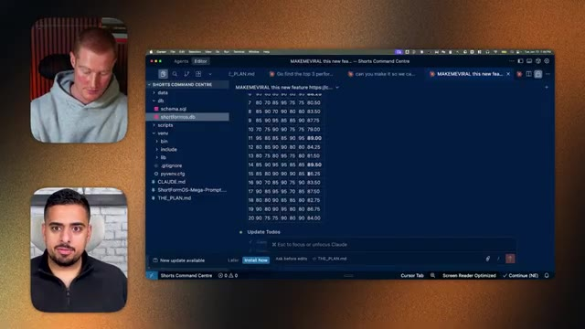
*⏱️ 00:38:24 — Capture d'écran montrant l'éditeur de code Cursor avec l'arborescence du projet « SHORTS COMMAND CENTRE » et un tableau de données numériques affiché dans le panneau principal, ainsi que deux participants en visio sur le côté gauche.*

---

### ⏱️ `[00:38:49 - 00:39:09]` | Segment #86

**🔊 Audio (Transcription Intégrale Mot pour Mot en Français) :**
> l'analyse ou Anthropic ou peu importe pour exécuter tout ce que nous avons fait dans le terminal. Donc d'une certaine manière, vous laissez la dernière partie pour la fin, où si vous avez une interface utilisateur, si vous avez votre propre produit, il est maintenant entièrement peaufiné. C'est en fait un super bon point parce que j'allais dire, en regardant ce truc de tableau de score viral ici, je me suis dit : "Mec, ça a l'air de faire beaucoup de chiffres."

**👁️ Analyse Visuelle d'Écran (gemini-3.5-flash-lite) :**
**Interface & Outils** : IDE Cursor / Éditeur de code (type VS Code), affichant un projet structuré avec des dossiers (data, db, scripts, venv) et des fichiers de configuration.

**Contenu textuel & Code** : Arborescence de fichiers, fichiers de base de données (schema.sql, shortformos.db), configurations Python (venv, pyvenv.cfg), et un tableau de notes ou de métriques chiffrées.

**Action / Démonstration** : Présentation de la structure d'un projet logiciel orienté IA / automatisation, avec une interface d'éditeur ouverte.

*⏱️ 00:38:54 — Un éditeur de code et de projet montrant l'arborescence des fichiers du répertoire « SHORTS COMMAND CENTRE » avec un tableau de données numériques.*

---

### ⏱️ `[00:39:10 - 00:39:37]` | Segment #87

**🔊 Audio (Transcription Intégrale Mot pour Mot en Français) :**
> J'adorerais, si tu aimerais, qu'on soit dans un tableau de bord, j'allais littéralement le mentionner mais c'est tellement un bon point parce que si je n'ai pas ce truc réglé, pour ainsi dire, genre maintenant, ça va être pénible de devoir faire des aller-retours et d'essayer de coder au feeling. Et mon audience sait comment coder au feeling et à quel point ça peut être pénible tellement, la plupart du temps. Donc oui, c'est intéressant. J'ai hâte de voir à quoi ça ressemble quand c'est presque comme son propre petit mini, genre logiciel interne que je pourrais utiliser au lieu de devoir utiliser quelque chose qui pourrait être un peu plus intimidant, comme Cursor ou quelque chose comme ça.

**👁️ Analyse Visuelle d'Écran (gemini-3.5-flash-lite) :**
**Interface & Outils** : Éditeur de code Cursor (VS Code fork), interface de visioconférence.

**Contenu textuel & Code** : Formule mathématique de calcul de score (Curiosity, Emotion, Brevity, Niche, Uniqueness, Platform) et tableau de données chiffrées évaluant différents shorts.

**Action / Démonstration** : Présentation et explication du tableau de bord et de l'architecture du projet par les intervenants.

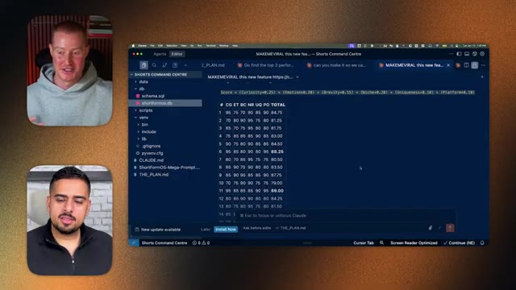
*⏱️ 00:39:16 — Capture d'écran montrant l'éditeur de code Cursor avec l'arborescence du projet « SHORTS COMMAND CENTRE » et un tableau de notation/scores pour des contenus courts, ainsi que les deux participants en visioconférence.*

---

### ⏱️ `[00:39:37 - 00:40:13]` | Segment #88

**🔊 Audio (Transcription Intégrale Mot pour Mot en Français) :**
> Exactement. Donc, et puis le tout le principe est que ça vous donne tout ça comme résultats. Donc ça vous donne maintenant les trois meilleurs accroches. Donc ça vous dit pourquoi c'est une accroche, pourquoi c'est une bonne accroche plutôt. donc celle-ci, Claude Code vient juste de donner aux non-codeurs a choisi exactement la même d'ailleurs que celle que vous avez dite qui est une bonne, ce qui est intéressant qu'il soit d'accord et ça vient avec le reste d'entre eux a toujours ce truc de commentaire bizarre que vous devriez enlever et ensuite ça génère les légendes et ce qui est marrant c'est que ça a écrit les légendes comme ça ça change tout ça n'a pas le commentaire l'accroche n'est-ce pas c'est euh attendez est-ce que ce serait l'accroche ou genre le script je veux dire je pense

**👁️ Analyse Visuelle d'Écran (gemini-3.5-flash-lite) :**
**Interface & Outils** : Cursor (éditeur de code / IDE) et visioconférence à deux participants.

**Contenu textuel & Code** : Texte montrant "Step 4: TOP 3 HOOKS", l'accroche numéro 1 notée 89.50 ("Claude just gave non-coders the same superpowers as developers.") avec un tableau d'évaluation par facteurs (Curiosity Gap, Emotional Trigger, Brevity & Clarity, Niche Relevance, Uniqueness, Platform Optimization) et l'accroche numéro 2 notée 89.00.

**Action / Démonstration** : Présentation et analyse des résultats générés par l'IA concernant les meilleures accroches pour le contenu vidéo.

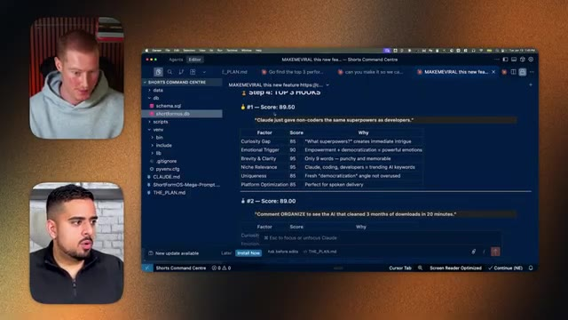
*⏱️ 00:39:46 — Capture d'écran montrant l'interface du logiciel Cursor avec les résultats de génération d'accroches pour les réseaux sociaux, incluant des scores et des explications détaillées, ainsi que deux flux vidéo des intervenants dans des cadres à gauche.*

---

### ⏱️ `[00:40:13 - 00:40:56]` | Segment #89

**🔊 Audio (Transcription Intégrale Mot pour Mot en Français) :**
> ça pourrait être une légende mais c'est intéressant que ça n'ait pas mis le commentaire x ou y même si on c'est très présent dans les petites données que nous avons donc il y a beaucoup de nuances ici c'est super cependant ce serait vraiment désolé de t'interrompre mais ce serait super facile pour moi de donner à Claude Code une consigne et de dire hé écoute pour chaque ou pour chaque description ou ouais je suppose que ça serait considéré comme une description je veux je veux utiliser un mot-clé où il est écrit commentaire x je t'enverrai y et ensuite ça corrigera ça maintenant à chaque fois que je l'utiliserai ça va genre comprendre n'est-ce pas ? Oui, et encore mieux, puisque nous utilisons déjà l'MCP d'Appify, tu pourrais dire, est-ce que tu peux aller sur mon Instagram, regarder les cinq publications les plus performantes, aller récupérer mon style de légendes, et aller récupérer mon style d'accroches sur celles qui ont bien performé.

**👁️ Analyse Visuelle d'Écran (gemini-3.5-flash-lite) :**
**Interface & Outils** : Cursor IDE / Éditeur de code (macOS)

**Contenu textuel & Code** : Texte markdown et notes sur l'utilisation de l'IA (Anthropic Cowork, Claude), scripts et structure de dossiers (data, db, scripts, venv), et accroches marketing (HOOK #2: 'Comment ORGANIZE to see the AI that cleaned 3 months of downloads in 20 minutes.')

**Action / Démonstration** : Présentation de scripts et de notes de projet textuelles au sein de l'éditeur de code Cursor.

*⏱️ 00:40:24 — Capture d'écran montrant l'interface d'un éditeur de code (Cursor IDE) avec un projet nommé 'Shorts Command Centre', affichant du texte rédigé sur l'intelligence artificielle et des scripts, accompagné de deux intervenants en visioconférence sur le côté gauche.*

---

### ⏱️ `[00:40:57 - 00:41:30]` | Segment #90

**🔊 Audio (Transcription Intégrale Mot pour Mot en Français) :**
> Et dans la base de données, je veux changer le score maintenant. Je veux ajouter une pondération Brock, où si c'est un crochet de ma part qui a bien fonctionné, je veux que tu lui donnes plus de poids que les autres créateurs, parce que les autres créateurs ne sont pas moi. C'est donc là que la nuance entre en jeu et au lieu que tu t'obstines à mettre à jour une interface et qu'un bouton ne fonctionne pas, tu passes une heure à réparer le bouton même si le processus doit changer, tu te concentres sur ce qui fait vraiment bouger les choses. Ouais, c'est c'est génial, mec. C'est honnêtement mieux que ce que je pensais, pour tout te dire. Genre, je suis super excité de jouer avec ça. Bien, bien, juste pour tout le monde dans le public, ceci est un processus.

**👁️ Analyse Visuelle d'Écran (gemini-3.5-flash-lite) :**
**Interface & Outils** : Éditeur de code Cursor (IDE) avec une base de données de shorts et un terminal intégré.

**Contenu textuel & Code** : Un tableau récapitulatif avec les éléments 'Hooks Generated: 20', 'Hooks Scored & Ranked: 20', 'Top Hooks Selected: 3', et une liste des meilleurs crochets avec leurs scores respectifs (ex: 89.50, 89.00, 88.25).

**Action / Démonstration** : Le présentateur explique la logique de pondération et de notation des crochets dans la base de données du projet.

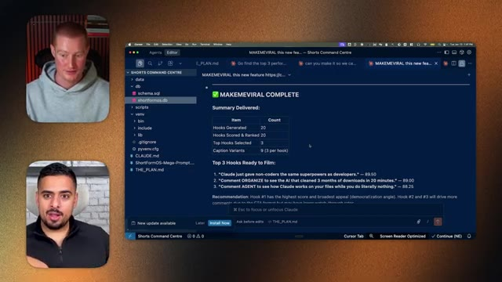
*⏱️ 00:41:05 — Capture d'écran montrant l'interface de l'éditeur de code Cursor avec l'arborescence d'un projet de création de contenu court et un résumé des crochets générés et notés.*

---

### ⏱️ `[00:41:30 - 00:42:04]` | Segment #91

**🔊 Audio (Transcription Intégrale Mot pour Mot en Français) :**
> Et le truc, c'est que si vous utilisez quelque chose comme Anti-Gravity ou Cursor — ça, c'est mon arme secrète, c'est clair que vous avez affaire à Claude ici — mais disons que vous avez besoin d'un regard neuf sur votre code ou sur tout ce que vous générez, vous pouvez toujours intégrer Cursor gratuitement, car vous avez une version gratuite plutôt généreuse tant que vous n'utilisez pas le mode Max. Vous pouvez vous dire : « Cool, qu'est-ce que Codex ou GPT 5.2 pense de mon système pour générer des hooks ? » Donc vous pouvez faire appel à différents conseillers, si l'on peut dire, pour jeter un œil à la même base de code, que vous fassiez du vibe coding ou que vous produisiez simplement quelque chose à grande échelle. Donc vous dites qu'au fur et à mesure que ces

**👁️ Analyse Visuelle d'Écran (gemini-3.5-flash-lite) :**
**Interface & Outils** : Éditeur de code Cursor, arborescence de fichiers, interface de discussion avec l'IA.

**Contenu textuel & Code** : Résumé de génération de crochets (hooks) pour des vidéos courtes avec des scores et des propositions de phrases d'accroche.

**Action / Démonstration** : Présentation de l'interface de développement et des résultats générés par l'IA dans Cursor.

*⏱️ 00:41:39 — Capture d'écran montrant l'interface du logiciel Cursor avec un projet de tableau de bord de génération de contenus ("Shorts Command Centre") et des webcams des participants à gauche.*

---

### ⏱️ `[00:42:04 - 00:42:37]` | Segment #92

**🔊 Audio (Transcription Intégrale Mot pour Mot en Français) :**
> les modèles s'améliorent, vous pourriez alors l'utiliser presque comme l'orchestrateur pour comprendre comment je pourrais optimiser ce genre de... oui, alors disons que vous avez fini par construire cette interface utilisateur et que, pour une raison quelconque, Claude Code n'était pas à la hauteur, il n'y arrivait tout simplement pas, peut-être faites-vous intervenir un expert spécialisé sous la forme de Gemini 3 Pro et vous dites, hé regardez, tous les deux partagent la même base de code, donc cette base de code, tout ce qui est dans Cursor peut voir ceci, donc Claude peut voir ceci et tout ce qui est dans Cursor peut voir ceci, donc avec cela, vous pouvez aller par exemple en mode question et dire, écoutez, pouvez-vous jeter un œil et me donner des conseils sur la façon dont je pourrais estructurer cela mieux ou encore plus

**👁️ Analyse Visuelle d'Écran (gemini-3.5-flash-lite) :**
**Interface & Outils** : Éditeur de code (Cursor / VS Code), interface de chat avec agent IA (GPT-5.2), et double flux vidéo des présentateurs.

**Contenu textuel & Code** : Tableau 'MAKEMEVIRAL COMPLETE' affichant les compteurs : 20 Hooks Générés, 20 Notés & Classés, 3 Top Hooks Sélectionnés, et 9 Variantes de légende. Liste des 3 meilleurs hooks prêts à être filmés avec leurs scores.

**Action / Démonstration** : Présentation de l'interface utilisateur de l'application 'Shorts Command Centre' générée et gérée par l'IA.

*⏱️ 00:42:12 — Vue d'un éditeur de code affichant un tableau récapitulatif de génération de crochets (hooks) de contenu pour les réseaux sociaux et la structure du projet, avec deux intervenants en incrustation vidéo.*

---

### ⏱️ `[00:42:37 - 00:43:01]` | Segment #93

**🔊 Audio (Transcription Intégrale Mot pour Mot en Français) :**
> bricolé, on pourrait dire, va chercher sur le web les meilleures pratiques pour prompter le code cloud, peux-tu m'aider à rédiger un prompt qui réglerait ce problème qui se produit dans ma base de code, et ensuite il pourrait aller chercher dans la base de code, puis aller chercher la meilleure façon de le prompter, et ensuite tu peux copier-coller le prompt d'ici à là, donc il y a tellement de façons d'utiliser ce duo dynamique, ouais j'adore, c'est super, du genre je ne savais pas qu'on pouvait faire ça, donc c'est, c'est, c'est un bon conseil.

**👁️ Analyse Visuelle d'Écran (gemini-3.5-flash-lite) :**
**Interface & Outils** : Éditeur de code (Cursor / VS Code), panneau de chat IA intégré, fenêtres de visioconférence.

**Contenu textuel & Code** : Explorateur de fichiers du projet "Shorts Command Centre" (dossiers data, db, scripts, venv), résumé textuel d'une fonctionnalité ("MAKEMEVIRAL COMPLETE") avec un tableau de comptage et une zone de chat avec le modèle Gemini 3 Pro.

**Action / Démonstration** : Navigation dans l'environnement de développement et utilisation d'un assistant IA pour concevoir ou structurer des fonctionnalités de code.

*⏱️ 00:42:43 — Capture d'écran montrant l'interface d'un éditeur de code avec l'arborescence du projet et un panneau de chat IA, ainsi que deux vignettes vidéo des intervenants sur la gauche.*

---

### ⏱️ `[00:43:02 - 00:43:24]` | Segment #94

**🔊 Audio (Transcription Intégrale Mot pour Mot en Français) :**
> Voilà. Mais ouais, avec ça, du genre, évidemment on peut aller tellement plus loin, rendre ça infiniment mieux. Mais c'est l'idée du genre, tu attaches quelques outils, tu balances quelques clés API, tu lui donnes un prompt, et ensuite tu lances le processus. Genre pour aller plus loin, non pas qu'on va faire ça dans cette vidéo, mais un cas d'usage que je verrais pour ça, c'est que j'ai utilisé, ou j'ai créé des miniatures pour mes vidéos courtes sur Instagram, juste parce que ça rend mieux sur mon profil, peu importe.

**👁️ Analyse Visuelle d'Écran (gemini-3.5-flash-lite) :**
**Interface & Outils** : Éditeur de code Cursor (IDE), arborescence de fichiers, interface de chat IA (Gemini 3 Pro) et flux vidéo des intervenants.

**Contenu textuel & Code** : Résumé d'exécution de script 'MAKEMEVIRAL COMPLETE' avec des tableaux de comptage (Hooks Generated, Hooks Scored & Ranked) et une liste de crochets marketing prêts à être filmés.

**Action / Démonstration** : Présentation du résultat d'un script automatisé par IA gérant la création et le classement de contenus courts (shorts).

*⏱️ 00:43:07 — Une capture d'écran montrant l'interface de l'éditeur de code Cursor avec un projet de tableau de bord nommé 'Shorts Command Centre' et des fenêtres de discussion vidéo en incrustation.*

---

### ⏱️ `[00:43:24 - 00:43:58]` | Segment #95

**🔊 Audio (Transcription Intégrale Mot pour Mot en Français) :**
> Donc littéralement, je pourrais faire ce que tu as fait pour YouTube, où tu fais ça en utilisant Nano Banana via l'API de Gemini, et ça va réellement créer ces miniatures pour toi en utilisant un outil de génération d'images. Et c'est peut-être la prochaine chose que je vais personnellement aller essayer de développer, parce que ce serait super utile. Et tu as construit quelque chose qui est un peu plus complexe que, genre, la vidéo courte. J'ai l'impression que le système que tu as construit avec YouTube a genre cinq étapes, une ou deux étapes d'avance sur ça. Et c'est juste fou de voir ce qu'on peut faire avec Claude Code. Donc cette vidéo me donne une marque. Du coup, je vais devoir y aller, genre, me lancer. Ouais. Sur cette miniature.

**👁️ Analyse Visuelle d'Écran (gemini-3.5-flash-lite) :**
**Interface & Outils** : Éditeur de code Cursor (VS Code fork), explorateur de fichiers, terminal intégré et interface Markdown.

**Contenu textuel & Code** : Résumé de génération de crochets ('Hooks Generated: 20', 'Hooks Scored & Ranked: 20', 'Top Hooks Selected: 3', 'Caption Variants: 9') et liste des 3 meilleurs crochets prêts à être filmés avec leurs scores.

**Action / Démonstration** : Présentation du tableau de bord de génération de contenu et de l'automatisation des crochets pour les réseaux sociaux.

*⏱️ 00:43:33 — Capture d'écran montrant l'interface de l'éditeur de code Cursor avec l'application 'MAKEMEVIRAL - Shorts Command Centre' et deux intervenants en visioconférence dans des fenêtres superposées à gauche.*

---

### ⏱️ `[00:43:58 - 00:44:32]` | Segment #96

**🔊 Audio (Transcription Intégrale Mot pour Mot en Français) :**
> la chose juste pour inspirer les gens donc la façon dont je l'ai créé c'est que je demande à nano banana de créer le concept et ensuite il le rédige sous forme de croquis et ensuite il prend ce croquis et il l'envoie à nano banana à nouveau pour créer la version un de la miniature et ensuite il charge ça dans gemini pour obtenir son avis sur l'image en tant qu'expert youtube et ensuite après l'avoir critiquée il réinjecte ses commentaires dans nano banana pour le corriger donc j'ai cette boucle de rétroaction où avant que j'y jette un œil il s'est déjà auto-critiqué, c'est pourquoi, encore une fois, c'est une compétence à si fort effet de levier.

**👁️ Analyse Visuelle d'Écran (gemini-3.5-flash-lite) :**
**Interface & Outils** : Éditeur de code (type Cursor ou VS Code) avec explorateur de fichiers et interface de chat intégrée, ainsi que deux flux vidéo de participants.

**Contenu textuel & Code** : Un résumé affichant des données sur des "Hooks" générés, notés et classés ("Hooks Generated: 20", "Hooks Scored & Ranked: 20", "Top Hooks Selected: 3"), accompagnés de propositions textuelles et de scores.

**Action / Démonstration** : Visualisation du tableau récapitulatif généré par l'assistant IA concernant les accroches (hooks) pour les vidéos courtes.

*⏱️ 00:44:07 — Une capture d'écran montrant l'interface d'un éditeur de code ou d'un outil de développement (semblable à Cursor ou VS Code) avec des webcams des participants sur le côté gauche.*

---

### ⏱️ `[00:44:32 - 00:44:52]` | Segment #97

**🔊 Audio (Transcription Intégrale Mot pour Mot en Français) :**
> Si vous n'êtes pas du tout technique, c'est le moment. C'est le moment idéal pour vous lancer et vous mouiller la nuque. Oui, ça, et c'est, j'adore entendre ça. Une autre chose que je veux mentionner avant de terminer cet épisode, parce qu'on a évidemment montré un peu ce qu'on a construit ici ou ce qu'Mark a construit ici. Retournez à ce tableau Excalidraw que vous avez montré, parce que corrigez-moi si je me trompe, vous avez construit ça avec CloudCode, n'est-ce pas ?

**👁️ Analyse Visuelle d'Écran (gemini-3.5-flash-lite) :**
**Interface & Outils** : Éditeur de code (Cursor / VS Code) et interface de visioconférence.

**Contenu textuel & Code** : Un tableau récapitulatif "MAKEMEVIRAL COMPLETE" affichant les métriques (20 Hooks Générés, 20 Hooks Notés & Classés, 3 Top Hooks Sélectionnés, 9 Variantes de légendes) ainsi que le classement des 3 meilleurs "hooks" prêts à être filmés avec leurs scores respectifs.

**Action / Démonstration** : Présentation et démonstration de l'interface de l'application de création de contenu automatisée par IA.

*⏱️ 00:44:37 — Capture d'écran montrant l'interface de l'éditeur de code avec l'application "Shorts Command Centre" et deux participants en visioconférence dans des encarts à gauche.*

---

### ⏱️ `[00:44:53 - 00:45:12]` | Segment #98

**🔊 Audio (Transcription Intégrale Mot pour Mot en Français) :**
> Tu n'as même pas construit ça toi-même. Non, j'ai un système que j'ai construit dans Cloud Code qui m'aide à faire des diagrammes explicatifs, surtout pour mon YouTube, où ce sont des gribouillis. Ça rend donc les choses beaucoup plus digestes. Je vais donc expliquer, genre, je lui ai littéralement parlé comme ça : écoute, je m'apprête à participer au podcast de Brock, sur sa chaîne. Son objectif n'est pas trop orienté développeur.

**👁️ Analyse Visuelle d'Écran (gemini-3.5-flash-lite) :**
**Interface & Outils** : Navigateur web affichant un outil de dessin/diagramme avec un style de gribouillage (style sketchy).

**Contenu textuel & Code** : Un schéma illustrant un système de contenu : des icônes d'Instagram, TikTok et YouTube reliées par des flèches à une étape de "scrape", menant à une base de données ("database"), puis à la création de contenu ("create content").

**Action / Démonstration** : Le présentateur explique le fonctionnement de son système de diagrammes explicatifs générés automatiquement pour ses vidéos.

*⏱️ 00:44:57 — Capture d'écran montrant le présentateur et son interlocuteur en visioconférence à gauche, et un diagramme explicatif interactif avec des icônes de réseaux sociaux à droite.*

---

### ⏱️ `[00:45:12 - 00:45:46]` | Segment #99

**🔊 Audio (Transcription Intégrale Mot pour Mot en Français) :**
> Je veux décomposer cela. Alors aide-moi à créer trois à cinq images où tu penses que ce concept serait bien représenté et que ça s'occupe du reste à partir de là. Mec, j'adore ça. C'est juste hilarant. J'adore que tu aies fait ça. Très bien. Donc cet épisode a été incroyable. Je suis impatient de tester ces trucs maintenant et de commencer réellement à utiliser ce système, à construire d'autres choses par-dessus. Mais Mark, si nous pouvions donner au spectateur de ceci, une personne complètement non technique, une action concrète à faire dès maintenant, du genre au lieu de simplement regarder cette vidéo, de prendre des notes et de ne rien faire avec, qu'est-ce qu'il pourrait faire à cette exact seconde pour vraiment faire ce premier pas, commencer, commencer à apprendre ceci et espérer bâtir la compétence qui pourrait changer sa vie au cours des années à venir ?

**👁️ Analyse Visuelle d'Écran (gemini-3.5-flash-lite) :**
**Interface & Outils** : Navigateur web affichant un outil de dessin ou de mindmapping (type Excalidraw ou similaire).

**Contenu textuel & Code** : Un schéma en trois étapes : 1) Icônes des réseaux sociaux (Instagram, TikTok, YouTube) menant à "scrape", 2) Une base de données ("database"), 3) Une étape finale "create content" avec une icône étincelante.

**Action / Démonstration** : Présentation et explication d'un workflow d'automatisation de contenu par l'invité.

*⏱️ 00:45:20 — Schéma explicatif dessiné à la main montrant le processus de création de contenu automatisé à partir des réseaux sociaux.*

---

### ⏱️ `[00:45:46 - 00:46:08]` | Segment #100

**🔊 Audio (Transcription Intégrale Mot pour Mot en Français) :**
> Ouais. Donc je vais, je vais donner ce conseil avec des pincettes parce que je sais que les gens vont regarder ça. Et même si nous prouvons que c'est efficace, ils ne téléchargeront toujours pas le terminal. Donc si c'est ça le point de friction, vous avez littéralement quelque chose qui est tombé du ciel sous la forme de Co-work, qui n'est pas parfait. Ce n'est toujours pas un produit parfait, mais cela vous donnera un petit aperçu de ce à quoi pourrait ressembler l'exécution de flux de travail agentiques.

**👁️ Analyse Visuelle d'Écran (gemini-3.5-flash-lite) :**
**Interface & Outils** : Visioconférence (aucun outil technique ou graphique visible).

**Contenu textuel & Code** : Aucun code source, indicateur technique, prompt ou donnée chiffrée.

**Action / Démonstration** : Discussion entre les intervenants.

---

### ⏱️ `[00:46:08 - 00:46:29]` | Segment #101

**🔊 Audio (Transcription Intégrale Mot pour Mot en Français) :**
> Vous n'obtiendrez pas la largeur. Vous n'obtiendrez pas la profondeur, mais cela vous mettra plus à l'aise. Et espérons que cela vous donnera le FOMO que si vous aviez, au lieu d'un moteur de base, toute la puissance de feu d'un moteur V8 qui vous permettrait d'aller beaucoup plus loin. Donc au lieu de devoir aller de zéro au grand bain, vous pouvez aller de zéro au petit bain, vous mouiller les pieds, vous y habituer.

**👁️ Analyse Visuelle d'Écran (gemini-3.5-flash-lite) :**
**Interface & Outils** : Aucune interface logicielle ou graphique de trading n'est affichée.

**Contenu textuel & Code** : Aucun indicateur technique, code source ou donnée chiffrée visible.

**Action / Démonstration** : Présentation orale et discussion en visioconférence sans démonstration technique active.

---

### ⏱️ `[00:46:29 - 00:46:49]` | Segment #102

**🔊 Audio (Transcription Intégrale Mot pour Mot en Français) :**
> Et ensuite, quand vous êtes prêts, faites quelques commandes et commencez votre parcours avec le code cloud. Gardez à l'esprit que c'est un outil qui est sorti littéralement hier. C'est donc votre signe venu des cieux. Comme tu l'as dit, je vais essayer ça et le tester. Il n'y a plus d'excuses maintenant. Mark, c'est génial, mec. J'apprécie. Merci d'avoir construit ça pour moi. Merci de l'avoir expliqué. Où mon audience peut-elle te trouver ? Bien sûr. Alors, Mark underscore Kashif sur YouTube.

**👁️ Analyse Visuelle d'Écran (gemini-3.5-flash-lite) :**
**Interface & Outils** : Visioconférence / capture d'écran de l'émission.

**Contenu textuel & Code** : Aucun graphique, terminal, code source ou indicateur technique visible.

**Action / Démonstration** : Discussion entre le présentateur et son invité sans démonstration technique active à l'écran.

---

### ⏱️ `[00:46:49 - 00:47:23]` | Segment #103

**🔊 Audio (Transcription Intégrale Mot pour Mot en Français) :**
> Si vous êtes quelqu'un qui s'intéresse au côté le plus poussé des choses, que vous ne voulez pas juste être non-technique, mais que vous voulez vraiment aller à fond, vous pouvez consulter ma communauté Early AI Doctors. C'est là que je donne tout le temps et que je construis toutes sortes de choses. Et en dehors de ça, j'espère qu'il y en aura plus sur la chaîne de Brock. Ouais. Je tiens à féliciter la communauté de Mark aussi, parce que j'y suis depuis, je ne sais pas, probablement plus de six mois maintenant. Honnêtement, si je veux apprendre quelque chose d'un peu plus technique, c'est mon endroit préféré. Ça permet en quelque sorte de faire abstraction du bruit de tout le reste. Je n'ai pas besoin d'aller sur YouTube ou sur X et de voir mon anxiété et mon FOMO augmenter. Au lieu de cela, je vais directement dans la communauté de Mark. C'est un super endroit. Donc ouais, Mark, merci d'être venu, mec.

**👁️ Analyse Visuelle d'Écran (gemini-3.5-flash-lite) :**
**Interface & Outils** : Visioconférence (aucun graphique, terminal ou code affiché).

**Contenu textuel & Code** : Aucun indicateur technique, code source ou donnée chiffrée n'est présent.

**Action / Démonstration** : Discussion en visio-conférence entre les deux intervenants sans manipulation technique visible.

---

### ⏱️ `[00:47:24 - 00:47:26]` | Segment #104

**🔊 Audio (Transcription Intégrale Mot pour Mot en Français) :**
> Je suis sûr que nous vous inviterons bientôt. Passez une bonne journée. À plus tout le monde.

**👁️ Analyse Visuelle d'Écran (gemini-3.5-flash-lite) :**
**Interface & Outils** : Visioconférence (aucun graphique, code ou terminal).

**Contenu textuel & Code** : Aucun contenu technique ni données chiffrées.

**Action / Démonstration** : Fin de l'appel ou de l'interview, salutations de fin de session.

---

