# 🎬 This Is the Most Powerful AI App Builder I’ve Ever Used (Rork Max)

> **Chaîne** : [Brock Mesarich | AI for Non Techies](https://www.youtube.com/@BrockMesarich)  
> **Lien YouTube** : [https://www.youtube.com/watch?v=3uIbTvgaNRY](https://www.youtube.com/watch?v=3uIbTvgaNRY)  
> **Date de publication** : 20260220  
> **Durée** : 00:09:34  
> **Identifiant vidéo** : `3uIbTvgaNRY`  
> **Transcription & Analyse** : `whisper-v3-large-turbo+gemini-3.5-flash-lite`  

---

## 📌 Synthèse Exécutive & Outils

### 💡 Résumé
Cette vidéo de la chaîne *Brock Mesarich | AI for Non Techies* met en lumière une avancée majeure dans le développement logiciel assisté par l'intelligence artificielle : la capacité de concevoir, compiler et déployer de véritables applications iOS natives (en Swift) directement sur un iPhone à partir d'un simple prompt textuel. Grâce à l'association des capacités de codage complexes du modèle Claude Opus 4.6 et de l'outil Rork Max, les utilisateurs n'ont plus besoin de se limiter à des applications web s'exécutant dans un navigateur. Ils peuvent désormais exploiter toutes les fonctionnalités matérielles des appareils physiques, telles que la caméra, le microphone, la géolocalisation et la réalité augmentée, avec des icônes sur l'écran d'accueil et des notifications push fonctionnelles.

La démonstration pratique illustre la puissance de cette synergie à travers la création rapide d'applications concrètes, incluant un jeu de type Minecraft et un studio de design en réalité augmentée (AI Space Studio) permettant de placer des objets 3D en temps réel dans une pièce filmée par la caméra du téléphone. Le flux de travail présenté montre comment passer d'une idée formulée vocalement (via Whisper Flow et ChatGPT) à un prompt structuré hautement spécifique, avant de compiler l'application sur l'écosystème Rork et de la transférer de manière transparente sur un iPhone physique via l'application compagnon et un compte de développeur Apple.

Ce changement de paradigme démocratise radicalement la création logicielle, permettant à des non-techniciens de matérialiser instantanément des concepts complexes en applications prêtes à être publiées sur l'App Store. Bien que le contenu s'adresse à des créateurs et des entrepreneurs cherchant à prototyper ou commercialiser des solutions mobiles sans compétences en programmation traditionnelle, la rigueur méthodologique exigée dans la structuration des prompts s'apparente aux meilleures pratiques d'ingénierie des processus automatisés.

### 🛠️ Outils, Modèles & Logiciels Présentés
* **Rork Max** : Environnement de développement et plateforme de création d'applications permettant de générer et de compiler du code Swift natif pour iOS à partir de descriptions textuelles.
* **Claude Opus 4.6** : Modèle linguistique de pointe de haute performance, particulièrement optimisé pour la gestion de tâches de codage complexes et la génération de structures logicielles robustes sans erreur.
* **ChatGPT** : Assistant conversationnel généraliste utilisé pour transformer des idées brutes en prompts structurés et ultra-spécifiques.
* **Whisper Flow** : Outil de dictée vocale et de transcription permettant de formuler rapidement des idées textuelles par la voix avant de les structurer par IA.
* **n8n** : Plateforme d'automatisation de flux de travail (mentionnée dans l'écosystème technique global de la chaîne pour l'interconnexion d'agents et d'APIs).
* **Make** : Outil d'intégration et d'automatisation no-code pour connecter des applications web et exécuter des processus automatisés.
* **Zapier** : Solution pionnière d'automatisation de tâches entre différentes applications logicielles.
* **Gemini** : Modèle d'intelligence artificielle de Google offrant de larges fenêtres de contexte pour l'analyse de données et la génération de contenu.
* **Grok** : Modèle d'intelligence artificielle orienté vers l'accès à l'information en temps réel.

### 🔑 Points Clés & Enseignements Stratégiques
* **Dépassement du paradigme Web-App** : Abandon des applications hébergées dans un navigateur (Chrome, Safari) au profit d'applications natives Swift s'exécutant directement sur le matériel physique de l'appareil.
* **Accès aux fonctionnalités natives du hardware** : Intégration transparente et fluide des composants matériels de l'iPhone, incluant la caméra haute résolution, le microphone, la géolocalisation et les capteurs de mouvement.
* **Expérience utilisateur de niveau production** : Les applications générées disposent d'icônes sur l'écran d'accueil, gèrent les notifications push et continuent de fonctionner en arrière-plan, offrant une ergonomie indiscernable des applications développées de manière traditionnelle.
* **Exploitation de la Réalité Augmentée (RA)** : Capacité à concevoir des applications interactives complexes capables de superposer des objets virtuels 3D dans un flux vidéo en direct de l'environnement réel de l'utilisateur.
* **Stratégie de prompt engineering structuré** : Nécessité de fournir des instructions hautement détaillées et méthodiques pour maximiser le taux de réussite de la génération de code en un seul essai (*one-shot*).
* **Utilisation combinée de la dictée vocale et du LLM** : Optimisation du flux de création par l'utilisation de Whisper Flow pour verbaliser une idée brute, convertie ensuite par ChatGPT en un prompt technique hyper-spécifique destiné à Claude Opus 4.6.
* **Gestion des capacités de calcul asynchrones** : Acceptation d'un temps de génération initial plus long par l'IA pour garantir la structuration d'un code propre, fonctionnel et exempt d'erreurs logiques.
* **Processus de déploiement physique simplifié** : Utilisation de l'application compagnon Rork pour authentifier un identifiant Apple et transférer l'application compilée directement sur un iPhone connecté par USB.
* **Accessibilité de la publication sur l'App Store** : Potentiel de mise sur le marché immédiat des applications générées en quelques clics, ouvrant la voie à une monétisation rapide pour les non-programmeurs.
* **Suppression des barrières techniques à l'entrée** : Démocratisation totale de la création logicielle où l'imagination et la clarté de la vision stratégique priment sur la maîtrise des langages de programmation bas niveau.

---

## ⏱️ Chronologie & Transcription Complète Audio & Visuelle (Mot pour Mot)

### ⏱️ `[00:00:00 - 00:00:23]` | Segment #01

**🔊 Audio (Transcription Intégrale Mot pour Mot en Français) :**
> C'est l'un de ces moments révélateurs où l'IA me scotche littéralement. Je viens de créer de vraies applications iOS en un seul produit. Pas des applications web, pas des démos dans un navigateur. Ce sont de vraies applications natives téléchargées sur mon iPhone. Et je pourrais littéralement les publier sur l'App Store en quelques clics seulement. Le tout nouveau Claude Opus 4.6 et la nouvelle mise à jour de Rourke Max constituent l'une des expériences d'IA les plus folles que j'aie jamais vécues.

**👁️ Analyse Visuelle d'Écran (gemini-3.5-flash-lite) :**
**Interface & Outils** : Interface de développement et de publication d'application mobile, page web d'annonce logicielle.

**Contenu textuel & Code** : Textes explicatifs sur la création d'applications sans compte développeur payant et détails sur une mise à jour d'intelligence artificielle (Claude Opus 4.6).

**Action / Démonstration** : Présentation de la création et du déploiement d'une application iOS native sans frais de compte développeur Apple.

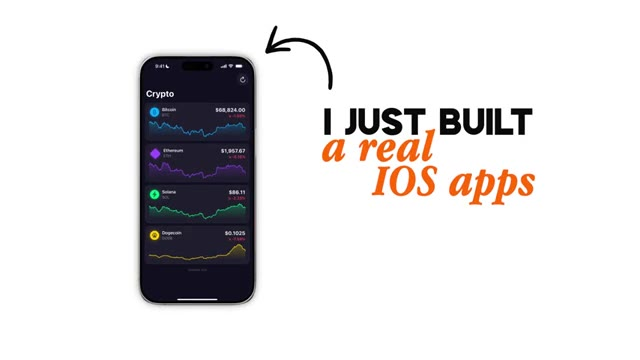
*⏱️ 00:00:06 — Aperçu d'une application iOS affichant des cours de cryptomonnaies sur un écran de smartphone, avec le texte 'I JUST BUILT a real iOS apps'.*

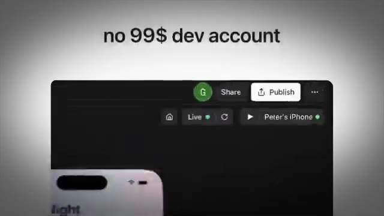
*⏱️ 00:00:12 — Interface de déploiement ou de publication d'application mobile montrant le ciblage d'un iPhone personnel avec la mention 'no 99$ dev account'.*

---

### ⏱️ `[00:00:23 - 00:00:56]` | Segment #02

**🔊 Audio (Transcription Intégrale Mot pour Mot en Français) :**
> Nous en sommes officiellement au point où n'importe qui peut créer n'importe quelle application qu'il peut imaginer. Donc dans cette vidéo, je vais vous montrer ce qui rend cela si révolutionnaire, vous faire découvrir de vraies applications que j'ai construites moi-même, et vous montrer comment vous pourriez faire exactement la même chose d'ici la fin de cette vidéo. Sans plus attendre, plongeons dans le vif du sujet. Très bien, donc je sais que j'ai placé la barre très haut au début de cette vidéo, en expliquant en gros à quel point cela change tout pour la création d'applications mobiles, mais il faut que vous compreniez qu'il s'agit vraiment d'une avancée majeure lorsqu'il s'agit d'être capable de créer des applications mobiles avec l'IA. Je vais l'expliquer dès maintenant, et ensuite je vais vous montrer les applications que j'ai construites moi-même, et je vais vous montrer exactement

**👁️ Analyse Visuelle d'Écran (gemini-3.5-flash-lite) :**
**Interface & Outils** : Excalidraw (tableau blanc en ligne)

**Contenu textuel & Code** : Maquettes et captures d'écrans d'applications mobiles natives, notes manuscrites sur fond vert et bleu concernant les applications iOS natives et les fonctionnalités.

**Action / Démonstration** : Présentation et explication visuelle des différentes applications mobiles créées par le présentateur.

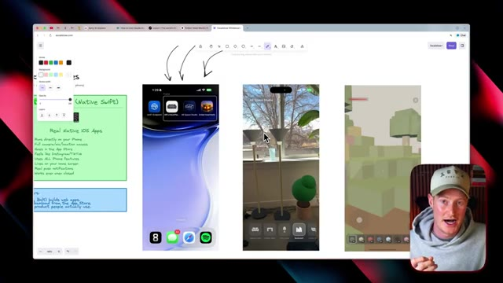
*⏱️ 00:00:40 — Une vue d'écran d'ordinateur montrant un tableau blanc interactif (Excalidraw) avec plusieurs maquettes d'applications mobiles et des notes adhésives.*

---

### ⏱️ `[00:00:56 - 00:01:31]` | Segment #03

**🔊 Audio (Transcription Intégrale Mot pour Mot en Français) :**
> comment vous pourriez faire cela vous-même en quelques étapes simples. Voici de quoi je parle. Il s'agit d'une capture d'écran sur mon téléphone que je viens de prendre il y a environ cinq minutes des applications que j'ai téléchargées. Nous avons donc notre application AI Furniture Place, nous avons notre application AI Space Studio, et nous avons notre application Emble Voxel World. Et ce sont des exemples d'applications que nous avons construites. Alors ici même, nous avons cette application de réalité augmentée où vous pouvez essentiellement prendre une vidéo ou littéralement une vidéo en direct de votre pièce et y placer des objets en temps réel. Cela fonctionne comme n'importe quelle application de RA, vous en avez déjà utilisé et cela utilise votre véritable appareil photo sur votre iPhone et c'est ce qui change la donne

**👁️ Analyse Visuelle d'Écran (gemini-3.5-flash-lite) :**
**Interface & Outils** : Navigateur web affichant un tableau blanc (Excalidraw) avec des maquettes et captures d'écran d'applications iOS.

**Contenu textuel & Code** : Captures d'écran d'applications de réalité augmentée (AI Furniture Place, AR Space Studio, Ember View World) et interface de dessin/notes.

**Action / Démonstration** : Présentation des captures d'écran d'applications mobiles téléchargées récemment par le créateur.

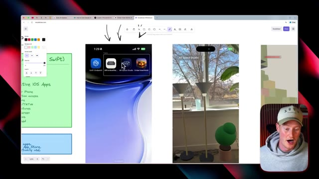
*⏱️ 00:01:05 — Un écran de navigateur affichant un tableau blanc avec des captures d'écran mobiles (AI Furniture Place, AR Space Studio, Ember View World) et le présentateur en médaillon.*

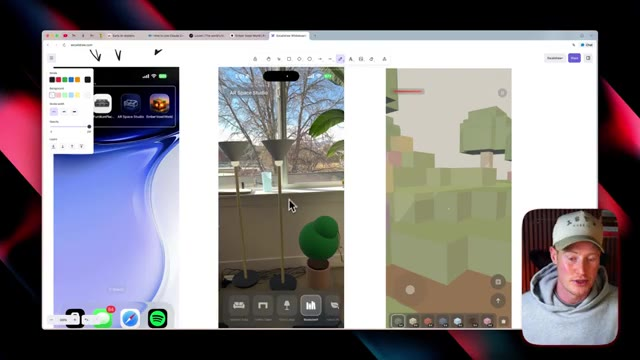
*⏱️ 00:01:22 — Vue similaire de l'écran de navigateur avec les applications mobiles en réalité augmentée et les interfaces d'outils, ainsi que le présentateur en bas à droite.*

---

### ⏱️ `[00:01:31 - 00:02:03]` | Segment #04

**🔊 Audio (Transcription Intégrale Mot pour Mot en Français) :**
> chose ici et nous avons en fait recréé Minecraft en littéralement un seul prompt et c'est extrêmement facile à utiliser et le plus grand point à ce sujet c'est que j'ai téléchargé cela sur mon application mobile et je pourrais facilement les publier sur l'App Store en quelques étapes simples ce ne sont pas des applications web que vous utiliseriez sur votre navigateur ce sont des applications qui sont sur votre vrai téléphone et vos appareils physiques et c'est l'un des plus grands aspects de cette mise à jour dont nous allons parler dans cette vidéo. Passons maintenant à l'action pour montrer exactement ce que fait Rourke Max. Ensuite je vais vous montrer mes applications puis vous montrer des cas d'usage et comment vous pouvez commencer à faire cela vous-même. Tous

**👁️ Analyse Visuelle d'Écran (gemini-3.5-flash-lite) :**
**Interface & Outils** : Tableau blanc numérique interactif, navigateur web et interface de présentation vidéo.

**Contenu textuel & Code** : Icônes d'applications mobiles, captures d'écrans de jeux (style Minecraft) et illustrations de développement d'applications.

**Action / Démonstration** : Présentation et démonstration visuelle d'applications mobiles créées à l'aide de l'IA.

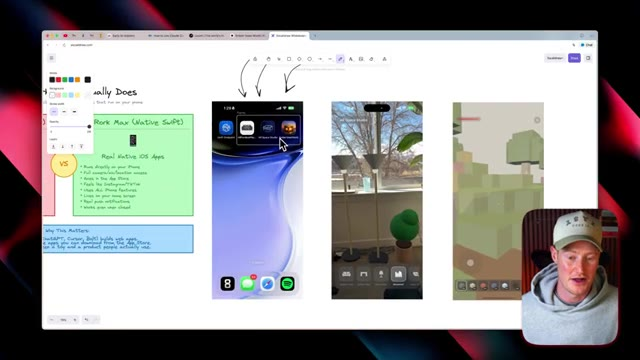
*⏱️ 00:01:39 — Capture d'écran montrant un tableau blanc numérique avec des applications mobiles, incluant une application inspirée de Minecraft, et le visage du présentateur en bas à droite.*

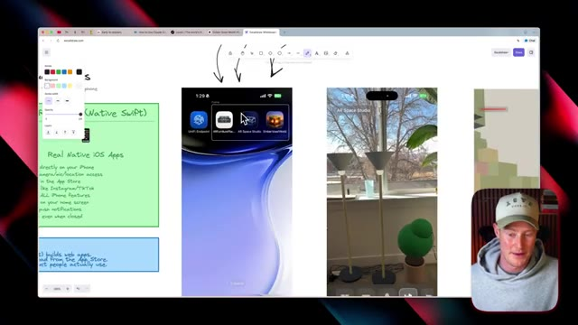
*⏱️ 00:01:47 — Vue similaire centrée sur les applications mobiles présentées sur le tableau blanc numérique avec le curseur pointant sur une icône.*

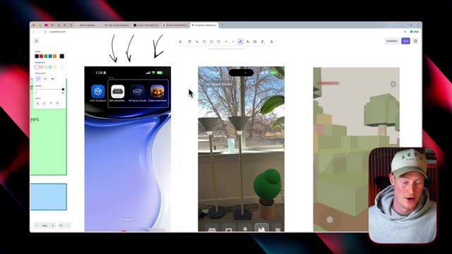
*⏱️ 00:01:55 — Vue détaillée des applications mobiles créées et présentées sur le tableau blanc avec une application rappelant l'univers de Minecraft.*

---

### ⏱️ `[00:02:03 - 00:02:38]` | Segment #05

**🔊 Audio (Transcription Intégrale Mot pour Mot en Français) :**
> Exactement, alors parlons d'abord d'avant Roark Max et Opus 4.6. Chaque créateur d'applications construisait des applications web. Donc, essentiellement, ce qu'est une application web, c'est quelque chose qui s'exécute dans un navigateur. Donc, si vous utilisez Chrome, vous devez y accéder par ce biais. Vous ne pouviez pas y accéder sur votre appareil physique. Vous ne pouviez pas accéder correctement à des éléments comme votre caméra ou votre micro. Il n'y avait pas d'App Store, pas de téléchargements. Vous ne pouviez pas réellement les utiliser sur vos appareils et cela ressemblait à un site web. Ce n'était pas comme une vraie application que vous utiliseriez sur votre téléphone. Cependant, cela change tout et c'est en quelque sorte le changement de paradigme qui vous permet de réellement construire ces applications sur vos téléphones. Avant

**👁️ Analyse Visuelle d'Écran (gemini-3.5-flash-lite) :**
**Interface & Outils** : Excalidraw (tableau blanc en ligne)

**Contenu textuel & Code** : Texte comparatif sur les applications web (« Run in browser », « Can't access your camera/mic properly », etc.)

**Action / Démonstration** : Le présentateur explique les limites des applications web en pointant du curseur les éléments du schéma.

---

### ⏱️ `[00:02:38 - 00:03:05]` | Segment #06

**🔊 Audio (Transcription Intégrale Mot pour Mot en Français) :**
> nous n'avions pas d'icônes sur l'écran d'accueil. Nous n'avions pas de notifications push et l'application s'arrête dès que vous fermez l'onglet. Alors qu'aujourd'hui, avec Rourke Max et Opus 4.6, nous avons du Swift natif, qui est essentiellement un langage de codage vous permettant de créer des applications iOS directement sur vos appareils. Cela s'exécute donc directement sur votre téléphone. Vous pouvez utiliser votre appareil photo, votre micro et l'accès à votre position. Cela va sur l'App Store. Et pour l'expliquer d'une manière très élémentaire, c'est comme utiliser Instagram ou TikTok sur votre téléphone.

**👁️ Analyse Visuelle d'Écran (gemini-3.5-flash-lite) :**
**Interface & Outils** : Excalidraw (tableau blanc numérique en ligne) et navigateur web.

**Contenu textuel & Code** : Schéma comparatif listant les avantages du Swift natif ("Runs directly on your iPhone", "App Store", "Push notifications", "Works even when closed").

**Action / Démonstration** : Le présentateur commente le tableau blanc et souligne les points clés sur les applications natives iOS.

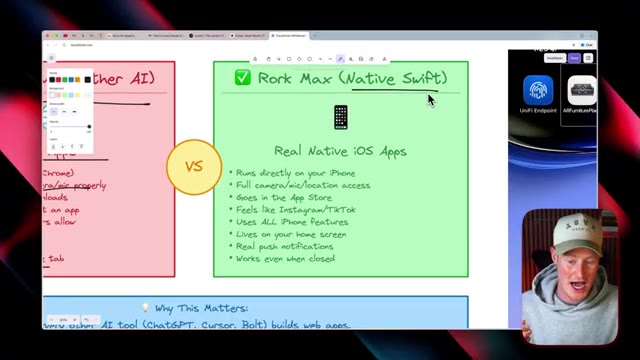
*⏱️ 00:02:52 — Vue d'un tableau blanc interactif (Excalidraw) comparant les applications web et natives, mettant en avant Rork Max (Native Swift).*

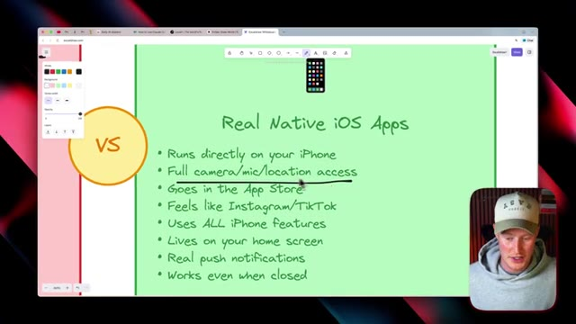
*⏱️ 00:02:58 — Gros plan sur le tableau blanc interactif zoomé détaillant les caractéristiques des "Real Native iOS Apps".*

---

### ⏱️ `[00:03:05 - 00:03:38]` | Segment #07

**🔊 Audio (Transcription Intégrale Mot pour Mot en Français) :**
> On dirait vraiment une application native. On n'a pas l'impression que c'est quelque chose qui a été assemblé de bric et de broque. Une autre chose importante, c'est que ça utilise toutes les fonctionnalités de l'iPhone, ça peut vivre sur votre écran d'accueil, avec de vraies notifications push, et ça fonctionne même lorsque l'application est fermée. Maintenant que nous comprenons exactement pourquoi c'est si percutant, je vais vous montrer les applications que j'ai construites et vous montrer comment vous pourriez faire exactement la même chose. Très bien, passons donc à Rourke. Je vais vous montrer exactement comment vous pouvez commencer à utiliser ceci dès maintenant. Juste ici, nous avons en fait ce bouton Rourke max. Nous allons donc nous assurer de l'activer. C'est ce qui nous permet réellement de construire ces applications Swift qui

**👁️ Analyse Visuelle d'Écran (gemini-3.5-flash-lite) :**
**Interface & Outils** : Navigateur web, site Rork (rork.com), outil de présentation / tableau blanc.

**Contenu textuel & Code** : Texte listant les avantages des apps natives (exécutées sur iPhone, App Store, notifications push, écran d'accueil) et champ de saisie pour décrire une application mobile.

**Action / Démonstration** : Navigation sur le site web de Rork et présentation des caractéristiques d'une application mobile native par le présentateur.

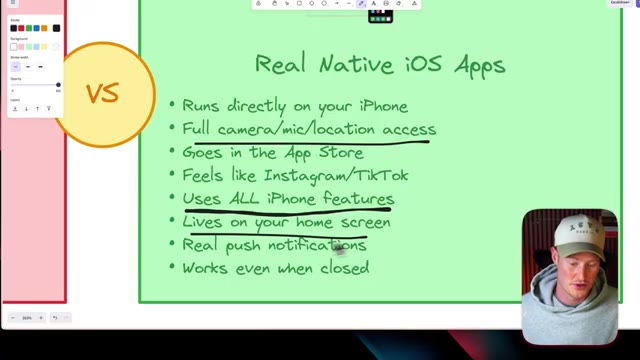
*⏱️ 00:03:13 — Présentation des fonctionnalités des applications iOS natives sur fond vert (Real Native iOS Apps).*

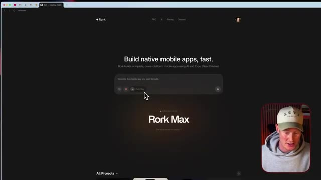
*⏱️ 00:03:30 — Interface web du service Rork permettant de créer des applications mobiles natives à l'aide de l'IA (Rork Max).*

---

### ⏱️ `[00:03:38 - 00:04:11]` | Segment #08

**🔊 Audio (Transcription Intégrale Mot pour Mot en Français) :**
> que nous pourrions commencer à utiliser sur notre téléphone. Ce que je vais faire, c'est que je vais coller ce prompt ici. C'est un prompt très détaillé. Essentiellement, ce que j'ai fait, c'est que je suis juste allé sur ChatGPT. J'ai utilisé Whisper Flow. Et j'ai en gros simplement parlé à mon ordinateur et j'ai dit : Hé, je veux une application qui soit essentiellement Minecraft. Je veux que tu me fasses un prompt hyper spécifique pour une application iOS Swift à construire en utilisant RORC. Et ensuite, il m'a donné ce résultat ici. C'est donc vraiment important que nous donnions un prompt assez structuré lorsque nous allons construire notre application, parce qu'Opus 4.6 est phénoménal quand il s'agit de tâches de codage vraiment complexes. Et nous pourrions en fait choisir le modèle que nous voulons utiliser ici. Nous allons

**👁️ Analyse Visuelle d'Écran (gemini-3.5-flash-lite) :**
**Interface & Outils** : Navigateur web affichant le site rork.com.

**Contenu textuel & Code** : Texte du prompt détaillé décrivant des indices sonores, une navigation minimaliste et le titre 'Rork Max'.

**Action / Démonstration** : Le présentateur explique comment il utilise un prompt détaillé copié-collé depuis ChatGPT pour générer une application mobile.

---

### ⏱️ `[00:04:11 - 00:04:46]` | Segment #09

**🔊 Audio (Transcription Intégrale Mot pour Mot en Français) :**
> d'utiliser Opus 4.6. Et si je configure ceci pour dire RORC max, cela va automatiquement l'utiliser, je crois. Donc ce que je vais faire, je vais envoyer ceci maintenant et Rourke va commencer à construire notre application. Très bien. Donc ce que nous allons voir à l'intérieur de Rourke maintenant, c'est ce plan très détaillé. Donc il semble que nous ayons déjà deux de nos 13 tâches de faites. Une chose que je veux mentionner à propos de Rourke Max et de Claude Opus 4.6, c'est que cela prendra un certain temps pour générer notre application. Et ce n'est pas une mauvaise chose parce que quand je vous dis que vous pouvez créer une application en un seul essai, vous pouvez créer une application en un seul essai. Et ce que je veux dire par un seul essai, c'est que vous donnez juste un prompt détaillé comme celui-ci et il va construire une application entière qui est

**👁️ Analyse Visuelle d'Écran (gemini-3.5-flash-lite) :**
**Interface & Outils** : Interface web de développement (type Bolt/v0 ou outil similaire de génération d'application par IA).

**Contenu textuel & Code** : Texte descriptif d'une application mobile (« Ember: Luxe Wood Survival ») avec spécifications techniques et visuelles, et prévisualisation d'écran de smartphone.

**Action / Démonstration** : Présentation de la génération et de la configuration de l'application en cours par l'intelligence artificielle.

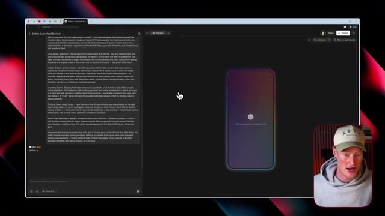
*⏱️ 00:04:20 — Capture d'écran montrant une interface de développement d'application avec un panneau de code/prompt à gauche et une simulation d'interface mobile à droite, ainsi que le présentateur en incrustation (webcam).*

---

### ⏱️ `[00:04:46 - 00:05:08]` | Segment #10

**🔊 Audio (Transcription Intégrale Mot pour Mot en Français) :**
> fonctionnant en douceur avec zéro erreur exactement comme vous le voulez. Donc cela va prendre un petit moment ici. Laissons-le faire, réfléchir à la façon de s'attaquer, vous savez, à la tâche de construire cette application et ensuite nous verrons le résultat final. Donc nous avons maintenant cette application de style Minecraft ici, ce qui est super. Mais une chose que je veux mentionner est que nous utilisons ceci à l'intérieur du navigateur. Maintenant nous sommes sur le site web de Rourke en utilisant ceci.

**👁️ Analyse Visuelle d'Écran (gemini-3.5-flash-lite) :**
**Interface & Outils** : Navigateur web avec interface de développement d'application et simulateur mobile.

**Contenu textuel & Code** : Code de spécification textuelle à gauche et aperçu graphique d'un jeu de type voxel sur l'écran du smartphone virtuel.

**Action / Démonstration** : Chargement initial puis affichage du résultat final de l'application interactive générée.

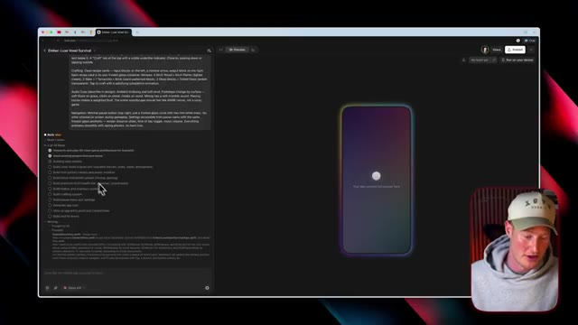
*⏱️ 00:04:52 — Interface de développement avec une application mobile en cours de chargement (écran noir avec logo), et la webcam du présentateur en bas à droite.*

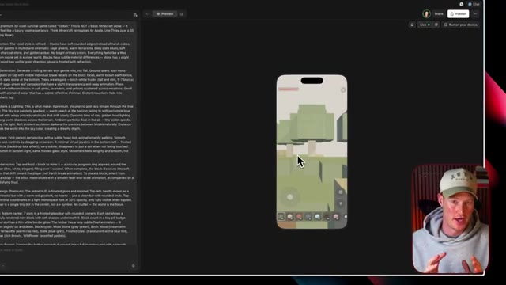
*⏱️ 00:05:03 — Interface de développement montrant le jeu voxel en 3D fonctionnel dans l'émulateur mobile, avec le présentateur visible en incrustation.*

---

### ⏱️ `[00:05:08 - 00:05:26]` | Segment #11

**🔊 Audio (Transcription Intégrale Mot pour Mot en Français) :**
> Tu te demandes probablement, Brock, comment est-ce que j'utilise ça sur mon téléphone ? Donc je vais te montrer exactement comment faire ça en ce moment même en seulement deux ou trois étapes simples. Donc tout d'abord, laisse-moi te montrer juste genre comment l'application fonctionne. On pourrait essentiellement juste genre, tu sais, sauter partout et, tu sais, en gros c'est essentiellement juste genre Minecraft. On pourrait utiliser différents blocs, et cetera, tout ce genre de trucs. C'est super, mais je vais te montrer maintenant comment faire ça sur ton téléphone.

**👁️ Analyse Visuelle d'Écran (gemini-3.5-flash-lite) :**
**Interface & Outils** : Interface web de développement / preview mobile avec panneau de code et simulation d'application.

**Contenu textuel & Code** : Simulation d'application mobile avec interface de jeu en 3D voxel et instructions textuelles dans le panneau latéral gauche.

**Action / Démonstration** : Démonstration de l'utilisation de l'application sur un écran de téléphone simulé dans l'interface de développement.

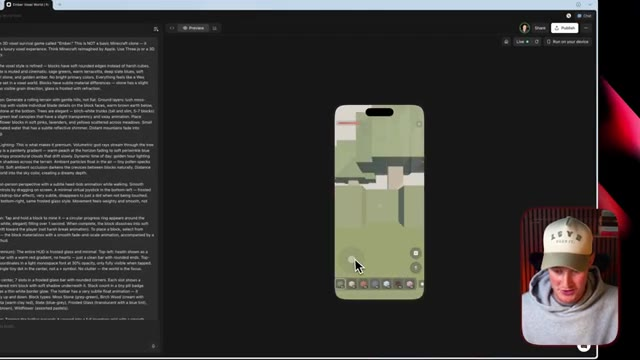
*⏱️ 00:05:17 — Interface de développement montrant la simulation d'un écran de smartphone au centre avec une application en cours d'utilisation et du texte descriptif sur la gauche.*

---

### ⏱️ `[00:05:26 - 00:06:01]` | Segment #12

**🔊 Audio (Transcription Intégrale Mot pour Mot en Français) :**
> Donc ce que nous allons faire, c'est que nous allons aller dans le coin supérieur droit à l'intérieur de Rourke. Nous allons cliquer sur exécuter sur votre appareil. Et ce que nous allons faire, c'est télécharger cette application compagnon Rourke. C'est donc crucial. Si vous voulez pouvoir faire cela, nous devons avoir cette application téléchargée. Je vais donc cliquer sur télécharger et cela va m'emmener pour télécharger réellement ce fichier. Je vais ouvrir ce fichier. Et juste comme ça, nous avons maintenant l'application compagnon Rourke. Vous ne pouvez pas la voir sur mon bureau. Cependant, je l'ai bien téléchargée sur mon ordinateur maintenant. Donc ce que je vais faire, c'est simplement me connecter à mon compte Rourke. Donc si vous n'en avez pas déjà un, assurez-vous de vous inscrire. Je vais juste me connecter rapidement et je vais cliquer sur ouvrir l'application compagnon Rourke.

**👁️ Analyse Visuelle d'Écran (gemini-3.5-flash-lite) :**
**Interface & Outils** : Navigateur web, interface de développement Bolt/Rourke, émulateur d'application mobile (iOS).

**Contenu textuel & Code** : Texte de description détaillée d'un jeu voxel 'Ember', aperçu interactif d'un smartphone simulant le rendu du jeu 3D, options de téléchargement et de connexion de l'application compagnon.

**Action / Démonstration** : Téléchargement et ouverture de l'application compagnon Rourke pour tester le prototype directement sur un appareil physique.

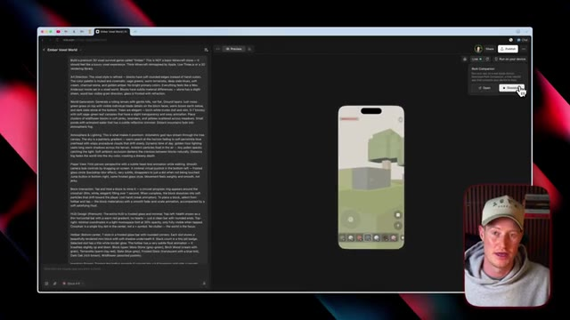
*⏱️ 00:05:35 — Interface web affichant un code de description de jeu à gauche, un aperçu d'application mobile au centre et le menu 'Rourke Companion' en haut à droite.*

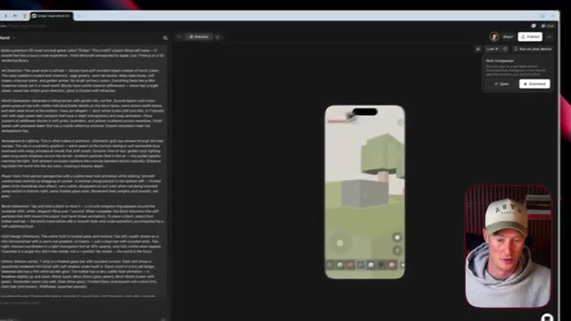
*⏱️ 00:05:44 — Vue similaire centrée sur l'aperçu du jeu mobile avec le panneau 'Rourke Companion' visible dans le coin supérieur droit.*

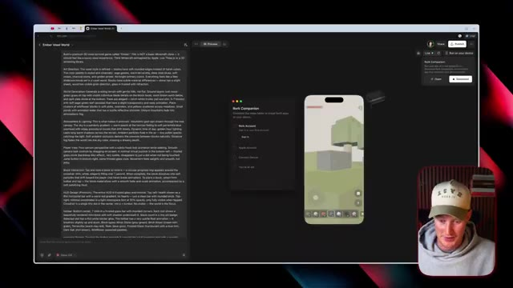
*⏱️ 00:05:52 — Apparition de la fenêtre pop-up de connexion 'Rourke Companion' superposée à l'écran principal de développement.*

---

### ⏱️ `[00:06:01 - 00:06:34]` | Segment #13

**🔊 Audio (Transcription Intégrale Mot pour Mot en Français) :**
> C'était la première étape, c'était extrêmement facile à faire. Maintenant, ce que je dois faire, c'est en fait me connecter à mon identifiant Apple ou à mon compte de développeur Apple. Je vais donc vous montrer comment faire dès maintenant. Donc, essentiellement, ce que vous allez faire, c'est vous connecter à votre compte d'identifiant Apple. Je vais donc me connecter maintenant. On va me demander de vérifier cela et je viens de recevoir une notification. Je vais l'accepter sur mon téléphone. Ensuite, je vais simplement taper ce code de vérification que je viens de recevoir sur mon téléphone, sélectionner une équipe. Et juste comme ça, nous sommes maintenant configurés. Ensuite, je vais essentiellement brancher mon téléphone sur mon ordinateur. Nous devons donc connecter notre appareil via USB. Je vais donc brancher mon

**👁️ Analyse Visuelle d'Écran (gemini-3.5-flash-lite) :**
**Interface & Outils** : Navigateur web, site de Rork, fenêtre pop-up de connexion Apple.

**Contenu textuel & Code** : Champs de connexion Apple ID / Apple Developer, étapes d'installation de l'application Rork Companion (Rork Account, Apple Account, Connect Device).

**Action / Démonstration** : Connexion au compte Apple Developer pour configurer le déploiement d'applications mobiles.

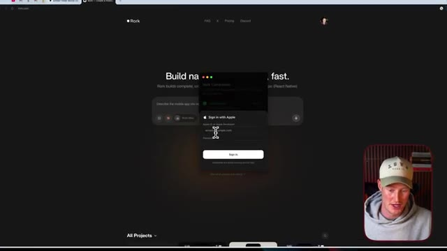
*⏱️ 00:06:09 — Interface web montrant une fenêtre de connexion "Sign in with Apple" avec des champs pour l'identifiant et le mot de passe.*

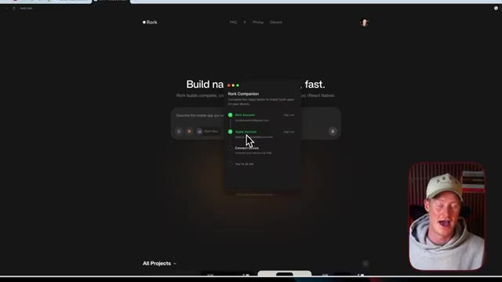
*⏱️ 00:06:26 — Fenêtre modale "Rork Companion" affichant les étapes de configuration avec un compte Apple connecté validé.*

---

### ⏱️ `[00:06:34 - 00:07:08]` | Segment #14

**🔊 Audio (Transcription Intégrale Mot pour Mot en Français) :**
> téléphone maintenant. Et juste comme ça, nous sommes maintenant prêts. Je vais donc cliquer sur openwork.com. Et ensuite, je vais aller sur notre application que nous venons en fait de créer. Et à partir de là, tout ce que j'ai à faire, c'est de cliquer sur exécuter sur votre appareil. Vous pouvez donc voir que nous avons l'iPhone de Brock installé juste ici. Et laissez-moi aller de l'avant et transférer la vue sur mon téléphone maintenant. Pour que vous puissiez me voir en train d'accéder directement à l'application ici. Très bien. Donc si vous jetez un œil à mon téléphone, j'ai en fait cette icône d'application ici. Et ce qu'est cette application, c'est en gros une réplication de Minecraft. Laissez-moi donc l'ouvrir. Je pourrais même l'utiliser de côté sur mon écran. Je pourrais construire des choses. Vous pouvez voir que je suis juste en train de

**👁️ Analyse Visuelle d'Écran (gemini-3.5-flash-lite) :**
**Interface & Outils** : OpenWork, émulateur mobile, interface iOS (iPhone).

**Contenu textuel & Code** : Application voxel mobile nommée 'Ember Voxel World' générée par IA.

**Action / Démonstration** : Navigation sur l'application web OpenWork et présentation de l'application mobile nouvellement créée.

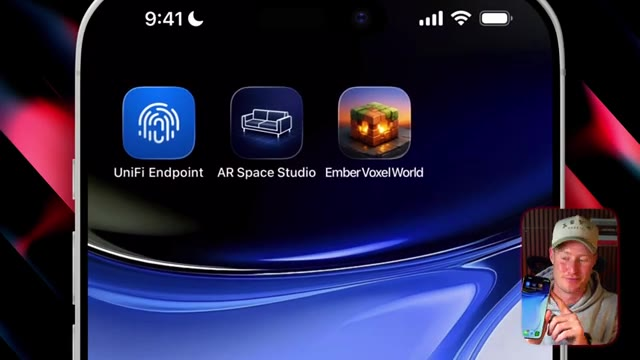
*⏱️ 00:06:59 — Gros plan sur l'écran d'un smartphone affichant l'icône de l'application 'Ember Voxel World' récemment créée.*

---

### ⏱️ `[00:07:08 - 00:07:44]` | Segment #15

**🔊 Audio (Transcription Intégrale Mot pour Mot en Français) :**
> en collant différents blocs ici. Et tout cela a été construit à partir d'une seule invite. Laissez-moi donc vous montrer une autre application que j'ai construite. Cette application juste ici est une application de réalité augmentée qui me permet essentiellement de placer différentes choses dans ma pièce et de voir à quoi cela ressemble. Me voilà donc à l'intérieur de la caméra. Laissez-moi aller voir par ici et je vais placer, comme vous pouvez le voir, j'ai en fait placé quelques lampadaires juste ici. Laissez-moi aller placer une table basse. Nous avons donc cette toute petite table basse ici. Je pourrais en fait continuer. Je pourrais placer une bibliothèque et elle utilise la réalité augmentée sur mon téléphone. Et l'une des choses les plus importantes que je tiens à mentionner ici, c'est que puisqu'elle utilise la réalité augmentée, elle utilise ma véritable caméra.

**👁️ Analyse Visuelle d'Écran (gemini-3.5-flash-lite) :**
**Interface & Outils** : Application mobile de réalité augmentée (AR Space Studio) affichée sur un iPhone, avec retour vidéo du présentateur en incrustation.

**Contenu textuel & Code** : Interface utilisateur de l'application AR avec des icônes de sélection de meubles (canapé, table, lampe, étagère) et un espace de prévisualisation en réalité augmentée.

**Action / Démonstration** : Le présentateur démontre l'utilisation d'une application mobile en réalité augmentée pour placer et visualiser des objets virtuels dans un environnement réel.

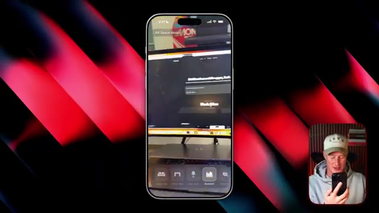
*⏱️ 00:07:17 — Interface d'une application mobile de réalité augmentée montrant un menu avec des options de mobilier.*

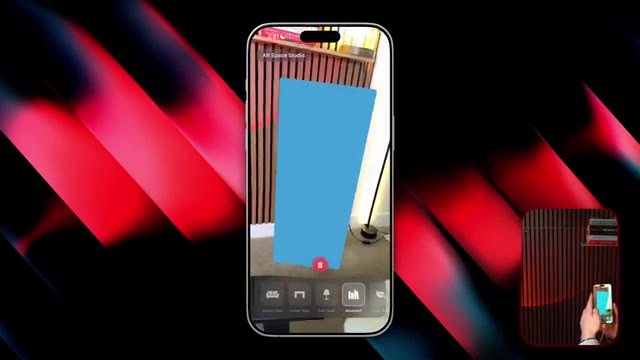
*⏱️ 00:07:35 — Affichage en réalité augmentée sur l'écran d'un smartphone d'un objet virtuel bleu modélisant un meuble dans une pièce.*

---

### ⏱️ `[00:07:44 - 00:08:02]` | Segment #16

**🔊 Audio (Transcription Intégrale Mot pour Mot en Français) :**
> Donc, comme il s'agit d'une application Swift, elle est capable d'utiliser les fonctionnalités intégrées à mon iPhone. Et c'est un peu pour cela que ça change la donne. Très bien. Donc cette dernière application que je veux vous montrer n'a probablement l'air de rien d'extraordinaire en surface, mais je vais vous montrer ce qui a de si spécial là-dedans. Nous avons cette nouvelle icône d'application ici qui indique les prix des cryptos.

**👁️ Analyse Visuelle d'Écran (gemini-3.5-flash-lite) :**
**Interface & Outils** : Écran d'accueil iOS d'un iPhone montrant plusieurs icônes d'applications.

**Contenu textuel & Code** : Icônes d'applications mobiles sur iOS (UniFi Endpoint, AR Space Studio, Ember Voxel World, CryptoPriceWidget).

**Action / Démonstration** : Présentation et démonstration d'une application mobile développée en Swift intégrée à l'écosystème iPhone.

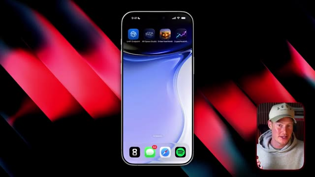
*⏱️ 00:07:53 — Vue de l'écran d'un iPhone affichant l'interface d'applications mobiles, avec le présentateur en incrustation dans le coin inférieur droit.*

---

### ⏱️ `[00:08:02 - 00:08:21]` | Segment #17

**🔊 Audio (Transcription Intégrale Mot pour Mot en Français) :**
> Donc si je clique là-dessus, vous pouvez voir qu'on peut suivre les cryptos en temps réel. Ce sont des informations réelles, en direct et actualisées, qui utilisent une API de crypto, laquelle a pu aller chercher [des données] afin d'obtenir des informations en temps réel. Cependant, la chose qui est vraiment incroyable avec ça, c'est regardez ça. Je vais retourner sur mon écran d'accueil. Je vais cliquer sur "ajouter un widget" et je peux réellement ajouter un widget à mon application.

**👁️ Analyse Visuelle d'Écran (gemini-3.5-flash-lite) :**
**Interface & Outils** : Interface d'application mobile de suivi des cryptomonnaies.

**Contenu textuel & Code** : Cours actuels et graphiques d'évolution pour le Bitcoin ($68,872.00), l'Ethereum ($1,961.13), Solana ($86.20) et Dogecoin ($0.1025).

**Action / Démonstration** : Le présentateur montre l'application mobile de suivi des cryptomonnaies en direct.

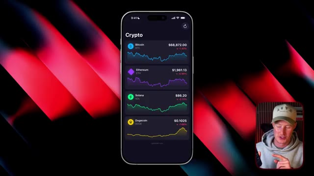
*⏱️ 00:08:07 — Une application mobile affichant les cours en temps réel de différentes cryptomonnaies (Bitcoin, Ethereum, Solana, Dogecoin).*

---

### ⏱️ `[00:08:21 - 00:08:41]` | Segment #18

**🔊 Audio (Transcription Intégrale Mot pour Mot en Français) :**
> Donc je vais chercher un outil de suivi des prix des cryptos et des widgets et boum, juste comme ça, nous pouvons désormais suivre tous les prix des cryptos sur mon téléphone. Et bien sûr, il y a d'autres applications qui peuvent faire cela. Cependant, le fait qu'au sein de Rourke, en utilisant Claude Opus 4.6, nous pouvons désormais créer une application mobile sur notre téléphone qui peut utiliser des widgets. Elle peut utiliser Siri. Elle peut utiliser la Dynamic Island sur notre téléphone.

**👁️ Analyse Visuelle d'Écran (gemini-3.5-flash-lite) :**
**Interface & Outils** : Interface mobile (iOS) avec widget de suivi des prix (Bitcoin, Ethereum, Solana).

**Contenu textuel & Code** : Prix et variations en pourcentage pour Bitcoin ($91,500.00 / +2.34%), Ethereum ($3,450.00 / -1.50%) et Solana ($195.00 / +5.67%).

**Action / Démonstration** : Présentation du widget de suivi des prix de cryptomonnaies intégré sur l'écran d'un téléphone.

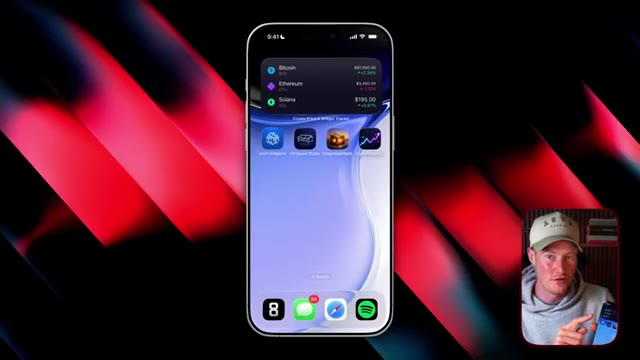
*⏱️ 00:08:26 — Capture d'écran d'un smartphone affichant un widget de suivi des prix des cryptomonnaies sur l'écran d'accueil.*

---

### ⏱️ `[00:08:41 - 00:09:01]` | Segment #19

**🔊 Audio (Transcription Intégrale Mot pour Mot en Français) :**
> Toutes ces différentes choses n'étaient pas possibles par le codage à l'instinct jusqu'à cette nouvelle mise à jour de Rourke Max. Très bien. Donc pour les personnes qui veulent aller de l'avant et utiliser Rourke Max, je dois faire un préambule et dire que ce n'est pas bon marché. Cependant, vous payez pour beaucoup de haute qualité ici. Donc actuellement c'est 200 dollars par mois pour le forfait de 1000 crédits sur le forfait max.

**👁️ Analyse Visuelle d'Écran (gemini-3.5-flash-lite) :**
**Interface & Outils** : Navigateur web affichant la page de tarification de la plateforme Rork.

**Contenu textuel & Code** : Tableau des prix montrant les offres Free, Pro (20$/mois) et Max (200$/mois) avec les crédits et fonctionnalités incluses.
[DESC_IMAGE_1] (Ignorée selon les critères car pas de graphique/code/terminal pertinent)
[DESC_IMAGE_2] Présentation des tarifs de l'outil Rork Max abordés dans l'audio.
[DESC_IMAGE_3] Zoom sur l'option tarifaire Rork Max commentée par le présentateur.

**Action / Démonstration** : Navigation et présentation des coûts d'abonnement de la plateforme d'IA.

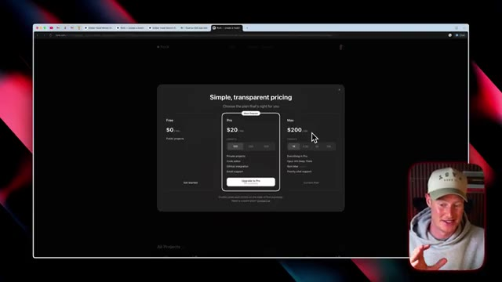
*⏱️ 00:08:51 — Capture montrant la page web des tarifs (pricing) de la plateforme de développement avec les différentes formules, dont le plan Max à 200$/mois.*

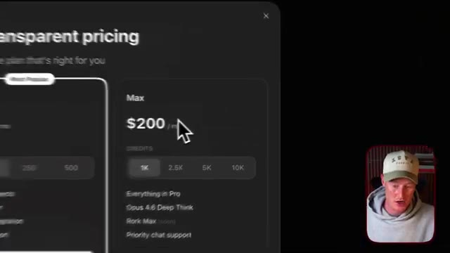
*⏱️ 00:08:56 — Gros plan sur la section du plan Max à 200$/mois de la page de tarification.*

---

### ⏱️ `[00:09:01 - 00:09:26]` | Segment #20

**🔊 Audio (Transcription Intégrale Mot pour Mot en Français) :**
> Et je vais dire que les 1 000 crédits vont vraiment très loin. Donc ça devrait vous suffire. Donc si vous voulez vraiment commencer à utiliser le plan Rourke, vous pouvez aller de l'avant et le faire, mais ça ne va pas être bon marché. Très bien. Donc si vous êtes quelqu'un qui veut utiliser Rourke max et commencer à créer des applications mobiles, j'ai généré ce document ici, qui est un guide détaillant des astuces et des conseils que vous pourriez commencer à utiliser pour essentiellement accélérer votre passage de débutant à expert en utilisant cette nouvelle fonctionnalité.

**👁️ Analyse Visuelle d'Écran (gemini-3.5-flash-lite) :**
**Interface & Outils** : Navigateur web affichant la grille tarifaire de la plateforme Rourke et visionneuse de PDF.

**Contenu textuel & Code** : Tableau des prix des abonnements avec les options Free ($0), Pro ($20) et Max ($200), incluant les détails des crédits et fonctionnalités.

**Action / Démonstration** : Présentation des différents plans tarifaires et options d'abonnement de la plateforme par le créateur.

*⏱️ 00:09:08 — Capture d'écran montrant la page de tarification du service Rourke avec les différents forfaits (Free, Pro à 20$, et Max à 200$).*

---

### ⏱️ `[00:09:26 - 00:09:34]` | Segment #21

**🔊 Audio (Transcription Intégrale Mot pour Mot en Français) :**
> Si vous voulez ceci, il y aura un lien gratuit dans la description. Ceci étant dit, les gars, merci beaucoup d'être restés jusqu'à la fin de cette vidéo. J'espère que vous en avez retiré de la valeur et je vous vois dans la prochaine.

**👁️ Analyse Visuelle d'Écran (gemini-3.5-flash-lite) :**
**Interface & Outils** : Aucune (caméra frontale du présentateur).

**Contenu textuel & Code** : Aucun graphique, code ou indicateur technique.

**Action / Démonstration** : Le présentateur conclut la vidéo et indique la description.

---

