# 🎬 Can Lindy Replace OpenClaw? (CEO Interview)

> **Chaîne** : [Brock Mesarich | AI for Non Techies](https://www.youtube.com/@BrockMesarich)  
> **Lien YouTube** : [https://www.youtube.com/watch?v=cD5XuAYTcY4](https://www.youtube.com/watch?v=cD5XuAYTcY4)  
> **Date de publication** : 20260221  
> **Durée** : 00:29:50  
> **Identifiant vidéo** : `cD5XuAYTcY4`  
> **Transcription & Analyse** : `whisper-v3-large-turbo+gemini-3.5-flash-lite`  

---

## 📌 Synthèse Exécutive & Outils

### 💡 Résumé

Cette interview exclusive de la chaîne *Brock Mesarich | AI for Non Techies* met en lumière un changement de paradigme fondamental opéré par la plateforme Lindy, raconté par son CEO (« Flo »). Alors que le marché des agents conversationnels reposait jusqu'à présent sur des logiques de construction complexe — nécessitant pour l'utilisateur d'assembler des briques logicielles, de paramétrer des déclencheurs et de maintenir des flux rigides (comparable à l'artisanat d'un cheeseburger maison) —, l'industrie bascule vers des assistants IA autonomes « prêts à l'emploi ». Lindy s'affranchit des interfaces traditionnelles (comme la consultation obsessionnelle de la boîte mail) pour devenir un véritable collégien numérique proactif, capable de s'intégrer directement dans les canaux de communication quotidiens des utilisateurs (via SMS, messageries et notes vocales). 

La discussion décortique l'évolution technologique qui permet de passer d'une IA « en laisse » — bridée par des enchaînements programmatiques rigides — à un agent fluide et contextuel doté d'une initiative propre. Grâce à une connexion profonde avec l'écosystème de travail de l'utilisateur (agendas, e-mails, outils de visioconférence), Lindy analyse en arrière-plan les flux de données pour automatiser les micro-tâches répétitives. L'analogie aéronautique filée par les intervenants illustre parfaitement l'enjeu : tout comme 95 % des accidents aériens surviennent lors des phases critiques de décollage et d'atterrissage, la fatigue mentale au travail ne provient pas de la « croisière » stratégique, mais de l'accumulation incessante de tâches de transition (suivis de réunion, planification, tri de messages).

Enfin, la vidéo démontre l'impact concret de ces assistants autonomes sur l'optimisation du temps et la gestion opérationnelle. Qu'il s'agisse de traiter des mémos vocaux pour générer du contenu créatif basé sur des analyses de performance historiques (comme l'optimisation de titres YouTube), ou de réaliser des audits de calendrier automatisés pour réallouer le temps de travail selon des priorités stratégiques, l'outil agit comme un second cerveau. Cette transition marque la fin de l'ère où l'humain devait s'adapter aux contraintes techniques des logiciels pour entrer dans une phase où la technologie anticipe, orchestre et simplifie activement le quotidien professionnel.

### 🛠️ Outils, Modèles & Logiciels Présentés

* **Lindy (Lindy Assistant)** : Plateforme d'IA conversationnelle et proactive de nouvelle génération qui fonctionne comme un assistant de travail autonome pour éliminer les tâches répétitives (gestion des e-mails, des agendas et des réunions).
* **OpenClaw** : Produit concurrent mentionné dans le cadre de l'évolution des architectures d'agents conversationnels rapides à configurer.
* **Gemini** : Modèle de langage multimodal de pointe exploité pour la compréhension contextuelle et le traitement de données textuelles complexes.
* **ChatGPT** : Modèle conversationnel d'OpenAI utilisé pour la génération de contenu et l'assistance textuelle.
* **Claude** : Modèle d'intelligence artificielle d'Anthropic réputé pour ses capacités d'analyse approfondie et de synthèse.
* **Grok** : Modèle d'IA conversationnelle intégré aux flux de données en temps réel.
* **n8n** : Outil d'automatisation de flux de travail open-source et flexible pour connecter différentes applications logicielles.
* **Make** : Plateforme visuelle avancée d'automatisation et d'intégration d'API (anciennement Integromat).
* **Zapier** : Logiciel pionnier d'automatisation sans code permettant de relier divers services cloud entre eux.
* **Gmail / Messagerie SMS / Outils de visioconférence** : Écosystèmes logiciels traditionnels connectés aux agents IA pour assurer la proactivité des notifications et la prise de notes en direct.

### 🔑 Points Clés & Enseignements Stratégiques

* **Mutation de l'approche « No-Code » vers l'autonomie clé en main** : Le passage de la création de flux d'agents personnalisés à un produit fini et unifié évite à l'utilisateur non-technique d'avoir à « construire » son propre outil, privilégiant l'usage direct à la configuration complexe.
* **Élimination du syndrome de la laisse (« Unchained AI »)** : Les modèles récents sont suffisamment robustes pour se passer de structures programmatiques rigides, gagnant ainsi en flexibilité, en pertinence contextuelle et en capacité d'adaptation en temps réel.
* **Proactivité pilotée par les événements** : Contrairement aux logiciels traditionnels passifs qui nécessitent une requête explicite, Lindy prend les devants en envoyant des synthèses matinales ou des alertes instantanées par SMS dès qu'un e-mail urgent ou un changement de contexte survient.
* **Gestion des « phases de décollage et d'atterrissage » professionnelles** : L'automatisation cible spécifiquement la friction des micro-tâches de transition (e-mails de suivi, planification d'agendas, comptes-rendus) pour permettre aux professionnels de se concentrer sur la vision stratégique à haute altitude.
* **Immersion dans les réunions et contextualisation continue** : L'agent assiste aux visioconférences, prend des notes, analyse les accords conclus entre participants et propose immédiatement des actions concrètes (envoi d'invitations, rédaction de synthèses).
* **Traitement des mémos vocaux comme interface universelle de décharge cognitive** : La possibilité d'envoyer des messages audio en fin de journée permet de vider sa charge mentale tout en confiant à l'IA la structuration des projets en cours.
* **Analyse prédictive et créative basée sur l'historique** : L'assistant exploite les données passées de l'utilisateur (comme l'historique des vidéos YouTube et leurs performances) pour générer de manière autonome des propositions créatives alignées sur les critères de succès antérieurs.
* **Audits de calendrier pilotés par les priorités** : L'IA peut analyser rétrospectivement ou prospectivement l'emploi du temps pour quantifier le temps alloué aux objectifs stratégiques majeurs et recommander des suppressions ou délégations de réunions.
* **Réduction drastique du temps passé dans la boîte de réception** : L'utilisation d'un assistant proactif modifie en profondeur la relation avec l'ordinateur, réduisant quasi totalement la nécessité d'ouvrir manuellement des clients de messagerie comme Gmail.
* **Centralisation multi-plateforme transparente** : La puissance de l'automatisation réside dans la capacité de l'agent à faire le pont entre de multiples applications cloisonnées (calendriers, suites bureautiques, messageries) pour exécuter des ordres complexes sans intervention humaine intermédiaire.

---

## ⏱️ Chronologie & Transcription Complète Audio & Visuelle (Mot pour Mot)

### ⏱️ `[00:00:00 - 00:00:20]` | Segment #01

**🔊 Audio (Transcription Intégrale Mot pour Mot en Français) :**
> We are no longer a platform where you can build AI agents. We are an AI agent. Like, technology should just work. You shouldn't have to build an agent to get stuff done. Using Lindy has changed my relationship with the computer, and I barely open Gmail anymore. It's kind of weird. I used to be glued to my inbox like a realtor founder. OpenClaw is not real to your weekend plan. Like, technology is supposed to be at your service now the other way around.

**👁️ Analyse Visuelle d'Écran (gemini-3.5-flash-lite) :**
**Interface & Outils** : Présentation ou face-caméra explicatif du trader sans interface logicielle partagée.

**Contenu textuel & Code** : Explications orales des stratégies et mise en contexte méthodologique du marché.

**Action / Démonstration** : Explications face caméra et analyse conceptuelle des marchés.

---

### ⏱️ `[00:00:21 - 00:00:41]` | Segment #02

**🔊 Audio (Transcription Intégrale Mot pour Mot en Français) :**
> I just sat down with the CEO of one of the biggest AI automation platforms to talk about OpenClaw, their new competing product that you can set up in under 60 seconds. and why how we think about AI automations and agents just changed forever. So grab a coffee and strap in because this is going to be a fun one. Flo, what is going on, man? I'm stoked to have you on the podcast.

**👁️ Analyse Visuelle d'Écran (gemini-3.5-flash-lite) :**
**Interface & Outils** : Présentation ou face-caméra explicatif du trader sans interface logicielle partagée.

**Contenu textuel & Code** : Explications orales des stratégies et mise en contexte méthodologique du marché.

**Action / Démonstration** : Explications face caméra et analyse conceptuelle des marchés.

---

### ⏱️ `[00:00:41 - 00:01:00]` | Segment #03

**🔊 Audio (Transcription Intégrale Mot pour Mot en Français) :**
> There's some pretty juicy things that we're probably going to talk about today. Anyways, I've used your guys' platform for years, probably three, four years now. I absolutely love it. And a lot of my audience loves it too. So I'm super stoked to have you on the podcast. It's a full circle moment and stoked to be talking to you today. Yeah, thanks for having me, Brock. And you have been with us from the very beginning, haven't you?

**👁️ Analyse Visuelle d'Écran (gemini-3.5-flash-lite) :**
**Interface & Outils** : Présentation ou face-caméra explicatif du trader sans interface logicielle partagée.

**Contenu textuel & Code** : Explications orales des stratégies et mise en contexte méthodologique du marché.

**Action / Démonstration** : Explications face caméra et analyse conceptuelle des marchés.

---

### ⏱️ `[00:01:00 - 00:01:33]` | Segment #04

**🔊 Audio (Transcription Intégrale Mot pour Mot en Français) :**
> I'm really appreciative. Yeah, no, you guys have a great product. And I think one thing, just diving into this, yeah, my audience is pretty non-technical and I've always loved how your platform is so easy to build out different automations, you know, like whether it's a meeting prep assistant or auto labeling emails, these are all things that I've used your product for, for years to like help me run my business. And I think you guys are making an interesting transition a product wise. And I'm super excited to talk about today. So yeah, give me kind of a break down like early stages, what it is that you guys were trying to build. And then we can maybe

**👁️ Analyse Visuelle d'Écran (gemini-3.5-flash-lite) :**
**Interface & Outils** : Présentation ou face-caméra explicatif du trader sans interface logicielle partagée.

**Contenu textuel & Code** : Explications orales des stratégies et mise en contexte méthodologique du marché.

**Action / Démonstration** : Explications face caméra et analyse conceptuelle des marchés.

---

### ⏱️ `[00:01:33 - 00:02:01]` | Segment #05

**🔊 Audio (Transcription Intégrale Mot pour Mot en Français) :**
> dive a bit more into like where you guys are evolving to in the next couple of months or coming years. Yeah, 100%. So the way we've explained who we are for the longest time has been we are the easiest way to build AI agents for non-technical people. And I think we had an epiphany of sorts sometime around last year where we realized that especially as the technology evolved and as the models get better, that the easiest way to build an AI agent becomes almost a contradiction in terms.

**👁️ Analyse Visuelle d'Écran (gemini-3.5-flash-lite) :**
**Interface & Outils** : Présentation ou face-caméra explicatif du trader sans interface logicielle partagée.

**Contenu textuel & Code** : Explications orales des stratégies et mise en contexte méthodologique du marché.

**Action / Démonstration** : Explications face caméra et analyse conceptuelle des marchés.

---

### ⏱️ `[00:02:01 - 00:02:24]` | Segment #06

**🔊 Audio (Transcription Intégrale Mot pour Mot en Français) :**
> You know, it's almost like I told you, like, hey, I'm the easiest way for you to make yourself a burger at home, a cheeseburger. And it's like, hey, like, if you really want the easiest way to make yourself a cheeseburger, you're not going to want to make yourself a cheeseburger. You're going to go to McDonald's. So that's kind of, there's a big, big, big mental shift we've made where we are going from no longer a platform where you can build AI agents. We are an AI agent.

**👁️ Analyse Visuelle d'Écran (gemini-3.5-flash-lite) :**
**Interface & Outils** : Visioconférence (aucun outil de trading, terminal ou graphique affiché).

**Contenu textuel & Code** : Aucun contenu technique, code ou indicateur visible.

**Action / Démonstration** : Conversation en visioconférence entre le présentateur et un invité.

---

### ⏱️ `[00:02:24 - 00:02:45]` | Segment #07

**🔊 Audio (Transcription Intégrale Mot pour Mot en Français) :**
> You don't have to build it, you can just use it. So what we just released last week is called Vindy Assistant. And the way I like to describe it is like, it's an AI work assistant that helps you get rid of the bullshit. Like your email, your calendar, your meeting scheduling, your email triaging, your email drafting. Like it saves you one to two hours a day from the, excuse my French, like the bullshit.

**👁️ Analyse Visuelle d'Écran (gemini-3.5-flash-lite) :**
**Interface & Outils** : Interface utilisateur de messagerie / application Lindy Assistant

**Contenu textuel & Code** : E-mails de démonstration pour la planification de réunions et icônes d'applications professionnelles intégrées (Google Calendar, Gmail, Slack, Notion, Asana, Monday.com, Zoho).

**Action / Démonstration** : Démonstration visuelle de la connexion de Lindy Assistant aux outils de communication et de productivité.

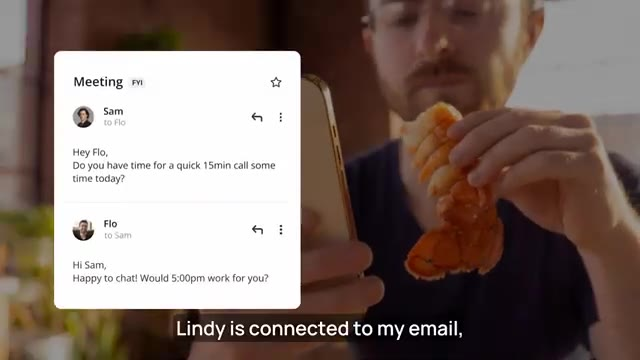
*⏱️ 00:02:35 — Interface de messagerie montrant un échange de e-mails géré automatiquement par Lindy.*

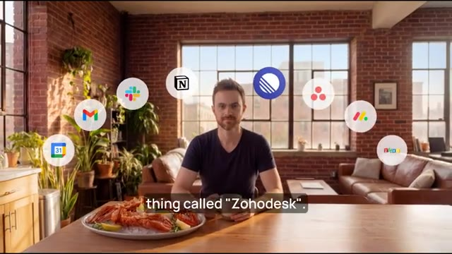
*⏱️ 00:02:40 — Présentateur entouré d'icônes représentant différentes applications professionnelles connectées (Gmail, Slack, Notion, Asana, etc.).*

---

### ⏱️ `[00:02:46 - 00:03:04]` | Segment #08

**🔊 Audio (Transcription Intégrale Mot pour Mot en Français) :**
> Exactement, non, j'adore ça. Et pour donner un peu de contexte à mon public, comment est-ce qu'on interagit avec ça maintenant ? Est-ce que c'est quelque chose qui tourne juste en arrière-plan, à exécuter toutes ces automatisations et tout, sans qu'on le voie vraiment ? Genre, est-ce que tu lui envoies des messages ? Est-ce que tu es, tu sais, sur l'interface Lindy ? Comment se déroule cette conversation avec notre assistant Lindy ?

**👁️ Analyse Visuelle d'Écran (gemini-3.5-flash-lite) :**
**Interface & Outils** : AUCUNE

**Contenu textuel & Code** : AUCUN

**Action / Démonstration** : Discussion en visioconférence entre le présentateur et un invité.

---

### ⏱️ `[00:03:05 - 00:03:25]` | Segment #09

**🔊 Audio (Transcription Intégrale Mot pour Mot en Français) :**
> Ouais, je pense que c'est une très bonne illustration de la très grande différence entre ce nouveau produit et l'ancien. Je vais montrer mon écran rapidement. Je pense que le montrer, c'est le plus simple. Voici l'ancien produit. Et ça, c'est l'un des cas d'usage les plus courants qu'on avait avec l'ancien produit, à savoir le récapitulatif quotidien. Donc recevoir un e-mail ou un message chaque matin du genre : voilà avec qui vous avez rendez-vous.

**👁️ Analyse Visuelle d'Écran (gemini-3.5-flash-lite) :**
**Interface & Outils** : Navigateur web affichant l'application Lindy (Flow editor).

**Contenu textuel & Code** : Un diagramme de flux d'automatisation avec des blocs séquentiels ("On recurring schedule", "Check Meetings For The Day", "For Every Meeting", etc.).

**Action / Démonstration** : Le présentateur partage son écran pour montrer un ancien produit ou flux de travail automatisé.

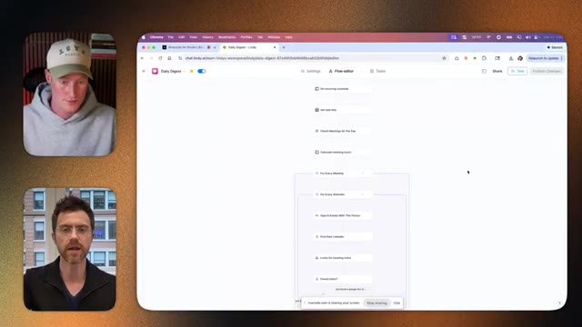
*⏱️ 00:03:15 — Partage d'écran montrant l'interface d'un éditeur de flux de travail (Flow editor) de type no-code/automatisation.*

---

### ⏱️ `[00:03:25 - 00:03:43]` | Segment #10

**🔊 Audio (Transcription Intégrale Mot pour Mot en Français) :**
> C'est le contexte de votre réunion. Donc ce qu'il a fait dans ce cas, c'est du genre : hé, chaque matin tu te réveilles, tu regardes mes réunions de la journée, et puis pour chaque réunion et pour chaque participant de chaque réunion, tu fais des recherches sur eux, tu regardes leur LinkedIn, tu regardes mes anciennes notes de réunion avec eux, tu regardes mes anciens e-mails avec eux, et ensuite tu rassembles tout dans un très grand e-mail avec genre tout ce contexte.

**👁️ Analyse Visuelle d'Écran (gemini-3.5-flash-lite) :**
**Interface & Outils** : Navigateur web affichant l'éditeur de flux de Lindy (chat.lindy.ai), avec incrustation vidéo des participants sur le côté gauche.

**Contenu textuel & Code** : Diagramme de flux de tâches automatisées : vérification des réunions du jour, calcul des heures, boucles itératives sur chaque réunion et chaque participant, recherche d'e-mails, recherche LinkedIn et consultation des notes de réunion.

**Action / Démonstration** : Présentation et explication visuelle d'un workflow d'automatisation d'intelligence artificielle configuré pour préparer les réunions quotidiennes et analyser les participants.

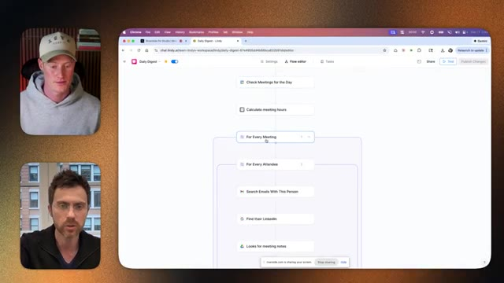
*⏱️ 00:03:34 — Vue de l'interface de Lindy montrant un workflow automatisé pour le "Daily Digest", avec les étapes "Check Meetings for the Day", "For Every Meeting", "For Every Attendee", et des actions comme "Search Emails With This Person" et "Find their LinkedIn".*

---

### ⏱️ `[00:03:43 - 00:04:04]` | Segment #11

**🔊 Audio (Transcription Intégrale Mot pour Mot en Français) :**
> Exactement. Et c'était tout à fait du genre, bon, une fois qu'il a fait cette étape, passez à la suivante dans ce, je ne connais pas le mot exact pour ça, peut-être un peu programmatique ou tout simplement très structuré dans sa façon de fonctionner, n'est-ce pas ? On tenait l'IA en laisse. Et je pense qu'à mesure que les modèles ont évolué, la laisse est devenue inutile et, en fait, est devenue nuisible parce que le modèle perd en flexibilité lorsqu'il est en laisse.

**👁️ Analyse Visuelle d'Écran (gemini-3.5-flash-lite) :**
**Interface & Outils** : Navigateur web Google Chrome affichant l'éditeur de flux de l'application Lindy.

**Contenu textuel & Code** : Diagramme de flux de travail (workflow) avec des blocs logiques : "Found notes?", "Get document", "Exit loop", "Send Daily Digest" et "Send message".

**Action / Démonstration** : Présentation et explication d'un flux de travail structuré et automatisé pas à pas dans une application d'IA.

*⏱️ 00:03:54 — Capture d'écran montrant le navigateur Google Chrome avec l'interface de l'éditeur de flux Lindy (Flow editor) affichant des étapes conditionnelles, des boucles de sortie et des blocs d'envoi de messages, ainsi que deux vignettes vidéo des participants sur le côté gauche.*

---

### ⏱️ `[00:04:04 - 00:04:26]` | Segment #12

**🔊 Audio (Transcription Intégrale Mot pour Mot en Français) :**
> Le nouveau produit, la façon dont il fonctionne, j'ai plein de captures d'écran ici. J'ai dû les compiler à l'avance parce que c'est évidemment des informations potentiellement sensibles. Mais je reçois juste ce genre de synthèse chaque matin et pour répondre à votre question, je le reçois sur l'IMF. Donc c'est exactement comme envoyer un SMS à un assistant humain. Et donc chaque matin, ça m'envoie un SMS et ça fait, hé, bonjour flow, genre aujourd'hui il fait beau, 61 degrés.

**👁️ Analyse Visuelle d'Écran (gemini-3.5-flash-lite) :**
**Interface & Outils** : macOS Finder / Explorateur de fichiers

**Contenu textuel & Code** : Miniatures de captures d'écran de messages et d'interfaces de messagerie (potentiellement sensibles)

**Action / Démonstration** : Le présentateur montre des captures d'écran compilées à l'avance pour illustrer ses propos.

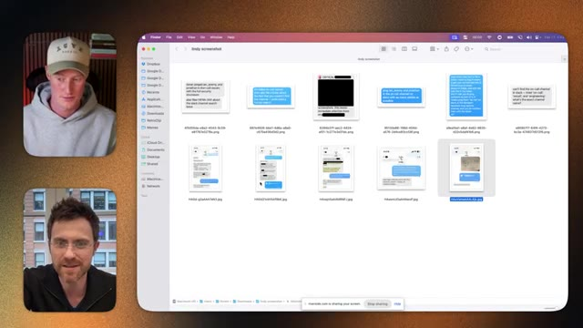
*⏱️ 00:04:09 — Un écran de Mac affichant un dossier rempli de miniatures de captures d'écran, avec deux intervenants en visio sur le côté.*

---

### ⏱️ `[00:04:26 - 00:04:49]` | Segment #13

**🔊 Audio (Transcription Intégrale Mot pour Mot en Français) :**
> Tu as trois réunions sur ton calendrier. Au fait, tu as un e-mail urgent de Brandon que tu aimerais peut-être regarder. Ouais, et je veux t'interrompre ici ou ne pas t'interrompre, mais plutôt ajouter quelques infos ici. Ça t'a envoyé un SMS. Tu n'as pas eu besoin d'aller dire, hé, Lindy, qu'est-ce qu'il y a sur mon e-mail ou qu'est-ce qu'il y a sur ma liste pour mon calendrier aujourd'hui ? Si j'ai bien compris, Lindy a pris les devants pour te contacter par SMS et te dire, hé, c'est le matin.

**👁️ Analyse Visuelle d'Écran (gemini-3.5-flash-lite) :**
**Interface & Outils** : macOS, application de messagerie / interface mobile Lindy.

**Contenu textuel & Code** : Résumé des réunions du calendrier et notification d'e-mail urgent de Brandon avec contre-offre.

**Action / Démonstration** : Présentation d'une démonstration d'interaction textuelle avec l'assistant IA Lindy.

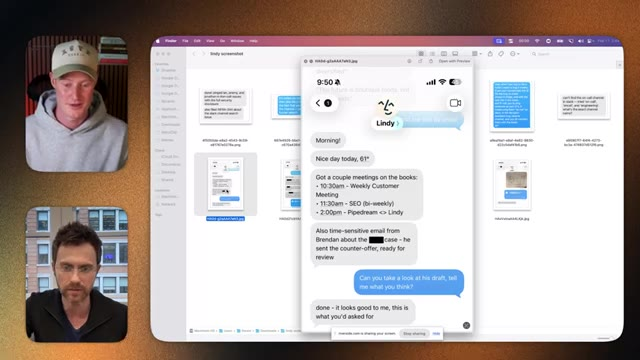
*⏱️ 00:04:32 — Capture d'écran montrant une interface de messagerie sur mobile avec l'assistant Lindy, affichant le calendrier et un e-mail de Brandon.*

---

### ⏱️ `[00:04:49 - 00:05:08]` | Segment #14

**🔊 Audio (Transcription Intégrale Mot pour Mot en Français) :**
> Genre, laisse-moi juste genre te mettre au courant de tout. Parce que genre, c'est un peu ça le processus maintenant. Non, exactement. Donc c'est juste, c'est très proactif. Et je pense que la proactivité de la chose est un principe de financement vraiment très important pour ce produit. Par exemple, là, je vais utiliser un autre exemple. C'était, dès que je reçois un e-mail urgent, il m'envoie un SMS.

**👁️ Analyse Visuelle d'Écran (gemini-3.5-flash-lite) :**
**Interface & Outils** : macOS Finder et application de visioconférence.

**Contenu textuel & Code** : Dossier contenant des captures d'écran de messages et d'interfaces (Lindy screenshot).

**Action / Démonstration** : Partage d'écran illustrant des exemples de processus automatisés ou de notifications.

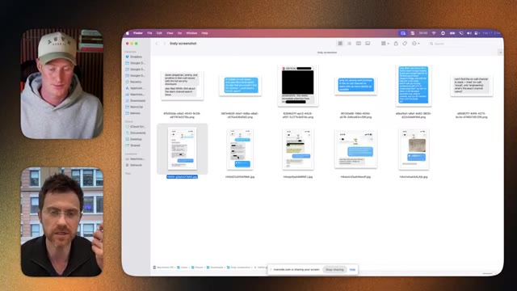
*⏱️ 00:05:03 — Vue en mosaïque d'un appel vidéo avec le partage d'écran d'un dossier de captures d'écran (Finder macOS).*

---

### ⏱️ `[00:05:08 - 00:05:27]` | Segment #15

**🔊 Audio (Transcription Intégrale Mot pour Mot en Français) :**
> Ou par exemple, si je suis en réunion, Lindy se joint également aux réunions. Elle est du genre, j'utilise les pronoms elle. Elle prend des notes pendant les réunions et ainsi de suite. Si pendant la réunion je dis quelque chose du genre, hé, super, Brock, genre retrouvons-nous mercredis la semaine prochaine. Et tu réponds, ça marche. Lindy m'enverra un texto après, on fera juste genre, bonne réunion avec Brock.

**👁️ Analyse Visuelle d'Écran (gemini-3.5-flash-lite) :**
**Interface & Outils** : Application de visioconférence et interface de messagerie/chat Lindy.

**Contenu textuel & Code** : Échanges textuels de type assistant virtuel (Lindy) concernant des mises à jour professionnelles et la vérification d'adresses.

**Action / Démonstration** : Le présentateur illustre les interactions possibles avec l'assistant Lindy à travers un partage d'écran.

*⏱️ 00:05:13 — Capture d'écran montrant une visioconférence avec un partage d'écran affichant une interface de messagerie/discussion avec Lindy.*

---

### ⏱️ `[00:05:27 - 00:05:47]` | Segment #16

**🔊 Audio (Transcription Intégrale Mot pour Mot en Français) :**
> Genre, est-ce que tu veux que j'envoie une invitation pour mercredi ? Ou si je dis... Lire la transcription de la réunion, puis utiliser cela comme contexte pour ensuite être proactif et en quelque sorte créer une liste d'actions. C'est tout à fait ça. Et, tu sais, après presque chaque réunion, tu as ces petits éléments d'action et ils sont comme des coupures de papier. Tu sais, c'est du genre, tu dois envoyer un e-mail de suivi. Tu dois en quelque sorte faire part à Bob de la décision qui vient d'être prise.

**👁️ Analyse Visuelle d'Écran (gemini-3.5-flash-lite) :**
**Interface & Outils** : Application de messagerie / assistant IA Lindy sur interface mobile et macOS.

**Contenu textuel & Code** : Échanges textuels avec un assistant IA gérant des contre-offres, des vérifications d'adresse et l'annulation de réunions.

**Action / Démonstration** : Démonstration de l'utilisation d'un agent IA conversationnel pour automatiser la gestion des tâches et de l'agenda.

*⏱️ 00:05:37 — Capture d'écran montrant une conversation avec l'assistant IA Lindy concernant des détails immobiliers et des adresses.*

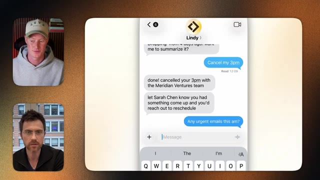
*⏱️ 00:05:42 — Capture d'écran montrant une interaction avec l'assistant IA Lindy pour annuler un rendez-vous à 15h.*

---

### ⏱️ `[00:05:47 - 00:06:21]` | Segment #17

**🔊 Audio (Transcription Intégrale Mot pour Mot en Français) :**
> tu dois genre envoyer une invitation de calendrier de suivi et ces choses-là genre ça a l'air de rien mais l'analogie que j'ai entendue et que j'ai vraiment aimée c'est genre tu sais je ne sais pas si tu sais genre 95 pour cent des accidents d'avion se produisent pendant le décollage et l'atterrissage donc peu importe si tu voles de genre San Francisco à Paris ce qui fait genre un vol de 11 heures ce sont les 10 minutes de décollage et d'atterrissage qui sont de loin les plus dangereuses genre la croisière c'est en fait vraiment facile et donc si tu devais voler de San Francisco à New York et atterrir et décoller dans chaque ville en chemin ce serait un vol misérable ce serait très long et ce serait très dangereux et donc le

**👁️ Analyse Visuelle d'Écran (gemini-3.5-flash-lite) :**
**Interface & Outils** : Application de messagerie / assistant IA Lindy sur macOS.

**Contenu textuel & Code** : Échanges textuels de mise à jour d'une offre commerciale et de vérification d'adresse avec l'agent Lindy.

**Action / Démonstration** : Présentation d'une interface de démonstration d'agent conversationnel IA.

---

### ⏱️ `[00:06:21 - 00:06:49]` | Segment #18

**🔊 Audio (Transcription Intégrale Mot pour Mot en Français) :**
> l'analogie ici est que c'est ce qu'on nous demande de faire chaque jour au travail nous voulons tous naviguer en croisière parce que c'est fluide et c'est c'est plus facile et c'est moins dangereux nous voulons penser stratégiquement à nos entreprises comme à 10 000 pieds d'altitude mais on nous demande de décoller et d'atterrir 50 fois par jour tu veux penser stratégiquement mais ah putain je dois envoyer un e-mail de suivi à bob ah il y a cet événement dans le calendrier que j'ai oublié je dois sauter là-dessus et donc je pense que l'opportunité qui s'ouvre en ce moment parce que les modèles sont devenus si bons c'est qu'ils peuvent tourner constamment en arrière-plan pour toi

**👁️ Analyse Visuelle d'Écran (gemini-3.5-flash-lite) :**
**Interface & Outils** : macOS Finder et application de messagerie mobile/assistant IA (Lindy)

**Contenu textuel & Code** : Une conversation textuelle montrant des échanges sur des adresses postales et des mises à jour de contrats (ex. "1841 Market St", "101 New Montgomery").

**Action / Démonstration** : Le présentateur illustre visuellement un exemple d'interaction textuelle ou de gestion de tâches automatisée via un assistant intelligent pour appuyer son analogie.

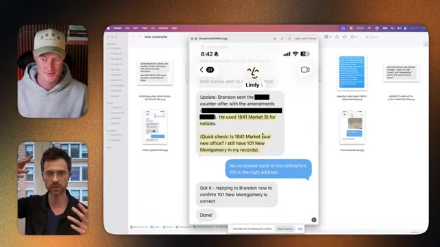
*⏱️ 00:06:28 — Capture d'écran montrant une interface de messagerie ou de chatbot mobile (avec l'assistant Lindy) affichée au premier plan sur un fond d'écran d'ordinateur macOS contenant plusieurs aperçus de fichiers et de messages.*

---

### ⏱️ `[00:06:49 - 00:07:10]` | Segment #19

**🔊 Audio (Transcription Intégrale Mot pour Mot en Français) :**
> Ils peuvent être votre acolyte qui est avec vous toute la journée, qui est comme dans votre boîte de réception avec vous, qui est dans vos réunions avec vous. Et qui attrape tous ces moments de décollage et d'atterrissage et qui s'occupe du décollage et de l'atterrissage pour vous. C'est vrai, j'adore ça. C'est une si bonne analogie parce que ça essaie juste de réduire cette friction de tout ce travail machinal et manuel. Et genre une chose que j'utilise avec l'assistant Lindy peut-être ces cinq, six derniers jours depuis que vous l'avez sorti.

**👁️ Analyse Visuelle d'Écran (gemini-3.5-flash-lite) :**
**Interface & Outils** : Application de messagerie type chat (Lindy AI) sur macOS.

**Contenu textuel & Code** : Interface de chat textuel illustrant une interaction avec un assistant intelligent gérant des mises à jour et vérifiant des adresses.

**Action / Démonstration** : Présentation visuelle d'un exemple concret d'interaction avec l'assistant IA Lindy.

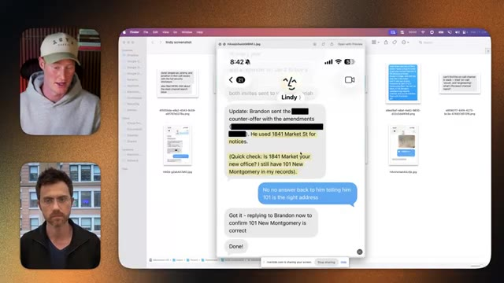
*⏱️ 00:06:59 — Partage d'écran d'un ordinateur montrant une conversation avec un assistant IA nommé Lindy, affichant des messages texte de mise à jour et de validation d'adresses.*

---

### ⏱️ `[00:07:10 - 00:07:44]` | Segment #20

**🔊 Audio (Transcription Intégrale Mot pour Mot en Français) :**
> Et une chose pour laquelle je l'utilise personnellement beaucoup, c'est un peu comme un second cerveau, tu vois, à la fin de la journée, je vais littéralement, même pas juste lui envoyer un message texte, je vais lui donner un message vocal et dire, hé, genre un mémo vocal, et faire, hé, voici sur quoi je travaille, voici les miniatures que je dois faire pour mes vidéos en préparation, est-ce que tu peux chercher des titres en te basant sur mes précédents titres YouTube ? Et non seulement ça va faire preuve de créativité et trouver des titres, mais ça va de manière proactive analyser mon YouTube, regarder mes vidéos précédentes, trouver celles qui fonctionnent, et ensuite créer des titres basés sur ça. Donc pour moi, ça a été la meilleure chose au monde pour lui balancer tout ce qui me passe par la tête en gros.

**👁️ Analyse Visuelle d'Écran (gemini-3.5-flash-lite) :**
**Interface & Outils** : Application de messagerie / assistant IA (Lindy) sur macOS.

**Contenu textuel & Code** : Fils de discussion textuels montrant des échanges de messages et des vérifications d'informations (adresses, offres).

**Action / Démonstration** : Démonstration de l'utilisation d'un assistant virtuel pour la gestion de messages et le suivi de tâches.

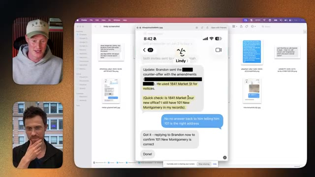
*⏱️ 00:07:27 — Capture d'écran montrant l'interface d'une application de messagerie ou d'un agent conversationnel IA (Lindy) avec des interactions textuelles et des captures d'écran réduites en arrière-plan.*

---

### ⏱️ `[00:07:44 - 00:08:07]` | Segment #21

**🔊 Audio (Transcription Intégrale Mot pour Mot en Français) :**
> À la fin de la journée, ou peut-être le matin ou même au milieu de la journée quand je suis stressé et que je dis, hé, qu'est-ce qu'il y a sur ma liste de choses à faire que je dois vraiment faire maintenant ? Et elle va simplement s'exécuter et le faire pour moi parce qu'elle est connectée à toutes ces différentes applications que j'utilise, ce qui a été la chose la plus incroyable à ce sujet. À 100 %. Je fais ça tellement souvent. Donc l'un de mes cas d'utilisation préférés, c'est qu'à la fin de la semaine, j'envoie un message à ma Lindy et je lui dis que j'ai un message à ce sujet quelque part par ici.

**👁️ Analyse Visuelle d'Écran (gemini-3.5-flash-lite) :**
**Interface & Outils** : Finder macOS, application de visioconférence (type Zoom ou Google Meet).

**Contenu textuel & Code** : Miniatures de captures d'écran montrant diverses conversations textuelles et interfaces mobiles.

**Action / Démonstration** : Partage d'écran explorant un dossier de captures d'écran ou de preuves visuelles lors d'une visioconférence.

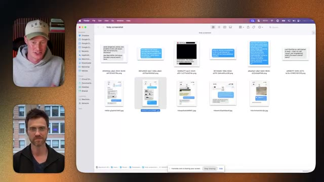
*⏱️ 00:07:56 — Capture d'écran d'un dossier Finder sur macOS affichant de nombreuses miniatures d'images et de captures d'écran, avec deux fenêtres vidéo de participants sur le côté gauche.*

---

### ⏱️ `[00:08:08 - 00:08:27]` | Segment #22

**🔊 Audio (Transcription Intégrale Mot pour Mot en Français) :**
> Par exemple, donc chaque semaine j'envoie un message à mon agent et je suis du genre, hé, ma priorité pour la semaine prochaine est de travailler sur X. En ce moment c'est le produit. Ils font beaucoup de travail sur le produit. Et je suis du genre, est-ce que tu peux s'il te plaît me dire, faire un audit de calendrier pour moi. Du genre regarde mon calendrier la semaine prochaine et dis-moi combien d'heures de réunions est-ce que j'ai et combien correspondent à cette priorité. Et ensuite qu'est-ce que tu recommandes que je déplace ?

**👁️ Analyse Visuelle d'Écran (gemini-3.5-flash-lite) :**
**Interface & Outils** : Application de messagerie / agent conversationnel (type Lindy ou interface de chat).

**Contenu textuel & Code** : Un message utilisateur (« my prio is to work on product next week... ») demandant d'analyser le calendrier, suivi d'une réponse structurée détaillant les heures de réunion et la répartition du temps de travail sur les sujets produit et ingénierie.

**Action / Démonstration** : Présentation d'un exemple concret d'utilisation d'un agent IA pour auditer et optimiser son planning hebdomadaire en fonction des priorités professionnelles.

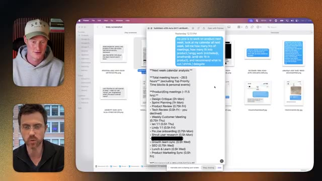
*⏱️ 00:08:13 — Capture d'écran montrant l'interface d'un agent conversationnel affichant une analyse textuelle du calendrier hebdomadaire avec le détail des réunions et des temps de travail.*

---

### ⏱️ `[00:08:28 - 00:08:58]` | Segment #23

**🔊 Audio (Transcription Intégrale Mot pour Mot en Français) :**
> Quelle réunion puis-je annuler ? Qu'est-ce que je peux déléguer ? Pourquoi est-ce que je ne peux tout simplement pas y assister afin de faire plus de place pour, genre, mes vraies priorités ? Aussi, pour rebondir sur ce que tu disais à propos de l'entraîner comme ce partenaire de départ qui, en gros, compile des informations et les envoie vers, genre, différents systèmes et différents fichiers de notes et ainsi de suite. C'est l'un de mes cas d'usage préférés. Chaque fois que nous faisons, genre, du tableau blanc, des séances de brainstorming avec l'équipe et quand nous avons terminé, j'envoie une photo de la séance à Lindy et j'envoie un mémo vocal et je fais, genre, hé, c'était un brainstorming sur X, Y et Z et elle peut voir le tableau blanc.

**👁️ Analyse Visuelle d'Écran (gemini-3.5-flash-lite) :**
**Interface & Outils** : macOS Finder et aperçu d'une application mobile de messagerie intelligente.

**Contenu textuel & Code** : Interface utilisateur affichant des aperçus de fichiers et une conversation textuelle et vocale avec un assistant nommé Lindy.

**Action / Démonstration** : Présentation visuelle d'un exemple d'interaction avec un assistant IA pour illustrer l'automatisation de tâches à partir d'une photo de tableau blanc.

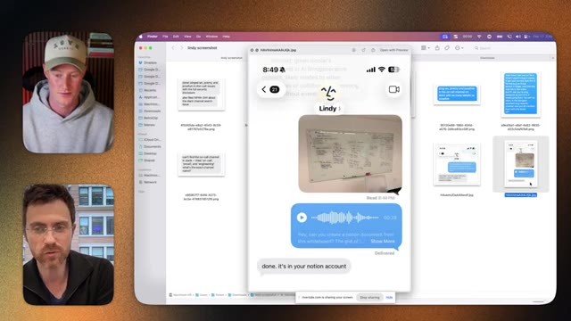
*⏱️ 00:08:35 — Capture d'écran montrant l'interface d'un ordinateur avec des fenêtres de dossiers et un aperçu d'une application de messagerie mobile illustrant un échange avec un assistant IA.*

---

### ⏱️ `[00:08:58 - 00:09:18]` | Segment #24

**🔊 Audio (Transcription Intégrale Mot pour Mot en Français) :**
> Donc je me dis, c'était un brainstorming sur X, Y et Z. Peux-tu s'il te plaît simplement organiser ce tableau blanc en une note propre et la mettre sur Notion ? Donc ouais, vas-y. Non, j'allais juste dire que c'est tellement fou et je veux faire une remarque parce que c'est, c'est un exemple parfait parce qu'il y a quelques années, peut-être il y a environ deux ans, quand j'ai découvert pour la première fois l'utilisation de votre plateforme, j'avais eu cette même idée pour un cas d'usage.

**👁️ Analyse Visuelle d'Écran (gemini-3.5-flash-lite) :**
**Interface & Outils** : macOS, application de messagerie / assistant Lindy, interface de chat.

**Contenu textuel & Code** : Une photo d'un tableau blanc rempli de notes, un message vocal d'une durée de 0:28 avec la transcription "hey, can you create a notion document from this whiteboard?", et la réponse de l'assistant "done. it's in your notion account".

**Action / Démonstration** : Démonstration de l'utilisation d'un agent IA (Lindy) pour traiter une image de tableau blanc et créer automatiquement une note sur Notion à partir d'une consigne vocale.

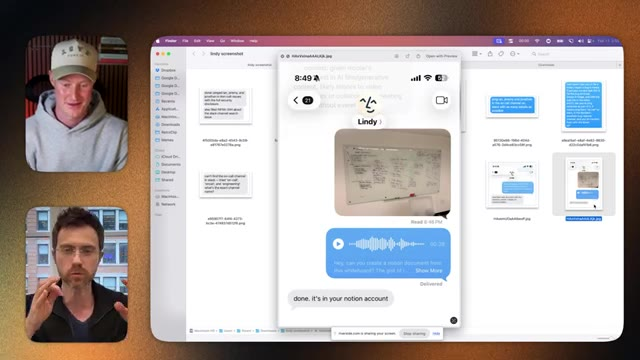
*⏱️ 00:09:03 — Capture d'écran montrant l'application de messagerie avec l'assistant Lindy et un message vocal demandant d'organiser le contenu d'un tableau blanc sur Notion.*

---

### ⏱️ `[00:09:18 - 00:09:40]` | Segment #25

**🔊 Audio (Transcription Intégrale Mot pour Mot en Français) :**
> J'étais genre, ok, j'ai ce genre de bloc-notes. Je vais coller ça dedans et je vais essayer de trouver une automatisation qui pourrait automatiquement genre catégoriser ça pour moi ou, tu sais, faire ce que j'avais besoin qu'elle fasse en arrière-plan. Et c'était tellement chiant d'essayer de comprendre genre, ok, comment est-ce que je fais pour que l'IA analyse l'image ? Comment est-ce que genre, c'est quoi le processus pour ça ? Et ensuite qu'est-ce que je fais ici ? Avec le nouvel assistant Lindy, tu n'as pas besoin de configurer tout ça toi-même.

**👁️ Analyse Visuelle d'Écran (gemini-3.5-flash-lite) :**
**Interface & Outils** : macOS Finder / Application de visioconférence (split-screen).

**Contenu textuel & Code** : Fichiers d'images miniatures nommés avec des identifiants alphanumériques (fichiers PNG).

**Action / Démonstration** : Navigation et affichage d'un dossier de captures d'écran pendant la discussion.

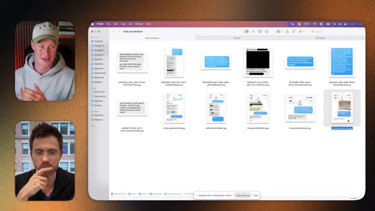
*⏱️ 00:09:24 — Vue d'un dossier partagé contenant de nombreuses captures d'écran, avec deux intervenants en visioconférence sur le côté gauche.*

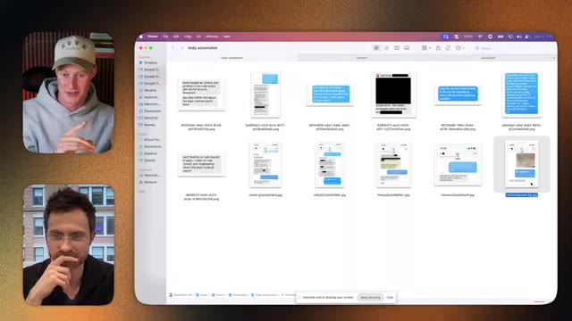
*⏱️ 00:09:34 — Vue similaire montrant le dossier de captures d'écran et les participants à l'appel vidéo.*

---

### ⏱️ `[00:09:40 - 00:09:58]` | Segment #26

**🔊 Audio (Transcription Intégrale Mot pour Mot en Français) :**
> L'IA s'améliore. Donc les modèles d'images sont capables d'extraire du texte des images pour rendre cela réellement possible maintenant. Mais le fait même que nous n'ayons plus besoin de concevoir le flux pour créer ceci est la meilleure partie de tout ça, parce qu'il vous suffit littéralement de demander à votre assistant et il sait comment construire tout ce truc. À 100 %. Ça devrait juste fonctionner. Ouais. Genre, la technologie devrait juste fonctionner.

**👁️ Analyse Visuelle d'Écran (gemini-3.5-flash-lite) :**
**Interface & Outils** : Interface de visioconférence et système d'exploitation macOS (explorateur de fichiers).

**Contenu textuel & Code** : Captures d'écran et interface de messagerie textuelle.

**Action / Démonstration** : Le présentateur explique le fonctionnement des agents conversationnels et le traitement automatique d'images.

---

### ⏱️ `[00:09:58 - 00:10:36]` | Segment #27

**🔊 Audio (Transcription Intégrale Mot pour Mot en Français) :**
> Tu ne devrais pas avoir à construire un agent pour faire avancer les choses. C'est vrai. Je suis d'accord à 100 %. Donc je suppose que cela m'amène peut-être à l'une de mes prochaines questions. Donc pour votre avenir à vous, évidemment, parce que beaucoup d'entre vous connaissent des plateformes comme n8n ou make.com, vous savez, ce sont des constructeurs d'interfaces visuelles et donc vous pensez, bon, si j'ai besoin de créer une automatisation, je vais utiliser Lindy et la construire moi-même. Maintenant que ce n'est plus vraiment aussi nécessaire, où essayez-vous de vous positionner à long terme pour être en quelque sorte cet assistant IA incontournable, pour ainsi dire ? Oui, alors les flux de travail, comme les flux de travail Lindy, sont toujours là et vous pouvez toujours, vous pouvez toujours construire

**👁️ Analyse Visuelle d'Écran (gemini-3.5-flash-lite) :**
**Interface & Outils** : macOS Finder, appel vidéo en visioconférence.

**Contenu textuel & Code** : Fichiers image miniatures affichant des aperçus de conversations textuelles.

**Action / Démonstration** : Navigation dans les fichiers locaux du système pour montrer des exemples de captures d'écran.

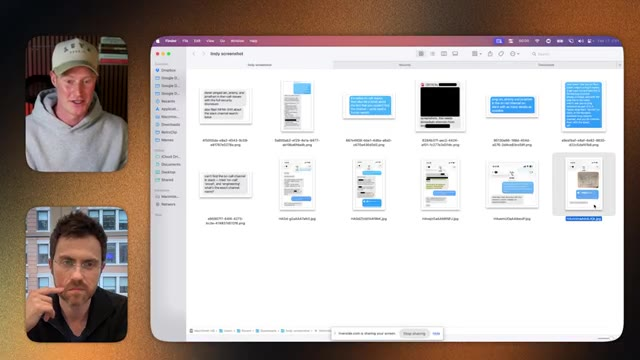
*⏱️ 00:10:08 — Partage d'écran montrant le Finder macOS avec plusieurs vignettes d'images de captures d'écran de discussions.*

*⏱️ 00:10:26 — Partage d'écran du Finder macOS avec des vignettes de captures d'écran, similaire à l'image 1.*

---

### ⏱️ `[00:10:36 - 00:10:59]` | Segment #28

**🔊 Audio (Transcription Intégrale Mot pour Mot en Français) :**
> les. Et ils sont parfaits pour pas mal de cas d'usage pour des personnes beaucoup plus techniques qui ont le temps et la capacité technique de les construire. Pour certains cas d'usage, ils sont meilleurs. Ils sont comme plus fiables parce qu'ils ont la laisse et ils sont plus rentables et ainsi de suite. Mais en ce moment, vous savez, c'est vraiment comme un retour à nos sources. Comme si nous construisions vraiment un système Lindy AI, ce qui est là où nous avons commencé initialement. Et je pense que la technologie n'était tout simplement pas prête.

**👁️ Analyse Visuelle d'Écran (gemini-3.5-flash-lite) :**
**Interface & Outils** : Fenêtre de navigateur ou éditeur de texte (Image #1), Explorateur de fichiers macOS Finder (Image #3).

**Contenu textuel & Code** : Instructions textuelles structurées en balises (workflow, prompt, email_template_guidelines) pour un cas d'usage IA (Image #1). Grille de vignettes d'images et de captures d'écran (Image #3).

**Action / Démonstration** : Présentation d'exemples de prompts et de fichiers de démonstration pour illustrer l'explication technique.

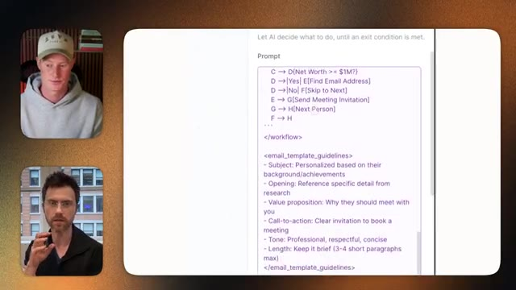
*⏱️ 00:10:41 — Image montrant un exemple de prompt et de structure de workflow textuelle avec des conditions logiques.*

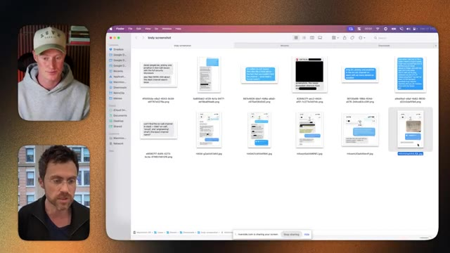
*⏱️ 00:10:53 — Image montrant un gestionnaire de fichiers avec une vue en grille de captures d'écran et d'images.*

---

### ⏱️ `[00:10:59 - 00:11:25]` | Segment #29

**🔊 Audio (Transcription Intégrale Mot pour Mot en Français) :**
> Comme si le modèle n'était vraiment pas encore assez bon. Mec, quand nous avons commencé, c'était genre avant GPT-4, c'était GPT-3.5, des fenêtres de contexte de 4 000 jetons. Rien ne fonctionnait. Et même GPT-4 à l'époque nous a tous époustouflés, évidemment, mais ce n'est rien comparé aux derniers modèles grand public. C'est là que nous nous situons. Je pense que peut-être une comparaison que nous entendons de temps en temps, c'est qu'il est difficile en février 2026 de ne pas mentionner OpenCLAR.

**👁️ Analyse Visuelle d'Écran (gemini-3.5-flash-lite) :**
**Interface & Outils** : macOS Finder.

**Contenu textuel & Code** : Dossier contenant des captures d'écran et des images de messages textuels.

**Action / Démonstration** : Partage d'écran du Finder pour illustrer une discussion sans démonstration technique pertinente.

---

### ⏱️ `[00:11:25 - 00:11:45]` | Segment #30

**🔊 Audio (Transcription Intégrale Mot pour Mot en Français) :**
> C'est juste, ça a vraiment été un tel phénomène. Et je pense que la façon dont je le compare, c'est que je le compare à genre Linux versus Mac OS. Genre, tout comme Linux, OpenCloud est cette sorte d'explosion étrange et vibrante qui sort de nulle part. C'est ça ? Genre, Linux est sorti de la chambre de Linus Torvalds, juste un type bizarre venu de Suède.

**👁️ Analyse Visuelle d'Écran (gemini-3.5-flash-lite) :**
**Interface & Outils** : Gestionnaire de fichiers Finder (macOS) et application de visioconférence.

**Contenu textuel & Code** : Miniatures de captures d'écran de discussions textuelles et d'interfaces mobiles.

**Action / Démonstration** : Le présentateur discute et partage son écran en montrant un dossier contenant des captures d'écran de messages.

---

### ⏱️ `[00:11:45 - 00:12:06]` | Segment #31

**🔊 Audio (Transcription Intégrale Mot pour Mot en Français) :**
> Exactement ? Et puis il y a comme cet immense engouement dans la communauté open source autour de ça. Et donc les ingénieurs en quelque sorte le couronnent comme le nouveau standard. Ça a vraiment explosé. Et maintenant c'est intéressant parce que si on avance rapidement, je sais pas, genre de trois ou quatre décennies, trois décennies. Linux a gagné, mais d'une manière très détournée. Genre tout le monde utilise au moins Unix sans s'en rendre compte.

**👁️ Analyse Visuelle d'Écran (gemini-3.5-flash-lite) :**
**Interface & Outils** : Système d'exploitation macOS (Finder)

**Contenu textuel & Code** : Dossier contenant des vignettes de captures d'écran de messages ou de discussions textuelles.

**Action / Démonstration** : Navigation dans les fichiers du système d'exploitation pour montrer des exemples de captures d'écran.

---

### ⏱️ `[00:12:06 - 00:12:25]` | Segment #32

**🔊 Audio (Transcription Intégrale Mot pour Mot en Français) :**
> Comme votre iPhone, vos appareils Android fonctionnent sur Linux. Votre Mac fonctionne sur le système d'exploitation Unix. Et donc je pense que c'est là que je fais la comparaison. C'est comme si Linux et OpenCloud étaient de merveilleuses technologies. Ce ne sont pas des produits. Et il ne s'agit pas seulement du déploiement. C'est une vraie galère. Le déploiement est une vraie galère.

**👁️ Analyse Visuelle d'Écran (gemini-3.5-flash-lite) :**
**Interface & Outils** : macOS Finder et application de visioconférence (type Zoom/Google Meet)

**Contenu textuel & Code** : Explorateur de fichiers affichant de nombreuses miniatures de captures d'écran de conversations ou d'interfaces.

**Action / Démonstration** : Le présentateur illustre ses propos en partageant l'écran de son ordinateur et en montrant des fichiers de captures d'écran.

*⏱️ 00:12:16 — Partage d'écran montrant le Finder macOS avec un dossier rempli de captures d'écran, aux côtés des deux participants en visioconférence.*

---

### ⏱️ `[00:12:25 - 00:12:54]` | Segment #33

**🔊 Audio (Transcription Intégrale Mot pour Mot en Français) :**
> Mais vous voyez beaucoup de ces produits qui proposent du genre de déployer Open Cloud en un clic, ce qui ne fait toujours pas un produit une fois que vous avez déployé Open Cloud en un clic, ce n'est toujours pas un produit axé sur un avis tranché qui fait des choses prêtes à l'emploi pour vous, vous devez le configurer et je ne saurais vous dire combien de gens j'entends ici me dire ah je dois encore configurer Open Cloud, genre on dirait une corvée, vous savez, c'est du genre et quand je leur dis, c'est du genre Open Cloud ne vaut pas votre week-end, mec, genre la technologie est censée être à votre service et non l'inverse, vous savez, donc la plupart des gens, ils l'ont sur leur liste de tâches, ils ne veulent pas le faire, c'est un, ils ne veulent pas configurer Open Cloud.

**👁️ Analyse Visuelle d'Écran (gemini-3.5-flash-lite) :**
**Interface & Outils** : macOS Finder et application de visioconférence.

**Contenu textuel & Code** : Dossier contenant des vignettes de captures d'écran de messages ou de documents.

**Action / Démonstration** : Partage d'écran du Finder montrant des fichiers d'images de captures d'écran.

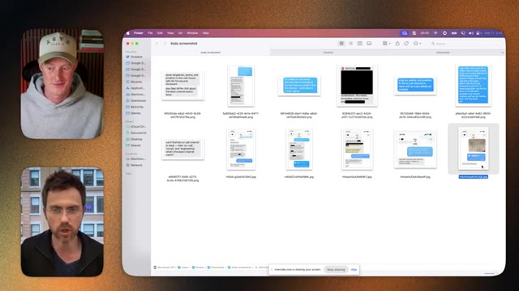
*⏱️ 00:12:32 — L'image #1 montre une fenêtre de Finder macOS affichant une grille de captures d'écran, avec deux intervenants en visioconférence sur le côté gauche.*

---

### ⏱️ `[00:12:54 - 00:13:15]` | Segment #34

**🔊 Audio (Transcription Intégrale Mot pour Mot en Français) :**
> Et je dirais, donc 90 % des gens que je connais veulent le faire, ils ne l'ont pas fait. Et puis, genre 90 % des gens restants, ils ont commencé et ils l'ont réellement déployé. Donc le problème n'est pas le déploiement. C'est juste qu'ils se disent, ah, d'accord. Une fois que c'est déployé, en fait, il y a beaucoup de corvées à faire pour que ça devienne réellement utile. Et donc je pense simplement que, encore une fois, c'est l'histoire de Linux et de Mac OS.

**👁️ Analyse Visuelle d'Écran (gemini-3.5-flash-lite) :**
**Interface & Outils** : Fenêtre du Finder macOS (partage d'écran)

**Contenu textuel & Code** : Miniatures de captures d'écran textuelles et de conversations sans code ni indicateur technique

**Action / Démonstration** : Présentation orale et discussion générale sans manipulation technique ou graphique spécifique

---

### ⏱️ `[00:13:15 - 00:13:35]` | Segment #35

**🔊 Audio (Transcription Intégrale Mot pour Mot en Français) :**
> Genre, ce n’est pas un produit fini. Et je pense que c’est une nouvelle brique de construction importante que des startups comme Owels pourraient utiliser pour construire un produit final. C'est ça. Ouais, à 100 %. Je suis tout à fait d'accord. Genre, personnellement, j'ai configuré OpenClaw. Je l'utilise. Et, tu sais, j'utilise à la fois Lindy et OpenClaw, pour être totalement transparent.

**👁️ Analyse Visuelle d'Écran (gemini-3.5-flash-lite) :**
**Interface & Outils** : macOS Finder

**Contenu textuel & Code** : Dossier contenant des miniatures de captures d'écran de messages ou d'interfaces.

**Action / Démonstration** : Navigation dans un dossier de captures d'écran pour illustrer la discussion.

---

### ⏱️ `[00:13:35 - 00:13:53]` | Segment #36

**🔊 Audio (Transcription Intégrale Mot pour Mot en Français) :**
> Mais une chose que j'ai remarquée, c'est que j'utilise Lindy pour des informations plus sensibles. Donc j'utilise ça. Je texte évidemment par SMS, mais par exemple j'utilise Lindy pour mes e-mails. Je ne vais pas utiliser OpenClaw personnellement pour ce cas d'usage, parce que je ne lui fais tout simplement pas confiance personnellement. Vous savez, je ne... je ne suis pas technique.

**👁️ Analyse Visuelle d'Écran (gemini-3.5-flash-lite) :**
**Interface & Outils** : Interface de messagerie mobile (iMessage) sur smartphone et disposition en incrustation vidéo (picture-in-picture) avec deux participants.

**Contenu textuel & Code** : Échange de messages textuels professionnels liés à la coordination (messages concernant Tom, David de Sequoia et des mises à jour sur Slack).

**Action / Démonstration** : Démonstration visuelle d'une interface de messagerie textuelle illustrant l'utilisation d'assistants IA pour la communication par SMS.

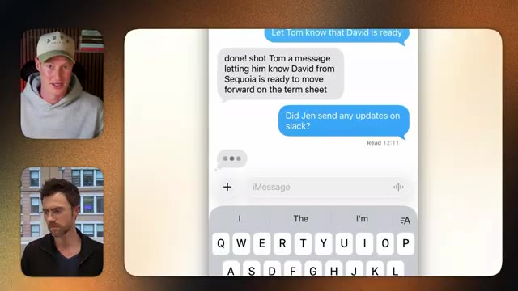
*⏱️ 00:13:48 — Capture d'écran montrant une conversation par SMS (iMessage) sur mobile avec des bulles de messages textuels et le clavier virtuel.*

---

### ⏱️ `[00:13:53 - 00:14:14]` | Segment #37

**🔊 Audio (Transcription Intégrale Mot pour Mot en Français) :**
> Donc j'ai toujours cette peur du genre, mon Dieu, est-ce que j'ai mal configuré ça ? Du genre, est-ce que je vais lui donner accès à quelque je ne devrais probablement pas donner accès ? Est-ce que je vais lui donner le mauvais prompt ? Je ne vais pas, est-ce que je ne vais pas mettre en place les bonnes balises de sécurité ? Ouais. Je serais intéressé d'entendre un peu où vous voulez vous positionner. Du genre, peut-être en étant ça, du genre, je ne veux pas vous mettre des mots dans la bouche, et peut-être en étant cette alternative sûre que des gens non techniques ou n'importe qui peut utiliser.

**👁️ Analyse Visuelle d'Écran (gemini-3.5-flash-lite) :**
**Interface & Outils** : macOS Finder et visioconférence.

**Contenu textuel & Code** : Dossier contenant des vignettes d'images de captures d'écran, montrant potentiellement des conversations ou des interfaces.

**Action / Démonstration** : Le présentateur discute tout en affichant un dossier de captures d'écran sur son écran partagé.

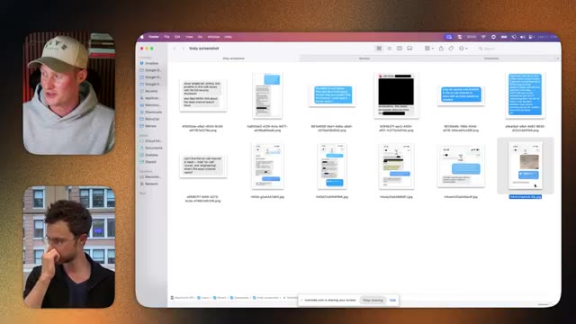
*⏱️ 00:14:04 — Partage d'écran d'un dossier de captures d'écran sur macOS (Finder), avec deux vignettes de webcams des participants sur le côté gauche.*

---

### ⏱️ `[00:14:14 - 00:14:51]` | Segment #38

**🔊 Audio (Transcription Intégrale Mot pour Mot en Français) :**
> donc ils n'ont pas à faire face aux retombées négatives potentielles de l'utilisation de quelque chose comme OpenClaw. Ouais, je pense qu'il est difficile en février 2026 de ne pas mentionner OpenClaw. Je pense qu'en un mot, nous sommes plus sécurisés et on parle genre de mille années supplémentaires pour tout vendre. Je pense qu'OpenClaw est une chose formidable, mais écoutez, il a 80 jours. Nous travaillons là-dessus depuis trois ans et il y a donc eu pas mal de failles de sécurité qui en découlent. Nous avons passé beaucoup de temps sur la sécurité. Nous avons donc cette chose que nous appelons un bouclier d'agent qui vous protège, vous et vos données, ainsi que l'agent qui construit comme de nombreuses couches de protection entre vos données et vos agents de telle sorte que personne ne peut injecter des commandes dans votre agent Lindy, comme les gens ne peuvent pas simplement envoyer un e-mail à votre agent Lindy

**👁️ Analyse Visuelle d'Écran (gemini-3.5-flash-lite) :**
**Interface & Outils** : macOS Finder, application de visioconférence.

**Contenu textuel & Code** : Dossier contenant des miniatures de captures d'écran de messages et d'interfaces textuelles.

**Action / Démonstration** : Partage d'écran et discussion entre les deux intervenants.

---

### ⏱️ `[00:14:51 - 00:15:10]` | Segment #39

**🔊 Audio (Transcription Intégrale Mot pour Mot en Français) :**
> et l'amener à faire des choses comme il y a beaucoup de couches de protection au milieu et ensuite c'est beaucoup plus facile de faire comme avec OpenClaw je le compare souvent à Linux c'est comme c'est un magnifique morceau de technologie ce n'est pas un produit final il ne s'agit pas seulement du déploiement vous savez il y a beaucoup de produits qui sortent pour vous permettre de déployer OpenClaw en un clic mais une fois que vous l'avez déployé vous devez toujours faire en sorte qu'il fasse quelque chose d'utile pour vous.

**👁️ Analyse Visuelle d'Écran (gemini-3.5-flash-lite) :**
**Interface & Outils** : macOS Finder / Explorateur de fichiers

**Contenu textuel & Code** : Dossier contenant des captures d'écran de messages textuels (fichiers PNG et JPG)

**Action / Démonstration** : Navigation et affichage d'un dossier de captures d'écran dans l'interface de macOS.

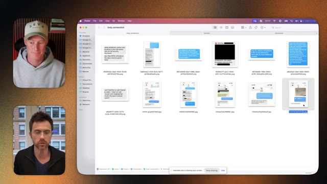
*⏱️ 00:14:56 — Capture d'écran montrant le Finder macOS avec plusieurs vignettes d'images contenant des captures de messages et de conversations, ainsi que deux participants en visio sur le côté gauche.*

---

### ⏱️ `[00:15:11 - 00:15:35]` | Segment #40

**🔊 Audio (Transcription Intégrale Mot pour Mot en Français) :**
> Ce n'est pas un produit clé en main avec des avis tranchés où tout est inclus. C'est ce que nous sommes. C'est une bonne façon de le formuler. Un produit avec tout inclus. Ouais. Parce qu'encore une fois, pour revenir à ce que je disais tout à l'heure, j'utilise vraiment Lindy pour toutes les informations sensibles. Je ne vais pas donner un accès général à mes e-mails, toutes ces choses-là, mais ouais, ça m'intéresserait d'entendre. Alors, est-ce que vous avez travaillé à reformuler et à recréer ce produit et à le reconditionner dans le nouvel assistant Lindy ?

**👁️ Analyse Visuelle d'Écran (gemini-3.5-flash-lite) :**
**Interface & Outils** : Système d'exploitation macOS (Finder) et application de visioconférence (type Riverside).

**Contenu textuel & Code** : Dossier de captures d'écran ("lindy screenshot") affichant des aperçus miniatures de messages textuels et d'interfaces de chat.
[DESC_IMAGE_3]

**Action / Démonstration** : Navigation dans les fichiers locaux et présentation visuelle de captures d'écran d'exemples d'utilisation.

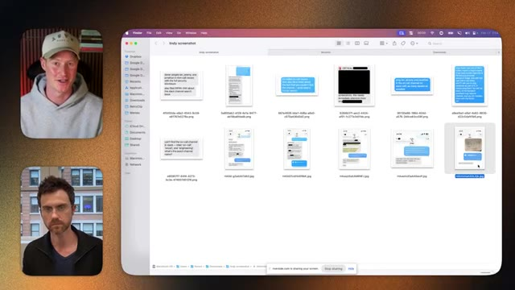
*⏱️ 00:15:17 — Capture d'écran montrant l'interface d'un dossier de fichiers Mac contenant des aperçus de captures d'écran, avec deux fenêtres de webcam des intervenants sur le côté.*

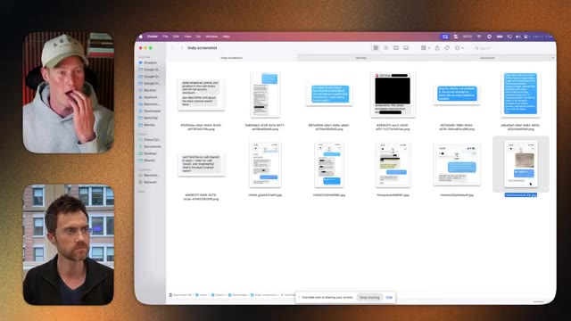
*⏱️ 00:15:29 — Capture d'écran similaire à la première, montrant l'explorateur de fichiers avec des miniatures d'images et les deux participants en vignette à gauche.*

---

### ⏱️ `[00:15:35 - 00:15:57]` | Segment #41

**🔊 Audio (Transcription Intégrale Mot pour Mot en Français) :**
> Est-ce que vous travaillez là-dessus depuis ces deux derniers mois, ou est-ce que c'est quelque chose que vous avez décidé de changer parce que vous avez vu ce que OpenClaw est en train de faire ? Parce que je suppose que c'est quelque chose que vous aviez dans les tuyaux et que vous envisagez depuis pas mal de temps maintenant. Oh, à 100 %. On travaille là-dessus précisément depuis environ six mois, ce qui est comme une éternité en IA, et on a vraiment pris notre temps pour bien faire les choses.

**👁️ Analyse Visuelle d'Écran (gemini-3.5-flash-lite) :**
**Interface & Outils** : macOS Finder / Explorateur de fichiers

**Contenu textuel & Code** : Dossier contenant des miniatures de captures d'écran textuelles ou de messages (type chat/Slack) avec des noms de fichiers alphanumériques.

**Action / Démonstration** : Le présentateur ou l'invité montre des documents ou des captures d'écran stockés sur son ordinateur.

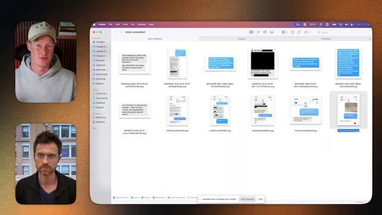
*⏱️ 00:15:40 — Un écran partagé montrant une fenêtre de gestionnaire de fichiers macOS (Finder) avec plusieurs vignettes d'images de captures d'écran, tandis que les deux participants à la visio apparaissent en vignettes à gauche.*

---

### ⏱️ `[00:15:57 - 00:16:19]` | Segment #42

**🔊 Audio (Transcription Intégrale Mot pour Mot en Français) :**
> Mais vraiment, même avant ces six mois, cela s'appuie sur toute l'infrastructure, l'échafaudage et la technologie que nous avons construits au cours des trois dernières années. Donc, par exemple, dès aujourd'hui et sans configuration particulière, Lindy peut utiliser un navigateur Web pour faire des achats pour vous sur Amazon, rechercher des informations et tout le reste. C'est une annonciation que nous avons faite il y a neuf mois, qui concerne l'utilisation du navigateur et l'utilisation de l'ordinateur.

**👁️ Analyse Visuelle d'Écran (gemini-3.5-flash-lite) :**
**Interface & Outils** : macOS Finder et application de visioconférence.

**Contenu textuel & Code** : Dossier de captures d'écran ("lindy screenshot") affichant des aperçus d'échanges de messages et de conversations de l'outil Lindy.

**Action / Démonstration** : Présentation et navigation dans les captures d'écran illustrant les capacités et l'interface de l'outil Lindy.

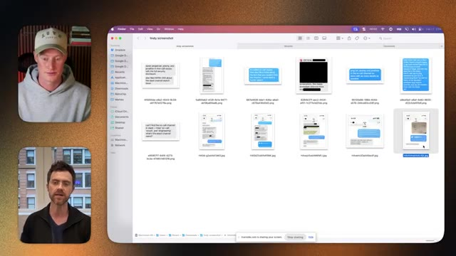
*⏱️ 00:16:08 — Vue de l'écran partagé montrant une fenêtre du Finder avec plusieurs captures d'écran de l'interface de Lindy, accompagné des flux vidéo des participants.*

---

### ⏱️ `[00:16:20 - 00:16:57]` | Segment #43

**🔊 Audio (Transcription Intégrale Mot pour Mot en Français) :**
> Donc Lindy est capable d'utiliser toutes ces briques de construction que nous avons construites au fil des ans. C'est exact. Et c'est d'ailleurs quelque chose que j'allais aborder. Je suis content que tu aies rafraîchi ma mémoire, l'utilisation du navigateur. Parce que Claude, je veux dire, j'imagine que c'est une priorité. Euh Claude Sonnet 4.6 vient de sortir et apparemment l'utilisation du navigateur est, vous savez, même un tout petit peu meilleure que celle de Sonnet 4.5. Donc je suppose que l'utilisation du navigateur que vous avez ne fera que s'améliorer à mesure que ces LLM s'amélioreront et que la technologie d'IA derrière tout ça s'améliorera, parce que c'est vraiment ce qui me passionne, c'est d'avoir un agent qui non seulement peut, vous savez, planifier une réunion pour moi parce qu'il est connecté à, vous savez, Google Calendar, mais qui est capable de partir et de cliquer réellement à l'intérieur d'un navigateur, vous savez.

**👁️ Analyse Visuelle d'Écran (gemini-3.5-flash-lite) :**
**Interface & Outils** : Système d'exploitation macOS (Finder), application de visioconférence.

**Contenu textuel & Code** : Dossier Finder contenant des fichiers PNG de captures d'écran miniatures (ex: lindy screenshot).

**Action / Démonstration** : Navigation et affichage d'un dossier de fichiers sur l'écran partagé pendant la discussion.

*⏱️ 00:16:29 — Vue d'un dossier sur macOS affichant des captures d'écran (lindy screenshot) avec les deux intervenants en médaillons vidéo à gauche.*

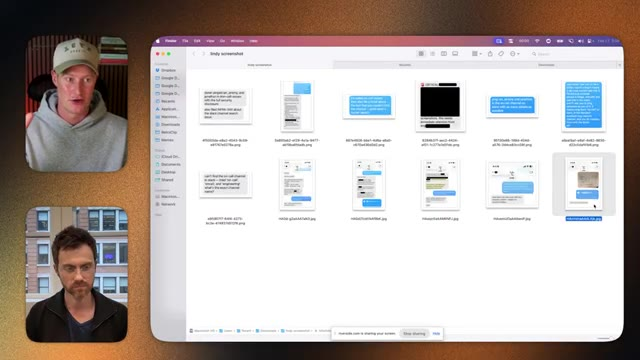
*⏱️ 00:16:48 — Vue quasi identique du dossier de captures d'écran sur macOS avec les intervenants à gauche, montrant une navigation dans les fichiers.*

---

### ⏱️ `[00:16:57 - 00:17:16]` | Segment #44

**🔊 Audio (Transcription Intégrale Mot pour Mot en Français) :**
> Que ce soit sur un vrai navigateur sur mon ordinateur ou un navigateur virtuel, ce qui, je crois, est la façon dont vous le faites. Quelles sont vos réflexions sur les capacités d'utilisation du navigateur ? Est-ce quelque chose qui, selon vous, va vraiment être la prochaine grande nouveauté ? Ou est-ce que ce sera plutôt simplement connecter ces applications et n'utiliser l'utilisation du navigateur que si vous ne pouvez pas vous connecter à ces applications ? Oui, je pense que c'est les deux.

**👁️ Analyse Visuelle d'Écran (gemini-3.5-flash-lite) :**
**Interface & Outils** : Système d'exploitation macOS, explorateur de fichiers (Finder) et interface web de partage.

**Contenu textuel & Code** : Fichiers d'images miniatures et interface de configuration de partage pour un agent de génération de leads.

**Action / Démonstration** : Navigation dans les fichiers locaux et démonstration du partage d'un agent conversationnel.

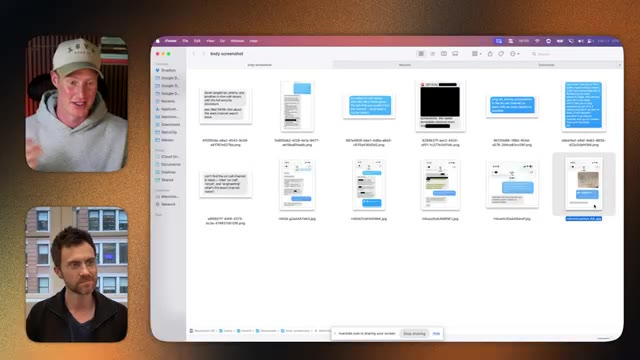
*⏱️ 00:17:07 — Partage d'écran d'un explorateur de fichiers montrant un dossier contenant de nombreuses captures d'écran.*

---

### ⏱️ `[00:17:16 - 00:17:35]` | Segment #45

**🔊 Audio (Transcription Intégrale Mot pour Mot en Français) :**
> Je pense que l'utilisation du navigateur va être en quelque sorte l'interface ultime pour les LLM. Mais je pense, oui, que chaque fois que vous pouvez utiliser des intégrations directes et des API, c'est évidemment beaucoup plus rapide, beaucoup moins cher, beaucoup plus fiable, vous devriez donc privilégier cela par défaut. Mais vous seriez surpris de voir à quel peu de choses vous pouvez faire avec une API par rapport à ce que vous pouvez faire avec un navigateur.

**👁️ Analyse Visuelle d'Écran (gemini-3.5-flash-lite) :**
**Interface & Outils** : macOS Finder affichant un dossier de captures d'écran, avec deux fenêtres de visioconférence incrustées sur le côté gauche.

**Contenu textuel & Code** : Miniatures de captures d'écran de discussions textuelles et d'interfaces de messagerie (probablement des exemples d'interactions d'agents IA ou de tests de navigation).

**Action / Démonstration** : Le présentateur illustre ses propos sur l'utilisation des interfaces et des navigateurs en montrant des exemples de données visuelles manipulées par des agents.

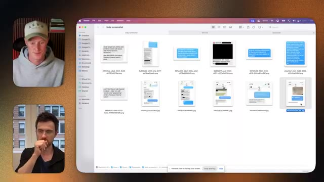
*⏱️ 00:17:26 — Partage d'écran montrant un dossier rempli de captures d'écran de messages et d'interfaces mobiles.*

---

### ⏱️ `[00:17:35 - 00:17:56]` | Segment #46

**🔊 Audio (Transcription Intégrale Mot pour Mot en Français) :**
> C'est intéressant, tu sais, il y a environ deux ans, la planification a toujours été un grand cas d'usage pour nous. Et c'est intéressant, même quand quelqu'un m'envoie un lien Calendly, je suis un peu paresseux pour cliquer et regarder mes horaires et tout ça. Je veux juste que ça se fasse automatiquement. Et donc nous sommes en contact avec l'équipe de Calendly, qui est en fait juste en face de la rue depuis longtemps.

**👁️ Analyse Visuelle d'Écran (gemini-3.5-flash-lite) :**
**Interface & Outils** : macOS Finder

**Contenu textuel & Code** : Dossier contenant des miniatures de captures d'écran textuelles et d'interfaces de messagerie.

**Action / Démonstration** : Navigation et présentation de fichiers visuels à l'écran.

---

### ⏱️ `[00:17:56 - 00:18:18]` | Segment #47

**🔊 Audio (Transcription Intégrale Mot pour Mot en Français) :**
> Et on était du genre, hey, est-ce que vous pouvez s'il vous plaît nous donner une API ? Donc si quelqu'un envoie un lien Calendly à un utilisateur de Linde, Linde peut réserver des créneaux via l'API. Et Calendly était du genre, pas vraiment. On ne veut pas vous laisser faire ça. Genre, on ne veut pas être désintermédiés. On ne veut pas offrir d'API. Et en plus, ça va ouvrir la porte aux bots et tout ce genre de trucs. Et ce que je leur ai dit, c'est, vous savez, écoutez, on va faire ça de la manière la plus simple ou de la manière la plus dure.

**👁️ Analyse Visuelle d'Écran (gemini-3.5-flash-lite) :**
**Interface & Outils** : Système d'exploitation macOS (Finder) et interface de visioconférence.

**Contenu textuel & Code** : Dossier de captures d'écran (fichiers d'images miniatures) illustrant des discussions ou des interfaces utilisateur.

**Action / Démonstration** : Partage d'écran illustrant des documents de travail ou des exemples visuels lors de l'interview.

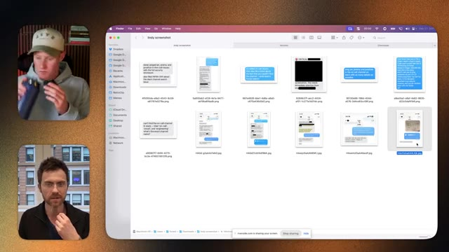
*⏱️ 00:18:01 — Capture d'écran montrant l'écran partagé avec un dossier de fichiers contenant des aperçus d'images et de captures d'écran, tandis que l'intervenant apparaît en médaillon.*

---

### ⏱️ `[00:18:18 - 00:18:36]` | Segment #48

**🔊 Audio (Transcription Intégrale Mot pour Mot en Français) :**
> C'est comme si l'utilisation du navigateur arrivait, tu vois ? Et je pense qu'à l'époque, ils ne m'ont pas pris tout à fait au sérieux. Je pense que maintenant, si. Et ouais, tu sais, maintenant quand j'ai quelqu'un — avancer rapide de deux ans — genre, l'interface utilisateur de Calendly est plus que suffisamment simple pour que des agents de navigation puissent la gérer. Et donc, chaque fois que quelqu'un m'envoie un lien Calendly, je ne prends même pas la peine d'y jeter un œil.

**👁️ Analyse Visuelle d'Écran (gemini-3.5-flash-lite) :**
**Interface & Outils** : Système d'exploitation macOS (Finder) et logiciel de visioconférence.

**Contenu textuel & Code** : Dossier du Finder contenant des fichiers PNG de captures d'écran textuelles et mobiles.

**Action / Démonstration** : Navigation et affichage d'un dossier de captures d'écran partagé lors de la discussion.

---

### ⏱️ `[00:18:36 - 00:18:54]` | Segment #49

**🔊 Audio (Transcription Intégrale Mot pour Mot en Français) :**
> Je le transfère simplement à ma Lindy et elle regarde mon calendrier, elle a mes préférences de réservation et elle trouve simplement l'heure et le réserve sur Calendly. Ouais, non, j'adore ça. Je suppose que ça m'amène un peu à ma prochaine question. Genre, quels sont peut-être des cas d'utilisation originaux pour lesquels vous utilisez l'assistant Lindy et que quelqu'un pourrait négliger ? Ouais, celui-ci est l'un de mes préférés. C'est vraiment bizarre.

**👁️ Analyse Visuelle d'Écran (gemini-3.5-flash-lite) :**
**Interface & Outils** : Application Lindy (interface d'assistant IA avec tableau de bord et options de discussion).

**Contenu textuel & Code** : Commandes textuelles et prompt d'assistance (« What urgent items need my attention this morning? ») avec des options de tâches automatisées.

**Action / Démonstration** : Démonstration de l'interface de l'assistant IA Lindy et de ses fonctionnalités de gestion des tâches.

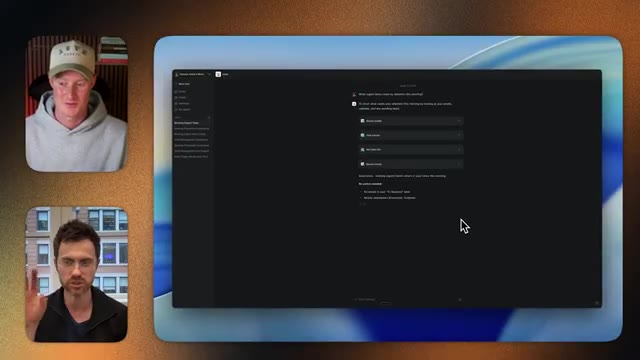
*⏱️ 00:18:40 — Capture d'écran montrant l'interface sombre d'une application d'assistant virtuel (Lindy) avec des vignettes vidéo des interlocuteurs sur le côté gauche.*

---

### ⏱️ `[00:18:55 - 00:19:13]` | Segment #50

**🔊 Audio (Transcription Intégrale Mot pour Mot en Français) :**
> C'est, je dirais, utiliser Lindy, et c'est quelque chose que j'entends de la part de mes amis également et de nos utilisateurs, utiliser Lindy a changé ma relation avec l'ordinateur. Je vais vous dire exactement ce que je veux dire. C'est un cas d'utilisation quotidien pour moi. J'aime, parfois je suis dans des réunions d'affilée et je suis au milieu d'un truc pour des réunions après genre cinq heures. Et donc je n'ai pas regardé ma boîte de réception pendant cinq heures.

**👁️ Analyse Visuelle d'Écran (gemini-3.5-flash-lite) :**
**Interface & Outils** : macOS Finder, application mobile Lindy, interface de visioconférence.

**Contenu textuel & Code** : Captures d'écran de l'interface de chat de l'assistant IA Lindy affichant des messages texte et des notes vocales.

**Action / Démonstration** : Partage d'écran et présentation d'exemples d'utilisation de l'assistant IA Lindy par le présentateur.

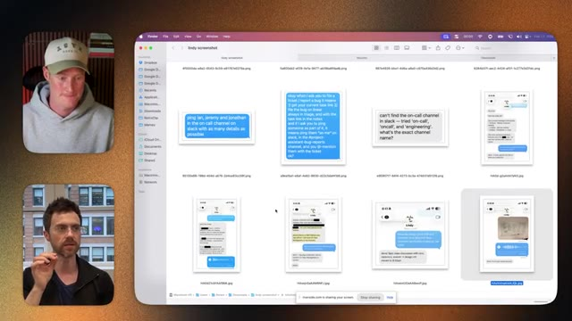
*⏱️ 00:18:59 — Vue d'un écran partagé montrant une visionneuse de fichiers macOS avec plusieurs captures d'écran de conversations avec l'assistant Lindy, aux côtés des participants en visioconférence.*

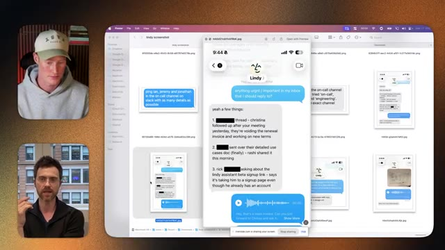
*⏱️ 00:19:08 — Vue d'un écran partagé où l'une des captures d'écran de l'application Lindy est agrandie au premier plan, montrant des interactions textuelles et vocales.*

---

### ⏱️ `[00:19:13 - 00:19:48]` | Segment #51

**🔊 Audio (Transcription Intégrale Mot pour Mot en Français) :**
> Et j'aime généralement être très, très réactif par e-mail. Et donc après ces cinq heures de réunions, d'ailleurs, je n'ai même plus vraiment envie de regarder mes e-mails. J'avais juste envie de sortir et d'aller me promener après cinq heures d'appels d'affilée. Et donc je sors littéralement et j'envoie un message à ma Lindy et je lui dis, ouais, est-ce qu'il y a quelque chose d'urgent ou d'important dans ma boîte de réception que tu devrais regarder ? Et Lindy répond et elle dit, ouais, trois choses. Boum, boum, boum, boum. Et puis vous voyez, je réponds avec un mémo vocal et c'est magique. C'est comme si je parlais à ma boîte de réception. Je me dis, ok, e-mail numéro un, ce n'est en fait pas grave. Supprime-le simplement. E-mail numéro deux, ouais, dis-lui que c'est bon. On peut faire ça. Et e-mail numéro trois, peux-tu le transférer à notre comptable et lui demander quoi faire ? Pareil. C'est terminé. Tu

**👁️ Analyse Visuelle d'Écran (gemini-3.5-flash-lite) :**
**Interface & Outils** : Interface de discussion mobile (Lindy) affichée sur un écran d'ordinateur macOS, avec des vignettes de visioconférence.

**Contenu textuel & Code** : Résumé de messages textuels listant des points d'action et des e-mails importants traités par un assistant IA.

**Action / Démonstration** : Présentation et explication d'un outil d'assistant IA gérant les e-mails et les messages.

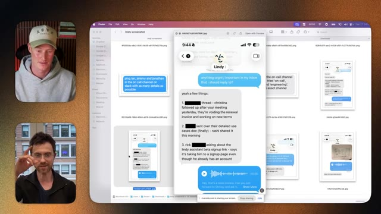
*⏱️ 00:19:31 — Capture d'écran d'un ordinateur montrant une interface de discussion mobile (Lindy) affichant des messages récapitulatifs, avec deux vignettes vidéo des intervenants sur le côté gauche.*

---

### ⏱️ `[00:19:48 - 00:20:10]` | Segment #52

**🔊 Audio (Transcription Intégrale Mot pour Mot en Français) :**
> Et c'est donc ce que je veux dire par le fait que ma relation avec mon ordinateur a changé. J'utilise beaucoup mon ordinateur, honnêtement. J'utilise beaucoup plus mon téléphone portable et j'ouvre à peine Gmail maintenant. C'est assez bizarre. J'avais l'habitude d'être collé à ma boîte de réception comme n'importe quel autre fondateur. Maintenant, tout se passe simplement sur mes messages sur mon téléphone portable. Et c'est assez bizarre. Je regarde le bureau en ce moment et je vois tous ces ordinateurs et ces grands écrans.

**👁️ Analyse Visuelle d'Écran (gemini-3.5-flash-lite) :**
**Interface & Outils** : Application mobile Lindy, interface de démonstration.

**Contenu textuel & Code** : Interface de messagerie intelligente avec l'assistant Lindy gérant des tâches et des résumés.

**Action / Démonstration** : Démonstration de l'utilisation de l'assistant IA mobile Lindy.

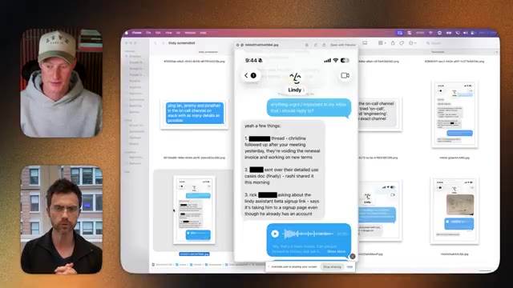
*⏱️ 00:19:53 — Capture d'écran montrant l'application Lindy sur smartphone affichée à l'écran d'un ordinateur.*

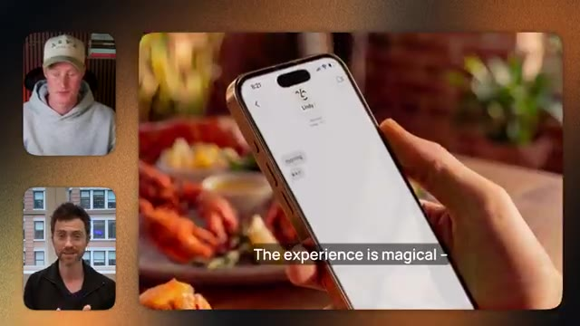
*⏱️ 00:19:59 — Gros plan sur un utilisateur manipulant l'application Lindy sur son smartphone.*

---

### ⏱️ `[00:20:10 - 00:20:29]` | Segment #53

**🔊 Audio (Transcription Intégrale Mot pour Mot en Français) :**
> Et de plus en plus, je perçois ces choses presque comme, c'est presque comme s'il y avait un peu de nostalgie, quelque chose de presque mélancolique à ce sujet en fait. Eh bien, je veux dire, je les perçois comme des reliques du passé. Je les perçois comme, je vois un ordinateur et un grand moniteur, et un clavier, et une souris. Je les perçois comme un outil que nous utilisons pour micro-gérer la technologie, n'est-ce pas ?

**👁️ Analyse Visuelle d'Écran (gemini-3.5-flash-lite) :**
**Interface & Outils** : Présentation ou face-caméra explicatif du trader sans interface logicielle partagée.

**Contenu textuel & Code** : Explications orales des stratégies et mise en contexte méthodologique du marché.

**Action / Démonstration** : Explications face caméra et analyse conceptuelle des marchés.

---

### ⏱️ `[00:20:29 - 00:20:50]` | Segment #54

**🔊 Audio (Transcription Intégrale Mot pour Mot en Français) :**
> Il vous faut un clavier et une souris parce que vous devez micro-gérer votre truc, touche par touche, clic par clic par clic, vous voyez ? Et c'est un peu comme un ouvrier d'usine. Vous êtes un travailleur du savoir, mais vous êtes presque un ouvrier d'usine et c'est une machine que vous utilisez pour produire du savoir toute la journée, n'est-ce pas ? C'est une machine très compliquée. Et je pense que lorsque votre ordinateur devient assez intelligent, c'est juste comme un employé, du genre vous n'avez plus besoin de le micro-gérer.

**👁️ Analyse Visuelle d'Écran (gemini-3.5-flash-lite) :**
**Interface & Outils** : macOS, Finder, Aperçu d'images, application de messagerie mobile sur captures d'écran.

**Contenu textuel & Code** : Captures d'écran miniatures affichant des discussions avec un assistant virtuel nommé « Lindy » sur smartphone.

**Action / Démonstration** : Le présentateur discute de la gestion des tâches et de l'utilisation d'outils numériques tout en montrant des exemples de captures d'écran de l'interface mobile Lindy.

---

### ⏱️ `[00:20:50 - 00:21:14]` | Segment #55

**🔊 Audio (Transcription Intégrale Mot pour Mot en Français) :**
> Et donc, plus votre ordinateur est petit, plus vous pouvez lui donner un objectif de haut niveau au lieu de le micro-gérer. Vous pouvez lui dire, hé, va dans ma boîte de réception, trouve cet e-mail, prépare un rapport sur Google Docs, convertis-le en PDF, et renvoie-le-lui. Et toute la mise en relation de toutes les applications, tout ça, l'ordinateur va le comprendre par lui-même. Je pense aussi que beaucoup de choses se résument probablement à la créativité dont vous pouvez faire preuve avec les tâches que vous voulez qu'il aille accomplir.

**👁️ Analyse Visuelle d'Écran (gemini-3.5-flash-lite) :**
**Interface & Outils** : macOS Finder, aperçu de captures d'écran mobiles, application de messagerie de l'assistant Lindy.

**Contenu textuel & Code** : Interface d'un assistant virtuel (Lindy) listant des messages et des tâches de résumé de boîte de réception.

**Action / Démonstration** : Présentation d'un cas d'usage d'un agent IA gérant des messages et résumant des e-mails.

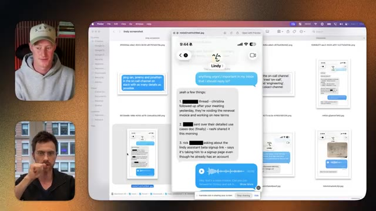
*⏱️ 00:20:56 — Vue d'écran partagée montrant deux intervenants en vidéo et un bureau macOS avec une application de messagerie mobile affichant des interactions avec un assistant IA.*

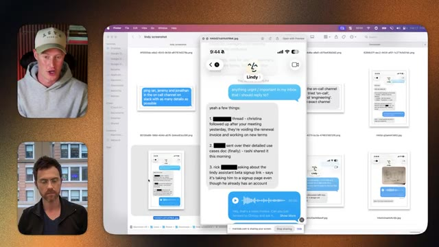
*⏱️ 00:21:08 — Vue similaire à l'image 1 montrant la suite de la démonstration sur l'écran d'ordinateur avec l'assistant Lindy.*

---

### ⏱️ `[00:21:15 - 00:21:33]` | Segment #56

**🔊 Audio (Transcription Intégrale Mot pour Mot en Français) :**
> Donc c'est quelque chose, par exemple, avec Claude Vaughn et Lindy avec qui j'ai expérimenté, du genre, OK, jusqu'où je pourrais pousser ce truc ? Tu sais, genre, bien sûr, je pourrais peut-être lui faire parcourir mes réunions et planifier une réunion et, tu sais, ce genre de trucs. Mais genre, j'ai été de plus en plus impressionné par ce qu'il peut faire. Et pour rebondir sur ce que tu dis, où on a presque l'impression que les ordinateurs sont des reliques du passé.

**👁️ Analyse Visuelle d'Écran (gemini-3.5-flash-lite) :**
**Interface & Outils** : Application de messagerie Lindy, Finder macOS, Aperçu d'images.

**Contenu textuel & Code** : Interface de conversation avec l'assistant Lindy posant des questions sur les e-mails urgents, listant des points de suivi (fil de discussion, documents d'utilisation, liens d'inscription bêta).

**Action / Démonstration** : Présentation et démonstration de l'interface de l'assistant IA Lindy et de ses capacités d'automatisation des e-mails et messages.

*⏱️ 00:21:19 — Capture d'écran montrant l'interface de l'assistant IA Lindy sous forme de chat sur mobile, affichée au premier plan sur un bureau macOS avec d'autres captures d'écran en arrière-plan.*

---

### ⏱️ `[00:21:34 - 00:21:59]` | Segment #57

**🔊 Audio (Transcription Intégrale Mot pour Mot en Français) :**
> C'est marrant parce qu'on est tous les deux tellement immergés dans la technologie et on est tellement à fond, genre, mec, pour ma part, j'adore les nouveaux produits Apple. J'adore un nouveau MacBook Pro. J'adore un nouveau Mac Studio, un Mac mini, peu importe. Mais genre, je suis de plus en plus fatigué de regarder mon ordinateur. Et j'aimerais, je suis tellement impatient d'arriver au moment où l'intelligence artificielle sera assez performante pour que je puisse lui envoyer un message vocal, aller faire une marche et qu'elle puisse partir faire toutes ces différentes choses pour moi.

**👁️ Analyse Visuelle d'Écran (gemini-3.5-flash-lite) :**
**Interface & Outils** : macOS Finder et visioconférence.

**Contenu textuel & Code** : Fichiers d'images et extraits de texte liés au support ou à la documentation.

**Action / Démonstration** : Présentation et partage d'éléments visuels à l'écran.

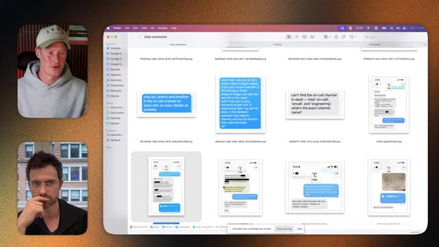
*⏱️ 00:21:46 — Partage d'écran affichant une fenêtre du Finder macOS avec des captures d'écran et des extraits textuels, avec les deux intervenants en miniatures vidéo sur le côté.*

---

### ⏱️ `[00:21:59 - 00:22:30]` | Segment #58

**🔊 Audio (Transcription Intégrale Mot pour Mot en Français) :**
> Et, vous savez, ça fait peut-être plus de travail que je n'en ferais en peut-être environ trois ou quatre heures passées assis sur mon ordinateur et à faire mon travail de concentration profonde, si on peut même appeler ça comme ça. C'est donc pour cela que j'ai été si impressionné par en quelque sorte cette nouvelle révolution que nous commençons à voir, de simplement ces agents auxquels nous pouvons envoyer des textos ou même, vous savez, je suppose qu'à un moment donné nous pourrons peut-être avoir un appel téléphonique ou simplement discuter par message vocal et les lancer pour qu'ils fassent ces choses. C'est pourquoi j'ai vraiment adoré ce produit que vous avez créé, parce que je peux me reconnecter davantage avec la nature. Je peux me reconnecter avec mes amis au lieu d'avoir l'impression que je dois bosser dur toute la journée et faire ces choses manuellement. C'est juste que, c'est intéressant de voir comment les dynamiques sont en train de changer.

**👁️ Analyse Visuelle d'Écran (gemini-3.5-flash-lite) :**
**Interface & Outils** : macOS Finder et application de visioconférence.

**Contenu textuel & Code** : Miniatures de captures d'écran montrant divers messages textuels et interfaces de discussion mobile.

**Action / Démonstration** : Présentation et visualisation de captures d'écran illustrant des exemples de messages ou de tâches.

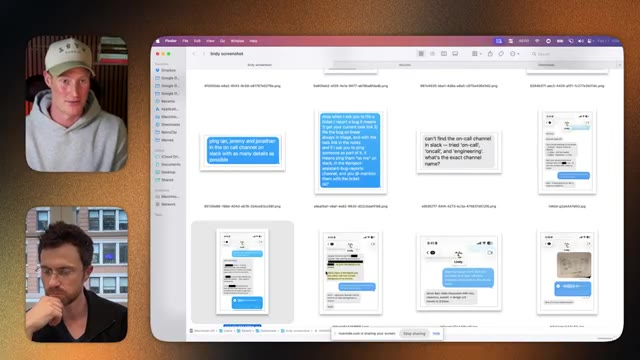
*⏱️ 00:22:15 — Partage d'écran d'un ordinateur affichant un dossier de captures d'écran (Finder) contenant des images de messages textuels et de bulles de discussion, avec les participants visibles en vignettes vidéo sur le côté.*

---

### ⏱️ `[00:22:31 - 00:22:52]` | Segment #59

**🔊 Audio (Transcription Intégrale Mot pour Mot en Français) :**
> 100 %. Je veux dire, la façon dont nous avons toujours exprimé notre mission est de libérer l'humanité du travail. Une fois que l'humanité sera libérée du travail, laissant de côté pour l'instant les questions sociétales profondes que cela soulève, mais une fois que l'humanité sera libérée du travail et que nous aurons résolu ces questions profondes, vous n'allez pas avoir d'ordinateur. Vous allez simplement être au parc au soleil, à traîner avec vos amis et votre famille, et vous allez avoir votre téléphone.

**👁️ Analyse Visuelle d'Écran (gemini-3.5-flash-lite) :**
**Interface & Outils** : Gestionnaire de fichiers / système de visionnage de captures d'écran.

**Contenu textuel & Code** : Miniatures de captures d'écran contenant des messages texte et des interfaces de messagerie.

**Action / Démonstration** : Présentation de captures d'écran illustrant des exemples de communication ou de rapports d'erreurs.

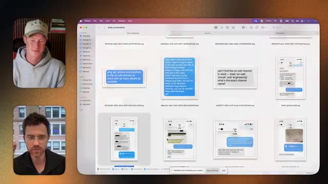
*⏱️ 00:22:36 — Capture d'écran montrant l'interface d'un gestionnaire de fichiers avec plusieurs aperçus de captures d'écran de messages et de discussions textuelles.*

---

### ⏱️ `[00:22:53 - 00:23:11]` | Segment #60

**🔊 Audio (Transcription Intégrale Mot pour Mot en Français) :**
> Et peut-être qu'il y aura un Neuralink à ce moment-là, et tu pourras simplement parler à ton téléphone. Tu te dis, tu peux m'apporter un burrito ? Oh, ce serait chouette s'il y avait un bâtiment ici. Et je suis d'accord avec toi, tu te retrouves en quelque sorte limité par, c'est un sentiment vraiment surréaliste parce que, tu sais, nous avons construit cette application et nous découvrons nous-mêmes de nouveaux cas d'usage pour elle sans arrêt.

**👁️ Analyse Visuelle d'Écran (gemini-3.5-flash-lite) :**
**Interface & Outils** : Application de visioconférence et explorateur de fichiers macOS (Finder).

**Contenu textuel & Code** : Miniatures d'images de messages textuels et d'échanges conversationnels affichées dans l'explorateur de fichiers.

**Action / Démonstration** : Discussion en visioconférence avec partage d'écran de documents visuels et de captures d'écran.

*⏱️ 00:22:57 — Vue en visioconférence à deux participants avec le partage d'écran d'un dossier macOS contenant des captures d'écran de messages et d'interfaces textuelles.*

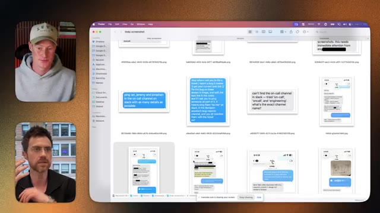
*⏱️ 00:23:07 — Vue similaire à l'image 1 montrant le partage d'écran d'un dossier de captures d'écran pendant la conversation vidéo.*

---

### ⏱️ `[00:23:11 - 00:23:30]` | Segment #61

**🔊 Audio (Transcription Intégrale Mot pour Mot en Français) :**
> Et une fois que vous commencez à en faire une habitude, vous commencez petit, vous commencez par des trucs évidents. Tout le monde veut de l'aide avec ses e-mails, ses réunions et son calendrier. Mais ensuite, petit à petit, vous l'utilisez de plus en plus, vous lui parlez toute la journée, et petit à petit, vous êtes à votre ordinateur et vous faites quelque chose et vous vous sentez bête. Vous vous dites, pourquoi je fais ça ? Sûrement que Lindy peut faire ça. Et donc je vais vous donner un exemple de quelque chose qui s'est passé l'autre jour.

**👁️ Analyse Visuelle d'Écran (gemini-3.5-flash-lite) :**
**Interface & Outils** : Application de visionnage d'images sur macOS et interface de visioconférence.

**Contenu textuel & Code** : Dossier contenant de nombreuses miniatures de captures d'écran de messages textuels (style chat/Slack).

**Action / Démonstration** : Le présentateur illustre visuellement son propos en affichant des exemples de captures de conversations.

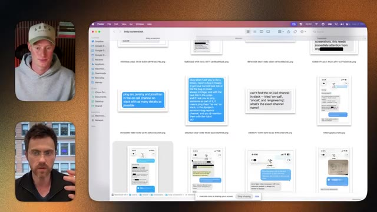
*⏱️ 00:23:16 — Capture d'écran montrant l'écran partagé avec une vue de galerie de captures d'écran de messages et de discussions, avec le présentateur en médaillon.*

---

### ⏱️ `[00:23:30 - 00:23:48]` | Segment #62

**🔊 Audio (Transcription Intégrale Mot pour Mot en Français) :**
> Genre, je travaille beaucoup sur le produit et je crée beaucoup de tickets à chaque fois que je rencontre un problème avec Lindy. Et donc je parle avec Lindy, un truc mauvais s'est produit. Je me dis, ah, c'est nul. Je prends une capture d'écran sur mon téléphone. Je l'envoie sur mon ordinateur. J'ouvre Minier. C'est ce qu'on utilise pour notre suivi des bugs. Je crée un ticket. Je définis une priorité.

**👁️ Analyse Visuelle d'Écran (gemini-3.5-flash-lite) :**
**Interface & Outils** : macOS Finder, application de messagerie ou de gestion de tâches.

**Contenu textuel & Code** : Instructions textuelles données à une intelligence artificielle (Lindy) concernant la création de tickets de bugs sur Linear, l'envoi de messages sur Slack et la gestion des notifications.

**Action / Démonstration** : Présentation d'un flux de travail automatisé et de consignes textuelles pour signaler des bugs à l'assistant IA.

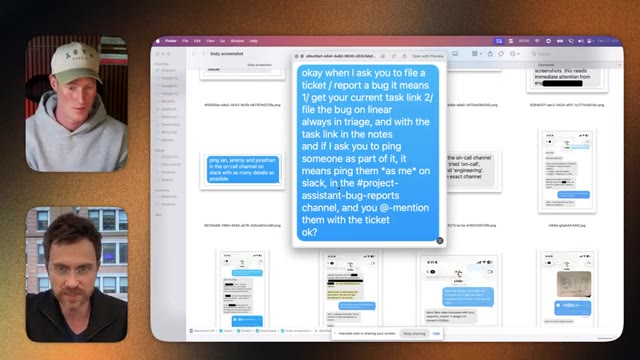
*⏱️ 00:23:35 — Capture d'écran montrant l'interface d'un ordinateur avec des captures d'écran de l'application Lindy affichées en arrière-plan et une fenêtre de texte au premier plan détaillant les instructions pour la création de tickets de bugs.*

---

### ⏱️ `[00:23:48 - 00:24:08]` | Segment #63

**🔊 Audio (Transcription Intégrale Mot pour Mot en Français) :**
> Je l'envoie à quelqu'un. Je joins le truc. Et je me dis, attends une minute, pourquoi je fais ça ? Et donc j'ai juste envoyé ce message à Lindy et je me suis dit, hé, quand je te demande de créer un ticket ou de signaler un bug, je veux que tu ailles simplement là-dedans et que tu le crées. Et puis si je te demande, tu sais, de contacter quelqu'un sur Slack à ce sujet également. C'est donc ça que je veux dire par micro-gérer l'ordinateur.

**👁️ Analyse Visuelle d'Écran (gemini-3.5-flash-lite) :**
**Interface & Outils** : Application de messagerie / système de gestion de tickets.

**Contenu textuel & Code** : Instructions détaillées sur la façon de signaler des bugs, d'obtenir des liens de tâches et d'interagir sur Slack.

**Action / Démonstration** : Le présentateur explique et montre un message de consignes envoyé à l'assistant IA Lindy.

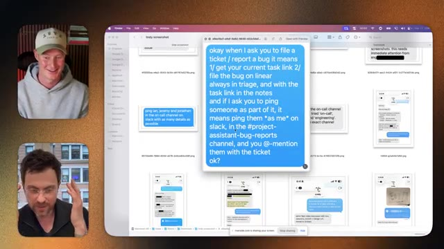
*⏱️ 00:23:53 — Capture d'écran montrant un message textuel envoyé à Lindy détaillant les instructions pour la création de tickets et le signalement de bugs.*

---

### ⏱️ `[00:24:08 - 00:24:29]` | Segment #64

**🔊 Audio (Transcription Intégrale Mot pour Mot en Français) :**
> Vous savez, comme ici ce flux de travail est en quelque sorte partagé entre Linear et Slack. Et donc je pense qu'il n'a presque aucun flux de travail qui est contenu dans une seule application. Il s'étend toujours sur plusieurs applications. Vous savez, vous rassemblez une présentation et ensuite vous l'exportez et vous l'envoyez par e-mail. Et vous savez, aujourd'hui, le flux de travail doit être orchestré à travers toutes ces applications.

**👁️ Analyse Visuelle d'Écran (gemini-3.5-flash-lite) :**
**Interface & Outils** : Lindy.ai, gestionnaire de fichiers macOS, interface de messagerie.

**Contenu textuel & Code** : Instructions textuelles sur la gestion des tickets et des rapports de bugs connectant Linear et Slack.

**Action / Démonstration** : Présentation d'un flux de travail automatisé multi-applications entre Linear, Slack et des agents IA.

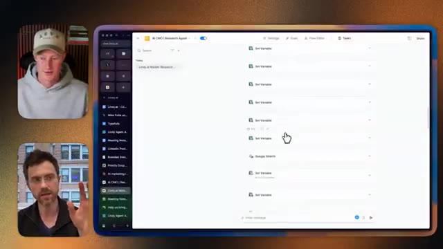
*⏱️ 00:24:13 — Interface d'un outil d'automatisation (Lindy.ai) affichant un flux de travail avec des variables et des recherches.*

*⏱️ 00:24:19 — Partage d'écran montrant un dossier rempli de captures d'écran de messages textuels avec une instruction détaillée en surbrillance.*

---

### ⏱️ `[00:24:29 - 00:24:50]` | Segment #65

**🔊 Audio (Transcription Intégrale Mot pour Mot en Français) :**
> Et le gars qui doit faire l'orchestration, c'est l'utilisateur. Et personne ne s'est dit étant enfant, quand je serai grand, je veux être orchestrateur de flux de travail. Et c'est donc ce que je veux dire à propos de la relation avec les ordinateurs qui est en train de changer, où vous pouvez simplement donner un objectif à votre ordinateur et il va orchestrer le flux de travail pour vous. Oui, je pense que je suis d'accord à 100 %. Je pense que c'est tout simplement une excellente façon, une nouvelle direction vers laquelle nous avançons.

**👁️ Analyse Visuelle d'Écran (gemini-3.5-flash-lite) :**
**Interface & Outils** : Navigateur web / application de messagerie ou de configuration de workflow (type Lindy AI / interface de chat textuel).

**Contenu textuel & Code** : Texte affiché dans une bulle de dialogue bleue donnant des instructions détaillées sur la gestion des tickets et des rapports de bugs ("okay when I ask you to file a ticket / report a bug...").

**Action / Démonstration** : Présentation ou démonstration d'un prompt textuel ou d'instructions d'automatisation de tâches.

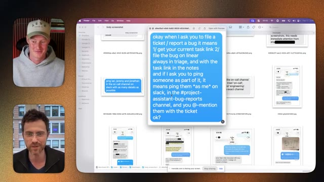
*⏱️ 00:24:34 — Capture d'écran montrant le partage d'écran d'un ordinateur avec une fenêtre affichant une discussion ou un prompt textuel en anglais, sur fond de miniatures d'images, avec deux vignettes vidéo des participants sur le côté.*

---

### ⏱️ `[00:24:50 - 00:25:10]` | Segment #66

**🔊 Audio (Transcription Intégrale Mot pour Mot en Français) :**
> Et ensuite, je suppose que, genre, une question que j'ai, c'est : comment est-ce que Lindy apprend, genre, la façon dont tu operes, par exemple ? Parce que j'ai remarqué que, lorsque j'étais à l'intérieur de mon assistant Lindy, il y avait cette, genre, je crois que c'était une partie d'instructions, où j'ai remarqué que c'était comme mon agent de messagerie. Et il a effectivement lu mes e-mails, a compris mon langage et la façon dont je réponds réellement à des e-mails spécifiques.

**👁️ Analyse Visuelle d'Écran (gemini-3.5-flash-lite) :**
**Interface & Outils** : Interface utilisateur web affichant un historique de versions (Version History).

**Contenu textuel & Code** : Liste des versions numérotées (Version 8, Version 7, etc.) avec des horodatages datant de septembre 2025.

**Action / Démonstration** : Navigation et affichage de l'historique des versions d'un document ou d'un assistant IA.

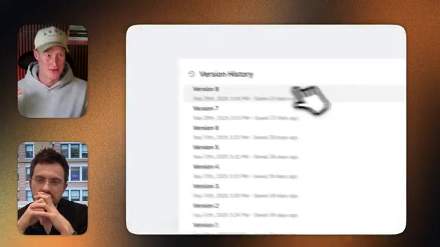
*⏱️ 00:25:05 — Capture d'écran montrant l'interface d'historique des versions ("Version History") avec un curseur de souris, ainsi que les deux participants dans des vignettes sur le côté.*

---

### ⏱️ `[00:25:10 - 00:25:30]` | Segment #67

**🔊 Audio (Transcription Intégrale Mot pour Mot en Français) :**
> Donc j'aimerais bien savoir, parce qu'évidemment ces assistants IA sont en quelque sorte limités par la qualité de la réponse qu'ils fournissent, tu sais, mais s'ils ne comprennent pas comment je réponds réellement, alors à quoi bon le laisser partir et le faire à ma place ? Personne n'aime la bouillie générée par l'IA. Mais je veux connaître votre processus pour cela. Comment Lindy apprend-elle réellement notre façon de parler, notre façon de fonctionner, et notre façon d'exécuter réellement différentes choses ?

**👁️ Analyse Visuelle d'Écran (gemini-3.5-flash-lite) :**
**Interface & Outils** : Navigateur web / Finder / Interface de messagerie ou de gestion de tâches.

**Contenu textuel & Code** : Texte de prompt détaillé pour un assistant IA expliquant comment créer des tickets de bug, notifier des personnes sur Slack et gérer les tâches.

**Action / Démonstration** : Présentation et explication d'un exemple concret de configuration et de consignes données à un assistant IA pour automatiser des tâches.

*⏱️ 00:25:20 — Une vue d'écran partagée montrant un navigateur avec des captures d'écran de messages de chat et une fenêtre pop-up affichant des instructions détaillées pour un assistant IA.*

---

### ⏱️ `[00:25:31 - 00:25:49]` | Segment #68

**🔊 Audio (Transcription Intégrale Mot pour Mot en Français) :**
> Oui. Cela a vraiment été un parcours en interne où nous avons passé beaucoup de temps à développer ce système pour que Lindy s'améliore continuellement et apprenne vos préférences. Et ça devient magique une fois que ça fonctionne vraiment. Il y a cet exemple où Lindy m'a envoyé cet e-mail. Elle se disait, hé, ton avocat vient d'envoyer une contre-offre à ces gars.

**👁️ Analyse Visuelle d'Écran (gemini-3.5-flash-lite) :**
**Interface & Outils** : macOS Finder et application de messagerie / assistant virtuel Lindy

**Contenu textuel & Code** : Texte de consigne détaillé adressé à l'assistant ("okay when I ask you to file a ticket...") et interface de discussion mobile/desktop avec Lindy.

**Action / Démonstration** : Présentation de cas d'usage et d'interactions textuelles avec l'assistant IA Lindy pour illustrer son apprentissage des préférences utilisateur.

*⏱️ 00:25:35 — Capture d'écran montrant une conversation avec un assistant virtuel sur macOS, avec des instructions textuelles détaillées.*

*⏱️ 00:25:44 — Capture d'écran montrant un échange de messages avec l'assistant Lindy pour confirmer une adresse de bureau.*

---

### ⏱️ `[00:25:49 - 00:26:24]` | Segment #69

**🔊 Audio (Transcription Intégrale Mot pour Mot en Français) :**
> Et d'ailleurs, j'ai remarqué dans la contre-offre qu'il a utilisé cette adresse pour ton bureau. C'est la bonne adresse ? Je pensais que c'était l'adresse de ton bureau. Et je fais genre, oh ouais non, t'as raison, genre il s'est trompé d'adresse, genre s'il te plaît, envoie-lui un e-mail, c'est fou, c'est vraiment génial et je mens pas quand je dis que genre tous les jours, y compris genre il y a quelques heures, j'étais en réunion avec un vieux pote et Lindy m'envoie toujours un message quand je rencontre quelqu'un avec genre une préparation pour la réunion et l'ordre du jour, la personne que je rencontre et euh elle m'envoie ce SMS et elle fait genre, oh tu rencontres Shukant aujourd'hui, c'est un vieux pote, vous avez bossé ensemble pendant cinq ans, c'était un peu un pionnier de l'équipe il y a un moment et je fais genre, putain, comment

**👁️ Analyse Visuelle d'Écran (gemini-3.5-flash-lite) :**
**Interface & Outils** : Application de messagerie/assistant Lindy, explorateur de fichiers macOS en arrière-plan et flux vidéo des participants.

**Contenu textuel & Code** : Messages texte surlignés en jaune mentionnant '1841 Market St' et '101 New Montgomery', illustrant une discussion sur une erreur d'adresse dans un document de contre-offre.

**Action / Démonstration** : Le présentateur présente une capture d'écran d'un échange avec un assistant IA pour illustrer la vérification automatisée de documents et de détails contractuels.

*⏱️ 00:25:58 — Capture d'écran montrant l'interface d'un assistant virtuel (Lindy) affichant des messages texte concernant la vérification d'une adresse sur une contre-offre.*

---

### ⏱️ `[00:26:24 - 00:26:57]` | Segment #70

**🔊 Audio (Transcription Intégrale Mot pour Mot en Français) :**
> tu sais quoi ? Comment c'est arrivé ? Et donc ce qui s'est passé, c'est que nous avons construit ce système. C'est comme un système de mémoire à apprentissage continu. Nous avons itéré dessus pendant longtemps. Nous l'avons vraiment fait briller comme un beau joyau. Et nous nous sommes dit, oh mon Dieu, ça marche. C'est génial. Petit à petit, il en apprend sur moi et il me surprend par tout ce qu'il sait sur moi. Le seul inconvénient, c'est qu'on ne récolte vraiment ces bénéfices qu'après avoir parlé un moment de soi, n'est-ce pas ? C'est une relation qu'on construit sur le long terme. Et donc je me souviens distinctement, nous étions au bureau tard le soir quand nous discutions de ça, en train de dîner avec l'équipe, et nous nous sommes dit, ne serait-ce pas chouette si l'on pouvait simplement tout savoir sur toi dès le départ.

**👁️ Analyse Visuelle d'Écran (gemini-3.5-flash-lite) :**
**Interface & Outils** : Interface de chat Lindy, application de messagerie mobile et interface de gestion de tâches.

**Contenu textuel & Code** : Conversations textuelles, messages de notification et transcriptions d'appels vocaux de l'assistant IA Lindy.

**Action / Démonstration** : Démonstration de l'utilisation d'un système d'assistant conversationnel intelligent et de sa mémoire contextuelle.

*⏱️ 00:26:33 — L'image montre une interface de chat mobile affichée sur un écran d'ordinateur, illustrant des interactions textuelles avec l'assistant Lindy.*

*⏱️ 00:26:41 — L'image montre l'intervenant en train d'utiliser un assistant vocal sur smartphone, avec une interface textuelle associée affichée à l'écran.*

---

### ⏱️ `[00:26:58 - 00:27:18]` | Segment #71

**🔊 Audio (Transcription Intégrale Mot pour Mot en Français) :**
> Comment pourrions-nous obtenir toutes ces données vous concernant, toutes ces préférences ? Et donc ce que nous avons fini par faire, c'est que nous avons construit, nous l'avons appelé le système hydrator. Il hydrate donc votre base de connaissances et votre base de mémoire. Et donc ce que nous faisons, c'est que lorsque vous vous inscrivez, nous demandons l'accès à votre boîte de réception. Nous sommes, encore une fois, conformes à la norme SOC 2, conformes à la norme HIPAA, super sécurisés.

**👁️ Analyse Visuelle d'Écran (gemini-3.5-flash-lite) :**
**Interface & Outils** : macOS Finder, application de messagerie ou assistant virtuel (Lindy), interface de visioconférence (type Zoom ou Google Meet).

**Contenu textuel & Code** : Messages texte d'une conversation confirmant des adresses (ex: 1841 Market St vs 101 New Montgomery) et des mises à jour sur une contre-offre immobilière ou commerciale.

**Action / Démonstration** : Le présentateur explique et illustre visuellement la collecte de données, de préférences et d'informations contextuelles à l'aide d'un assistant conversationnel et de captures d'écran.

*⏱️ 00:27:03 — Capture d'écran montrant une interface de discussion de type messagerie instantanée (Lindy) superposée à un gestionnaire de fichiers macOS, avec deux participants visibles en incrustation vidéo à gauche.*

---

### ⏱️ `[00:27:18 - 00:27:39]` | Segment #72

**🔊 Audio (Transcription Intégrale Mot pour Mot en Français) :**
> Et si vous nous donnez accès à votre boîte de réception avec votre permission, nous examinons votre historique d'e-mails. Nous examinons des milliers et des milliers d'e-mails et nous les traitons à l'aide de grands modèles de langage. Encore une fois, rien n'est jamais utilisé pour l'entraînement. Nous avons des accords en place avec les laboratoires et ainsi de suite. Mais nous traitons tout cela et nous l'utilisons pour apprendre à vous connaître. Et ensuite, c'est vrai, vous pouvez aller dans vos paramètres et vous pouvez voir tout ce que nous avons appris.

**👁️ Analyse Visuelle d'Écran (gemini-3.5-flash-lite) :**
**Interface & Outils** : Interface de chat mobile (Lindy) et système de gestion de fichiers sur macOS.

**Contenu textuel & Code** : Échanges textuels entre l'assistant IA et l'utilisateur concernant la vérification d'adresses postales et de contre-offres.

**Action / Démonstration** : Démonstration de l'utilisation d'un agent IA pour vérifier des informations et répondre automatiquement à des e-mails ou des messages.

*⏱️ 00:27:29 — Une capture d'écran d'ordinateur montrant une interface de chat mobile (Lindy) superposée à un dossier de captures, illustrant une interaction avec un assistant virtuel.*

---

### ⏱️ `[00:27:39 - 00:27:58]` | Segment #73

**🔊 Audio (Transcription Intégrale Mot pour Mot en Français) :**
> Et très souvent, les gens trouvent en fait que c'est un réel plaisir d'apprendre, d'aimer lire ce rapport. Et nous l'utilisons ensuite pour faire beaucoup de choses, y compris la rédaction de réponses pour vous, parce que nous avons appris à qui vous répondez et comment vous écrivez. Et je ne mens pas en disant qu'à ce stade, c'est quotidien. Vous savez, je regarde ma boîte de réception et je regarde un brouillon qui s'y trouve, en réponse à un e-mail que j'ai reçu.

**👁️ Analyse Visuelle d'Écran (gemini-3.5-flash-lite) :**
**Interface & Outils** : Application de messagerie / Assistant virtuel Lindy sur macOS

**Contenu textuel & Code** : Interface de chat montrant des bulles de discussion avec des mises à jour textuelles, des vérifications d'adresses et des confirmations automatiques ("Got it - replying to Brandon now... Done!").

**Action / Démonstration** : Démonstration de l'automatisation des réponses textuelles et de la gestion de messages par l'assistant IA.

*⏱️ 00:27:44 — Capture d'écran montrant l'interface d'un assistant conversationnel (Lindy) simulant des échanges de messages pour gérer des réponses et confirmer des adresses.*

---

### ⏱️ `[00:27:58 - 00:28:19]` | Segment #74

**🔊 Audio (Transcription Intégrale Mot pour Mot en Français) :**
> Et au début, je pensais que je devenais fou. Au début, je me suis dit, est-ce que c'est moi qui ai écrit ce brouillon ? Je n'aucun souvenir de l'avoir écrit. Et c'est juste que, c'est Lindy qui l'a écrit. Donc oui, nous avons prêté beaucoup d'attention à ça. Genre, pas seulement le fait que ce soit proactif, mais le fait que ce soit personnalisé et que ça continue d'apprendre à ton sujet et de s'améliorer. Oui, c'est énorme. Et comme tu l'as dit, le fait que tu n'aies pas, tu sais, bien sûr, ça peut apprendre plus et plus tu chattes avec.

**👁️ Analyse Visuelle d'Écran (gemini-3.5-flash-lite) :**
**Interface & Outils** : Application de messagerie mobile et système de visioconférence (type Riverside ou Zoom).

**Contenu textuel & Code** : Interface de discussion textuelle montrant des interactions automatisées avec un assistant IA ("Lindy") gérant des notifications et des adresses.

**Action / Démonstration** : Présentation et discussion autour d'un échange automatisé par IA illustrant une discussion textuelle entre l'utilisateur et Lindy.

*⏱️ 00:28:04 — Capture d'écran montrant un partage d'écran d'une conversation textuelle avec un assistant virtuel nommé Lindy, entouré de vignettes de visioconférence.*

*⏱️ 00:28:14 — Vue similaire au premier écran, affichant le partage d'écran de l'interface de messagerie de Lindy avec les participants à la visioconférence.*

---

### ⏱️ `[00:28:19 - 00:28:40]` | Segment #75

**🔊 Audio (Transcription Intégrale Mot pour Mot en Français) :**
> Mais le fait qu'il ait déjà cette information juste parce qu'il est capable de l'extraire. Genre pour moi, je n'aurais probablement pas permis qu'il rédige des réponses à mes e-mails s'il n'avait pas déjà cette connaissance préexistante. Mais maintenant, il est tellement bon. Je me dis, ok, c'est assez bien pour être réellement utilisé. Donc ça a été quelque chose d'incroyable pour moi quand je l'ai utilisé. Est-ce qu'il y a autre chose dont tu aimerais qu'on discute ou une façon dont on pourrait en quelque sorte conclure ?

**👁️ Analyse Visuelle d'Écran (gemini-3.5-flash-lite) :**
**Interface & Outils** : Interface macOS avec un gestionnaire de fichiers en arrière-plan et une fenêtre de discussion mobile (Lindy) au premier plan, accompagnée d'une vue de visioconférence.

**Contenu textuel & Code** : Captures d'écran de messages textuels et de notifications de l'assistant IA Lindy concernant des adresses ("1841 Market St" vs "101 New Montgomery") et des confirmations de réponses automatisées.

**Action / Démonstration** : Illustration visuelle des capacités d'un agent IA (Lindy) capable d'extraire des informations, de poser des questions de vérification et de rédiger/envoyer des messages ou e-mails de confirmation.

*⏱️ 00:28:29 — Partage d'écran montrant une interface de messagerie/discussion avec l'assistant IA Lindy, affichant des échanges textuels sur des adresses et des contre-offres, avec deux intervenants en visioconférence sur le côté gauche.*

---

### ⏱️ `[00:28:40 - 00:28:58]` | Segment #76

**🔊 Audio (Transcription Intégrale Mot pour Mot en Français) :**
> C'est disponible dès aujourd'hui. Oui, tout à fait. Et non, nous recrutons. Si quelqu'un écoute et qu'il est ingénieur et passionné par ce genre de choses, nous développons notre équipe rapidement. Parfait. Et ensuite, en ce qui concerne les prix, à quoi ressemble la tarification en ce moment ? Oui, ça coûte 49 dollars par mois.

**👁️ Analyse Visuelle d'Écran (gemini-3.5-flash-lite) :**
**Interface & Outils** : Visioconférence (aucun graphique, terminal ou code affiché).

**Contenu textuel & Code** : Aucun contenu technique, indicateur, code ou données chiffrées visibles.

**Action / Démonstration** : Conversation en visioconférence sans manipulation visuelle ou technique.

---

### ⏱️ `[00:28:58 - 00:29:34]` | Segment #77

**🔊 Audio (Transcription Intégrale Mot pour Mot en Français) :**
> Compris. Non, j'allais dire, jusqu'où ça vous mène ? Parce que je l'ai utilisé, ça m'a mené très loin. Je n'ai atteint aucune limite. Donc je suppose que pour la majorité des gens, c'est probablement suffisant, à moins que vous n'ayez une utilisation vraiment excessive de ceci. C'est exactement ça, c'est suffisant pour 98 % des gens, il y a environ deux pour cent des gens qui rencontrent des limites et on leur dit simplement de nous contacter et et généralement ce qu'on fait c'est que ça devient du genre cent dollars par mois parfois deux cents dollars par mois pour les utilisateurs vraiment très intensifs certaines personnes nous utilisent pour coder ce qu'on n'avait jamais vraiment prévu mais c'est du genre hey on ne peut pas vraiment vous donner des jetons à l'infini pour cinquante dollars par mois et donc ouais c'est suffisant pour 98 % des gens. Compris, ouais, à 100 %.

**👁️ Analyse Visuelle d'Écran (gemini-3.5-flash-lite) :**
**Interface & Outils** : Visioconférence (aucun graphique, terminal ou interface de trading visible).

**Contenu textuel & Code** : Aucun contenu technique, code ou indicateur affiché à l'écran.

**Action / Démonstration** : Conversation en visioconférence sans démonstration technique ni manipulation de logiciel.

---

### ⏱️ `[00:29:34 - 00:29:50]` | Segment #78

**🔊 Audio (Transcription Intégrale Mot pour Mot en Français) :**
> Eh bien, Flow, merci beaucoup d'être venu, mec. C'est, encore une fois, comme je l'ai dit, la boucle est bouclée, j'utilise votre produit depuis des années maintenant. Je suis super ravi de discuter de ça, et j'ai hâte de voir ce que vous allez continuer à construire, et j'espère pouvoir vous réinviter quand vous sortirez un autre produit révolutionnaire. Ce serait un plaisir, ouais. Merci beaucoup de m'avoir reçu, Brock. Santé.

**👁️ Analyse Visuelle d'Écran (gemini-3.5-flash-lite) :**
**Interface & Outils** : Visioconférence (aucun outil de trading, graphique ou code affiché).

**Contenu textuel & Code** : Aucun indicateur technique, code source ou données chiffrées.

**Action / Démonstration** : Conversation de fin d'entretien entre le présentateur et son invité.

---

