# 🎬 How I Run a $70K/Month Business With No Team (Claude Code)

> **Chaîne** : [Brock Mesarich | AI for Non Techies](https://www.youtube.com/@BrockMesarich)  
> **Lien YouTube** : [https://www.youtube.com/watch?v=2KS3PjAbPek](https://www.youtube.com/watch?v=2KS3PjAbPek)  
> **Date de publication** : 20260224  
> **Durée** : 00:22:37  
> **Identifiant vidéo** : `2KS3PjAbPek`  
> **Transcription & Analyse** : `whisper-v3-large-turbo+gemini-3.5-flash-lite`  

---

## 📌 Synthèse Exécutive & Outils

### 💡 Résumé
Dans cette vidéo intitulée **How I Run a $70K/Month Business With No Team (Claude Code)**, Alex Carter détaille une approche stratégique et pratique du trading et de l'automatisation par agents IA.

### 🛠️ Outils, Modèles & Logiciels Présentés
- **TradingView & Claude Code** : Analyse technique avancée et automatisation algorithmique.

### 🔑 Points Clés & Enseignements Stratégiques
- Respect rigoureux du ratio risque/rendement et du money management.
- Automatisation méthodique des déclencheurs d'ordres via des agents intelligents.

---

## ⏱️ Chronologie & Transcription Complète Audio & Visuelle (Mot pour Mot)

### ⏱️ `[00:00:00 - 00:00:34]` | Segment #01

**🔊 Audio (Transcription Intégrale Mot pour Mot en Français) :**
> I'm going to show you the exact content system I'm using right now to generate $70,000 per month, and I'm doing this with no team, just using Claude Code. I built a system that finds what to post every single morning based on what's trending in my niche. It literally writes the content for me, then critiques itself. It builds everything I need to film, and it posts to every single platform hands-free on autopilot. And all of this runs under one tool with 30 plus commands, six different services in one command line interface. The tool is called CloudCode,

**👁️ Analyse Visuelle d'Écran (gemini-3.5-flash-lite) :**
**Interface & Outils** : Présentation ou face-caméra explicatif du trader sans interface logicielle partagée.

**Contenu textuel & Code** : Explications orales des stratégies et mise en contexte méthodologique du marché.

**Action / Démonstration** : Explications face caméra et analyse conceptuelle des marchés.

---

### ⏱️ `[00:00:34 - 00:00:57]` | Segment #02

**🔊 Audio (Transcription Intégrale Mot pour Mot en Français) :**
> and I have been using this the last two months, and it's genuinely changed my life with everything it's able to do for me. Not only am I harnessing the power of CloudCode, but I'm actually using different applications and APIs and MCP servers directly under that. For example, I'm using Appify and Blotato. Appify does the research and the scraping for me. Blotato auto-publishes and creates the posts for me. And in this video, I'm going to show you the exact setup I'm using.

**👁️ Analyse Visuelle d'Écran (gemini-3.5-flash-lite) :**
**Interface & Outils** : Présentation ou face-caméra explicatif du trader sans interface logicielle partagée.

**Contenu textuel & Code** : Explications orales des stratégies et mise en contexte méthodologique du marché.

**Action / Démonstration** : Explications face caméra et analyse conceptuelle des marchés.

---

### ⏱️ `[00:00:57 - 00:01:18]` | Segment #03

**🔊 Audio (Transcription Intégrale Mot pour Mot en Français) :**
> And by the end, you're going to see why agentic workflows are the future of how we work. Otherwise, you will get left behind. So without further ado, I'm going to show you this system now. All right, guys. So I have this huge diagram here that I actually generated using Cloud Code, of course. And let me break this down. This is essentially my system I'm using right now to make $70,000 per month through my content business.

**👁️ Analyse Visuelle d'Écran (gemini-3.5-flash-lite) :**
**Interface & Outils** : Présentation ou face-caméra explicatif du trader sans interface logicielle partagée.

**Contenu textuel & Code** : Explications orales des stratégies et mise en contexte méthodologique du marché.

**Action / Démonstration** : Explications face caméra et analyse conceptuelle des marchés.

---

### ⏱️ `[00:01:18 - 00:01:39]` | Segment #04

**🔊 Audio (Transcription Intégrale Mot pour Mot en Français) :**
> And I'm going to show you each of these right now. So first of all, we have our discovery engines. This is what finds what's trending for us. So you can see right here, it finds what's trending before anyone else. We have these different slash commands. So essentially inside of Claude Code, I just type in morning. And what it will do is it will give me a daily AI briefing with the top three script opportunities.

**👁️ Analyse Visuelle d'Écran (gemini-3.5-flash-lite) :**
**Interface & Outils** : Présentation ou face-caméra explicatif du trader sans interface logicielle partagée.

**Contenu textuel & Code** : Explications orales des stratégies et mise en contexte méthodologique du marché.

**Action / Démonstration** : Explications face caméra et analyse conceptuelle des marchés.

---

### ⏱️ `[00:01:39 - 00:02:01]` | Segment #05

**🔊 Audio (Transcription Intégrale Mot pour Mot en Français) :**
> And this runs every single morning automatically when I hit this morning command. From there, I have a trending command that actually searches eight plus AI categories, scores and ranks different topics, and then creates a viral potential score based on all of those. Then, you know, for YouTube, I have the same thing. We scrape all of my competitors on YouTube, finds the different keywords and basically analyzes things that I should make content about that day.

**👁️ Analyse Visuelle d'Écran (gemini-3.5-flash-lite) :**
**Interface & Outils** : Présentation ou face-caméra explicatif du trader sans interface logicielle partagée.

**Contenu textuel & Code** : Explications orales des stratégies et mise en contexte méthodologique du marché.

**Action / Démonstration** : Explications face caméra et analyse conceptuelle des marchés.

---

### ⏱️ `[00:02:01 - 00:02:20]` | Segment #06

**🔊 Audio (Transcription Intégrale Mot pour Mot en Français) :**
> Along with this, we also have all of these data sources here. So inside of Cloud Code, we are able to search real-time AI news. We use Appify Scrapers, which I'm going to show you how I'm using in this video. We have Tweet Scrapers, YouTube Scrapers, Content Q JSON, all this stuff. And then you could see right here, this actually creates winning patterns for my short form content.

**👁️ Analyse Visuelle d'Écran (gemini-3.5-flash-lite) :**
**Interface & Outils** : Présentation ou face-caméra explicatif du trader sans interface logicielle partagée.

**Contenu textuel & Code** : Explications orales des stratégies et mise en contexte méthodologique du marché.

**Action / Démonstration** : Explications face caméra et analyse conceptuelle des marchés.

---

### ⏱️ `[00:02:20 - 00:02:40]` | Segment #07

**🔊 Audio (Transcription Intégrale Mot pour Mot en Français) :**
> For example, you could see this as an example. Google plus free equals massive engagement based on my previous posts on Instagram. And then also here's another one without needing expensive thing also resonates. Here's another one. New release plus visual. Wow. Equals high shares. Anyways, guys, we don't need to dive into all of this to understand like my content system.

**👁️ Analyse Visuelle d'Écran (gemini-3.5-flash-lite) :**
**Interface & Outils** : Présentation ou face-caméra explicatif du trader sans interface logicielle partagée.

**Contenu textuel & Code** : Explications orales des stratégies et mise en contexte méthodologique du marché.

**Action / Démonstration** : Explications face caméra et analyse conceptuelle des marchés.

---

### ⏱️ `[00:02:40 - 00:03:16]` | Segment #08

**🔊 Audio (Transcription Intégrale Mot pour Mot en Français) :**
> But what we do need to understand is how Claude Code can do all of this for us without us needing to necessarily know what's going on in the back end. Moving on real quickly. I'm just going to talk about the script factory because this is really, really important. I'm going to show you my Instagram here. I grew from zero to about 16,000 followers here. We had this video go viral. This is actually that script that it said is, Hey, you know, that is a winning hook style. Let's go ahead and use more of that. Basically our script factor. We have multiple things inside of here. So if I use the command script and then give a topic, it's going to go ahead and automatically trigger a very specific prompt that it's going to generate in order for

**👁️ Analyse Visuelle d'Écran (gemini-3.5-flash-lite) :**
**Interface & Outils** : Présentation ou face-caméra explicatif du trader sans interface logicielle partagée.

**Contenu textuel & Code** : Explications orales des stratégies et mise en contexte méthodologique du marché.

**Action / Démonstration** : Explications face caméra et analyse conceptuelle des marchés.

---

### ⏱️ `[00:03:16 - 00:03:34]` | Segment #09

**🔊 Audio (Transcription Intégrale Mot pour Mot en Français) :**
> it to create a script in my exact tone. Then same thing for hooks. It's going to actually AB test five different hooks for me to try out. And this is a big part about this. We have a self critique engine for it gives me every single script for me to actually approve. It's going to go through and automatically check and say, Hey, is this good? Is this bad? If it's bad, it's going to redo it.

**👁️ Analyse Visuelle d'Écran (gemini-3.5-flash-lite) :**
**Interface & Outils** : Présentation ou face-caméra explicatif du trader sans interface logicielle partagée.

**Contenu textuel & Code** : Explications orales des stratégies et mise en contexte méthodologique du marché.

**Action / Démonstration** : Explications face caméra et analyse conceptuelle des marchés.

---

### ⏱️ `[00:03:34 - 00:04:07]` | Segment #10

**🔊 Audio (Transcription Intégrale Mot pour Mot en Français) :**
> All that stuff on autopilot. Then quickly, I'm going to talk about the full output. So I get video scripts with YouTube tags, B roll links, captions, YouTube descriptions, Google doc resources. So essentially for my Instagram here, I say like comment this and I'll send you a resource. that resource is actually created automatically with this cloud code system. And we have all these other things. Again, I don't need to dive into the nitty gritty of all of this. And then we also have video production here, which is, you know, super helpful for me for YouTube, then performance and analytics. Again, it's able to analyze my entire short form content after

**👁️ Analyse Visuelle d'Écran (gemini-3.5-flash-lite) :**
**Interface & Outils** : Présentation ou face-caméra explicatif du trader sans interface logicielle partagée.

**Contenu textuel & Code** : Explications orales des stratégies et mise en contexte méthodologique du marché.

**Action / Démonstration** : Explications face caméra et analyse conceptuelle des marchés.

---

### ⏱️ `[00:04:07 - 00:04:43]` | Segment #11

**🔊 Audio (Transcription Intégrale Mot pour Mot en Français) :**
> it's posted and it actually checks what's working, what's not. And it saves all this information to my local data inside of my cloud code system. Then we can publish and distribute this. So essentially you can see here that we use blotato for auto posting. It's going to automatically post my reels, my TikToks, my YouTube shorts, Twitter posts, LinkedIn posts, all of this stuff directly inside of Claude Code. All right. So moving on to Claude Code and how I actually use this system. This is Claude Code inside of cursor. This is where I personally actually want to use this. And on the left-hand side of my screen here, you can see I have my Claude Code short systems command. This is my command center. All of these different commands

**👁️ Analyse Visuelle d'Écran (gemini-3.5-flash-lite) :**
**Interface & Outils** : Présentation ou face-caméra explicatif du trader sans interface logicielle partagée.

**Contenu textuel & Code** : Explications orales des stratégies et mise en contexte méthodologique du marché.

**Action / Démonstration** : Explications face caméra et analyse conceptuelle des marchés.

---

### ⏱️ `[00:04:43 - 00:05:19]` | Segment #12

**🔊 Audio (Transcription Intégrale Mot pour Mot en Français) :**
> here have specific tasks. And this right here saves me so much time. For example, if I want to scrape my previous Instagram reel, what I do is I simply just type in real, and this is going to check my latest performance and give feedback. So what I'm going to do is I'm going to send this off. It's going to go through and look at my system overview. And what it's going to do is it's going to look at this real skill here, which I could actually pull this up. And this is a set of instructions that gets invoked every single time I say command real. So this way, I don't need to paste in this very specific prompt every single time. So check your latest Reels performance and get feedback. So it shows the purpose. It shows the workflow. Use the Appify Instagram

**👁️ Analyse Visuelle d'Écran (gemini-3.5-flash-lite) :**
**Interface & Outils** : Présentation ou face-caméra explicatif du trader sans interface logicielle partagée.

**Contenu textuel & Code** : Explications orales des stratégies et mise en contexte méthodologique du marché.

**Action / Démonstration** : Explications face caméra et analyse conceptuelle des marchés.

---

### ⏱️ `[00:05:19 - 00:05:53]` | Segment #13

**🔊 Audio (Transcription Intégrale Mot pour Mot en Français) :**
> scraper to get the most recent post. And it goes ahead. It actually has this specific actor, which essentially just goes and scrapes Instagram. That is what that actor means. It pulls the captions, the likes, the comments, et cetera, and compares it to historical data. So it's actually referencing the top performing content JSON file, which is basically a database, a collection of all of the previous performing videos that I've scraped and then breaks down the book effectiveness, the script structure, the call to action topic fit. And then from here, it's going to compare it to my average views and break down what exactly worked and what could be improved here. And so that right

**👁️ Analyse Visuelle d'Écran (gemini-3.5-flash-lite) :**
**Interface & Outils** : Présentation ou face-caméra explicatif du trader sans interface logicielle partagée.

**Contenu textuel & Code** : Explications orales des stratégies et mise en contexte méthodologique du marché.

**Action / Démonstration** : Explications face caméra et analyse conceptuelle des marchés.

---

### ⏱️ `[00:05:53 - 00:06:19]` | Segment #14

**🔊 Audio (Transcription Intégrale Mot pour Mot en Français) :**
> there is the prompt. So what I'm trying to say here is for me to run that workflow, all I have to do is come here and say real, and it automatically knows to go scrape my last Instagram video and do all of those things for it. And just like that, about one minute, two minutes later, we have this output here. So latest real check post Google just snuck seven free AF features into your apps and nobody is talking about them. This was posted today about six hours ago. It looks like, you know, it has a decent amount of views. The engagement rate is okay. This is the most important part.

**👁️ Analyse Visuelle d'Écran (gemini-3.5-flash-lite) :**
**Interface & Outils** : Présentation ou face-caméra explicatif du trader sans interface logicielle partagée.

**Contenu textuel & Code** : Explications orales des stratégies et mise en contexte méthodologique du marché.

**Action / Démonstration** : Explications face caméra et analyse conceptuelle des marchés.

---

### ⏱️ `[00:06:19 - 00:06:39]` | Segment #15

**🔊 Audio (Transcription Intégrale Mot pour Mot en Français) :**
> It's breaking down what worked and what could be improved because if you create short form content or any content for that matter, it's really important for you to understand like what styles work for you. So I'm really trying to dial this in before this took me so much time having to go through and make notes of every single video. And you can see it even gives me my recommendation for next steps here.

**👁️ Analyse Visuelle d'Écran (gemini-3.5-flash-lite) :**
**Interface & Outils** : Présentation ou face-caméra explicatif du trader sans interface logicielle partagée.

**Contenu textuel & Code** : Explications orales des stratégies et mise en contexte méthodologique du marché.

**Action / Démonstration** : Explications face caméra et analyse conceptuelle des marchés.

---

### ⏱️ `[00:06:39 - 00:06:58]` | Segment #16

**🔊 Audio (Transcription Intégrale Mot pour Mot en Français) :**
> Let's say that we don't wanna have to look at this inside of cursor. What I'm gonna do is I'm gonna come to Cloud Code and just say, hey, this is amazing. Could you go ahead and turn this into an HTML dashboard in a Swiss Apple style design for me to basically see all this information in one place so I can understand everything about this Instagram reel and how I could make it better.

**👁️ Analyse Visuelle d'Écran (gemini-3.5-flash-lite) :**
**Interface & Outils** : Présentation ou face-caméra explicatif du trader sans interface logicielle partagée.

**Contenu textuel & Code** : Explications orales des stratégies et mise en contexte méthodologique du marché.

**Action / Démonstration** : Explications face caméra et analyse conceptuelle des marchés.

---

### ⏱️ `[00:06:58 - 00:07:17]` | Segment #17

**🔊 Audio (Transcription Intégrale Mot pour Mot en Français) :**
> So I'm gonna send that prompt off. And what it's gonna do is it's gonna spin up a little vibe coded interface that it's actually going to open up in my browser over here. And so I'm going to let it do its thing and we'll come back to that. All right. So take a look at this. I didn't even have to open this up in my browser. Claude code just automatically opened up this HTML file that I could actually take a look at and interact with. Real check posted six hours ago.

**👁️ Analyse Visuelle d'Écran (gemini-3.5-flash-lite) :**
**Interface & Outils** : Présentation ou face-caméra explicatif du trader sans interface logicielle partagée.

**Contenu textuel & Code** : Explications orales des stratégies et mise en contexte méthodologique du marché.

**Action / Démonstration** : Explications face caméra et analyse conceptuelle des marchés.

---

### ⏱️ `[00:07:17 - 00:07:37]` | Segment #18

**🔊 Audio (Transcription Intégrale Mot pour Mot en Français) :**
> It breaks down the hook and the caption breaks on the views, the engagement rate shows the comment rate, the comment to like ratio, all of this stuff. This is crazy. It even shows comparisons to my previous videos. So the viral video that I have, the other seven Google AI tools video, it had 10,000 views at this point in time. And this one has 1,565.

**👁️ Analyse Visuelle d'Écran (gemini-3.5-flash-lite) :**
**Interface & Outils** : Présentation ou face-caméra explicatif du trader sans interface logicielle partagée.

**Contenu textuel & Code** : Explications orales des stratégies et mise en contexte méthodologique du marché.

**Action / Démonstration** : Explications face caméra et analyse conceptuelle des marchés.

---

### ⏱️ `[00:07:37 - 00:08:00]` | Segment #19

**🔊 Audio (Transcription Intégrale Mot pour Mot en Français) :**
> So it might not hit that same virality as that last one. And it has a performance benchmarks hook analysis. This is probably the most important part here, the analysis. So it's breaking down what worked, what could be improved. It's saying that there is a content overlap risk because I've covered some of the same tools in my previous videos. Features feel less new. Interesting. Like this is a really broken down and thoughtful breakdown of this previous video that I posted.

**👁️ Analyse Visuelle d'Écran (gemini-3.5-flash-lite) :**
**Interface & Outils** : Présentation ou face-caméra explicatif du trader sans interface logicielle partagée.

**Contenu textuel & Code** : Explications orales des stratégies et mise en contexte méthodologique du marché.

**Action / Démonstration** : Explications face caméra et analyse conceptuelle des marchés.

---

### ⏱️ `[00:08:00 - 00:08:33]` | Segment #20

**🔊 Audio (Transcription Intégrale Mot pour Mot en Français) :**
> And again, this was done inside of Claude Code and simply, you know, just using that one command and then saying, hey, turn this into a dashboard. Let me show you one more thing here that could be pretty helpful for you guys to see. So I have this command that is one of my favorites to use probably. What it is, is just resource script. So let me just like paste this in here, resource script. And so what this does is this builds a short form script built around a resource, not a tool. So what I mean by this, it's going to find something that is just a really compelling and interesting topic. And then what I could do is I could then use that as a resource for the

**👁️ Analyse Visuelle d'Écran (gemini-3.5-flash-lite) :**
**Interface & Outils** : Présentation ou face-caméra explicatif du trader sans interface logicielle partagée.

**Contenu textuel & Code** : Explications orales des stratégies et mise en contexte méthodologique du marché.

**Action / Démonstration** : Explications face caméra et analyse conceptuelle des marchés.

---

### ⏱️ `[00:08:33 - 00:08:51]` | Segment #21

**🔊 Audio (Transcription Intégrale Mot pour Mot en Français) :**
> video. So and say, Hey, I just found this free system prompt from this company. Do you want it? If so comment X and I'll send it to you. And so that automatically gets scraped. And instead of me having to like come up with the idea for the video, it automatically builds the like framing in the script and the idea for that video based on this resource.

**👁️ Analyse Visuelle d'Écran (gemini-3.5-flash-lite) :**
**Interface & Outils** : Présentation ou face-caméra explicatif du trader sans interface logicielle partagée.

**Contenu textuel & Code** : Explications orales des stratégies et mise en contexte méthodologique du marché.

**Action / Démonstration** : Explications face caméra et analyse conceptuelle des marchés.

---

### ⏱️ `[00:08:51 - 00:09:10]` | Segment #22

**🔊 Audio (Transcription Intégrale Mot pour Mot en Français) :**
> It's just been the best tool for me to make some of the best content possible. All right, so I'm going to show you real quickly the resource that I found to show you exactly what I mean. I'm going to show you one more use case and then I will show you how you can build something similar like this out. So this is the resource that I found. A curated list of 25 free AI tools that directly replace paid software subscription.

**👁️ Analyse Visuelle d'Écran (gemini-3.5-flash-lite) :**
**Interface & Outils** : Présentation ou face-caméra explicatif du trader sans interface logicielle partagée.

**Contenu textuel & Code** : Explications orales des stratégies et mise en contexte méthodologique du marché.

**Action / Démonstration** : Explications face caméra et analyse conceptuelle des marchés.

---

### ⏱️ `[00:09:10 - 00:09:30]` | Segment #23

**🔊 Audio (Transcription Intégrale Mot pour Mot en Français) :**
> It even generated the script. I tested every free AI tool out there. 25 of them replace over $600 a month in paid software. And that's great. The script is great, but where is the resource? And the resource is right here. It created this markdown file and I could go through, it shows the design and images tools, Adobe Photoshop, Chachapiti image editing, which is free.

**👁️ Analyse Visuelle d'Écran (gemini-3.5-flash-lite) :**
**Interface & Outils** : Présentation ou face-caméra explicatif du trader sans interface logicielle partagée.

**Contenu textuel & Code** : Explications orales des stratégies et mise en contexte méthodologique du marché.

**Action / Démonstration** : Explications face caméra et analyse conceptuelle des marchés.

---

### ⏱️ `[00:09:31 - 00:09:53]` | Segment #24

**🔊 Audio (Transcription Intégrale Mot pour Mot en Français) :**
> So it has all these different paid versions versus these alternative versions here, which is pretty cool. So what I could do is I could just like tell Claude Code to, hey, turn that into a Google document. And what it would do is it'd go create a Google document, share that link with me. And then I could add that to my Instagram real automation that automatically like sends that to every single one of the people that comments for that resource.

**👁️ Analyse Visuelle d'Écran (gemini-3.5-flash-lite) :**
**Interface & Outils** : Présentation ou face-caméra explicatif du trader sans interface logicielle partagée.

**Contenu textuel & Code** : Explications orales des stratégies et mise en contexte méthodologique du marché.

**Action / Démonstration** : Explications face caméra et analyse conceptuelle des marchés.

---

### ⏱️ `[00:09:53 - 00:10:11]` | Segment #25

**🔊 Audio (Transcription Intégrale Mot pour Mot en Français) :**
> All right. So let's talk about what happens when I post a YouTube video. So I built this system inside of cloud code that will automatically take that YouTube video and potato turns that into five different pieces of content on autopilot. It reads the transcript of the video and it rewrites that content for every single platform on autopilot. I don't have to touch it.

**👁️ Analyse Visuelle d'Écran (gemini-3.5-flash-lite) :**
**Interface & Outils** : Présentation ou face-caméra explicatif du trader sans interface logicielle partagée.

**Contenu textuel & Code** : Explications orales des stratégies et mise en contexte méthodologique du marché.

**Action / Démonstration** : Explications face caméra et analyse conceptuelle des marchés.

---

### ⏱️ `[00:10:12 - 00:10:30]` | Segment #26

**🔊 Audio (Transcription Intégrale Mot pour Mot en Français) :**
> Le code cloud gère tout cela pour moi. Donc, on passe d'une seule vidéo YouTube à cinq publications sur différentes plateformes. Il s'agit d'une publication LinkedIn, d'un reel Instagram, d'un TikTok, d'une publication X ou Twitter et aussi sur Threads. Et une chose à mentionner, c'est que cela n'utilise pas la même légende copiée-collée. Ça ne prend pas simplement la transcription YouTube pour la publier sur LinkedIn.

**👁️ Analyse Visuelle d'Écran (gemini-3.5-flash-lite) :**
**Interface & Outils** : Navigateur web (schéma HTML/présentation plein écran sur l'image 2, fil d'actualité LinkedIn sur l'image 3).

**Contenu textuel & Code** : - Schéma de republication : « one video -> 5 platform posts » avec icônes YouTube, agent IA, et canaux de sortie (LinkedIn post, Instagram Reel, TikTok, X / Twitter, Threads).
- Texte du post LinkedIn : « We just hit a turning point in AI app development... », mentionnant des prompts pour créer des applications iOS natives (clone Minecraft, app AR, crypto tracker).

**Action / Démonstration** : Présentation de l'architecture du workflow de republication multiplateforme puis affichage du résultat final généré sur LinkedIn.

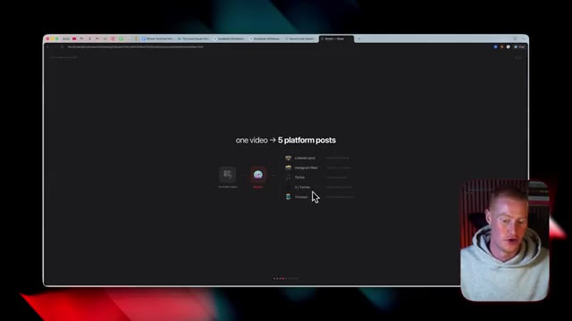
*⏱️ 00:10:21 — Diapositive schématisant le flux d'automatisation « one video -> 5 platform posts » reliant une vidéo YouTube à 5 réseaux sociaux (LinkedIn, Instagram Reel, TikTok, X / Twitter, Threads).*

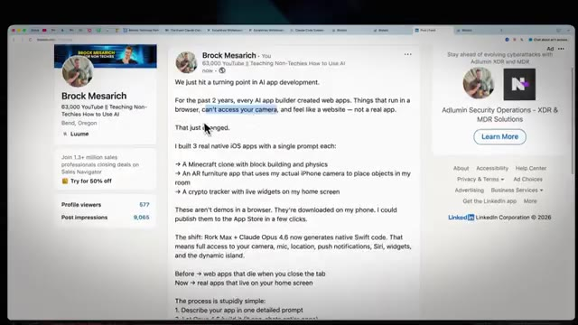
*⏱️ 00:10:25 — Interface web de LinkedIn affichant une publication rédigée automatiquement à propos du développement d'applications mobiles natives par IA.*

---

### ⏱️ `[00:10:30 - 00:11:03]` | Segment #27

**🔊 Audio (Transcription Intégrale Mot pour Mot en Français) :**
> It's rewriting these each for each platform based on the content style that those platforms prefer. On top of all this, it schedules them. It posts them. all of this is done directly inside of Lutato, inside of Cloud Code. So I'm going to show you how to set this up now and exactly how it works. All right. So I guess first things first, let me actually go ahead and show you this in action. So I'm going to open up a new thing inside of Cloud Code here. And I'm going to say, I want you to go and scrape my last YouTube video, get the transcript. And from that transcript, I want you to create a LinkedIn post about this video

**👁️ Analyse Visuelle d'Écran (gemini-3.5-flash-lite) :**
**Interface & Outils** : Interface web de Claude Code et navigateur internet.

**Contenu textuel & Code** : Arborescence de projets (dossiers outputs, resources, config), interface de commande Claude Code avec instructions textuelles.

**Action / Démonstration** : Le présentateur navigue dans l'interface de Claude Code pour montrer la configuration et l'organisation des fichiers du projet d'automatisation.

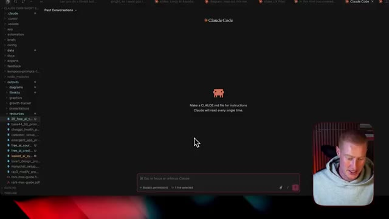
*⏱️ 00:10:55 — Capture d'écran affichant l'interface de Claude Code avec une arborescence de fichiers sur le panneau de gauche et une invite de commande au centre, accompagnée de la vidéo du présentateur.*

---

### ⏱️ `[00:11:03 - 00:11:21]` | Segment #28

**🔊 Audio (Transcription Intégrale Mot pour Mot en Français) :**
> et ce dont j'ai parlé dedans. D'accord. Donc je vais envoyer ça à Cloud Code. Et maintenant, ce qu'il va faire, c'est qu'il va évidemment scraper cette vidéo YouTube. Et ce que je devrais faire en fait, en y pensant maintenant, c'est que je devrais juste transformer ça en commande. Donc ce que je dirais après qu'il aura fait ça, ce serait du genre : hé, transforme ça en commande.

**👁️ Analyse Visuelle d'Écran (gemini-3.5-flash-lite) :**
**Interface & Outils** : Claude Code / Cursor IDE avec volet de navigation de fichiers à gauche et fenêtre de chat IA centrale.

**Contenu textuel & Code** : Prompt utilisateur : "I want you to go and scrape my last YouTube video, get the transcript. From that transcript, I want you to create a LinkedIn post", fichier contextuel joint, statut d'exécution "Cooking...".

**Action / Démonstration** : Soumission d'une consigne d'automatisation d'extraction de contenu YouTube et de génération de post LinkedIn à l'outil Claude Code.

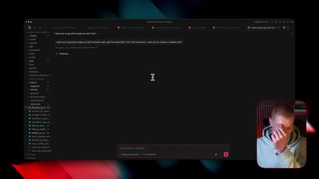
*⏱️ 00:11:07 — Interface de type IDE/terminal (Claude Code) exécutant une commande pour scraper une vidéo YouTube et rédiger un post LinkedIn.*

---

### ⏱️ `[00:11:21 - 00:11:42]` | Segment #29

**🔊 Audio (Transcription Intégrale Mot pour Mot en Français) :**
> So whenever I say scrape YouTube, it automatically goes through this process. And here we go. It's looking through my YouTube. So I'm just going to submit that. Also inside of cloud code, I do suggest or inside of cursor, I do suggest I would do whatever you want to do, I select bypass permissions here. So that way I don't need to approve everything. It just automatically runs on autopilot instead of me having to like go through and approve all this stuff.

**👁️ Analyse Visuelle d'Écran (gemini-3.5-flash-lite) :**
**Interface & Outils** : Claude Code / Terminal interactif sombre avec encart vidéo du présentateur.

**Contenu textuel & Code** : Texte de prompt : "What's your YouTube channel URL or handle so I can find your latest video?" avec des options de sélection (ex. @brockmesarich).

**Action / Démonstration** : Le présentateur interagit avec l'outil d'IA en sélectionnant son identifiant YouTube pour récupérer la dernière vidéo et automatiser la transcription.

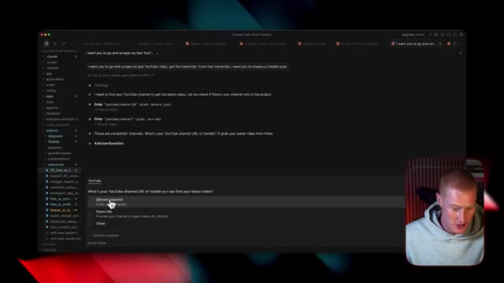
*⏱️ 00:11:26 — Interface sombre de l'outil montrant un prompt demandant de spécifier l'URL ou le pseudonyme de la chaîne YouTube, avec le présentateur en médaillon en bas à droite.*

---

### ⏱️ `[00:11:42 - 00:12:02]` | Segment #30

**🔊 Audio (Transcription Intégrale Mot pour Mot en Français) :**
> Donc on dirait qu'il a trouvé ma dernière vidéo YouTube ici. Donc c'est le générateur d'applications d'IA le plus puissant que j'aie jamais utilisé. Donc il est en train de télécharger les sous-titres générés automatiquement pour la vidéo. Et les gars, un truc que je veux vraiment mentionner avec CloudCode, j'avais peur de commencer à l'utiliser parce que je me disais, mec, je ne comprends pas cette interface. Je ne comprends pas ce qu'il fait. On dirait qu'il fait tellement de choses complexes.

**👁️ Analyse Visuelle d'Écran (gemini-3.5-flash-lite) :**
**Interface & Outils** : IDE avec agent de code (type Claude Code / Cursor), terminal Bash

**Contenu textuel & Code** : Commandes `yt-dlp --flat-playlist` et `--write-auto-sub`, titre de la vidéo "This is the Most Powerful AI App Builder I've Ever Used (Rork Max)", chemin d'enregistrement des sous-titres `/tmp/brock_latest`.

**Action / Démonstration** : Exécution automatique de commandes de terminal pour extraire la transcription de la dernière vidéo YouTube d'un créateur.

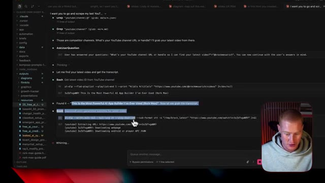
*⏱️ 00:11:47 — Interface d'un environnement de développement montrant un agent IA exécutant des commandes Bash avec yt-dlp pour identifier une vidéo YouTube et télécharger ses sous-titres.*

---

### ⏱️ `[00:12:02 - 00:12:21]` | Segment #31

**🔊 Audio (Transcription Intégrale Mot pour Mot en Français) :**
> Et le truc, c'est que si vous rencontrez un problème, vous ne savez pas comment une tâche spécifique doit être effectuée dans du code cloud. Soit demandez-lui, comment fait-on ceci ? Ou dites simplement, débrouille-toi. Et je vous le dis, ça a l'air d'être le truc de codeur au « vibe » le plus total. Genre, par exemple, je ne savais pas comment extraire la transcription d'une vidéo YouTube, mais j'ai juste dit, va trouver un moyen de scraper ça.

**👁️ Analyse Visuelle d'Écran (gemini-3.5-flash-lite) :**
**Interface & Outils** : Interface logicielle / éditeur de code et outil de génération de texte avec incrustation vidéo.

**Contenu textuel & Code** : Texte d'un brouillon de publication LinkedIn sur le développement d'applications natives iOS par l'IA et les prompts associés.

**Action / Démonstration** : Le présentateur explique et commente le contenu affiché à l'écran concernant le développement d'applications assisté par IA.

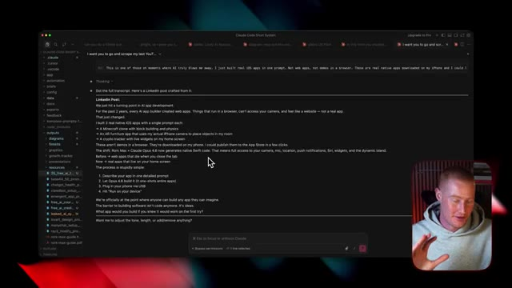
*⏱️ 00:12:11 — Interface de développement ou terminal affichant du texte (post LinkedIn et processus de génération d'applications iOS avec Claude), avec la caméra du présentateur incrustée en bas à droite.*

---

### ⏱️ `[00:12:21 - 00:12:40]` | Segment #32

**🔊 Audio (Transcription Intégrale Mot pour Mot en Français) :**
> Et ça va aller chercher, par exemple, une plateforme API qui fait ça gratuitement. Donc c'est vraiment fort pour aller simplement faire des itérations et trouver la meilleure façon de faire quelque chose jusqu'à ce qu'il comprenne réellement comment le faire. Donc, juste comme ça, nous avons maintenant cette publication LinkedIn. Nous venons donc de franchir un cap dans le développement d'applications par IA. D'accord, ça a l'air bien. Ce que je pourrais faire, c'est lui dire automatiquement de publier ceci dès maintenant.

**👁️ Analyse Visuelle d'Écran (gemini-3.5-flash-lite) :**
**Interface & Outils** : Claude Code / IDE avec terminal Bash intégré et explorateur de fichiers de projet.

**Contenu textuel & Code** : Script Python/Bash pour extraire les transcriptions de sous-titres VTT, sortie texte générant un post LinkedIn sur le développement d'applications iOS via l'IA, arborescence de fichiers du projet.

**Action / Démonstration** : Traitement automatisé de transcriptions VTT et création de contenu rédigé par agent IA.

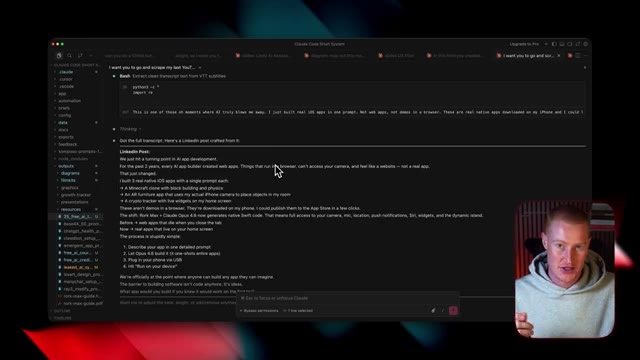
*⏱️ 00:12:30 — Interface de terminal/IDE affichant l'exécution d'un script d'extraction sous Claude Code et la génération automatisée d'un post LinkedIn.*

---

### ⏱️ `[00:12:40 - 00:13:00]` | Segment #33

**🔊 Audio (Transcription Intégrale Mot pour Mot en Français) :**
> But what I'm going to say is I want you to actually use one of the templates inside of Plotato that formats this into a tweet and turns it into a carousel post along with the caption of the, you know, that you have here. Okay. So what I'm talking about here is let me go over to Plotato. And again, I'm going to show you how to actually enable this and set this up yourself here shortly.

**👁️ Analyse Visuelle d'Écran (gemini-3.5-flash-lite) :**
**Interface & Outils** : Présentation ou face-caméra explicatif du trader sans interface logicielle partagée.

**Contenu textuel & Code** : Explications orales des stratégies et mise en contexte méthodologique du marché.

**Action / Démonstration** : Explications face caméra et analyse conceptuelle des marchés.

---

### ⏱️ `[00:13:00 - 00:13:19]` | Segment #34

**🔊 Audio (Transcription Intégrale Mot pour Mot en Français) :**
> Donc, ce que je veux vous montrer, c'est le fait qu'il y a différents modèles ici. Alors, certains d'entre eux sont pas mal. Certains d'entre eux sont vraiment bien. Genre, celui-ci serait génial pour, genre, une infographie ou quelque شيء comme ça ou, vous savez, une alerte info, quelque chose comme ça. Ceux-ci sont plutôt solides, mais j'aime vraiment celui-ci juste là ou, vous savez, j'aime celui-ci encore plus. Donc en gros, ce que c'est, c'est un modèle comme cette carte de tweet.

**👁️ Analyse Visuelle d'Écran (gemini-3.5-flash-lite) :**
**Interface & Outils** : Présentation ou face-caméra explicatif du trader sans interface logicielle partagée.

**Contenu textuel & Code** : Explications orales des stratégies et mise en contexte méthodologique du marché.

**Action / Démonstration** : Explications face caméra et analyse conceptuelle des marchés.

---

### ⏱️ `[00:13:19 - 00:13:52]` | Segment #35

**🔊 Audio (Transcription Intégrale Mot pour Mot en Français) :**
> Vous avez donc probablement vu ce genre de posts carrousel sur Instagram, TikTok ou LinkedIn un peu partout. Donc ce que je pourrais faire, c'est soit générer une vidéo ou un post dans Lutato, mais comme j'utilise Claude Code et le MCP dans Claude Code, que je vais vous montrer exactement comment configurer, je n'ai pas besoin de faire ça moi-même. Il va donc faire référence à cela et générer un tweet comme celui-ci, basé sur cette vidéo précédente que je viens à nouveau de scraper. Et encore une fois, je n'ai rien d'autre à faire que de dire, par exemple : scrape ma précédente vidéo YouTube, transforme-la en post carrousel et publie-la sur LinkedIn et TikTok. Donc ce que je vais faire, c'est que je vais revenir

**👁️ Analyse Visuelle d'Écran (gemini-3.5-flash-lite) :**
**Interface & Outils** : Navigateur web affichant une application de création de contenu de type carrousel.

**Contenu textuel & Code** : Interface utilisateur avec un champ de texte de prompt, un bouton de génération de vidéo et un aperçu visuel au format carrousel.

**Action / Démonstration** : Le présentateur montre l'interface web utilisée pour générer des posts carrousels avant d'expliquer sa transition vers l'utilisation de Claude Code.

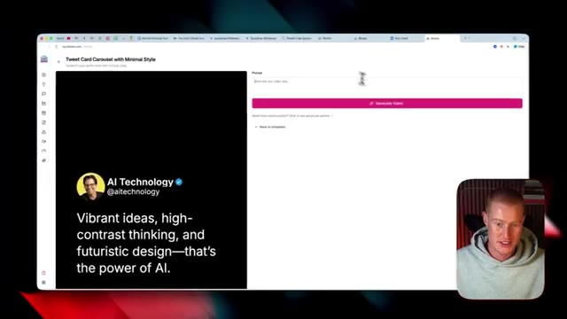
*⏱️ 00:13:27 — Capture d'écran montrant une interface de génération de contenu avec un aperçu de publication de type carrousel et une webcam du présentateur en bas à droite.*

---

### ⏱️ `[00:13:52 - 00:14:29]` | Segment #36

**🔊 Audio (Transcription Intégrale Mot pour Mot en Français) :**
> ici. C'est en direct maintenant. Donc ce qu'il est en train de faire, c'est qu'il crée réellement ce visuel et on dirait que le carrousel est prêt à être publié. LinkedIn est en direct. TikTok est en train de traiter. Donc, laissez-moi aller directement sur LinkedIn, voir si je vois effectivement cette publication. Et encore une fois, je vais vous montrer exactement comment faire cela. Et boum, juste comme ça, nous avons cette nouvelle publication LinkedIn. Donc nous venons de franchir un cap dans le développement d'applications d'IA, car ces deux dernières années, tous les créateurs d'IA ont créé des applications Web, des choses qui s'exécutent dans un navigateur ou fonctionnent dans un navigateur, ne peuvent pas accéder à votre caméra, et cetera. Ça vient de changer, bla, bla, bla. D'accord. Et ensuite, ce qu'il a fait, c'est qu'il a même généré ces publications en carrousel de type carte de tweet résumant ce dont je parle dans cette vidéo. Donc encore une fois, c'est automatique

**👁️ Analyse Visuelle d'Écran (gemini-3.5-flash-lite) :**
**Interface & Outils** : Visual Studio Code, Terminal de commandes CLI / Claude Code, Navigateur Web (LinkedIn)

**Contenu textuel & Code** : Lignes de commande de script Python (`post_create`), texte de publication ("We just hit a turning point in AI app development..."), diapositives de carrousel générées automatiquement

**Action / Démonstration** : Contrôle et vérification en direct du statut de publication automatisée sur LinkedIn après l'exécution du workflow IA

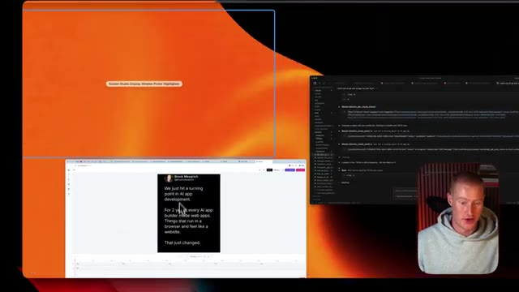
*⏱️ 00:14:01 — Bureau affichant un terminal / éditeur de code exécutant des scripts d'automatisation à droite et la fenêtre de prévisualisation du visuel généré à gauche.*

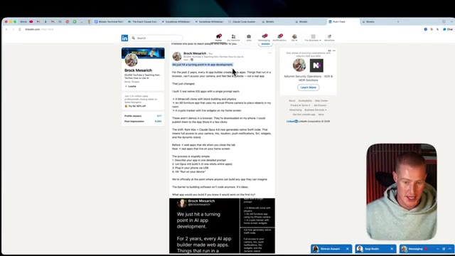
*⏱️ 00:14:10 — Interface LinkedIn affichant le texte et le carrousel visuel de la publication générée et mise en ligne automatiquement par le script.*

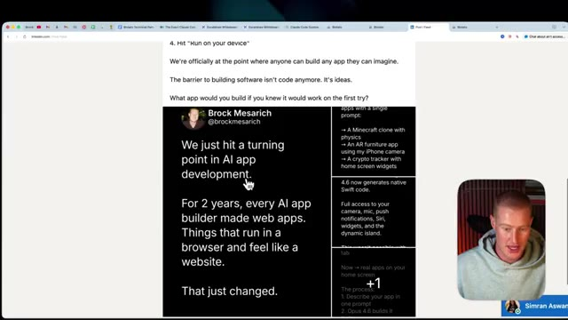
*⏱️ 00:14:20 — Vue détaillée du carrousel d'images au format carte sombre intégré dans la publication LinkedIn publiée en direct.*

---

### ⏱️ `[00:14:29 - 00:14:48]` | Segment #37

**🔊 Audio (Transcription Intégrale Mot pour Mot en Français) :**
> extrait de mes posts YouTube. Ma dernière vidéo YouTube que j'ai publiée, c'est passé de ce post YouTube à cette réutilisation sur LinkedIn ainsi que sur TikTok. Alors laissez-moi vérifier TikTok maintenant. Et juste comme ça, nous avons maintenant ce post TikTok ici. Très bien. Donc ce que vous allez faire pour concrètement mettre cela en place, c'est que vous allez vous inscrire avec un compte Potato. Je vais entrer dans mon compte ici.

**👁️ Analyse Visuelle d'Écran (gemini-3.5-flash-lite) :**
**Interface & Outils** : Présentation ou face-caméra explicatif du trader sans interface logicielle partagée.

**Contenu textuel & Code** : Explications orales des stratégies et mise en contexte méthodologique du marché.

**Action / Démonstration** : Explications face caméra et analyse conceptuelle des marchés.

---

### ⏱️ `[00:14:48 - 00:15:10]` | Segment #38

**🔊 Audio (Transcription Intégrale Mot pour Mot en Français) :**
> Et donc pour les paramètres, vous allez en gros simplement vous connecter à vos comptes. Je me suis donc connecté à mon LinkedIn et à mon TikTok extrêmement facilement. Pour l'instant, ce sont les seules plateformes auxquelles je lui donne accès. Quoi qu'il en soit, vous vous connectez tout simplement. C'est très, très simple à faire. Et ensuite, ce que vous allez faire afin de commencer réellement à utiliser cela à l'intérieur de notre code cloud, c'est que nous allons aller dans API et nous n'avons même pas besoin de copier notre clé API.

**👁️ Analyse Visuelle d'Écran (gemini-3.5-flash-lite) :**
**Interface & Outils** : Navigateur web (paramètres de compte) et terminal de commandes/éditeur de code.

**Contenu textuel & Code** : Boutons de connexion aux réseaux sociaux (Login with Twitter, LinkedIn, Facebook, TikTok, etc.) et section des comptes connectés ("Connected accounts").

**Action / Démonstration** : Configuration des connexions aux différents comptes de réseaux sociaux et bascule vers une interface de terminal/code.

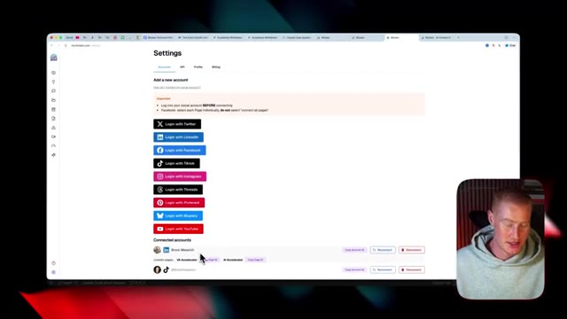
*⏱️ 00:14:53 — Interface web montrant les paramètres de connexion aux comptes de réseaux sociaux (Twitter, LinkedIn, Facebook, TikTok, Instagram, Threads, Pinterest, BlueSky, YouTube), avec les comptes LinkedIn et TikTok connectés.*

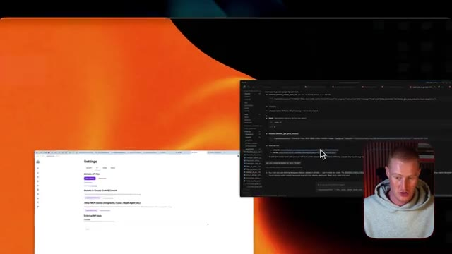
*⏱️ 00:15:04 — Vue du bureau affichant simultanément les paramètres du navigateur et une fenêtre de terminal sombre avec du code source ou une interface de configuration CLI.*

---

### ⏱️ `[00:15:10 - 00:15:32]` | Segment #39

**🔊 Audio (Transcription Intégrale Mot pour Mot en Français) :**
> Ce qu'on fait, c'est qu'ils ont effectivement un serveur MCP maintenant. Donc, essentiellement, on n'a pas besoin de genre d'expliquer, du genre, oh, tu dois utiliser ceci, tu sais, l'API de publication, tout ça. Le MCP va savoir exactement comment l'utiliser. Donc, on va juste cliquer sur copier la commande de configuration et on va revenir à Claude Code, ou tu peux voir à l'intérieur d'ici, on pourrait même utiliser Claude Cowork également, qui est une autre alternative pour cela.

**👁️ Analyse Visuelle d'Écran (gemini-3.5-flash-lite) :**
**Interface & Outils** : Présentation ou face-caméra explicatif du trader sans interface logicielle partagée.

**Contenu textuel & Code** : Explications orales des stratégies et mise en contexte méthodologique du marché.

**Action / Démonstration** : Explications face caméra et analyse conceptuelle des marchés.

---

### ⏱️ `[00:15:32 - 00:15:53]` | Segment #40

**🔊 Audio (Transcription Intégrale Mot pour Mot en Français) :**
> Donc ce qu'on fait, c'est qu'on colle simplement ça ici, et je l'ai déjà fait. Ce que ça va faire, c'est que ça va littéralement aller configurer tout ça entièrement pour vous. Et je ne sais pas ce que ça fait en arrière-plan, mais la magie opère tout simplement et ça l'intègre parfaitement. Et ensuite, vous pouvez venir ici et simplement dire : « hé, que peux-tu faire avec le MCP Blotato ? » Et ensuite, cela va nous donner un bon guide de tout ce qu'il peut réellement faire pour nous.

**👁️ Analyse Visuelle d'Écran (gemini-3.5-flash-lite) :**
**Interface & Outils** : Présentation ou face-caméra explicatif du trader sans interface logicielle partagée.

**Contenu textuel & Code** : Explications orales des stratégies et mise en contexte méthodologique du marché.

**Action / Démonstration** : Explications face caméra et analyse conceptuelle des marchés.

---

### ⏱️ `[00:15:53 - 00:16:16]` | Segment #41

**🔊 Audio (Transcription Intégrale Mot pour Mot en Français) :**
> And we could begin working this into our system that we have built out. Of course, what I have is a pretty comprehensive system that is like an entire content army of agents that is tackling all these tasks for me. But you could have it do something very simple. Like, you know, if you write a blog post manually and you like writing blog posts, it could automatically just like repurpose that into different content for you on autopilot without you having to manually do that yourself.

**👁️ Analyse Visuelle d'Écran (gemini-3.5-flash-lite) :**
**Interface & Outils** : Présentation ou face-caméra explicatif du trader sans interface logicielle partagée.

**Contenu textuel & Code** : Explications orales des stratégies et mise en contexte méthodologique du marché.

**Action / Démonstration** : Explications face caméra et analyse conceptuelle des marchés.

---

### ⏱️ `[00:16:16 - 00:16:35]` | Segment #42

**🔊 Audio (Transcription Intégrale Mot pour Mot en Français) :**
> Donc par exemple, vous pouvez voir qu'il peut publier des trucs pour nous. Il peut créer des posts, programmer des posts, créer des threads. Il peut générer des carrousels, des diaporamas, des transcriptions YouTube, il peut scraper, tout ce genre de trucs. Donc il peut faire tellement de choses différentes. Donc ça, c'est Potato. Si vous voulez l'utiliser, il y aura un lien dans la description pour le faire. En ce qui concerne les tarifs, je veux évidemment vous montrer ça les gars. Donc vous pouvez avoir un essai gratuit de sept jours et tester ça vous-même.

**👁️ Analyse Visuelle d'Écran (gemini-3.5-flash-lite) :**
**Interface & Outils** : Présentation ou face-caméra explicatif du trader sans interface logicielle partagée.

**Contenu textuel & Code** : Explications orales des stratégies et mise en contexte méthodologique du marché.

**Action / Démonstration** : Explications face caméra et analyse conceptuelle des marchés.

---

### ⏱️ `[00:16:35 - 00:16:54]` | Segment #43

**🔊 Audio (Transcription Intégrale Mot pour Mot en Français) :**
> Voyez si c'est même quelque chose qui vaut la peine d'être envisagé. Et ensuite, vous avez un plan starter, un plan créateur, un plan agence. Bien sûr, le plan agence est assez cher. Cependant, je pense que le plan à 29 dollars par mois devrait vous permettre d'aller assez loin. Vous pourriez avoir 20 comptes de réseaux sociaux, et cetera, et jusqu'à 900 publications TikTok par mois. Donc cela pourrait vous emmener vraiment loin. Et si vous voulez automatiser votre contenu, c'est un excellent moyen de le faire de façon, vous savez, relativement peu coûteuse.

**👁️ Analyse Visuelle d'Écran (gemini-3.5-flash-lite) :**
**Interface & Outils** : Présentation ou face-caméra explicatif du trader sans interface logicielle partagée.

**Contenu textuel & Code** : Explications orales des stratégies et mise en contexte méthodologique du marché.

**Action / Démonstration** : Explications face caméra et analyse conceptuelle des marchés.

---

### ⏱️ `[00:16:54 - 00:17:16]` | Segment #44

**🔊 Audio (Transcription Intégrale Mot pour Mot en Français) :**
> Passons à notre dernière astuce dans cette vidéo. Et si l'intelligence artificielle pouvait contrôler n'importe quelle application que vous utilisez déjà ? Techniquement, nous pouvons le faire parce que nous pouvons nous connecter à des API, mais cela signifie que nous devons configurer OAuth pour chaque application. Nous avons une logique de rafraîchissement des jetons. Nous avons tous ces différents aspects techniques qui vont simplement représenter un énorme casse-tête pour nous afin de réellement configurer les applications que nous voulons utiliser.

**👁️ Analyse Visuelle d'Écran (gemini-3.5-flash-lite) :**
**Interface & Outils** : Navigateur web (Google Chrome) ouvrant l'onglet de présentation "Zapper MCP - Slides".

**Contenu textuel & Code** : Question affichée au centre de l'écran : "what if your AI could control any app?".

**Action / Démonstration** : Le présentateur introduit la dernière astuce de la vidéo concernant le contrôle d'applications par des agents IA via des API.

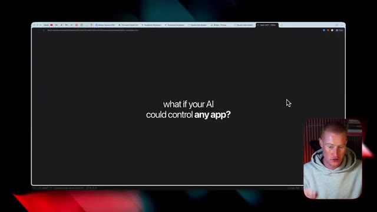
*⏱️ 00:16:59 — Capture d'écran d'un navigateur web affichant une diapositive de présentation avec la question "what if your AI could control any app?".*

---

### ⏱️ `[00:17:16 - 00:17:48]` | Segment #45

**🔊 Audio (Transcription Intégrale Mot pour Mot en Français) :**
> And we will have to pay per service for every single app that we're going to try to connect to. So the solution for this that I personally use is Zapier MCP. Think of this as a way for your AI to use all the tools that you already use directly. So inside of Zapier MCP, we have 8,000 plus app integrations with over 30,000 plus actions based on this one Zapier MCP connection. It makes it extremely easy to tap into these. So here is how it works in our system, which is the really important part. Cloud code, we obviously have our commands, all of that stuff in there. We have our

**👁️ Analyse Visuelle d'Écran (gemini-3.5-flash-lite) :**
**Interface & Outils** : Navigateur Web, diapositive de présentation interactive sur Zapier MCP.

**Contenu textuel & Code** : Intitulé "Zapier MCP" affiché au centre de la présentation, onglets de navigateur ouverts.

**Action / Démonstration** : Présentation théorique et introduction de la solution Zapier MCP pour connecter des milliers d'applications à des agents IA.

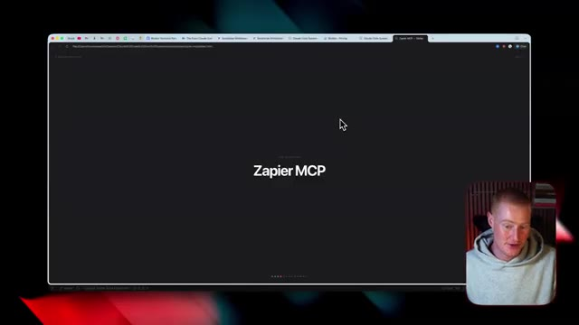
*⏱️ 00:17:24 — Capture d'écran d'un navigateur web affichant une diapositive de présentation sombre avec le titre "Zapier MCP" au centre et la vignette vidéo du présentateur en bas à droite.*

---

### ⏱️ `[00:17:48 - 00:18:16]` | Segment #46

**🔊 Audio (Transcription Intégrale Mot pour Mot en Français) :**
> specific skills that we have in our system that's really complex. And then we have Zapier MCP that handles the connection to our app. So of course we use Blatato, we set up the Blatato MCP. However, that's just one application that we are using. We had to go and configure that manually. If we want to connect any of the apps we use, we're going to use a Zapier MCP in order to do that. Just, it's going to make our life so much easier. Here are some of the things that it does in my content system. When a new script is done, you know, I'll just go to CloudCode and say, hey, I filmed it.

**👁️ Analyse Visuelle d'Écran (gemini-3.5-flash-lite) :**
**Interface & Outils** : Présentation ou face-caméra explicatif du trader sans interface logicielle partagée.

**Contenu textuel & Code** : Explications orales des stratégies et mise en contexte méthodologique du marché.

**Action / Démonstration** : Explications face caméra et analyse conceptuelle des marchés.

---

### ⏱️ `[00:18:16 - 00:18:44]` | Segment #47

**🔊 Audio (Transcription Intégrale Mot pour Mot en Français) :**
> Slack va automatiquement envoyer un message à mon monteur parce qu'il a accès à l'application Slack. Lorsque la vidéo est publiée, il pourrait en fait aller enregistrer cette vidéo dans Google Sheets avec les métriques. Il pourrait donc appeler la commande dans CloudCode pour aller analyser ma vidéo, puis publier cela automatiquement dans Google Sheets en utilisant le MCP de Zapier. Et s'il y a un nouveau contrat, alors l'événement est créé dans le calendrier, un palier est franchi, vous savez, envoyer un e-mail au sponsor, tout ce genre de choses simplement via Gmail. Ce sont toutes les choses qu'il pourrait faire. Bien sûr, Cloud Code ne peut-il pas simplement appeler des API lui-même ?

**👁️ Analyse Visuelle d'Écran (gemini-3.5-flash-lite) :**
**Interface & Outils** : Présentation ou face-caméra explicatif du trader sans interface logicielle partagée.

**Contenu textuel & Code** : Explications orales des stratégies et mise en contexte méthodologique du marché.

**Action / Démonstration** : Explications face caméra et analyse conceptuelle des marchés.

---

### ⏱️ `[00:18:44 - 00:19:19]` | Segment #48

**🔊 Audio (Transcription Intégrale Mot pour Mot en Français) :**
> Yes, it can, but it is an absolute pain to have to set up every single one of these apps you're using in Cloud Code. So now that we talked about this real briefly, I'm going to show you exactly how you could plug this into your system right now. What you're going to do is you're going to come to zapiermcp.com, actually zapier.com slash mcp. There's going to be a link in the description to do this. So what we're going to do is we're just going to click on start building, login, or sign up to an account if you don't already have one. And then inside here, we're just going to click on create new MCP server. Then we could select whatever we want. If we're using cursor, we could do that, but I'm just going to click on Claude Code. And now for the fun part, we get to

**👁️ Analyse Visuelle d'Écran (gemini-3.5-flash-lite) :**
**Interface & Outils** : Présentation ou face-caméra explicatif du trader sans interface logicielle partagée.

**Contenu textuel & Code** : Explications orales des stratégies et mise en contexte méthodologique du marché.

**Action / Démonstration** : Explications face caméra et analyse conceptuelle des marchés.

---

### ⏱️ `[00:19:19 - 00:19:42]` | Segment #49

**🔊 Audio (Transcription Intégrale Mot pour Mot en Français) :**
> select any of the apps that we want to connect to. So let's say we want to give Claude Code access to our Gmail. I'm going to click on this and I could either select individually each of these specific tasks that it could perform, or I could just select all, and it's going to select every single thing that Gmail can do inside of Zapier, which is a lot of different things. And now we have that connected to our server. Then I could come do the same exact thing for Google Sheets.

**👁️ Analyse Visuelle d'Écran (gemini-3.5-flash-lite) :**
**Interface & Outils** : Présentation ou face-caméra explicatif du trader sans interface logicielle partagée.

**Contenu textuel & Code** : Explications orales des stratégies et mise en contexte méthodologique du marché.

**Action / Démonstration** : Explications face caméra et analyse conceptuelle des marchés.

---

### ⏱️ `[00:19:42 - 00:20:04]` | Segment #50

**🔊 Audio (Transcription Intégrale Mot pour Mot en Français) :**
> As I mentioned earlier, you know, we could automatically like scrape the scripts that we have or the performance of the videos and add that to Google Spreadsheets. So I'm going to go ahead and do that now. If we use Slack or HubSpot as our CRM, I could just instantly go here, select tools, connect to HubSpot CRM and done. Just like that, we have that added. So in order for us to connect this to CloudCode, I'm just gonna simply click on connect.

**👁️ Analyse Visuelle d'Écran (gemini-3.5-flash-lite) :**
**Interface & Outils** : Présentation ou face-caméra explicatif du trader sans interface logicielle partagée.

**Contenu textuel & Code** : Explications orales des stratégies et mise en contexte méthodologique du marché.

**Action / Démonstration** : Explications face caméra et analyse conceptuelle des marchés.

---

### ⏱️ `[00:20:04 - 00:20:24]` | Segment #51

**🔊 Audio (Transcription Intégrale Mot pour Mot en Français) :**
> We need to obviously have CloudCode installed and then I'm gonna copy this command. I'm gonna come to CloudCode and then say, literally, I'm just gonna give it that command and it's gonna go off and do its thing and actually build in this MCP server. All right, so let's summarize a bit and kind of really understand what it is that we have built out inside of CloudCode and how this works. It starts with the Claude MD file.

**👁️ Analyse Visuelle d'Écran (gemini-3.5-flash-lite) :**
**Interface & Outils** : Présentation ou face-caméra explicatif du trader sans interface logicielle partagée.

**Contenu textuel & Code** : Explications orales des stratégies et mise en contexte méthodologique du marché.

**Action / Démonstration** : Explications face caméra et analyse conceptuelle des marchés.

---

### ⏱️ `[00:20:24 - 00:20:47]` | Segment #52

**🔊 Audio (Transcription Intégrale Mot pour Mot en Français) :**
> So we write our rules with our tone and how we work. So for example, right here is our instructions, my business system, rules, always check CRM before outreach, use my brand voice, all of these different things. So we craft this as we use this every single day. We type one command and an entire workflow runs. So I could write trending and it will go, scrape all the trending posts for me and all the trending news in the AI space and then create a script for me based on that.

**👁️ Analyse Visuelle d'Écran (gemini-3.5-flash-lite) :**
**Interface & Outils** : Présentation ou face-caméra explicatif du trader sans interface logicielle partagée.

**Contenu textuel & Code** : Explications orales des stratégies et mise en contexte méthodologique du marché.

**Action / Démonstration** : Explications face caméra et analyse conceptuelle des marchés.

---

### ⏱️ `[00:20:47 - 00:21:10]` | Segment #53

**🔊 Audio (Transcription Intégrale Mot pour Mot en Français) :**
> So all I have to do is type in that command and it pulls all this information, goes through this entire set of workflows. Then we added MCP servers that connect our system to everything. We could use all the different apps that we use, such as Notion, Slack, GitHub, any of these different tools that we use on a day-to-day basis using either the APIs that Cloud Code sets up for you or the MCP tools that just like condense those all into one.

**👁️ Analyse Visuelle d'Écran (gemini-3.5-flash-lite) :**
**Interface & Outils** : Présentation ou face-caméra explicatif du trader sans interface logicielle partagée.

**Contenu textuel & Code** : Explications orales des stratégies et mise en contexte méthodologique du marché.

**Action / Démonstration** : Explications face caméra et analyse conceptuelle des marchés.

---

### ⏱️ `[00:21:10 - 00:21:28]` | Segment #54

**🔊 Audio (Transcription Intégrale Mot pour Mot en Français) :**
> And as I mentioned, our memory compounds across all of our sessions. So you could see inside of our memory.md file, it actually breaks down what it learned today or through the specific tasks that you went through. as long as you're being proactive and like telling it what it did good and what it did bad at. And all of these pieces now stack together. So we have our Cloud MD, which is our rules.

**👁️ Analyse Visuelle d'Écran (gemini-3.5-flash-lite) :**
**Interface & Outils** : Présentation ou face-caméra explicatif du trader sans interface logicielle partagée.

**Contenu textuel & Code** : Explications orales des stratégies et mise en contexte méthodologique du marché.

**Action / Démonstration** : Explications face caméra et analyse conceptuelle des marchés.

---

### ⏱️ `[00:21:28 - 00:21:49]` | Segment #55

**🔊 Audio (Transcription Intégrale Mot pour Mot en Français) :**
> We have our slash commands, which are our complex workflows that are condensed into a single word. MCP servers, our hooks and our memory. And this is the entire Cloud Code system. And guys, I know that we talked in this video about my content system that I built. However, you can do this for your entire business, whatever it is that you do or any of the tasks you do on a computer.

**👁️ Analyse Visuelle d'Écran (gemini-3.5-flash-lite) :**
**Interface & Outils** : Présentation ou face-caméra explicatif du trader sans interface logicielle partagée.

**Contenu textuel & Code** : Explications orales des stratégies et mise en contexte méthodologique du marché.

**Action / Démonstration** : Explications face caméra et analyse conceptuelle des marchés.

---

### ⏱️ `[00:21:49 - 00:22:07]` | Segment #56

**🔊 Audio (Transcription Intégrale Mot pour Mot en Français) :**
> So this does not need to be based around content. The things that CloudCode can do really are phenomenal. Like I've been blown away the last two months using it. So I really suggest that you start using this as your personal operating system. Ask it questions on, you know, things that it could actually automate for you. Do whisper flow and just at the end of the day say, hey, I did all of these things.

**👁️ Analyse Visuelle d'Écran (gemini-3.5-flash-lite) :**
**Interface & Outils** : Présentation ou face-caméra explicatif du trader sans interface logicielle partagée.

**Contenu textuel & Code** : Explications orales des stratégies et mise en contexte méthodologique du marché.

**Action / Démonstration** : Explications face caméra et analyse conceptuelle des marchés.

---

### ⏱️ `[00:22:07 - 00:22:26]` | Segment #57

**🔊 Audio (Transcription Intégrale Mot pour Mot en Français) :**
> And you know, here were the things that were the toughest for me. Here's what I spent the most time on. And it could reverse engineer and actually build systems for you to help alleviate some of the tasks on your plate. So I hope you guys got some value from this video. Oh, this one I put a ton of time and energy into. I've been playing around with Claude Code religiously, and I really wanted to show you guys what it's capable of because it's been blowing my mind.

**👁️ Analyse Visuelle d'Écran (gemini-3.5-flash-lite) :**
**Interface & Outils** : Présentation ou face-caméra explicatif du trader sans interface logicielle partagée.

**Contenu textuel & Code** : Explications orales des stratégies et mise en contexte méthodologique du marché.

**Action / Démonstration** : Explications face caméra et analyse conceptuelle des marchés.

---

### ⏱️ `[00:22:26 - 00:22:37]` | Segment #58

**🔊 Audio (Transcription Intégrale Mot pour Mot en Français) :**
> So if you guys got some value from this video, please let me know what you think in the comments. Leave a like, it supports the channel so much. Subscribe for more content like this. And without further ado, happy Claude Coding. And I hope you guys enjoy playing around with it yourself if you haven't already.

**👁️ Analyse Visuelle d'Écran (gemini-3.5-flash-lite) :**
**Interface & Outils** : Page YouTube (image 1)

**Contenu textuel & Code** : Vignettes de vidéos YouTube et boutons d'incitation à l'abonnement

**Action / Démonstration** : Conclusion de la vidéo et appel à l'action pour les abonnements et likes

---

