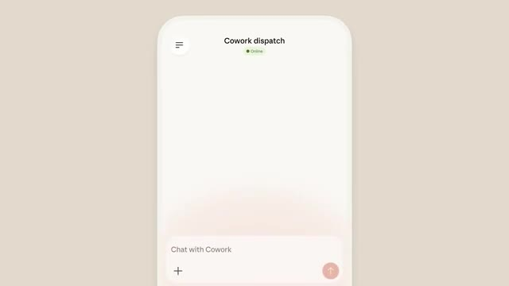
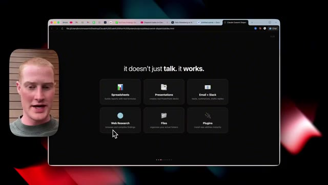
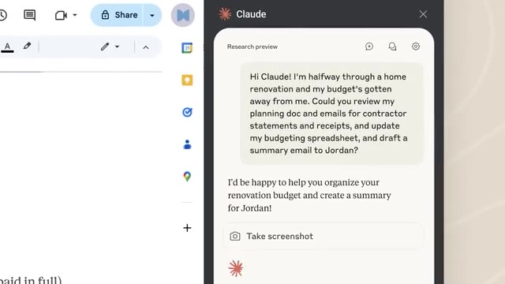
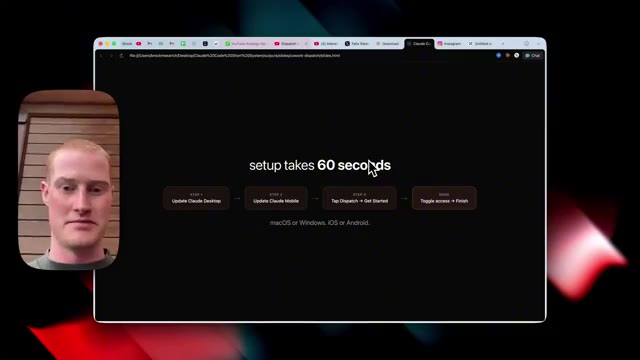
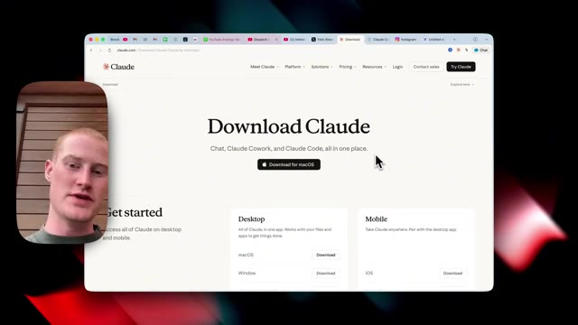

# 🎬 Claude Cowork Now Works from ANYWHERE (OpenClaw Killer?)

> **Chaîne** : [Brock Mesarich | AI for Non Techies](https://www.youtube.com/@BrockMesarich)  
> **Lien YouTube** : [https://www.youtube.com/watch?v=blBrZw237Yw](https://www.youtube.com/watch?v=blBrZw237Yw)  
> **Date de publication** : 20260318  
> **Durée** : 00:14:45  
> **Identifiant vidéo** : `blBrZw237Yw`  
> **Transcription & Analyse** : `whisper-v3-large-turbo+gemini-3.5-flash-lite`  

---

## 📌 Synthèse Exécutive & Outils

### 💡 Résumé
Dans cette vidéo intitulée **Claude Cowork fonctionne désormais de PARTOUT (Le tueur d'OpenClaw ?)**, Alex Carter détaille une approche stratégique et pratique du trading et de l'automatisation par agents IA.

### 🛠️ Outils, Modèles & Logiciels Présentés
- **TradingView & Claude Code** : Analyse technique avancée et automatisation algorithmique.

### 🔑 Points Clés & Enseignements Stratégiques
- Respect rigoureux du ratio risque/rendement et du money management.
- Automatisation méthodique des déclencheurs d'ordres via des agents intelligents.

---

## ⏱️ Chronologie & Transcription Complète Audio & Visuelle (Mot pour Mot)

### ⏱️ `[00:00:00 - 00:00:20]` | Segment #01

**🔊 Audio (Transcription Intégrale Mot pour Mot en Français) :**
> Another day, another massive release from Anthropic. So today, Anthropic just released Claude Cowork Dispatch. And this is a huge update if you've ever used Cowork. And I'm going to explain exactly why. So first of all, let's talk about what is Claude Cowork. So Claude Cowork is an AI agent that lives on your computer. It could read your files, connect to your apps, and actually do work for you.

**👁️ Analyse Visuelle d'Écran (gemini-3.5-flash-lite) :**
**Interface & Outils** : Application mobile Claude Cowork Dispatch (Anthropic)

**Contenu textuel & Code** : Titre d'en-tête « Cowork dispatch », indicateur de statut vert « Online », champ de saisie « Chat with Cowork » avec bouton d'envoi

**Action / Démonstration** : Présentation de l'interface de l'agent IA Claude Cowork Dispatch sur mobile avant le démarrage d'une conversation

*⏱️ 00:00:05 — Aperçu de l'interface mobile de Claude Cowork Dispatch affichant le statut en ligne et la boîte de dialogue de discussion*

---

### ⏱️ `[00:00:20 - 00:00:49]` | Segment #02

**🔊 Audio (Transcription Intégrale Mot pour Mot en Français) :**
> Il pouvait faire des choses comme générer des feuilles de calcul, générer des présentations, parcourir vos e-mails, Slack et toutes les différentes applications que vous utilisez. Faire des recherches sur le Web, il peut organiser vos fichiers et commencer à créer des choses à l'intérieur de votre ordinateur, et peut même exécuter des tâches sur votre navigateur avec l'extension Claude et Chrome. Mais Claude Co-Work avait un gros problème, et c'est que nous devions rester assis devant notre ordinateur tout le temps. Donc, si nous n'utilisions pas notre ordinateur, il n'y avait aucun moyen pour nous de déclencher réellement Co-Work et de le laisser partir accomplir des tâches pour nous. Eh bien, Dispatch règle justement cela.

**👁️ Analyse Visuelle d'Écran (gemini-3.5-flash-lite) :**
**Interface & Outils** : Navigateur Web (Chrome), extension/panneau latéral Claude AI ("Research preview"), Google Docs / Workspace.

**Contenu textuel & Code** : - Image 1 : Cartes de fonctionnalités d'automatisation (mise en page de tableurs, génération de présentations, recherche web, organisation de fichiers).
- Image 2 : Prompt textuel adressé à Claude demandant de parcourir des documents de planification, e-mails de factures, de mettre à jour un tableur budgétaire et de rédiger un e-mail de synthèse.

**Action / Démonstration** : Démonstration des capacités d'automatisation de tâches bureautiques par l'agent IA et illustration de l'interface de commande contextuelle de Claude.

*⏱️ 00:00:27 — Diapositive Web présentant les fonctionnalités clés de l'agent IA (Spreadsheets, Presentations, Email + Slack, Web Research, Files, Plugins) avec le présentateur en incrustation.*

*⏱️ 00:00:34 — Capture de l'interface latérale de Claude AI intégrée à un document Web, affichant un prompt détaillé pour la révision de budget et la rédaction d'e-mail.*

---

### ⏱️ `[00:00:49 - 00:01:21]` | Segment #03

**🔊 Audio (Transcription Intégrale Mot pour Mot en Français) :**
> So we could text Claude on our phone, have it perform tasks on our actual physical computer, and we could come back to results when we're at the gym or basically doing anything. And this might replace the need for open claw and we're going to talk about that later in this video. So in this video we're going to be covering what clawed co-work dispatch actually is, how to set it up very very simply. I'm going to show dispatch in action in a couple of different use cases you can start using right now with co-work dispatch and then we're going to talk about where this falls short. So without further ado let's dive right into this. Let's talk about now a little bit more about

**👁️ Analyse Visuelle d'Écran (gemini-3.5-flash-lite) :**
**Interface & Outils** : Présentation ou face-caméra explicatif du trader sans interface logicielle partagée.

**Contenu textuel & Code** : Explications orales des stratégies et mise en contexte méthodologique du marché.

**Action / Démonstration** : Explications face caméra et analyse conceptuelle des marchés.

---

### ⏱️ `[00:01:21 - 00:01:54]` | Segment #04

**🔊 Audio (Transcription Intégrale Mot pour Mot en Français) :**
> le mode dispatch, et ensuite je vais vous montrer exactement comment le configurer, les cas d'usage clés, toutes ces différentes choses pour que vous puissiez contrôler Cowork depuis votre téléphone et revenir retrouver un travail terminé. Voici donc un exemple rapide : depuis votre téléphone, vous pourriez dire quelque chose comme « compile mes chiffres du premier trimestre dans un rapport », et ensuite Claude sur votre ordinateur ouvrira vos feuilles de calcul, apportera des modifications à votre Google Drive, toutes ces différentes choses puisque Cowork a essentiellement l'accès nécessaire pour faire cela pour vous. Mais vous pouvez désormais y accéder via votre téléphone, et le point clé ici, c'est que la configuration prend peut-être 60 secondes et je vais vous montrer exactement comment faire cela maintenant, alors qu'OpenClaw peut être un peu plus difficile.

**👁️ Analyse Visuelle d'Écran (gemini-3.5-flash-lite) :**
**Interface & Outils** : Présentation ou face-caméra explicatif du trader sans interface logicielle partagée.

**Contenu textuel & Code** : Explications orales des stratégies et mise en contexte méthodologique du marché.

**Action / Démonstration** : Explications face caméra et analyse conceptuelle des marchés.

---

### ⏱️ `[00:01:54 - 00:02:23]` | Segment #05

**🔊 Audio (Transcription Intégrale Mot pour Mot en Français) :**
> if you're not a developer to set it up, get it running. And you also run into the issues of maybe not having a secure system on your computer, and you go off and, you know, do a whole bunch of things you don't want it to do. All right, so let's quickly talk about now how you can begin using this right this second. So first of all, you're going to go to the Claude desktop app and download it if you don't already have it on your computer. There's going to be a link in the description to do so. And if you do have Claude downloaded and you're not seeing this in your account, I suggest delete it, redownload it a couple of times, and you should see it pop up.

**👁️ Analyse Visuelle d'Écran (gemini-3.5-flash-lite) :**
**Interface & Outils** : Navigateur Web (slides de présentation HTML et site officiel claude.ai / Anthropic).

**Contenu textuel & Code** : Procédure de configuration ("Update Claude Desktop", "Update Claude Mobile", "Tap Dispatch", "Toggle access") et boutons de téléchargement de l'application pour macOS, Windows, iOS et Android.

**Action / Démonstration** : Explication du processus d'installation et démonstration du site de téléchargement pour configurer l'environnement Claude Code et Claude Cowork.

*⏱️ 00:02:01 — Présentation sur écran montrant les 4 étapes rapides de configuration de l'écosystème Claude ("setup takes 60 seconds").*

*⏱️ 00:02:08 — Page Web officielle d'Anthropic pour le téléchargement de l'application Claude (Chat, Claude Cowork et Claude Code).*

---

### ⏱️ `[00:02:23 - 00:02:43]` | Segment #06

**🔊 Audio (Transcription Intégrale Mot pour Mot en Français) :**
> However, as of today, you need to be on the max plan, which is their $100 per month plan, but it is rolling out to their pro plan, which is the $20 per month plan. So let me go ahead and show you what this looks like inside of Claude Cowork. So if you see here, I'm inside of Cowork and on the left-hand side underneath schedule tasks, we now have this dispatch button.

**👁️ Analyse Visuelle d'Écran (gemini-3.5-flash-lite) :**
**Interface & Outils** : Présentation ou face-caméra explicatif du trader sans interface logicielle partagée.

**Contenu textuel & Code** : Explications orales des stratégies et mise en contexte méthodologique du marché.

**Action / Démonstration** : Explications face caméra et analyse conceptuelle des marchés.

---

### ⏱️ `[00:02:43 - 00:03:15]` | Segment #07

**🔊 Audio (Transcription Intégrale Mot pour Mot en Français) :**
> And if I click on it, you could see that we have a couple of different things here. First, I'm going to give Claude access to my files. Also, there's this new button here that says keep this computer awake. so this basically prevents your computer from sleeping because if your computer is closed Claude Cowork can't go off and perform tasks for you so I'm going to toggle this on then you can see we actually have access to this in Chrome so it could actually navigate click and fill out forms inside of my browser and then all of my connectors are on so I'm just going to click finish setup now and I'm also going to allow all browser actions as well just to give it a bit more

**👁️ Analyse Visuelle d'Écran (gemini-3.5-flash-lite) :**
**Interface & Outils** : Présentation ou face-caméra explicatif du trader sans interface logicielle partagée.

**Contenu textuel & Code** : Explications orales des stratégies et mise en contexte méthodologique du marché.

**Action / Démonstration** : Explications face caméra et analyse conceptuelle des marchés.

---

### ⏱️ `[00:03:15 - 00:03:49]` | Segment #08

**🔊 Audio (Transcription Intégrale Mot pour Mot en Français) :**
> utility all right so next thing you're going to do is you're going to come to the Claude app on your phone. If you don't already have it downloaded, you need to make sure that it's downloaded. And from here, I'm going to click on dispatch. There's this little button here. And then we're going to see this screen here. And all I'm going to do is click the button that says pair with desktop. And now you can see this interface right here. So let me actually pull up a view from my phone so you can see exactly what I'm talking about. All right. So you could see inside of my phone that we have this little chat interface that says cowork. And I gave it the prompt morning brief, which is basically a skill that I have pre-configured inside of my cloud cowork that

**👁️ Analyse Visuelle d'Écran (gemini-3.5-flash-lite) :**
**Interface & Outils** : Présentation ou face-caméra explicatif du trader sans interface logicielle partagée.

**Contenu textuel & Code** : Explications orales des stratégies et mise en contexte méthodologique du marché.

**Action / Démonstration** : Explications face caméra et analyse conceptuelle des marchés.

---

### ⏱️ `[00:03:49 - 00:04:17]` | Segment #09

**🔊 Audio (Transcription Intégrale Mot pour Mot en Français) :**
> usually runs on my computer but basically what this does is this will automatically go through my email inbox via connectors so it has the ability to connect to my gmail it also connects to my google calendar what it will do is we'll scan both of those different apps and then update me with an html dashboard with all the things that i need to get done for that day so if i come back to co-work on my computer here you can see that i now have these three priorities here this is exactly what It showed inside of the dispatch mode on my phone.

**👁️ Analyse Visuelle d'Écran (gemini-3.5-flash-lite) :**
**Interface & Outils** : Présentation ou face-caméra explicatif du trader sans interface logicielle partagée.

**Contenu textuel & Code** : Explications orales des stratégies et mise en contexte méthodologique du marché.

**Action / Démonstration** : Explications face caméra et analyse conceptuelle des marchés.

---

### ⏱️ `[00:04:17 - 00:04:35]` | Segment #10

**🔊 Audio (Transcription Intégrale Mot pour Mot en Français) :**
> And we now have this morning briefing HTML website here, breaking down basically my focus for today. So it breaks down all the emails that I need to reply to. It shows that I have no meetings on the schedule, breaks down which emails need responses, which ones are, you know, important for me to be updated on, even breaks down all these news and updates here. So this is great.

**👁️ Analyse Visuelle d'Écran (gemini-3.5-flash-lite) :**
**Interface & Outils** : Présentation ou face-caméra explicatif du trader sans interface logicielle partagée.

**Contenu textuel & Code** : Explications orales des stratégies et mise en contexte méthodologique du marché.

**Action / Démonstration** : Explications face caméra et analyse conceptuelle des marchés.

---

### ⏱️ `[00:04:35 - 00:05:10]` | Segment #11

**🔊 Audio (Transcription Intégrale Mot pour Mot en Français) :**
> However, one thing I do want to note is that I'm not able to see this exact view on my phone. I just get the text message with basically a TLDR breakdown of everything, you know that it found for me the priorities the emails the news all that stuff but i don't get this amazing looking html dashboard because i don't actually have access to that file on my phone and another thing i want to mention here is if i come over to the recent chats on my computer you can see i now have this little like button or label here that says dispatch so any of the different tasks that we trigger via our phone you could see on the left hand side i think this is a

**👁️ Analyse Visuelle d'Écran (gemini-3.5-flash-lite) :**
**Interface & Outils** : Présentation ou face-caméra explicatif du trader sans interface logicielle partagée.

**Contenu textuel & Code** : Explications orales des stratégies et mise en contexte méthodologique du marché.

**Action / Démonstration** : Explications face caméra et analyse conceptuelle des marchés.

---

### ⏱️ `[00:05:10 - 00:05:45]` | Segment #12

**🔊 Audio (Transcription Intégrale Mot pour Mot en Français) :**
> cool little you know aspect to this because then it kind of organizes a bit more like okay what did dispatch do for me when I was not on my computer all right so let me show you a couple of different use cases of Claude Cowork Dispatch that I have been testing so for example I basically gave the prompt find the receipts for me inside of the expenses folder and give me a breakdown on everything I have bought so I have a folder on my computer called expenses and this is where basically I put all of my different receipts and what it did is it went off and analyzed all those PDF receipts in that folder and then gave me this breakdown. So it showed me everything that was

**👁️ Analyse Visuelle d'Écran (gemini-3.5-flash-lite) :**
**Interface & Outils** : Présentation ou face-caméra explicatif du trader sans interface logicielle partagée.

**Contenu textuel & Code** : Explications orales des stratégies et mise en contexte méthodologique du marché.

**Action / Démonstration** : Explications face caméra et analyse conceptuelle des marchés.

---

### ⏱️ `[00:05:45 - 00:06:18]` | Segment #13

**🔊 Audio (Transcription Intégrale Mot pour Mot en Français) :**
> spent. It broke down the different categories. It even itemized these receipts for me. Broke down the two biggest payments that I made. So the reason I want to show this use case is because this is a folder on my computer of different PDFs that I was able to actually go ahead and grab from my phone. I didn't have to actually be using my computer in order for it to do this. Any of the different folders or files that you have on your computer you can now access this directly from your phone inside of dispatch now moving on to another use case I said summarize the last three morning briefs you sent to me on Slack so I actually have a skill inside of co-workers that is

**👁️ Analyse Visuelle d'Écran (gemini-3.5-flash-lite) :**
**Interface & Outils** : Présentation ou face-caméra explicatif du trader sans interface logicielle partagée.

**Contenu textuel & Code** : Explications orales des stratégies et mise en contexte méthodologique du marché.

**Action / Démonstration** : Explications face caméra et analyse conceptuelle des marchés.

---

### ⏱️ `[00:06:18 - 00:06:50]` | Segment #14

**🔊 Audio (Transcription Intégrale Mot pour Mot en Français) :**
> a morning briefing task where it will go ahead it will scour my google calendar find any meetings that I have for the day it will then prep me for those meetings with like basically a breakdown on everybody that I have a meeting with and then it will go through my email inbox here as you could see inside of this markdown file skill basically finding all urgent time sensitive emails for me that I need to reply to and then we'll break down different AI news and updates that I need to you know stay on top of in order to cover on this YouTube channel and then lastly it breaks down the top priorities for me based on all the stuff that it pulled from the different applications that I

**👁️ Analyse Visuelle d'Écran (gemini-3.5-flash-lite) :**
**Interface & Outils** : Présentation ou face-caméra explicatif du trader sans interface logicielle partagée.

**Contenu textuel & Code** : Explications orales des stratégies et mise en contexte méthodologique du marché.

**Action / Démonstration** : Explications face caméra et analyse conceptuelle des marchés.

---

### ⏱️ `[00:06:50 - 00:07:17]` | Segment #15

**🔊 Audio (Transcription Intégrale Mot pour Mot en Français) :**
> give it access to and then it actually outputs an HTML dashboard for me and this is exactly what this HTML dashboard looks like basically breaking down today's focus all this different stuff but But the reason I even mentioned this is this also pings me every single morning on Slack with a breakdown of all of this. So you could see the one that I actually got yesterday, it breaks down my day at a glance, shows that I had zero events, three urgent emails, top stories, number one priority, all those different things I get inside of Slack.

**👁️ Analyse Visuelle d'Écran (gemini-3.5-flash-lite) :**
**Interface & Outils** : Présentation ou face-caméra explicatif du trader sans interface logicielle partagée.

**Contenu textuel & Code** : Explications orales des stratégies et mise en contexte méthodologique du marché.

**Action / Démonstration** : Explications face caméra et analyse conceptuelle des marchés.

---

### ⏱️ `[00:07:17 - 00:07:52]` | Segment #16

**🔊 Audio (Transcription Intégrale Mot pour Mot en Français) :**
> What I did is I, from my phone, asked Cowork Dispatch to summarize the last three morning briefs you sent to me on Slack. And I basically broke down these three things that it sent me over the last couple of days. breaking down you know all the things that were urgent inside of my email inbox as well as my google calendar all right so how do we actually give Claude Cowork Dispatch access to the different apps that we use and we could do this with something called Cowork Connectors these are one-click integrations that give Claude access to the different apps you use such as Slack or Gmail or Google Calendar or lots of different apps that you could think of so there's 38 different

**👁️ Analyse Visuelle d'Écran (gemini-3.5-flash-lite) :**
**Interface & Outils** : Présentation ou face-caméra explicatif du trader sans interface logicielle partagée.

**Contenu textuel & Code** : Explications orales des stratégies et mise en contexte méthodologique du marché.

**Action / Démonstration** : Explications face caméra et analyse conceptuelle des marchés.

---

### ⏱️ `[00:07:52 - 00:08:24]` | Segment #17

**🔊 Audio (Transcription Intégrale Mot pour Mot en Français) :**
> connectors directly inside of Claude and let's talk about why connectors matter for dispatch so you can text Claude from your phone obviously. Claude can use every single connector that you have enabled. It can read your Gmail, search Slack, pull from Google Drive, and then send you back the finished results from those apps. These are some that most people use. Gmail, Google Calendar, Google Drive, Slack, Notion, Microsoft 365. For business and sales you have HubSpot, Clay, Zoom Info, DocuSign. You know all these different apps that you could use. All right so let's say that Claude doesn't have the app that you want to integrate with. I'm going to show you

**👁️ Analyse Visuelle d'Écran (gemini-3.5-flash-lite) :**
**Interface & Outils** : Présentation ou face-caméra explicatif du trader sans interface logicielle partagée.

**Contenu textuel & Code** : Explications orales des stratégies et mise en contexte méthodologique du marché.

**Action / Démonstration** : Explications face caméra et analyse conceptuelle des marchés.

---

### ⏱️ `[00:08:24 - 00:08:56]` | Segment #18

**🔊 Audio (Transcription Intégrale Mot pour Mot en Français) :**
> a hack now to be able to connect to 8,000 plus different applications instead of just the 38 that you can connect to in Cloud. So you could connect to your different apps with something called MCP. If you don't know what that is, it's basically a universal remote that connects AI to all the different apps that you use. So I'm personally using Zapier MCP. So there's going to be a link in the description to actually sign up or to begin using this. I'm going to click on start building here. From here, all I'm going to do is click on add new MCP server. And then once I do that, I'm going to click on Claude Cowork as the client here, since that is what we're using.

**👁️ Analyse Visuelle d'Écran (gemini-3.5-flash-lite) :**
**Interface & Outils** : Présentation ou face-caméra explicatif du trader sans interface logicielle partagée.

**Contenu textuel & Code** : Explications orales des stratégies et mise en contexte méthodologique du marché.

**Action / Démonstration** : Explications face caméra et analyse conceptuelle des marchés.

---

### ⏱️ `[00:08:56 - 00:09:30]` | Segment #19

**🔊 Audio (Transcription Intégrale Mot pour Mot en Français) :**
> And then from there, all we have to do is give access to a couple of different tools that we want to add. So if I come here, you could see that we have access to Slack, HubSpot, Airtable, Google Forms, Monday.com. Click up all these different apps, or you could search across any of the ones you use. So if you use something like SynthFlow, which is an AI voice app, you can just click on this, click on select all tools. Now you have access to all these 27 different actions that you can perform across the app click on connect simply just connect your account click on add tools and now you have access to you know all these different actions across this mcp server then from there you're just going to click on connect there's going to be a url that you could

**👁️ Analyse Visuelle d'Écran (gemini-3.5-flash-lite) :**
**Interface & Outils** : Présentation ou face-caméra explicatif du trader sans interface logicielle partagée.

**Contenu textuel & Code** : Explications orales des stratégies et mise en contexte méthodologique du marché.

**Action / Démonstration** : Explications face caméra et analyse conceptuelle des marchés.

---

### ⏱️ `[00:09:30 - 00:10:02]` | Segment #20

**🔊 Audio (Transcription Intégrale Mot pour Mot en Français) :**
> copy here then you're just going to go back over to co-work come up to customize click on connectors and then just click browse connections and then from here you're just going to look up zapier right here click on allow and then just like that you could see that we have all of these different tools directly inside of the Zapier MCP connector here. All right so let's now talk about co-work dispatch versus OpenClaw because I know lots of you are probably wondering like does this replace the need for me to use OpenClaw and it might for you depending on what exactly you need to use it for.

**👁️ Analyse Visuelle d'Écran (gemini-3.5-flash-lite) :**
**Interface & Outils** : Présentation ou face-caméra explicatif du trader sans interface logicielle partagée.

**Contenu textuel & Code** : Explications orales des stratégies et mise en contexte méthodologique du marché.

**Action / Démonstration** : Explications face caméra et analyse conceptuelle des marchés.

---

### ⏱️ `[00:10:02 - 00:10:20]` | Segment #21

**🔊 Audio (Transcription Intégrale Mot pour Mot en Français) :**
> Think of this as two different ways to control AI remotely. So co-work dispatch is built into the Claw desktop app you text Clawed from your phone via the Clawed app it runs on your computer and this was made directly by Anthropic, which is probably one of the biggest AI companies out there right now. OpenClaw is an open source AI agent.

**👁️ Analyse Visuelle d'Écran (gemini-3.5-flash-lite) :**
**Interface & Outils** : Présentation ou face-caméra explicatif du trader sans interface logicielle partagée.

**Contenu textuel & Code** : Explications orales des stratégies et mise en contexte méthodologique du marché.

**Action / Démonstration** : Explications face caméra et analyse conceptuelle des marchés.

---

### ⏱️ `[00:10:20 - 00:10:38]` | Segment #22

**🔊 Audio (Transcription Intégrale Mot pour Mot en Français) :**
> You can control it from WhatsApp, Slack, Telegram, or even SMS text messages. It runs 24 seven on your machine. So a key thing here that we're gonna focus on is setup. So co-work dispatch is extremely easy to set up. You saw me do it in this video in just a couple of clicks, took about 30 seconds, zero configuration that you have to worry about.

**👁️ Analyse Visuelle d'Écran (gemini-3.5-flash-lite) :**
**Interface & Outils** : Présentation ou face-caméra explicatif du trader sans interface logicielle partagée.

**Contenu textuel & Code** : Explications orales des stratégies et mise en contexte méthodologique du marché.

**Action / Démonstration** : Explications face caméra et analyse conceptuelle des marchés.

---

### ⏱️ `[00:10:38 - 00:10:57]` | Segment #23

**🔊 Audio (Transcription Intégrale Mot pour Mot en Français) :**
> Whereas OpenClaw, you have to install node.js. you have to clone repo or run an installer. You have to get API keys from certain providers. So we'd have to actually get our Anthropic API key in order to use the Claude models. You'd have to configure and set it up in Telegram, set up different skills and permissions. And this would take probably 10 to 30 minutes.

**👁️ Analyse Visuelle d'Écran (gemini-3.5-flash-lite) :**
**Interface & Outils** : Présentation ou face-caméra explicatif du trader sans interface logicielle partagée.

**Contenu textuel & Code** : Explications orales des stratégies et mise en contexte méthodologique du marché.

**Action / Démonstration** : Explications face caméra et analyse conceptuelle des marchés.

---

### ⏱️ `[00:10:57 - 00:11:30]` | Segment #24

**🔊 Audio (Transcription Intégrale Mot pour Mot en Français) :**
> And it's pretty technical if you're non-techie. Then let's quickly break down the costs. So right now you could only use dispatch in the pro or the max plan, which is $20 for the pro plan, $100 for the max plan. That's it. You don't have to worry about any extra costs. don't have to add any API keys or you know you don't have any servers that you need to maintain whereas OpenClaw the software is completely free you know you have to pay for API keys which could be you know anywhere from a dollar to 150 dollars or even more if you're using this religiously you have to pay for server hosting all these different things are costs that come with using OpenClaw

**👁️ Analyse Visuelle d'Écran (gemini-3.5-flash-lite) :**
**Interface & Outils** : Présentation ou face-caméra explicatif du trader sans interface logicielle partagée.

**Contenu textuel & Code** : Explications orales des stratégies et mise en contexte méthodologique du marché.

**Action / Démonstration** : Explications face caméra et analyse conceptuelle des marchés.

---

### ⏱️ `[00:11:30 - 00:12:06]` | Segment #25

**🔊 Audio (Transcription Intégrale Mot pour Mot en Français) :**
> Dispatch we're only getting the Clawd models such as Clawd Sona 4.6 Clawd Opus 4.6 or any of the newer models that come out over time whereas OpenClaw you could basically use anything you want GPT models, Sonnet models, Gemini, DeepSeek, or even local models via Ollama. So where can you reach each of these? How do you interact? Right now you can only use Claude Dispatch inside of the Claude mobile app, whereas OpenClaude you could use WhatsApp, Telegram, Slack, Discord, iMessage, basically any different messaging platform you can connect with. So another key thing here is that Dispatch is not running 24-7. So your computer must be awake. You have to have

**👁️ Analyse Visuelle d'Écran (gemini-3.5-flash-lite) :**
**Interface & Outils** : Présentation ou face-caméra explicatif du trader sans interface logicielle partagée.

**Contenu textuel & Code** : Explications orales des stratégies et mise en contexte méthodologique du marché.

**Action / Démonstration** : Explications face caméra et analyse conceptuelle des marchés.

---

### ⏱️ `[00:12:06 - 00:12:42]` | Segment #26

**🔊 Audio (Transcription Intégrale Mot pour Mot en Français) :**
> your computer open as well as co-work. If your computer is closed, you're not going to be able to perform the tasks inside of dispatch. Whereas OpenClaw could run as a background service, can run on a server 24-7, whether you're using a Mac mini or something, which is what I'm personally using. It's a truly always-on agent, and that is why a lot of people would prefer this over something like co-work. So another big key comparison here is security. You're not going to run into any security issues inside of Anthropics Dispatch. This is just way more secure. So if you are a non-techie, you can run into tons of different security issues when you're using OpenClaw if you don't know how

**👁️ Analyse Visuelle d'Écran (gemini-3.5-flash-lite) :**
**Interface & Outils** : Présentation ou face-caméra explicatif du trader sans interface logicielle partagée.

**Contenu textuel & Code** : Explications orales des stratégies et mise en contexte méthodologique du marché.

**Action / Démonstration** : Explications face caméra et analyse conceptuelle des marchés.

---

### ⏱️ `[00:12:42 - 00:13:14]` | Segment #27

**🔊 Audio (Transcription Intégrale Mot pour Mot en Français) :**
> to use it properly. You could give it access to something since it's an open source project. You know, people could go off and do stuff with that information. So which one should you personally use? So I would say you should use Claude Cowork and now Claude Cowork Dispatch if you want the ease of use factor. You don't want to have to touch different configuration files. If you already use Claude, this is another great reason to just begin using dispatch. If you care about security, you should also probably use dispatch. And if you want a simple remote control that could basically have access to the different skills you build inside of Claude, this is a great

**👁️ Analyse Visuelle d'Écran (gemini-3.5-flash-lite) :**
**Interface & Outils** : Présentation ou face-caméra explicatif du trader sans interface logicielle partagée.

**Contenu textuel & Code** : Explications orales des stratégies et mise en contexte méthodologique du marché.

**Action / Démonstration** : Explications face caméra et analyse conceptuelle des marchés.

---

### ⏱️ `[00:13:14 - 00:13:49]` | Segment #28

**🔊 Audio (Transcription Intégrale Mot pour Mot en Français) :**
> alternative for you. Whereas if you want something that you can have full control with, have a 24-7 always-on agent, or want to use any of the different AM models, as well as have different means of communication such as whatsapp and telegram then i think open claw would be a good option for you my honest take is that i think that co-work and dispatch is much safer and easier and the majority of people should probably use it and i've been transitioning to this and i'm going to use this even more now than open claw since that we have the dispatch mode that i could control via my phone so guys there we have it that is the new clawed co-work dispatch that just released today

**👁️ Analyse Visuelle d'Écran (gemini-3.5-flash-lite) :**
**Interface & Outils** : Présentation ou face-caméra explicatif du trader sans interface logicielle partagée.

**Contenu textuel & Code** : Explications orales des stratégies et mise en contexte méthodologique du marché.

**Action / Démonstration** : Explications face caméra et analyse conceptuelle des marchés.

---

### ⏱️ `[00:13:49 - 00:14:24]` | Segment #29

**🔊 Audio (Transcription Intégrale Mot pour Mot en Français) :**
> this really does add a lot more utility to clawed co-work i know you guys have been really enjoying the content that I'm making about it. And this really does just like add another layer of utility that we can now use. I can go to dinner. I could actually, you know, basically trigger this to have coworker go off and do things for me with the different skills and folders that I have set up on my computer. So, so this is really good news as well as I believe Anthropic is coming out with even more use cases of cowork over the coming days and weeks based on this tweet thread, you know, breaking down this launch here. So guys, if you want more in-depth content, as well as the different skills and resources from my Cloud Code and Cloud Cowork systems that I've been building

**👁️ Analyse Visuelle d'Écran (gemini-3.5-flash-lite) :**
**Interface & Outils** : Présentation ou face-caméra explicatif du trader sans interface logicielle partagée.

**Contenu textuel & Code** : Explications orales des stratégies et mise en contexte méthodologique du marché.

**Action / Démonstration** : Explications face caméra et analyse conceptuelle des marchés.

---

### ⏱️ `[00:14:24 - 00:14:45]` | Segment #30

**🔊 Audio (Transcription Intégrale Mot pour Mot en Français) :**
> to help me run my $70,000 per month AI business, then make sure to join my school community. It's a great place to stay up to date with things like Cloud Cowork, Cloud Code, or any of the new AI tools coming out. And I dive a bit deeper in there as well as just link some different resources for you guys. So with that being said, guys, thank you so much. Subscribe to this channel for more content like this. And with that being said, I will see you guys in the next video.

**👁️ Analyse Visuelle d'Écran (gemini-3.5-flash-lite) :**
**Interface & Outils** : Présentation ou face-caméra explicatif du trader sans interface logicielle partagée.

**Contenu textuel & Code** : Explications orales des stratégies et mise en contexte méthodologique du marché.

**Action / Démonstration** : Explications face caméra et analyse conceptuelle des marchés.

---

