# 🎬 15 Claude Cowork Skills I Can’t Live Without (steal them)

> **Chaîne** : [Brock Mesarich | AI for Non Techies](https://www.youtube.com/@BrockMesarich)  
> **Lien YouTube** : [https://www.youtube.com/watch?v=0bRxpRupE5Y](https://www.youtube.com/watch?v=0bRxpRupE5Y)  
> **Date de publication** : 20260327  
> **Durée** : 00:27:59  
> **Identifiant vidéo** : `0bRxpRupE5Y`  
> **Transcription & Analyse** : `whisper-v3-large-turbo+gemini-3.5-flash-lite`  

---

## 📌 Synthèse Exécutive & Outils

### 💡 Résumé
Dans cette vidéo intitulée **15 compétences Claude Cowork dont je ne peux plus me passer (volez-les)**, Alex Carter détaille une approche stratégique et pratique du trading et de l'automatisation par agents IA.

### 🛠️ Outils, Modèles & Logiciels Présentés
- **TradingView & Claude Code** : Analyse technique avancée et automatisation algorithmique.

### 🔑 Points Clés & Enseignements Stratégiques
- Respect rigoureux du ratio risque/rendement et du money management.
- Automatisation méthodique des déclencheurs d'ordres via des agents intelligents.

---

## ⏱️ Chronologie & Transcription Complète Audio & Visuelle (Mot pour Mot)

### ⏱️ `[00:00:00 - 00:00:29]` | Segment #01

**🔊 Audio (Transcription Intégrale Mot pour Mot en Français) :**
> Plug Cowork est l'outil d'IA le plus puissant que j'aie jamais utilisé, mais seulement si vous l'équipez des bonnes compétences. La plupart des gens ouvrent Cowork, tapent une consigne, et c'est tout. C'haque fois que, sans compétences, vous n'utilisez qu'environ 10 % de ce qu'il peut réellement faire. Personnellement, j'utilise plus de 50 compétences chaque jour pour gérer une entreprise de 80 000 dollars par mois sans aucun employé. Et aujourd'hui, je vais en offrir 15 tout à fait gratuitement. Vous allez obtenir l'accès à un plugin, l'installer une seule fois, et vous aurez pratiquement toutes les compétences prêtes à l'emploi.

**👁️ Analyse Visuelle d'Écran (gemini-3.5-flash-lite) :**
**Interface & Outils** : Interface web de Claude Cowork (Anthropic).

**Contenu textuel & Code** : Champ de saisie utilisateur pour consigne textuelle, mentionnant le modèle Sonnet 4.6 et des tâches exemples ('Plan out your work priorities', 'Build a data dashboard').

**Action / Démonstration** : Saisie d'un prompt basique ou générique dans l'interface de l'assistant IA pour illustrer l'utilisation standard sans compétences spécialisées.

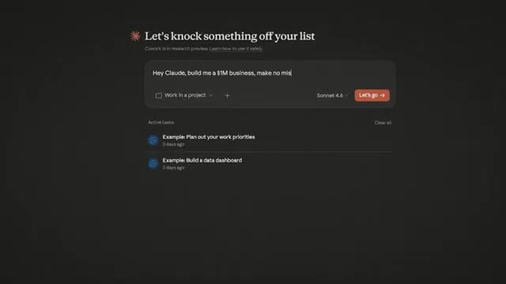
*⏱️ 00:00:07 — Interface de l'outil d'IA montrant un champ de saisie de consigne (prompt) avec le texte 'Hey Claude, build me a $1M business, make no mis' et des exemples de tâches actives en dessous.*

---

### ⏱️ `[00:00:29 - 00:00:48]` | Segment #02

**🔊 Audio (Transcription Intégrale Mot pour Mot en Français) :**
> Dans cette vidéo, je vais vous présenter les 15 compétences dont je ne peux pas me passer, vous montrer exactement ce que fait chacune d'elles. Et à la fin de cette vidéo, vous aurez une boîte à outils d'IA complète que la plupart des gens ignorent même l'existence. Alors entrons dans le vif du sujet. Je vais donc vous montrer les 15 compétences Claude Co-Works dont je ne peux absolument pas me passer. Et si vous ne savez pas ce qu'est une compétence, laissez-moi vous l'expliquer très simplement.

**👁️ Analyse Visuelle d'Écran (gemini-3.5-flash-lite) :**
**Interface & Outils** : Navigateur web, interface utilisateur de gestion de compétences et de configuration.

**Contenu textuel & Code** : Listes de compétences, documentation textuelle du 'Slide Deck Generator', et diapositive de présentation introduisant les 15 compétences gratuites.

**Action / Démonstration** : Présentation de l'interface des compétences et navigation dans le logiciel pour expliquer l'outil.

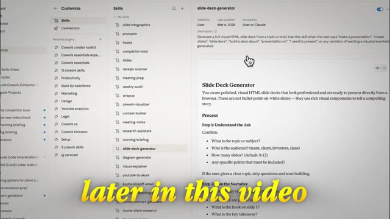
*⏱️ 00:00:34 — Capture d'écran montrant l'interface de configuration avec la liste des compétences d'IA et le générateur de diaporamas.*

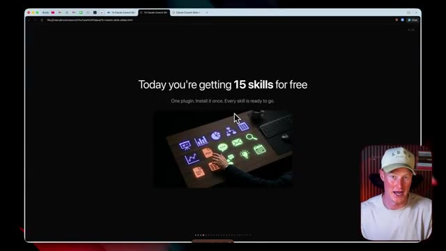
*⏱️ 00:00:44 — Capture d'écran d'une présentation montrant le titre 'Today you're getting 15 skills for free' avec une vignette vidéo.*

---

### ⏱️ `[00:00:49 - 00:01:16]` | Segment #03

**🔊 Audio (Transcription Intégrale Mot pour Mot en Français) :**
> Donc la plupart des gens utilisent Claude comme un chatbot. Ils lui posent fondamentalement juste des questions spécifiques, copient, collent les réponses, et c'est en gros toute l'étendue de leur utilisation. Mais ce qu'une compétence débloque, ce sont des flux de travail complets en un clic. Vous pouvez créer des fichiers, des tableaux de bord, des rapports, et il sait fondamentalement tout sur votre entreprise. Pensez à une compétence comme à un ensemble d'instructions réutilisables, qui est un fichier markdown spécifique qui indique exactement à Claude quoi faire pour des tâches spécifiques, que ce soit dans votre vie ou dans votre entreprise.

**👁️ Analyse Visuelle d'Écran (gemini-3.5-flash-lite) :**
**Interface & Outils** : Navigateur web affichant une diapositive de présentation interactive avec incrustation vidéo (PiP) du présentateur.

**Contenu textuel & Code** : Texte principal : "Most people use Cowork like a chatbot". Bloc gauche (WHAT MOST PEOPLE DO) : "Ask one question at a time", "Copy-paste answers", "Start over every session". Bloc droit (WHAT SKILLS UNLOCK) : "Full workflows in one click", "Files, dashboards, reports", "Knows your business context".

**Action / Démonstration** : Le présentateur explique les limites d'un usage classique des assistants sous forme de chatbot comparé à l'utilisation avancée de compétences (skills).

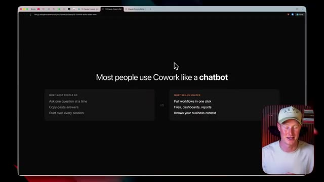
*⏱️ 00:00:55 — Une diapositive de présentation sombre affichant le texte "Most people use Cowork like a chatbot" avec deux blocs comparatifs, tandis que le présentateur apparaît en incrustation vidéo dans le coin inférieur droit.*

---

### ⏱️ `[00:01:16 - 00:01:39]` | Segment #04

**🔊 Audio (Transcription Intégrale Mot pour Mot en Français) :**
> Cela pourrait ensuite être déclenché automatiquement par quelque chose que vous dites. Cela pourrait donc être un mot-clé spécifique, une phrase spécifique, et Claude sait automatiquement déclencher ce flux de travail parce que c'est une compétence. Vous pourriez en fait personnaliser des compétences spécifiques pour votre entreprise et votre flux de travail, et celles-ci pourraient effectivement être regroupées dans des extensions. Vous pourriez ainsi combiner un ensemble de compétences différentes et les partager avec votre équipe, ou même les intégrer à votre propre expérience Claude.

**👁️ Analyse Visuelle d'Écran (gemini-3.5-flash-lite) :**
**Interface & Outils** : Navigateur web affichant une diapositive de présentation (slides).

**Contenu textuel & Code** : Texte principal : "A skill is a reusable instruction set". Points clés affichés : un fichier markdown (.md) indiquant à Claude quoi faire, déclenchement automatique, personnalisation pour l'entreprise/le flux de travail, et intégration dans un plugin.

**Action / Démonstration** : Présentation théorique du concept de compétence (skill) et explication de son fonctionnement dans un flux de travail.

*⏱️ 00:01:27 — Diapositive de présentation montrant la définition et les caractéristiques d'une compétence (skill) pour Claude.*

---

### ⏱️ `[00:01:39 - 00:01:59]` | Segment #05

**🔊 Audio (Transcription Intégrale Mot pour Mot en Français) :**
> Maintenant que nous comprenons ce qu'est une compétence, vous pouvez voir un peu ce petit graphique sympa ici. Je vais vous montrer comment vous pouvez télécharger les compétences que je vais vous montrer dans cette vidéo de manière super simple afin que vous puissiez les importer vous-même dans Claude. La première chose que nous allons faire est de veiller à télécharger l'application de bureau de Claude si vous ne l'avez pas déjà. Il va y avoir un lien dans la description pour télécharger cela.

**👁️ Analyse Visuelle d'Écran (gemini-3.5-flash-lite) :**
**Interface & Outils** : Navigateur web affichant une diapositive explicative et le site web de Claude (claude.ai).

**Contenu textuel & Code** : Texte descriptif sur les compétences ("A skill is a reusable instruction set", fichier Markdown, déclenchement automatique) et options de téléchargement de l'application Claude.

**Action / Démonstration** : Présentation conceptuelle des compétences et démonstration de la page de téléchargement de l'outil Claude.

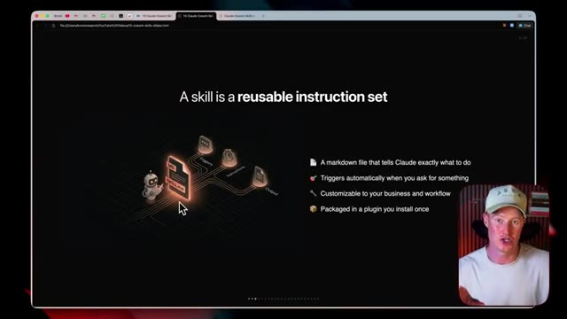
*⏱️ 00:01:44 — Diapositive de présentation montrant la définition d'une compétence (A skill is a reusable instruction set) avec des illustrations graphiques et des puces explicatives.*

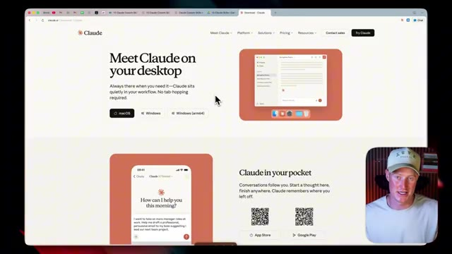
*⏱️ 00:01:54 — Page web officielle de téléchargement de l'application Claude pour ordinateurs (macOS/Windows) et appareils mobiles.*

---

### ⏱️ `[00:01:59 - 00:02:20]` | Segment #06

**🔊 Audio (Transcription Intégrale Mot pour Mot en Français) :**
> Je l'ai déjà téléchargé, alors laissez-moi l'ouvrir. Maintenant que j'ai ouvert Claude Cowork, laissez-moi vous expliquer très simplement comment cela fonctionne si vous ne l'avez jamais utilisé auparavant. J'ai d'autres vidéos où je l'explique en profondeur si vous souhaitez les visionner. Il y a aussi un lien dans la description. Cependant, je vais simplement sélectionner un dossier ici, ou nous pourrions créer un nouveau dossier pour y travailler. Donc, juste pour vous montrer comment en créer un, nous allons simplement venir ici, cliquer sur nouveau dossier.

**👁️ Analyse Visuelle d'Écran (gemini-3.5-flash-lite) :**
**Interface & Outils** : Interface web/desktop de Claude Cowork

**Contenu textuel & Code** : Champ de saisie 'How can I help you today?', liste des tâches actives et répertoires locaux accessibles

**Action / Démonstration** : Navigation et sélection de projets dans l'interface de Claude Cowork

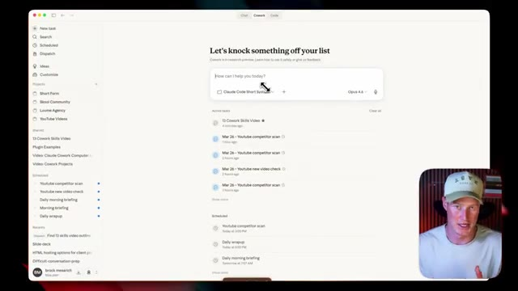
*⏱️ 00:02:04 — Interface principale de l'application Claude Cowork affichant le champ de saisie central et le présentateur en encadré.*

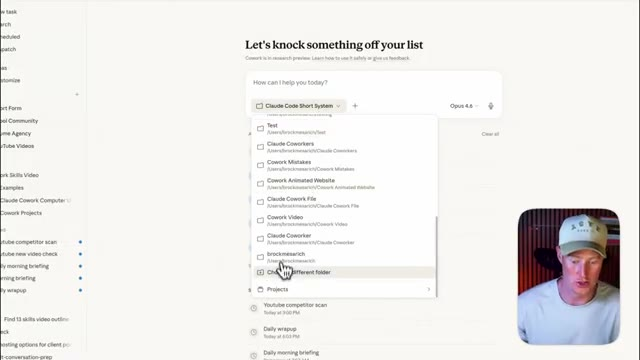
*⏱️ 00:02:14 — Déroulement du menu de sélection de dossiers ou de projets dans l'interface de Claude Cowork.*

---

### ⏱️ `[00:02:20 - 00:02:39]` | Segment #07

**🔊 Audio (Transcription Intégrale Mot pour Mot en Français) :**
> Je vais simplement appeler ce nouveau dossier juste pour les besoins de la vidéo. Je vais l'ouvrir, cliquer sur autoriser, puis sélectionner l'un des différents dossiers dans lesquels nous voulons travailler. Cependant, si je clique sur ce nouveau dossier que je viens de créer, ce sera un dossier vide sur notre bureau où nous effectuons des modifications dans Cowork. Ainsi, si nous générons quoi que ce soit, si nous faisons des modifications, nous allons voir tout cela à l'intérieur du dossier sur notre ordinateur.

**👁️ Analyse Visuelle d'Écran (gemini-3.5-flash-lite) :**
**Interface & Outils** : Interface logicielle de bureau / application web avec menu contextuel de gestion de dossiers.

**Contenu textuel & Code** : Liste de dossiers de projets et tâches actives ('Claude Code Short System', 'New Folder', etc.).

**Action / Démonstration** : Sélection d'un dossier dans l'interface pour configurer l'espace de travail.

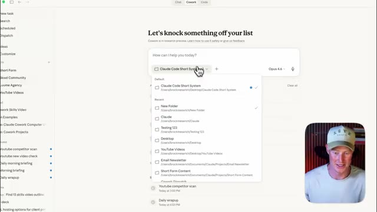
*⏱️ 00:02:24 — Interface de l'application montrant un menu déroulant de sélection de dossiers avec le dossier 'Claude Code Short System' sélectionné.*

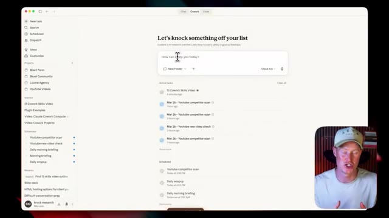
*⏱️ 00:02:34 — Interface principale de l'application affichant le champ de saisie 'How can I help you today?' avec un nouveau dossier sélectionné.*

---

### ⏱️ `[00:02:39 - 00:03:02]` | Segment #08

**🔊 Audio (Transcription Intégrale Mot pour Mot en Français) :**
> Donc maintenant que nous avons créé cela, je vais vous montrer exactement comment télécharger les compétences que je vais vous montrer dans cette vidéo. Il va donc y avoir un lien dans la description vers ce Google Drive. C'est entièrement gratuit pour vous d'utiliser tout cela. Et si vous voulez l'ensemble des 50 compétences que j'utilise tous les jours dans mon entreprise, et dont je ne peux sérieusement pas me passer, il y a un lien pour rejoindre ma communauté School où je rassemble toutes ces compétences pour que vous puissiez les télécharger.

**👁️ Analyse Visuelle d'Écran (gemini-3.5-flash-lite) :**
**Interface & Outils** : Navigateur web affichant la page de téléchargement de l'application Claude Desktop (claude.ai).

**Contenu textuel & Code** : Page web présentant les options de téléchargement pour macOS, Windows et Windows (arm64) avec le slogan « Meet Claude on your desktop ».

**Action / Démonstration** : Le présentateur introduit la ressource externe et indique l'emplacement du lien de téléchargement dans la description.

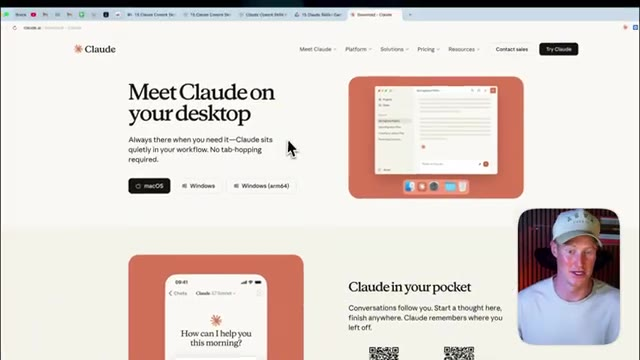
*⏱️ 00:02:45 — Capture d'écran montrant le site web officiel de Claude (claude.ai) avec le présentateur en médaillon vidéo en bas à droite.*

---

### ⏱️ `[00:03:02 - 00:03:21]` | Segment #09

**🔊 Audio (Transcription Intégrale Mot pour Mot en Français) :**
> Et c'est tout aussi simple que ce processus que je m'apprête à vous montrer. Donc, pour le télécharger, je vais simplement cliquer sur ce fichier zip. Je vais cliquer sur télécharger. N'ouvrez pas ce fichier zip parce que nous avons besoin qu'il soit formaté en fichier zip pour pouvoir le télécharger dans cowork. C'est essentiellement comme ça que l'application de bureau Claude, vous savez, nous fait le télécharger.

**👁️ Analyse Visuelle d'Écran (gemini-3.5-flash-lite) :**
**Interface & Outils** : Navigateur web (Google Drive), interface système de gestion de fichiers et incrustation vidéo du présentateur.

**Contenu textuel & Code** : Fichiers et dossiers compressés (15-cowork-skills.zip, README.md, dossier info).

**Action / Démonstration** : Navigation et consultation d'un fichier zip sur Google Drive avant téléchargement.

*⏱️ 00:03:07 — Vue d'un navigateur web affichant un dossier compressé nommé '15-cowork-skills.zip' sur Google Drive avec la caméra du présentateur en bas à droite.*

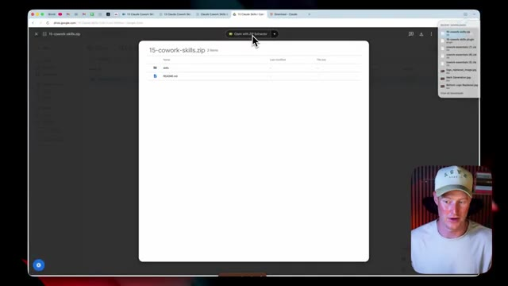
*⏱️ 00:03:12 — Le navigateur web montre l'intérieur du fichier zip '15-cowork-skills.zip' affichant un dossier 'info' et un fichier 'README.md', avec la liste des téléchargements récents sur la droite.*

---

### ⏱️ `[00:03:21 - 00:03:40]` | Segment #10

**🔊 Audio (Transcription Intégrale Mot pour Mot en Français) :**
> Il faut que ce soit dans ce format spécifique. Je vais donc prendre ce fichier, le sauvegarder simplement sur mon bureau ici. Et ensuite, ce que je vais faire, c'est revenir sur Claude, m'assurer que je suis en mode co-working. Et ensuite, je vais aller dans personnaliser. Et à partir de là, vous pouvez voir toutes nos compétences que nous avons. Mais nous allons nous concentrer sur cette fonctionnalité de plugins juste ici et cliquer sur ajouter un plugin.

**👁️ Analyse Visuelle d'Écran (gemini-3.5-flash-lite) :**
**Interface & Outils** : Application logicielle de type assistant IA en mode co-working avec menu latéral et encart vidéo du présentateur en bas à droite.

**Contenu textuel & Code** : Interface utilisateur affichant "Let's knock something off your list", la barre de saisie "How can I help you today?", et la liste des tâches récentes.

**Action / Démonstration** : Le présentateur montre comment naviguer dans l'interface de l'application pour accéder aux options de personnalisation.

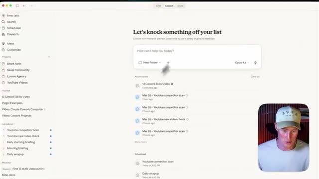
*⏱️ 00:03:26 — Interface principale de l'application montrant le mode co-working avec un champ de saisie central et la liste des tâches actives.*

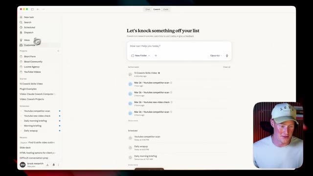
*⏱️ 00:03:30 — Navigation dans le panneau latéral gauche vers l'option de personnalisation de l'espace de travail.*

---

### ⏱️ `[00:03:40 - 00:04:17]` | Segment #11

**🔊 Audio (Transcription Intégrale Mot pour Mot en Français) :**
> À partir d'ici, je vais simplement cliquer sur "télécharger le plugin" et veiller à aller chercher ce fichier spécifique que vous avez sur votre bureau. Je clique sur télécharger et, comme par magie, nous avons maintenant nos 15 compétences Claude Co-Works directement ici. Laissez-moi donc décomposer rapidement, vous savez, à quoi cela ressemble. Vous pouvez voir chacune d'entre elles juste ici, les 15. Si nous voulons y apporter des modifications, nous pouvons venir ici et cliquer sur "personnaliser", et cela va pratiquement personnaliser tout ce plugin en fonction de votre entreprise, de sorte qu'il soit adapté directement à vous. Très bien, alors passons à la première compétence Claude dont je ne peux vraiment pas me passer : un créateur de diaporamas. Et le plus drôle, c'est que tout ce diaporama que vous voyez

**👁️ Analyse Visuelle d'Écran (gemini-3.5-flash-lite) :**
**Interface & Outils** : Interface utilisateur de gestion des compétences Co-Works / Navigateur web.

**Contenu textuel & Code** : Liste détaillée des 15 compétences (Slide Deck Builder, Customize, Budget Planner, etc.) et aperçu de l'outil Slide Deck Builder.

**Action / Démonstration** : Navigation et présentation des fonctionnalités des compétences Co-Works nouvellement installées.

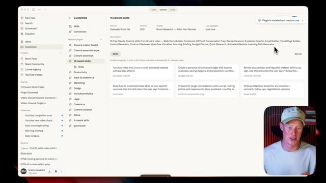
*⏱️ 00:03:49 — Interface affichant les 15 compétences Claude Co-Works installées avec succès.*

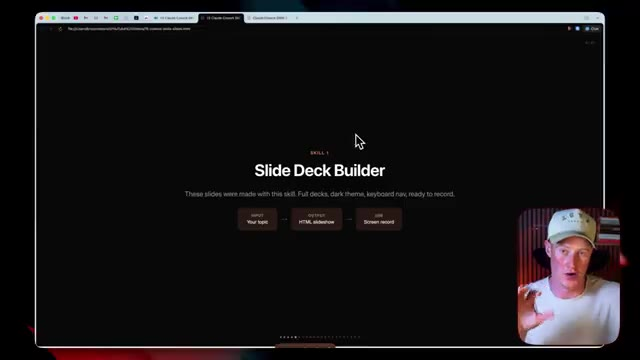
*⏱️ 00:04:08 — Présentation du premier outil de la liste, "Slide Deck Builder", sur fond sombre.*

---

### ⏱️ `[00:04:17 - 00:04:52]` | Segment #12

**🔊 Audio (Transcription Intégrale Mot pour Mot en Français) :**
> juste ici dans cette vidéo a été généré avec cette compétence spécifique. Et je vais vous montrer à quel point il est facile de fabriquer réellement quelque chose comme ça en utilisant cette compétence que vous venez de télécharger. Donc si je reviens à cowork afin que je puisse utiliser une compétence, il y a plusieurs façons différentes de le faire. Je pourrais simplement taper une barre oblique. Et puis à partir d'ici, vous allez voir toutes les compétences que nous avons téléchargées, mais je vais descendre aux 15 compétences de cowork ici, qui est un plugin que vous venez de télécharger. Et comme vous pouvez le voir, nous avons celle-ci qui s'appelle le créateur de présentations. Donc je pourrais simplement taper cela et ensuite simplement expliquer ce que c'est que je veux

**👁️ Analyse Visuelle d'Écran (gemini-3.5-flash-lite) :**
**Interface & Outils** : Navigateur web affichant une application de présentation de type slide deck et l'interface de l'application Cowork.

**Contenu textuel & Code** : Menus déroulants de compétences de l'outil Cowork, listes de tâches programmées liées à l'analyse de concurrents YouTube et blocs fonctionnels de création de diapositives.

**Action / Démonstration** : Navigation et démonstration de l'utilisation d'une compétence spécifique au sein de l'interface de Cowork pour automatiser la création de présentations et de tâches.

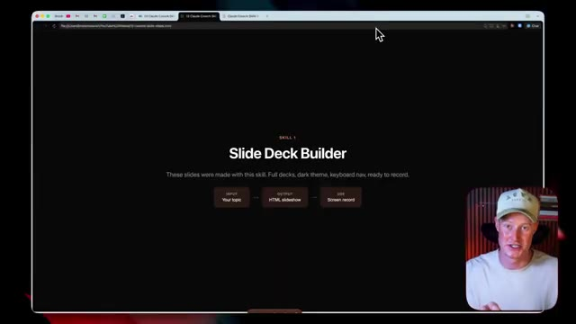
*⏱️ 00:04:26 — Capture montrant une page web noire avec le titre 'Slide Deck Builder' et des blocs d'interface illustrant le flux 'Input Your topic -> Output HTML slideshow -> Use Screen record'.*

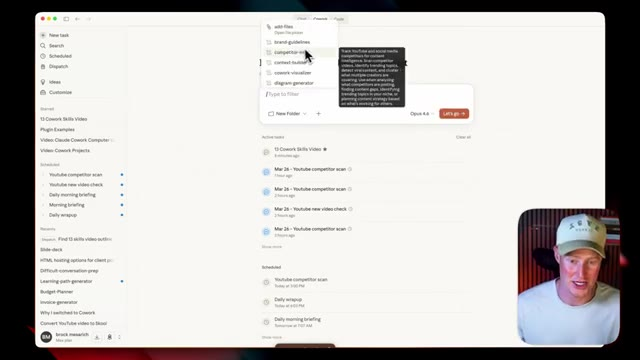
*⏱️ 00:04:34 — Capture montrant l'interface claire de Cowork avec un menu déroulant affichant des compétences (« brand-guidelines », « competitor-scan », « diagram-generator ») et une liste de tâches planifiées dans la barre latérale.*

---

### ⏱️ `[00:04:52 - 00:05:24]` | Segment #13

**🔊 Audio (Transcription Intégrale Mot pour Mot en Français) :**
> générer. Très bien. Donc je vais simplement donner le prompt pour générer un diaporama sur la façon d'utiliser Claude Code pour les non-techniciens. Et un point clé ici que je veux mentionner, c'est que je n'ai pas eu besoin de donner un prompt super exhaustif. Je n'ai pas eu besoin de coller un méta-prompt spécifique que j'ai enregistré. Le fonctionnement d'une compétence est le suivant : à chaque fois que celle-ci est déclenchée, elle va automatiquement charger un ensemble d'instructions que Claude suivra à chaque fois que vous l'utilisez. Donc si je reviens à mes compétences et si je lève ma compétence de génération de présentations, vous pouvez voir que nous avons ce fichier markdown qui

**👁️ Analyse Visuelle d'Écran (gemini-3.5-flash-lite) :**
**Interface & Outils** : Interface logicielle Cowork, navigateur de tâches, panneau de progression latéral et incrustation vidéo du présentateur.

**Contenu textuel & Code** : Prompt utilisateur : « /slide-deck-builder generate a slideshow for how to use Claude Code for non techies » et panneau de progression des tâches.

**Action / Démonstration** : Le présentateur lance l'exécution d'un prompt pour automatiser la création d'un diaporama à l'aide d'un agent IA.

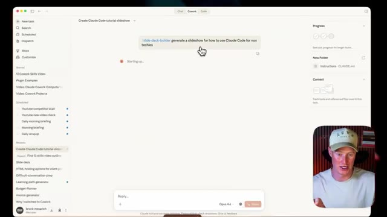
*⏱️ 00:05:00 — Interface de l'outil Cowork affichant la saisie d'un prompt pour générer un diaporama sur Claude Code, avec la webcam du présentateur en bas à droite.*

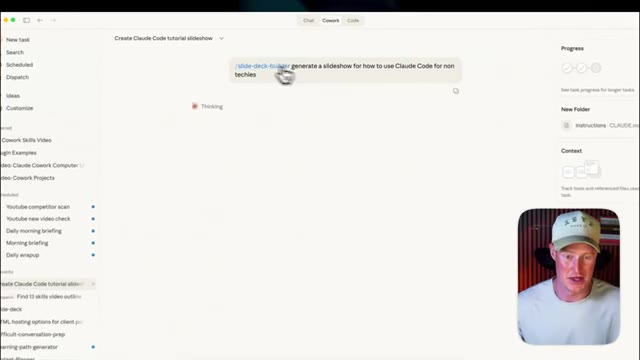
*⏱️ 00:05:08 — L'interface passe en mode de réflexion (« Thinking ») après la validation du prompt par le présentateur.*

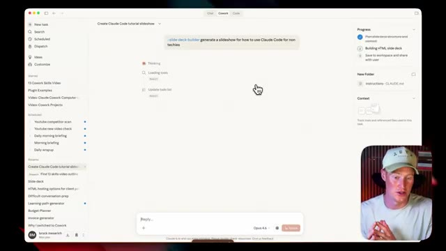
*⏱️ 00:05:16 — L'interface affiche le chargement des outils et la progression de la tâche avec plusieurs étapes listées à droite.*

---

### ⏱️ `[00:05:24 - 00:05:46]` | Segment #14

**🔊 Audio (Transcription Intégrale Mot pour Mot en Français) :**
> explique exactement comment nous voulons que cela fonctionne. Il intègre même des systèmes de conception spécifiques, des composants visuels à utiliser, différents textes de diapositive et des règles spécifiques, la navigation, fondamentalement absolument tout ce dont nous avons besoin pour que cela fonctionne correctement à chaque fois que nous l'exécutons. Et une autre façon pour nous d'invoquer cette compétence ou n'importe quelle compétence que nous voulons utiliser est fondamentalement de dire simplement, hé, est-ce que tu peux créer un diaporama pour ceci ?

**👁️ Analyse Visuelle d'Écran (gemini-3.5-flash-lite) :**
**Interface & Outils** : Interface de gestion de projets / Cowork platform avec éditeur de configuration de compétences (Skills).

**Contenu textuel & Code** : Paramètres de design, composants visuels disponibles (Big stat, Card grid, Flow diagram), règles de texte pour les diapositives et instructions de navigation.

**Action / Démonstration** : Présentation et explication des paramètres de configuration et des composants visuels d'un générateur de présentations.

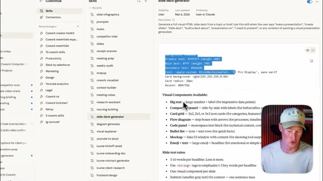
*⏱️ 00:05:30 — Interface logicielle affichant le panneau de configuration du générateur de diapositives avec les composants visuels et les règles de texte.*

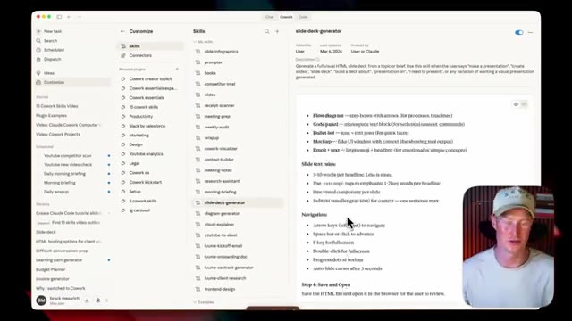
*⏱️ 00:05:35 — Interface logicielle affichant la suite des règles de texte, de navigation et l'étape de sauvegarde pour le générateur de diapositives.*

---

### ⏱️ `[00:05:46 - 00:06:22]` | Segment #15

**🔊 Audio (Transcription Intégrale Mot pour Mot en Français) :**
> Et puisqu'il comprend chaque fois que Brock veut générer un diaporama, qu'il utilise cette compétence, il va la charger automatiquement pour que vous n'ayez pas nécessairement à taper barre oblique slide deck builder, par exemple. Très bien, et juste comme ça, peut-être 30 secondes plus tard, nous avons maintenant ce diaporama ici qui a été généré, Claude Code pour les non-techniciens. Ça a l'air, ça a l'air vraiment similaire au diaporama que vous voyez dans cette vidéo et ça détaille fondamentalement tout ça ici, alors qu'est-ce que Claude Code, qu'est-ce qu'il peut réellement faire, démarrer en trois étapes, lui parler comme à une personne, genre c'est vraiment un très bon point de départ pour un diaporama et ça a été généré encore une fois en environ 30 secondes en donnant une invite très simple ici et ce que nous pourrions

**👁️ Analyse Visuelle d'Écran (gemini-3.5-flash-lite) :**
**Interface & Outils** : Application de génération de diaporamas et d'IA (interface en deux volets avec chat à gauche et rendu HTML/diapo à droite).

**Contenu textuel & Code** : Commande `/slide-deck-builder`, résumé des 10 diapositives générées et aperçu visuel de la diapositive de titre "Claude Code for Non-Techies".

**Action / Démonstration** : Démonstration de la création automatique d'un diaporama de présentation via une compétence d'IA intégrée.

*⏱️ 00:06:04 — Interface de l'application montrant à gauche le panneau de génération d'un diaporama avec la commande `/slide-deck-builder` et à droite le résultat visuel du diaporama "Claude Code for Non-Techies".*

---

### ⏱️ `[00:06:22 - 00:06:55]` | Segment #16

**🔊 Audio (Transcription Intégrale Mot pour Mot en Français) :**
> ce que nous pouvons faire, c'est en fait ouvrir ceci et l'ouvrir dans notre navigateur, donc c'est plutôt chouette, et encore une fois, nous pouvons y apporter toutes les modifications que nous voulons simplement en allant demander à Co-work d'effectuer un changement spécifique. Je voulais montrer cela comme l'une des compétences parce que, au sein de ma communauté scolaire, c'est probablement la compétence la plus demandée que je présente réellement. Les gens ont adoré ces diaporamas que j'ai générés dans toutes mes vidéos précédentes. Je voulais donc vraiment partager celle-ci comme première compétence que vous pouvez commencer à utiliser. Passons à la compétence numéro deux, celle-ci est tout à fait essentielle, en particulier pour vous après avoir téléchargé mon plugin avec toutes

**👁️ Analyse Visuelle d'Écran (gemini-3.5-flash-lite) :**
**Interface & Outils** : Application Co-work et navigateur web pour la génération de présentations.

**Contenu textuel & Code** : Texte descriptif de 10 diapositives sur Claude Code pour non-techniciens (« Claude Code for Non-Techies »).

**Action / Démonstration** : Présentation et démonstration de la génération de diapositives interactives via l'outil Co-work.

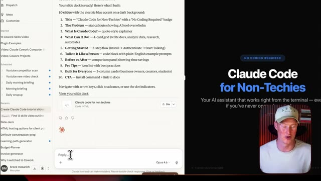
*⏱️ 00:06:30 — Interface divisée montrant l'application Co-work à gauche avec la liste des slides générées et la caméra du présentateur à droite.*

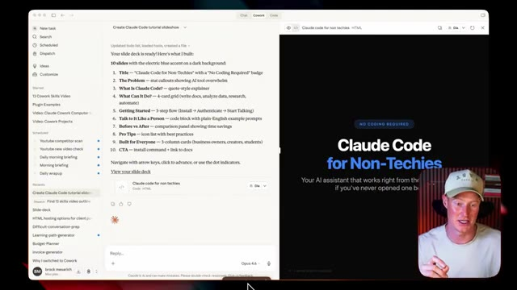
*⏱️ 00:06:47 — Vue similaire à l'image 1 montrant l'interface de l'application Co-work et un aperçu du diaporama de présentation web.*

---

### ⏱️ `[00:06:55 - 00:07:28]` | Segment #17

**🔊 Audio (Transcription Intégrale Mot pour Mot en Français) :**
> de mes compétences. Tout au long de cette vidéo, vous allez remarquer que certaines de ces compétences sont peut-être un peu adaptées à moi et à mon entreprise. Elle comprend le contexte me concernant et c'est spécifique à quelque chose pour lequel je l'utiliserais. Eh bien, cette compétence va en fait vous aider à personnaliser n'afin de ces différentes compétences que vous avez dans cowork. De cette façon, elle ajoute votre contexte, modifie l'instruction spécifique. Elle est donc spécifiée pour vous et pour tous ces différents éléments. Ainsi, elles peuvent fonctionner parfaitement pour vos cas d'utilisation. Donc, pour vous montrer exactement ce que je veux dire en utilisant cette compétence personnalisée ici, j'ai pris notre diaporama d'origine qu'elle a créé pour moi. J'ai basicamente dit en avant

**👁️ Analyse Visuelle d'Écran (gemini-3.5-flash-lite) :**
**Interface & Outils** : Navigateur web affichant une présentation de diapositives personnalisable, et application de type assistant IA avec interface en double panneau.

**Contenu textuel & Code** : Texte sur l'adaptation des compétences ("Customize", "Add your context") et structure de diaporama générée (10 slides sur Claude Code pour non-techniciens).

**Action / Démonstration** : Le présentateur explique comment personnaliser les compétences et ajouter du contexte personnel ou professionnel aux outils d'IA.

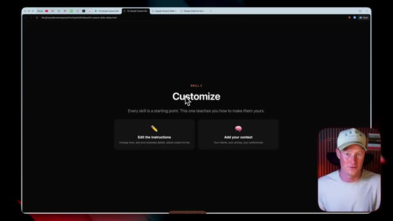
*⏱️ 00:07:04 — Une diapositive de présentation sur fond noir affichant le titre "Customize" avec deux options : "Edit the instructions" et "Add your context".*

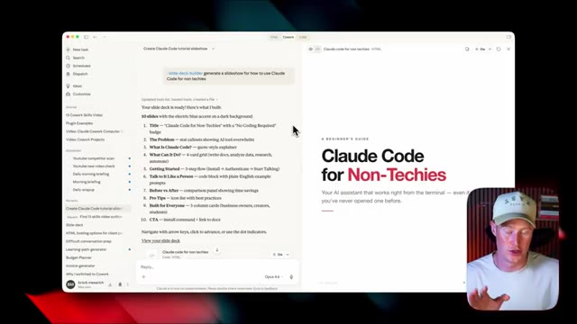
*⏱️ 00:07:20 — Une interface de type application ou tableau de bord divisée en deux panneaux, montrant la génération d'un diaporama intitulé "Claude Code for Non-Techies".*

---

### ⏱️ `[00:07:28 - 00:08:01]` | Segment #18

**🔊 Audio (Transcription Intégrale Mot pour Mot en Français) :**
> slash personnaliser, qui a invoqué cette compétence spécifique et a dit, aide-moi à personnaliser une compétence selon mes goûts spécifiques. Ensuite, cela m'a posé quelques questions différentes ici. Donc par exemple, quelle compétence veux-tu personnaliser ? Qu'est-ce qui est le plus important à personnaliser dans ta compétence de présentation de diapositives ? J'ai dit, je veux changer les couleurs de la marque et le style. Et j'ai en gros dit, je veux que l'ambiance visuelle ressemble davantage à un design de style suisse. Et juste comme ça, cela a effectivement généré cette version ici, que je pourrais réellement parcourir. Ça a l'air vraiment solide. C'est évidemment plus un design suisse avec en quelque sorte des accents de blanc, de noir et de rouge. Je trouve que ça a l'air vraiment cool et je

**👁️ Analyse Visuelle d'Écran (gemini-3.5-flash-lite) :**
**Interface & Outils** : Application Cowork / Interface de chat et de prévisualisation HTML, webcam du présentateur en bas à droite.

**Contenu textuel & Code** : Interface utilisateur interactive montrant les questions de personnalisation de compétences et la génération de code HTML/slides.

**Action / Démonstration** : Interaction avec l'assistant Cowork pour personnaliser les styles visuels et la mise en page des présentations.

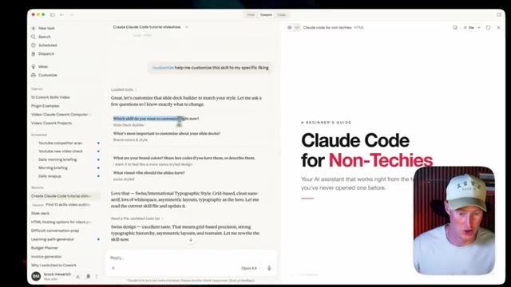
*⏱️ 00:07:36 — Interface de Cowork montrant le chat de personnalisation d'une compétence (Slide Deck Builder) avec aperçu HTML à droite.*

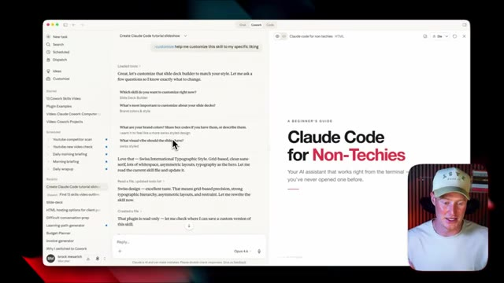
*⏱️ 00:07:45 — Poursuite de la conversation de personnalisation avec l'assistant IA listant les préférences visuelles de style suisse.*

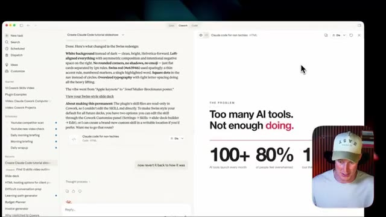
*⏱️ 00:07:53 — Résultat final de la refonte stylistique au format style suisse avec texte et métriques affichés.*

---

### ⏱️ `[00:08:01 - 00:08:33]` | Segment #19

**🔊 Audio (Transcription Intégrale Mot pour Mot en Français) :**
> Je vous conseille vivement, les gars, si vous utilisez l'une des compétences de cette vidéo, de les personnaliser à votre guise. La façon dont je les ai configurées me plaît, c'est tout. Vous pouvez les modifier comme vous voulez. C'est donc un diaporama vraiment solide maintenant. Et ce n'était qu'un exemple d'utilisation de la compétence personnalisée, mais vous pouvez le faire pour n'importe quelle compétence que je montre dans cette vidéo. Ensuite, nous avons la troisième compétence, qui concerne la préparation à des conversations difficiles. C'est donc une compétence que j'ai personnellement créée parce que je pense que beaucoup de gens peuvent utiliser quelque chose comme ça chaque jour, que ce soit pour parler avec un collègue, votre employeur, quel que soit le cas. Si je viens à

**👁️ Analyse Visuelle d'Écran (gemini-3.5-flash-lite) :**
**Interface & Outils** : Application de bureau avec panneau latéral de navigation, interface de chat d'IA et navigateur web affichant des diapositives de présentation.

**Contenu textuel & Code** : Texte de code et de discussion sur la personnalisation d'un diaporama de tutoriel, accompagnés d'une diapositive HTML minimaliste intitulée "Talk to it like a person".

**Action / Démonstration** : Présentation et démonstration de diapositives générées par IA et personnalisables pour des cas d'usage pratiques.

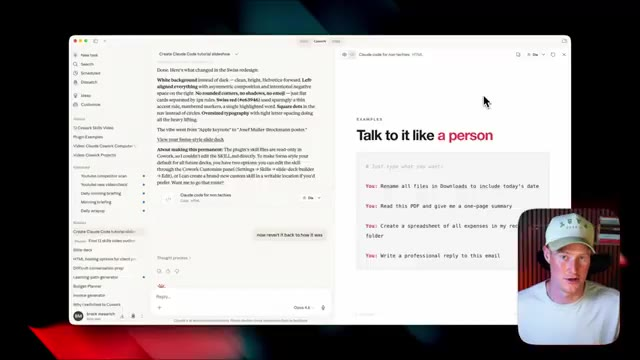
*⏱️ 00:08:09 — Interface logicielle en écran partagé montrant une discussion textuelle avec une IA à gauche et le rendu d'une diapositive HTML de présentation à droite, avec la webcam du présentateur en bas à droite.*

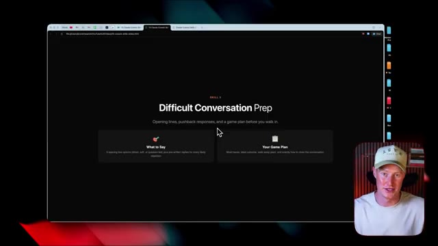
*⏱️ 00:08:25 — Capture d'écran d'une page de présentation web noire intitulée "Difficult Conversation Prep" avec des sections sur ce qu'il faut dire et le plan d'action, et la webcam du présentateur en bas à droite.*

---

### ⏱️ `[00:08:33 - 00:09:11]` | Segment #20

**🔊 Audio (Transcription Intégrale Mot pour Mot en Français) :**
> collègue, je vais littéralement dire : prépare-moi à une conversation difficile. Et remarquez que je ne mets pas de barre oblique pour donner le nom exact de la compétence. Je dis simplement, en gros, prépare-moi à une conversation difficile. Et il comprend que j'essaie d'invoquer cette compétence spécifique et il va aller la chercher. Et comme vous pouvez le voir maintenant, Claude me pose quelques questions de suivi, car c'est préconfiguré à l'intérieur de cette compétence afin d'obtenir tout le contexte dont il a besoin pour accomplir cette tâche pour moi. Disons donc qu'il s'agit d'une conversation professionnelle ou au travail. Quel est le problème principal ? Disons que la performance est le problème. La principale préoccupation en abordant cette conversation est de

**👁️ Analyse Visuelle d'Écran (gemini-3.5-flash-lite) :**
**Interface & Outils** : Application logicielle de bureau (Cowork / assistant IA) avec une disposition en colonnes (navigation à gauche, zone de chat centrale, panneau de progression à droite) et la vidéo du présentateur en incrustation (PiP) dans le coin inférieur droit.

**Contenu textuel & Code** : Le prompt textuel saisi par l'utilisateur "prep me for a difficult conversation", l'indicateur de chargement "Working on it...", et la sélection du modèle "Opus 4.4".

**Action / Démonstration** : L'utilisateur saisit un prompt en langage naturel pour invoquer une compétence spécifique sans utiliser de barre oblique, et l'assistant IA commence à traiter la demande.

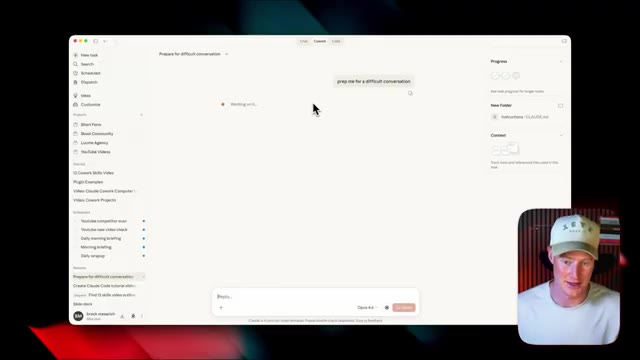
*⏱️ 00:08:43 — Capture d'écran montrant l'interface d'un assistant IA textuel (Cowork) avec la requête de l'utilisateur "prep me for a difficult conversation" en cours de traitement.*

---

### ⏱️ `[00:09:11 - 00:09:46]` | Segment #21

**🔊 Audio (Transcription Intégrale Mot pour Mot en Français) :**
> ne pas endommager la relation. Très bien, sélectionnons quelqu'un que je manage. Disons qu'il y a une sous-performance et nous pourrions aussi taper n'importe laquelle de ces réponses. Mais ceci, cela rend les choses vraiment simples afin d'obtenir tout le contexte et les besoins d'une manière modélisée. Très bien. Et juste comme ça, il a généré ce fichier markdown que je pourrais réellement visualiser, je pourrais l'ouvrir et encore une fois nous pourrions changer l'endroit où nous voulons qu'il nous soit envoyé, nous pourrions faire en sorte qu'il soit envoyé dans le chat, nous pourrions faire en sorte qu'il nous soit envoyé dans Slack, fondamentalement nous devons juste aller à l'échelle et dire je veux qu'il soit sorti comme ça et expliquer exactement comment nous voulons qu'il soit créé donc si je lis ceci, on dirait qu'il y a une chose « avant de commencer » juste ici donc la mentalité ce n'est pas une conversation de punition c'est tu

**👁️ Analyse Visuelle d'Écran (gemini-3.5-flash-lite) :**
**Interface & Outils** : Interface de l'application de productivité et de coaching Cowork / Claude.

**Contenu textuel & Code** : Questions contextuelles (sous-performance, gestion d'équipe) et document de préparation structuré au format Markdown.

**Action / Démonstration** : Interaction avec l'assistant IA pour affiner et générer un guide détaillé de gestion managériale.

*⏱️ 00:09:19 — L'assistant virtuel pose des questions contextuelles sur la conversation difficile à préparer concernant un employé sous-performant.*

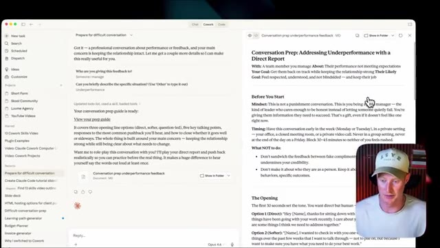
*⏱️ 00:09:28 — Le panneau latéral affiche un guide complet de préparation de conversation généré par l'IA pour aborder la sous-performance.*

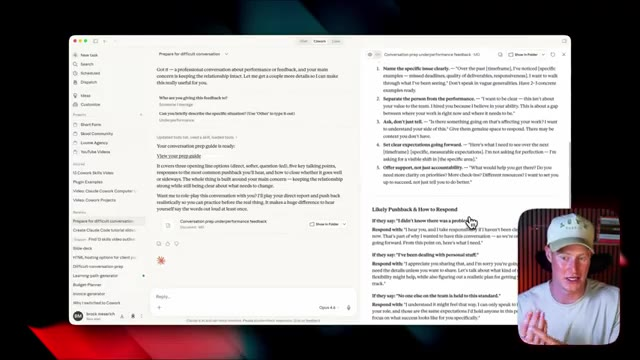
*⏱️ 00:09:37 — Le guide affiche des conseils pratiques et des exemples de réponses aux objections probables ("pushback") de l'employé.*

---

### ⏱️ `[00:09:46 - 00:10:05]` | Segment #22

**🔊 Audio (Transcription Intégrale Mot pour Mot en Français) :**
> être un bon manager donc c'est un peu comme vous faire vous sentir mieux à l'idée d'avoir cette conversation Ça suggère de l'avoir tôt dans la semaine dans un endroit privé. Ne faites pas ça. Ça me donne même des retours sur ce qu'il ne faut pas faire. Ça explique en quelque sorte l'introduction de la façon dont nous pourrions réellement, vous savez, commencer cette conversation. Des points clés à aborder. Donc au cours de la dernière période, j'ai remarqué des exemples précis.

**👁️ Analyse Visuelle d'Écran (gemini-3.5-flash-lite) :**
**Interface & Outils** : Application de productivité textuelle (type Claude Cowork / interface de gestion de projet) avec panneau de prévisualisation de documents.

**Contenu textuel & Code** : Texte généré par IA structuré en sections : "Mindset", "Timing", "What NOT to do", "The Opening", et "Key Points to Make".

**Action / Démonstration** : Le présentateur commente le contenu généré par l'IA concernant la gestion des feedbacks négatifs et la préparation des entretiens managériaux.

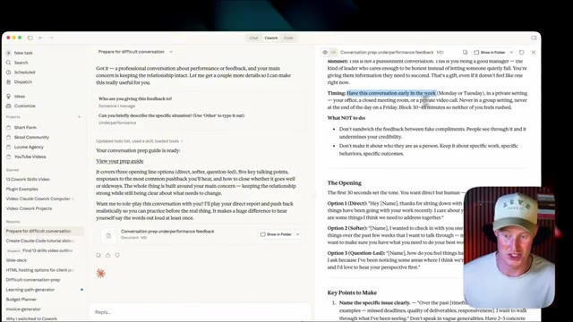
*⏱️ 00:09:51 — Vue d'une interface de type application de productivité avec un panneau latéral de discussion et un document généré à droite concernant la préparation d'une conversation difficile, avec la caméra du présentateur en bas à droite.*

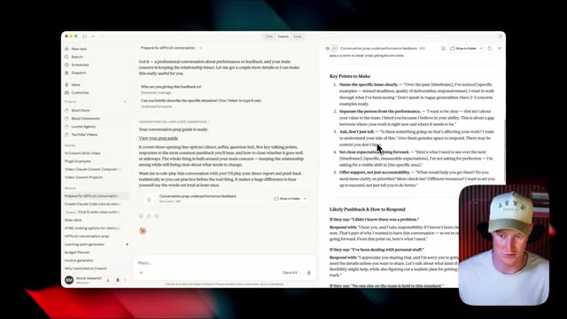
*⏱️ 00:10:00 — Défilement vers le bas dans le document de préparation de conversation affichant les points clés à aborder et les objections probables.*

---

### ⏱️ `[00:10:05 - 00:10:41]` | Segment #23

**🔊 Audio (Transcription Intégrale Mot pour Mot en Français) :**
> Je veux parler de ce que j'ai pu observer. C'est un cas d'usage dont je pense que beaucoup de gens peuvent tirer profit. Et c'est super simple à utiliser. Dites simplement, j'ai besoin d'aide pour une conversation difficile. Cela va déclencher cette compétence et ensuite nous l'afficherons dans ce fichier markdown facile à lire ici, que nous pourrions, vous savez, envoyer sur Slack ou autre. Donc, avant de passer à la suite et de vous montrer le reste des compétences, je veux parler très rapidement de quelque chose qui va instantanément donner des super-pouvoirs à Claude, et c'est d'associer vos compétences à des tâches planifiées. Ainsi, n'importe quelle compétence que nous créons, nous pouvons en fait la transformer en une tâche récurrente, que ce soit toutes les heures, toutes les trois heures, une fois par jour, chaque semaine, à la fin du mois, toutes ces différentes tâches, nous pouvons en fait les planifier à l'intérieur.

**👁️ Analyse Visuelle d'Écran (gemini-3.5-flash-lite) :**
**Interface & Outils** : Application Claude Cowork et interface de présentation web.

**Contenu textuel & Code** : Guide de préparation pour conversation difficile et options de tâches planifiées (Scheduled Tasks).

**Action / Démonstration** : Navigation dans l'application Claude Cowork et présentation des fonctionnalités d'automatisation.

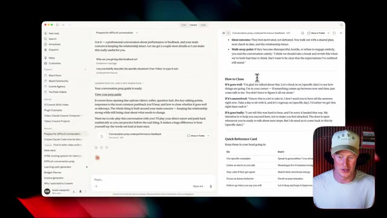
*⏱️ 00:10:14 — Capture d'écran montrant l'application Claude Cowork avec un guide de préparation pour une conversation difficile sur les performances.*

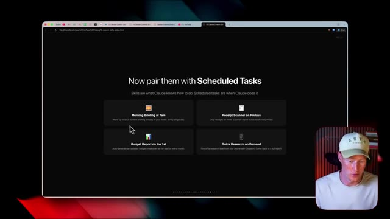
*⏱️ 00:10:32 — Diapositive de présentation sur fond noir montrant la fonctionnalité 'Scheduled Tasks' avec différentes options comme Morning Briefing, Receipt Scanner et Budget Report.*

---

### ⏱️ `[00:10:41 - 00:11:01]` | Segment #24

**🔊 Audio (Transcription Intégrale Mot pour Mot en Français) :**
> de Claude pour vous montrer exactement ce que je veux decir, passons à la compétence numéro quatre que nous pourrions associer à une tâche planifiée afin de l'exécuter chaque semaine. Cette compétence est fondamentalement un moyen pour moi de déposer tous mes reçus dans un dossier sur mon ordinateur, puis Claude catégorisera automatiquement tout ce sur quoi j'ai dépensé de l'argent et générera un tableur entier pour moi.

**👁️ Analyse Visuelle d'Écran (gemini-3.5-flash-lite) :**
**Interface & Outils** : Navigateur web affichant une page de présentation de compétence (Skill 4).

**Contenu textuel & Code** : Texte « SKILL 4 : Receipt Scanner » avec le sous-titre « Drop a folder of PDF receipts. Get a categorized expense report spreadsheet. » et trois étapes schématiques (INPUT : PDF receipts, PROCESS : Scan & categorize, OUTPUT : XLSX report).

**Action / Démonstration** : Présentation visuelle de la quatrième compétence automatisée concernant le scan de reçus par le présentateur.

*⏱️ 00:10:46 — Capture d'écran montrant une interface de présentation avec le titre « Skill 4: Receipt Scanner » et une description du fonctionnement.*

---

### ⏱️ `[00:11:01 - 00:11:20]` | Segment #25

**🔊 Audio (Transcription Intégrale Mot pour Mot en Français) :**
> C'est quelque chose que, par le passé, j'aurais dû payer un comptable ou un teneur de livres pour le faire, mais maintenant je peux simplement demander à l'intelligence artificielle de le faire pour moi automatiquement. Pour vous montrer exactement ce que je veux dire, j'ai ce dossier sur mon bureau qui contient essentiellement un tas de différents reçus aléatoires ici que j'ai réellement accumulés à l'intérieur de ce dossier. Donc, plusieurs éléments clés ici se sont produits. Elle a réellement extrait et lu ces reçus.

**👁️ Analyse Visuelle d'Écran (gemini-3.5-flash-lite) :**
**Interface & Outils** : Navigateur web, explorateur de fichiers macOS (Finder) et aperçu de documents PDF.

**Contenu textuel & Code** : Fichiers PDF de reçus d'achat (Amazon, Trader Joe's) et interface de présentation d'un outil de scan de reçus par IA.

**Action / Démonstration** : Navigation dans un dossier de reçus sur le bureau pour illustrer le traitement automatisé des factures.

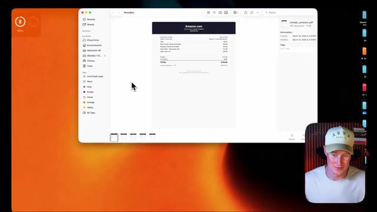
*⏱️ 00:11:11 — Explorateur de fichiers macOS affichant un dossier nommé "Receipts" contenant un reçu Amazon au format PDF.*

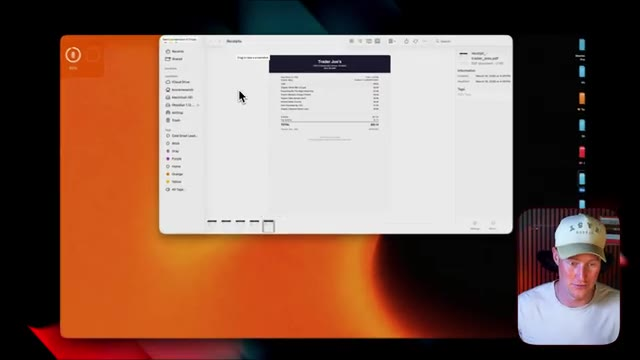
*⏱️ 00:11:16 — Explorateur de fichiers macOS affichant le même dossier "Receipts" avec un reçu Trader Joe's au format PDF.*

---

### ⏱️ `[00:11:20 - 00:11:39]` | Segment #26

**🔊 Audio (Transcription Intégrale Mot pour Mot en Français) :**
> Il l'a ajouté à cette sorte d'interface de travail partagé ici, ce qui est vraiment super. Il détaille le total général, tout ça. C'est génial. Mais un point clé sur lequel je veux me concentrer maintenant, ce sont ces deux résultats qu'il nous donne. Donc tout d'abord, je clique là-dessus. C'est un tableur qu'il a réellement généré pour nous. Automatiquement, nous n'avons rien eu à faire de tout cela. Et ensuite, nous obtenons même un tableau de bord de notes de frais.

**👁️ Analyse Visuelle d'Écran (gemini-3.5-flash-lite) :**
**Interface & Outils** : Présentation ou face-caméra explicatif du trader sans interface logicielle partagée.

**Contenu textuel & Code** : Explications orales des stratégies et mise en contexte méthodologique du marché.

**Action / Démonstration** : Explications face caméra et analyse conceptuelle des marchés.

---

### ⏱️ `[00:11:40 - 00:12:02]` | Segment #27

**🔊 Audio (Transcription Intégrale Mot pour Mot en Français) :**
> Et si j'ouvre ceci dans mon navigateur, vous pouvez le voir avec un peu plus de détails. Cela montre la dépense totale, le prix moyen par reçu, la taxe totale payée, tout ça. Ça nous ventile essentiellement tout ça. Et encore une fois, nous pourrions personnaliser cela comme nous le voulons. Changer le design, changer les différents points de données qu'il ajoute. C'est juste un cas d'usage sympa qui pourrait être immédiatement utile à toute personne qui a certaines dépenses et veut les suivre chaque semaine.

**👁️ Analyse Visuelle d'Écran (gemini-3.5-flash-lite) :**
**Interface & Outils** : Navigateur web affichant un rapport de dépenses personnalisé (Expense Report).

**Contenu textuel & Code** : Dépense totale (347,33 $), prix moyen par reçu, taxe totale payée, dépenses par catégorie, et liste des reçus.

**Action / Démonstration** : Présentation et explication du rapport de dépenses interactif généré par l'IA dans le navigateur.

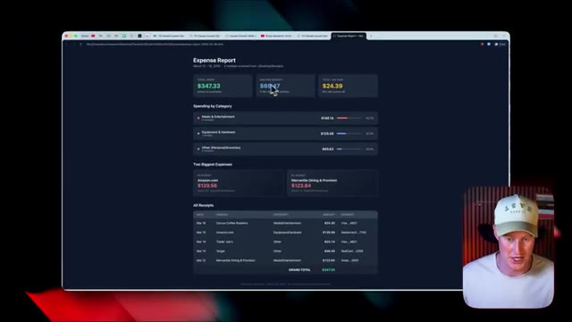
*⏱️ 00:11:45 — Capture d'écran montrant un rapport de dépenses détaillé dans un navigateur web avec des graphiques et des tableaux récapitulatifs, et le présentateur en médaillon.*

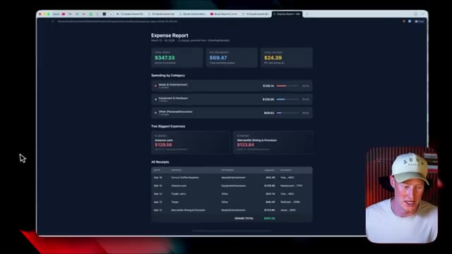
*⏱️ 00:11:56 — Capture d'écran similaire montrant le rapport de dépenses interactif avec le détail des coûts et des taxes, et le présentateur en bas à droite.*

---

### ⏱️ `[00:12:02 - 00:12:20]` | Segment #28

**🔊 Audio (Transcription Intégrale Mot pour Mot en Français) :**
> So now that we actually have this, how do we turn this into a scheduled task? And that is so simple to do. Either I could come into the chat and say, turn this into a scheduled task, or I could come up here, click on schedule. it'll pull up this prompt and say, I want you to turn this into a scheduled task that runs every single Friday at 5 p.m. at the end of the week. So I just give it that prompt.

**👁️ Analyse Visuelle d'Écran (gemini-3.5-flash-lite) :**
**Interface & Outils** : Interface de l'application (type Claude Cowork / dashboard) séparée en deux volets avec un panneau de discussion et un tableau de bord HTML.

**Contenu textuel & Code** : Menus d'options de tâche (Schedule, Turn into, Move to project, Star, Rename, Archive) et commande `/schedule`.
[DESC_IMAGE_1] (Non retenue)

**Action / Démonstration** : Sélectionner l'option de planification d'une tâche à partir du menu déroulant et de la barre de chat.

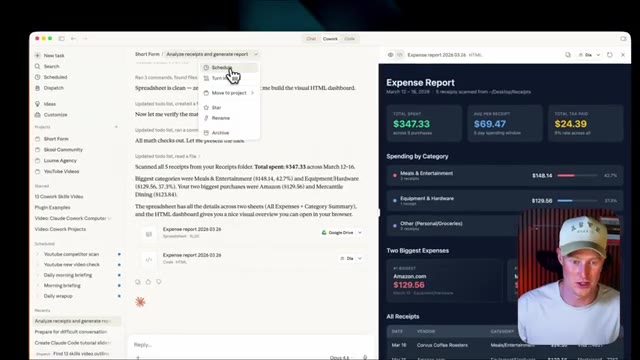
*⏱️ 00:12:11 — Le curseur clique sur le menu déroulant en haut pour sélectionner l'option de planification (Schedule).*

*⏱️ 00:12:16 — Le curseur montre la commande de planification `/schedule` tapée dans la zone de chat en bas.*

---

### ⏱️ `[00:12:20 - 00:12:45]` | Segment #29

**🔊 Audio (Transcription Intégrale Mot pour Mot en Français) :**
> Let's give it a second and it will come back once this is a scheduled task and I'll show you what that looks like. So what it's doing is it's asking if it could run this on a schedule. I'm just gonna click on schedule and now you can see every single day at 5 p.m. only on Fridays, this will run. And if I wanna see all those scheduled tasks that I have, I could come up here, click on scheduled and then we have all of them broken down and we now have the weekly receipt scanner, which we could actually make changes to if we would like.

**👁️ Analyse Visuelle d'Écran (gemini-3.5-flash-lite) :**
**Interface & Outils** : Interface Cowork (application de productivité IA)

**Contenu textuel & Code** : Configuration de tâches planifiées (scheduled tasks), instructions pour le scan de reçus et tableaux de bord financiers HTML.

**Action / Démonstration** : Programmation d'une tâche automatisée récurrente pour exécuter l'analyse de reçus et la génération de rapports chaque vendredi à 17h00.

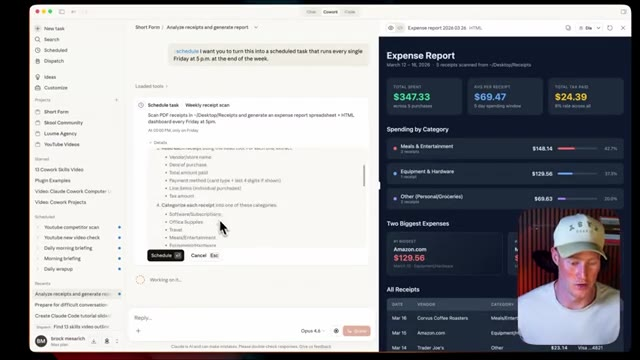
*⏱️ 00:12:27 — Interface de l'application Cowork affichant une tâche de scan de reçus programmée pour s'exécuter chaque vendredi à 17h00, avec un tableau de bord HTML des dépenses sur le côté droit.*

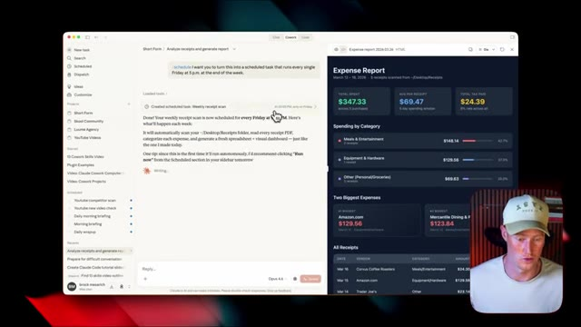
*⏱️ 00:12:33 — Confirmation de la création de la tâche planifiée dans Cowork, indiquant que le scan hebdomadaire des reçus est configuré pour chaque vendredi à 17h00.*

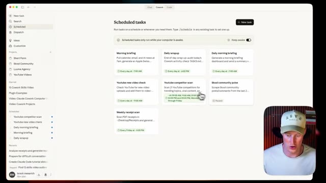
*⏱️ 00:12:39 — Vue d'ensemble de la section "Scheduled tasks" dans Cowork montrant plusieurs cartes de tâches automatisées avec leurs horaires d'exécution respectifs.*

---

### ⏱️ `[00:12:46 - 00:13:07]` | Segment #30

**🔊 Audio (Transcription Intégrale Mot pour Mot en Français) :**
> Moving on to skill five, and I would probably place this in my top three to five skills that I have that I use on a daily basis. And this is my explainer graphic skill. So basically we could give any concept, it will build a full infographic page with real world analogies to help explain something to me. And I found this incredibly helpful specifically when using Cloud Cowork or AI in general.

**👁️ Analyse Visuelle d'Écran (gemini-3.5-flash-lite) :**
**Interface & Outils** : Navigateur web ou outil de présentation (slides).

**Contenu textuel & Code** : Texte à l'écran : "Explainer Graphic", "Give it any concept. It builds a full visual infographic page with real-world analogies", ainsi que trois points clés sur les infographies HTML, les analogies et l'utilisation dans les présentations.

**Action / Démonstration** : Présentation de la compétence "Explainer Graphic" illustrant la création automatique de pages infographiques basées sur des concepts et des analogies.

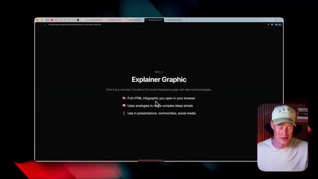
*⏱️ 00:12:51 — Capture d'écran montrant une interface de présentation avec un titre "Explainer Graphic" et une description des fonctionnalités, avec une petite fenêtre incrustée du présentateur en bas à droite.*

---

### ⏱️ `[00:13:07 - 00:13:31]` | Segment #31

**🔊 Audio (Transcription Intégrale Mot pour Mot en Français) :**
> So I'll do research on something, but I need it broken down in a bite-sized way for me to understand and really learn. So if you're in school or you need to do a lot of research, this one will be a game changer I am telling you. So let me show you exactly what I mean. If I pull up my Cloud Cowork, you can see I gave the prompt explainer graphic, create an explainer about how bridges get built over water, and it generated this HTML page for me that I could actually go through.

**👁️ Analyse Visuelle d'Écran (gemini-3.5-flash-lite) :**
**Interface & Outils** : Application Claude Cowork et interface web de prévisualisation HTML.

**Contenu textuel & Code** : Plan détaillé, analogies (bâtir un pont comme une clôture sur un étang), layout en étapes empilées et code HTML généré.
[DESC_IMAGE_1] Non retenue.

**Action / Démonstration** : Navigation et présentation de la génération automatisée d'infographies explicatives à partir d'un prompt textuel.

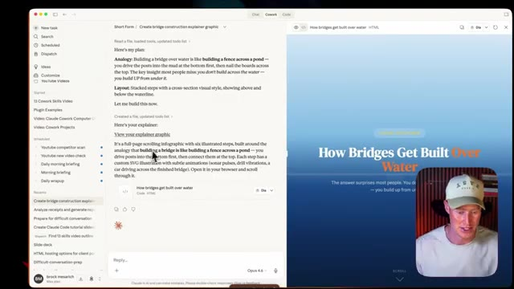
*⏱️ 00:13:19 — Interface de Claude Cowork divisée en deux panneaux montrant le processus de génération d'une infographie sur la construction des ponts.*

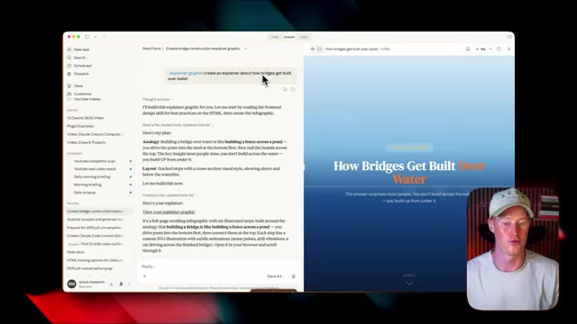
*⏱️ 00:13:25 — Vue similaire de l'interface Claude Cowork avec le prompt actif demandant de créer une explication sur la construction des ponts au-dessus de l'eau.*

---

### ⏱️ `[00:13:31 - 00:14:06]` | Segment #32

**🔊 Audio (Transcription Intégrale Mot pour Mot en Français) :**
> Donc, laissez-moi faire défiler maintenant. Donc, ne construisez pas un pont par-dessus l'eau. Vous le construisez depuis le bas. C'est comme construire une clôture autour de l'étang. Donc, ça décompose une analogie très simple ici et ensuite ça montre même des graphiques ici. Donc, ça dit inspecter le site, construire un coffer-dam [batardeau]. C'est super intéressant. Je n'ai jamais, vous savez, su comment tout cela fonctionne et vous pouvez voir que c'est comme animé pour forer jusqu'au roc de fond [rocher de fondation]. Je veux dire, c'est fou, ça montre un sol mou, l'argile, la roche de défense, le rocher de fondation. C'est plutôt cool. Donc, vous pouvez voir, je veux dire, regardez ça. Ça a cette animation. Vous pouvez voir comment vous pouvez prendre n'importe quel sujet très complexe et le transformer en

**👁️ Analyse Visuelle d'Écran (gemini-3.5-flash-lite) :**
**Interface & Outils** : Application de type interface de chat/génération de contenu (Claude Artifacts) et webcam du présentateur.

**Contenu textuel & Code** : Texte explicatif utilisant l'analogie "It's like building a fence across a pond" et des illustrations graphiques interactives.

**Action / Démonstration** : Le présentateur présente un graphique explicatif généré par l'IA détaillant une analogie visuelle.

*⏱️ 00:13:39 — Interface d'une application montrant la génération d'un graphique explicatif sur la construction de ponts avec une analogie sur la clôture.*

---

### ⏱️ `[00:14:06 - 00:14:40]` | Segment #33

**🔊 Audio (Transcription Intégrale Mot pour Mot en Français) :**
> site HTML infographique juste comme celui-ci pour vous guider à travers n'importe quoi. Et cela a été généré en utilisant cette compétence en une seule invite simple. Donc, si vous discutez avec Claude Cowork, par exemple, et que vous avez besoin qu'il explique quelque chose, vous pouvez simplement dire à Claude, transforme-le en infographie explicative et il le fera pour vous. Passant à la compétence six, c'est une dont chaque personne a probablement besoin. Je ne vais pas passer en revue à quoi ça ressemble, tout ça. C'est assez explicite. C'est un rédacteur d'e-mails. Donc, chaque fois que j'ai de la prospection à froid, des suivis ou des négociations spécifiques pour lesquelles j'ai besoin d'aide, il crée automatiquement un e-mail spécifique adapté à n'importe quelle conversation spécifique.

**👁️ Analyse Visuelle d'Écran (gemini-3.5-flash-lite) :**
**Interface & Outils** : Interface de Claude Cowork et navigateur web affichant des infographies HTML et des outils textuels.

**Contenu textuel & Code** : Interface utilisateur avec des fenêtres divisées montrant le processus de génération d'infographies par IA et des modules de compétences.

**Action / Démonstration** : Le présentateur montre des exemples d'applications pratiques générées automatiquement par IA via Claude Cowork.

*⏱️ 00:14:14 — Interface de Claude Cowork affichant une infographie interactive générée sur la construction de ponts avec le présentateur en bas à droite.*

*⏱️ 00:14:23 — Page web affichant une application ou un outil intitulé "Email Drafter" avec des options de sélection de situations.*

---

### ⏱️ `[00:14:40 - 00:15:14]` | Segment #34

**🔊 Audio (Transcription Intégrale Mot pour Mot en Français) :**
> automatiquement pour moi. Et le meilleur aspect de cette compétence, c'est que vous pouvez la connecter à Gmail. Elle est donc capable de récupérer tous vos e-mails de la journée, de les résumer et même de rédiger ces réponses pour vous. Très bien. Ensuite, nous avons la compétence numéro sept. Et c'est une autre compétence de visualisation que j'aime vraiment. Je pense que c'est l'une de mes choses préférées dans Cowork : générer des façons de visualiser des données spécifiques. Laissez-moi donc vous montrer exactement comment cela fonctionne. Fondamentalement, il y a des sections interactives. Vous pouvez parcourir des animations et des transitions fluides, et c'est parfait pour toute ressource communautaire ou même pour de la documentation détaillant exactement comment votre Cloud Cowork, Cloud Code

**👁️ Analyse Visuelle d'Écran (gemini-3.5-flash-lite) :**
**Interface & Outils** : Présentation ou face-caméra explicatif du trader sans interface logicielle partagée.

**Contenu textuel & Code** : Explications orales des stratégies et mise en contexte méthodologique du marché.

**Action / Démonstration** : Explications face caméra et analyse conceptuelle des marchés.

---

### ⏱️ `[00:15:14 - 00:15:46]` | Segment #35

**🔊 Audio (Transcription Intégrale Mot pour Mot en Français) :**
> les systèmes fonctionnent, donc vous pouvez en quelque sorte visualiser cela. Donc laissez-moi revenir dans Cowork. Donc je vous ai fondamentalement donné le prompt constructeur de pages visuelles et je lui ai dit d'en créer une appelée comment fonctionnent réellement les grands modèles de langage afin que je puisse vraiment décomposer cela et ce qu'il a fait, c'est qu'il a généré ce site HTML pour moi qui est fondamentalement juste comme un guide approfondi sur le fonctionnement exact des LLM et c'est un excellent moyen pour nous de condenser fondamentalement n'information, que nous fassions des recherches sur quelque chose ou que nous voulions simplement apprendre quelque chose en profondeur d'une manière que nous puissions en quelque sorte voir cela sous forme d'informations digestes à l'intérieur d'un tableau de bord spécifique, vous savez, ici. Vous pouvez voir qu'il parle

**👁️ Analyse Visuelle d'Écran (gemini-3.5-flash-lite) :**
**Interface & Outils** : Cowork / Navigateur web (éditeur de code et prévisualisation HTML)

**Contenu textuel & Code** : Plan de génération de contenu, spécifications des sections (« The Scale », « Training Pipeline », « LLMs vs Traditional Software »), cartes statistiques (paramètres, tokens, coûts).

**Action / Démonstration** : Présentation de la création automatique d'une page web explicative interactive par l'assistant IA de Cowork.

*⏱️ 00:15:22 — Interface de Cowork montrant le plan et la génération d'un visualiseur HTML sur le fonctionnement des LLM.*

*⏱️ 00:15:30 — Aperçu du rendu visuel HTML affichant les cartes de statistiques sur l'échelle des modèles de langage.*

*⏱️ 00:15:38 — Aperçu du rendu visuel HTML affichant le tableau comparatif entre logiciels traditionnels et grands modèles de langage.*

---

### ⏱️ `[00:15:46 - 00:16:21]` | Segment #36

**🔊 Audio (Transcription Intégrale Mot pour Mot en Français) :**
> à propos de ce qui se cache derrière le rideau, de ce que fait réellement un prompt. Donc ça décompose cela de manière assez complète. Et ça décompose même en quelque sorte les idées reçues les plus courantes sur les LLM en disant que les LLM recherchent sur Internet et tout un tas de choses différentes. Donc, tout un tas de cas d'utilisation différents pour lesquels vous pouvez utiliser ceci, littéralement de la manière que vous voulez pour condenser l'information. C'est une excellente façon de le faire. Très bien, alors ensuite, nous avons la compétence numéro huit, et c'est pour la génération de factures. Personnellement, j'avais l'habitude d'utiliser un logiciel de génération de factures et c'était pénible à utiliser. Donc maintenant, j'ai fondamentalement une compétence qui sait exactement comment je veux générer mes factures. Donc à chaque fois que j'en ai une, je peux simplement l'expliquer en une seule phrase et cela les générera en pilotage automatique. C'est probablement, sans

**👁️ Analyse Visuelle d'Écran (gemini-3.5-flash-lite) :**
**Interface & Outils** : Navigateur web affichant une application web de génération de factures (Invoice Generator).

**Contenu textuel & Code** : Interface utilisateur minimaliste avec le titre "Invoice Generator", un texte explicatif et des boutons d'options ("CLIENT: ABC Company", "SERVICE: 10hrs @ $150", "OUTPUT: 📄 PDF Invoice").

**Action / Démonstration** : Le présentateur présente une application web ou un exemple de projet d'automatisation/facturation créé avec l'aide d'une IA.

*⏱️ 00:16:12 — Capture d'écran d'un navigateur affichant une interface web sur fond noir intitulée "Invoice Generator", avec une incrustation vidéo du présentateur en bas à droite.*

---

### ⏱️ `[00:16:21 - 00:16:44]` | Segment #37

**🔊 Audio (Transcription Intégrale Mot pour Mot en Français) :**
> l'une des choses les plus pratiques que j'ai construites à l'intérieur de Cloud Cowork que j'utilise pratiquement tous les jours chaque fois que j'envoie une facture. En arrivant dans Cowork, je lui ai simplement donné la consigne de générer une facture pour Bob. C'est pour du travail de prestation en IA pour 75 000 dollars. Invente le reste des détails parce que je ne voulais pas montrer un cas d'utilisation réellement confidentiel ici. Je pourrais donc cliquer là-dessus et ouvrir le PDF. Pour une raison quelconque, cela ne charge pas. Cependant, cela va généralement se charger.

**👁️ Analyse Visuelle d'Écran (gemini-3.5-flash-lite) :**
**Interface & Outils** : Application Cloud Cowork, interface utilisateur de génération de documents.

**Contenu textuel & Code** : Prompt utilisateur « /invoice-generator generate an invoice for Bob. this is for AI contracting work for $75,000 » et réponse textuelle de l'IA avec détails de calculs et lien vers le fichier PDF généré.

**Action / Démonstration** : Démonstration de la création automatisée d'une facture de prestation de services via l'assistant IA de Cloud Cowork.

*⏱️ 00:16:33 — Interface de l'application Cloud Cowork montrant le prompt de génération de facture pour Bob avec un aperçu PDF dans le panneau latéral.*

*⏱️ 00:16:39 — Vue rapprochée de l'interface de Cloud Cowork mettant en avant le résultat de la génération de facture en format PDF.*

---

### ⏱️ `[00:16:45 - 00:17:19]` | Segment #38

**🔊 Audio (Transcription Intégrale Mot pour Mot en Français) :**
> Donc je pourrais simplement cliquer sur afficher dans le Finder et cela va ouvrir ce fichier spécifique. Et cela montre fondamentalement la facture pour ces quatre services différents ici, en détaillant les tarifs, contient toutes mes informations ici, contient le numéro de facture, la date, la date d'échéance, tout cela, contient même les conditions de paiement et tout le reste. Donc tout cela est préconfiguré à l'intérieur de la compétence. Vous pouvez personnaliser cela comme vous voulez. Vous pouvez en changer le design, la mise en page, toutes ces différentes choses et le personnaliser à votre guise. Pour continuer, nous en avons un autre qui tombe un peu dans la même catégorie ici, et c'est un réviseur de contrats. Donc fondamentalement, vous pouvez y coller n'importe quel contrat ou fondamentalement le faire fouiller dans vos e-mails, trouver un contrat, et ensuite ce qu'il fera

**👁️ Analyse Visuelle d'Écran (gemini-3.5-flash-lite) :**
**Interface & Outils** : Système d'exploitation macOS et navigateur web affichant une application web de revue de contrat.

**Contenu textuel & Code** : Facture détaillée pour des services de conseil en IA (montant total 75 000 $) et interface d'analyse de contrats juridiques.
[DESC_IMAGE_3] Présentation d'une interface logicielle d'analyse et de révision de contrats.

**Action / Démonstration** : Explications face caméra et analyse conceptuelle des marchés.

*⏱️ 00:16:53 — Aperçu d'une facture professionnelle de Brock Mesarich affichée sur macOS.*

*⏱️ 00:17:02 — Vue légèrement ajustée de la même facture professionnelle affichée sur l'écran.*

*⏱️ 00:17:10 — Interface web montrant l'outil "Contract Reviewer" avec des options comme Red Flags, Missing Terms et What to Negotiate.*

---

### ⏱️ `[00:17:19 - 00:17:37]` | Segment #39

**🔊 Audio (Transcription Intégrale Mot pour Mot en Français) :**
> c'est qu'il va ajouter des signaux d'alerte spécifiques qui sont des clauses qui pourraient potentiellement vous nuire, des termes manquants, et fondamentalement ce que vous devriez négocier. Donc je fais cela tout le temps pour des contrats spécifiques pour mon entreprise. Donc je lui ai donné cet accord spécifique ici que j'ai généré. Donc si je sors ceci, vous pourriez y jeter un œil. C'est fondamentalement juste un accord contractuel.

**👁️ Analyse Visuelle d'Écran (gemini-3.5-flash-lite) :**
**Interface & Outils** : Présentation ou face-caméra explicatif du trader sans interface logicielle partagée.

**Contenu textuel & Code** : Explications orales des stratégies et mise en contexte méthodologique du marché.

**Action / Démonstration** : Explications face caméra et analyse conceptuelle des marchés.

---

### ⏱️ `[00:17:37 - 00:17:57]` | Segment #40

**🔊 Audio (Transcription Intégrale Mot pour Mot en Français) :**
> Et encore une fois, c'est juste de fausses informations ici. Je ne voulais pas utiliser l'un de mes vrais contrats. J'ai donc téléchargé ça, j'ai juste dit réviseur de contrats. Et ensuite, ce qu'il a fait, c'est qu'il a parcouru cette compétence. Et je ne vais pas passer en revue tout ça, mais vous pouvez voir que c'est une compétence de révision de contrats. Fondamentalement, il prend l'entrée, la traite, crée le format de sortie, et passe par des types de contrats spécifiques.

**👁️ Analyse Visuelle d'Écran (gemini-3.5-flash-lite) :**
**Interface & Outils** : Application web d'intelligence artificielle (type agent/compétence personnalisée).

**Contenu textuel & Code** : Documentation et instructions de la compétence « Contract Reviewer », affichant les sections « Input », « Process » et les consignes de format de sortie pour analyser des documents légaux.

**Action / Démonstration** : Le présentateur commente l'utilisation d'une compétence d'IA pour analyser un faux contrat téléchargé, montrant le résumé généré et les points de vigilance identifiés.

*⏱️ 00:17:42 — Capture d'écran montrant l'interface d'un outil d'intelligence artificielle dédié à la révision de contrats, avec le présentateur en incrustation vidéo dans le coin inférieur droit.*

---

### ⏱️ `[00:17:57 - 00:18:17]` | Segment #41

**🔊 Audio (Transcription Intégrale Mot pour Mot en Français) :**
> So freelance, contractor agreements, NDAs, employment contracts, all this stuff. This is like a pretty broken down skill here. So if you wanna make this even more refined for your specific use case, you completely can just by clicking manage and then basically clicking edit and customizing it with clock. However, if I go down, you could see that it generated this markdown file for me, breaking down every single thing inside of the contract.

**👁️ Analyse Visuelle d'Écran (gemini-3.5-flash-lite) :**
**Interface & Outils** : Présentation ou face-caméra explicatif du trader sans interface logicielle partagée.

**Contenu textuel & Code** : Explications orales des stratégies et mise en contexte méthodologique du marché.

**Action / Démonstration** : Explications face caméra et analyse conceptuelle des marchés.

---

### ⏱️ `[00:18:17 - 00:18:37]` | Segment #42

**🔊 Audio (Transcription Intégrale Mot pour Mot en Français) :**
> So this is a great way for me to basically get kind of an understanding of all the things in a contract that I might need to renegotiate or take a deeper look at. So you could see it shows the short version, shows the key terms, specific red flags, yellow flags, what's missing, basically adds the bottom line, whether or not I should sign it, and then certain things that I should negotiate.

**👁️ Analyse Visuelle d'Écran (gemini-3.5-flash-lite) :**
**Interface & Outils** : Interface de type application de notes ou d'assistant IA (Claude / Notion ou similaire) avec une vue partagée.

**Contenu textuel & Code** : Document intitulé 'Contract Review - Professional Services Agreement' affichant un résumé, des points clés, des 'red flags' et une analyse détaillée des termes.

**Action / Démonstration** : Présentation d'un rapport d'analyse de contrat généré par IA, mettant en évidence les clauses à négocier et les points de vigilance.

*⏱️ 00:18:22 — Capture d'écran montrant une interface de révision de contrat par IA avec un panneau de chat à gauche et le document analysé à droite, ainsi que le présentateur en médaillon.*

---

### ⏱️ `[00:18:37 - 00:18:56]` | Segment #43

**🔊 Audio (Transcription Intégrale Mot pour Mot en Français) :**
> Ensuite, pour la dixième compétence, nous avons un visualiseur de flux de travail qui, si vous utilisez Co-Work, va être une fonctionnalité révolutionnaire, car disons que vous construisez un système spécifique ici et que vous voulez visualiser à quoi il va ressembler. C'est donc un cas d'utilisation pour lequel je l'utilise, mais vous pourriez l'utiliser pour des projets clients spécifiques ou fondamentalement pour n'importe quoi.

**👁️ Analyse Visuelle d'Écran (gemini-3.5-flash-lite) :**
**Interface & Outils** : Présentation ou face-caméra explicatif du trader sans interface logicielle partagée.

**Contenu textuel & Code** : Explications orales des stratégies et mise en contexte méthodologique du marché.

**Action / Démonstration** : Explications face caméra et analyse conceptuelle des marchés.

---

### ⏱️ `[00:18:56 - 00:19:14]` | Segment #44

**🔊 Audio (Transcription Intégrale Mot pour Mot en Français) :**
> It's a way to just visualize a bunch of different data. So let me show you exactly how this looks now. Here's one that I have for my specific business. This is my entire cloud code and cloud cowork system that runs my content business. It's called my business OS right here. Breaks down all the commands and skills that I use. And take a look at this.

**👁️ Analyse Visuelle d'Écran (gemini-3.5-flash-lite) :**
**Interface & Outils** : Présentation ou face-caméra explicatif du trader sans interface logicielle partagée.

**Contenu textuel & Code** : Explications orales des stratégies et mise en contexte méthodologique du marché.

**Action / Démonstration** : Explications face caméra et analyse conceptuelle des marchés.

---

### ⏱️ `[00:19:14 - 00:19:33]` | Segment #45

**🔊 Audio (Transcription Intégrale Mot pour Mot en Français) :**
> If I look at the master flow section, I can actually click on each of these and it shows each phase. So these are daily triggers. I have my morning briefing, my email briefing, my competitor intel, and it basically breaks down what each of these are. It goes through all the different phases. So phase two, ideation and research. Again, click on all of these. It's an interactive site.

**👁️ Analyse Visuelle d'Écran (gemini-3.5-flash-lite) :**
**Interface & Outils** : Présentation ou face-caméra explicatif du trader sans interface logicielle partagée.

**Contenu textuel & Code** : Explications orales des stratégies et mise en contexte méthodologique du marché.

**Action / Démonstration** : Explications face caméra et analyse conceptuelle des marchés.

---

### ⏱️ `[00:19:33 - 00:19:56]` | Segment #46

**🔊 Audio (Transcription Intégrale Mot pour Mot en Français) :**
> C'est super cool de pouvoir simplement visualiser comment fonctionne tout mon système Cloud Code, Cloud Cowork, parce que ça peut devenir un peu écrasant de ne pas pouvoir voir une représentation visuelle de ce qui se passe en arrière-plan. Je vous suggère donc vivement d'utiliser ceci à l'intérieur de Cowork pour vous simplifier la tâche. Ça montre même toutes les différentes commandes que j'ai. Comme ça, je peux me référer à ceci quand je veux, ça montre où toutes mes données sont stockées et ça montre même toutes mes différentes applications connectées et intégrations.

**👁️ Analyse Visuelle d'Écran (gemini-3.5-flash-lite) :**
**Interface & Outils** : Navigateur web affichant une application web interactive sous forme de diagramme et de tableau de bord de gestion de contenu.

**Contenu textuel & Code** : Schémas d'architecture, blocs fonctionnels de pipelines (YouTube, Instagram, Skool), et listes de fichiers de données JSON (`top_performing_content.json`, `youtube_performance.json`, etc.).

**Action / Démonstration** : Navigation et présentation visuelle de la carte système ("system map") du Content Business OS par le présentateur.

*⏱️ 00:19:39 — Vue d'ensemble du diagramme interactif "Brock's Content Business OS" montrant l'architecture complète du système cloud et des flux de travail.*

*⏱️ 00:19:50 — Affichage détaillé de la section "Data Stores" du tableau de bord "Brock's Content Business OS" listant les fichiers JSON de données et de stockage.*

---

### ⏱️ `[00:19:56 - 00:20:17]` | Segment #47

**🔊 Audio (Transcription Intégrale Mot pour Mot en Français) :**
> So I could be up to date with that and take a look at this. It even shows my different revenue engines that it knows that I have based on all the conversations I've had inside of co-work skill number 11. This might be my favorite skill that I have and I've covered it on this channel in the past and you guys have been saying that you've been loving this one. So I had to show it again. So this is my morning briefing skill that I have running every single morning.

**👁️ Analyse Visuelle d'Écran (gemini-3.5-flash-lite) :**
**Interface & Outils** : Navigateur web affichant un tableau de bord personnalisé et un système d'exploitation de contenu (Content Business OS).

**Contenu textuel & Code** : Diagrammes de flux, sections "Revenue Engines", modules "Morning Briefing" avec calendrier, actualité sectorielle (Industry News) et priorités.
[DESC_IMAGE_1] Navigation dans le tableau de bord interactif du système d'exploitation pour montrer les différents moteurs de revenus et processus métier.

**Action / Démonstration** : Explications face caméra et analyse conceptuelle des marchés.

*⏱️ 00:20:01 — Interface web affichant "Brock's Content Business OS" avec un aperçu des moteurs de revenus et des statistiques globales (55+ commandes, 10+ compétences).*

*⏱️ 00:20:07 — Interface de présentation de "Skill 11: Morning Briefing" montrant un tableau de bord HTML pour le calendrier, les actualités et les priorités.*

---

### ⏱️ `[00:20:17 - 00:20:35]` | Segment #48

**🔊 Audio (Transcription Intégrale Mot pour Mot en Français) :**
> So every single morning at 7 or 8 a.m., it sends me a morning briefing with basically everything that's on my calendar for the day, specific industry news, and even polls through my email inbox to find different emails I need to reply to that are urgent for the day. Let me show you exactly how this works. So let me just come over to scheduled tasks.

**👁️ Analyse Visuelle d'Écran (gemini-3.5-flash-lite) :**
**Interface & Outils** : Navigateur web affichant une page HTML locale ou un tableau de bord.

**Contenu textuel & Code** : Texte "SKILL 11 - Morning Briefing" avec la description "Full HTML dashboard with your calendar, priorities, and industry news. Every morning." et trois icônes représentant le calendrier, les actualités et les priorités.

**Action / Démonstration** : Présentation du tableau de bord matinal automatisé par l'IA.

*⏱️ 00:20:22 — Capture d'écran montrant l'interface d'un tableau de bord HTML nommé "Morning Briefing" avec trois sections principales : Calendar, Industry News et Priorities.*

---

### ⏱️ `[00:20:35 - 00:21:09]` | Segment #49

**🔊 Audio (Transcription Intégrale Mot pour Mot en Français) :**
> Et vous pouvez voir que j'ai cette tâche programmée appelée mon point matinal quotidien. Elle s'exécute tous les jours à 7 heures et elle a même accès à mon Slack. Donc non seulement elle va rassembler ces informations pour moi sur toutes ces plateformes différentes, mais elle va m'envoyer un message ici avec un tableau de bord HTML que je vais vous montrer, et elle va aussi m'envoyer un message sur Slack avec toutes ces choses différentes. Donc si je jette un œil à celle qui s'est exécutée ce matin, nous pouvons voir ceci juste ici. Donc elle a fondamentalement dit qu'il y avait 20 e-mails non lus, tout ce genre de choses. Donc je pourrais ouvrir mon point matinal, et c'est fondamentalement un tableau de bord avec pratiquement tout ce qui est sur ma liste pour aujourd'hui. Ça montre que mon emploi du temps est grand ouvert,

**👁️ Analyse Visuelle d'Écran (gemini-3.5-flash-lite) :**
**Interface & Outils** : Présentation ou face-caméra explicatif du trader sans interface logicielle partagée.

**Contenu textuel & Code** : Explications orales des stratégies et mise en contexte méthodologique du marché.

**Action / Démonstration** : Explications face caméra et analyse conceptuelle des marchés.

---

### ⏱️ `[00:21:09 - 00:21:41]` | Segment #50

**🔊 Audio (Transcription Intégrale Mot pour Mot en Français) :**
> montre des e-mails spécifiques auxquels je dois répondre, et il montre même des réponses suggérées que je pourrais envoyer. C'est donc un exemple parfait du moment où vous prenez une compétence, lui donnez accès à des connecteurs pour qu'elle puisse aller utiliser vos applications, puis la transformez en tâche planifiée, car c'est essentiellement une automatisation qui s'exécute sans vous. Maintenant, pour passer au point suivant que je dois souligner, c'est que les compétences sont bien meilleures avec des connecteurs, car les assistants peuvent faire des choses extraordinaires, mais s'ils n'ont pas accès aux applications que vous utilisez tous les jours, comme les e-mails, Google Calendar, Slack, ou quoi que ce soit d'autre que vous utilisez. Je ne sais pas ce que vous utilisez, mais cela rend les choses tellement mieux.

**👁️ Analyse Visuelle d'Écran (gemini-3.5-flash-lite) :**
**Interface & Outils** : Application de bureau (dashboard d'automatisation) et navigateur web affichant une diapositive de présentation.

**Contenu textuel & Code** : Listes d'e-mails professionnels (Emergent AI, Rocket Team, Consensus), aperçu de calendrier, et icônes d'applications pour connecteurs.

**Action / Démonstration** : Le présentateur explique comment les compétences connectées aux applications permettent d'automatiser la gestion des e-mails et des tâches quotidiennes.

*⏱️ 00:21:17 — Interface logicielle affichant un résumé quotidien avec des e-mails triés et des suggestions de réponses.*

*⏱️ 00:21:33 — Diapositive de présentation titrée "Skills get better with Connectors" montrant les icônes de différentes applications connectées (Gmail, Google Calendar, Slack, Google Drive, Notion).*

---

### ⏱️ `[00:21:41 - 00:22:16]` | Segment #51

**🔊 Audio (Transcription Intégrale Mot pour Mot en Français) :**
> Donc, je vais vous montrer comment vous pourriez réellement vous connecter à ces applications dès maintenant. Tout d'abord, nous allons revenir à « co-work ». Ensuite, à partir d'ici, je vais cliquer sur « personnaliser ». Et tout comme là où nous avons vu nos compétences et nos modules d'extension, nous avons ici une section de connecteurs. Et juste ici, nous pouvons simplement configurer n'importe laquelle des applications que nous utilisons. J'ai donc Gmail configuré, Google Calendar, Notion, Slack, Canva, HubSpot, nous pouvons nous connecter à toutes ces applications. De cette façon, nous pouvons essentiellement effectuer des tâches à travers celles-ci. Et disons qu'il y a une application à laquelle vous voulez vous connecter et qui ne figure pas sur cette liste ici. Parce qu'actuellement, je pense qu'il y a peut-être entre 50 et 70 applications différentes, mais il y a des tonnes d'autres applications que vous utilisez probablement. Donc, si vous voulez vous connecter à elles, je vais

**👁️ Analyse Visuelle d'Écran (gemini-3.5-flash-lite) :**
**Interface & Outils** : Présentation ou face-caméra explicatif du trader sans interface logicielle partagée.

**Contenu textuel & Code** : Explications orales des stratégies et mise en contexte méthodologique du marché.

**Action / Démonstration** : Explications face caméra et analyse conceptuelle des marchés.

---

### ⏱️ `[00:22:16 - 00:22:49]` | Segment #52

**🔊 Audio (Transcription Intégrale Mot pour Mot en Français) :**
> montrer une astuce maintenant. Donc j'utilise personnellement quelque chose qui s'appelle Zapier MCP parce qu'ils ont plus de 8 000 applications qui sont préconfigurées dans leur plateforme. Et vous pouvez en profiter en utilisant leur serveur MCP que vous pouvez créer et personnaliser. Afin de commencer à créer votre propre serveur MCP personnalisé, c'est vraiment simple et facile à faire. Donc nous allons venir, cliquer sur nouveau serveur MCP, sélectionner simplement Claude Cowork comme client là-bas. Et ensuite à partir d'ici, vous pouvez voir que j'ai déjà préconfiguré quelques applications différentes. Nous avons school, Google Docs, Google Drive, HubSpot, et je peux juste cliquer sur ajouter un outil et rechercher n'importe laquelle des différentes applications que nous

**👁️ Analyse Visuelle d'Écran (gemini-3.5-flash-lite) :**
**Interface & Outils** : Navigateur web affichant la plateforme Zapier MCP et le flux vidéo du présentateur.

**Contenu textuel & Code** : Interface utilisateur de Zapier MCP, options de configuration de serveurs MCP et liste d'applications connectées (HubSpot, etc.).

**Action / Démonstration** : Navigation et présentation de l'interface Zapier MCP pour connecter des IA à des applications tierces.

*⏱️ 00:22:24 — Page d'accueil du site Zapier MCP montrant le titre 'Connect your AI to any app with Zapier MCP'.*

*⏱️ 00:22:33 — Interface de configuration d'un serveur MCP sur Zapier avec la liste des outils disponibles.*

*⏱️ 00:22:41 — Vue détaillée du serveur MCP Claude sur Zapier avec la liste des actions HubSpot intégrées.*

---

### ⏱️ `[00:22:49 - 00:23:23]` | Segment #53

**🔊 Audio (Transcription Intégrale Mot pour Mot en Français) :**
> use. So let's say we want to connect to Stripe. I could then just click on this. And here we have all the different actions we can perform. So I'm just going to click on select all tools, click on connect add 21 tools so now claude could actually perform tasks across stripe for me create payment links pull different payment details all that stuff and then i'm going to click on connect and there's going to be a url here that i'm just going to copy and if we come back over to claude i'm just going to search up zapier and from here all i have to do is paste in that url and then we will have access to all these tools inside of claude moving on to skill number 12 i think this

**👁️ Analyse Visuelle d'Écran (gemini-3.5-flash-lite) :**
**Interface & Outils** : Présentation ou face-caméra explicatif du trader sans interface logicielle partagée.

**Contenu textuel & Code** : Explications orales des stratégies et mise en contexte méthodologique du marché.

**Action / Démonstration** : Explications face caméra et analyse conceptuelle des marchés.

---

### ⏱️ `[00:23:23 - 00:23:56]` | Segment #54

**🔊 Audio (Transcription Intégrale Mot pour Mot en Français) :**
> is one that probably everybody can use and this is a budget planner skill that honestly has been been helping me out so much. So basically it will give you a full breakdown on your income, your expenses, saving targets, and it will even create a dashboard for you with specific advice, as well as like condense all of your budget information into one dashboard. So to show you exactly what I mean, I have this task here that I ran inside of cowork, basically said budget planner, and it asked me a couple of different questions here. So I asked if this is personal or business time period, what my goal is. And then I use some mock data for the sake of this video.

**👁️ Analyse Visuelle d'Écran (gemini-3.5-flash-lite) :**
**Interface & Outils** : Présentation ou face-caméra explicatif du trader sans interface logicielle partagée.

**Contenu textuel & Code** : Explications orales des stratégies et mise en contexte méthodologique du marché.

**Action / Démonstration** : Explications face caméra et analyse conceptuelle des marchés.

---

### ⏱️ `[00:23:56 - 00:24:16]` | Segment #55

**🔊 Audio (Transcription Intégrale Mot pour Mot en Français) :**
> with specific income that I'm making, fixed expenses, and basically goals for what it is that I'm trying to do with my finances. And then what it did is it generated this financial dashboard for me that I could open up in my browser. As you could see, it shows all of the income, expenses, and basically what it is I'll be saving every single month as well as a saving rate.

**👁️ Analyse Visuelle d'Écran (gemini-3.5-flash-lite) :**
**Interface & Outils** : Application de bureau Claude (Cowork) et interface web HTML de tableau de bord financier.

**Contenu textuel & Code** : Chiffres de revenus (10 000 $), dépenses fixes (3 300 $), épargne (6 700 $), taux d'épargne (67 %) et curseurs de répartition budgétaire.

**Action / Démonstration** : Saisie des données de revenus et dépenses, génération d'un dashboard interactif et visualisation dans le navigateur.

*⏱️ 00:24:01 — Interface de l'assistant IA affichant les calculs de budget et le résumé financier.*

*⏱️ 00:24:06 — Génération simultanée du code et apparition du tableau de bord financier interactif.*

*⏱️ 00:24:11 — Vue détaillée en plein écran du tableau de bord financier interactif avec graphiques circulaires et curseurs ajustables.*

---

### ⏱️ `[00:24:16 - 00:24:35]` | Segment #56

**🔊 Audio (Transcription Intégrale Mot pour Mot en Français) :**
> Et le plus cool dans tout ça, c'est que c'est une page interactive où je peux simplement modifier ça. Disons donc que, par hypothèse, je devais augmenter mon revenu mensuel à environ 14 000 dollars, ça ajuste alors tout. Ça montre donc le pourcentage économisé. Ça montre combien vous payez de loyer. Et puis ça montre même qu'après 12 mois, chaque mois, combien vous aurez économisé à la fin du mois.

**👁️ Analyse Visuelle d'Écran (gemini-3.5-flash-lite) :**
**Interface & Outils** : Présentation ou face-caméra explicatif du trader sans interface logicielle partagée.

**Contenu textuel & Code** : Explications orales des stratégies et mise en contexte méthodologique du marché.

**Action / Démonstration** : Explications face caméra et analyse conceptuelle des marchés.

---

### ⏱️ `[00:24:35 - 00:24:56]` | Segment #57

**🔊 Audio (Transcription Intégrale Mot pour Mot en Français) :**
> So this is a great skill if you really wanna like visualize how you could save money, as well as like see where you are spending the majority of your money as well. So not only can you use this for personal reasons, but this is a great skill to use for business budgeting as well. So moving on to skill 13, this is a really simple one, but this has genuinely bought back so much of my time because a lot of my time is spent researching.

**👁️ Analyse Visuelle d'Écran (gemini-3.5-flash-lite) :**
**Interface & Outils** : Navigateur web affichant des pages HTML interactives de démonstration (tableaux de bord et outils de recherche).

**Contenu textuel & Code** : Tableaux de bord de finances personnelles avec des graphiques circulaires, des indicateurs de revenus et de dépenses, ainsi qu'une interface de recherche rapide.

**Action / Démonstration** : Présentation visuelle et démonstration d'outils numériques pour la gestion budgétaire et la recherche rapide.

*⏱️ 00:24:41 — Un tableau de bord financier interactif affiché à l'écran, avec des graphiques de répartition du budget et des curseurs de personnalisation.*

*⏱️ 00:24:51 — Une interface web présentant la fonctionnalité 'Quick Research' avec une description des capacités de recherche web et de génération de rapports.*

---

### ⏱️ `[00:24:57 - 00:25:16]` | Segment #58

**🔊 Audio (Transcription Intégrale Mot pour Mot en Français) :**
> So I have to research different AI tools and releases for this YouTube channel. This is a great skill to basically take a bunch of different resources on a particular topic to then give you bite-sized information so you can understand it. So pulling up this task here, you could see that I said quick research and then break down the new Claude Cowork Dispatch Mode, which is basically a release that Anthropic made.

**👁️ Analyse Visuelle d'Écran (gemini-3.5-flash-lite) :**
**Interface & Outils** : Interface web de présentation et application de bureau de recherche/productivité.

**Contenu textuel & Code** : Texte descriptif sur le mode Quick Research et rapport généré sur Claude Cowork Dispatch avec liens sources.

**Action / Démonstration** : Présentation et explication d'un outil de recherche automatisée basé sur l'IA pour créer des rapports.

*⏱️ 00:25:11 — Une interface logicielle affichant un rapport de recherche détaillé sur le "Claude Cowork Dispatch mode" avec des listes de sources et un panneau latéral de configuration.*

---

### ⏱️ `[00:25:16 - 00:25:40]` | Segment #59

**🔊 Audio (Transcription Intégrale Mot pour Mot en Français) :**
> Et personnellement, j'utilise ceci lorsque je crée des vidéos afin d'obtenir une compréhension en résumé (« TLDR ») de ce qui vient de se passer avec une sortie spécifique et de ce qui importe, pour pouvoir en parler sur cette chaîne. Ensuite, cela me génère ce fichier Markdown avec toutes ces informations. Nous avons donc notre résumé ici, comment cela fonctionne, les fonctionnalités clés, les exigences spécifiques et la disponibilité, une ventilation des prix, les points positifs, les points négatifs, et puis fondamentalement la conclusion ici, ainsi que toutes les différentes ressources.

**👁️ Analyse Visuelle d'Écran (gemini-3.5-flash-lite) :**
**Interface & Outils** : Présentation ou face-caméra explicatif du trader sans interface logicielle partagée.

**Contenu textuel & Code** : Explications orales des stratégies et mise en contexte méthodologique du marché.

**Action / Démonstration** : Explications face caméra et analyse conceptuelle des marchés.

---

### ⏱️ `[00:25:41 - 00:26:00]` | Segment #60

**🔊 Audio (Transcription Intégrale Mot pour Mot en Français) :**
> So this is something I use for researching YouTube videos and specific releases for AI products, but you can use this for anything research related. Moving on to skill 14, and this one is a bit more complex than a lot of the other ones we've shown. And this is a skill that will generate animated websites for you. So let me show you exactly what I mean right now.

**👁️ Analyse Visuelle d'Écran (gemini-3.5-flash-lite) :**
**Interface & Outils** : Application de recherche et prise de notes / Interface de présentation plein écran.

**Contenu textuel & Code** : Rapport de recherche textuel sur Claude Dispatch Mode et présentation de la skill 'Animated Website'.

**Action / Démonstration** : Le présentateur commente un rapport de recherche avant de passer à la compétence suivante concernant la génération de sites web animés.

*⏱️ 00:25:46 — Interface de recherche montrant un rapport détaillé sur Claude Cowork Dispatch Mode avec le présentateur en incrustation.*

*⏱️ 00:25:51 — Diapositive de présentation introduisant la compétence 14 : Animated Website avec défilement animé et effets de parallaxe.*

---

### ⏱️ `[00:26:00 - 00:26:29]` | Segment #61

**🔊 Audio (Transcription Intégrale Mot pour Mot en Français) :**
> To show you what I mean, I built this landing page here from one single video. So if I scroll through this website, you could see that there's like animated text on here. You could see that it's slowly panning away from the product. And I built this with, like I said, just like one prompt inside of Claude Cowork with this skill. If you guys wanna see a more in-depth breakdown on how exactly to do this and to perfect it, I have a video on this YouTube channel that I'll link in the description, or you could just scroll through my channel. It is called how to build $10,000 plus animated websites with Cloud Cowork.

**👁️ Analyse Visuelle d'Écran (gemini-3.5-flash-lite) :**
**Interface & Outils** : Navigateur web affichant une page de destination de produit.

**Contenu textuel & Code** : Page de site web interactive présentant le parfum Dior Sauvage avec design minimaliste.

**Action / Démonstration** : Présentation visuelle d'une landing page générée automatiquement à partir d'une vidéo.

*⏱️ 00:26:07 — Capture d'écran montrant une page web de démonstration pour un parfum (Dior Sauvage) avec une vidéo en arrière-plan et du texte animé, et le présentateur en médaillon en bas à droite.*

---

### ⏱️ `[00:26:29 - 00:27:01]` | Segment #62

**🔊 Audio (Transcription Intégrale Mot pour Mot en Français) :**
> Vous pouvez donc aller de l'avant et commencer à faire cela vous-même. Très bien. Nous avons donc maintenant la compétence numéro 15, qui s'appelle le générateur de parcours d'apprentissage, qui est fondamentalement un programme semaine par semaine avec des ressources spécifiques, des étapes clés et des projets que vous pourriez réellement réaliser pour apprendre des choses spécifiques. Donc, pour vous montrer ce que je veux dire, retournons dans Cowork. Donc, comme vous pouvez le voir, je lui ai donné la consigne d'apprendre comment fonctionnent les flux de travail agentiques. Il m'a posé quelques questions différentes et puis il a même décomposé mon parcours d'apprentissage ici. De cette façon, je pouvais comprendre, d'accord, comment je peux découper cela ? Pour pouvoir apprendre étape par étape comment fonctionnent les flux de travail agentiques. Il décompose

**👁️ Analyse Visuelle d'Écran (gemini-3.5-flash-lite) :**
**Interface & Outils** : Interface web / application interactive de génération de parcours d'apprentissage (Learning Path Generator).

**Contenu textuel & Code** : Texte du prompt '/learning-path-generator learning how agentic workflows work', questions interactives sur les objectifs et le temps disponible, résumé de parcours sur 8 semaines, projets pratiques (Personal Research Agent, Code Review Agent, Content Repurposing Pipeline) et tableau récapitulatif des ressources.

**Action / Démonstration** : Navigation et démonstration de la génération d'un parcours d'apprentissage personnalisé semaine par semaine avec des ressources et des jalons.

*⏱️ 00:26:45 — Interface de l'application montrant l'utilisation du prompt '/learning-path-generator' pour structurer un parcours d'apprentissage sur les flux de travail d'agents.*

*⏱️ 00:26:53 — Vue détaillée du panneau latéral affichant les détails d'un projet pratique et un résumé des ressources pédagogiques pour le parcours généré.*

---

### ⏱️ `[00:27:01 - 00:27:37]` | Segment #63

**🔊 Audio (Transcription Intégrale Mot pour Mot en Français) :**
> réduit le temps d'investissement que j'ai, le niveau de départ montre des phases spécifiques. Donc ça décompose la première semaine, ça ajoute toutes les différentes ressources. Donc si je clique là-dessus, ça va réellement ajouter la documentation d'Anthropic sur la façon de construire des agents efficaces comme vous pouvez le voir. C'est donc un excellent point de départ. Donc ça décompose essentiellement toutes les informations dont nous avons besoin pour maîtriser l'apprentissage des flux de travail agents. Très bien les gars, ce sont donc les 15 compétences Claude dont je ne peux pas me passer. J'utilise personnellement probablement 50 compétences différentes chaque jour ou tous les deux jours pour gérer mon entreprise à l'intérieur de Claude Cowork. Donc si vous voulez accéder aux 35 autres compétences que j'utilise au quotidien

**👁️ Analyse Visuelle d'Écran (gemini-3.5-flash-lite) :**
**Interface & Outils** : Application de notes / navigateur web (interface de type Cowork ou documentation markdown).

**Contenu textuel & Code** : Texte structuré d'un plan d'apprentissage sur les workflows d'agents IA (modules, ressources, jalons) et présentation de compétences.

**Action / Démonstration** : Le présentateur explique et détaille le parcours d'apprentissage en montrant les différentes phases et ressources recommandées à l'écran.

*⏱️ 00:27:19 — Interface de prise de notes ou de gestion de projet affichant un parcours d'apprentissage détaillé avec des ressources et des phases.*

*⏱️ 00:27:28 — Page web de présentation avec le texte "That's 15 skills. I use 50+ every day." et des catégories de compétences (Business, Productivity, Communication).*

---

### ⏱️ `[00:27:37 - 00:27:59]` | Segment #64

**🔊 Audio (Transcription Intégrale Mot pour Mot en Français) :**
> basis. They are linked in my school community. You can go ahead and join that. I also update every single week what new skills I added to my tool belt so you guys can stay up to date with how I'm adapting and using AI and specifically Cloud Cowork. So if you guys got some value from this video, leave a like, subscribe to this channel for more free content like this. With that being said, thank you so much for saying the end and I'll see you guys in the next video.

**👁️ Analyse Visuelle d'Écran (gemini-3.5-flash-lite) :**
**Interface & Outils** : Présentation ou face-caméra explicatif du trader sans interface logicielle partagée.

**Contenu textuel & Code** : Explications orales des stratégies et mise en contexte méthodologique du marché.

**Action / Démonstration** : Explications face caméra et analyse conceptuelle des marchés.

---

