# 🎬 All 4 NEW Claude Cowork Features Explained (and how to master them)

> **Chaîne** : [Brock Mesarich | AI for Non Techies](https://www.youtube.com/@BrockMesarich)  
> **Lien YouTube** : [https://www.youtube.com/watch?v=TU5GBkyuOSs](https://www.youtube.com/watch?v=TU5GBkyuOSs)  
> **Date de publication** : 20260331  
> **Durée** : 00:23:23  
> **Identifiant vidéo** : `TU5GBkyuOSs`  
> **Transcription & Analyse** : `whisper-v3-large-turbo+gemini-3.5-flash-lite`  

---

## 📌 Synthèse Exécutive & Outils

### 💡 Résumé
Dans cette vidéo orientée vers l'optimisation des flux de travail et l'automatisation avancée, Brock Mesarich (chaîne *Brock Mesarich | AI for Non Techies*) décortique les quatre nouvelles fonctionnalités majeures de **Claude Cowork**. L'intervenant met en lumière l'évolution de l'intelligence artificielle générative, passant d'un simple usage conversationnel (chatbot ponctuel) à un véritable écosystème opérationnel autonome capable de gérer des projets complexes, de maintenir une mémoire contextuelle persistante et d'exécuter des tâches planifiées en arrière-plan.

L'analyse démontre comment structurer son espace de travail numérique pour éliminer la surcharge cognitive et remplacer des outils d'automatisation traditionnels souvent complexes pour les profils non techniques. En s'appuyant sur des cas d'usage concrets — comme le suivi automatisé des performances de chaînes de contenu ou l'organisation multi-projets —, la démonstration illustre la capacité de Claude Cowork à interagir directement avec les applications locales et les fichiers de l'utilisateur, réduisant ainsi drastiquement la friction opérationnelle et le besoin d'intervention humaine continue.

### 🛠️ Outils, Modèles & Logiciels Présentés
* **Claude Cowork (Application de bureau)** : Environnement de travail de bureau d'Anthropic permettant d'accéder aux fonctionnalités avancées de gestion de projets, de mémoire persistante et d'automatisation locale.
* **Claude (Claude.ai)** : Modèle de langage conversationnel de référence, utilisé ici pour le chat textuel et l'importation de structures de projets préexistantes.
* **ChatGPT** : Modèle conversationnel alternatif mentionné pour situer l'usage classique des chatbots par rapport aux nouvelles approches de travail collaboratif.
* **Gemini** : Modèle d'intelligence artificielle concurrent évoqué dans le paysage global des assistants conversationnels.
* **Grok** : Modèle d'IA conversationnelle mentionné pour contextualiser l'écosystème actuel des outils génératifs.
* **n8n** : Plateforme d'automatisation de workflows par nœuds (nocode/low-code), explicitement concurrencée et remplacée pour certains cas d'usage par les tâches planifiées natives de Claude Cowork.
* **Make** : Outil d'intégration et d'automatisation de flux de travail en ligne.
* **Zapier** : Solution d'automatisation et de connexion d'applications tierces.

### 🔑 Points Clés & Enseignements Stratégiques
* **Dépassement du mode Chat classique** : Migration d'un usage purement réactif (questions-réponses ponctuelles) vers un mode de travail proactif où l'IA gère des tâches en arrière-plan et conserve un historique opérationnel.
* **Centralisation avec Claude Cowork Projects** : Regroupement au sein d'un même écosystème des instructions, des fichiers, du contexte et de la mémoire spécifique à chaque projet ou entreprise.
* **Mémoire contextuelle persistante** : Résolution du problème d'amnésie des LLMs ; Claude se souvient de l'identité de l'utilisateur, de ses préférences, de ses entreprises et de l'historique des conversations au sein d'un projet dédié.
* **Alternatives au fichier ClaudeMD** : Éviter la surcharge et l'atteinte rapide de la fenêtre de contexte en structurant l'information par projet plutôt qu'en accumulant des données dans un fichier unique constamment rechargé.
* **Automatisation native sans code complexe** : Suppression du besoin de configurer des nœuds techniques complexes sur des plateformes comme n8n pour des tâches récurrentes simples.
* **Planification temporelle flexible** : Configuration de l'exécution des tâches selon des fréquences variées (horaire, quotidienne, hebdomadaire, week-end ou déclenchement manuel).
* **Suivi automatisé des flux de contenu** : Exemple pratique d'une tâche planifiée vérifiant quotidiennement l'apparition de nouvelles vidéos sur une chaîne YouTube et mettant à jour un tableur de suivi des performances.
* **Importation de projets préexistants** : Possibilité de basculer des anciens projets du mode web de Claude directement vers l'application de bureau Cowork sans perte de contexte.
* **Intégration avec l'arborescence locale** : Capacité à pointer directement vers un dossier existant sur le bureau de l'ordinateur pour doter l'IA du contexte complet des fichiers locaux.
* **Optimisation de l'organisation multi-entreprise** : Cloisonnement étanche des espaces de travail (ex: formats courts, communautés en ligne, agences de marketing) pour maintenir une clarté stratégique et opérationnelle.

---

## ⏱️ Chronologie & Transcription Complète Audio & Visuelle (Mot pour Mot)

### ⏱️ `[00:00:00 - 00:00:20]` | Segment #01

**🔊 Audio (Transcription Intégrale Mot pour Mot en Français) :**
> Claude Cowork peut être l'outil d'IA le plus puissant, mais seulement si vous l'utilisez correctement. Anthropic a publié de nouvelles fonctionnalités presque chaque jour, et il y a fort à parier que vous en avez probablement raté quelques-unes. Donc, dans cette vidéo, je vais décortiquer toutes les tout nouvelles fonctionnalités qu'ils ont sorties et vous montrer comment utiliser chacune d'elles pour décupler instantanément la puissance de Claude Cowork pour vous.

**👁️ Analyse Visuelle d'Écran (gemini-3.5-flash-lite) :**
**Interface & Outils** : Interface web de Claude (Anthropic), publication Twitter/X.

**Contenu textuel & Code** : Publication sur les nouvelles fonctionnalités mobiles de Claude et options de création de projets (« Start from scratch », « Import a project », « Use an existing folder »).

**Action / Démonstration** : Navigation et présentation des fonctionnalités de Claude Cowork et des options de création de projets.

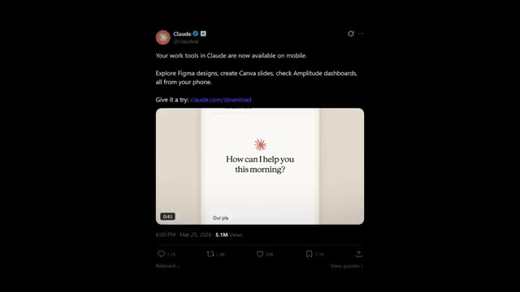
*⏱️ 00:00:05 — Publication Twitter/X de @ClaudeAI annonçant la disponibilité des outils de travail Claude sur mobile.*

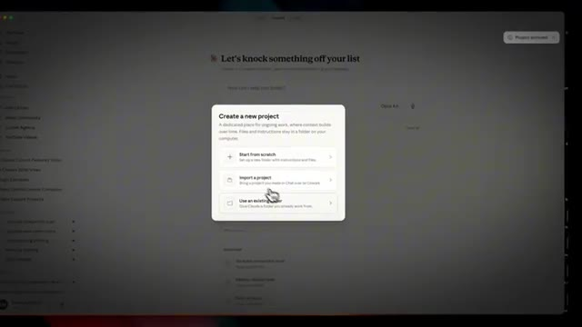
*⏱️ 00:00:15 — Interface de l'application Claude affichant une fenêtre modale pour créer un nouveau projet avec plusieurs options.*

---

### ⏱️ `[00:00:20 - 00:00:41]` | Segment #02

**🔊 Audio (Transcription Intégrale Mot pour Mot en Français) :**
> Et ensuite, je vais vous montrer une astuce que la plupart des gens ignorent et qui rend le tout encore plus puissant. Alors, sans plus attendre, plongeons-nous dedans. Très bien, les gars, parlons maintenant des quatre nouvelles fonctionnalités de Claude qu'ils ont sorties ces deux dernières semaines. Et s'il y en a une que vous connaissiez déjà, restez jusqu'à la fin de cette vidéo, car je peux presque vous garantir qu'il y en a peut-être une ou deux que vous n'avez probablement jamais utilisées auparavant.

**👁️ Analyse Visuelle d'Écran (gemini-3.5-flash-lite) :**
**Interface & Outils** : Interface web de Claude / Navigateur web.

**Contenu textuel & Code** : Menu de personnalisation de Claude avec options de connexion d'applications et de création de compétences.

**Action / Démonstration** : Navigation dans les menus de personnalisation de l'outil et introduction des nouvelles fonctionnalités.

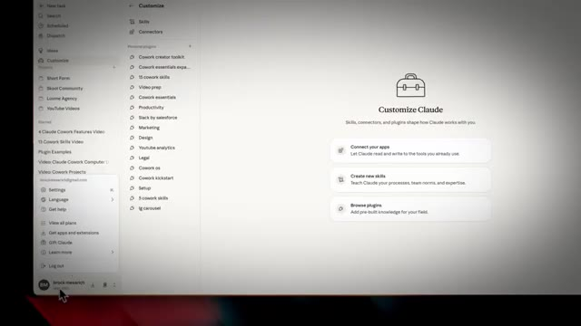
*⏱️ 00:00:26 — Interface de personnalisation de Claude (Customize Claude) montrant les sections Skills, Connectors et Plugins.*

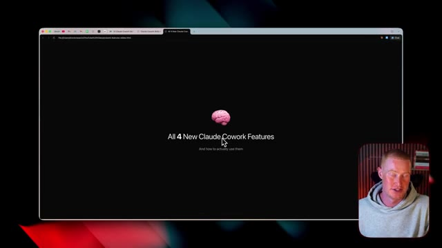
*⏱️ 00:00:31 — Écran de présentation du navigateur affichant le titre du sujet sur fond noir 'All 4 New Claude Cowork Features' avec un encadré vidéo du présentateur en bas à droite.*

---

### ⏱️ `[00:00:41 - 00:01:06]` | Segment #03

**🔊 Audio (Transcription Intégrale Mot pour Mot en Français) :**
> Alors tout d'abord, la plupart des gens utilisent Claude comme un chatbot. En gros, ils ouvrent Claude, ils tapent une question spécifique, obtiennent une réponse, et c'est tout ce qu'ils font avec Claude ou ChatGPT en ce moment. Mais si vous utilisez Cowork, cela peut en fait vous permettre de vous souvenir exactement de la façon dont vous travaillez, d'exécuter des tâches spécifiques pendant que vous dormez, de recevoir des instructions depuis votre téléphone pour que vous n'ayez pas besoin d'utiliser votre ordinateur, et de contrôler vos applications directement.

**👁️ Analyse Visuelle d'Écran (gemini-3.5-flash-lite) :**
**Interface & Outils** : Navigateur web affichant une présentation ou un article sur les fonctionnalités de l'intelligence artificielle Claude.

**Contenu textuel & Code** : Texte explicatif et schémas comparatifs illustrant l'utilisation classique de Claude comme simple chatbot par rapport à des fonctionnalités plus avancées.

**Action / Démonstration** : Le présentateur introduit son sujet en illustrant visuellement l'utilisation basique de Claude via une interface web pendant qu'il parle.

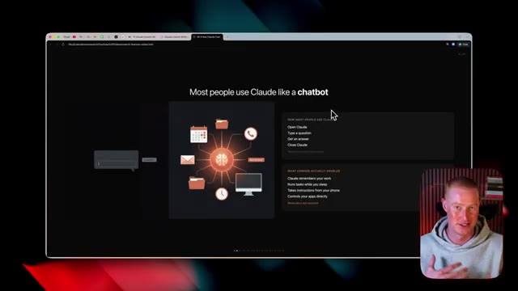
*⏱️ 00:00:47 — Capture d'écran montrant une page web avec le titre "Most people use Claude like a chatbot" et une interface visuelle explicative, avec le présentateur en médaillon en bas à droite.*

---

### ⏱️ `[00:01:06 - 00:01:28]` | Segment #04

**🔊 Audio (Transcription Intégrale Mot pour Mot en Français) :**
> Donc, d'ici la fin de cette vidéo, tout cela sera vrai pour votre configuration Cloud Cowork. Ces quatre fonctionnalités, vous devez absolument les utiliser si vous voulez vraiment exploiter la véritable puissance de Cloud Cowork. Ce sont des choses qui vous aideront avec la mémoire, vous aideront à créer des automatisations spécifiques, vous permettront d'utiliser Cloud Cowork en mobilité afin de pouvoir l'utiliser sur votre téléphone, ainsi que de contrôler votre ordinateur réel.

**👁️ Analyse Visuelle d'Écran (gemini-3.5-flash-lite) :**
**Interface & Outils** : Navigateur web affichant une présentation ou un site de tutoriel

**Contenu textuel & Code** : Texte "4 features you need to be using" et quatre blocs représentant les fonctionnalités (Memory, Automation, Mobile, Control) avec des graphiques schématiques à gauche.

**Action / Démonstration** : Le présentateur introduit les quatre fonctionnalités clés à utiliser pour configurer et exploiter Cloud Cowork.

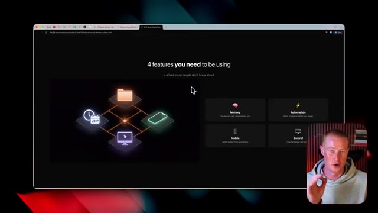
*⏱️ 00:01:12 — Capture d'écran montrant une page web avec le titre "4 features you need to be using" et des icônes illustrant les quatre fonctionnalités principales, avec le présentateur en médaillon dans le coin inférieur droit.*

---

### ⏱️ `[00:01:28 - 00:01:54]` | Segment #05

**🔊 Audio (Transcription Intégrale Mot pour Mot en Français) :**
> Donc toutes ces fonctionnalités dont nous allons parler vont vous permettre de faire cela. Donc la première fonctionnalité que vous avez peut-être manquée est Claude Cowork Projects. Et après avoir expliqué très simplement ce que c'est, je vais vous montrer comment le configurer ainsi que exactement comment j'utilise les projets pour rendre Cowork tellement meilleur pour moi. C'est probablement l'une des meilleures fonctionnalités qu'ils ont sorties à mon avis, simplement parce que cela vous aide à rester organisé et peut aider avec un problème vraiment crucial dont je vais parler ici dans une seconde.

**👁️ Analyse Visuelle d'Écran (gemini-3.5-flash-lite) :**
**Interface & Outils** : Navigateur web affichant une diapositive de présentation.

**Contenu textuel & Code** : Texte affiché : '01', 'FEATURE 1', 'Projects give Claude a permanent home', 'A workspace where Claude keeps your files, instructions, and memory in one place'.

**Action / Démonstration** : Présentation visuelle de la première fonctionnalité (Claude Projects) avec le présentateur en médaillon.

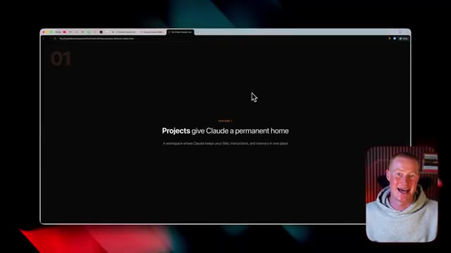
*⏱️ 00:01:41 — Une diapositive de présentation sur fond noir montrant le titre 'Projects give Claude a permanent home' avec une incrustation vidéo du présentateur en bas à droite.*

---

### ⏱️ `[00:01:54 - 00:02:15]` | Segment #06

**🔊 Audio (Transcription Intégrale Mot pour Mot en Français) :**
> Donc un projet donne essentiellement à Claude un espace où il garde vos fichiers, vos instructions et votre mémoire en un seul endroit. Donc pensez à ceci un peu comme à un écosystème à l'intérieur de Claude Co-Work. Nous avons donc nos instructions, nous avons un contexte spécifique, nous avons des tâches spécifiques et nous avons une mémoire qu'il condense dans cet écosystème qui est vraiment organisé et structuré pour nous.

**👁️ Analyse Visuelle d'Écran (gemini-3.5-flash-lite) :**
**Interface & Outils** : Navigateur web affichant une page de présentation de fonctionnalités de Claude.

**Contenu textuel & Code** : Texte centré "Projects give Claude a permanent home" avec un sous-titre descriptif concernant l'espace de travail des fichiers et instructions.

**Action / Démonstration** : Présentation visuelle de la fonctionnalité "Projects" de Claude par le présentateur.

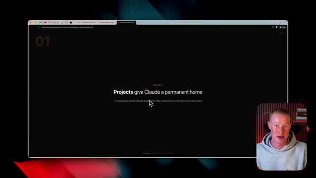
*⏱️ 00:01:59 — Capture d'écran montrant une interface de présentation avec un fond sombre, titrée "Projects give Claude a permanent home", accompagnée d'une pastille vidéo du présentateur en bas à droite.*

---

### ⏱️ `[00:02:15 - 00:02:35]` | Segment #07

**🔊 Audio (Transcription Intégrale Mot pour Mot en Français) :**
> Donc, pour vous montrer exactement ce que je veux dire, laissez-moi ouvrir Co-Work. Et si vous n'avez pas déjà téléchargé l'application de bureau Claude et que vous n'utilisez pas Co-Work, il y a un lien dans la description qui vous permettra de télécharger l'application de bureau, ce qui est l'endroit où nous accédons réellement à Co-Work. Vous ne verrez pas cela sur l'application Web si vous l'utilisez sur Claude.ai. Vous devez utiliser l'application de bureau pour y accéder.

**👁️ Analyse Visuelle d'Écran (gemini-3.5-flash-lite) :**
**Interface & Outils** : Application de bureau Claude (Co-Work)

**Contenu textuel & Code** : Tableau de bord avec zone de saisie "Let's knock something off your list", liste de projets récents et tâches planifiées.
[DESC_IMAGE_3] Navigation et présentation de l'interface logicielle de l'outil Co-Work par le créateur.

**Action / Démonstration** : Explications face caméra et analyse conceptuelle des marchés.

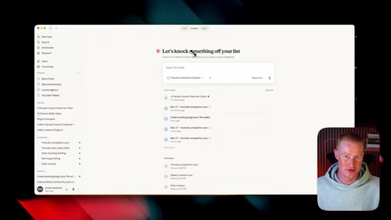
*⏱️ 00:02:20 — Interface principale de l'application de bureau Claude (Co-Work) affichant le tableau de bord avec des listes de tâches et projets en cours.*

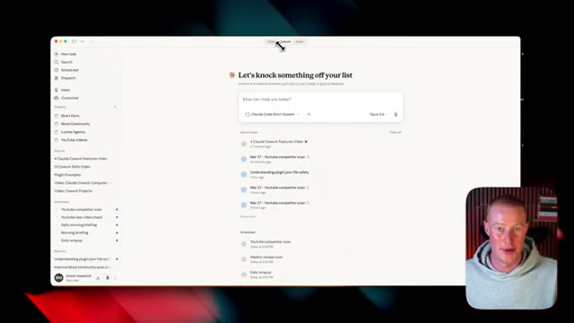
*⏱️ 00:02:30 — Vue légèrement modifiée de l'interface Claude (Co-Work) montrant le champ de saisie principal de l'assistant virtuel.*

---

### ⏱️ `[00:02:35 - 00:02:55]` | Segment #08

**🔊 Audio (Transcription Intégrale Mot pour Mot en Français) :**
> Alors parlons maintenant de quelque chose juste ici. Comme vous pouvez le voir, c'est probablement à quoi ressemble votre espace de travail en ce moment. Vous avez tout un tas de projets différents, de tâches et de conversations spécifiques que vous y menez. Et cela peut être tellement encombré. Pour moi, c'était un véritable calvaire quand j'ai commencé à utiliser cet espace de travail, jusqu'à ce qu'ils lancent justement cette fonctionnalité il y a tout juste quelques jours, je crois il y a trois ou quatre jours.

**👁️ Analyse Visuelle d'Écran (gemini-3.5-flash-lite) :**
**Interface & Outils** : Application de bureau de type workspace/gestion de projets avec panneau latéral.

**Contenu textuel & Code** : Liste de tâches, fils de discussion et explications textuelles sur des fonctionnalités.
[DESC_IMAGE_1] Navigation et présentation de l'interface principale.
[DESC_IMAGE_2] Affichage de réponses textuelles détaillées.
[DESC_IMAGE_3] Défilement de la liste des projets dans la barre latérale.

**Action / Démonstration** : Navigation et présentation de l'interface de travail.

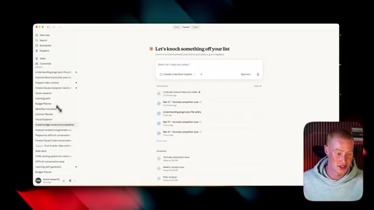
*⏱️ 00:02:40 — Interface d'une application de gestion de projets et de tâches montrant une liste de projets et un champ de saisie central.*

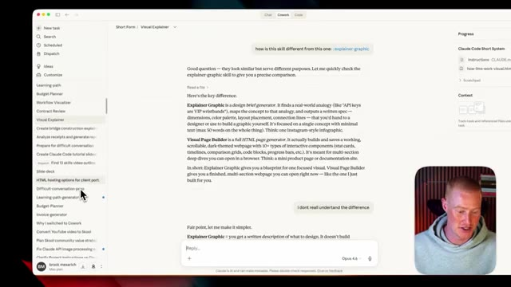
*⏱️ 00:02:45 — Conversation active dans une interface logicielle avec du texte explicatif comparant deux fonctionnalités.*

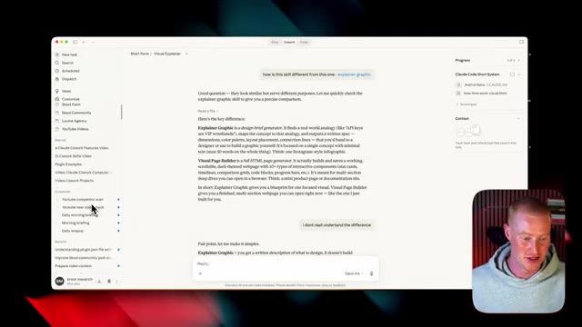
*⏱️ 00:02:50 — Vue similaire de l'interface montrant le fil de discussion et la barre latérale avec les projets récents.*

---

### ⏱️ `[00:02:56 - 00:03:17]` | Segment #09

**🔊 Audio (Transcription Intégrale Mot pour Mot en Français) :**
> Et ça a été tellement crucial quand il s'agit d'organiser mes pensées dans mon espace de travail à l'intérieur de Cowark. Concentrons-nous sur ça maintenant. Nous avons des projets. Si vous ne voyez pas vos projets, vous pouvez cliquer sur ce bouton d'affichage et ils apparaîtront. Et j'ai quatre projets spécifiques à l'intérieur de mes différentes entreprises. Donc, tout d'abord, j'ai le format court, qui est fondamentalement tout ce qui est lié au contenu de format court.

**👁️ Analyse Visuelle d'Écran (gemini-3.5-flash-lite) :**
**Interface & Outils** : Application de bureau Cowark et incrustation vidéo du présentateur.

**Contenu textuel & Code** : Interface utilisateur affichant une liste de projets (Short Form, Skool Community, Luume Agency, YouTube Videos) et une conversation textuelle sur les fonctionnalités de l'outil.

**Action / Démonstration** : Navigation dans l'interface de Cowark et démonstration de la gestion des projets.

---

### ⏱️ `[00:03:17 - 00:03:36]` | Segment #10

**🔊 Audio (Transcription Intégrale Mot pour Mot en Français) :**
> Donc c'est pour mes chaînes TikTok et Instagram. Ensuite, j'ai une communauté scolaire. Donc c'est fondamentalement tout ce qui est lié à ma communauté scolaire. Ça m'aide à créer des ressources, ça m'aide à rester organisé. Et j'ai même différentes tâches planifiées, dont nous parlerons plus tard dans cette vidéo, qui s'exécutent automatiquement à l'intérieur de ce projet. Ensuite, nous avons tous nos résultats ici.

**👁️ Analyse Visuelle d'Écran (gemini-3.5-flash-lite) :**
**Interface & Outils** : Application de gestion de projet (Cowork / Skool Community).

**Contenu textuel & Code** : Panneau de projets, zone de saisie de tâches, section "Outputs", et tâches planifiées (ex: "Skool community pulse").

**Action / Démonstration** : Navigation et présentation de l'interface de gestion de projets et des tâches planifiées.

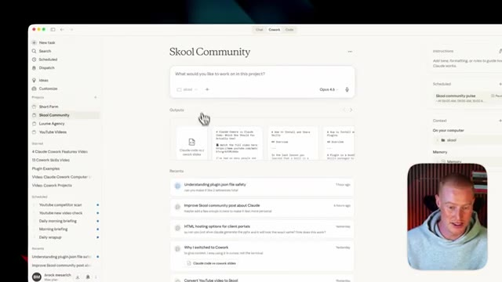
*⏱️ 00:03:22 — Interface de gestion de projet montrant les outputs de la communauté Skool avec le présentateur en incrustation.*

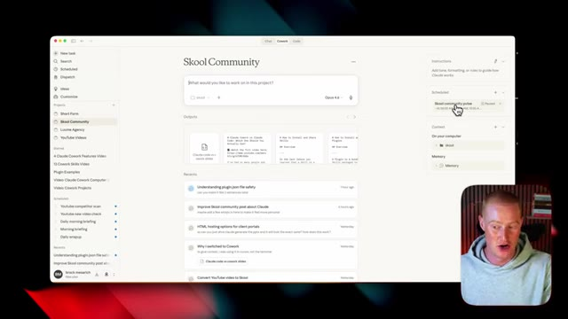
*⏱️ 00:03:32 — Interface de l'application montrant les tâches planifiées (Scheduled) pour la communauté Skool.*

---

### ⏱️ `[00:03:37 - 00:03:55]` | Segment #11

**🔊 Audio (Transcription Intégrale Mot pour Mot en Français) :**
> Donc nous pourrions voir tous, par exemple, de ces diaporas qui sont générés que je montre réellement, vous savez, à l'intérieur de ma communauté d'école, en décomposant les choses plus en profondeur. Et vous pouvez voir toutes nos tâches récentes juste ici. Et si je descends, vous pouvez voir que j'ai une agence Loom, qui est pour mon agence de marketing d'influence, et ensuite des vidéos YouTube, qui est fondamentalement l'espace de travail principal dans lequel je reste.

**👁️ Analyse Visuelle d'Écran (gemini-3.5-flash-lite) :**
**Interface & Outils** : Application Claude Cowork / interface de gestion de projet.

**Contenu textuel & Code** : Liste des tâches récentes, projets (Skool Community, Luume Agency, YouTube Videos) et interface de génération de diapositives.

**Action / Démonstration** : Navigation dans l'application Claude Cowork pour montrer les différents projets et tâches gérés par l'IA.

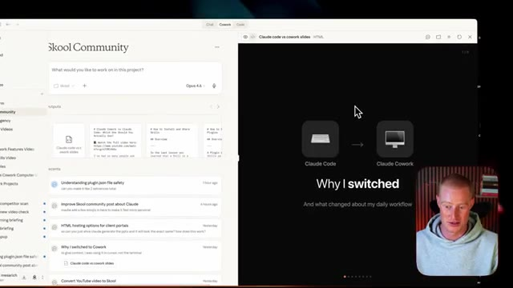
*⏱️ 00:03:41 — Interface de l'application Claude Cowork avec une fenêtre de présentation de diapositives ouverte à droite.*

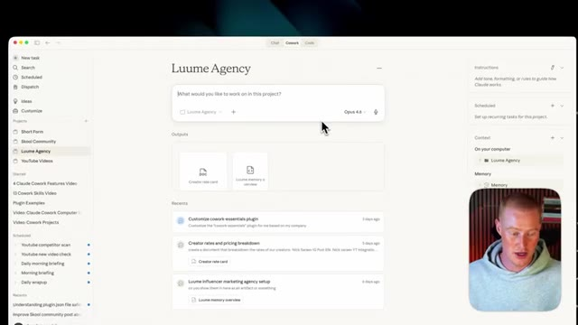
*⏱️ 00:03:51 — Tableau de bord Luume Agency dans l'application Claude Cowork montrant les tâches récentes et les projets.*

---

### ⏱️ `[00:03:55 - 00:04:18]` | Segment #12

**🔊 Audio (Transcription Intégrale Mot pour Mot en Français) :**
> Et cela a changé ma vie d'utiliser ceci. Parlons donc rapidement maintenant de trois façons de créer un projet afin que vous puissiez commencer à faire cela et à organiser vous-même du travail collaboratif. Tout d'abord, nous pouvons commencer à partir de zéro, ce qui est assez explicite. Nous pouvons simplement le nommer, ajouter des instructions, et il commencera à fonctionner. Et ensuite, vous pourrez l'affiner plus tard. Ou nous pouvons importer à partir d'un projet Claude spécifique que nous avons préexistant à l'intérieur de Claude.

**👁️ Analyse Visuelle d'Écran (gemini-3.5-flash-lite) :**
**Interface & Outils** : Interface web / Présentation de diapositives avec incrustation vidéo du présentateur en bas à droite.

**Contenu textuel & Code** : Schéma explicatif listant les 3 options de création de projet : 1. Start from scratch, 2. Import from Claude project, 3. Point at an existing folder.

**Action / Démonstration** : Le présentateur explique les différentes méthodes disponibles pour initialiser et configurer un projet.

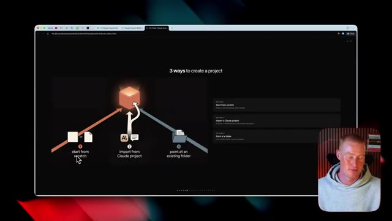
*⏱️ 00:04:07 — Interface de présentation montrant "3 ways to create a project" (Start from scratch, Import from Claude project, Point at an existing folder).*

---

### ⏱️ `[00:04:19 - 00:04:52]` | Segment #13

**🔊 Audio (Transcription Intégrale Mot pour Mot en Français) :**
> Donc, si je reviens sur Claude ici, je ne veux pas vous embrouiller les gars, mais il y a le mode chat. Et c'est là qu'on peut simplement clavarder avec Claude. Rien de bien fou. C'est probablement comme ça que vous avez utilisé Claude ou ChatGPT par le passé. Mais vous aviez la possibilité de créer des projets ici. Et c'est une fonctionnalité présente depuis un an ou deux. Ce n'est rien de nouveau. Donc, si vous avez des projets à l'intérieur de Claude, vous pouvez les importer directement dans co-work et commencer à les utiliser. Vous avez ainsi le contexte de tout ce projet, si c'est clair. Donc, pour faire ça, je clique simplement sur le bouton plus et nous obtenons ces trois options ici. Et si nous voulons

**👁️ Analyse Visuelle d'Écran (gemini-3.5-flash-lite) :**
**Interface & Outils** : Interface web de Claude (Anthropic) et présentation vidéo.

**Contenu textuel & Code** : Menus de navigation de Claude, barre de prompt, sélecteur de modèle (Sonnet 4.4 / Opus 4.6), historique des chats et gestion de projets YouTube.

**Action / Démonstration** : Navigation et explication des différents modes et fonctionnalités de l'interface de Claude par le présentateur.

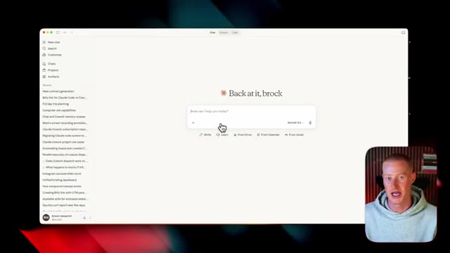
*⏱️ 00:04:27 — Interface principale de Claude en mode chat, affichant l'historique des discussions à gauche et la barre de saisie au centre, avec une petite fenêtre vidéo du présentateur en bas à droite.*

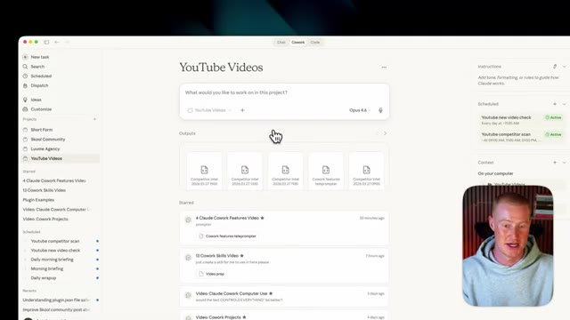
*⏱️ 00:04:43 — Interface de Claude affichant un projet orienté sur les vidéos YouTube (« YouTube Videos »), avec des sections pour les tâches programmées, les sorties (outputs) et les instructions.*

---

### ⏱️ `[00:04:52 - 00:05:25]` | Segment #14

**🔊 Audio (Transcription Intégrale Mot pour Mot en Français) :**
> importer un projet, il suffit de cliquer ici. Et à partir de là, vous allez simplement sélectionner celui auquel vous voulez accéder. Laissez-moi donc cliquer sur réutilisation de formats courts. Et à partir de là, nous allons simplement le pointer vers un projet spécifique. Et ici, nous allons simplement le pointer vers un emplacement spécifique, qui est fondamentalement juste un dossier sur votre bureau dans lequel vous voulez travailler. Et comme vous pouvez le voir ici, la mémoire est activée. Et c'est l'un des aspects les plus importants des projets Cloud qui change la donne si vous utilisez cowork. Ensuite, tout ce que nous aurions à faire, c'est de cliquer sur créer. Et c'est aussi simple que ça, vous pouvez maintenant voir notre nouveau projet juste ici sur le côté gauche. Nous pourrions alors commencer à poser des questions et nous pourrions

**👁️ Analyse Visuelle d'Écran (gemini-3.5-flash-lite) :**
**Interface & Outils** : Cowork (application desktop liée à Claude / Anthropic)

**Contenu textuel & Code** : Modal d'importation de projet : sélection de « Short Form Repurpose », champ de renommage « Short Form Repurpose », sélection du chemin local `/Users/brockmesarich/Documents/Claude/Project...`, option « Memory is on », boutons « Cancel » et « Create ».

**Action / Démonstration** : Configuration de l'importation d'un projet Claude Chat existant vers l'espace de travail local Cowork.

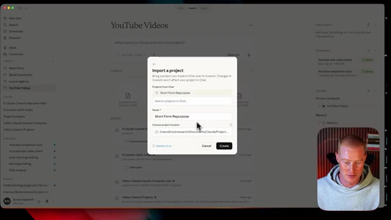
*⏱️ 00:05:00 — Fenêtre modale « Import a project » dans l'application Cowork permettant de sélectionner le projet « Short Form Repurpose » et de définir son emplacement local.*

---

### ⏱️ `[00:05:25 - 00:05:55]` | Segment #15

**🔊 Audio (Transcription Intégrale Mot pour Mot en Français) :**
> même voir tous les dossiers à l'intérieur de celui-ci ainsi que notre mémoire et différents projets enregistrés à partir du chat ici. Et la troisième façon de commencer à créer un projet, c'est que nous pourrions le faire pointer vers un dossier existant. Donc, si je viens ici et que je clique sur utiliser un dossier existant, ce que cela va faire, c'est prendre un dossier que vous avez sur votre bureau. Alors laissez-moi juste chercher baud code short system. Et disons que nous voulons importer ceci. Nous pourrions continuer et ouvrir cela. Et à partir de là, cela va en réalité créer ceci en se basant sur ce fichier. Il a ainsi le contexte de tout ce qui se trouve à l'intérieur de ce dossier.

**👁️ Analyse Visuelle d'Écran (gemini-3.5-flash-lite) :**
**Interface & Outils** : Interface de l'application Claude Cowork / gestionnaire de projets avec explorateur de fichiers système.

**Contenu textuel & Code** : Options de création de projet et arborescence de fichiers de l'ordinateur.

**Action / Démonstration** : Sélection et pointage vers un dossier existant sur l'ordinateur pour initialiser le projet.

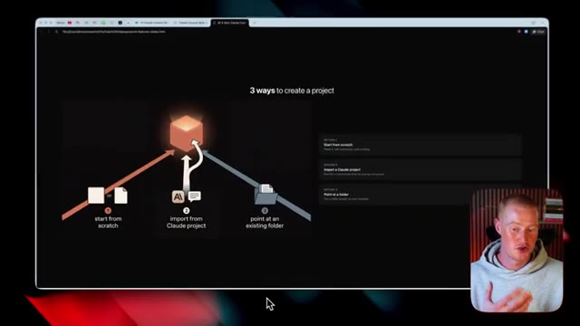
*⏱️ 00:05:33 — Une diapositive explicative montrant les 3 façons de créer un projet : repartir de zéro, importer un projet Claude, ou pointer vers un dossier existant.*

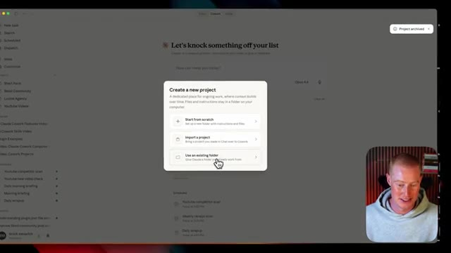
*⏱️ 00:05:40 — Une fenêtre modale d'application avec l'option « Use an existing folder » sélectionnée pour créer un nouveau projet.*

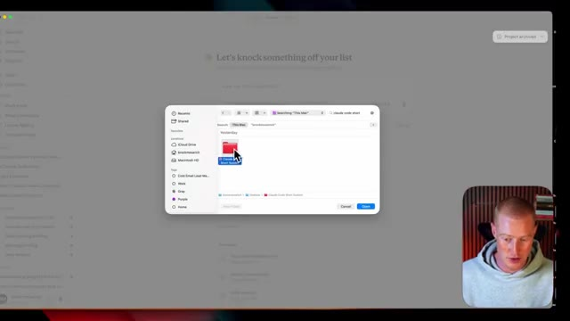
*⏱️ 00:05:48 — Une fenêtre de sélection de dossier du système d'exploitation où l'utilisateur sélectionne un dossier spécifique (Claude Code Short System).*

---

### ⏱️ `[00:05:55 - 00:06:20]` | Segment #16

**🔊 Audio (Transcription Intégrale Mot pour Mot en Français) :**
> Très bien, alors beaucoup de personnes au sein de ma communauté Skool m'ont demandé : « Brock, est-ce que la seule fonction d'un projet dans co-work est vraiment juste de te garder organisé ? » Et la réponse à cela est non. Il pourrait y avoir un cas d'usage encore plus puissant pour les projets. Et c'est la mémoire. Donc sans projet, Claude oublie fondamentalement qui vous êtes. Il ne se souvient donc pas de ce que vous lui avez dit hier, n'a pas accès à vos conversations précédentes, et n'a aucune idée de ce que vous ou votre entreprise faites.

**👁️ Analyse Visuelle d'Écran (gemini-3.5-flash-lite) :**
**Interface & Outils** : Navigateur web affichant une présentation de diapositives au design sombre.

**Contenu textuel & Code** : Texte comparatif montrant les différences entre une conversation normale (« Claude doesn't know who you are ») et l'intérieur d'un projet (« Claude knows your name and your business », « Has access to your actual files »), accompagné de deux illustrations représentant un cerveau sans structure versus un cerveau organisé dans un projet.

**Action / Démonstration** : Présentation visuelle et explication des fonctionnalités et avantages des projets par rapport aux conversations standards.

*⏱️ 00:06:01 — Une diapositive de présentation affichée dans un navigateur web illustrant la comparaison « Without a project, Claude forgets everything » (Sans projet, Claude oublie tout) avec des graphiques explicatifs et le présentateur visible en vignette dans le coin inférieur droit.*

---

### ⏱️ `[00:06:20 - 00:06:39]` | Segment #17

**🔊 Audio (Transcription Intégrale Mot pour Mot en Français) :**
> Mais à l'intérieur d'un projet, Claude connaîtra votre nom et votre entreprise, se souvient des conversations passées et des préférences, ce qui est énorme, je vous le dis, a accès à vos fichiers réels et suit vos instructions personnalisées que vous avez définies pour ce projet. En gros, cela vous permet simplement de reprendre exactement là où vous vous étiez arrêté lors d'une conversation précédente, et cela manquait dans CoWork.

**👁️ Analyse Visuelle d'Écran (gemini-3.5-flash-lite) :**
**Interface & Outils** : Navigateur Web (page HTML de présentation)

**Contenu textuel & Code** : Graphiques conceptuels (cerveau isolé vs cerveau connecté dans un coffre avec des fichiers) et liste comparative des fonctionnalités d'un Projet Claude ("Claude knows your name and your business", "Remembers past conversations and preferences", "Has access to your actual files", "Follows your custom instructions").

**Action / Démonstration** : Explication des avantages de la mémoire contextuelle, des fichiers attachés et des instructions personnalisées dans les Projets Claude.

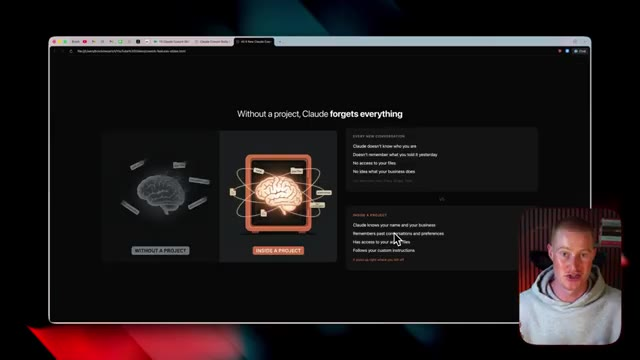
*⏱️ 00:06:25 — Diapositive comparative illustrant les limites d'une conversation standard face aux fonctionnalités d'un projet Claude ("Without a project, Claude forgets everything" vs "Inside a project").*

---

### ⏱️ `[00:06:39 - 00:07:02]` | Segment #18

**🔊 Audio (Transcription Intégrale Mot pour Mot en Français) :**
> Et vous vous dites peut-être, genre : « Brock, n'est-ce pas à ça que sert le fichier ClaudeMD ? » Et la réponse est oui, mais vous devez constamment mettre à jour ce fichier ClaudeMD à l'intérieur de CoWork si vous vouliez avoir constamment tout ce contexte sur vous, de même que vous ne voulez pas avoir un fichier CloudMD complètement surchargé, parce que c'est chargé à chaque fois que vous avez une conversation avec lui, et vous pourriez alors atteindre votre fenêtre de contexte extrêmement vite, et après vous ne pouvez plus utiliser Claude.

**👁️ Analyse Visuelle d'Écran (gemini-3.5-flash-lite) :**
**Interface & Outils** : Navigateur web affichant une diapositive explicative avec un comparatif visuel (Sans projet vs Dans un projet).

**Contenu textuel & Code** : Texte « Without a project, Claude forgets everything », illustrations graphiques d'un cerveau et descriptions textuelles des limites sans projet et des avantages avec un projet.

**Action / Démonstration** : Le présentateur explique les limites de la mémoire de Claude hors contexte de projet et l'importance d'utiliser des fichiers de configuration comme Claude.md.

*⏱️ 00:06:45 — Capture d'écran montrant une présentation visuelle sur le comportement de l'IA Claude avec ou sans projet, avec le présentateur en bas à droite.*

---

### ⏱️ `[00:07:02 - 00:07:25]` | Segment #19

**🔊 Audio (Transcription Intégrale Mot pour Mot en Français) :**
> Très bien, donc en passant à la fonctionnalité numéro deux, et personnellement, et je connais plein d'autres personnes, qui ont remplacé N8N pour cette fonctionnalité spécifique qu'ils viennent de sortir il y a quelques semaines. Donc avant cette fonctionnalité, vous pouviez voir tous ces nœuds que vous deviez exécuter à l'intérieur de N8N. Vous deviez comprendre comment les configurer, y ajouter toutes vos différentes applications, configurer tout ce truc qui, si vous n'êtes pas technique, était juste un casse-tête.

**👁️ Analyse Visuelle d'Écran (gemini-3.5-flash-lite) :**
**Interface & Outils** : Navigateur web affichant une présentation interactive sur les nouvelles fonctionnalités de Claude Cowork.

**Contenu textuel & Code** : Titres : "02", "FEATURE 2", "BEFORE", "AFTER", champ textuel "Run this every morning", badge "Task Completed: 8:00 AM", texte "I replaced n8n with this - Scheduled Tasks automate recurring work without building a single workflow".

**Action / Démonstration** : Présentation conceptuelle expliquant comment les tâches planifiées (Scheduled Tasks) remplacent les workflows n8n complexes par une simple instruction en langage naturel.

*⏱️ 00:07:13 — Diapositive de présentation montrant une comparaison "BEFORE" (graphe de flux n8n complexe avec de multiples nœuds interconnectés) et "AFTER" (invite de commande simple "Run this every morning" avec statut de tâche programmée "Task Completed: 8:00 AM", sous le titre "I replaced n8n with this").*

---

### ⏱️ `[00:07:25 - 00:07:49]` | Segment #20

**🔊 Audio (Transcription Intégrale Mot pour Mot en Français) :**
> Je détestais vraiment faire ça. Eh bien, maintenant vous pouvez pratiquement dire à Cloud Cowork d'exécuter une tâche spécifique selon un calendrier et il peut faire cela pour vous automatiquement et sait exactement comment faire cette tâche parce qu'il a toutes ces compétences directement à l'intérieur de votre système. Vous pouvez choisir quand il s'exécute, que vous vouliez le faire toutes les heures, manuellement, tous les jours, toutes les semaines, le week-end, littéralement quand vous voulez le faire, vous pouvez faire en sorte que cela s'exécute et vous pouvez toujours déclencher cela manuellement si vous le souhaitez également.

**👁️ Analyse Visuelle d'Écran (gemini-3.5-flash-lite) :**
**Interface & Outils** : Navigateur web affichant une page de présentation/diapositive.

**Contenu textuel & Code** : Schéma complexe de workflow étiqueté 'BEFORE' comparé à un champ de saisie simple étiqueté 'AFTER' avec le texte 'Run this every morning', ainsi que le texte 'I replaced n8n with this'.

**Action / Démonstration** : Présentation de la fonctionnalité de tâches planifiées remplaçant les outils d'automatisation complexes comme n8n.

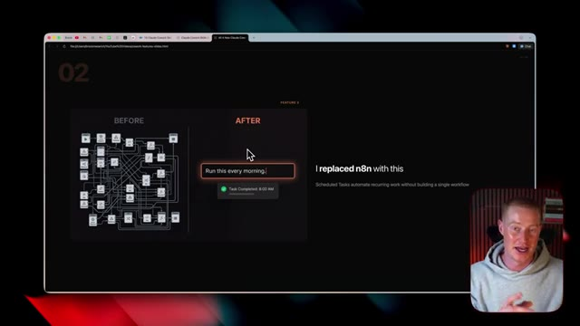
*⏱️ 00:07:31 — Capture d'écran montrant une présentation comparative intitulée 'BEFORE / AFTER' illustrant le remplacement d'un workflow complexe par une simple invite textuelle.*

---

### ⏱️ `[00:07:49 - 00:08:09]` | Segment #21

**🔊 Audio (Transcription Intégrale Mot pour Mot en Français) :**
> Donc je vais aller dans Claude Coworks pour que vous puissiez voir quelques-unes des tâches planifiées que j'exécute personnellement. Et si vous voulez réellement regarder à l'intérieur de vos projets, vous pouvez voir chaque tâche que vous avez planifiée dans ce projet particulier. Ce sont les tâches planifiées que j'ai pour mon projet de vidéos YouTube. Vous pouvez donc voir si je clique là-dessus.

**👁️ Analyse Visuelle d'Écran (gemini-3.5-flash-lite) :**
**Interface & Outils** : Claude Coworks (application de bureau/web)

**Contenu textuel & Code** : Panneau latéral des tâches planifiées ("Scheduled") incluant "Youtube new video check" et "Youtube competitor scan", ainsi que des outputs de fichiers et l'historique des projets.
[DESC_IMAGE_1] AUCUNE

**Action / Démonstration** : Navigation dans l'interface de l'application Claude Coworks pour présenter les tâches automatisées et planifiées liées aux projets YouTube.

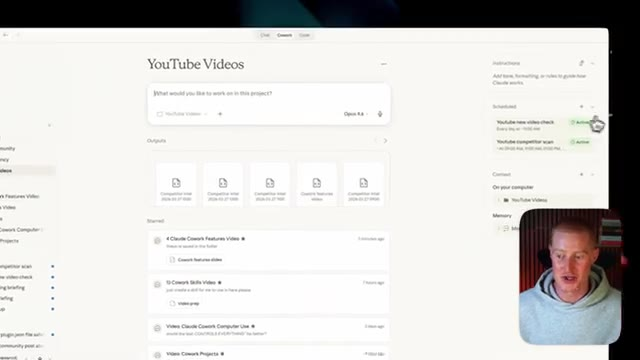
*⏱️ 00:07:59 — Interface de Claude Coworks montrant la vue d'un projet avec le panneau latéral droit listant les tâches planifiées ("Scheduled").*

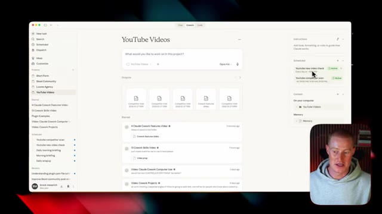
*⏱️ 00:08:04 — Interface de Claude Coworks avec un zoom sur la section "Scheduled" du panneau de droite mettant en évidence les tâches actives programmées.*

---

### ⏱️ `[00:08:09 - 00:08:28]` | Segment #22

**🔊 Audio (Transcription Intégrale Mot pour Mot en Français) :**
> Donc, cette tâche ici vérifie essentiellement mon YouTube tous les matins pour voir si j'ai ajouté une nouvelle vidéo. Et s'il y a une nouvelle vidéo, elle va l'extraire, puis l'ajouter à un tableur spécifique. Comme ça, nous pouvons suivre les performances de toutes mes vidéos. Donc, si je clique sur l'historique ici, vous pouvez alors voir que cette tâche a été exécutée ce matin, je crois à 11 heures.

**👁️ Analyse Visuelle d'Écran (gemini-3.5-flash-lite) :**
**Interface & Outils** : Application de bureau (interface de gestion de tâches / automatisation) et incrustation vidéo du présentateur en bas à droite.

**Contenu textuel & Code** : Description de la tâche : "Check YouTube for new video uploads and add them to video-tracker.xlsx". Instructions textuelles pour lire le fichier Excel et rechercher de nouvelles vidéos sur la chaîne YouTube. Planification définie à "Every day at 11:00 AM".

**Action / Démonstration** : Présentation de la configuration et des instructions d'une tâche automatisée vérifiant quotidiennement les nouvelles vidéos YouTube.

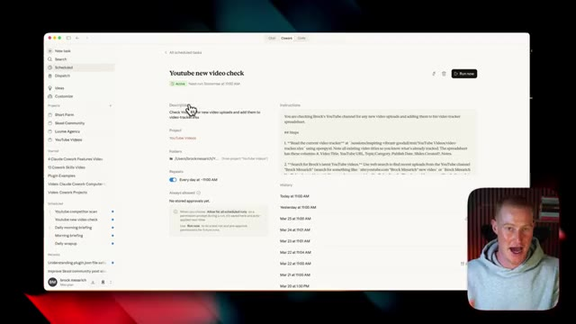
*⏱️ 00:08:13 — Interface d'une application d'automatisation montrant la configuration d'une tâche nommée "Youtube new video check", avec les instructions détaillées et l'historique d'exécution.*

---

### ⏱️ `[00:08:28 - 00:08:47]` | Segment #23

**🔊 Audio (Transcription Intégrale Mot pour Mot en Français) :**
> Ouais, 11 heures ici. Et si je clique dessus, vous pouvez voir juste ici que ça s'est ajouté à ce tableur. Donc ça détaille le titre de la vidéo, ça me donne l'URL YouTube, le sujet, la catégorie, la date de publication, ça détaille pratiquement tout ça. Ça montre même le nombre de vues. Donc comme ça, je peux suivre ça chaque jour. Et selon à quel point vous êtes entré dans le co-working, vous vous demandez peut-être : Brock, comment il sait comment faire ça ?

**👁️ Analyse Visuelle d'Écran (gemini-3.5-flash-lite) :**
**Interface & Outils** : Interface logicielle de type tableau de bord / tableur de suivi de vidéos.

**Contenu textuel & Code** : Tableau listant des vidéos YouTube avec colonnes : Video Title, YouTube URL, Topic/Category, Publish Date, Slides Created?, Notes, et nombre de vues.

**Action / Démonstration** : Le présentateur montre et commente le tableur généré automatiquement par l'IA contenant le suivi des vidéos.

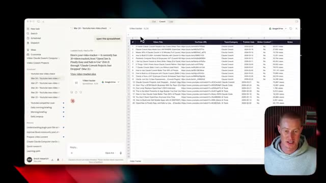
*⏱️ 00:08:33 — Capture d'écran montrant une interface logicielle avec un tableau de suivi de vidéos (Video Tracker) affichant les titres, URLs, sujets, dates et nombres de vues, avec la webcam du présentateur en bas à droite.*

---

### ⏱️ `[00:08:47 - 00:09:06]` | Segment #24

**🔊 Audio (Transcription Intégrale Mot pour Mot en Français) :**
> Et la réponse, ce sont les compétences. Si vous voulez comprendre ce que sont les compétences, j'ai une vidéo qui les analyse en profondeur et j'analyse même 15 compétences différentes que vous pouvez télécharger dans Cowork pour les exécuter automatiquement. Et ce sont fondamentalement des flux de travail entiers que vous pouvez exécuter à partir d'une seule invite. Je voulais donc vous donner des éléments concrets que vous pouvez retenir de cette vidéo.

**👁️ Analyse Visuelle d'Écran (gemini-3.5-flash-lite) :**
**Interface & Outils** : Interface de l'application Cowork / Claude Cowork.

**Contenu textuel & Code** : Suivi de 20 vidéos YouTube ("video-tracker.xlsx"), instructions CLAUDE.md et commandes de tâches planifiées.

**Action / Démonstration** : Présentation d'un flux de travail automatisé dans Cowork montrant la gestion de projets de vidéos.

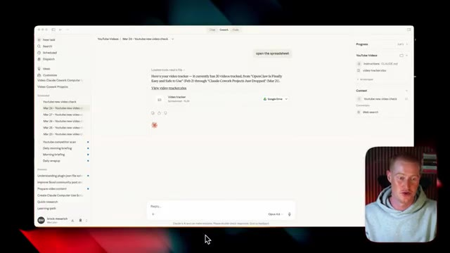
*⏱️ 00:08:57 — Interface de l'application Cowork affichant un tableau de bord de suivi de vidéos YouTube avec une fenêtre de chat et un fichier Excel lié.*

---

### ⏱️ `[00:09:07 - 00:09:32]` | Segment #25

**🔊 Audio (Transcription Intégrale Mot pour Mot en Français) :**
> Voici donc quelques tâches qui, selon moi, valent la peine d'être automatisées pour vous et que vous pourriez commencer à configurer dès maintenant. Personnellement, j'utilise une compétence de briefing matinal où elle va automatiquement parcourir toute ma boîte de réception d'e-mails, trouver tous les e-mails que j'ai, ainsi que sur Slack. Elle va consulter mon Google Agenda, puis me faire un compte rendu de absolument tout ce que j'ai manqué pendant que je dors, ainsi que de toutes les priorités clés pour la journée, incluant le fait qu'elle rédige des brouillons de réponses à mes e-mails pour moi automatiquement.

**👁️ Analyse Visuelle d'Écran (gemini-3.5-flash-lite) :**
**Interface & Outils** : Navigateur web affichant une diapositive de présentation avec un diagramme circulaire représentant des tâches d'automatisation.

**Contenu textuel & Code** : Liste de tâches à automatiser : Morning briefing (email + Slack + calendar), Weekly report (Google Drive), Competitor scan, et End-of-day wrap-up.

**Action / Démonstration** : Présentation des exemples de tâches idéales à automatiser en premier lieu à l'aide d'IA.

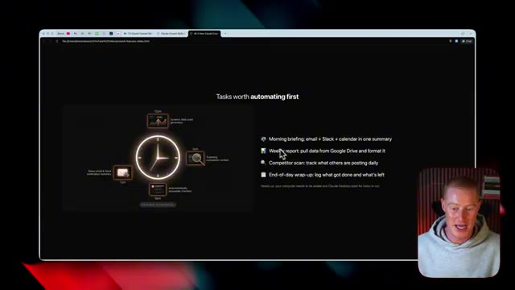
*⏱️ 00:09:13 — Capture d'écran montrant une interface de présentation avec le titre "Tasks worth automating first" et une liste de tâches recommandées.*

---

### ⏱️ `[00:09:32 - 00:09:53]` | Segment #26

**🔊 Audio (Transcription Intégrale Mot pour Mot en Français) :**
> Pour vous montrer ce que je veux dire, laissez-moi cliquer sur ma tâche de planification de résumé matinal quotidien. Je vais l'ouvrir ici et vous pouvez voir que je génère ce tableau de bord pour moi-même chaque matin, en analysant essentiellement tout ce qui se trouve dans ma boîte de réception e-mail. De cette façon, je peux être à jour lorsque je commence ma matinée. Et si vous voulez accéder à toutes les plus de 50 compétences que j'utilise dans mon entreprise chaque jour, assurez-vous de rejoindre ma communauté School.

**👁️ Analyse Visuelle d'Écran (gemini-3.5-flash-lite) :**
**Interface & Outils** : Interface de l'application Claude Cowork / Chat.

**Contenu textuel & Code** : Texte de résumé d'e-mails, priorités du jour, notifications Slack et structure d'un tableau de bord HTML personnel.

**Action / Démonstration** : Navigation et affichage du tableau de bord de résumé matinal généré automatiquement par l'IA.

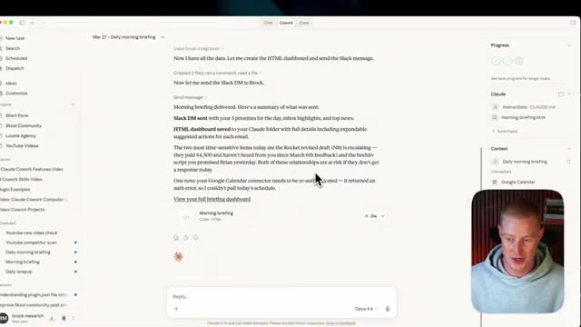
*⏱️ 00:09:37 — Interface d'un assistant IA montrant le résultat de la génération d'un tableau de bord de résumé matinal.*

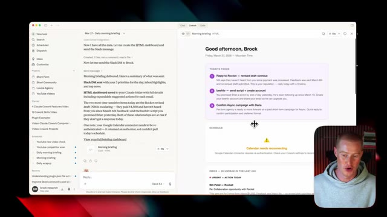
*⏱️ 00:09:43 — Affichage détaillé du tableau de bord HTML généré pour la planification quotidienne ("Good afternoon, Brock").*

---

### ⏱️ `[00:09:54 - 00:10:12]` | Segment #27

**🔊 Audio (Transcription Intégrale Mot pour Mot en Français) :**
> Je lie ces éléments et je mets cela à jour chaque semaine pour que vous y ayez accès. Ensuite, une tâche que je pense que vous pourriez réellement automatiser dès maintenant est un rapport hebdomadaire qui extraira des données de Google Drive et les mettra en forme. De cette façon, tout n'est pas encombré à l'intérieur de Google Drive. Une analyse des concurrents, donc si vous créez du contenu, cela suivra ce que d'autres personnes dans votre niche publient chaque jour.

**👁️ Analyse Visuelle d'Écran (gemini-3.5-flash-lite) :**
**Interface & Outils** : Présentation visuelle (diapositive) avec un schéma d'horloge et du texte descriptif.

**Contenu textuel & Code** : Texte listant les tâches à automatiser en priorité : « Morning briefing: email + Slack + calendar in one summary », « Weekly report: pull data from Google Drive and format it », « Competitor scan: track what others are posting daily », et « End-of-day wrap-up: log what got done and what's left ».

**Action / Démonstration** : Le présentateur explique les différentes tâches qu'il est possible d'automatiser en premier, pointant notamment sur le rapport hebdomadiare depuis Google Drive.

*⏱️ 00:09:58 — Une diapositive de présentation intitulée « Tasks worth automating first » avec un diagramme circulaire représentant des tâches planifiées selon les heures de la journée, et une liste à puces à droite détaillant ces tâches, avec le présentateur visible en incrustation vidéo dans le coin inférieur droit.*

---

### ⏱️ `[00:10:12 - 00:10:34]` | Segment #28

**🔊 Audio (Transcription Intégrale Mot pour Mot en Français) :**
> et l'une de celles que j'utilise est un récapitulatif de fin de journée qui explique en gros exactement ce que Claude Cowork a accompli tout au long de la journée, ainsi que tout ce que j'ai accompli tout au long de la journée dans toute mon entreprise. Pour passer à la fonctionnalité numéro trois, jusqu'à présent, nous étions liés à notre ordinateur. Si nous sommes en déplacement, nous ne pouvons pas vraiment demander à Claude d'effectuer des tâches spécifiques pour nous, à moins qu'il ne s'agisse déjà d'une tâche programmée.

**👁️ Analyse Visuelle d'Écran (gemini-3.5-flash-lite) :**
**Interface & Outils** : Navigateur web affichant une page de présentation ou un document de type diapositive.

**Contenu textuel & Code** : Texte listant des tâches à automatiser (Morning briefing, Weekly report, Competitor scan, End-of-day wrap-up) et schéma visuel circulaire représentant une horloge avec des étapes de la journée.

**Action / Démonstration** : Le présentateur commente les tâches automatisables et pointe l'écran tout en expliquant l'utilisation d'un récapitulatif de fin de journée.

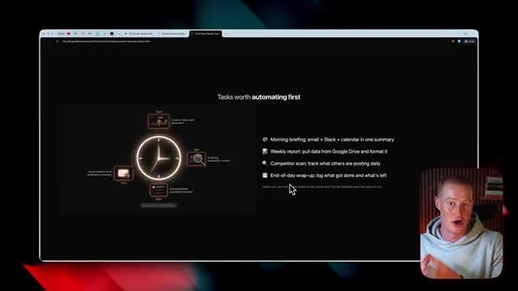
*⏱️ 00:10:17 — Capture d'écran montrant une présentation avec le titre "Tasks worth automating first" et une liste de tâches à automatiser, incluant le récapitulatif de fin de journée ("End-of-day wrap-up").*

---

### ⏱️ `[00:10:34 - 00:10:52]` | Segment #29

**🔊 Audio (Transcription Intégrale Mot pour Mot en Français) :**
> Donc cette fonctionnalité ici appelée Dispatch permet essentiellement d'envoyer un SMS à Claude depuis l'application mobile et de le faire travailler sur votre bureau pendant que vous n'y êtes pas. Et il ne s'agit pas seulement de demander à Claude de naviguer sur Internet pour vous répondre. Il s'agit de donner à Claude de véritables capacités pour apporter des modifications aux dossiers de votre ordinateur.

**👁️ Analyse Visuelle d'Écran (gemini-3.5-flash-lite) :**
**Interface & Outils** : Navigateur web affichant une page de présentation de fonctionnalité.

**Contenu textuel & Code** : Le texte principal indique "Dispatch: text Claude from your phone" et en sous-titre "One continuous conversation between your phone and your desktop".

**Action / Démonstration** : Présentation visuelle de la fonctionnalité "Dispatch" par le présentateur en incrustation vidéo.

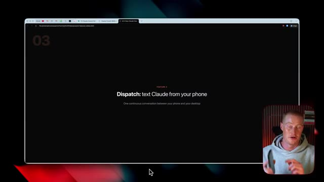
*⏱️ 00:10:38 — Capture d'écran montrant une page web au design minimaliste avec le chiffre "03" en filigrane et le titre "Dispatch: text Claude from your phone", avec l'animateur en médaillage vidéo en bas à droite.*

---

### ⏱️ `[00:10:52 - 00:11:12]` | Segment #30

**🔊 Audio (Transcription Intégrale Mot pour Mot en Français) :**
> Donc, tout ce que vous pouvez faire à l'intérieur de Cowork, vous pouvez le faire avec cette fonctionnalité depuis votre téléphone. En gros, vous pouvez nous envoyer un SMS du genre « sors mes analyses » et cela va littéralement extraire l'information de vos dossiers, générer des fichiers spécifiques et vous l'envoyer. Vous pouvez donc envoyer une tâche depuis votre téléphone, Claude travaille sur votre bureau et vous pouvez même activer les notifications push afin d'être prévenu dès que la tâche est terminée.

**👁️ Analyse Visuelle d'Écran (gemini-3.5-flash-lite) :**
**Interface & Outils** : Navigateur web affichant une page de présentation / diapositive interactive.

**Contenu textuel & Code** : Texte principal "You text it. Claude does it." et illustrations graphiques schématisant l'envoi de SMS depuis un téléphone vers un bureau virtuel.

**Action / Démonstration** : Le présentateur explique la fonctionnalité mobile permettant d'envoyer des instructions textuelles à Claude pour automatiser des tâches sur l'ordinateur.

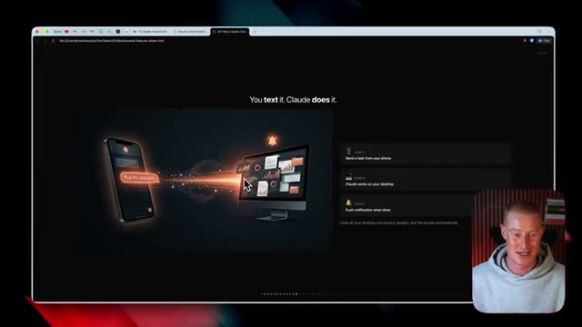
*⏱️ 00:10:57 — Une diapositive de présentation web avec le texte "You text it. Claude does it." montrant une illustration animée d'un smartphone envoyant une requête textuelle (« Pull my analytics ») vers un ordinateur de bureau qui traite des dossiers et graphiques.*

---

### ⏱️ `[00:11:12 - 00:11:34]` | Segment #31

**🔊 Audio (Transcription Intégrale Mot pour Mot en Français) :**
> Et une autre chose à mentionner est que le contexte ne se réinitialise jamais. Vous avez donc un seul fil de discussion à la fois sur votre téléphone et sur votre ordinateur de bureau. Laissez-moi donc ouvrir mon ordinateur maintenant pour vous montrer exactement ce que je veux dire. Donc, si je clique sur le côté gauche, et si vous ne voyez pas cela, assurez-vous de cliquer sur ce bouton pour ouvrir la barre latérale ici, vous aurez alors accès à toutes ces différentes, vous savez, sections à l'intérieur de Cowork.

**👁️ Analyse Visuelle d'Écran (gemini-3.5-flash-lite) :**
**Interface & Outils** : Navigateur web, application Claude Cowork, interface de bureau macOS.

**Contenu textuel & Code** : Texte "Context never resets", listes de fonctionnalités de synchronisation, menu latéral de projets et tâches planifiées (Scheduled, Dispatch, Ideas, etc.).
[ASSOCIATION] Le présentateur illustre ses propos sur la persistance du contexte et la synchronisation entre appareils en ouvrant l'application sur son bureau.

**Action / Démonstration** : Explications face caméra et analyse conceptuelle des marchés.

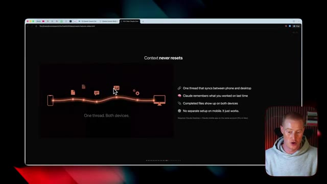
*⏱️ 00:11:18 — Capture d'écran montrant une interface de présentation avec le titre "Context never resets" et l'illustration de la synchronisation entre un téléphone et un ordinateur, avec le présentateur en médaillon.*

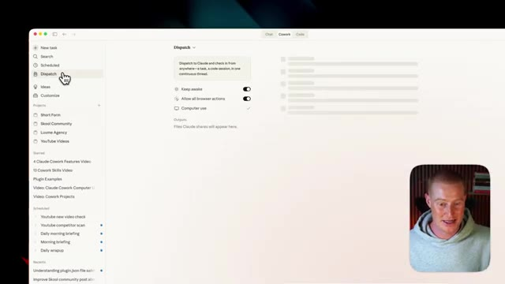
*⏱️ 00:11:23 — Capture d'écran de l'application Claude Cowork sur ordinateur avec le menu latéral ouvert et l'onglet Dispatch sélectionné.*

---

### ⏱️ `[00:11:34 - 00:12:08]` | Segment #32

**🔊 Audio (Transcription Intégrale Mot pour Mot en Français) :**
> On va cliquer sur dispatch. Et si vous ne voyez pas encore ceci, assurez-vous de supprimer l'application Cloud Desktop, de la retélécharger et si vous êtes un utilisateur pro sur le forfait à 20 dollars par mois, vous devriez avoir accès à cette fonctionnalité. Maintenant, voilà à quoi ça ressemble. Fondamentalement, je peux voir exactement ce même chat sur mon téléphone. Je ne sais pas si vous pouvez voir cela, mais c'est exactement le même fil de conversation ici que celui que nous pouvons voir sur mon bureau ici. Mais pour les besoins de cette vidéo, je vais juste le faire sur mon ordinateur. C'est plus grand. Vous pouvez voir ce qui se passe réellement ici. Sachez simplement que la même interface exacte est sur mon téléphone et je peux envoyer un message ici. Par exemple, laissez-moi juste dire hey quoi de neuf un truc

**👁️ Analyse Visuelle d'Écran (gemini-3.5-flash-lite) :**
**Interface & Outils** : Application mobile de messagerie sur smartphone.

**Contenu textuel & Code** : Interface utilisateur d'une application mobile montrant du texte de discussion.

**Action / Démonstration** : Le présentateur montre son téléphone portable en parlant de la mise à jour de l'application.

---

### ⏱️ `[00:12:08 - 00:12:42]` | Segment #33

**🔊 Audio (Transcription Intégrale Mot pour Mot en Français) :**
> comme ça, envoyé par SMS depuis mon téléphone et maintenant c'est reflété sur mon ordinateur. Quelques points clés ici : nous avons ces bascules, je vous suggère vivement de cliquer sur ce bouton "rester éveillé". Ce bouton juste ici fera en sorte que Claude ne s'endorme pas sur votre ordinateur, car si votre ordinateur est fermé ou que l'application de bureau Claude n'est pas ouverte, Dispatch ne peut pas aller exécuter des tâches pour vous sur votre ordinateur. Personnellement, j'autorise toutes les actions du navigateur pour qu'il puisse littéralement cliquer à l'intérieur de mon navigateur, remplir des formulaires et faire des choses dedans, ainsi que l'utilisation de l'ordinateur dont je vais parler plus tard dans cette vidéo. Pour vous montrer exactement comment cela fonctionne et exactement ce que je veux dire, vous pouvez voir que j'ai envoyé

**👁️ Analyse Visuelle d'Écran (gemini-3.5-flash-lite) :**
**Interface & Outils** : Interface application desktop (Claude / Cowork) avec affichage en picture-in-picture du présentateur.

**Contenu textuel & Code** : Options de configuration ("Keep awake", "Allow all browser actions", "Computer use") et historique de conversation textuelle avec l'assistant.

**Action / Démonstration** : Le curseur de la souris survole et pointe sur le bouton de configuration des paramètres de l'application.

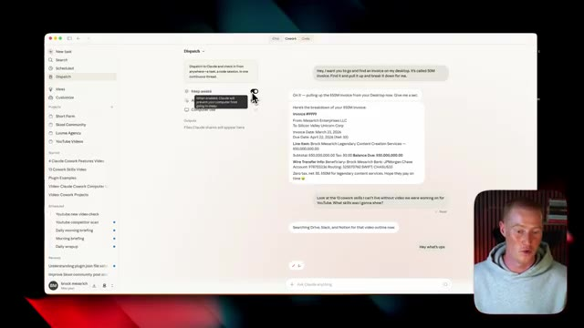
*⏱️ 00:12:17 — Interface logicielle affichant un assistant IA avec des options de configuration, montrant une infobulle sur le bouton "Keep awake".*

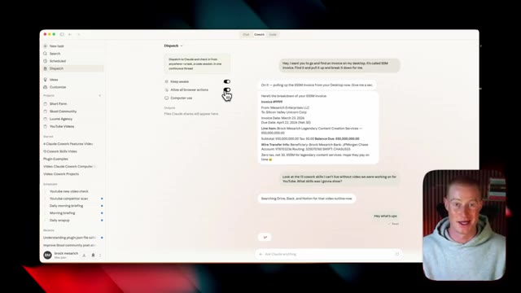
*⏱️ 00:12:34 — Interface logicielle montrant les options de configuration de l'assistant IA, avec un focus sur les bascules de paramètres.*

---

### ⏱️ `[00:12:42 - 00:13:17]` | Segment #34

**🔊 Audio (Transcription Intégrale Mot pour Mot en Français) :**
> ce message, a scanné mes reçus depuis mon téléphone. En gros, il a dit où sont les reçus et je lui ai dit de trouver le dossier appelé reçus sur mon ordinateur et il a parcouru et extrait tous les reçus qui s'y trouvaient et a ensuite ventilé en gros tout ce sur quoi j'ai dépensé mon argent. Et c'est une compétence spécifique que j'ai créée à l'intérieur de Cloud Cowork pour générer en gros un tableau de bord HTML de absolument tout ce sur quoi j'ai dépensé de l'argent. Vous pourriez donc créer des compétences spécifiques puis utiliser le mode de déclenchement pour les lancer sur votre ordinateur pendant que vous n'êtes pas à votre bureau. Et une autre chose essentielle ici, c'est que si vous allez dans nos tâches ou nos chats sur la barre latérale gauche, vous pouvez voir qu'il y a ceci

**👁️ Analyse Visuelle d'Écran (gemini-3.5-flash-lite) :**
**Interface & Outils** : Interface logicielle de type assistant IA (Claude / Cowork) avec une vue de discussion textuelle et un panneau latéral de gestion des tâches.

**Contenu textuel & Code** : Historique de discussion textuel montrant les prompts « scan my receipts », « scan my receipts in the folder called receipts », et la réponse détaillée de l'IA avec la ventilation des coûts (« 347.33 total », « Meals/Entertainment », « Equipment/Hardware »).

**Action / Démonstration** : Démonstration de l'utilisation d'un agent IA pour parcourir les dossiers locaux de l'ordinateur, analyser des reçus et générer un rapport de dépenses catégorisé.

*⏱️ 00:12:51 — Capture d'écran d'une interface de chat IA montrant la discussion avec l'assistant sur l'analyse des reçus et le résumé des dépenses.*

---

### ⏱️ `[00:13:17 - 00:13:37]` | Segment #35

**🔊 Audio (Transcription Intégrale Mot pour Mot en Français) :**
> bouton ici appelé "dispatch". Donc si vous voulez reprendre là où vous vous étiez arrêté ou essentiellement voir ce que "dispatch" a fait pour vous pendant que vous n'êtes pas à votre ordinateur, vous pouvez toujours voir ceci lorsque vous êtes de retour sur l'application de bureau. Je peux ouvrir ceci. Une fois que j'ai ouvert ceci, nous pouvons voir une conversation par chat plus détaillée sur exactement ce que cela a fait. Donc cela a créé ce petit, vous savez, tableau pour nous, tout comme je vous l'ai dit, cela crée un tableau de bord HTML.

**👁️ Analyse Visuelle d'Écran (gemini-3.5-flash-lite) :**
**Interface & Outils** : Application de bureau (interface de type assistant IA/Cowork Dispatch)

**Contenu textuel & Code** : Historique de requêtes et de réponses textuelles concernant des tâches de recherche et de numérisation de reçus.

**Action / Démonstration** : Navigation dans l'historique des tâches et présentation des résultats de la fonction Dispatch de l'assistant IA.

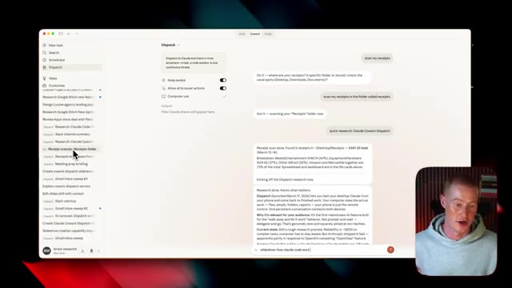
*⏱️ 00:13:22 — Capture d'écran montrant l'application de bureau avec le menu "Dispatch" sélectionné et un historique de tâches textuelles sur la droite.*

---

### ⏱️ `[00:13:37 - 00:13:56]` | Segment #36

**🔊 Audio (Transcription Intégrale Mot pour Mot en Français) :**
> Nous pouvions voir notre tableau de bord HTML, qui est fondamentalement juste comme une ventilation de tout ce sur quoi j'ai dépensé mon argent juste ici. Nous ne pouvons pas voir cela sur notre téléphone, cependant, mais quand nous sommes de retour sur notre ordinateur et que nous trouvons l'étiquette dispatch ici dans notre conversation de chat, nous pouvions afficher toutes ces choses et avoir accès à n'importe quel fichier qu'il crée pour nous ou n'importe quel artéfact, tout ce contenu différent sera juste ici.

**👁️ Analyse Visuelle d'Écran (gemini-3.5-flash-lite) :**
**Interface & Outils** : Application de bureau (Interface de type assistant IA / Claude) affichant un tableau de bord HTML.

**Contenu textuel & Code** : Rapport de dépenses totalisant 347.33 $, ventilé par catégories (Meals/Entertainment, Equipment/Hardware, Other) avec des graphiques de répartition et une chronologie des transactions.

**Action / Démonstration** : Présentation et explication du tableau de bord HTML des dépenses personnelles généré automatiquement à partir de reçus scannés.

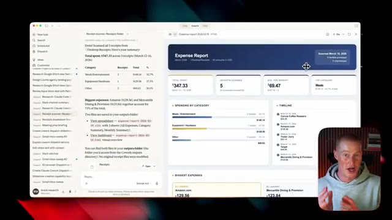
*⏱️ 00:13:42 — Tableau de bord HTML d'analyse de dépenses généré par IA montrant un récapitulatif financier avec graphiques et catégories.*

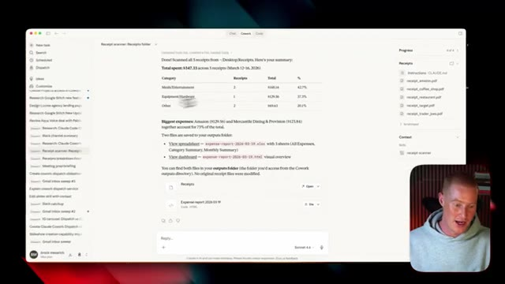
*⏱️ 00:13:47 — Interface de l'application affichant les résultats du scan de reçus et les liens vers le rapport de dépenses.*

---

### ⏱️ `[00:13:57 - 00:14:16]` | Segment #37

**🔊 Audio (Transcription Intégrale Mot pour Mot en Français) :**
> Alors maintenant, je veux parler de deux astuces spécifiques que la plupart des gens ne vous disent pas ou tout simplement ignorent. Et c'est ainsi que nous pour-rions donner à Claude un accès en temps réel à n'importe quelle donnée sur Internet. Je veux vous montrer un exemple rapide de ce que je veux vraiment dire afin de scraper Internet en utilisant Claude pour obtenir des données spécifiques pour moi. J'ai donc ce flux de travail que vous pouvez voir à l'intérieur de mon système d'exploitation d'entreprise.

**👁️ Analyse Visuelle d'Écran (gemini-3.5-flash-lite) :**
**Interface & Outils** : Présentation ou face-caméra explicatif du trader sans interface logicielle partagée.

**Contenu textuel & Code** : Explications orales des stratégies et mise en contexte méthodologique du marché.

**Action / Démonstration** : Explications face caméra et analyse conceptuelle des marchés.

---

### ⏱️ `[00:14:16 - 00:14:37]` | Segment #38

**🔊 Audio (Transcription Intégrale Mot pour Mot en Français) :**
> Voici mon système de contenu court. Donc, si vous jetez un œil à ceci ici, vous pouvez voir que chaque matin, je trouve des sujets tendance dans ma niche sur différentes vidéos que je pourrais créer pour mes vidéos courtes. Ensuite, il recherche et vérifie des sujets spécifiques sur lesquels je peux créer du contenu. Ensuite, il génère un script pour moi. Et à partir de là, il me préparera à tourner réellement cette vidéo.

**👁️ Analyse Visuelle d'Écran (gemini-3.5-flash-lite) :**
**Interface & Outils** : Présentation ou face-caméra explicatif du trader sans interface logicielle partagée.

**Contenu textuel & Code** : Explications orales des stratégies et mise en contexte méthodologique du marché.

**Action / Démonstration** : Explications face caméra et analyse conceptuelle des marchés.

---

### ⏱️ `[00:14:37 - 00:14:56]` | Segment #39

**🔊 Audio (Transcription Intégrale Mot pour Mot en Français) :**
> Et un point clé ici, c'est que si vous utilisez Claude normalement, vous ne pouvez pas scraper Instagram ou TikTok ou YouTube afin d'extraire les transcriptions de vidéos pour comprendre quelles vidéos cartonnent réellement dans votre niche spécifique. Eh bien, c'est exactement pour cela que j'utilise quelque chose qui s'appelle Apify, que je peux brancher directement à l'intérieur de Claude. Et ceci n'est pas sponsorisé par Apify.

**👁️ Analyse Visuelle d'Écran (gemini-3.5-flash-lite) :**
**Interface & Outils** : Navigateur web affichant un tableau de bord personnalisé et le site web d'Apify.

**Contenu textuel & Code** : Schéma d'automatisation de contenu et outils de scraping web en temps réel (TikTok Scraper, Instagram Scraper).

**Action / Démonstration** : Navigation et présentation des outils de scraping web utilisés pour extraire des données des réseaux sociaux.

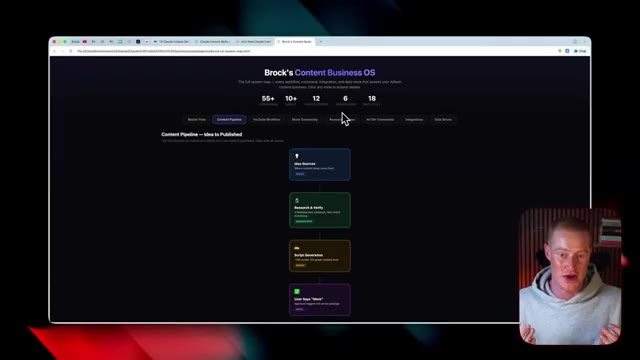
*⏱️ 00:14:46 — Interface d'un tableau de bord de gestion de contenu nommé 'Brock's Content Business OS' avec différentes sections de flux de travail.*

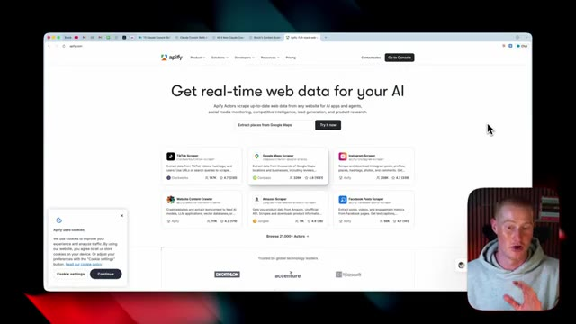
*⏱️ 00:14:51 — Page d'accueil du site web Apify montrant des outils de scraping pour TikTok, Instagram, Google Maps et Amazon.*

---

### ⏱️ `[00:14:56 - 00:15:20]` | Segment #40

**🔊 Audio (Transcription Intégrale Mot pour Mot en Français) :**
> Je n'ai aucune affiliation avec eux. Laissez-moi donc parler maintenant de pourquoi c'est important et de la façon dont vous pouvez configurer le MCP. Donc, avant Claude Cowork, je devais faire cela de la manière la plus difficile. J'utilisais donc N8N. Je devais trouver des acteurs spécifiques à l'intérieur d'Appify, qui sont fondamentalement différents scrapers. Donc, par exemple, ce scraper TikTok va automatiquement extraire différentes vidéos, rechercher différents mots-clés spécifiques, et extraire les métadonnées des vidéos sur TikTok.

**👁️ Analyse Visuelle d'Écran (gemini-3.5-flash-lite) :**
**Interface & Outils** : Navigateur web affichant une page Apify et une présentation de diapositive.

**Contenu textuel & Code** : Documentation technique du scraper TikTok, listant les points de données extractibles (profils, hashtags, vidéos).

**Action / Démonstration** : Navigation sur le site d'Apify pour présenter un outil de web scraping compatible avec les modèles d'IA.

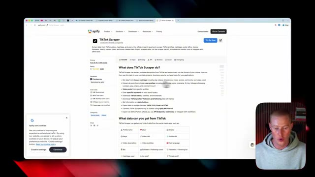
*⏱️ 00:15:14 — Page web du site Apify affichant la documentation et les fonctionnalités du 'TikTok Scraper'.*

---

### ⏱️ `[00:15:21 - 00:15:40]` | Segment #41

**🔊 Audio (Transcription Intégrale Mot pour Mot en Français) :**
> Avant, je devais aller en trouver un qui fonctionnait vraiment, configurer l'API, le brancher à N8N, et c'était une vraie galère à devoir gérer. Eh bien, maintenant, je peux simplement dire à Claude d'aller scraper Instagram. Et sans que j'aie à préconfigurer cette API spécifique, c'est connecté au MCP. Donc il va trouver un acteur, qui est un scraper à l'intérieur d'Appify.

**👁️ Analyse Visuelle d'Écran (gemini-3.5-flash-lite) :**
**Interface & Outils** : Navigateur web affichant une page Apify et des diapositives de présentation.

**Contenu textuel & Code** : Documentation d'outils de scraping et comparaison visuelle entre les workflows traditionnels (Before) et l'intégration directe avec Claude (Now).

**Action / Démonstration** : Le présentateur illustre les difficultés techniques passées liées à la configuration d'APIs et de workflows par rapport à la simplicité d'utilisation actuelle.

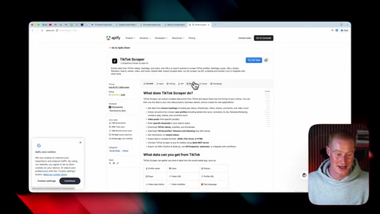
*⏱️ 00:15:25 — Capture montrant la page web d'un outil de scraping (TikTok Scraper sur Apify) avec une description détaillée de ses fonctionnalités.*

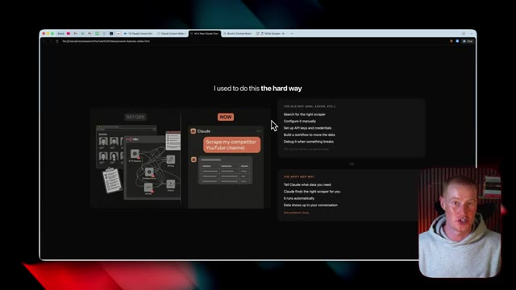
*⏱️ 00:15:30 — Diapositive de présentation contrastant l'ancienne méthode complexe (recherche, configuration manuelle, clés API, workflows N8N) et la nouvelle méthode simplifiée avec Claude.*

---

### ⏱️ `[00:15:41 - 00:15:59]` | Segment #42

**🔊 Audio (Transcription Intégrale Mot pour Mot en Français) :**
> Automatiquement pour moi, ça fonctionne et ça va simplement faire cette tâche pour moi. Totalement sans intervention. Je n'ai même pas besoin de m'inquiéter de ce qu'il fait. Très bien, alors vous vous demandez probablement : « Brock, comment fonctionne ce MCP ? Est-ce que je dois aller chercher tous les connecteurs moi-même ? » Et non, c'est là que le MCP à l'intérieur de Claude est super utile. Par exemple, ce graphique ici est un parfait exemple de ce dont je parle.

**👁️ Analyse Visuelle d'Écran (gemini-3.5-flash-lite) :**
**Interface & Outils** : Présentation ou face-caméra explicatif du trader sans interface logicielle partagée.

**Contenu textuel & Code** : Explications orales des stratégies et mise en contexte méthodologique du marché.

**Action / Démonstration** : Explications face caméra et analyse conceptuelle des marchés.

---

### ⏱️ `[00:15:59 - 00:16:30]` | Segment #43

**🔊 Audio (Transcription Intégrale Mot pour Mot en Français) :**
> Vous pouvez simplement donner le prompt comme "J'ai besoin de données YouTube" ou "Scrape YouTube pour moi" et il va trier parmi tous les 1300 différents acteurs qui sont différents scrapers et trouver le parfait pour vous pour chaque tâche individuelle. Donc vous n'avez pas besoin de configurer cela vous-même. Une fois que vous avez l'application connectée, elle le fera automatiquement pour vous et c'était tellement un casse-tête avant et maintenant c'est complètement soulagé depuis que nous pouvons faire cela directement à l'intérieur de Claude. Avant de vous montrer exactement comment configurer cela en juste quelques clics différents, parlons rapidement de ce que vous pouvez exactement faire à l'intérieur d'Appify ? Donc vous pouvez voir qu'il y a plus de 1300 acteurs différents ici.

**👁️ Analyse Visuelle d'Écran (gemini-3.5-flash-lite) :**
**Interface & Outils** : Navigateur web affichant une application web et la plateforme Apify.

**Contenu textuel & Code** : Texte « Claude finds the scraper for you », infographie de recherche automatique avec le prompt « I need YouTube data », et interface du catalogue d'acteurs Apify listant 1 327 acteurs différents.

**Action / Démonstration** : Présentation de la fonctionnalité de sélection automatisée de scrapers par l'intelligence artificielle pour simplifier l'extraction de données.

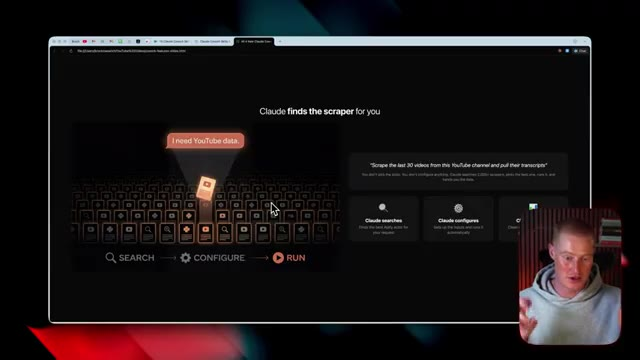
*⏱️ 00:16:07 — Interface web illustrant comment Claude trouve et sélectionne automatiquement un scraper adapté pour une requête YouTube.*

*⏱️ 00:16:22 — Capture d'écran montrant le catalogue et les différents acteurs (scrapers) disponibles sur la plateforme Apify.*

---

### ⏱️ `[00:16:30 - 00:17:02]` | Segment #44

**🔊 Audio (Transcription Intégrale Mot pour Mot en Français) :**
> Il y a des choses pour les bibliothèques d'annonces Meta, le scraper de Meta Threads, le scraper de Reddit, le web scraper par IA. Il y a tellement de choses différentes ici que vous pourriez faire. Donc, scraper du contenu sur Instagram, TikTok ou YouTube que j'utilise, c'est peut-être pas applicable pour vous, mais il y a probablement quelque chose que vous pourriez utiliser à l'intérieur de cette bibliothèque d'acteurs juste ici. La première chose qu'on va faire, c'est de créer un compte. Et les gars, c'est vraiment bon marché à faire tourner, à moins que vous ne fassiez tourner ça des milliers de fois par jour selon l'acteur. En gros, ce que vous allez faire, c'est que vous allez descendre dans les paramètres. À partir de là, vous allez cliquer sur API et intégrations, et vous

**👁️ Analyse Visuelle d'Écran (gemini-3.5-flash-lite) :**
**Interface & Outils** : Navigateur web affichant la plateforme Apify Store avec vignettes d'outils de scraping.

**Contenu textuel & Code** : Liste de modules de scraping : Meta Ad Library Scraper, YouTube Video Transcript, Meta Threads Scraper, Reddit Scraper, AI Web Scraper.

**Action / Démonstration** : Navigation et présentation des différents scrapers et outils d'automatisation disponibles sur la plateforme Apify.

*⏱️ 00:16:46 — Capture d'écran du navigateur montrant la plateforme Apify Store avec de nombreux scrapers et outils d'automatisation.*

---

### ⏱️ `[00:17:02 - 00:17:38]` | Segment #45

**🔊 Audio (Transcription Intégrale Mot pour Mot en Français) :**
> besoin de créer un jeton API et une fois qu'il est créé, il suffit de le copier et à partir d'ici, nous allons revenir à Claude Cowork, puis nous allons aller sur personnaliser sur le côté gauche. Ensuite, nous allons cliquer sur connecteurs. À partir d'ici, cliquez sur le bouton plus et parcourir les connecteurs, puis cherchez simplement Apify et heureusement, il y a une intégration native à Apify donc tout ce que nous avons à faire est simplement de brancher notre clé API et nous devrions être connectés à cette plateforme maintenant. Et je tiens à le mentionner les gars, vous n'avez pas besoin d'utiliser ceci, mais si vous prévoyez de scraper un tas d'informations provenant de différentes sources de données, c'est une excellente astuce pour en gros, genre, vous assurer de ne rencontrer aucun

**👁️ Analyse Visuelle d'Écran (gemini-3.5-flash-lite) :**
**Interface & Outils** : Interface web de Claude Cowork / Claude.ai sur macOS.

**Contenu textuel & Code** : Paramètres de personnalisation, liste des connecteurs disponibles (Apify, Bitly, Canva, GitHub, Gmail, Google Calendar, Google Drive, Notion, Slack, Zapier), et options de permissions pour les outils.
[DESC_IMAGE_3] Navigation dans les menus de personnalisation et de configuration des connecteurs tiers de Claude Cowork.

**Action / Démonstration** : Explications face caméra et analyse conceptuelle des marchés.

*⏱️ 00:17:11 — Capture montrant l'interface de Claude Cowork avec le menu latéral ouvert et le curseur sur l'option 'Customize'.*

*⏱️ 00:17:20 — Capture montrant la fenêtre modale des connecteurs avec une barre de recherche où 'Apify' est tapé.*

*⏱️ 00:17:29 — Capture montrant la liste des connecteurs configurés dans Claude Cowork, avec les permissions et outils du connecteur Bitly affichés.*

---

### ⏱️ `[00:17:38 - 00:18:11]` | Segment #46

**🔊 Audio (Transcription Intégrale Mot pour Mot en Français) :**
> des erreurs disant que nous ne pouvons pas trouver cette information ou quelque chose comme ça. Parlons donc maintenant un peu plus des connecteurs. C'est essentiellement là que nous donnons à Claude l'accès pour se connecter aux différentes applications que nous utilisons chaque jour. Donc, si vous utilisez Gmail, c'est ainsi qu'il est capable d'explorer votre boîte de réception d'e-mails, de répondre à vos e-mails pour vous, de vérifier votre Google Agenda, de publier des choses sur Slack, toutes ces choses formidables. Vous pouvez donc venir ici, cliquer là-dessus et parcourir tous les différents connecteurs qu'ils proposent, ce qui est génial. Ils en ont plein, mais s'il y en a un auquel vous ne pouvez pas vous connecter, je vais vous montrer une astuce rapide maintenant. Personnellement, j'utilise donc quelque chose qui s'appelle Zapier MCP,

**👁️ Analyse Visuelle d'Écran (gemini-3.5-flash-lite) :**
**Interface & Outils** : Interface utilisateur de l'application Claude (paramètres et connecteurs).

**Contenu textuel & Code** : Liste des applications connectables (Bitly, Google Calendar, FactSet, Zapier, etc.) et leurs permissions associées (outils en lecture seule et écriture/suppression).

**Action / Démonstration** : Navigation et présentation des différents connecteurs et de leurs permissions d'accès au sein de l'application Claude.

*⏱️ 00:17:46 — Interface de configuration affichant la liste des connecteurs disponibles pour Claude, avec Bitly sélectionné et ses permissions d'outils visibles.*

*⏱️ 00:17:55 — Navigation dans le panneau des connecteurs, avec Google Calendar sélectionné pour montrer les outils de lecture et d'écriture associés.*

*⏱️ 00:18:03 — Fenêtre modale de recherche et d'ajout de nouveaux connecteurs tiers pour intégrer des services supplémentaires à Claude.*

---

### ⏱️ `[00:18:11 - 00:18:44]` | Segment #47

**🔊 Audio (Transcription Intégrale Mot pour Mot en Français) :**
> ce qui se connecte fondamentalement à plus de 8 000 applications différentes avec lesquelles je peux effectuer des actions au sein de Claude. Donc, pour créer un compte, il vous suffit de cliquer sur Commencer à créer, de vous connecter à votre compte. Et une fois que vous y êtes, nous allons simplement cliquer rapidement sur Nouveau serveur MCP. Vous n'avez même pas besoin de savoir ce qu'est un serveur MCP pour que cela fonctionne. Je vais juste cliquer sur Claude Cowork. Et à partir de là, ce que nous allons faire, c'est configurer tous les différents outils que nous voulons ajouter à Claude. Donc, par exemple, si je veux chercher School, qui est fondamentalement une plateforme que j'utilise tout le temps, et que je veux l'ajouter de sorte que

**👁️ Analyse Visuelle d'Écran (gemini-3.5-flash-lite) :**
**Interface & Outils** : Navigateur web affichant l'interface Zapier MCP.

**Contenu textuel & Code** : Menus de configuration de serveurs MCP, listes d'applications et d'outils compatibles (Stripe, HubSpot, Google Drive, Slack, Google Docs).
[DESC_IMAGE_1] Navigation sur la page de présentation et démonstration de l'outil Zapier MCP.
[DESC_IMAGE_2] Sélection et configuration d'un nouveau serveur MCP pour les clients IA.
[DESC_IMAGE_3] Ajout et gestion des outils et applications connectés au serveur MCP.

**Action / Démonstration** : Explications face caméra et analyse conceptuelle des marchés.

*⏱️ 00:18:20 — Page d'accueil du site Zapier affichant le titre 'Connect your AI to any app with Zapier MCP' avec un bouton 'Start building'.*

*⏱️ 00:18:28 — Interface de configuration affichant une fenêtre modale 'New MCP Server' avec une liste de clients IA populaires (Claude, ChatGPT, Cursor).*

*⏱️ 00:18:36 — Tableau de bord Zapier MCP montrant les outils connectés (Stripe, HubSpot, Google Drive, Slack, Google Docs) avec un bouton 'Add tool'.*

---

### ⏱️ `[00:18:44 - 00:19:19]` | Segment #48

**🔊 Audio (Transcription Intégrale Mot pour Mot en Français) :**
> Je pourrais aller de l'avant et inviter des membres ou déverrouiller un cours pour un membre, je pourrais faire cela directement à l'intérieur de Claude maintenant. Donc je vais simplement sélectionner cela. Et donc maintenant nous avons toutes ces différentes applications auxquelles nous pouvons nous connecter. Et afin de connecter ceci à Claude, nous allons simplement cliquer sur ce bouton ici, copier cette URL que nous allons voir à l'intérieur d'ici, ou ce bouton "ajouter à Claude". Ensuite, nous allons revenir à Claude. Recherchez simplement Zapier et collez cette URL ou le prompt qu'il nous donne. Encore une fois, ce n'est pas quelque chose que vous avez nécessairement besoin d'utiliser à moins qu'il y ait des applications que vous ne pouvez pas connecter de manière native à l'intérieur de Claude. Très bien, alors passons à la fonctionnalité numéro quatre que vous avez peut-être ratée, et c'est une grande nouveauté. Les gens deviennnent fous à ce sujet.

**👁️ Analyse Visuelle d'Écran (gemini-3.5-flash-lite) :**
**Interface & Outils** : Navigateur web, interface Zapier MCP, configuration de serveur Claude MCP.

**Contenu textuel & Code** : Liste d'applications connectées (Stripe, HubSpot, Google Drive, Slack, Google Docs) utilisables via le serveur MCP.
[DESC_IMAGE_1] Navigation et sélection des outils d'applications connectées pour Claude MCP.

**Action / Démonstration** : Explications face caméra et analyse conceptuelle des marchés.

*⏱️ 00:18:53 — Interface web montrant la configuration d'un serveur Claude MCP via Zapier, avec la liste des outils connectés (Stripe, HubSpot, Google Drive).*

*⏱️ 00:19:02 — Vue éloignée d'une fenêtre de navigateur affichant l'interface de gestion Zapier MCP et les outils connectés.*

---

### ⏱️ `[00:19:20 - 00:19:45]` | Segment #49

**🔊 Audio (Transcription Intégrale Mot pour Mot en Français) :**
> Claude peut désormais voir et contrôler l'écran de votre ordinateur. Il peut cliquer, taper et naviguer dans n'importe quelle application nativement sur votre ordinateur. Et je ne parle pas de celles que vous avez connectées à l'intérieur de Claude. Afin de détailler un peu plus cela, je veux parler de cette sorte de pyramid que vous voyez à l'écran ici. Nous avons donc plusieurs niveaux différents. Nous avons notre niveau supérieur, qui correspond essentiellement aux connecteurs que je viens de vous montrer un peu plus tôt dans cette vidéo. C'est donc là que Claude a accès à vos applications spécifiques simplement en cliquant sur « connecter ».

**👁️ Analyse Visuelle d'Écran (gemini-3.5-flash-lite) :**
**Interface & Outils** : Navigateur web affichant une présentation ou un site d'information.

**Contenu textuel & Code** : Texte explicatif sur la fonctionnalité de contrôle d'écran de Claude ("Feature 4 : Claude can see and control your screen").

**Action / Démonstration** : Le présentateur commente la fonctionnalité textuelle affichée à l'écran sans manipulation technique directe.

---

### ⏱️ `[00:19:45 - 00:20:07]` | Segment #50

**🔊 Audio (Transcription Intégrale Mot pour Mot en Français) :**
> Et c'est la meilleure et la plus rapide façon d'effectuer des actions à travers vos applications. S'il y a quelque chose que vous devez faire auquel Claude ne se connecte pas, il utilisera alors votre navigateur avec un outil appelé "browser use", que si vous n'avez pas déjà téléchargé, je vous le conseille vivement. Cela peut fondamentalement exécuter différentes tâches à l'intérieur de notre navigateur. Il peut remplir différents formulaires pour nous, toutes ces superbes choses, mais cela se limite uniquement à nos navigateurs.

**👁️ Analyse Visuelle d'Écran (gemini-3.5-flash-lite) :**
**Interface & Outils** : Navigateur web affichant une présentation de diapositive, avec le panneau latéral de l'application Claude ouvert à droite.

**Contenu textuel & Code** : Schéma en pyramide classant les modes d'interaction par rapidité : "Top Tier" (Direct connectors), "Middle Tier" (Browser navigation), et "Bottom Tier" (Screen control).

**Action / Démonstration** : Présentation conceptuelle et visuelle des différentes méthodes d'utilisation et d'automatisation des outils par Claude selon le niveau de connectivité.

---

### ⏱️ `[00:20:07 - 00:20:27]` | Segment #51

**🔊 Audio (Transcription Intégrale Mot pour Mot en Français) :**
> Donc, s'il y a une tâche spécifique que vous avez dans Claude où les connecteurs ne résolvent pas le problème ou que l'utilisation du navigateur ne résout pas le problème, vous pourriez alors utiliser la nouvelle fonctionnalité d'utilisation de l'ordinateur, qui est fondamentalement le contrôle de l'écran sur l'ensemble de votre ordinateur. Cela pourrait ouvrir vos navigateurs, pourrait parcourir vos différents fichiers sur votre véritable ordinateur, toutes ces différentes choses que vous pouvez faire à l'intérieur de l'utilisation de l'ordinateur maintenant.

**👁️ Analyse Visuelle d'Écran (gemini-3.5-flash-lite) :**
**Interface & Outils** : Navigateur web affichant une page de présentation des fonctionnalités de Claude.

**Contenu textuel & Code** : Une pyramide divisée en trois niveaux : « Connectors » (Top tier), « Browser » (Middle tier), et « Screen control » (Bottom tier).

**Action / Démonstration** : Le présentateur explique la hiérarchie des outils utilisés par Claude pour résoudre des tâches spécifiques.

*⏱️ 00:20:12 — Capture d'écran montrant une page web avec une pyramide illustrant les niveaux d'outils de Claude (« Claude always picks the fastest tool first »), avec le présentateur en bas à droite.*

---

### ⏱️ `[00:20:27 - 00:20:47]` | Segment #52

**🔊 Audio (Transcription Intégrale Mot pour Mot en Français) :**
> Et une chose essentielle que je veux mentionner ici, c'est que vous pouvez contrôler ce que Claude touche réellement. Donc, s'il y a une application spécifique sur votre bureau à laquelle vous ne voulez pas qu'il ait accès, vous pouvez aller de l'avant et la bloquer pour qu'il ne puisse pas y accéder. Je vais vous montrer très rapidement comment activer cette fonction, puis je vais vous la montrer en direct pour que vous puissiez commencer à l'utiliser. Nous allons donc venir sur notre compte ici, cliquer en bas à gauche, puis cliquer sur les paramètres.

**👁️ Analyse Visuelle d'Écran (gemini-3.5-flash-lite) :**
**Interface & Outils** : Navigateur web affichant une présentation de fonctionnalités et interface de l'application Claude Cowork.

**Contenu textuel & Code** : Texte explicatif sur les permissions des applications (« Per-App Permissions », « Blocked by Default ») et interface de gestion de tâches.

**Action / Démonstration** : Présentation des options de contrôle et de sécurité des accès de l'IA aux applications du bureau.

*⏱️ 00:20:32 — Capture d'écran montrant une diapositive de présentation sur les contrôles de sécurité et les permissions de Claude (« You control what Claude can touch »).*

*⏱️ 00:20:42 — Capture d'écran montrant l'interface logicielle de Claude Cowork avec un champ de saisie (« Let's knock something off your list »).*

---

### ⏱️ `[00:20:47 - 00:21:07]` | Segment #53

**🔊 Audio (Transcription Intégrale Mot pour Mot en Français) :**
> À partir d'ici, descendez dans Général, puis vous allez activer ce bouton d'utilisation de l'ordinateur juste ici. Et s'il y a une application à laquelle vous ne voulez pas accorder l'accès, je vous suggère vivement d'ajouter cette application. Et ensuite, à partir d'ici, nous pouvons retourner sur Claude et lui donner une tâche à exécuter sur mon ordinateur. Je vais donc donner cette invite : utilise l'utilisation de l'ordinateur et trouve cette vidéo sur mon bureau.

**👁️ Analyse Visuelle d'Écran (gemini-3.5-flash-lite) :**
**Interface & Outils** : Interface logicielle de bureau (Cowork / Claude).

**Contenu textuel & Code** : Options de configuration pour le contrôle de l'ordinateur et gestion des tâches.

**Action / Démonstration** : Activation du paramètre d'utilisation de l'ordinateur puis retour à l'écran principal.

*⏱️ 00:20:52 — Paramètres généraux de l'application montrant l'option d'utilisation de l'ordinateur activée.*

*⏱️ 00:21:02 — Interface principale de l'application montrant le champ de saisie et la liste des tâches actives.*

---

### ⏱️ `[00:21:07 - 00:21:29]` | Segment #54

**🔊 Audio (Transcription Intégrale Mot pour Mot en Français) :**
> Ensuite, je veux que vous ajoutiez CapCut et que vous l'ajoutiez à un projet. Donc c'est fondamentalement une vidéo sur mon ordinateur juste ici. Celle-ci spécifiquement que je voulais vraiment ajouter à mon logiciel de montage juste ici. Donc, hypothétiquement, il glisserait ceci dans ce projet ici. Donc ce que je vais faire, c'est que je vais l'envoyer. Nous allons voir l'utilisation de l'ordinateur en direct et en action. Donc en ce moment, Claude dit fondamentalement qu'il veut l'accès à Finder ainsi qu'à CapCut.

**👁️ Analyse Visuelle d'Écran (gemini-3.5-flash-lite) :**
**Interface & Outils** : CapCut (logiciel de montage vidéo)

**Contenu textuel & Code** : Interface principale de CapCut avec panneau multimédia, timeline et options d'exportation/partage.

**Action / Démonstration** : Manipulation et intégration d'une vidéo dans le projet de montage sur CapCut.

*⏱️ 00:21:18 — Le logiciel de montage vidéo CapCut ouvert sur le bureau avec une timeline et une fenêtre de prévisualisation.*

---

### ⏱️ `[00:21:29 - 00:22:05]` | Segment #55

**🔊 Audio (Transcription Intégrale Mot pour Mot en Français) :**
> Donc je dois personnellement autoriser cette session pour qu'elle puisse réellement se lancer et exécuter des tâches à travers ces applications. Et mes mains sont loin du clavier, tout ce qu'elle est en train de faire en ce moment, c'est Claude qui utilise l'utilisation de l'ordinateur pour exécuter une tâche différente pour moi. Donc vous pouviez voir qu'il a cherché cela à l'intérieur du Finder, a trouvé la vidéo très rapidement. Voyons s'il est capable de cliquer dessus. Et une chose à mentionner, vous pourriez voir cette chose orange lumineuse autour de mon ordinateur. Cela signifie fondamentalement que l'utilisation de l'ordinateur par Claude fonctionne. Très bien, il a donc trouvé le fichier, il a ensuite ouvert CapCut et vous pouvez voir ici, il détaille étape par étape ce qu'il est en train de faire. Ensuite, tout ce qu'il a à faire, c'est réellement glisser ce fichier, le fichier vidéo,

**👁️ Analyse Visuelle d'Écran (gemini-3.5-flash-lite) :**
**Interface & Outils** : macOS, application Claude, Finder, CapCut, incrustation vidéo (webcam du présentateur).

**Contenu textuel & Code** : Interface d'utilisation de l'ordinateur de Claude affichant les processus de pensée (« Thought process ») et le prompt demandant de trouver une vidéo et de l'importer dans CapCut.

**Action / Démonstration** : Démonstration de l'agent IA (Claude) qui prend le contrôle du système d'exploitation pour naviguer dans les dossiers et lancer un logiciel de montage vidéo de manière autonome.

*⏱️ 00:21:38 — Capture d'écran montrant macOS avec Claude en train d'utiliser l'ordinateur pour ouvrir le Finder et localiser un fichier vidéo, avec une incrustation vidéo du présentateur en bas à droite.*

*⏱️ 00:21:56 — Capture d'écran montrant l'application de montage vidéo CapCut ouverte et manipulée automatiquement par Claude, avec l'interface de chat sur le côté droit.*

---

### ⏱️ `[00:22:05 - 00:22:23]` | Segment #56

**🔊 Audio (Transcription Intégrale Mot pour Mot en Français) :**
> dans ce projet et ça devrait être tout bon. Très bien, et juste comme ça, ça a pris peut-être environ deux ou trois minutes pour comprendre ça. Et c'était une tâche très, très simple. Donc ce n'est pas encore extraordinaire, mais cela pose les fondations et les bases pour vous permettre de déclencher Claude depuis votre téléphone afin qu'il aille exécuter des tâches partout sur votre ordinateur, de sorte que vous n'avez même pas besoin d'être là.

**👁️ Analyse Visuelle d'Écran (gemini-3.5-flash-lite) :**
**Interface & Outils** : macOS, application de bureau (interface de type assistant textuel ou éditeur).
[DESC_IMAGE_3] Texte descriptif de projet et instructions ("New Cowork Features").

**Contenu textuel & Code** : Explications orales des stratégies et mise en contexte méthodologique du marché.

**Action / Démonstration** : Présentation d'une interface logicielle et explication du fonctionnement de l'outil.

*⏱️ 00:22:09 — Interface macOS affichant une application avec du texte et un récapitulatif textuel, avec la webcam du présentateur en bas à droite.*

*⏱️ 00:22:19 — Vue similaire à l'image 1 montrant l'interface logicielle et le panneau de contrôle de l'application avec le présentateur en incrustation vidéo.*

---

### ⏱️ `[00:22:23 - 00:22:43]` | Segment #57

**🔊 Audio (Transcription Intégrale Mot pour Mot en Français) :**
> Je pense que ça va s'améliorer considérablement au cours des prochains mois. Ce n'est pas formidable pour l'instant, mais cela peut être utile si vous êtes en déplacement et qu'il y a quelque chose sur votre ordinateur que vous devez faire, à condition que ce soit très simple. Vous pouvez maintenant déclencher Claude pour le faire. Vous pouvez donc aussi associer cela au nouveau mode de répartition que j'ai montré un peu plus tôt dans cette vidéo pour contrôler réellement votre ordinateur depuis votre téléphone. En gros, faire en sorte qu'il fasse des choses quand vous n'êtes pas là.

**👁️ Analyse Visuelle d'Écran (gemini-3.5-flash-lite) :**
**Interface & Outils** : macOS, application de chat / assistant IA (type Claude ou similaire).

**Contenu textuel & Code** : Interface utilisateur avec des fenêtres de texte, des menus latéraux de tâches et un flux de discussion textuel.

**Action / Démonstration** : Présentation d'une application ou d'un outil logiciel sur ordinateur.

*⏱️ 00:22:33 — Capture d'écran d'un bureau macOS affichant une application de type outil de productivité ou d'intelligence artificielle avec une interface de chat, et une miniature vidéo du présentateur en bas à droite.*

---

### ⏱️ `[00:22:43 - 00:23:04]` | Segment #58

**🔊 Audio (Transcription Intégrale Mot pour Mot en Français) :**
> Très bien, les amis, voilà qui est fait. Ce sont là les quatre nouvelles fonctionnalités de Claude Cowork que vous avez peut-être manquées et qui vont instantanément optimiser votre façon de l'utiliser. Si vous voulez en savoir plus sur Claude Cowork, c'est la meilleure chaîne YouTube pour le faire. Je couvre toutes les nouvelles fonctionnalités et tous les cas d'utilisation clés que j'utilise personnellement moi-même, et si vous souhaitez également accéder à toutes les compétences que j'utilise au sein de Claude.

**👁️ Analyse Visuelle d'Écran (gemini-3.5-flash-lite) :**
**Interface & Outils** : Interface YouTube, page de chaîne vidéo.

**Contenu textuel & Code** : Miniatures de vidéos sur l'intelligence artificielle et Claude Cowork avec des titres accrocheurs (ex: "AUTOMATE ANYTHING", "COWORK MOBILE", "WORKS 24/7").

**Action / Démonstration** : Navigation et présentation de la chaîne YouTube de l'auteur pour inciter les spectateurs à s'abonner et consulter les ressources sur Claude Cowork.

*⏱️ 00:22:53 — Vue de la page d'accueil de la chaîne YouTube de Brock Mesarich mettant en avant des tutoriels sur Claude Cowork.*

*⏱️ 00:22:58 — Grille de miniatures YouTube montrant diverses vidéos tutoriels sur l'utilisation et l'automatisation avec Claude Cowork.*

---

### ⏱️ `[00:23:04 - 00:23:22]` | Segment #59

**🔊 Audio (Transcription Intégrale Mot pour Mot en Français) :**
> Il y a un lien pour rejoindre ma communauté School où je partage ceci, et je le mets à jour chaque semaine avec toutes les nouvelles compétences que j'ajoute. C'est donc essentiellement une bibliothèque entière des compétences que j'utilise dans mes différentes entreprises. Cela étant dit, les gars, merci d'avoir regardé cette vidéo. J'apprécie chacun d'entre vous, et j'ai hâte de vous voir dans la prochaine vidéo.

**👁️ Analyse Visuelle d'Écran (gemini-3.5-flash-lite) :**
**Interface & Outils** : Navigateur web affichant une plateforme de partage de compétences et ressources.

**Contenu textuel & Code** : Liste de compétences et d'outils répertoriés sous forme de cartes (cartes de compétences, descriptions, catégories).

**Action / Démonstration** : Navigation et présentation de la bibliothèque de ressources et compétences utilisées dans les entreprises du présentateur.

---

### ⏱️ `[00:23:22 - 00:23:23]` | Segment #60

**🔊 Audio (Transcription Intégrale Mot pour Mot en Français) :**
> Santé.

**👁️ Analyse Visuelle d'Écran (gemini-3.5-flash-lite) :**
**Interface & Outils** : Aucune interface logicielle visible.

**Contenu textuel & Code** : Aucun élément technique, graphique, code ou donnée chiffrée affiché.

**Action / Démonstration** : Le présentateur s'adresse directement au public.

---

