# 🎬 12 Things Burning Your Claude Cowork Credits (and how to fix them)

> **Chaîne** : [Brock Mesarich | AI for Non Techies](https://www.youtube.com/@BrockMesarich)  
> **Lien YouTube** : [https://www.youtube.com/watch?v=0KeaciaT55w](https://www.youtube.com/watch?v=0KeaciaT55w)  
> **Date de publication** : 20260409  
> **Durée** : 00:20:07  
> **Identifiant vidéo** : `0KeaciaT55w`  
> **Transcription & Analyse** : `whisper-v3-large-turbo+gemini-3.5-flash-lite`  

---

## 📌 Synthèse Exécutive & Outils

### 💡 Résumé
Dans cette vidéo intitulée **12 choses qui épuisent vos crédits Claude Cowork (et comment y remédier)**, Alex Carter détaille une approche stratégique et pratique du trading et de l'automatisation par agents IA.

### 🛠️ Outils, Modèles & Logiciels Présentés
- **TradingView & Claude Code** : Analyse technique avancée et automatisation algorithmique.

### 🔑 Points Clés & Enseignements Stratégiques
- Respect rigoureux du ratio risque/rendement et du money management.
- Automatisation méthodique des déclencheurs d'ordres via des agents intelligents.

---

## ⏱️ Chronologie & Transcription Complète Audio & Visuelle (Mot pour Mot)

### ⏱️ `[00:00:00 - 00:00:30]` | Segment #01

**🔊 Audio (Transcription Intégrale Mot pour Mot en Français) :**
> Si vous utilisez Claude Cowork, vous avez probablement remarqué que vos crédits disparaissent beaucoup plus vite que prévu, et cela vous fait perdre beaucoup d'argent. C'est parce que la plupart des gens n'ont aucune idée de ce qui se passe réellement en coulisses à chaque fois qu'ils envoient un message. Et la façon dont la plupart des gens ont configuré leur système empire les choses. J'ai donc trouvé 12 choses que vous pouvez changer dès maintenant et qui feront durer vos crédits beaucoup plus longtemps. Certaines m'ont littéralement pris seulement cinq secondes à modifier, et pour deux d'entre elles, je n'avais aucune idée que c'était un problème avant de regarder sous le capot.

**👁️ Analyse Visuelle d'Écran (gemini-3.5-flash-lite) :**
**Interface & Outils** : Interface web d'application de gestion de tâches / productivité sur grand écran.

**Contenu textuel & Code** : Texte de prompt ou de tâche affiché à l'écran, listes de tâches dans la barre latérale, options contextuelles avec menus déroulants et boutons d'action (comme "Run").

**Action / Démonstration** : Le présentateur est assis à son bureau et regarde l'écran de son ordinateur, illustrant l'utilisation d'une application ou d'un agent IA en conditions réelles.

*⏱️ 00:00:22 — Vue de profil du présentateur assis devant un grand écran d'ordinateur affichant une interface d'application web de type outil de productivité ou de gestion de tâches.*

---

### ⏱️ `[00:00:30 - 00:01:02]` | Segment #02

**🔊 Audio (Transcription Intégrale Mot pour Mot en Français) :**
> Et à la toute fin de cette vidéo, je vais vous montrer comment j'ai obtenu 200 dollars de crédits gratuits de la part d'Anthropic. Et la plupart des gens ne connaissent même pas cette astuce que je vais vous montrer. Donc, sans plus tarder, entrons dans le vif du sujet. Très bien. Alors, soyons honnêtes. Si vous avez cliqué sur cette vidéo, vous rencontrez probablement le problème d'épuisement de vos crédits dans Claude. Et cela vous fait perdre de l'argent. Et vous voulez vraiment résoudre ce problème parce que l'argent n'est pas infini et vous ne voulez pas gaspiller d'argent s'il y a une meilleure façon de faire quelque chose dans Claude et plus particulièrement dans Claude Cowork. Je vais donc vous montrer les 12 solutions qui fonctionnent vraiment et que tout le monde

**👁️ Analyse Visuelle d'Écran (gemini-3.5-flash-lite) :**
**Interface & Outils** : Navigateur web affichant un fichier HTML local de diapositives de présentation

**Contenu textuel & Code** : Titre : « Stop Running Out of Claude Credits », sous-titre : « 12 fixes that actually work », icône représentant des billets ailés

**Action / Démonstration** : Introduction du guide pratique présentant 12 solutions pour optimiser et éviter l'épuisement des crédits d'API/utilisation Claude d'Anthropic

*⏱️ 00:00:46 — Diapositive de présentation affichée dans une fenêtre de navigateur web avec le titre « Stop Running Out of Claude Credits » et le présentateur en incrustation vidéo.*

---

### ⏱️ `[00:01:02 - 00:01:39]` | Segment #03

**🔊 Audio (Transcription Intégrale Mot pour Mot en Français) :**
> peut appliquer après avoir regardé cette vidéo pour vous faire économiser instantanément de l'argent et économiser sur les crédits, car ils peuvent vraiment s'accumuler. Donc, d'abord, nous devons comprendre exactement le problème auquel vous êtes probablement confronté et que nombre d'entre nous rencontrent. Cowork consomme des crédits beaucoup plus rapidement que le chat normal. Donc, si vous avez utilisé le mode chat de Claude, cela ne consomme pas autant de jetons que l'utilisation de Claude Cowork. C'est donc une visualisation parfaite de ce dont je parle. Donc, pour un chat simple, nous avons juste quelques jetons ici. Alors qu'à l'intérieur de Cowork, vous pourriez exécuter un flux de travail ou une tâche très complexe qui, oui, peut faire des tonnes de choses différentes, mais cela va consommer votre

**👁️ Analyse Visuelle d'Écran (gemini-3.5-flash-lite) :**
**Interface & Outils** : Interface web de présentation et de gestion des tâches IA (Cowork).

**Contenu textuel & Code** : Graphiques comparatifs de consommation de crédits (« Simple Chat » vs « Complex Cowork Task »).

**Action / Démonstration** : Le présentateur explique la consommation rapide de crédits des tâches complexes par rapport au chat classique.

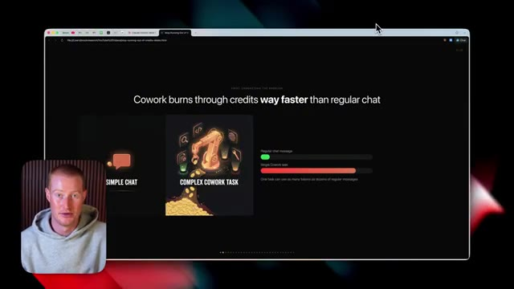
*⏱️ 00:01:11 — Interface web montrant la comparaison entre un chat simple et une tâche Cowork complexe consommant plus de crédits, avec le présentateur en médaillon.*

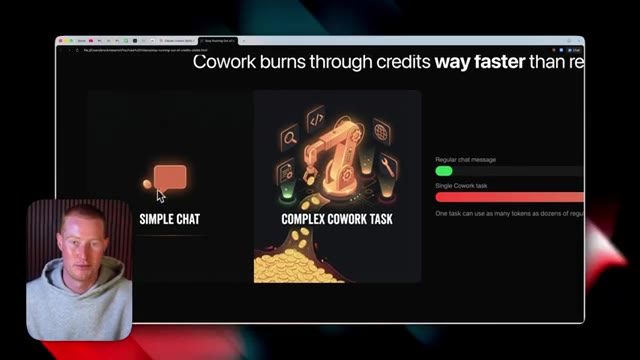
*⏱️ 00:01:30 — Interface web similaire montrant la comparaison de consommation de crédits entre les messages de chat réguliers et les tâches Cowork.*

---

### ⏱️ `[00:01:39 - 00:01:59]` | Segment #04

**🔊 Audio (Transcription Intégrale Mot pour Mot en Français) :**
> limites de tokens. Et c'est parce qu'il y a des tonnes de choses qui se passent en arrière-plan d'une tâche Claude Cowork dont vous ne savez probablement même pas qu'elles ont lieu. Donc, qu'il s'agisse de lire des fichiers, de chercher sur le Web, d'exécuter du code, d'appeler tous les différents outils auxquels vous êtes connecté, ainsi que de créer la génération de résultat parfaite pour vous. Tout cela consomme vos tokens ici.

**👁️ Analyse Visuelle d'Écran (gemini-3.5-flash-lite) :**
**Interface & Outils** : Navigateur web affichant une présentation de diapositives interactive.

**Contenu textuel & Code** : Schéma illustrant 5 étapes : Reading files, Web search, Running code, Calling tools, Output generation. Texte explicatif 'Each step costs tokens. More steps = more credits gone.'

**Action / Démonstration** : Le présentateur explique les différentes étapes en arrière-plan d'une tâche Claude Cowork qui consomment des tokens.

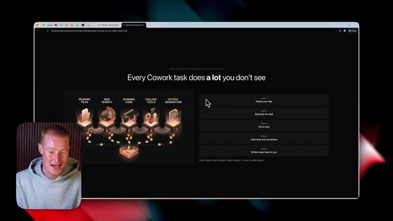
*⏱️ 00:01:44 — Une diapositive de présentation sur fond noir montrant le titre 'Every Cowork task does a lot you don't see' avec des schémas d'étapes en arrière-plan et le présentateur dans un encadré en bas à gauche.*

---

### ⏱️ `[00:02:00 - 00:02:20]` | Segment #05

**🔊 Audio (Transcription Intégrale Mot pour Mot en Français) :**
> C'est une représentation visuelle parfaite de ce que fait en gros Cloud Cowork. Ça aspire tout simplement tous ces jetons de votre part. Et une chose essentielle que je veux que vous compreniez pour cette vidéo, c'est qu'une fois que vous aurez compris où vont ces jetons, il devient très facile pour nous de régler le problème, car nous pouvons simplement faire quelques modifications simples et cela résoudra la majorité des problèmes ici. Il y a vraiment deux endroits différents où vont vos jetons lorsque vous utilisez Cloud Cowork.

**👁️ Analyse Visuelle d'Écran (gemini-3.5-flash-lite) :**
**Interface & Outils** : Navigateur web affichant une présentation ou une documentation sur l'utilisation des jetons par une IA.

**Contenu textuel & Code** : Texte explicatif et diagramme illustrant la circulation des jetons et les fonctionnalités chargées automatiquement ("Once you understand where the tokens go, fixing it gets easy").

**Action / Démonstration** : Le présentateur explique visuellement à l'aide d'un schéma les mécanismes de consommation des jetons informatiques.

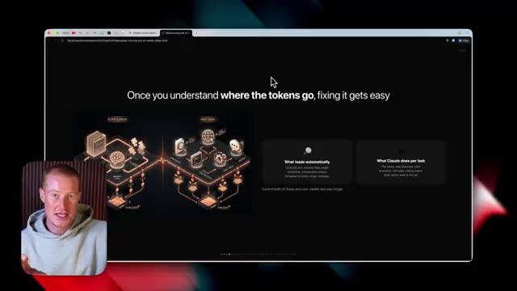
*⏱️ 00:02:05 — Capture d'écran montrant une page web avec le titre "Once you understand where the tokens go, fixing it gets easy" et un schéma explicatif sur la consommation des jetons par l'IA.*

---

### ⏱️ `[00:02:20 - 00:02:45]` | Segment #06

**🔊 Audio (Transcription Intégrale Mot pour Mot en Français) :**
> Et laissez-moi décomposer cela très simplement maintenant. D'abord, nous avons les jetons qui se chargent automatiquement à chaque fois que nous discutons avec lui. Et ce sont des choses comme votre fichier CloudMD, vos fichiers de mémoire, et des plugins ou des compétences spécifiques que vous utilisez. Et ensuite, nous avons des jetons qui sont utilisés pour des tâches spécifiques. Donc, pensez à ceux-ci comme la recherche sur le web, l'exécution de code, la lecture de fichiers spécifiques, et l'utilisation de nos différents outils, ainsi que les sorties spécifiques que nous obtenons à l'intérieur de Cloud.

**👁️ Analyse Visuelle d'Écran (gemini-3.5-flash-lite) :**
**Interface & Outils** : Navigateur web affichant une diapositive explicative illustrée.

**Contenu textuel & Code** : Schéma schématisant d'un côté le chargement automatique (« AUTO-LOADS » avec fichiers CLAUDE.md, mémoire, plugins) et de l'autre les tâches spécifiques (« PER-TASK » avec recherche web, exécution de code, appels d'outils), chacun relié à des indicateurs de coût (« TOTAL COST » et « TASK COST »).

**Action / Démonstration** : Le présentateur explique la répartition des coûts et le chargement automatique des jetons à l'aide d'un schéma visuel.

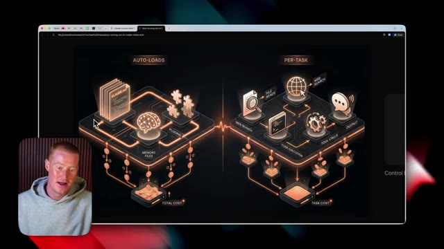
*⏱️ 00:02:26 — Schéma explicatif divisé en deux parties (« AUTO-LOADS » et « PER-TASK ») illustrant la gestion des jetons et des coûts de l'IA, avec une incrustation vidéo du présentateur en bas à gauche.*

---

### ⏱️ `[00:02:45 - 00:03:07]` | Segment #07

**🔊 Audio (Transcription Intégrale Mot pour Mot en Français) :**
> Donc, pour résumer cela, nous avons des choses qui se chargent automatiquement, et nous avons des choses qui sont par tâche. Vous pensez probablement que la majorité de vos jetons proviennent des tâches, mais je pourrais presque vous garantir que la majorité de votre utilisation de jetons provient des choses qui se chargent automatiquement. Et c'est très simple à corriger. Très bien. Alors, première astuce qui va instantanément vous faire économiser des tonnes de jetons dans Claude Cowork, et c'est de choisir quel modèle utiliser.

**👁️ Analyse Visuelle d'Écran (gemini-3.5-flash-lite) :**
**Interface & Outils** : Navigateur web affichant des diapositives de présentation sur l'utilisation des IA et des jetons.

**Contenu textuel & Code** : Schéma d'architecture des coûts (Auto-Loads vs Per-Task) et présentation des trois modèles d'IA (Haiku, Sonnet, Opus).

**Action / Démonstration** : Le présentateur explique la répartition des coûts entre les charges automatiques et les tâches spécifiques, puis présente les différents modèles disponibles.

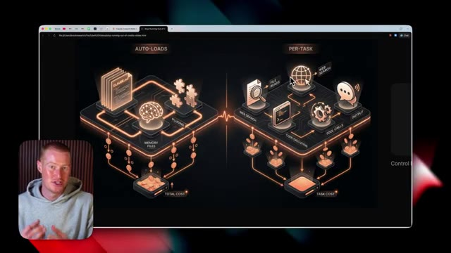
*⏱️ 00:02:50 — Schéma comparatif divisé en deux parties : "Auto-Loads" à gauche et "Per-Task" à droite, illustrant la consommation de jetons et les coûts associés.*

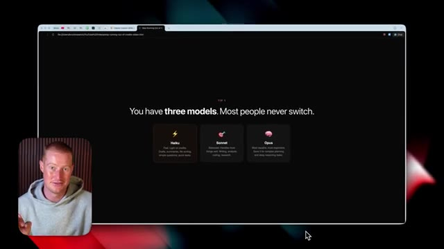
*⏱️ 00:03:02 — Diapositive affichant le texte "TIP 1: You have three models. Most people never switch." avec les icônes de Haiku, Sonnet et Opus.*

---

### ⏱️ `[00:03:08 - 00:03:28]` | Segment #08

**🔊 Audio (Transcription Intégrale Mot pour Mot en Français) :**
> Et je sais que ça a l'air probablement très basique, mais je veux commencer par ça parce que c'est peut-être l'une des choses les plus importantes qui vous freinent et gaspillent tout un tas de vos crédits, que vous pourriez régler en littéralement cinq secondes. Nous avons donc trois modèles différents dans Claude. Nous avons Haiku, nous avons Sonnet, et nous avons Opus. Pensez à Haiku comme étant essentiellement le modèle rapide qui n'est pas aussi complexe que Sonnet et Opus.

**👁️ Analyse Visuelle d'Écran (gemini-3.5-flash-lite) :**
**Interface & Outils** : Navigateur web (application de présentation / fichier HTML)

**Contenu textuel & Code** : Texte « TIP 1: You have three models. Most people never switch. », trois catégories de modèles : Haiku (rapide, économe en crédits, requêtes simples), Sonnet (équilibré, écriture, analyse, code), Opus (très capable, plus coûteux, tâches complexes).

**Action / Démonstration** : Explication théorique sur la gestion des crédits Claude et la nécessité de choisir le modèle approprié selon la complexité de la tâche.

*⏱️ 00:03:13 — Diapositive de présentation affichant les trois modèles d'IA de Claude (Haiku, Sonnet, Opus) et leurs caractéristiques en termes de consommation de crédits.*

---

### ⏱️ `[00:03:28 - 00:03:47]` | Segment #09

**🔊 Audio (Transcription Intégrale Mot pour Mot en Français) :**
> Donc si vous utilisez des choses simples comme discuter de part et d'autre, vous devriez probablement utiliser Haiku. Ensuite, Sonnet est plus équilibré. Il est doué pour gérer des tâches plus complexes. Et c'est probablement le modèle que vous voulez utiliser pour toutes vos tâches quotidiennes que vous effectuez. Tandis qu'Opus est destiné à des flux de travail complexes spécifiques que vous souhaitez déclencher, mais vous ne voudrez probablement pas l'utiliser tout le temps.

**👁️ Analyse Visuelle d'Écran (gemini-3.5-flash-lite) :**
**Interface & Outils** : Navigateur web affichant une diapositive de présentation interactive avec des cartes de modèles d'IA.

**Contenu textuel & Code** : Texte explicatif et sélection des modèles Haiku, Sonnet et Opus d'Anthropic.

**Action / Démonstration** : Le présentateur explique les différences entre les trois modèles d'IA présentés à l'écran.

*⏱️ 00:03:33 — Capture d'écran montrant une présentation avec le texte "You have three models. Most people never switch." et les trois options : Haiku, Sonnet, et Opus. Le présentateur apparaît dans un encadré en bas à gauche.*

---

### ⏱️ `[00:03:47 - 00:04:09]` | Segment #10

**🔊 Audio (Transcription Intégrale Mot pour Mot en Français) :**
> Donc, si je reviens à Claude Cowork, vous pouvez voir ici, dès que nous lançons réellement une tâche, nous pouvons voir les différents modèles que nous pouvons sélectionner ici. Nous avons Haiku 4.5. Et si vous ne savez jamais lequel vous devriez utiliser, cela résume juste ici une description très courte. Il est donc indiqué : le plus rapide pour des réponses rapides. Nous sélectionnerions Haiku. Le plus efficace pour les tâches quotidiennes est Sonnet 4.6.

**👁️ Analyse Visuelle d'Écran (gemini-3.5-flash-lite) :**
**Interface & Outils** : Claude Cowork (interface web/desktop d'Anthropic).

**Contenu textuel & Code** : Modèles affichés : Opus 4.6 ("Most capable for ambitious work"), Sonnet 4.6 ("Most efficient for everyday tasks"), Haiku 4.5 ("Fastest for quick answers"), bascule "Extended thinking". Liste des tâches actives et planifiées (Scheduled).

**Action / Démonstration** : Sélection et comparaison des différents modèles Claude disponibles pour exécuter une tâche dans Cowork.

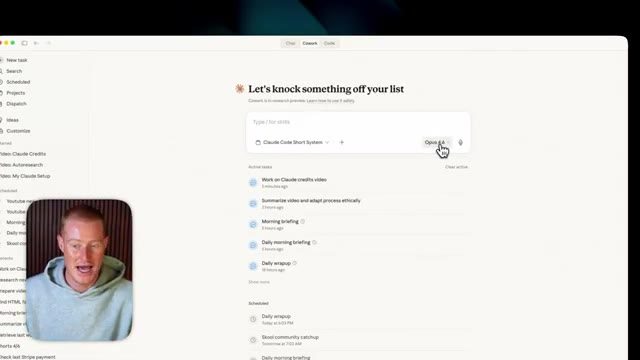
*⏱️ 00:03:52 — Interface Claude Cowork avec le curseur placé sur le sélecteur de modèle AI en bas du champ de saisie de tâche.*

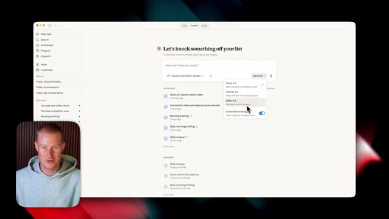
*⏱️ 00:03:58 — Menu déroulant des modèles Claude ouvert affichant Opus 4.6, Sonnet 4.6, Haiku 4.5 et l'option Extended Thinking.*

---

### ⏱️ `[00:04:09 - 00:04:33]` | Segment #11

**🔊 Audio (Transcription Intégrale Mot pour Mot en Français) :**
> Nous pourrions sélectionner cela ou nous pouvons sélectionner Opus 4.6, qui est notre modèle le plus capable pour les travaux ambitieux. Et il s'agit de choses comme des flux de travail complexes ou des compétences que vous avez en cours d'exécution dans co-work. Donc, pour vous donner un peu un visuel ici et pour comprendre quelles tâches vous devriez utiliser pour chaque modèle, si vous rédigez un e-mail, je suggère fortement d'utiliser quelque chose comme Haiku parce que cela devrait faire l'affaire puisque tout ce qu'il fait, c'est fondamentalement écrire un e-mail pour vous.

**👁️ Analyse Visuelle d'Écran (gemini-3.5-flash-lite) :**
**Interface & Outils** : Navigateur web affichant une diapositive de présentation avec incrustation vidéo du présentateur.

**Contenu textuel & Code** : Texte "Match the model to the task", illustrations de bras mécaniques et outils, et exemples de correspondance entre tâches et modèles (Opus, Haiku, Sonnet).

**Action / Démonstration** : Présentation des bonnes pratiques pour associer chaque tâche au modèle d'IA approprié afin d'optimiser l'utilisation.

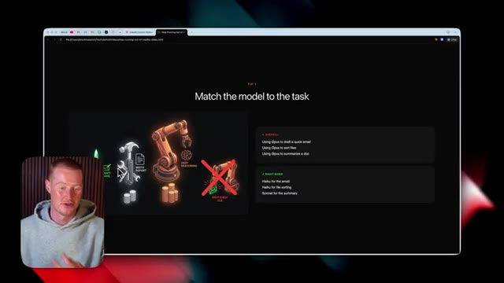
*⏱️ 00:04:21 — Une diapositive de présentation intitulée "Match the model to the task" avec des graphiques illustrant le choix des modèles d'IA.*

---

### ⏱️ `[00:04:33 - 00:04:57]` | Segment #12

**🔊 Audio (Transcription Intégrale Mot pour Mot en Français) :**
> Vous pourriez également utiliser ceci pour rédiger un rapport, mais si vous voulez un rapport vraiment spécifique, Sonnet 4.6 serait un excellent modèle pour cela. Mais si vous avez besoin de quelque chose qui relève davantage de la catégorie du raisonnement approfondi, alors Opus 4.6 serait le meilleur modèle pour cela. Très bien, passons donc à l'astuce numéro deux, et la plupart des gens ne le savent probablement même pas, et c'est que ce que Claude vous écrit en retour coûte plus cher que ce que vous avez envoyé.

**👁️ Analyse Visuelle d'Écran (gemini-3.5-flash-lite) :**
**Interface & Outils** : Présentation ou face-caméra explicatif du trader sans interface logicielle partagée.

**Contenu textuel & Code** : Explications orales des stratégies et mise en contexte méthodologique du marché.

**Action / Démonstration** : Explications face caméra et analyse conceptuelle des marchés.

---

### ⏱️ `[00:04:57 - 00:05:18]` | Segment #13

**🔊 Audio (Transcription Intégrale Mot pour Mot en Français) :**
> Donc, si vous ne connaissez pas la différence entre les jetons d'entrée et de sortie, pensez-y de cette façon. Chaque fois que vous envoyez un SMS ou que vous tapez avec Claude, c'est un jeton d'entrée. Et tout ce qui est généré par Claude et vous est renvoyé, c'est une sortie. Donc, par exemple, j'ai cette tâche programmée configurée dans Cowork qui analyse essentiellement tous mes concurrents sur YouTube.

**👁️ Analyse Visuelle d'Écran (gemini-3.5-flash-lite) :**
**Interface & Outils** : Présentation web / Navigateur.

**Contenu textuel & Code** : Schéma explicatif sur le coût des jetons d'entrée par rapport aux jetons de sortie de Claude.

**Action / Démonstration** : Le présentateur explique la différence de coût entre les requêtes de l'utilisateur et les réponses générées par l'IA.

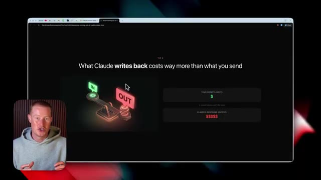
*⏱️ 00:05:02 — Diapositive montrant le titre « What Claude writes back costs way more than what you send » avec une illustration de balance entre jetons d'entrée et de sortie.*

---

### ⏱️ `[00:05:19 - 00:05:40]` | Segment #14

**🔊 Audio (Transcription Intégrale Mot pour Mot en Français) :**
> Et il génère ce document pour moi. C'est un tableau de bord HTML vraiment complexe et approfondi, qui analyse toutes les différentes vidéos que je devrais probablement faire en effectuant des recherches sur tous mes concurrents et sur les différentes vidéos qui fonctionnent pour eux. Il analyse même les sujets tendance ici. Donc, ce résultat ici me coûterait beaucoup plus cher que si je donnais un prompt vraiment détaillé à Claude.

**👁️ Analyse Visuelle d'Écran (gemini-3.5-flash-lite) :**
**Interface & Outils** : - Interface d'assistant / agent IA (Cowork / Claude).
- Tableau de bord HTML d'analyse concurrentielle ("YouTube Competitor Scan").

**Contenu textuel & Code** : - Métriques clés affichées : 3 actions urgentes, 18 sujets exploitables, 82 vidéos scannées, 11 thématiques identifiées.
- Recommandations de vidéos basées sur les tendances des concurrents ("Karpathy's LLM Knowledge Bases for Non-Techies", "Paperclip: The Zero-Employee Company Tool").

**Action / Démonstration** : - Démonstration d'un rapport/dashboard d'intelligence concurrentielle généré par IA pour la recherche de sujets de vidéos YouTube.

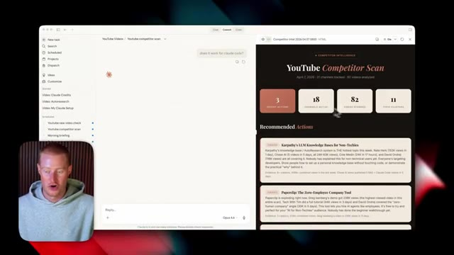
*⏱️ 00:05:29 — Capture d'écran montrant l'interface d'un assistant IA à gauche et un tableau de bord HTML intitulé "YouTube Competitor Scan" à droite avec des métriques et des idées de contenu.*

---

### ⏱️ `[00:05:40 - 00:05:58]` | Segment #15

**🔊 Audio (Transcription Intégrale Mot pour Mot en Français) :**
> Donc, une façon de résoudre instantanément ce problème est de dire exactement à Claude quelle quantité ou ce dont vous avez exactement besoin en retour, au lieu d'obtenir un tas d'informations inutiles dont vous n'avez pas forcément besoin. Cela permet essentiellement de réduire ce que Claude vous renvoie et, en même temps, de réduire la quantité de tokens qu'il utilise.

**👁️ Analyse Visuelle d'Écran (gemini-3.5-flash-lite) :**
**Interface & Outils** : Navigateur web affichant une diapositive de présentation sur les conseils d'utilisation de l'IA Claude.

**Contenu textuel & Code** : Texte de la diapositive : "Tell Claude exactly how much you need back" avec deux exemples comparatifs ("NO LENGTH GUIDANCE" vs "SPECIFIC ABOUT LENGTH").

**Action / Démonstration** : Le présentateur explique comment optimiser les requêtes adressées à Claude pour économiser des tokens en précisant exactement le format de réponse souhaité.

*⏱️ 00:05:44 — Une diapositive de présentation avec le titre "Tell Claude exactly how much you need back", comparant une consigne vague à une consigne spécifique sur la longueur, avec le présentateur en médaillon.*

---

### ⏱️ `[00:05:58 - 00:06:17]` | Segment #16

**🔊 Audio (Transcription Intégrale Mot pour Mot en Français) :**
> Donc, par exemple ici, la plupart des gens n'ont probablement aucune consigne de longueur et nous disons simplement « explique comment fonctionnent les jetons » et ensuite Claude va partir et écrire 2 000 mots différents. Mais cela aurait pu être résumé en quelque chose comme 200 mots, par exemple. Je suggère donc d'être très précis dans la façon dont nous le guidons. Donc, « explique comment fonctionnent les jetons », version courte, trois phrases maximum.

**👁️ Analyse Visuelle d'Écran (gemini-3.5-flash-lite) :**
**Interface & Outils** : Navigateur web affichant une diapositive de présentation avec le présentateur en médaillon vidéo dans le coin inférieur gauche.

**Contenu textuel & Code** : Comparaison entre deux prompts pour Claude : à gauche "No length guidance" (Explain how tokens work -> Claude writes 2,000 words) et à droite "Specific about length" (Explain how tokens work. Short version, 3 sentences max. -> Same info. Way fewer output tokens).

**Action / Démonstration** : Le présentateur explique l'importance de donner des consignes de longueur précises pour économiser les jetons.

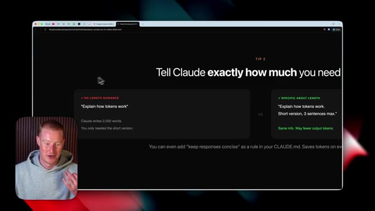
*⏱️ 00:06:03 — Capture d'écran montrant une diapositive de présentation intitulée "Tip 2: Tell Claude exactly how much you need", comparant un prompt sans consigne de longueur et un prompt spécifique.*

---

### ⏱️ `[00:06:17 - 00:06:38]` | Segment #17

**🔊 Audio (Transcription Intégrale Mot pour Mot en Français) :**
> Donc on va obtenir la même information, sauf qu'elle sera beaucoup plus condensée. Et une façon de faire ça sans avoir toujours besoin d'aller demander à Claude de vous donner un résultat court, c'est de l'intégrer automatiquement dans les compétences. Donc comme vous pouvez le voir ici, j'ai toutes ces différentes compétences à l'intérieur de Claude Cowork. Et on pourrait simplement donner des instructions à Claude en disant : je veux toujours que tu réformes en moins de quatre phrases ou quelque chose comme ça.

**👁️ Analyse Visuelle d'Écran (gemini-3.5-flash-lite) :**
**Interface & Outils** : Application Cowork (interface de gestion de compétences et assistants IA)

**Contenu textuel & Code** : Configuration de la compétence « slide-infographics », liste de compétences (autoresearch, prompter, slides, etc.), instructions textuelles pour structurer des diapositives HTML et prompts d'infographies.

**Action / Démonstration** : Démonstration de l'intégration de consignes personnalisées dans la section « Skills » de l'assistant IA pour obtenir des résultats automatiquement structurés et condensés.

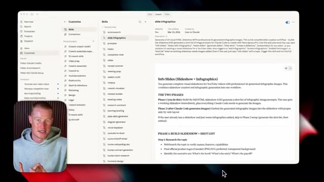
*⏱️ 00:06:22 — Interface de l'application Cowork montrant la section des compétences (Skills) avec la compétence « slide infographics » sélectionnée et ses instructions de départ.*

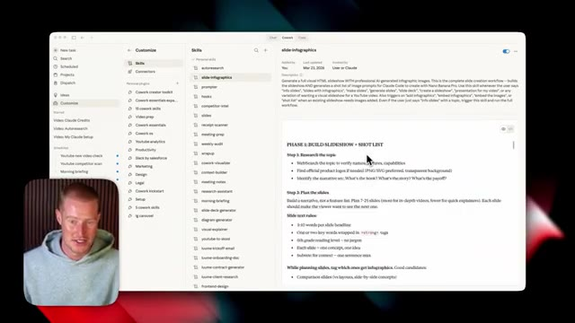
*⏱️ 00:06:28 — Vue défilée de l'interface Cowork détaillant la « Phase 1: Build Slideshow + Shot List » et les étapes de planification de présentation par l'IA.*

---

### ⏱️ `[00:06:38 - 00:06:57]` | Segment #18

**🔊 Audio (Transcription Intégrale Mot pour Mot en Français) :**
> Et puis il fera cela automatiquement à chaque fois que cette compétence ou ce flux de travail est déclenché. Très bien. L'astuce numéro trois concerne donc le fichier Claude MD. Laissez-moi donc vous expliquer exactement quel est le problème. Si vous ne savez pas ce qu'est un fichier Claude MD, je vais vous l'expliquer très simplement. Parlons-en maintenant. Votre fichier Claude MD est toujours activé.

**👁️ Analyse Visuelle d'Écran (gemini-3.5-flash-lite) :**
**Interface & Outils** : Application Cowork (gestionnaire de compétences/workflows IA), Navigateur Web (affichage de diapositives HTML).

**Contenu textuel & Code** : Instructions système pour la génération d'infographies et diaporamas HTML, schéma conceptuel expliquant l'impact du fichier CLAUDE.md ("Double taxation", "Direct cost", "Indirect cost").

**Action / Démonstration** : Explication du fonctionnement des flux de travail personnalisés et des pièges liés à la surconsommation de crédits lors de l'utilisation permanente d'un fichier CLAUDE.md.

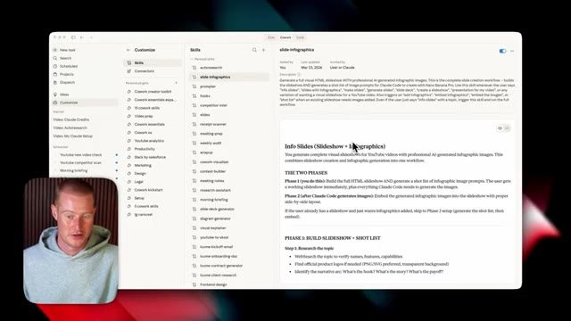
*⏱️ 00:06:43 — Interface de l'application Cowork affichant la configuration et le prompt de la compétence "slide-infographics".*

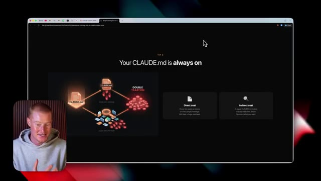
*⏱️ 00:06:47 — Diapositive de présentation web intitulée "Your CLAUDE.md is always on" détaillant les coûts directs et indirects du fichier CLAUDE.md.*

---

### ⏱️ `[00:06:57 - 00:07:32]` | Segment #19

**🔊 Audio (Transcription Intégrale Mot pour Mot en Français) :**
> À chaque fois que vous envoyez un message à Claude, il récupère ce fichier markdown, qui est fondamentalement un ensemble d'instructions, et cela vous coûte des tonnes de jetons à l'intérieur de Claude. Si vous ne savez pas ce qu'est un fichier ClaudeMD, c'est fondamentalement un manuel d'instructions pour Claude. Fondamentalement, nous écrivons simplement ceci une seule fois. Claude lit ceci à chaque message pour comprendre qui nous sommes, comment nous travaillons et ce que nous voulons qu'il fasse, ainsi que ce que nous ne voulons pas qu'il fasse. Pensez à cela comme à l'intégration d'une nouvelle embauche, sauf que nous n'avons à le faire qu'une seule fois. Donc, l'astuce ici lors de la formulation de votre fichier ClaudeMD est de

**👁️ Analyse Visuelle d'Écran (gemini-3.5-flash-lite) :**
**Interface & Outils** : Navigateur web affichant une diapositive de présentation avec un schéma schématique et du texte.

**Contenu textuel & Code** : Texte "Your CLAUDE.md is always on", "Direct cost", "Indirect cost", et un diagramme montrant le flux "CLAUDE.md" vers "DOUBLE TAXATION".

**Action / Démonstration** : Le présentateur explique l'impact du fichier CLAUDE.md sur la consommation de jetons et les coûts indirects.

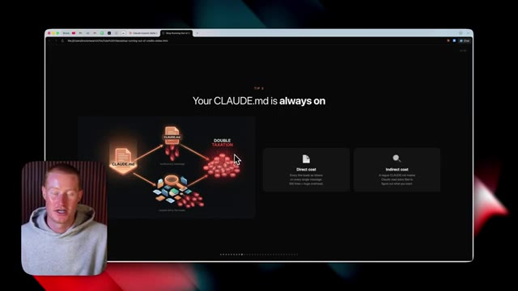
*⏱️ 00:07:06 — Une diapositive de présentation intitulée "Your CLAUDE.md is always on" avec un schéma illustrant le coût de ce fichier et le présentateur en médaillon en bas à gauche.*

---

### ⏱️ `[00:07:32 - 00:08:08]` | Segment #20

**🔊 Audio (Transcription Intégrale Mot pour Mot en Français) :**
> garde ça sous les 200 lignes. Tu te demandes sûrement, genre Brock, est-ce qu'on ne veut pas être vraiment précis sur la façon dont on veut que Claude fonctionne, avec des compétences spécifiques et différentes choses qu'on veut qu'il fasse ? Et la réponse est oui, mais on ne veut pas toujours faire ça à l'intérieur du fichier Claude.md, parce que vois les choses comme ça : à chaque fois que tu tchatches avec lui, ceci est chargé dans notre fenêtre de contexte et ça va vraiment grignoter tes tokens. Donc à la place, on veut déplacer le reste de cette information vers des compétences spécifiques. Alors, qu'est-ce qui appartient réellement au fichier Claude.md ? Les choses qui y ont leur place sont : qui tu es et quel est ton business, le ton et le style d'écriture, les règles universelles, et le contexte clé que chaque

**👁️ Analyse Visuelle d'Écran (gemini-3.5-flash-lite) :**
**Interface & Outils** : Présentation numérique / navigateur web

**Contenu textuel & Code** : - Règle affichée : « Tip 3: Keep it under 200 lines. Move the rest into skills. »
- Catégorie « Belongs in CLAUDE.md » : Who you are and your business, Tone and writing style, Universal rules, Key context for every task.
- Catégorie « Move somewhere else » : Task-specific instructions, Long reference lists, Detailed how-to processes, Stuff you only use sometimes.

**Action / Démonstration** : Présentation des bonnes pratiques de structuration du fichier de contexte CLAUDE.md pour optimiser l'utilisation des tokens et éviter de surcharger les prompts.

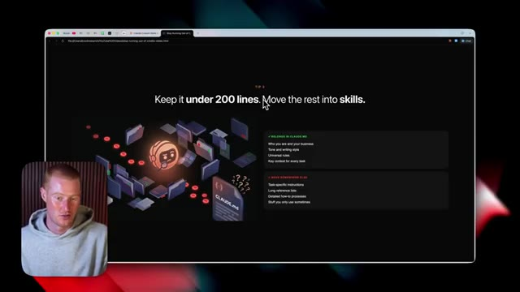
*⏱️ 00:07:50 — Presentation à l'écran affichant le conseil « Keep it under 200 lines. Move the rest into skills. » accompagné d'un schéma explicatif pour structurer les fichiers CLAUDE.md.*

---

### ⏱️ `[00:08:08 - 00:08:39]` | Segment #21

**🔊 Audio (Transcription Intégrale Mot pour Mot en Français) :**
> tâche doit comprendre. Alors que vous devriez déplacer toutes ces différentes choses vers les compétences, les instructions spécifiques aux tâches, les listes de référence longues, les processus détaillés étape par étape et les trucs que vous n'utilisez qu'occasionnellement. Et personnellement, j'ai rencontré ce problème lorsque j'ai commencé à utiliser Claude Cowork et j'atteignais mes limites très facilement. Et une fois que j'ai réalisé que je devais élaguer mon fichier ClaudeMD et transformer le reste en compétences, cela a vraiment changé ma façon de l'utiliser. Et c'est une transition parfaite vers l'astuce numéro quatre, qui consiste à utiliser correctement les compétences.

**👁️ Analyse Visuelle d'Écran (gemini-3.5-flash-lite) :**
**Interface & Outils** : Navigateur web / Logiciel de présentation

**Contenu textuel & Code** : Texte listant les éléments à inclure dans Claude.md ("Who you are and your business", "Tone and writing style", "Universal rules", "Key context for every task") et ceux à déplacer ailleurs ("Task-specific instructions", "Long reference lists", "Detailed how-to processes", "Stuff you only use sometimes").

**Action / Démonstration** : Le présentateur explique la structure et l'organisation recommandée des fichiers de configuration pour les assistants IA.

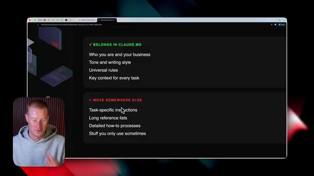
*⏱️ 00:08:16 — Capture d'écran montrant une présentation avec deux blocs de texte contrastés : "BELONGS IN CLAUDE.MD" en vert et "MOVE SOMEWHERE ELSE" en rouge, tandis que le présentateur apparaît en incrustation dans le coin inférieur gauche.*

---

### ⏱️ `[00:08:39 - 00:09:00]` | Segment #22

**🔊 Audio (Transcription Intégrale Mot pour Mot en Français) :**
> Donc les compétences se chargent à la demande, tandis que Claude MD est toujours actif, tout comme j'en ai parlé dans la diapositive précédente. Ceci représente parfaitement la différence entre Claude MD et nos compétences spécifiques. Vous pouvez donc voir, pensez à ceci comme à notre message que nous envoyons. Cela charge Claude MD et cela consomme vos jetons à chaque fois avec tout ce contexte ici.

**👁️ Analyse Visuelle d'Écran (gemini-3.5-flash-lite) :**
**Interface & Outils** : Navigateur Web / Support de présentation HTML (Formation Claude AI)

**Contenu textuel & Code** : - En-tête : "Skills load on-demand. CLAUDE.md is always-on."
- Section CLAUDE.MD : "All instructions load every time", "Even when you don't need them", "Wastes tokens constantly" / "ALWAYS ON, ALWAYS COSTING".
- Section SKILLS : "Only loads when triggered", "Dormant the rest of the time", "Zero cost until you need it" / "ONE THING LIT UP ONLY WHEN NEEDED".

**Action / Démonstration** : Explication conceptuelle de la gestion de contexte et d'économie de tokens entre les instructions permanentes (CLAUDE.md) et les compétences modulaires déclenchées à la demande.

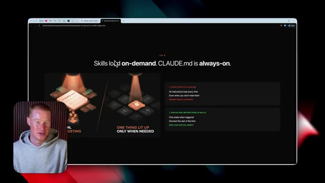
*⏱️ 00:08:44 — Diapositive de présentation comparant l'exécution continue de CLAUDE.md et le chargement sur demande des compétences (Skills) pour optimiser les tokens.*

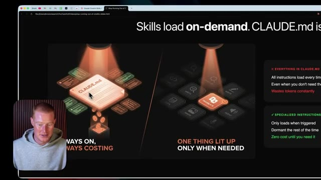
*⏱️ 00:08:50 — Gros plan sur le schéma illustrant le fichier CLAUDE.md toujours actif ("Always On, Always Costing") par rapport aux compétences activées uniquement au besoin ("One thing lit up only when needed").*

---

### ⏱️ `[00:09:00 - 00:09:22]` | Segment #23

**🔊 Audio (Transcription Intégrale Mot pour Mot en Français) :**
> Alors que des compétences spécifiques sont chargées en fonction de cette tâche précise que vous essayez d'exécuter. Donc si vous essayez de traduire quelque chose, il chargera cette compétence spécifique au lieu de tout le fichier CloudMD saturé. Très bien. Passons donc à l'astuce numéro cinq, il s'agit des projets. C'est un moyen de vraiment rester organisé et de garder vos systèmes à l'intérieur de CloudCowork plus ciblés et beaucoup plus légers.

**👁️ Analyse Visuelle d'Écran (gemini-3.5-flash-lite) :**
**Interface & Outils** : Navigateur web affichant une présentation visuelle ou un article explicatif.

**Contenu textuel & Code** : Schémas avec les légendes "ALWAYS ON, ALWAYS COSTING" et "ONE THING LIT UP ONLY WHEN NEEDED", ainsi que des blocs de texte comparant le coût en jetons des instructions globales par rapport aux compétences spécialisées.

**Action / Démonstration** : Le présentateur explique visuellement la différence d'efficacité et d'économie de jetons entre un fichier CLAUDE.md constamment chargé et le chargement spécifique des compétences (skills) uniquement lorsque cela est nécessaire.

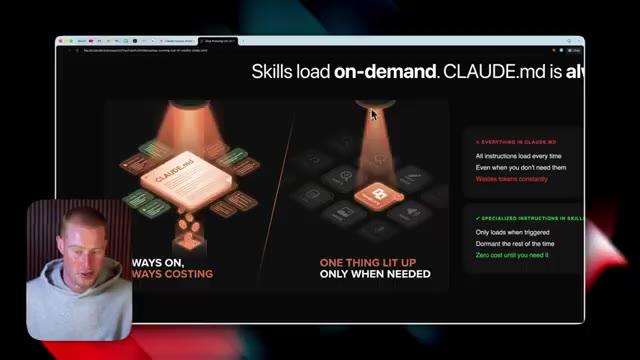
*⏱️ 00:09:06 — Une diapositive explicative montrant le fonctionnement du chargement des compétences à la demande avec Claude.md par rapport au chargement global permanent, illustré par des schémas comparatifs.*

---

### ⏱️ `[00:09:22 - 00:09:44]` | Segment #24

**🔊 Audio (Transcription Intégrale Mot pour Mot en Français) :**
> Donc ce visuel ici explique à quoi ressemble CloudCowork avant les projets qu'ils viennent de sortir il y a quelques semaines. Considérez cela comme ayant absolument tout à l'intérieur de votre entreprise, de votre vie personnelle, de vos finances, toutes ces différentes choses. En gros, nous avions des tâches réparties dans tout cela au sein de notre écosystème de co-travail. Alors qu'aujourd'hui, pour moi personnellement, j'ai un projet spécifique pour YouTube, pour des clients, dans ma vie personnelle.

**👁️ Analyse Visuelle d'Écran (gemini-3.5-flash-lite) :**
**Interface & Outils** : Navigateur web affichant une page de présentation ou un document de travail.

**Contenu textuel & Code** : Un grand cercle orange en haut marqué d'une croix rouge montrant un désordre de dossiers et d'icônes (YouTube, clients, vie personnelle mélangés), menant à trois bulles vertes en bas séparées et organisées pour YouTube, Clients et Personal.

**Action / Démonstration** : Le présentateur explique la structure initiale et désordonnée du système avant les récents changements.

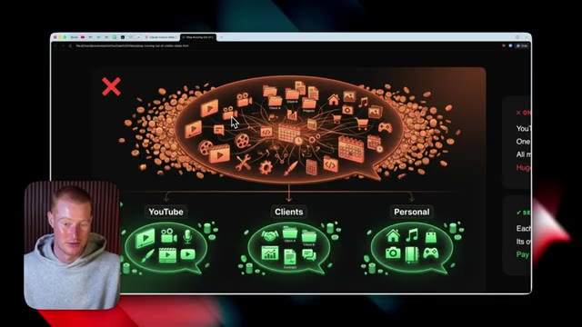
*⏱️ 00:09:28 — Un schéma explicatif affiché sur un navigateur web, illustrant le fonctionnement de CloudCowork avant et après l'organisation, avec le présentateur en médaillon dans le coin inférieur gauche.*

---

### ⏱️ `[00:09:44 - 00:10:04]` | Segment #25

**🔊 Audio (Transcription Intégrale Mot pour Mot en Français) :**
> Et cela permet vraiment de garder tout bien organisé et de ne pas consommer tous mes jetons. Pour vous montrer exactement ce que je veux decir, laissez-moi venir sur co-work. Je vais remonter dans mes projets ici. Et vous pouvez voir que j'ai quelques projets différents ici que j'utilise personnellement. J'en ai un spécifique pour mon contenu court. J'en ai un pour ma communauté scolaire. À l'intérieur de nos projets, nous avons plusieurs choses.

**👁️ Analyse Visuelle d'Écran (gemini-3.5-flash-lite) :**
**Interface & Outils** : Application de gestion de projets et de tâches "Co-work" sur ordinateur.

**Contenu textuel & Code** : Liste des tâches actives, programmées, et répertoires de projets (Short Form, Skool Community, Luume Agency, YouTube Videos).

**Action / Démonstration** : Navigation dans l'interface de Co-work pour présenter les différents projets et l'organisation du flux de travail.

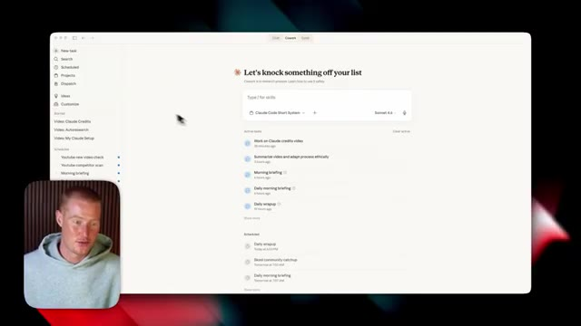
*⏱️ 00:09:49 — Interface de l'application Co-work affichant les tâches en cours et les options de configuration.*

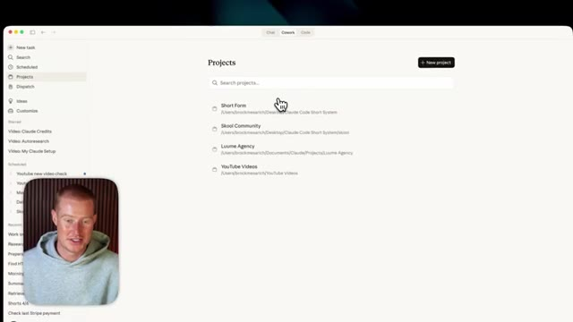
*⏱️ 00:09:54 — Interface de Co-work montrant la liste des différents projets personnels du présentateur.*

---

### ⏱️ `[00:10:04 - 00:10:28]` | Segment #26

**🔊 Audio (Transcription Intégrale Mot pour Mot en Français) :**
> Vous pouvez voir tous nos résultats ici, qui sont en gros juste comme différents fichiers. Vous pouvez voir ce fichier HTML qu'il a créé pour moi. Vous pouvez voir toutes nos tâches précédentes, alias les conversations que nous avons eues. Vous pouvez voir chaque tâche planifiée qui s'exécute ici, ainsi que le contexte spécifique de ce projet qui est vraiment stocké uniquement à l'intérieur de ce projet et non à l'intérieur de notre système global de travail partagé.

**👁️ Analyse Visuelle d'Écran (gemini-3.5-flash-lite) :**
**Interface & Outils** : Interface web de Claude Cowork / Skool Community, explorateur de fichiers et prévisualisation HTML.

**Contenu textuel & Code** : Fichiers HTML générés ("New Skills Drop"), historique des conversations, tâches planifiées (Weekly skill audit, Weekly skills drop) et liste des fichiers du dossier "skool".

**Action / Démonstration** : Navigation dans l'interface de gestion de projet de l'IA, affichage des fichiers de sortie, des tâches précédentes et du panneau de contexte.

*⏱️ 00:10:10 — Vue d'écran partagée montrant l'interface d'assistant IA à gauche et un aperçu de fichier HTML à droite intitulé "New Skills Drop".*

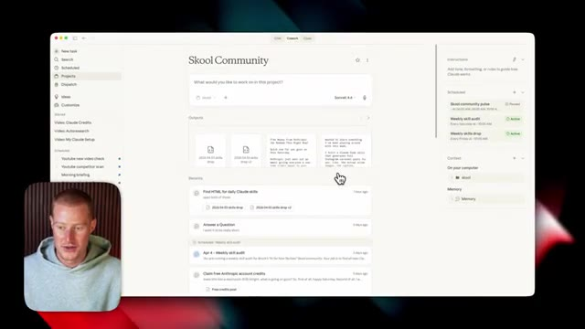
*⏱️ 00:10:16 — Interface principale de l'assistant IA avec le tableau de bord "Skool Community", affichant les sorties de tâches et les tâches planifiées sur le panneau latéral.*

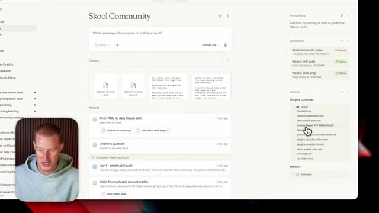
*⏱️ 00:10:22 — Gros plan sur le panneau latéral "Context" montrant la liste des fichiers locaux du projet "skool" (HTML, Markdown, PDF).*

---

### ⏱️ `[00:10:28 - 00:11:02]` | Segment #27

**🔊 Audio (Transcription Intégrale Mot pour Mot en Français) :**
> Ensuite, j'en ai un pour mes vidéos YouTube. Et encore une fois, vous pouvez voir toutes mes tâches planifiées, tous mes fichiers à l'intérieur, ainsi qu'une mémoire spécifique qu'il possède sur mes projets YouTube. Passons à l'astuce numéro six, et parlons rapidement des problèmes que nous avons avant de parler de sa solution. Ainsi, les messages ultérieurs dans le cadre d'une tâche cloud spécifique coûtent beaucoup plus cher que les précédents. Juste ici, si vous y jetez un œil, un petit message est petit, il utilise juste un tout petit peu de, vous savez, de jetons ici. Mais à mesure que la conversation grandit et qu'elle a de plus en plus de contexte, cela va coûter beaucoup plus cher.

**👁️ Analyse Visuelle d'Écran (gemini-3.5-flash-lite) :**
**Interface & Outils** : Interface web de Claude / Navigateur web présentant des diapositives explicatives.

**Contenu textuel & Code** : Tableau de bord de gestion de projet IA avec fichiers, tâches planifiées (Scheduled) et section mémoire (Memory) ; infographie illustrant l'augmentation des coûts et de l'historique cumulé au fil des messages.

**Action / Démonstration** : Présentation et démonstration de l'organisation des projets YouTube dans l'interface de Claude, puis transition vers l'astuce numéro six concernant la consommation de crédits et l'historique des conversations.

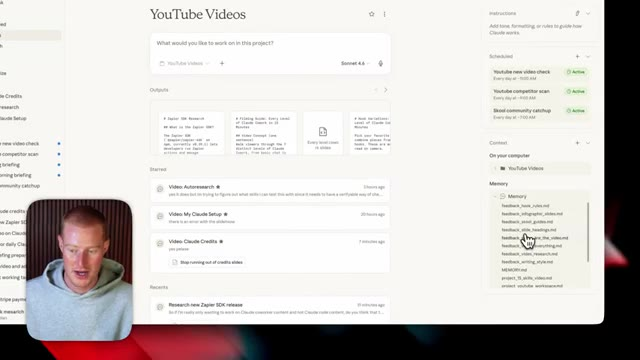
*⏱️ 00:10:37 — Capture d'écran montrant l'interface utilisateur de Claude (projet YouTube Videos) avec le présentateur incrusté en bas à gauche, affichant les tâches planifiées et la mémoire des projets.*

*⏱️ 00:10:45 — Capture d'écran montrant une présentation visuelle sur le coût des messages dans les conversations IA avec l'astuce numéro six ("Later messages cost way more than early ones").*

---

### ⏱️ `[00:11:02 - 00:11:21]` | Segment #28

**🔊 Audio (Transcription Intégrale Mot pour Mot en Français) :**
> Et avant même de vous en rendre compte, nous allons discuter avec Claude pendant 20 messages aller-retour. Et maintenant, nous avons une énorme fenêtre de contexte qui va consommer davantage de nos jetons. C'est quelque chose qui progresse tout naturellement. Et parfois, j'oublie que je suis dans une conversation depuis trop longtemps. Donc, pour remédier à cela, je suggère d'utiliser une seule tâche pour une session spécifique.

**👁️ Analyse Visuelle d'Écran (gemini-3.5-flash-lite) :**
**Interface & Outils** : Navigateur web affichant une présentation de diapositives avec illustration graphique et barres de progression.

**Contenu textuel & Code** : Texte « Later messages cost way more than early ones », schémas de sphères grossissantes illustrant le coût accumulé, et barres pour le message 1, 10, 20 et 30+.

**Action / Démonstration** : Le présentateur illustre et commente l'augmentation de la consommation de jetons et des coûts au fil des messages avec Claude.

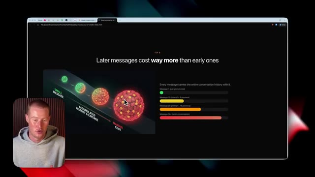
*⏱️ 00:11:07 — Une diapositive explicative montrant graphiquement que les messages tardifs coûtent beaucoup plus cher en raison de l'accumulation de l'historique de conversation.*

---

### ⏱️ `[00:11:21 - 00:11:40]` | Segment #29

**🔊 Audio (Transcription Intégrale Mot pour Mot en Français) :**
> Voici donc un exemple d'une longue session qui consommerait vos jetons. Il s'agit d'écrire un script, de passer de cela à l'organisation de fichiers, à la rédaction d'un e-mail, puis à la recherche sur un sujet. Ce sont toutes des choses qui n'ont aucun rapport entre elles et qui peuvent être faites dans des sessions différentes, tout comme ceci. Donc, session un, nous pourrions écrire le script. Session deux, organiser les fichiers.

**👁️ Analyse Visuelle d'Écran (gemini-3.5-flash-lite) :**
**Interface & Outils** : Présentation visuelle sur fond noir avec encadré explicatif.

**Contenu textuel & Code** : Texte illustrant une session longue : "Write a script -> organize files -> draft an email -> research a topic", ainsi que les mentions "Message 40+. Each one is expensive." et "Context is bloated with unrelated stuff."

**Action / Démonstration** : Le présentateur explique les limites et le coût en jetons d'une session unique regroupant des tâches non corrélées.

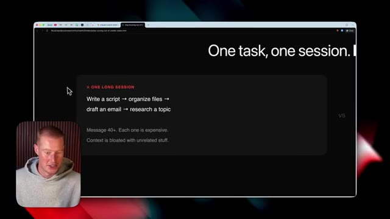
*⏱️ 00:11:26 — Capture d'écran montrant une diapositive de présentation avec le texte "One task, one session." et un encadré décrivant les inconvénients d'une longue session unique, avec le présentateur en médaillon en bas à gauche.*

---

### ⏱️ `[00:11:40 - 00:12:02]` | Segment #30

**🔊 Audio (Transcription Intégrale Mot pour Mot en Français) :**
> Troisième session, rédiger l'e-mail. Et c'est aussi simple que de venir dans coworker et de simplement sélectionner de nouvelles tâches chaque fois que nous avons quelque chose de nouveau au lieu d'être à l'intérieur de cette ancienne tâche ici et de faire des allers-retours et des allers-retours. Très bien, donc l'astuce numéro sept, et c'est une astuce vraiment simple que n'importe qui peut faire dès maintenant. Et c'est de déconnecter les connecteurs spécifiques que vous n'utilisez pas quotidiennement ou chaque semaine.

**👁️ Analyse Visuelle d'Écran (gemini-3.5-flash-lite) :**
**Interface & Outils** : Application de bureau Cowork (interface de gestion de tâches et d'IA) et navigateur web.

**Contenu textuel & Code** : Listes de tâches, interface de chat IA, notes structurées numérotées, et recommandations sur la gestion des connecteurs.

**Action / Démonstration** : Navigation et démonstration de l'interface de Cowork pour passer d'une tâche à une autre.

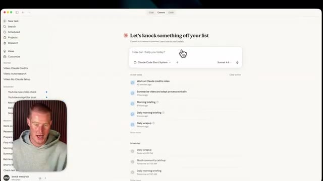
*⏱️ 00:11:46 — Interface de Cowork montrant le tableau de bord principal avec la liste des tâches actives et le champ de saisie central.*

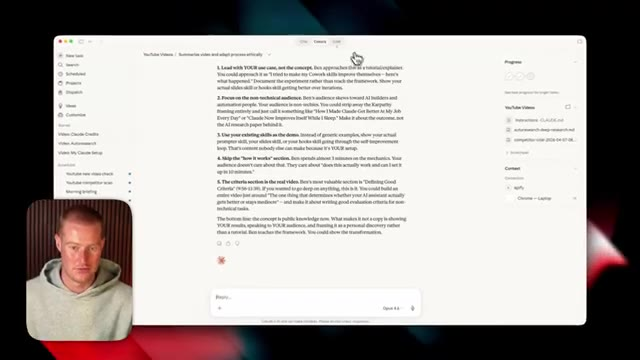
*⏱️ 00:11:51 — Visualisation d'un document rédigé avec des listes à puces numérotées sur Cowork, illustrant le contenu généré.*

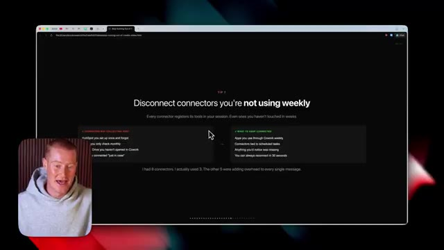
*⏱️ 00:11:57 — Présentation d'une page de conseils sur fond noir avec le titre "Disconnect connectors you're not using weekly".*

---

### ⏱️ `[00:12:03 - 00:12:24]` | Segment #31

**🔊 Audio (Transcription Intégrale Mot pour Mot en Français) :**
> Si vous ne savez pas ce qu'est un connecteur, laissez-moi venir dans mon espace de travail. Et si je viens sur "personnaliser", vous allez voir ce bouton de connecteurs. Ce sont essentiellement toutes les différentes applications auxquelles Claude Cowork a accès. Donc Canva, vous pouvez aller de l'avant et, vous savez, créer des designs pour moi dans Canva, récupérer différents designs. Il peut se connecter à mon Gmail. Il est donc capable de récupérer mes emails, Google Agenda, Google Drive, toutes ces différentes choses.

**👁️ Analyse Visuelle d'Écran (gemini-3.5-flash-lite) :**
**Interface & Outils** : Interface de l'application Claude Cowork

**Contenu textuel & Code** : Menu latéral affichant les options "Skills", "Connectors", et la zone principale "Customize Claude" avec des boutons pour connecter les applications, créer de nouvelles compétences et parcourir les plugins.

**Action / Démonstration** : Navigation dans l'espace de travail et survol du bouton "Connectors" pour présenter les applications connectées.

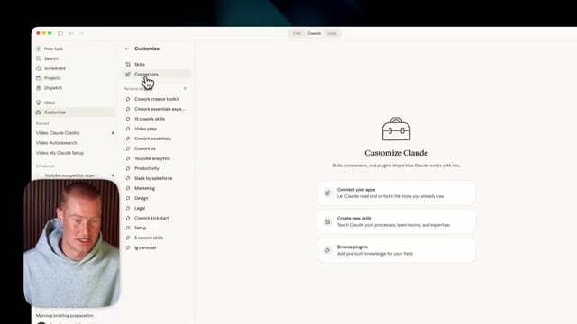
*⏱️ 00:12:08 — Capture d'écran de l'espace de travail montrant l'interface de personnalisation avec le menu des connecteurs et les options de configuration.*

---

### ⏱️ `[00:12:24 - 00:12:43]` | Segment #32

**🔊 Audio (Transcription Intégrale Mot pour Mot en Français) :**
> Cependant, il y en a ici que je n'utilise personnellement pas tous les jours ou que je n'ai probablement pas utilisés ces deux dernières semaines. Donc, par exemple, celui-ci dans la vidéo un, je vais juste le déconnecter parce que je ne l'utilise jamais. C'est un truc très simple que vous pouvez faire pour vous assurer que nous ne chargeons pas de connecteurs spécifiques que nous n'allons pas utiliser.

**👁️ Analyse Visuelle d'Écran (gemini-3.5-flash-lite) :**
**Interface & Outils** : Application Claude Desktop, section Cowork, panneau de configuration "Connectors".

**Contenu textuel & Code** : Liste d'intégrations et de connecteurs (InVideo, Canva, Gmail, Notion, Zapier, Apify), fenêtre d'avertissement de déconnexion.

**Action / Démonstration** : Suppression/déconnexion manuelle de l'outil InVideo inutilisé depuis les paramètres des connecteurs de l'agent AI.

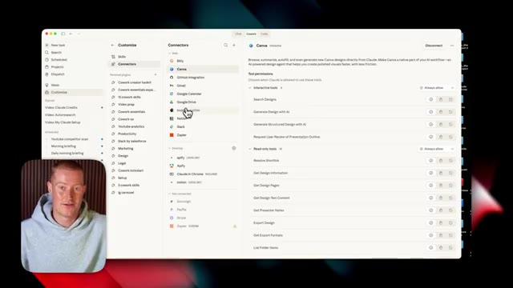
*⏱️ 00:12:29 — L'interface de Claude affiche la liste des connecteurs (Connectors) tels que Canva, InVideo, Notion et Zapier, avec le détail des autorisations d'outils.*

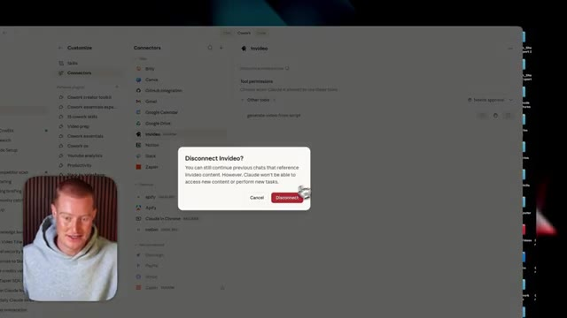
*⏱️ 00:12:34 — Affichage d'une boîte de dialogue de confirmation "Disconnect Invideo?" avec le curseur s'apprêtant à cliquer sur le bouton rouge "Disconnect".*

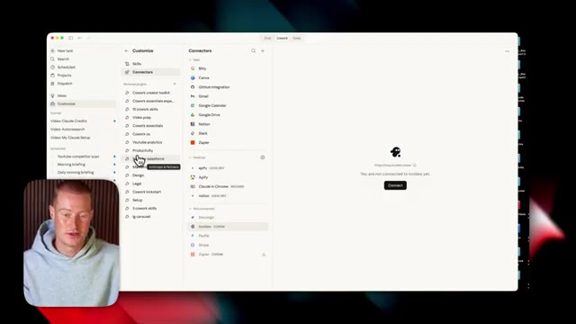
*⏱️ 00:12:38 — L'interface confirme la déconnexion de l'intégration avec le message "You are not connected to Invideo yet." et l'option "Connect".*

---

### ⏱️ `[00:12:43 - 00:13:03]` | Segment #33

**🔊 Audio (Transcription Intégrale Mot pour Mot en Français) :**
> Parce que parfois, vous savez, Claude va s'embrouiller et nous allons essayer d'aller exécuter des tâches à travers différentes applications. Et donc, en déconnectant certains des connecteurs que vous n'utilisez pas tous les jours, cela devrait vous faire économiser des jetons et des crédits. Et encore une fois, c'est du pain bénit, pour ainsi dire. C'est une chose vraiment simple que vous pouvez faire pour tirer immédiatement plus profit de votre abonnement à Claude. L'audit complet des connecteurs pourrait donc ressembler à quelque chose comme ça.

**👁️ Analyse Visuelle d'Écran (gemini-3.5-flash-lite) :**
**Interface & Outils** : Interface logicielle de type Cowork / Claude.

**Contenu textuel & Code** : Liste des connecteurs disponibles et connectés (Bitly, Canva, GitHub, Gmail, Google Calendar, Notion, Slack, Zapier, etc.).

**Action / Démonstration** : Navigation et gestion des paramètres de connexion des applications tierces pour optimiser l'utilisation de l'intelligence artificielle.

*⏱️ 00:12:48 — Capture d'écran montrant l'interface de configuration des connecteurs d'une application de type assistant IA (Cowork/Claude), avec le présentateur en médaillon en bas à gauche.*

---

### ⏱️ `[00:13:03 - 00:13:36]` | Segment #34

**🔊 Audio (Transcription Intégrale Mot pour Mot en Français) :**
> Supprimez les connecteurs que vous n'utilisez pas via Claude Cowork. Supprimez les connecteurs en double pour la même application. Personnellement, j'avais quelques doublons. Désinstallez les packs de plugins qui chevauchent ceux que vous avez déjà. Donc, si vous avez déjà des compétences intégrées à Cowork qui sont également incluses dans le plugin, allez peut-être simplement supprimer cette compétence spécifique. Comme ça, vous n'utilisez pas les deux et vous ne gardez que les connecteurs et les plugins que vous utilisez réellement toutes les semaines. Et un point essentiel ici, c'est que vous pourrez toujours les reconnecter et les installer plus tard. C'est très simple à faire. C'est pourquoi je vous suggère de simplement supprimer ceux que vous n'utilisez pas. Très bien. Passons maintenant au conseil numéro neuf,

**👁️ Analyse Visuelle d'Écran (gemini-3.5-flash-lite) :**
**Interface & Outils** : Navigateur web affichant une diapositive de présentation sur fond noir.

**Contenu textuel & Code** : Texte listant des bonnes pratiques : supprimer les connecteurs inutilisés, supprimer les connecteurs en double, désinstaller les packs de plugins qui se chevauchent, et conserver les connecteurs utilisés chaque semaine.

**Action / Démonstration** : Présentation visuelle des étapes d'optimisation des connecteurs et plugins pour économiser des jetons (tokens).

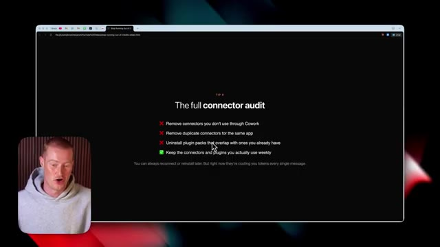
*⏱️ 00:13:12 — Une diapositive de présentation affichant les conseils pour réaliser un audit complet des connecteurs (The full connector audit) avec le présentateur en médaillon dans le coin inférieur gauche.*

---

### ⏱️ `[00:13:36 - 00:14:09]` | Segment #35

**🔊 Audio (Transcription Intégrale Mot pour Mot en Français) :**
> c'est-à-dire que les fichiers de mémoire obsolètes constituent un poids mort dans chaque conversation que nous avons au sein de Claude. Donc ce graphique ici est en quelque sorte un exemple parfait. Si vous avez des mémoires obsolètes, si vous avez des mémoires obsolètes dans votre fichier memory md, il les charge automatiquement dans chaque conversation, un peu comme votre fichier clawd md, et au fond, ça gaspille simplement vos jetons, donc vous voulez avoir ces mémoires vertes et actuelles que vous utilisez réellement dans clawd au lieu d'avoir également des mémoires obsolètes. Donc, comme je l'ai dit, tout cela se trouve dans votre memory md qui charge chaque session de vieilles entrées.

**👁️ Analyse Visuelle d'Écran (gemini-3.5-flash-lite) :**
**Interface & Outils** : Navigateur web affichant une présentation de diapositive de type slide deck avec illustration visuelle et incrustation vidéo du présentateur en bas à gauche.

**Contenu textuel & Code** : Texte principal "Stale memory files are dead weight on every conversation", graphiques explicatifs de gestion de fichiers mémoire, et encadrés explicatifs sur "Your MEMORY.md" et "The fix".

**Action / Démonstration** : Le présentateur explique l'impact négatif des fichiers de mémoire obsolètes qui pèsent sur chaque conversation et consomment des jetons inutilement.

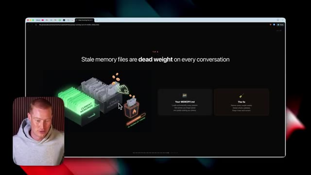
*⏱️ 00:13:44 — Une diapositive de présentation web montrant le titre "Stale memory files are dead weight on every conversation" avec une illustration graphique comparant des mémoires actuelles en vert et des mémoires obsolètes jetées à la poubelle.*

---

### ⏱️ `[00:14:09 - 00:14:43]` | Segment #36

**🔊 Audio (Transcription Intégrale Mot pour Mot en Français) :**
> que vous oubliez vous coûtent discrètement des jetons et la solution est que vous pouvez simplement revoir cela toutes les quelques semaines. C'est ce que je fais personnellement. Et je supprime essentiellement ce qui est obsolète. De cette façon, cela le garde léger et actuel. Il a donc une mémoire actuelle et non une mémoire périmée. Afin de vous montrer ce que je veux dire, laissez-moi venir sur mon projet de vidéos YouTube. Et à l'intérieur d'ici, nous allons voir la mémoire. Et nous avons tous ces différents fichiers de mémoire. Mais ce sur quoi je veux me concentrer, c'est memory.md. Et ici même se trouve essentiellement l'index de la mémoire. Ce sont tous les différents fichiers que j'ai à l'intérieur d'ici. Et ce que je pourrais faire, c'est que je pourrais cliquer sur chacun d'entre eux individuellement. Donc

**👁️ Analyse Visuelle d'Écran (gemini-3.5-flash-lite) :**
**Interface & Outils** : Interface de l'application de workspace et éditeur de documents Markdown.

**Contenu textuel & Code** : Fichiers d'index de mémoire (MEMORY.md), listes de règles de formatage, préférences de création de contenu et directives de vérification.

**Action / Démonstration** : Navigation dans les fichiers de contexte et démonstration de l'organisation de la mémoire pour l'intelligence artificielle.

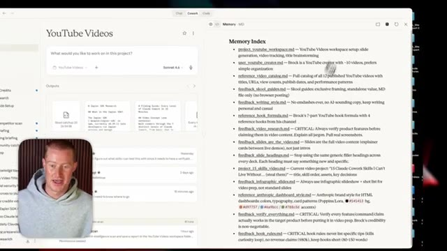
*⏱️ 00:14:35 — Affichage de l'index de la mémoire (Memory Index) sous forme de fichiers Markdown listant les préférences, styles d'écriture et règles de recherche.*

---

### ⏱️ `[00:14:43 - 00:15:18]` | Segment #37

**🔊 Audio (Transcription Intégrale Mot pour Mot en Français) :**
> commentaires sur les diapositives des vidéos. Ça, c'est essentiellement comme des commentaires que j'ai donnés pour l'une de mes tâches dans Claude Cowork. Référence à la formule d'accroche. Donc c'est pour mes accroches YouTube. Toutes ces choses différentes. S'il y a des souvenirs particuliers ici que vous n'utilisez pas, je vous suggère de les supprimer s'ils ne sont plus pertinents pour vous. Certains d'entre eux, pour moi, je vais encore les utiliser, mais certains sont obsolètes et correspondent essentiellement à des choses que je lui ai données il y a quelques semaines et qui ne sont plus nécessairement pertinentes maintenant. Passons à l'astuce numéro 10, et c'est que les tâches programmées recommencent à zéro à chaque fois que vous les déclenchez. Donc, en revenant à l'une des sections dont nous avons parlé,

**👁️ Analyse Visuelle d'Écran (gemini-3.5-flash-lite) :**
**Interface & Outils** : Interface Claude Cowork et présentation vidéo.

**Contenu textuel & Code** : Documentation sur les formules d'accroche YouTube, tâches planifiées et notes méthodologiques.

**Action / Démonstration** : Navigation dans l'interface de travail et présentation de diapositives.

---

### ⏱️ `[00:15:19 - 00:15:46]` | Segment #38

**🔊 Audio (Transcription Intégrale Mot pour Mot en Français) :**
> où plus vos tâches et vos messages sont longs, plus le contexte s'accumule à l'intérieur de cette conversation et plus le nombre de jetons gaspillés est important. Alors que les tâches planifiées repartent de zéro à chaque fois que vous les déclenchez. Vous configurez donc la tâche, une nouvelle session se charge sans contexte alourdi, et le résultat vous attendra. Et si vous ne savez pas ce que sont les tâches planifiées, vous revenez sur Claude, vous pouvez voir sur le côté gauche que nous avons l'option planifié et nous pouvons exécuter des tâches planifiées spécifiques à certains moments de la journée.

**👁️ Analyse Visuelle d'Écran (gemini-3.5-flash-lite) :**
**Interface & Outils** : Interface web de présentation et application de gestion de tâches automatisées.

**Contenu textuel & Code** : Schéma explicatif sur les sessions propres sans accumulation de contexte et liste de tâches planifiées configurées (Morning briefing, Daily wrapup, YouTube check, etc.).
[DESC_IMAGE_1] (Voir l'image #1)
[DESC_IMAGE_2] (Voir l'image #2)
[DESC_IMAGE_3] (Voir l'image #3)

**Action / Démonstration** : Présentation conceptuelle et démonstration visuelle de l'optimisation des jetons grâce aux tâches planifiées qui redémarrent à chaque exécution.

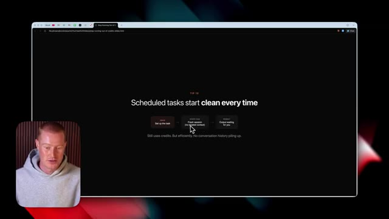
*⏱️ 00:15:32 — Diapositive affichant le titre "Scheduled tasks start clean every time" avec un schéma séquentiel en trois étapes illustrant le fonctionnement des tâches planifiées.*

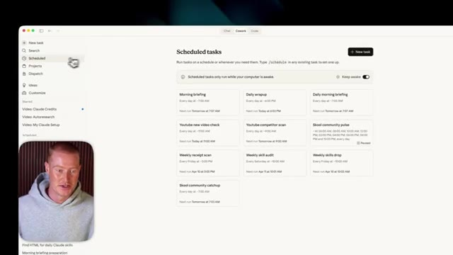
*⏱️ 00:15:39 — Interface logicielle affichant le panneau des "Scheduled tasks" avec plusieurs cartes de tâches automatisées programmées à des horaires réguliers.*

---

### ⏱️ `[00:15:46 - 00:16:23]` | Segment #39

**🔊 Audio (Transcription Intégrale Mot pour Mot en Français) :**
> Par exemple, j'ai cette compétence de briefing matinal qui s'exécute, vérifie ma boîte de réception d'e-mails. Et ensuite, ce qu'elle fait, c'est qu'elle génère ce site HTML pour moi, en décomposant tout ce qui se trouve dans ma boîte de réception d'e-mails auquel je dois répondre, ainsi que toutes mes réunions de la journée via Google Agenda. C'est donc un excellent moyen de ne pas avoir à faire d'aller-retours avec Claude, de construire plus de contexte dans une conversation spécifique. Et ça recommence à zéro à chaque fois. Ça ne consomme donc pas vos jetons. Les bonnes choses à planifier sont des choses comme votre briefing matinal, le balayage de la boîte de réception, les rapports hebdomadaires, les résumés de fin de journée. Ces certaines choses que vous pourriez fondamentalement demander à Claude d'aller faire au lieu que vous ayez à les évoquer dans un

**👁️ Analyse Visuelle d'Écran (gemini-3.5-flash-lite) :**
**Interface & Outils** : Navigateur web, interface de dashboard personnel et outil de génération de rapports automatisés.

**Contenu textuel & Code** : Résumé d'e-mails, tâches prioritaires, calendrier, actualités technologiques et sections "Morning briefing", "Weekly report", "Inbox sweep".

**Action / Démonstration** : Présentation et démonstration d'un dashboard matinal généré automatiquement à partir de la boîte mail.

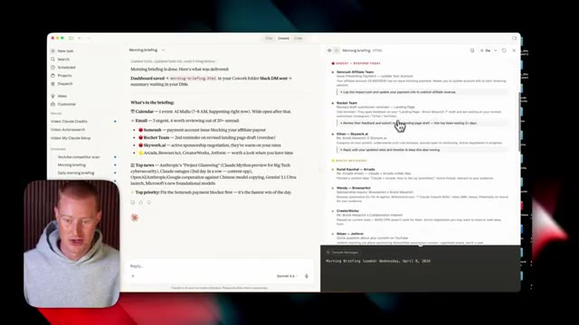
*⏱️ 00:15:56 — Interface d'un dashboard de briefing matinal généré automatiquement avec le résumé des e-mails et des tâches prioritaires.*

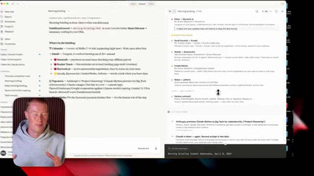
*⏱️ 00:16:05 — Défilement de la page du dashboard de briefing matinal affichant les e-mails urgents et les actualités du jour.*

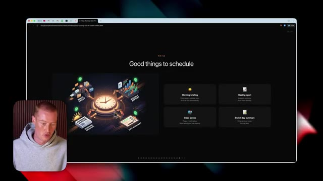
*⏱️ 00:16:14 — Page web de présentation intitulée "Good things to schedule" montrant les différentes options automatisables comme le briefing matinal et le rapport hebdomadaire.*

---

### ⏱️ `[00:16:23 - 00:16:56]` | Segment #40

**🔊 Audio (Transcription Intégrale Mot pour Mot en Français) :**
> conversation préexistante. Très bien. Passons donc aux conseils finaux, et ensuite je vais vous montrer comment vous pouvez réellement réclamer des crédits gratuits dans Claude dès maintenant. C'est uniquement disponible jusqu'au 17 avril. Donc les conseils numéro 11 et 12. Ce sont deux astuces pour ne jamais être bloqué hors de votre compte ou utiliser tous vos jetons. Et ce que vous pouvez faire, c'est activer l'utilisation supplémentaire. C'est donc essentiellement du paiement à l'utilisation. Vous pouvez donc charger un certain montant de jetons dans votre compte, que ce soit 5 ou 10 dollars par mois. Et de cette façon, une fois que vous atteignez votre limite sur votre forfait, si vous êtes sur le forfait pro,

**👁️ Analyse Visuelle d'Écran (gemini-3.5-flash-lite) :**
**Interface & Outils** : Navigateur web affichant une page de présentation aux tons sombres.

**Contenu textuel & Code** : Texte présentant deux astuces (« Turn on extra usage » et « Know your peak hours ») pour éviter d'être bloqué lors de l'utilisation de l'IA.

**Action / Démonstration** : Présentation visuelle des conseils finaux et des méthodes pour optimiser l'utilisation des crédits.

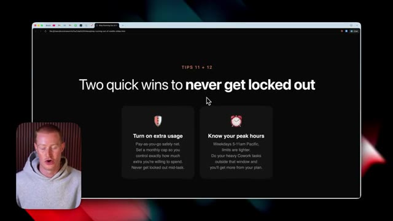
*⏱️ 00:16:40 — Capture d'écran d'une présentation affichant les conseils 11 et 12 (« Two quick wins to never get locked out »), avec une incrustation vidéo du présentateur en bas à gauche.*

---

### ⏱️ `[00:16:56 - 00:17:33]` | Segment #41

**🔊 Audio (Transcription Intégrale Mot pour Mot en Français) :**
> ensuite, il va réellement les utiliser comme utilisation supplémentaire pour votre compte. De cette façon, vous savez, toutes vos tâches peuvent toujours s'exécuter sans aucun problème. Et ensuite, c'est un point très important. Vous pouvez profiter des heures de pointe dans Claude. Donc en semaine, de 5 h à 11 h, heure du Pacifique. Les limites sont beaucoup plus strictes parce que la plupart des gens l'utilisent juste à ce moment-là. Je vous suggère donc de faire des tâches de collaboration lourdes si possible, si vous essayez vraiment de compter chaque centime et d'économiser autant que possible, parce que je sais que beaucoup d'entre vous le veulent. Je vous suggère de le faire en dehors de cette plage horaire et vous tirerez davantage parti de votre forfait Anthropic. Et une excellente façon de le faire encore une fois, ce sont les tâches programmées comme

**👁️ Analyse Visuelle d'Écran (gemini-3.5-flash-lite) :**
**Interface & Outils** : Navigateur web affichant une présentation de diapositives.

**Contenu textuel & Code** : Texte "Two quick wins to never get locked out", "Turn on extra usage" et "Know your peak hours".

**Action / Démonstration** : Présentation de conseils pratiques pour l'utilisation de l'outil d'IA sans interruption.

*⏱️ 00:17:06 — Diapositive présentant deux astuces pour éviter les pannes de crédit, avec le présentateur en médaillon.*

*⏱️ 00:17:24 — Diapositive similaire avec un curseur sur la seconde astuce concernant les heures de pointe, et le présentateur en médaillon.*

---

### ⏱️ `[00:17:33 - 00:18:00]` | Segment #42

**🔊 Audio (Transcription Intégrale Mot pour Mot en Français) :**
> Je viens de vous le montrer. Vous pouvez exécuter des tâches planifiées spécifiques à certains moments de la journée qui ne correspondent pas, vous savez, aux périodes chargées à l'intérieur de Claude en raison de tout le monde dans le monde qui l'utilise à ce moment-là. Très bien. Alors maintenant, vous connaissez les 12 astuces pour économiser sur vos crédits. Utilisons maintenant cette astuce qu'Anthropic vient de nous donner pour obtenir des crédits gratuits dès maintenant. J'ai personnellement échangé cela et j'ai obtenu 200 dollars de crédits gratuits sur mon forfait Claude max. Laissez-moi donc détailler exactement ce que je veux dire maintenant.

**👁️ Analyse Visuelle d'Écran (gemini-3.5-flash-lite) :**
**Interface & Outils** : Application de gestion de tâches automatisées (Claude/interface web) et navigateur web affichant une diapositive de présentation.

**Contenu textuel & Code** : Liste de tâches planifiées (Morning briefing, Daily wrapup, Youtube new video check, Weekly receipt scan, etc.) et options de crédits gratuits Anthropic.

**Action / Démonstration** : Navigation et présentation des fonctionnalités de tâches planifiées et des avantages/crédits d'Anthropic.

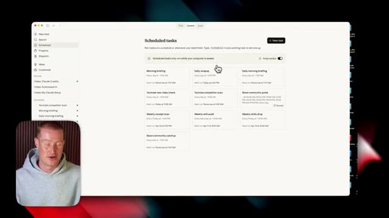
*⏱️ 00:17:40 — Interface d'une application montrant le panneau 'Scheduled tasks' avec plusieurs tâches automatisées programmées.*

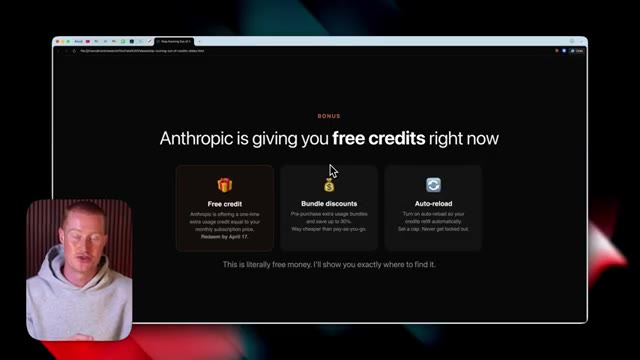
*⏱️ 00:17:46 — Diapositive de présentation sur fond sombre titrée 'Anthropic is giving you free credits right now' avec trois options (Free credit, Bundle discounts, Auto-reload).*

---

### ⏱️ `[00:18:00 - 00:18:25]` | Segment #43

**🔊 Audio (Transcription Intégrale Mot pour Mot en Français) :**
> Donc, en allant dans mes e-mails, j'ai reçu cet e-mail il y a quelques jours. Il est écrit qu'à partir du 4 avril, vous ne pourrez plus utiliser les abonnements Claude pour des interfaces tierces, y compris OpenClaw. Donc, si vous ne le savez pas, OpenClaw est fondamentalement un agent d'IA dans lequel les gens utilisaient Anthropic, et cela a consommé et gaspillé un tas de crédits. Et cela a entraîné des problèmes de performance au sein de Claude. Vous ne pouvez donc plus faire cela avec votre forfait Claude.

**👁️ Analyse Visuelle d'Écran (gemini-3.5-flash-lite) :**
**Interface & Outils** : Navigateur web (Gmail) affichant un message officiel d'Anthropic/Claude.

**Contenu textuel & Code** : Texte de l'e-mail expliquant la fin de la prise en charge des abonnements Claude pour les interfaces tierces (comme OpenClaw) à partir du 4 avril.

**Action / Démonstration** : Le présentateur commente et montre le contenu de l'e-mail reçu de la part de l'équipe Claude.

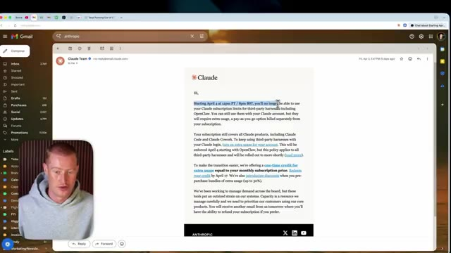
*⏱️ 00:18:06 — Vue d'un e-mail provenant de l'équipe Claude affiché à l'écran, avec le présentateur en médaillon dans le coin inférieur gauche.*

*⏱️ 00:18:18 — Gros plan similaire sur l'e-mail officiel d'Anthropic concernant les abonnements Claude et les interfaces tierces.*

---

### ⏱️ `[00:18:25 - 00:18:58]` | Segment #44

**🔊 Audio (Transcription Intégrale Mot pour Mot en Français) :**
> Vous devez en réalité payer pour l'API et l'utilisation supplémentaire. Donc ce qu'ils ont fait, et nous n'avons pas besoin de nous concentrer là-dessus. Ce sur quoi nous devons nous concentrer, c'est ceci juste ici. Donc pour faciliter la transition, nous offrons un crédit unique pour une utilisation supplémentaire égal à votre plan d'abonnement mensuel. Et nous pouvions échanger nos crédits d'ici le 17 avril, tout en introduisant des réductions lorsque vous achetez des lots d'utilisation supplémentaire allant jusqu'à 30 %. Vous voulez en profiter, mais vous allez cliquer là-dessus et vous devez posséder un abonnement Claude préexistant avant la date de cet email, qui était le 4 avril.

**👁️ Analyse Visuelle d'Écran (gemini-3.5-flash-lite) :**
**Interface & Outils** : Navigateur web affichant l'interface de messagerie Gmail avec un e-mail textuel de la part de l'équipe Claude.

**Contenu textuel & Code** : Texte d'un e-mail d'Anthropic/Claude expliquant les changements concernant l'utilisation des abonnements avec des applications tierces, l'introduction de crédits uniques et d'options de paiement à l'utilisation.

**Action / Démonstration** : Le présentateur commente le contenu d'un e-mail officiel expliquant la transition tarifaire et les crédits offerts pour l'utilisation supplémentaire des API et intégrations tierces.

*⏱️ 00:18:33 — Vue d'ensemble d'un e-mail provenant de l'équipe Claude affiché dans une interface Gmail, avec le présentateur visible en incrustation dans le coin inférieur gauche.*

*⏱️ 00:18:41 — Gros plan sur le texte de l'e-mail de l'équipe Claude mettant en avant l'offre d'un crédit unique pour l'utilisation supplémentaire.*

---

### ⏱️ `[00:18:58 - 00:19:17]` | Segment #45

**🔊 Audio (Transcription Intégrale Mot pour Mot en Français) :**
> Mais si vous aviez bien un compte, assurez-vous de vérifier vos e-mails, vérifiez vos spams. Vous devriez avoir cet e-mail et vous pourriez cliquer sur réclamer vos crédits. Et à partir de là, il va y avoir un bouton, en gros juste pour les utiliser. J'ai pu économiser 200 $ sur mon forfait. Si j'affiche cette capture d'écran ici, voyons si vous arrivez à voir ça. En gros, c'est écrit : 200 $ de crédit ajoutés, le rechargement automatique est activé.

**👁️ Analyse Visuelle d'Écran (gemini-3.5-flash-lite) :**
**Interface & Outils** : Présentation ou face-caméra explicatif du trader sans interface logicielle partagée.

**Contenu textuel & Code** : Explications orales des stratégies et mise en contexte méthodologique du marché.

**Action / Démonstration** : Explications face caméra et analyse conceptuelle des marchés.

---

### ⏱️ `[00:19:17 - 00:19:35]` | Segment #46

**🔊 Audio (Transcription Intégrale Mot pour Mot en Français) :**
> Donc en gros, ils viennent de créditer 200 $ sur mon forfait. Comme j'étais sur le forfait à 200 $ par mois, si vous êtes sur le forfait à 20 $ par mois, vous aurez accès pour récupérer ces 20 $ en crédits. Alors assurez-vous de le faire. Sinon, vous ne profitez pas de l'argent gratuit d'Anthropic. D'accord les gars. Donc si vous voulez plus de ressources comme celle-ci, assurez-vous de rejoindre ma communauté Skool.

**👁️ Analyse Visuelle d'Écran (gemini-3.5-flash-lite) :**
**Interface & Outils** : Visionneuse macOS Preview, notification de la console de facturation Anthropic

**Contenu textuel & Code** : Message affiché : "$200 credit added. Auto-reload is on, so you'll be charged automatically once the credit runs out. Manage auto-reload"

**Action / Démonstration** : Présentation de la preuve d'obtention des crédits offerts par Anthropic pour l'utilisation de Claude.

*⏱️ 00:19:22 — Fenêtre de visualisation affichant une notification de confirmation d'attribution d'un crédit de 200 $ par Anthropic avec mention du rechargement automatique.*

---

### ⏱️ `[00:19:35 - 00:19:55]` | Segment #47

**🔊 Audio (Transcription Intégrale Mot pour Mot en Français) :**
> Il y a un lien dans la description et dans le commentaire épinglé juste ici. J'ai 50 compétences différentes que j'utilise absolument tous les jours, et je mets ça à jour chaque semaine. Comme vous pouvez le voir ici, j'en ai des tonnes ici que vous pouvez tout simplement télécharger une fois que vous êtes dans la communauté, et c'est aussi un endroit formidable où les entrepreneurs utilisent et tirent parti de Claude Cowork spécifiquement pour leur entreprise.

**👁️ Analyse Visuelle d'Écran (gemini-3.5-flash-lite) :**
**Interface & Outils** : Navigateur Web affichant l'application / bibliothèque de compétences et prompts Claude (« Claude Covers Skills »).

**Contenu textuel & Code** : Liste de 50 compétences et 9 ressources IA réparties en modules (Hook Generator, Teleprompter, Trend Scanner, Diagram Generator, Proposal Generator, Email Drafter).

**Action / Démonstration** : Présentation et parcours de la bibliothèque de compétences et d'outils automatisés pour Claude.

*⏱️ 00:19:40 — Page d'accueil de la bibliothèque de compétences « Claude Covers » affichant le titre « Every Skill & Resource Brock Uses Every Day » et les outils de création de contenu.*

*⏱️ 00:19:45 — Défilement du catalogue présentant les cartes de compétences classées par catégories : « Research & Strategy », « Design & Visuals » et « Business ».*

---

### ⏱️ `[00:19:55 - 00:20:07]` | Segment #48

**🔊 Audio (Transcription Intégrale Mot pour Mot en Français) :**
> And it's an amazing community with like-minded people. If you guys want more content like this for free, make sure to subscribe to this channel. I have tons more content coming out about Claude Cowork. But with that being said, guys, thank you so much for staying to the end and I'll see you guys in the next video.

**👁️ Analyse Visuelle d'Écran (gemini-3.5-flash-lite) :**
**Interface & Outils** : Navigateur web affichant la plateforme YouTube.

**Contenu textuel & Code** : Vignettes de vidéos orientées sur l'outil "Claude Cowork" et l'intelligence artificielle pour non-techniciens.

**Action / Démonstration** : Le présentateur conclut sa vidéo en incitant les spectateurs à s'abonner et à regarder ses prochains contenus.

---

