# 🎬 Every Claude Cowork Concept Explained for Normal People

> **Chaîne** : [Brock Mesarich | AI for Non Techies](https://www.youtube.com/@BrockMesarich)  
> **Lien YouTube** : [https://www.youtube.com/watch?v=NDHWUhGzKg0](https://www.youtube.com/watch?v=NDHWUhGzKg0)  
> **Date de publication** : 20260412  
> **Durée** : 00:31:27  
> **Identifiant vidéo** : `NDHWUhGzKg0`  
> **Transcription & Analyse** : `whisper-v3-large-turbo+gemini-3.5-flash-lite`  

---

## 📌 Synthèse Exécutive & Outils

### 💡 Résumé

Cette vidéo, présentée par Brock Mesarich sur la chaîne *AI for Non Techies*, lève le voile sur l'un des environnements de travail IA les plus puissants du marché : Claude Cowork. Souvent intimidant en raison de son jargon technique (compétences, MCP, sous-agents), l'outil est ici déconstruit méthodiquement pour les utilisateurs non techniques. L'objectif est de transformer l'IA en un véritable "employé virtuel" capable d'interagir directement avec l'écosystème local de votre ordinateur, en s'appuyant sur des dossiers de travail dédiés et des mécanismes de personnalisation poussés.

L'analyse démontre comment structurer l'environnement de l'IA pour qu'elle passe d'un simple chatbot conversationnel à un assistant autonome et contextuel. Grâce à l'utilisation combinée de dossiers locaux synchronisés, de fichiers de configuration comportementale (`CLAUDE.md`), d'instructions globales et d'une mémoire cumulative, l'utilisateur gagne en efficacité opérationnelle. Cette architecture permet d'automatiser des flux de travail complexes, de standardiser des processus répétitifs et de s'affranchir des limites des interfaces de chat traditionnelles, ouvrant la voie à une automatisation bureautique et créative de haut niveau.

Bien que la vidéo se concentre sur la prise en main fondamentale de Claude Cowork, les concepts abordés — gestion de la mémoire à long terme, fenêtres de contexte étendues et structuration modulaire des instructions — partagent les mêmes fondements logiques que l'ingénierie de prompt avancée utilisée dans le trading quantitatif et l'automatisation de stratégies. La maîtrise de ces briques logicielles permet d'envisager sereinement le déploiement d'agents autonomes capables de traiter de vastes volumes de données non structurées, qu'il s'agisse de documentations complexes ou de flux de données opérationnels.

---

### 🛠️ Outils, Modèles & Logiciels Présentés

* **Claude (et Claude Cowork)** : Modèle de langage et environnement de bureau développé par Anthropic, permettant une interaction directe avec le système de fichiers local et l'exécution de tâches autonomes.
* **Claude Code** : Interface de développement et d'exécution technique liée à l'écosystème Claude pour la manipulation de scripts et de fichiers système.
* **ChatGPT** : Modèle de langage conversationnel d'OpenAI, pris comme point de comparaison pour illustrer les modes de discussion classiques par rapport au travail collaboratif.
* **Grok** : Modèle d'intelligence artificielle développé par xAI, mentionné dans le paysage concurrentiel des LLM.
* **Gemini** : Suite de modèles d'intelligence artificielle de Google, évoquée dans l'écosystème global des outils d'IA générative.
* **Zapier** : Plateforme d'automatisation no-code permettant de connecter différentes applications web entre elles pour créer des flux de travail automatisés.
* **n8n** : Outil d'automatisation de flux de travail open-source et auto-hégeable, privilégié pour la flexibilité des intégrations techniques.
* **Make** : Plateforme avancée d'intégration et d'automatisation (anciennement Integromat) pour orchestrer des processus multi-applications.

---

### 🔑 Points Clés & Enseignements Stratégiques

* **Intégration au système de fichiers local** : Claude Cowork s'exécute via une application de bureau dédiée qui permet à l'IA de lire, modifier et générer de vrais fichiers (documents, scripts Python, HTML, CSV) directement sur votre machine.
* **Utilisation des dossiers d'espace de travail** : Il est recommandé de créer un dossier dédié et isolé (ex. *Dossier de Travail Collaboratif Claude*) pour centraliser tous les assets et productions d'un projet spécifique, évitant ainsi la dispersion des données.
* **Le fichier de configuration `CLAUDE.md`** : Ce fichier textuel, placé au cœur du dossier du projet, définit les règles, le périmètre, l'identité et les consignes comportementales de Claude. Il est rechargé automatiquement au début de chaque session pour garantir un comportement constant.
* **Distinction entre `CLAUDE.md` et Instructions Globales** : Le fichier `CLAUDE.md` est spécifique à un projet et à son dossier de travail, tandis que les instructions globales s'appliquent de manière permanente à l'ensemble des sessions et modes de l'utilisateur sur la plateforme Claude.
* **Personnalisation de l'identité permanente** : Les instructions globales (accessibles via les paramètres du compte) permettent de configurer une fois pour toutes le profil de l'utilisateur, son ton, ses préférences et les conventions de réponse souhaitées.
* **Mémoire cumulative et adaptative** : Claude gère une section de mémoire composée de fichiers Markdown qui enregistrent au fil du temps les préférences de l'utilisateur, les retours correctifs et les méthodologies validées, permettant à l'IA d'apprendre de ses interactions passées.
* **Gestion de la fenêtre de contexte (bureau de travail)** : La fenêtre de contexte, mesurée en jetons (jusqu'à 1 million), représente l'espace de travail actif immédiat. Elle englobe le fichier `CLAUDE.md`, la mémoire, les instructions système, l'historique des discussions et les documents actifs.
* **Prévention de la saturation contextuelle** : Malgré une grande capacité (1 million de jetons), un va-et-vient prolongé dans une même conversation peut saturer le contexte, nécessitant une structuration modulaire des projets pour maintenir des performances optimales.
* **Approche modulaire des "employés IA"** : En combinant dossiers locaux, instructions ciblées (`CLAUDE.md`) et mémoire persistante, l'utilisateur peut configurer des agents spécialisés capables d'exécuter des rôles métiers précis (création de contenu, analyse de données, gestion de communauté).
* **Montée en compétences progressive** : L'architecture de Claude Cowork repose sur une hiérarchie logique (dossier $\rightarrow$ instructions locales $\rightarrow$ instructions globales $\rightarrow$ mémoire $\rightarrow$ contexte), dont la compréhension pas à pas démystifie l'utilisation des outils d'IA avancés pour les profils non techniques.

---

## ⏱️ Chronologie & Transcription Complète Audio & Visuelle (Mot pour Mot)

### ⏱️ `[00:00:00 - 00:00:28]` | Segment #01

**🔊 Audio (Transcription Intégrale Mot pour Mot en Français) :**
> Cloud Cowork est l'un des outils d'IA les plus puissants du marché, mais si vous débutez, cela peut paraître extrêmement intimidant. Vous avez probablement regardé tout un tas de tutoriels différents à ce sujet, et la moitié du temps, vous n'avez aucune idée de ce dont ils parlent. Compétences, MCP, sous-agents, connecteurs, tout le monde balance ces mots comme si vous étiez censé savoir déjà ce qu'ils signifient. Alors, dans cette vidéo, je vais décortiquer les 20 concepts de Cloud Cowork, en commençant par les plus simples pour aller jusqu'aux fonctionnalités les plus puissantes.

**👁️ Analyse Visuelle d'Écran (gemini-3.5-flash-lite) :**
**Interface & Outils** : Présentation vidéo avec éléments graphiques textuels.

**Contenu textuel & Code** : Listes de concepts relatifs à Claude (Claude Skills, MCPs, Sub-agents, 20 Claude Cowork Concepts).

**Action / Démonstration** : Présentation orale et énumération des notions abordées dans la vidéo.

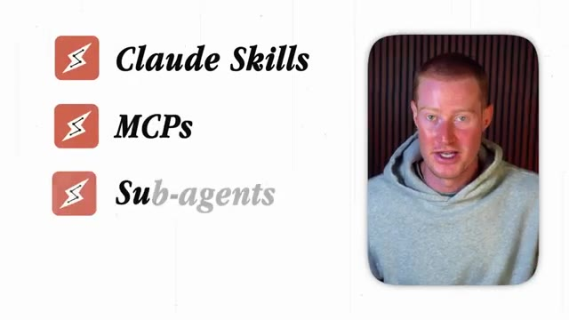
*⏱️ 00:00:14 — Le présentateur s'exprime face caméra avec des graphismes à l'écran listant des concepts clés : Claude Skills, MCPs, Sub-agents.*

---

### ⏱️ `[00:00:28 - 00:01:03]` | Segment #02

**🔊 Audio (Transcription Intégrale Mot pour Mot en Français) :**
> À la fin de cette vidéo, vous comprendrez réellement ce que Co-work peut faire, et chaque tutoriel que vous regarderez à partir de maintenant va enfin faire tilt. Alors, sans plus attendre, entrons dans le vif du sujet. Très bien, les gars. Je veux juste commencer par dire que je sais exactement ce que vous ressentez probablement. Il y a des tonnes de concepts différents dans Claude et plus particulièrement dans Claude Co-work, et cela peut être vraiment difficile à comprendre. Et j'étais exactement dans la même situation que vous. Cette vidéo va donc vraiment simplifier les choses pour que vous compreniez en profondeur tous ces différents concepts. Ainsi, vous pourrez commencer à l'utiliser et à l'intégrer dans votre Claude Co-work, et commencer à créer différents employés IA au sein de cette plateforme. Plongeons donc directement dans le vif du sujet et parlons du premier concept qui nous

**👁️ Analyse Visuelle d'Écran (gemini-3.5-flash-lite) :**
**Interface & Outils** : Navigateur web affichant une page HTML de présentation de concepts sur Claude Cowork.

**Contenu textuel & Code** : Le titre principal "20 Claude Cowork Concepts" et le sous-titre "Every major feature — explained properly.", accompagnés d'une grille d'icônes rondes représentant différentes fonctionnalités.

**Action / Démonstration** : Le présentateur introduit le sujet de la vidéo en affichant la page de présentation des concepts clés de Claude Cowork.

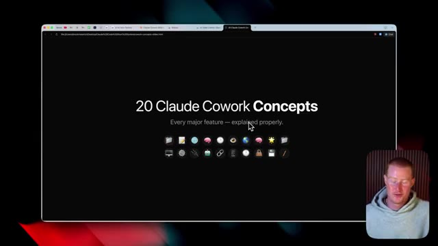
*⏱️ 00:00:45 — Capture d'écran d'une page web présentant le titre "20 Claude Cowork Concepts - Every major feature - explained properly." avec des icônes de fonctionnalités.*

---

### ⏱️ `[00:01:03 - 00:01:35]` | Segment #03

**🔊 Audio (Transcription Intégrale Mot pour Mot en Français) :**
> besoin de comprendre. Et c'est par là que vous commencez lorsque vous commencez à utiliser Claude Cowork. Parlons donc rapidement du dossier de l'espace de travail. C'est donc essentiellement là que tous nos fichiers vont exister à l'intérieur de Claude. Ce qui est génial avec Claude Cowork, c'est que vous pouvez accéder à de vrais dossiers et fichiers sur votre ordinateur. Donc par exemple, comme vous pouvez le voir ici, ce dossier système court Claude Code. C'est là que chaque fichier que je génère à l'intérieur de cowork réside. Nous pourrions donc extraire des informations d'ici. Nous pourrions ajouter différentes informations, toutes ces différentes choses.

**👁️ Analyse Visuelle d'Écran (gemini-3.5-flash-lite) :**
**Interface & Outils** : Présentation visuelle et Explorateur de fichiers macOS (Finder)

**Contenu textuel & Code** : Schéma explicatif sur l'utilisation des dossiers locaux et liste de fichiers dans l'espace de travail.

**Action / Démonstration** : Explication et démonstration de la structure des dossiers de travail dans Claude Cowork.

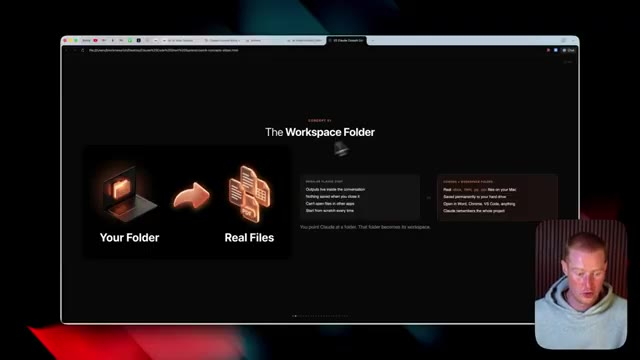
*⏱️ 00:01:11 — Diapositive de présentation montrant le concept du dossier de l'espace de travail ('The Workspace Folder') avec une interface sombre.*

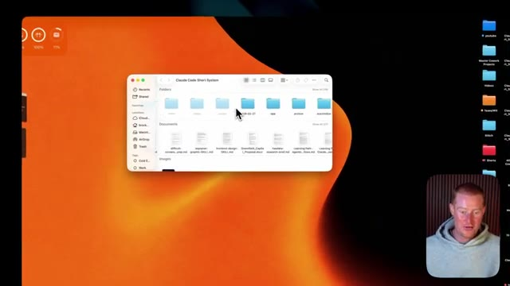
*⏱️ 00:01:27 — Capture d'écran d'un explorateur de fichiers sur macOS affichant l'arborescence des dossiers et documents liés à Claude Code.*

---

### ⏱️ `[00:01:35 - 00:02:08]` | Segment #04

**🔊 Audio (Transcription Intégrale Mot pour Mot en Français) :**
> C'est fondamentalement là que ça réside à l'intérieur de ces choses qui peuvent être des fichiers de documents, des fichiers HTML, des scripts Python, des fichiers CSV, fondamentalement tout ce que vous pouvez créer sur votre ordinateur. Ça réside à l'intérieur de ceci. Donc, première chose à faire, nous devons nous assurer d'avoir l'application de bureau Claude téléchargée sur notre ordinateur. Il va y avoir un lien dans la description pour la télécharger. Si vous ne l'avez pas déjà, vous cliqueriez simplement sur télécharger juste ici, vous pourriez la télécharger pour Mac, vous pourriez la télécharger pour Windows, toutes ces différentes choses, assurez-vous juste de la télécharger et ensuite je vais afficher la mienne, nous allons voir le mode de chat normal tout en haut, c'est fondamentalement là que nous chattons.

**👁️ Analyse Visuelle d'Écran (gemini-3.5-flash-lite) :**
**Interface & Outils** : Navigateur web affichant des pages de présentation et de téléchargement de logiciels (site web de Claude).

**Contenu textuel & Code** : Texte explicatif sur les dossiers de travail et les types de fichiers (.docx, .html, .py, .csv) ainsi que les liens de téléchargement pour macOS et Windows.
[DESC_IMAGE_3_bis] (Non applicable)

**Action / Démonstration** : Présentation des fonctionnalités de gestion de fichiers locaux et du téléchargement de l'application Claude.

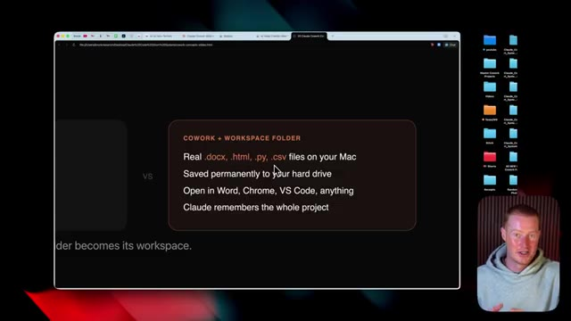
*⏱️ 00:01:43 — Capture d'écran montrant une présentation avec un bloc textuel détaillant le fonctionnement de "Cowork + Workspace Folder" et les types de fichiers pris en charge.*

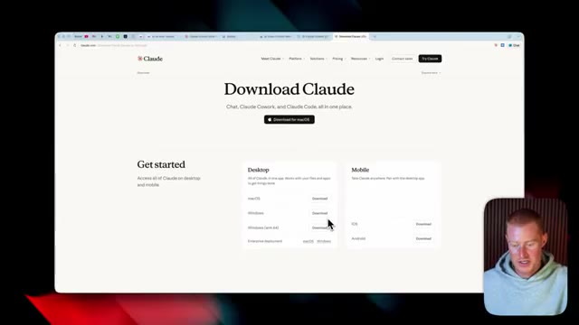
*⏱️ 00:02:00 — Capture d'écran du site officiel de Claude affichant la page de téléchargement pour ordinateurs et mobiles.*

---

### ⏱️ `[00:02:08 - 00:02:44]` | Segment #05

**🔊 Audio (Transcription Intégrale Mot pour Mot en Français) :**
> aller-retour avec Claude comme si nous parlions à ChatGPT mais nous allons nous concentrer sur le travail collaboratif, alors assurez-vous d'activer ceci et vous pouvez voir cette interface ici et la chose principale que je veux mentionner est qu'il s'agit du dossier de l'espace de travail juste ici donc si nous n'avons pas déjà de dossiers, nous pourrions en fait choisir ou créer un dossier spécifique. Donc ceux-ci ici sont fondamentalement tous les différents dossiers sur mon bureau, sur mon MacBook. Nous pourrions donc en sélectionner un préexistant si nous le voulons. Cependant, si vous débutez, je vous suggère fortement de simplement créer un nouveau dossier ici. Appelons simplement cela Dossier de Travail Collaboratif Claude. Je vais cliquer sur créer. Vous pouvez voir qu'il est en fait vide ici. Il y a

**👁️ Analyse Visuelle d'Écran (gemini-3.5-flash-lite) :**
**Interface & Outils** : Interface web de Claude et explorateur de fichiers du système d'exploitation.

**Contenu textuel & Code** : Menu de sélection du modèle ou du projet, champ de texte de prompt, liste de tâches récentes et dossiers d'espace de travail locaux.

**Action / Démonstration** : Navigation et sélection d'un dossier spécifique dans l'espace de travail pour l'importer dans l'interface de travail collaborative de Claude.

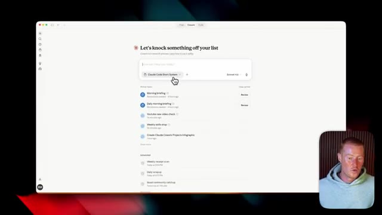
*⏱️ 00:02:17 — Interface principale de Claude affichant le champ de saisie et la sélection d'un système de code.*

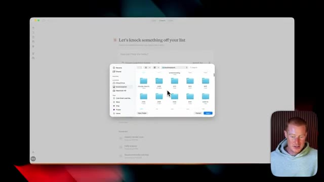
*⏱️ 00:02:26 — Fenêtre de sélection de fichiers système superposée sur l'interface de Claude, montrant les dossiers de l'espace de travail.*

---

### ⏱️ `[00:02:44 - 00:03:16]` | Segment #06

**🔊 Audio (Transcription Intégrale Mot pour Mot en Français) :**
> rien ne vit à l'intérieur de ceci. Au fur et à mesure que nous commençons à utiliser ceci de plus en plus, différents fichiers vont se peupler à l'intérieur d'ici. Je vais cliquer sur ouvrir. Je vais cliquer sur autoriser. Et juste comme ça, nous avons notre dossier Claude Cowork d'ouvert. Et une chose essentielle ici, nous pourrions en fait sélectionner plusieurs dossiers différents si nous voulons travailler à l'intérieur d'eux. Donc, au fur et à mesure que vous vous développez, vous pourriez ajouter différents dossiers, mais pour l'instant, concentrez-vous simplement sur ce seul dossier que nous avons créé. Passant au concept numéro deux, et vous avez probablement entendu cela des tonnes de fois dans n'importe quelle vidéo Claude Cowork que vous avez regardée, et c'est ClaudeMD.

**👁️ Analyse Visuelle d'Écran (gemini-3.5-flash-lite) :**
**Interface & Outils** : Interface web de Claude / Application de bureau.

**Contenu textuel & Code** : Options de sélection de projet, invites de permissions d'accès aux fichiers, et consignes textuelles d'un fichier de configuration Markdown.

**Action / Démonstration** : Navigation dans l'interface et validation des autorisations d'accès aux fichiers du dossier de travail.

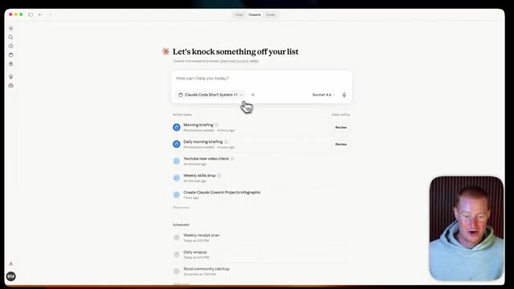
*⏱️ 00:02:52 — Interface principale de Claude affichant la barre de prompt et les tâches actives.*

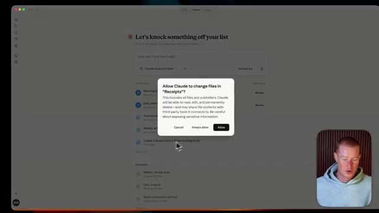
*⏱️ 00:03:00 — Boîte de dialogue de permission demandant l'autorisation d'accéder aux fichiers du dossier Receipts.*

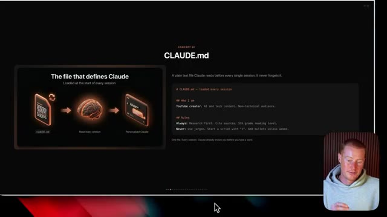
*⏱️ 00:03:08 — Diapositive explicative sur le fichier CLAUDE.md définissant le comportement de l'assistant.*

---

### ⏱️ `[00:03:16 - 00:03:41]` | Segment #07

**🔊 Audio (Transcription Intégrale Mot pour Mot en Français) :**
> Et cela a l'air plutôt complexe. Et laissez-moi vous dire que c'est super simple. Une fois que vous aurez compris le principe, cela aura tellement de sens et rendra votre expérience tellement plus facile dans Claude. C'est donc essentiellement un fichier qui définit exactement comment Claude fonctionne. Et il est chargé au début de chaque session. Pensez donc à un prompt comme ce que vous envoyez à Claude ou à tout autre grand modèle de langage comme ChatGPT, par exemple.

**👁️ Analyse Visuelle d'Écran (gemini-3.5-flash-lite) :**
**Interface & Outils** : Navigateur web affichant une diapositive explicative sur Claude AI.

**Contenu textuel & Code** : Schéma illustrant le fonctionnement du fichier CLAUDE.md chargé au démarrage de chaque session ("The file that defines Claude", "Read every session", "Personalized Claude").

**Action / Démonstration** : Le présentateur explique le concept du fichier de configuration CLAUDE.md qui personnalise le comportement de l'assistant à chaque session.

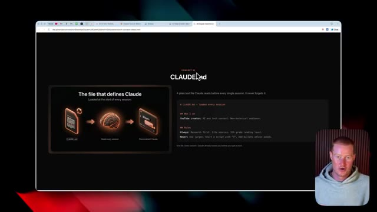
*⏱️ 00:03:23 — Présentation d'une diapositive sur le fichier de configuration de Claude AI (CLAUDE.md) avec un schéma explicatif en trois étapes.*

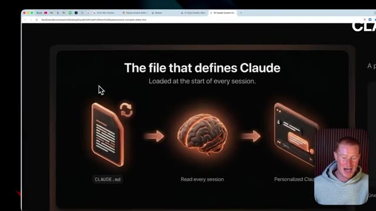
*⏱️ 00:03:29 — Gros plan sur le schéma explicatif montrant le fichier CLAUDE.md, sa lecture à chaque session et l'obtention d'un Claude personnalisé.*

---

### ⏱️ `[00:03:41 - 00:04:01]` | Segment #08

**🔊 Audio (Transcription Intégrale Mot pour Mot en Français) :**
> Il s'agit fondamentalement juste d'un document qui se trouve à l'intérieur du dossier que vous venez de créer et qui apprend à Claude exactement comment vous voulez qu'il fonctionne. Il lira ensuite ceci à chaque session avant chaque message que vous envoyez. Et c'est ainsi que vous obtenez une expérience Claude personnalisée basée sur qui vous êtes, la manière dont vous voulez qu'il interagisse, et toutes ces différentes choses que vous devez spécifier.

**👁️ Analyse Visuelle d'Écran (gemini-3.5-flash-lite) :**
**Interface & Outils** : Navigateur web affichant une page de présentation/documentation avec des illustrations graphiques 3D.

**Contenu textuel & Code** : Schéma en trois étapes : 1) Le fichier 'CLAUDE.md', 2) 'Read every session' avec une icône de cerveau, 3) 'Personalized Claude' avec une interface de discussion.

**Action / Démonstration** : Le présentateur explique le fonctionnement et l'utilité du fichier de configuration global 'CLAUDE.md' pour personnaliser l'IA à chaque nouvelle session.

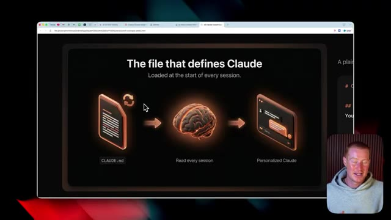
*⏱️ 00:03:46 — Schéma explicatif illustrant le rôle du fichier 'CLAUDE.md' qui est chargé au début de chaque session pour personnaliser le comportement de Claude.*

---

### ⏱️ `[00:04:01 - 00:04:33]` | Segment #09

**🔊 Audio (Transcription Intégrale Mot pour Mot en Français) :**
> Donc, par exemple, voilà à quoi cela ressemblerait. Vous auriez votre ClaudeMD qui est chargé à chaque session. Il y aurait ensuite quelque chose comme qui je suis. Pour moi, c'est écrit créateur YouTube, contenu sur l'IA et la tech, public non technique. Et puis il y a aussi mes règles ici, qui disent fondamentalement fais toujours ceci, ne fais jamais cela. Et encore une fois, ceci est chargé au début de chaque conversation. Donc, si je reviens sur cowork, laissez-moi vous montrer exactement ce que je veux dire. Donc, si je viens sur une tâche ou une conversation préexistante sur le côté gauche de notre interface cowork et que je clique dessus, vous pouvez voir que j'ai déjà fait des allers-retours dans cette conversation.

**👁️ Analyse Visuelle d'Écran (gemini-3.5-flash-lite) :**
**Interface & Outils** : Navigateur web affichant une page de présentation de code/configuration.

**Contenu textuel & Code** : Fichier de configuration CLAUDE.md affichant des instructions de personnalisation pour l'IA (section "Who I am" et "Rules").

**Action / Démonstration** : Le présentateur explique la structure d'un fichier CLAUDE.md chargé à chaque session pour configurer le comportement et le contexte de l'IA.

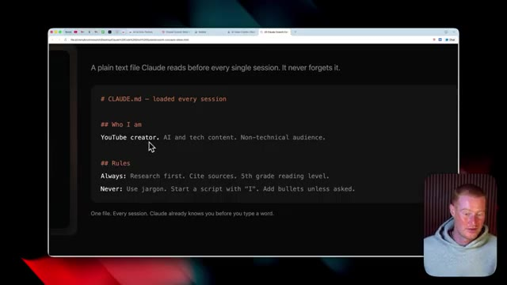
*⏱️ 00:04:09 — Capture d'écran montrant un exemple de fichier de configuration texte CLAUDE.md avec des sections définissant l'identité de l'utilisateur et ses règles de fonctionnement.*

---

### ⏱️ `[00:04:33 - 00:04:56]` | Segment #10

**🔊 Audio (Transcription Intégrale Mot pour Mot en Français) :**
> Mais ce que je pourrais faire, c'est que je pourrais cliquer sur ces instructions et vous pouvez voir juste ici, il est écrit claw.md. Et ceci juste ici est fondamentalement ce fichier claw.md, qui est juste un ensemble d'instructions sur la façon dont je veux qu'il fonctionne. Donc ce fichier CloudMD spécifique est pour school, décompose fondamentalement ce qu'est ma communauté school, différents tarifs, objectif de revenus, décompose ce que mes membres obtiennent, fondamentalement tout ce que vous devez savoir afin de comprendre ma communauté school.

**👁️ Analyse Visuelle d'Écran (gemini-3.5-flash-lite) :**
**Interface & Outils** : Application de bureau avec interface de gestion de projet et fenêtre modale d'instructions en Markdown.

**Contenu textuel & Code** : Fichier Markdown nommé "Skool - AI for Non-Techies" définissant les objectifs de revenus, la tarification, l'audience cible et la mission de la communauté.

**Action / Démonstration** : Le présentateur montre et explique le contenu des instructions du dossier qui dictent le fonctionnement de l'intelligence artificielle.

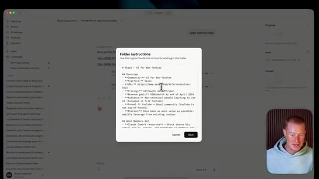
*⏱️ 00:04:39 — Interface affichant une boîte de dialogue "Folder instructions" contenant le contenu Markdown du fichier de configuration du dossier.*

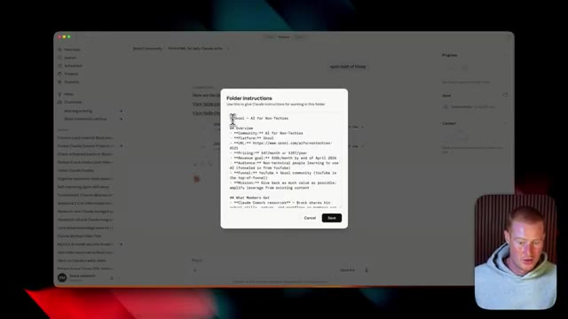
*⏱️ 00:04:44 — Vue légèrement actualisée de la même boîte de dialogue avec le curseur positionné sur les instructions du dossier.*

---

### ⏱️ `[00:04:56 - 00:05:31]` | Segment #11

**🔊 Audio (Transcription Intégrale Mot pour Mot en Français) :**
> Et ceci est chargé à chaque fois que j'ai une conversation dans ce projet différent. Très bien. Nous avons donc parlé de deux concepts différents. J'espère que vous n'êtes pas submergés. Vous avez pu voir que je décompose très simplement ces concepts et qu'ensuite vous pouvez commencer à vous appuyer sur ceux-ci. Ensuite, pour le concept numéro trois, nous avons les instructions globales. C'est un peu similaire au fichier ClaudeMD dont nous avons parlé. C'est donc fondamentalement la même chose dans le sens où vous le configurez une seule fois et il y est fait référence pour chaque conversation de chat que vous avez. Mais nous devons parler rapidement de la distinction entre ClaudeMD et une instruction globale, car ils sont un peu différents. Le fichier ClaudeMD se trouve donc à l'intérieur de ce

**👁️ Analyse Visuelle d'Écran (gemini-3.5-flash-lite) :**
**Interface & Outils** : Navigateur web affichant une page de présentation pédagogique.

**Contenu textuel & Code** : Schéma illustrant le concept 'Set it once. Apply it everywhere' avec des icônes de dossiers et de discussions, ainsi qu'un comparatif texte.

**Action / Démonstration** : Le présentateur explique les concepts d'instructions globales et de projets à travers un support visuel.

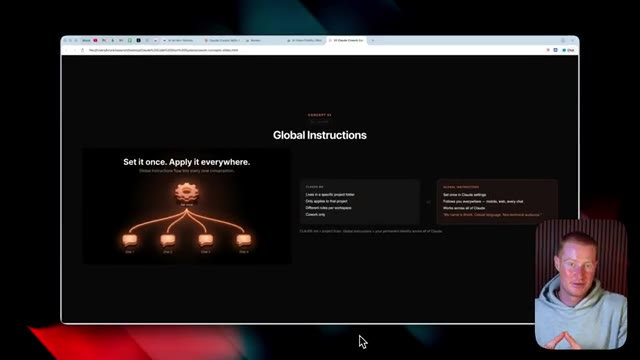
*⏱️ 00:05:05 — Capture d'écran montrant une page web avec le titre 'Global Instructions' et un schéma explicatif comparant les instructions globales et locales.*

---

### ⏱️ `[00:05:31 - 00:06:08]` | Segment #12

**🔊 Audio (Transcription Intégrale Mot pour Mot en Français) :**
> dossier de projet spécifique et cela s'applique uniquement à ce projet. Il a des règles différentes pour chaque espace de travail dans lequel il se trouve. Et c'est uniquement pour le mode co-work. Pensez donc à votre Claude MD comme au cerveau du projet. Et ensuite, vos instructions globales constituent votre identité permanente dans l'ensemble de Claude, qu'il s'agisse du mode chat de Claude, de Claude co-work ou de Claude code. Il s'agit fondamentalement juste d'instructions globales pour l'ensemble du système afin de vous montrer où vous trouverez vos instructions globales et comment les configurer. Vous allez descendre ici, sélectionner votre abonnement. Vous allez cliquer sur les paramètres. Vous allez ensuite descendre et sélectionner co-work et juste ici nous allons voir nos instructions globales, vous pouvez

**👁️ Analyse Visuelle d'Écran (gemini-3.5-flash-lite) :**
**Interface & Outils** : Navigateur web affichant l'interface de l'application Claude.

**Contenu textuel & Code** : Schéma comparatif entre CLAUDE.md (cerveau du projet, spécifique à un dossier) et les instructions globales (identité permanente).

**Action / Démonstration** : Le présentateur explique la distinction fonctionnelle entre les instructions au niveau du projet et les réglages globaux de l'IA.

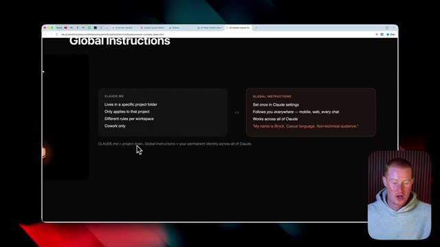
*⏱️ 00:05:41 — Présentation comparative entre le fichier CLAUDE.md et les instructions globales de l'IA, montrant leurs différences d'utilisation et de portée.*

---

### ⏱️ `[00:06:08 - 00:06:43]` | Segment #13

**🔊 Audio (Transcription Intégrale Mot pour Mot en Français) :**
> voyez que c'est écrit instructions ici s'applique à toutes les sessions de travail de Claude utilisez ceci pour les préférences les conventions ou le contexte que Claude doit toujours connaître et ensuite nous pouvons venir ici cliquer sur modifier et en gros simplement ajouter tout le contexte que nous voulons qu'il ait je dirais simplement qui vous êtes ce que vous voulez que Claude fasse comment vous voulez qu'il vous réponde réellement si vous voulez qu'il soit plus amical ou que vous voulez qu'il ait l'air plus professionnel ce sont toutes des choses que vous pouvez charger à l'intérieur de vos instructions globales. Ensuite, nous avons la mémoire pour le concept numéro quatre. Et c'est fondamentalement la façon dont Claude comprend toutes les conversations que vous avez avec lui, possède un contexte

**👁️ Analyse Visuelle d'Écran (gemini-3.5-flash-lite) :**
**Interface & Outils** : Interface des paramètres de Claude Cowork / Application de bureau.

**Contenu textuel & Code** : Section "Global Instructions" pour définir les préférences et conventions de Claude dans toutes les sessions de travail.

**Action / Démonstration** : Navigation dans les paramètres de Claude Cowork pour configurer les instructions globales et la mémoire persistante.

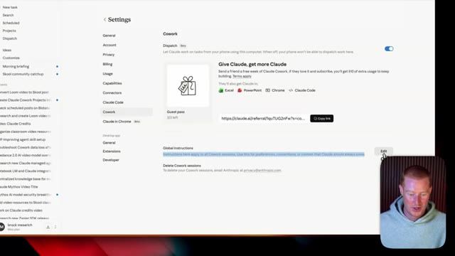
*⏱️ 00:06:17 — Paramètres de l'application Claude Cowork montrant la section Global Instructions avec le bouton Edit.*

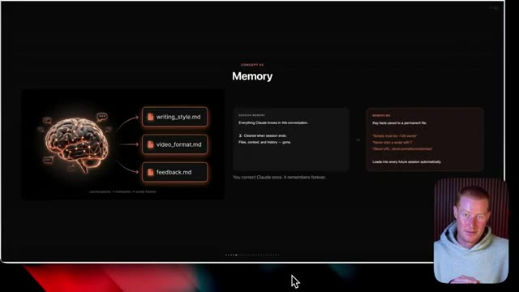
*⏱️ 00:06:35 — Diapositive explicative intitulée "Memory" contrastant la mémoire de session volatile et le stockage persistant dans memory.md.*

---

### ⏱️ `[00:06:43 - 00:07:17]` | Segment #14

**🔊 Audio (Transcription Intégrale Mot pour Mot en Français) :**
> sur différentes choses que vous vouliez faire et que vous avez faites précédemment, toutes ces différentes choses. Celle-ci, ce n'est pas sorcier. La mémoire est exactement ce qu'elle semble être. Donc si nous retournons sur co-work, je suis à l'intérieur de ce projet et nous allons parler de ce que sont les projets plus tard dans cette vidéo sous peu. Mais si je viens sur le côté droit, vous pouvez voir que nous avons cette section de mémoire. Et c'est fondamentalement un tas de fichiers markdown différents avec de la mémoire sur la façon dont je veux que certaines choses différentes soient faites. Donc que ce soit comme du contexte sur vous-même ou peut-être un flux de travail spécifique ou une tâche que vous créez, fondamentalement vous pouvez juste dire, Hé, je veux que tu ajoutes cela à mon

**👁️ Analyse Visuelle d'Écran (gemini-3.5-flash-lite) :**
**Interface & Outils** : Application Co-work (interface de gestion de projet IA)

**Contenu textuel & Code** : Fichiers markdown de mémoire (feedback, règles de rédaction, scripts, paramètres de projet)

**Action / Démonstration** : Navigation et explication de la section mémoire et des fichiers de contexte du projet Co-work

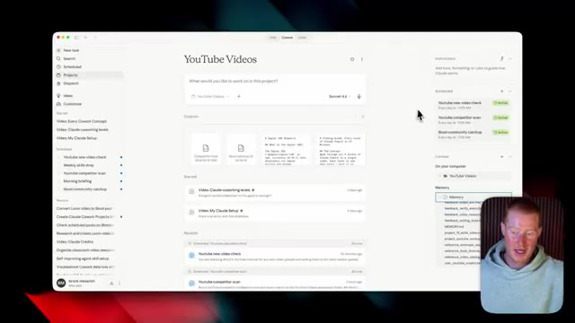
*⏱️ 00:06:52 — Vue d'ensemble de l'interface du projet "YouTube Videos" dans l'application Co-work, montrant les sections de tâches et le panneau latéral de mémoire.*

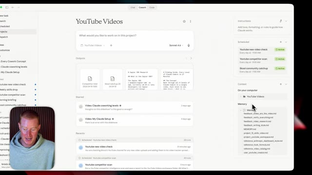
*⏱️ 00:07:00 — Gros plan sur le panneau latéral droit montrant la liste des fichiers stockés dans la mémoire du projet Co-work.*

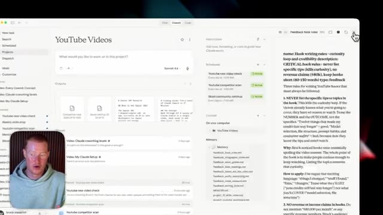
*⏱️ 00:07:08 — Affichage d'un fichier de mémoire ouvert dans le panneau latéral droit détaillant les règles d'écriture des "hooks" pour YouTube.*

---

### ⏱️ `[00:07:17 - 00:07:48]` | Segment #15

**🔊 Audio (Transcription Intégrale Mot pour Mot en Français) :**
> mémoire. Et la mémoire est quelque chose qui va simplement se construire avec le temps. S'il y a quelque chose que vous voulez que Claude se rappelle, je dis simplement, enregistrez cela dans la mémoire pour vous assurer qu'il l'enregistre bien, mais il devrait enregistrer les choses importantes avec le temps. Vous pouvez voir ici, c'est comme un truc très spécifique, mais un retour sur une compétence de génération de diapositives que j'avais quand j'ai dit de ne jamais utiliser ces phases, comment appliquer toutes ces choses. C'est juste de la mémoire. Vous pouvez voir que cela s'est construit à l'intérieur de projets dont nous allons parler plus tard dans cette vidéo. C'est donc fondamentalement ainsi que Claude se souvient de tout et de toutes les différentes conversations que vous avez avec lui. Très bien, alors passons au concept numéro cinq.

**👁️ Analyse Visuelle d'Écran (gemini-3.5-flash-lite) :**
**Interface & Outils** : Application Claude / interface de gestion de projets IA.

**Contenu textuel & Code** : Liste de fichiers mémorisés (feedback_host_roles.md, feedback_infographic_slides.md, MEMORY.md, etc.) et consignes de style.

**Action / Démonstration** : Navigation dans l'interface pour montrer l'arborescence de la mémoire et les fichiers de consignes enregistrés du projet.

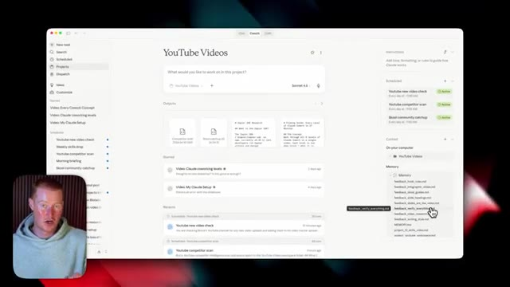
*⏱️ 00:07:40 — Affichage de la section mémoire (Memory) dans l'interface de Claude, listant les différents fichiers de configuration et de règles enregistrés pour le projet.*

---

### ⏱️ `[00:07:48 - 00:08:24]` | Segment #16

**🔊 Audio (Transcription Intégrale Mot pour Mot en Français) :**
> Voici la transcription et traduction française intégrale et naturelle de ce segment :

C'est la fenêtre de contexte. Je veux que vous pensiez à la fenêtre de contexte comme à un bureau pour chaque conversation que vous avez avec Claude. Vous ne pouvez faire tenir qu'une certaine quantité de choses sur ce bureau et en ce moment, vous pouvez faire tenir jusqu'à 1 million de jetons, ce qui est fondamentalement ainsi que cela s'appelle. Et les éléments qui se trouvent à l'intérieur de la fenêtre de contexte sont des choses comme le document ClaudeMD, les fichiers de mémoire, les instructions système, toute conversation qui entre et sort de Claude, les différents fichiers et documents que nous y avons, et les différentes sorties d'outils que nous utilisons au sein de notre conversation. Donc, en ce moment, nous avons une fenêtre de 1 million de jetons. Cela va probablement augmenter avec le temps, mais vous rencontrerez probablement des problèmes si vous

**👁️ Analyse Visuelle d'Écran (gemini-3.5-flash-lite) :**
**Interface & Outils** : Navigateur web affichant une diapositive de présentation pédagogique.

**Contenu textuel & Code** : Schémas et texte détaillant 'The Context Window' avec 1M de tokens, Instructions, Conversation, Files & Docs et Tool Output.

**Action / Démonstration** : Le présentateur explique visuellement le concept de la fenêtre de contexte de Claude à l'aide d'une diapositive de présentation.

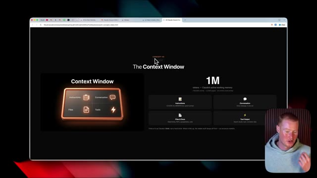
*⏱️ 00:08:06 — Une diapositive de présentation web intitulée 'The Context Window' avec des schémas explicatifs sur la mémoire de travail de Claude et les 1 million de tokens.*

---

### ⏱️ `[00:08:24 - 00:08:59]` | Segment #17

**🔊 Audio (Transcription Intégrale Mot pour Mot en Français) :**
> en faisant des allers-retours avec Claude pendant pas mal de temps, où on va devoir condenser cette fenêtre de contexte et on va devoir en quelque sorte éliminer certaines informations non pertinentes afin de l'actualiser. Passons au concept numéro six, et il s'agit du multimodal. Si vous vous intéressez à l'intelligence artificielle depuis un petit moment, vous avez probablement entendu cela. Pour moi, c'était confus au début. Ça avait l'air super complexe, mais ça ne l'est vraiment pas. C'est tout simplement l'ensemble des éléments que les grands modèles de langage et plus particulièrement Claude peuvent voir. Pensez donc à des choses comme des images, des captures d'écran, des graphiques, des PDF, différents textes que vous fournissez à tous ces différents éléments et la vidéo serait une autre option mais ce n'est en fait pas une entrée

**👁️ Analyse Visuelle d'Écran (gemini-3.5-flash-lite) :**
**Interface & Outils** : Navigateur web affichant une présentation de concepts sur l'intelligence artificielle.

**Contenu textuel & Code** : Schéma et texte explicatif sur la fenêtre de contexte ("The Context Window"), montrant les différents éléments de la mémoire de travail de Claude (Instructions, Conversation, Files & Docs, Tool Output) et la capacité de 1 million de tokens.

**Action / Démonstration** : Le présentateur explique le fonctionnement de la fenêtre de contexte et la gestion de la mémoire active de l'IA.

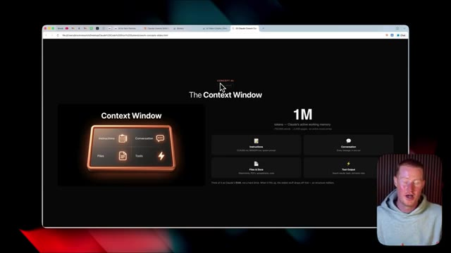
*⏱️ 00:08:33 — Capture d'écran montrant une page web de présentation intitulée "The Context Window" avec une illustration graphique des composants de la mémoire active (Instructions, Conversation, Files, Tools) et la mention "1M tokens".*

---

### ⏱️ `[00:08:59 - 00:09:34]` | Segment #18

**🔊 Audio (Transcription Intégrale Mot pour Mot en Français) :**
> format que Claude est réellement capable de voir. Donc quand les gens disent que Claude est multimodal, cela signifie simplement qu'il peut lire des fichiers, qu'il peut voir du texte à l'écran, et qu'il peut même voir différentes images que vous téléchargez. Ensuite, en passant au concept numéro sept, celui-ci est assez explicite mais il s'appelle la recherche web. Donc c'est fondamentalement ainsi que Claude est capable de rechercher sur le web différentes informations en direct. Donc à l'heure actuelle, la limite des connaissances pour Claude est mai 2025. Donc il ne connaît pas les différentes sorties de nouveaux outils d'IA ou les différents tarifs actuels pour des modèles spécifiques, différentes choses de ce genre. Il doit donc réellement utiliser l'outil de recherche web. Et c'est là qu'il est capable

**👁️ Analyse Visuelle d'Écran (gemini-3.5-flash-lite) :**
**Interface & Outils** : Navigateur web affichant une page de présentation de type slide.

**Contenu textuel & Code** : Texte et illustrations expliquant que Claude peut analyser des captures d'écran, des PDF, des photos et des graphiques.

**Action / Démonstration** : Le présentateur explique les fonctionnalités multimodales et la capacité de Claude à interpréter différents formats visuels.

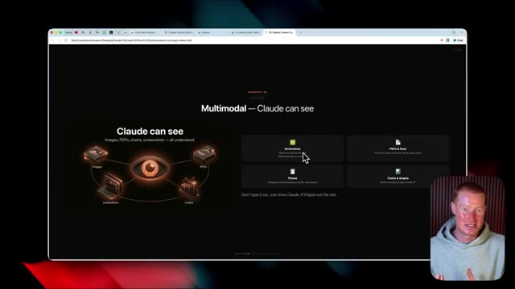
*⏱️ 00:09:08 — Capture d'écran montrant une présentation web sur les capacités multimodales de l'IA Claude avec le titre 'Multimodal — Claude can see'.*

---

### ⏱️ `[00:09:34 - 00:10:07]` | Segment #19

**🔊 Audio (Transcription Intégrale Mot pour Mot en Français) :**
> pour aller chercher, extraire et trouver différentes informations sur Internet, récupérer différents articles, toutes ces choses différentes. C'est vraiment simple. C'est le concept de recherche sur le web. Maintenant, passant au concept numéro huit, nous avons la réflexion approfondie, et c'est là que Claude peut réfléchir à des problèmes plus complexes et accomplir des tâches plus complexes pour vous. C'est aussi simple que de poser une question difficile. Claude y réfléchira très profondément, fera des allers-retours, méditera dessus, prendra un peu plus de temps, mais il en ressortira avec une meilleure réponse. Pensez-y comme si vous demandiez à quelqu'un de prendre son temps. Il va simplement mieux accomplir la tâche, mais cela prendra évidemment plus

**👁️ Analyse Visuelle d'Écran (gemini-3.5-flash-lite) :**
**Interface & Outils** : Navigateur web affichant une diapositive de présentation sur Claude et l'IA.

**Contenu textuel & Code** : Texte "Extended Thinking", "Claude thinks before answering" et graphiques explicatifs comparant les réponses normales et approfondies.
[DESC_IMAGE_2] Le présentateur commente la diapositive introduisant le concept numéro 8 sur la réflexion approfondie de l'IA.

**Action / Démonstration** : Explications face caméra et analyse conceptuelle des marchés.

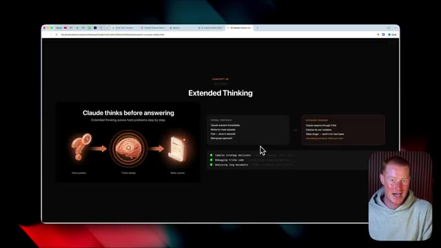
*⏱️ 00:09:51 — Une diapositive de présentation sur fond sombre intitulée "Extended Thinking" expliquant comment Claude réfléchit avant de répondre, avec le présentateur incrusté en bas à droite.*

---

### ⏱️ `[00:10:07 - 00:10:33]` | Segment #20

**🔊 Audio (Transcription Intégrale Mot pour Mot en Français) :**
> le moment est venu pour eux de donner une réponse ou de faire quelque chose. Passons au concept numéro neuf, et j'adore absolument ce concept. Il s'agit des artefacts. Un artefact est donc fondamentalement un résultat généré à l'intérieur de Claude qui n'est pas seulement du texte. Si vous avez déjà discuté avec ChatGPT, il répondra simplement avec des paragraphes et des paragraphes de texte. Alors qu'un artefact est un résultat tel qu'un tableau de bord HTML, un graphique ou un visuel, quelque chose de ce genre, que vous pouvez réellement voir à l'intérieur de Claude.

**👁️ Analyse Visuelle d'Écran (gemini-3.5-flash-lite) :**
**Interface & Outils** : Navigateur web affichant une page de présentation/diaporama interactif.

**Contenu textuel & Code** : Texte de présentation sur les "Artifacts" de Claude avec quatre catégories illustrées sous forme de blocs : HTML Tools, React Components, Charts & Visuals, Documents, et la mention "This slideshow is an artifact. Claude built it from scratch in a single session."

**Action / Démonstration** : Présentation visuelle du concept numéro neuf (les artefacts) par le présentateur visible en incrustation vidéo dans le coin inférieur droit.

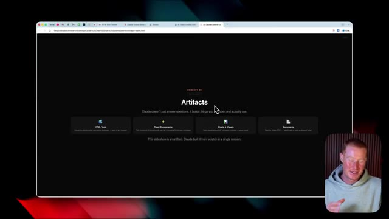
*⏱️ 00:10:13 — Capture d'écran montrant une interface de présentation web avec le titre "Artifacts" et des exemples de composants générés par Claude (HTML Tools, React Components, Charts & Visuals, Documents).*

---

### ⏱️ `[00:10:34 - 00:11:06]` | Segment #21

**🔊 Audio (Transcription Intégrale Mot pour Mot en Français) :**
> Et si je reviens à co-work, vous pouvez voir que j'ai cette conversation ici. Et si je fais apparaître ceci, il s'agit d'une ventilation sous forme de tableau de bord HTML de mes concurrents sur YouTube et des différentes vidéos que les gens réalisent tout au long de la journée. De cette façon, je peux voir ce qui cartonne dans le domaine de l'IA. À quoi dois-je prêter attention et essayer d'apprendre pour pouvoir le restituer à ma communauté scolaire. Ceci, ici même, est un artefact. C'est un tableau de bord HTML qu'il génère. Et si vous découvrez Claude en particulier, mais plus encore Claude co-work, le fait que nous ayons des artefacts intégrés à toutes nos conversations est tout simplement tellement incroyable. Vous allez adorer. Et la quantité des différents artefacts que vous

**👁️ Analyse Visuelle d'Écran (gemini-3.5-flash-lite) :**
**Interface & Outils** : Interface logicielle de type tableau de bord / outil d'analyse (Cowork avec rendu HTML).

**Contenu textuel & Code** : Rapport de veille concurrentielle YouTube : 21 chaînes analysées, 88 vidéos, clusters de sujets (Claude Code, Google Gemma, OpenClaw, etc.) et métriques de performance.

**Action / Démonstration** : Présentation et exploration visuelle d'un tableau de bord d'analyse concurrentielle de créateurs YouTube.

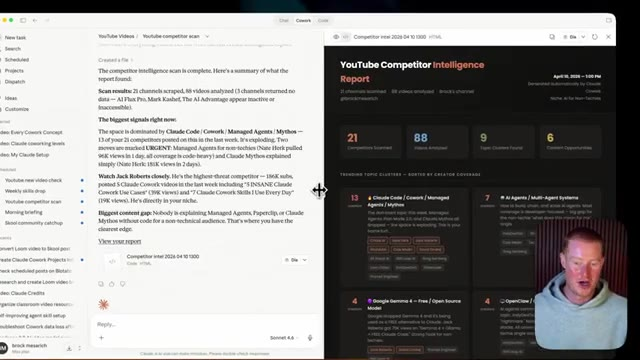
*⏱️ 00:10:42 — Interface d'une application affichant un rapport d'intelligence concurrentielle YouTube sous forme de tableau de bord HTML.*

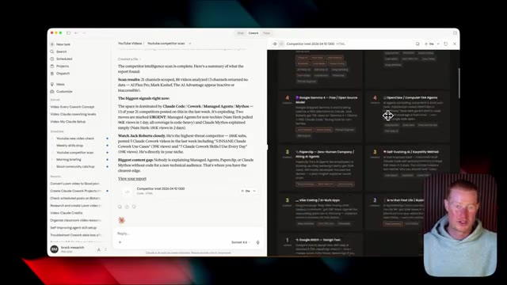
*⏱️ 00:10:58 — Vue défilée du même tableau de bord HTML montrant des analyses de contenu sur les concurrents et tendances YouTube.*

---

### ⏱️ `[00:11:06 - 00:11:41]` | Segment #22

**🔊 Audio (Transcription Intégrale Mot pour Mot en Français) :**
> créer sont en fait assez époustouflants ce diaporama que vous voyez les gars en fait dans cette vidéo est un artefact vous pouvez voir je l'ai créé à l'intérieur de Claude Co-work et vous pouvez voir sur le côté droit notre artefact ici et nous pourrions même l'ouvrir dans notre navigateur et le visionner c'est fondamentalement ce qu'est un artefact très bien donc ensuite et c'est là que les choses deviennent vraiment intéressantes et passionnantes parce que cela pourrait affiner la façon dont nous utilisons Claude Co-work donc au lieu de l'utiliser simplement très simplement ce sont des astuces et des conseils que vous pouvez utiliser pour être un utilisateur avancé donc notre concept suivant est les projets. Pensez donc à ceux-ci comme à des cerveaux séparés à l'intérieur d'un espace de travail spécifique. Donc chaque projet

**👁️ Analyse Visuelle d'Écran (gemini-3.5-flash-lite) :**
**Interface & Outils** : Claude Co-work, navigateur web, interface de présentation de diapositives HTML.

**Contenu textuel & Code** : Code source textuel, prompts pour la génération d'images, concepts de structure de fichiers (CLAUDE.md) et organisation de projets par dossiers ("Separate brains. One workspace").

**Action / Démonstration** : Présentation et démonstration de l'interface et des artefacts générés par l'IA dans Claude Co-work.

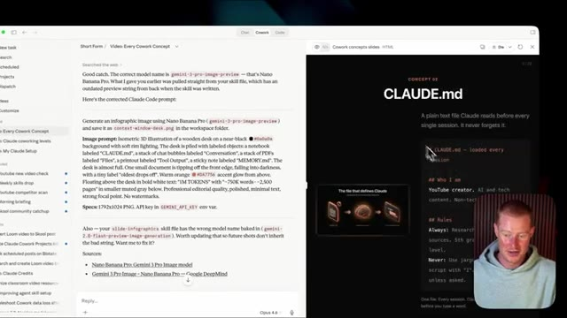
*⏱️ 00:11:15 — Interface divisée en deux montrant à gauche un éditeur de texte/code et à droite une présentation de diapositives avec le titre "CLAUDE.md".*

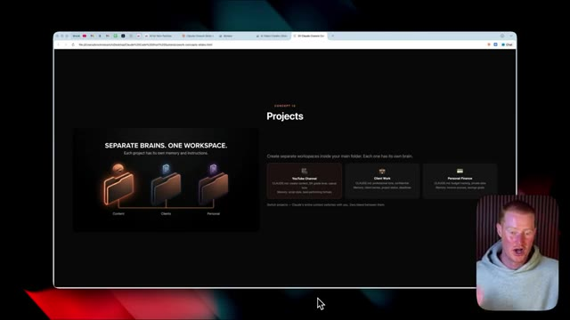
*⏱️ 00:11:32 — Vue en plein écran d'une page web de présentation avec le titre "Projects" et l'illustration graphique de dossiers séparés.*

---

### ⏱️ `[00:11:41 - 00:12:04]` | Segment #23

**🔊 Audio (Transcription Intégrale Mot pour Mot en Français) :**
> possède sa propre mémoire, ses propres instructions et ses propres conversations directement à l'intérieur de co-work. Donc, pour vous montrer ce que je veux dire, laissez-moi revenir à mon co-work ici. Et si je viens sur le côté gauche, nous allons voir des projets dans notre compte. Et j'ai quelques projets différents ici. J'ai short form, j'ai school community, loom agency et YouTube videos. Et si j'ouvre mon projet YouTube videos, il y a plusieurs choses différentes que nous pouvons voir ici.

**👁️ Analyse Visuelle d'Écran (gemini-3.5-flash-lite) :**
**Interface & Outils** : Application de bureau Co-work (interface de gestion de projets d'IA)

**Contenu textuel & Code** : Liste des projets enregistrés dans le compte utilisateur : 'Short Form', 'Skool Community', 'Luume Agency', et 'YouTube Videos' avec leurs chemins de fichiers respectifs.

**Action / Démonstration** : Le présentateur clique sur l'onglet 'Projects' dans le menu latéral pour afficher la liste des projets dans l'interface co-work.

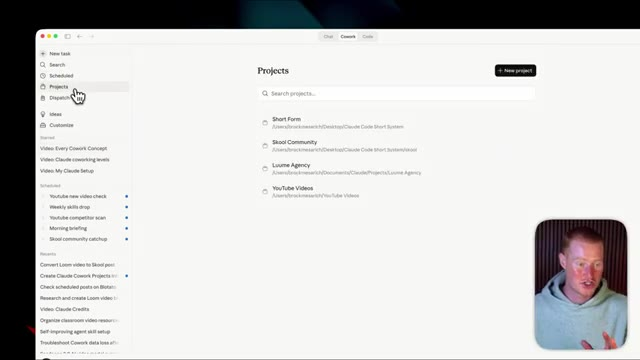
*⏱️ 00:11:52 — Vue de l'interface du logiciel co-work montrant la section 'Projects' avec la liste des dossiers de projets.*

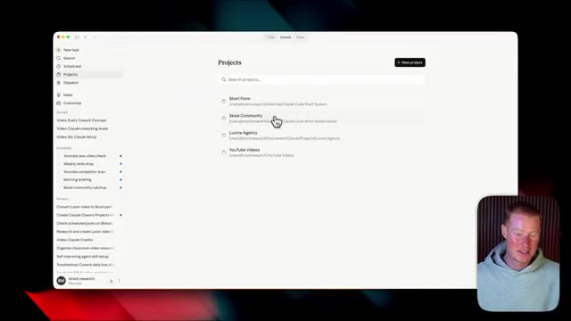
*⏱️ 00:11:58 — Vue similaire de l'interface co-work sur la section 'Projects' au moment où le curseur survole un projet.*

---

### ⏱️ `[00:12:04 - 00:12:23]` | Segment #24

**🔊 Audio (Transcription Intégrale Mot pour Mot en Français) :**
> Donc nous avons notre fenêtre de discussion normale ici où nous pouvons faire des allers-retours avec cowork. Nous avons nos sorties, qui sont fondamentalement les artéfacts que je viens d'aborder. J'ai donc affiché, vous pouvez voir que nous avons notre artéfact d'intelligence compétitive YouTube qui a été généré automatiquement, ainsi que l'ensemble de nos différentes tâches et conversations au sein de notre projet de vidéos YouTube.

**👁️ Analyse Visuelle d'Écran (gemini-3.5-flash-lite) :**
**Interface & Outils** : Interface logicielle de type espace de travail IA / Cowork avec panneau de discussion et gestionnaire de projets.

**Contenu textuel & Code** : Artéfacts de sortie, rapports d'intelligence compétitive, indicateurs de chaînes YouTube et rubriques de planification.

**Action / Démonstration** : Navigation et affichage d'un artéfact de rapport d'intelligence concurrentielle dans l'interface de travail.

*⏱️ 00:12:09 — Interface principale montrant un projet nommé "YouTube Videos" avec la zone de discussion et les artéfacts de sortie.*

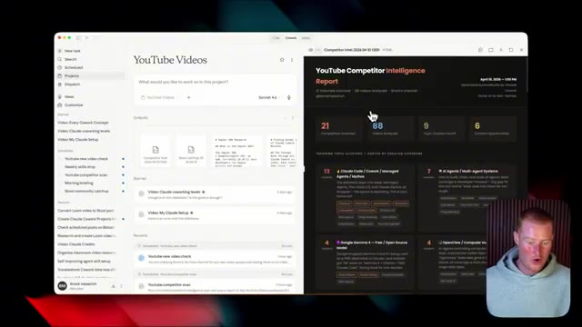
*⏱️ 00:12:18 — L'interface se sépare en deux pour afficher l'artéfact d'intelligence compétitive YouTube généré dans un panneau latéral.*

---

### ⏱️ `[00:12:23 - 00:12:58]` | Segment #25

**🔊 Audio (Transcription Intégrale Mot pour Mot en Français) :**
> Et sur le côté droit, nous avons des instructions spécifiques pour ce projet ou cet écosystème. Et ensuite, nous avons même des tâches planifiées ici que nous faisons tourner, dont je vais parler plus tard dans cette vidéo pour des tâches liées aux vidéos YouTube. Et ensuite, nous avons même tous nos fichiers à l'intérieur de ce projet de vidéo YouTube ici. Donc, pensez à cela comme à une manière plus organisée d'utiliser coworker. Donc, si vous avez une catégorie spécifique que vous voulez garder séparée de votre vie personnelle ou de votre entreprise, je vous suggère d'en faire un projet. Vous pouvez voir que j'ai un projet qui est pour les vidéos YouTube. J'en ai un qui est pour ma communauté scolaire.

**👁️ Analyse Visuelle d'Écran (gemini-3.5-flash-lite) :**
**Interface & Outils** : Interface logicielle de type espace de travail / gestion de projet (Cowork).

**Contenu textuel & Code** : Panneaux de configuration du projet, instructions spécifiques, tâches planifiées telles que "Youtube new video check" et "Youtube competitor scan".

**Action / Démonstration** : Navigation et présentation de l'interface de gestion des tâches planifiées dans l'écosystème d'IA.

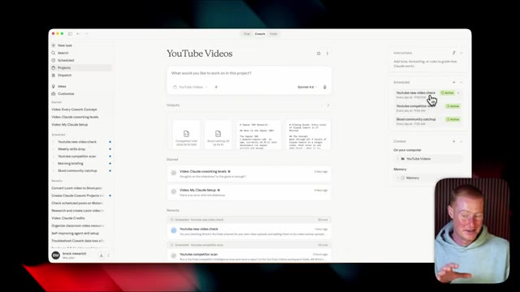
*⏱️ 00:12:32 — Capture d'écran montrant l'interface d'un outil d'IA de type espace de travail (Cowork) centré sur le projet YouTube Videos, avec un panneau latéral droit affichant des tâches planifiées.*

---

### ⏱️ `[00:12:58 - 00:13:18]` | Segment #26

**🔊 Audio (Transcription Intégrale Mot pour Mot en Français) :**
> Donc absolument tout ce qui concerne la communauté scolaire se trouve à l'intérieur d'ici. Toutes mes tâches planifiées, tous mes fichiers, et j'ai une mémoire spécifique sur l'école. Donc il comprend tout ce qu'il a besoin de savoir sur ma communauté scolaire. Donc afin de créer un projet, vous pouvez faire plusieurs choses différentes. Donc vous pouvez venir sur nouvelle tâche puis sélectionner le sélecteur de dossier ici.

**👁️ Analyse Visuelle d'Écran (gemini-3.5-flash-lite) :**
**Interface & Outils** : Application de gestion de projet / Cowork (interface web/bureau).

**Contenu textuel & Code** : Listes de tâches planifiées, sections de mémoire contextuelle et barres de saisie de requêtes.

**Action / Démonstration** : Navigation et présentation de la structure des projets de la communauté scolaire.

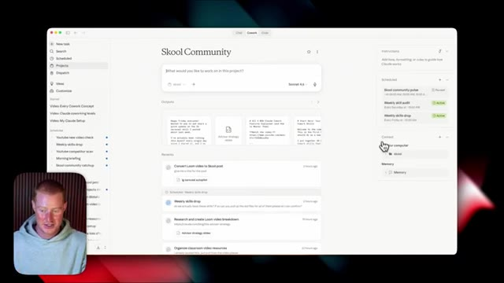
*⏱️ 00:13:03 — Interface d'un espace de projet "Skool Community" montrant les tâches planifiées et le contenu associé.*

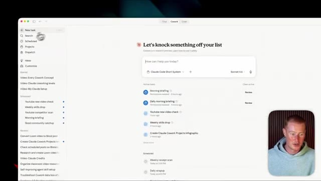
*⏱️ 00:13:13 — Interface principale de l'outil montrant la liste des tâches et des options de discussion.*

---

### ⏱️ `[00:13:19 - 00:13:46]` | Segment #27

**🔊 Audio (Transcription Intégrale Mot pour Mot en Français) :**
> Et vous pouvez descendre et sélectionner un projet. Vous pouvez voir que nous pouvons créer un nouveau projet également. Ou nous pourrions tout simplement cliquer sur projets ici. Venir sur un projet, commencer à converser ici même, ou nous pourrions prendre une conversation existante que nous avons, venir ici, et ensuite nous pourrions aussi déplacer cela vers un projet également. Et c'est juste une façon de rester beaucoup plus organisé pour que tout ne se mélange pas, parce que si vous venez ici, toutes ces discussions peuvent devenir accablantes et c'est vraiment bien de les catégoriser et de les diviser.

**👁️ Analyse Visuelle d'Écran (gemini-3.5-flash-lite) :**
**Interface & Outils** : Interface logicielle de gestion de projets et d'agents IA (type Cowork / Claude Cowork).

**Contenu textuel & Code** : Liste des projets (Short Form, Skool Community, Luume Agency, YouTube Videos) et suggestions de titres générées par l'IA pour un post ("Instagram Carousel Update", etc.).

**Action / Démonstration** : Navigation à travers les différents projets et sélection d'une conversation existante ou d'un espace de travail.

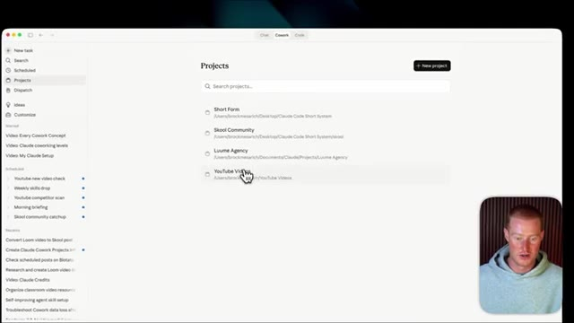
*⏱️ 00:13:25 — Vue d'ensemble de l'interface montrant la liste des projets disponibles avec un bouton pour en créer un nouveau ("New project") et un panneau latéral de navigation.*

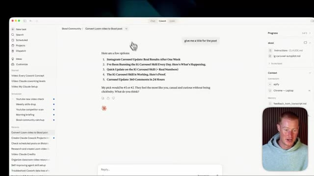
*⏱️ 00:13:32 — Affichage d'une conversation active au sein d'un projet spécifique avec des propositions de titres pour un post et des options de contexte sur le panneau latéral droit.*

---

### ⏱️ `[00:13:46 - 00:14:10]` | Segment #28

**🔊 Audio (Transcription Intégrale Mot pour Mot en Français) :**
> Ensuite, pour le concept numéro 11, nous avons l'outil bash. Et c'est fondamentalement la façon dont Claude écrit du code à l'intérieur de Cowork. Donc, au lieu que Claude nous donne du code à exécuter dans le terminal, il utilisera l'outil bash pour le faire automatiquement. Et honnêtement, vous n'avez pas vraiment besoin de comprendre ce qui se passe ici, les rouages. Comprenez simplement que c'est cela, l'outil bash. C'est fondamentalement la façon dont il vous aide à exécuter du code.

**👁️ Analyse Visuelle d'Écran (gemini-3.5-flash-lite) :**
**Interface & Outils** : Navigateur web affichant une page de présentation avec des schémas explicatifs et des graphiques.

**Contenu textuel & Code** : Texte et schémas sur le concept numéro 11 "The Bash Tool", montrant les étapes "Writes code", "Runs it" et "Real outputs" ainsi qu'une comparaison du flux de travail.

**Action / Démonstration** : Le présentateur explique le fonctionnement de l'outil bash et l'exécution automatique de code par Claude.

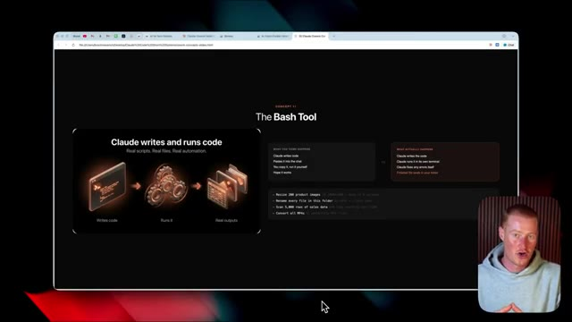
*⏱️ 00:13:52 — Capture d'écran montrant une diapositive de présentation sur le "Bash Tool" de Claude, illustrant son fonctionnement et son automatisation.*

---

### ⏱️ `[00:14:10 - 00:14:45]` | Segment #29

**🔊 Audio (Transcription Intégrale Mot pour Mot en Français) :**
> Un exemple parfait du moment où cela s'exécutera est, disons, si vous voulez redimensionner différentes images, renommer chaque fichier dans ce dossier, analyser un tas de données de ventes différentes. Toutes ces choses vont alors déclencher l'outil de traitement par lots pour ensuite écrire le code. Passons au concept numéro 12, et c'est probablement l'un des plus importants. Ce sont les compétences. Et c'est vraiment ce qui rend Cowork si puissant, beaucoup plus puissant que n'importe quel autre outil d'IA sur le marché. Pensez-y comme ceci. C'est fondamentalement une seule commande qui peut déclencher des flux de travail entiers pour vous. J'ai donc quelque chose appelé une tâche de respiration matinale qui va déclencher un flux de travail entier puis me donner un résultat spécifique. Et

**👁️ Analyse Visuelle d'Écran (gemini-3.5-flash-lite) :**
**Interface & Outils** : Navigateur web affichant une diapositive de présentation, avec une incrustation vidéo du présentateur en bas à droite.

**Contenu textuel & Code** : Liste à puces avec des exemples d'automatisation : redimensionner 200 images produits, renommer des fichiers, scanner 5000 lignes de données de ventes, convertir des fichiers MP4 en MP3.

**Action / Démonstration** : Le présentateur explique les différents cas d'usage pratiques de l'automatisation et du traitement par lots de fichiers.

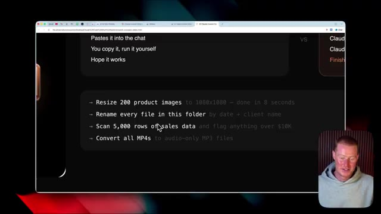
*⏱️ 00:14:19 — Une capture d'écran d'une présentation montrant des exemples de tâches automatisables (redimensionner des images, renommer des fichiers, analyser des données de ventes, convertir des MP4 en MP3).*

---

### ⏱️ `[00:14:45 - 00:15:08]` | Segment #30

**🔊 Audio (Transcription Intégrale Mot pour Mot en Français) :**
> Je vais vous montrer exactement ce que je veux dire en ce moment, ainsi que nous en avons quelques autres comme le générateur de factures, le scanner de reçus, toutes ces différentes compétences sont des flux de travail prédéterminés que Claude sait comment exécuter pour nous. Très bien. Donc, pour vous montrer exactement ce que je veux dire, j'ai une compétence ici même qui s'exécute chaque matin. Laissez-moi donc vous décomposer cela très simplement. Chaque fois que je tape simplement briefing matinal, cela va déclencher ce flux de travail où il ira.

**👁️ Analyse Visuelle d'Écran (gemini-3.5-flash-lite) :**
**Interface & Outils** : Navigateur web et interface logicielle de productivité / dashboard.

**Contenu textuel & Code** : Liste de compétences ('morning briefing', 'invoice-generator', 'youtube-to-skool', 'receipt-scanner') et logs d'exécution de tâches.

**Action / Démonstration** : Navigation et présentation des fonctionnalités automatisées de Claude par le présentateur.

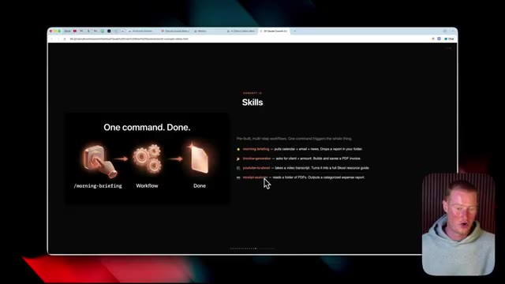
*⏱️ 00:14:50 — Interface web sombre présentant la section 'Skills' avec des flux de travail prédéterminés et le présentateur en médaillon.*

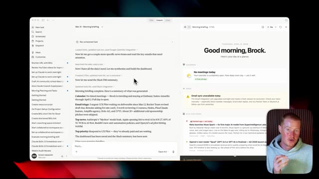
*⏱️ 00:14:56 — Interface d'une application affichant l'exécution d'une tâche de résumé matinal ('Morning briefing') et le présentateur en bas à droite.*

---

### ⏱️ `[00:15:08 - 00:15:42]` | Segment #31

**🔊 Audio (Transcription Intégrale Mot pour Mot en Français) :**
> Il va chercher dans mon agenda Google. Il va ensuite chercher dans mes e-mails. Il va ensuite chercher toutes les différentes actualités tendances sur l'IA que je devrais couvrir ou dont je devrais être au courant. Et puis il écrit même mes trois principales priorités. Et en plus de cela, il me crache ce tableau de bord HTML. Et il m'envoie même tout ce récapitulatif sur Slack à chaque fois que je le déclenche. Et vous vous demandez probablement comment cela fonctionne ? Comment on configure ça ? Laissez-moi donc vous montrer tout de suite. Alors si je viens sur personnaliser sur le côté gauche de cowork, nous allons voir des compétences juste ici. Et j'ai une tonne de compétences différentes que j'ai construites personnellement. Donc si je descends et trouve mon matin

**👁️ Analyse Visuelle d'Écran (gemini-3.5-flash-lite) :**
**Interface & Outils** : Interface application de bureau (type assistant IA / productivité).

**Contenu textuel & Code** : Résumé de briefing matinal intégrant calendrier, e-mails, actualités IA tendances et priorités de la journée.

**Action / Démonstration** : Présentation du tableau de bord de briefing matinal généré automatiquement par l'assistant IA.

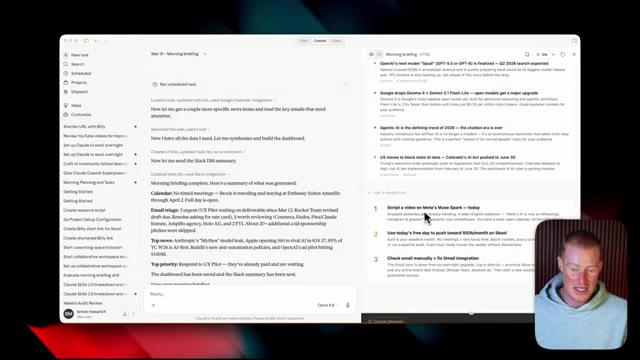
*⏱️ 00:15:16 — Interface logicielle affichant un résumé de briefing matinal généré par IA, comprenant le calendrier, le tri des e-mails, les actualités et les trois principales priorités.*

---

### ⏱️ `[00:15:42 - 00:16:01]` | Segment #32

**🔊 Audio (Transcription Intégrale Mot pour Mot en Français) :**
> compétence de briefing. Je peux cliquer dessus et cela va remplir cet ensemble d'instructions. C'est fondamentalement un fichier Markdown que vous pouvez voir décomposer tout ici. Il est donc indiqué que vous êtes un chef de cabinet personnel. Chaque matin, vous analysez le calendrier de l'utilisateur, ce qui détaille essentiellement ce qu'il faut faire. Cela détaille même le rendu spécifique que je veux pour ce tableau de bord HTML.

**👁️ Analyse Visuelle d'Écran (gemini-3.5-flash-lite) :**
**Interface & Outils** : Application de gestion de tâches et de compétences (Cowork / interface de type Notion ou outil IA personnalisé).

**Contenu textuel & Code** : Fichier Markdown de configuration nommé 'morning-briefing' avec les sections 'Calendar Overview', 'Email Summary' et 'News & Updates'.

**Action / Démonstration** : Navigation et sélection de la compétence de briefing matinal pour l'analyser et l'expliquer.

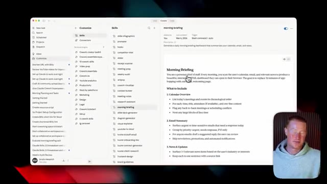
*⏱️ 00:15:47 — Interface logicielle affichant le panneau de compétences 'morning-briefing' avec le contenu du fichier markdown et le présentateur en incrustation.*

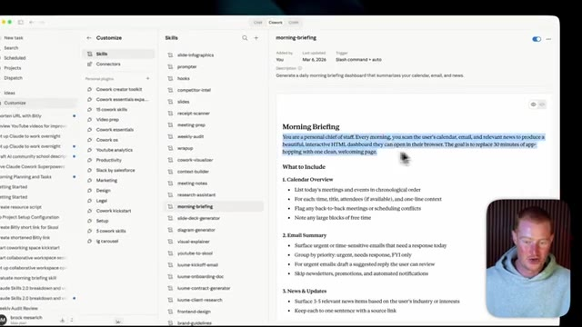
*⏱️ 00:15:56 — Vue rapprochée de l'éditeur de compétences markdown 'morning-briefing' montrant les détails des instructions pour le chef de cabinet personnel.*

---

### ⏱️ `[00:16:01 - 00:16:20]` | Segment #33

**🔊 Audio (Transcription Intégrale Mot pour Mot en Français) :**
> Donc vous pouvez voir que c'est un design de style Apple Swiss. Je pourrais changer cela si je le voulais, mais l'élément clé ici, c'est que ce sera généré comme ça dans ce style tous les jours lorsque je le déclencherai. C'est donc juste comme un ensemble prédéfini d'instructions. De cette façon, je peux faire en sorte que ce flux de travail s'exécute à chaque fois que je le déclenche et il fonctionnera exactement de la même manière à chaque fois.

**👁️ Analyse Visuelle d'Écran (gemini-3.5-flash-lite) :**
**Interface & Outils** : Application de gestion de tâches et de compétences avec interface de configuration textuelle.

**Contenu textuel & Code** : Instructions pour générer un tableau de bord HTML avec des spécifications de design (Apple Swiss Style, couleurs, polices).

**Action / Démonstration** : Le présentateur explique la configuration d'un modèle d'instructions prédéfini pour automatiser la génération de designs.

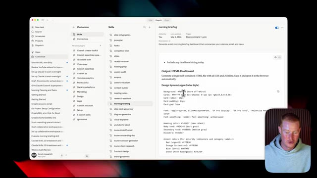
*⏱️ 00:16:06 — Capture montrant l'interface d'une application avec un éditeur de prompt/instructions et un design système défini (Apple Swiss Style).*

---

### ⏱️ `[00:16:20 - 00:16:55]` | Segment #34

**🔊 Audio (Transcription Intégrale Mot pour Mot en Français) :**
> Et si vous êtes intéressés par l'ensemble des 50 compétences que j'utilise tous les jours au sein de mon entreprise, il y aura un lien dans la description pour rejoindre ma communauté School où je vous tiens au courant chaque semaine de toutes les compétences que j'utilise personnellement et auxquelles vous pouvez accéder et télécharger. Quelques-unes des différentes compétences que j'ai et qui pourraient vous intéresser sont le générateur de propositions, la révision de contrats, le générateur de factures, et des tonnes d'autres dans différentes catégories que vous pouvez commencer à utiliser et à intégrer directement dans Cowork et à utiliser immédiatement. Très bien. Donc, concept numéro 13, et cela s'inscrit dans la continuité des compétences dont nous venons de parler. Et ce sont

**👁️ Analyse Visuelle d'Écran (gemini-3.5-flash-lite) :**
**Interface & Outils** : Navigateur web affichant une interface de tableau de bord de compétences et de workflows.

**Contenu textuel & Code** : Cartes de compétences classées par catégories (Business, System & Tools) et boutons d'appel à l'action.

**Action / Démonstration** : Présentation des différentes compétences disponibles dans sa communauté en faisant défiler l'interface web.

*⏱️ 00:16:38 — Une page web affichant une liste de compétences professionnelles sous forme de cartes claires (Proposal Generator, Email Drafter, Contract Reviewer, etc.).*

*⏱️ 00:16:46 — La suite de la page web montrant d'autres outils et systèmes (Context Builder, Weekly Audit, etc.) avec un appel à l'action pour rejoindre la communauté "Skool".*

---

### ⏱️ `[00:16:55 - 00:17:22]` | Segment #35

**🔊 Audio (Transcription Intégrale Mot pour Mot en Français) :**
> les commandes barre oblique. Une commande barre oblique, c'est en gros, pensez-y comme un mot déclencheur qui va ensuite déclencher une compétence spécifique, qui est en gros ce flux de travail. Donc je donne juste la commande barre oblique briefing matinal et cela exécute automatiquement ce flux de travail ou cette compétence pour moi. Cela peut sembler compliqué quand vous entendez les mots commandes barre oblique, mais c'est aussi simple qu'un simple mot-clé pour ensuite déclencher un flux de travail. Passons au concept numéro 14 à l'intérieur de Claude Cowork et ce sont les plugins.

**👁️ Analyse Visuelle d'Écran (gemini-3.5-flash-lite) :**
**Interface & Outils** : Navigateur web affichant une diapositive de présentation sur les commandes barre oblique.

**Contenu textuel & Code** : Texte et schémas expliquant les commandes barre oblique ('One word. Full workflow') avec des exemples de commandes comme `/script`, `/morning`, `/hooks`, `/graphic`, et `/batch`.

**Action / Démonstration** : Le présentateur explique le fonctionnement des commandes barre oblique et comment elles déclenchent des flux de travail automatisés.

*⏱️ 00:17:01 — Présentation à l'écran montrant le concept des commandes barre oblique ('Slash Commands') avec un schéma explicatif et des exemples de scripts.*

---

### ⏱️ `[00:17:22 - 00:17:42]` | Segment #36

**🔊 Audio (Transcription Intégrale Mot pour Mot en Français) :**
> En gros, ce qu'est un plugin, j'ai eu beaucoup de gens qui m'ont demandé, du genre : Brock, c'est quoi la différence entre un plugin et une compétence ? Quand est-ce que je dois utiliser l'un ou l'autre ? Et pour résumer ça très simplement, les plugins sont fondamentalement juste un ensemble de compétences regroupées qui font qu'il est très facile pour vous de les partager avec des coéquipiers ou avec un ami, par exemple, et pour vous de les télécharger dans Cowork.

**👁️ Analyse Visuelle d'Écran (gemini-3.5-flash-lite) :**
**Interface & Outils** : Navigateur web affichant une interface de présentation de concepts avec des cartes interactives (Creator Toolkit, Essentials Pack, Cowork OS).

**Contenu textuel & Code** : Texte explicatif : "Bundles of skills you install in one click. Each plugin adds a whole new set of capabilities." et des options de workflow (Marketplace, Install One click, New Skills).

**Action / Démonstration** : Présentation visuelle de la définition et du fonctionnement des plugins par rapport aux compétences individuelles.

*⏱️ 00:17:27 — Capture d'écran montrant une page web intitulée "Plugins" avec une icône de prise électrique, expliquant qu'il s'agit de packs de compétences installables en un clic.*

---

### ⏱️ `[00:17:42 - 00:18:02]` | Segment #37

**🔊 Audio (Transcription Intégrale Mot pour Mot en Français) :**
> De cette façon, vous n'avez pas à créer individuellement 50 compétences ou à télécharger ces 50 compétences vous-même. Donc, par exemple, toutes ces 50 compétences que je montre au sein de ma communauté scolaire, vous pourriez télécharger ce plugin ici et les télécharger automatiquement dans Cowork et vous les aurez toutes de disponible. Donc, pour faire cela, ce que vous feriez, c'est simplement enregistrer ce fichier zip ici.

**👁️ Analyse Visuelle d'Écran (gemini-3.5-flash-lite) :**
**Interface & Outils** : Navigateur web affichant une interface personnalisée de ressources et de compétences Claude Cowork.

**Contenu textuel & Code** : Page affichant "50 Skills" et "9 Categories", avec des blocs de compétences tels que Hook Generator, Teleprompter, YouTube Description, et un menu de téléchargements récents.

**Action / Démonstration** : Présentation et navigation sur une page web de ressources regroupant toutes les compétences utilisées quotidiennement.

*⏱️ 00:17:52 — Une page web intitulée "Every Skill & Resource Brock Uses Every Day" avec le panneau des téléchargements récents visibles à droite.*

*⏱️ 00:17:57 — La même page web affichant les différentes catégories de compétences de Claude Cowork, avec la vidéo du présentateur incrustée en bas à droite.*

---

### ⏱️ `[00:18:02 - 00:18:23]` | Segment #38

**🔊 Audio (Transcription Intégrale Mot pour Mot en Français) :**
> Vous veniez pour travailler en co-working et vous pouvez voir ici que nous avons un groupe de différents plugins. Nous pourrions parcourir les plugins. Ce sont des plugins qu'Anthropic possède déjà. Nous en avons donc pour le design, nous avons le marketing juridique. Tous ceux-ci, ce sont fondamentalement juste un ensemble de différentes compétences pour différentes industries. Et si vous voulez ajouter votre propre plugin, vous pouvez simplement venir ici, cliquer sur personnel, cliquer sur télécharger le plugin.

**👁️ Analyse Visuelle d'Écran (gemini-3.5-flash-lite) :**
**Interface & Outils** : Interface de gestion de plugins (Directory) dans l'application ou l'environnement de travail d'Anthropic.

**Contenu textuel & Code** : Liste des plugins catégorisés (Productivity, Design, Marketing, Legal, Slack par Salesforce, Data, Engineering, Finance, Product management, Operations, Sales, Brand voice) avec leurs métriques et descriptions.

**Action / Démonstration** : Navigation et exploration des différents plugins et catégories disponibles dans le répertoire d'Anthropic.

*⏱️ 00:18:07 — Fenêtre de répertoire affichant les plugins disponibles d'Anthropic & Partners, avec des catégories telles que Productivity, Design, Marketing et Legal.*

*⏱️ 00:18:13 — Vue similaire du répertoire de plugins montrant la sélection de la catégorie Marketing.*

*⏱️ 00:18:18 — Clic sur l'onglet "Personal" dans le répertoire de plugins pour afficher les téléversements locaux.*

---

### ⏱️ `[00:18:23 - 00:18:42]` | Segment #39

**🔊 Audio (Transcription Intégrale Mot pour Mot en Français) :**
> Et ensuite, je glisserais simplement ce fichier zip ici et je le téléchargerais. Et ensuite, toutes ces 50 compétences que je viens de mentionner se trouvant alors à l'intérieur de ce plugin. Pour vous en montrer un que j'ai téléchargé, il y a celui-ci, juridique, qu'Anthropic a créé. Et en gros, il y a quelques compétences différentes ici. Je pourrais cliquer sur toutes. Et il y a celui-ci de révision de contrat que j'utilise en fait pas mal.

**👁️ Analyse Visuelle d'Écran (gemini-3.5-flash-lite) :**
**Interface & Outils** : Interface de gestion de plugins et de personnalisation (type espace de travail IA / Claude Cowork).

**Contenu textuel & Code** : Liste de modules de compétences (Skills), plugins téléchargés localement, fiches descriptives pour des usages juridiques (revue de contrats, conformité RGPD, gestion des risques).
[DESC_IMAGE_3] Navigation et consultation des différentes fonctionnalités et compétences juridiques proposées par le plugin d'Anthropic.

**Action / Démonstration** : Explications face caméra et analyse conceptuelle des marchés.

*⏱️ 00:18:28 — Vue d'un répertoire de plugins (Directory) listant divers modules et outils personnels (Cowork creator toolkit, Video prep, YouTube analytics, etc.).*

*⏱️ 00:18:33 — Interface de configuration du plugin "Legal" créé par Anthropic, montrant différentes compétences juridiques disponibles et des exemples de requêtes.*

*⏱️ 00:18:37 — Suite de la liste des compétences et fonctionnalités incluses dans le plugin "Legal" (analyse de contrats, conformité, gestion des risques).*

---

### ⏱️ `[00:18:42 - 00:19:05]` | Segment #40

**🔊 Audio (Transcription Intégrale Mot pour Mot en Français) :**
> Et fondamentalement, je pourrais télécharger le PDF d'un contrat spécifique et il l'examinera automatiquement ainsi que signalera en rouge les points spécifiques que je dois négocier afin, pour ainsi dire, de signer réellement ce contrat. Très bien, alors passons au concept numéro 15, et il s'agit des connecteurs. C'est ici que les choses se concrétisent vraiment, sans jeu de mots, et c'est là que nous connectons simplement toutes nos applications pour travailler ensemble afin qu'elles puissent accomplir des tâches pour nous.

**👁️ Analyse Visuelle d'Écran (gemini-3.5-flash-lite) :**
**Interface & Outils** : Application Claude / Cowork Desktop, navigateur web Google Chrome.

**Contenu textuel & Code** : Directives du prompt "Contract Review Skill", règles d'examen des clauses juridiques, diapositives sur les connecteurs d'applications (MCP - Model Context Protocol).

**Action / Démonstration** : Démonstration de la configuration d'un agent IA pour réviser automatiquement des contrats, suivie d'une transition vers le concept des connecteurs applicatifs.

*⏱️ 00:18:48 — Interface de l'application Claude / Cowork affichant les paramètres et instructions de la compétence d'analyse de contrats ("contract-review").*

*⏱️ 00:18:54 — Presentation HTML du "Concept 15 : Connectors" montrant les liaisons entre Claude et des applications externes (Gmail, Slack, Notion, Stripe).*

---

### ⏱️ `[00:19:05 - 00:19:27]` | Segment #41

**🔊 Audio (Transcription Intégrale Mot pour Mot en Français) :**
> Comme je l'ai mentionné dans ma compétence de pointage matinal que j'ai, elle extrait des informations de mon e-mail, de mon Google Agenda, et elle publie sur Slack. La façon dont elle parvient à faire cela, c'est grâce à des connecteurs. Donc, pour utiliser des connecteurs, ce que vous allez faire, c'est que vous allez venir cliquer sur Personnaliser. À partir d'ici, sous Compétences, nous allons voir ce bouton Connecteurs et il est très simple d'ajouter nos différentes applications.

**👁️ Analyse Visuelle d'Écran (gemini-3.5-flash-lite) :**
**Interface & Outils** : Navigateur web affichant une page explicative sur les connecteurs et interface logicielle Claude Cowork.

**Contenu textuel & Code** : Schéma d'intégration des applications (Gmail, Slack, Notion, Stripe) autour d'un cerveau central et liste de tâches "Morning briefing", "YouTube new video check".

**Action / Démonstration** : Le présentateur explique comment les connecteurs permettent à l'IA d'interagir avec divers services et applications de productivité.

*⏱️ 00:19:11 — Page web présentant le concept de connecteurs avec Claude (Claude connects your apps) et l'intégration de différents outils.*

*⏱️ 00:19:16 — Interface de l'application Claude Cowork montrant le champ de saisie, les tâches planifiées et les options de compétences.*

---

### ⏱️ `[00:19:27 - 00:20:03]` | Segment #42

**🔊 Audio (Transcription Intégrale Mot pour Mot en Français) :**
> Vous pouvez voir que j'en ai ajouté quelques-uns ici. En gros, je pourrais venir ici, cliquer sur parcourir les connecteurs, et on pourrait en gros ajouter n'importe laquelle de ces différentes applications ici. Il y en a plein qu'Anthropic nous fournit en fait. Donc par exemple, on pourrait ajouter LegalZoom, PlayMCP, Intuit, QuickBooks, Gusto, des tonnes de choses différentes auxquelles vous pouvez vous connecter à l'intérieur de Claude. Maintenant, disons qu'il y a une application à laquelle vous voulez vous connecter qui n'est pas dans cette liste que Claude et Anthropic vous proposent. Je vais vous montrer une astuce dès maintenant qui vous permettra en gros de vous connecter à différentes applications qui ne sont pas là-dedans. Donc personnellement, j'utilise quelque chose qui s'appelle Zapier MCP, mais vous pourriez vraiment utiliser n'importe quel serveur MCP.

**👁️ Analyse Visuelle d'Écran (gemini-3.5-flash-lite) :**
**Interface & Outils** : Interface de gestion des connecteurs d'applications.

**Contenu textuel & Code** : Liste des connecteurs disponibles (LSEG, Lumin, MailerLite, Make, etc.).

**Action / Démonstration** : Navigation et présentation du répertoire des connecteurs d'applications.

*⏱️ 00:19:36 — Une fenêtre de répertoire montrant l'interface de sélection des connecteurs et applications partenaires.*

---

### ⏱️ `[00:20:03 - 00:20:24]` | Segment #43

**🔊 Audio (Transcription Intégrale Mot pour Mot en Français) :**
> Et ce que je vais faire, c'est que je vais simplement cliquer sur « commencer à créer » ici. Si vous avez déjà un compte, c'est parfait. Sinon, assurez-vous de vous inscrire. Et c'est vraiment seulement s'il y a des applications auxquelles vous voulez vous connecter qui ne sont pas dans Claude. Sinon, vous n'avez pas vraiment nécessairement besoin d'utiliser ceci. La première chose que vous allez faire, c'est d'aller sur le côté gauche et de cliquer sur « nouveau serveur MCP ». Vous allez cliquer sur « Claude Cowork » comme client.

**👁️ Analyse Visuelle d'Écran (gemini-3.5-flash-lite) :**
**Interface & Outils** : Navigateur web affichant la page de connexion officielle de la plateforme d'automatisation Zapier.

**Contenu textuel & Code** : Formulaire de connexion avec des champs pour l'e-mail et le mot de passe, ainsi que des boutons de connexion rapide.

**Action / Démonstration** : Saisie des identifiants utilisateur pour accéder au compte et configurer les intégrations d'applications.

*⏱️ 00:20:08 — Page de connexion de Zapier avec un champ d'adresse e-mail pré-rempli et des options de connexion via SSO ou réseaux sociaux.*

*⏱️ 00:20:14 — Étape suivante de la connexion sur Zapier montrant le champ de saisie du mot de passe et le bouton pour continuer.*

---

### ⏱️ `[00:20:25 - 00:20:48]` | Segment #44

**🔊 Audio (Transcription Intégrale Mot pour Mot en Français) :**
> Comme vous pouvez le voir, j'ai ici quelques outils différents et différentes applications que j'ai personnellement connectés. Et pour que vous puissiez en connecter, vous avez juste à venir ici et à taper n'importe laquelle des applications que vous utilisez. Donc par exemple, si je veux me connecter à School, je pourrais simplement cliquer là-dessus et je pourrais sélectionner tous ces différents outils ici. Et à partir de là, je pourrais juste cliquer sur "ajouter un outil" et ensuite nous le verrons s'afficher juste ici. Une fois que nous aurons ajouté toutes les applications que nous voulons ajouter, nous allons venir sur "connecter" et cliquer sur "ajouter à Claude".

**👁️ Analyse Visuelle d'Écran (gemini-3.5-flash-lite) :**
**Interface & Outils** : Interface Web Zapier MCP

**Contenu textuel & Code** : Liste des applications intégrables (Google Drive, Airtable, HubSpot, Slack, etc.) et outils déjà connectés (Stripe, HubSpot, Google Drive, Skool, Google Docs).

**Action / Démonstration** : Navigation et démonstration de l'ajout d'applications connectées au serveur MCP.

*⏱️ 00:20:30 — Interface Web affichant une fenêtre modale d'ajout d'outils avec une barre de recherche et des icônes d'applications.*

*⏱️ 00:20:42 — Interface Web de Zapier MCP montrant la liste des outils connectés tels que Stripe, HubSpot et Google Drive.*

---

### ⏱️ `[00:20:48 - 00:21:23]` | Segment #45

**🔊 Audio (Transcription Intégrale Mot pour Mot en Français) :**
> Et ensuite, nous allons simplement le connecter ici. Il devrait y avoir un bouton, et ensuite nous aurons accès à toutes ces applications. Ensuite, vous pouvez venir sur Zapier juste ici et vous pouvez voir tous les différents outils que nous avons ainsi que les niveaux d'autorisation. Si vous ne voulez pas avoir à approuver cela avant chaque fois qu'il appelle cet outil, vous pouvez simplement venir ici et sélectionner toujours approuver. Cependant, je suggérerais de faire attention à ne pas faire ça trop souvent, ne le faites vraiment que pour des actions spécifiques dont vous savez, vous savez, qu'elles ne causeront pas de problèmes si l'IA agit de son côté toute seule. Je veux vous montrer rapidement un connecteur que j'ai et qui est assez fou. Il est associé à certaines compétences que j'ai créées à l'intérieur de Claude. Alors laissez-moi

**👁️ Analyse Visuelle d'Écran (gemini-3.5-flash-lite) :**
**Interface & Outils** : Application de bureau Cowork (section Connectors / Zapier).

**Contenu textuel & Code** : Connecteur Zapier, intégrations Google Docs, Google Drive, HubSpot, options de permissions d'outils ("Always allow", "Needs approval", "Blocked", "Custom").

**Action / Démonstration** : Configuration de l'intégration Zapier et gestion des niveaux d'autorisation d'accès aux outils dans Cowork.

*⏱️ 00:20:57 — Interface de l'application Cowork affichant le menu des connecteurs avec Zapier sélectionné et la liste des outils tiers associés (Google Docs, Google Drive, HubSpot).*

*⏱️ 00:21:14 — Vue de configuration du connecteur Zapier montrant le réglage des autorisations d'outils ("Tool permissions") avec l'option "Always allow" sélectionnée.*

---

### ⏱️ `[00:21:23 - 00:21:56]` | Segment #46

**🔊 Audio (Transcription Intégrale Mot pour Mot en Français) :**
> vous montrer en ce moment. Fondamentalement, si je viens sur mon Instagram, je veux vous montrer ces différents carrousels Instagram que j'ai créés. Comme jetez un œil à ceci, cinq compétences de code Claude dont je ne peux pas me passer. Vous avez probablement pensé, genre, Brock, est-ce que tu as fait ça dans Canva ? Comment tu as fait ça ? Et tout cela a été généré à l'intérieur de Claude avec une compétence que j'ai créée. Et cela me prend littéralement environ deux minutes à construire. Je dois littéralement juste lui donner un prompt et cela va les générer automatiquement. Non seulement ça cependant, mais ça va même trouver la légende et les publier automatiquement pour moi à l'intérieur de Claude. Et pour faire cela, j'utilise quelque chose appelé

**👁️ Analyse Visuelle d'Écran (gemini-3.5-flash-lite) :**
**Interface & Outils** : Navigateur web affichant l'interface d'Instagram (publication et carrousel d'images).

**Contenu textuel & Code** : Texte descriptif des 5 compétences Claude Code (Morning Briefing, IG Carousel Generator, Invoice Generator, Receipt Scanner, Context Builder).

**Action / Démonstration** : Présentation et défilement des différentes diapositives d'un carrousel Instagram pour illustrer les compétences de Claude Code.

*⏱️ 00:21:31 — Vue du profil Instagram montrant le carrousel '5 Claude Code Skills I can't live without...' avec la description détaillée des compétences dans la légende.*

*⏱️ 00:21:40 — Gros plan sur une diapositive du carrousel Instagram 'Context Builder' expliquant le fonctionnement de la compétence de construction de contexte.*

*⏱️ 00:21:48 — Retour à la vue principale du post Instagram avec le carrousel et les commentaires des utilisateurs.*

---

### ⏱️ `[00:21:56 - 00:22:24]` | Segment #47

**🔊 Audio (Transcription Intégrale Mot pour Mot en Français) :**
> Blatato, ainsi que si vous voulez accéder à cette compétence de carrousel Instagram dont je parle, je la présente en fait dans ma communauté School. Alors assurez-vous de rejoindre. Il y a aussi un lien dans la description. Donc en gros, comment cet outil fonctionne, c'est que vous pouvez venir ici et vous pouvez sélectionner n'importe laquelle de ces différentes plateformes de médias sociaux que vous voulez connecter. Personnellement, j'ai juste mon Instagram de connecté, mais vous pouvez en fait republicer tous ces messages sur Twitter, Instagram, LinkedIn, toutes ces différentes plateformes. C'est donc un moyen facile pour vous de réutiliser du contenu.

**👁️ Analyse Visuelle d'Écran (gemini-3.5-flash-lite) :**
**Interface & Outils** : Navigateur web affichant la plateforme Skool et une application SaaS de gestion de contenu.

**Contenu textuel & Code** : Publications de la communauté avec des titres liés aux compétences Claude et aux carrousels Instagram ; options de sélection de réseaux sociaux.

**Action / Démonstration** : Navigation et présentation de la communauté Skool et d'un outil de création de contenu automatisé.

---

### ⏱️ `[00:22:24 - 00:22:48]` | Segment #48

**🔊 Audio (Transcription Intégrale Mot pour Mot en Français) :**
> Ensuite, vous pouvez voir que j'ai un calendrier ici et c'est là que j'ai prévu la publication de mes différents carrousels Instagram. Une chose sympa qui pourrait en fait vous être utile, c'est qu'il y a aussi des modèles ici. Donc, disons que vous voulez générer des infographies spécifiques et que vous voulez publier cela sur LinkedIn. Par exemple, vous pourriez réellement prendre ceci, l'utiliser comme exemple, l'intégrer dans Cloud Cowork et, vous savez, transformer cela en compétence. Ainsi, nous le générerons automatiquement dans ce style ou même comme cette carte de tweet.

**👁️ Analyse Visuelle d'Écran (gemini-3.5-flash-lite) :**
**Interface & Outils** : Navigateur web affichant une plateforme SaaS de génération de contenu par IA (interface de templates).

**Contenu textuel & Code** : Miniatures de modèles de carrousels, d'infographies variées et de diaporamas vidéo avec superpositions de texte.

**Action / Démonstration** : Navigation et exploration des différents modèles de templates de carrousels et d'infographies proposés sur l'application web.

---

### ⏱️ `[00:22:48 - 00:23:07]` | Segment #49

**🔊 Audio (Transcription Intégrale Mot pour Mot en Français) :**
> Des tonnes de personnes font des publications comme ça qui deviennent vraiment virales. Donc vous pourriez littéralement réutiliser une vidéo YouTube ou quelque chose comme ça, puis utiliser ce modèle pour créer du contenu pour vous en pilotage automatique. Je vais juste vous montrer très rapidement comment vous pourriez configurer ça dans les connecteurs. Donc ce qu'on va faire, c'est venir sur Cowork et on pourrait ajouter des connecteurs personnalisés s'il y a un serveur MCP spécifique auquel on veut se connecter.

**👁️ Analyse Visuelle d'Écran (gemini-3.5-flash-lite) :**
**Interface & Outils** : Navigateur web avec interface SaaS de génération de contenu vidéo et application de gestion de flux de travail / connecteurs d'API (Cowork / Blotato).

**Contenu textuel & Code** : Modèle de publication textuelle virale ("The future belongs to those who can turn data into decisions with AI") et liste de permissions d'outils d'automatisation (blotato_create_post, blotato_create_visual, etc.).

**Action / Démonstration** : Navigation et présentation d'un modèle d'automatisation pour générer du contenu vidéo à partir de publications textuelles ou de vidéos existantes.

*⏱️ 00:22:53 — Image montrant une interface de création de contenu vidéo avec un aperçu affichant une citation textuelle type post Twitter/X sur fond noir, et le présentateur dans un encart en bas à droite.*

*⏱️ 00:23:02 — Image montrant une interface logicielle de type tableau de bord de gestion de tâches et de connecteurs d'automatisation (Cowork / Blotato) avec des options de configuration de scripts et d'APIs.*

---

### ⏱️ `[00:23:07 - 00:23:35]` | Segment #50

**🔊 Audio (Transcription Intégrale Mot pour Mot en Français) :**
> Donc je vais juste appeler ça test pomme de terre. Et ensuite à partir d'ici, je vais venir sur pomme de terre. Je vais venir sur API. Donc je vais venir là où il est écrit Claude Desktop et Claude Code. Copier cette URL ici. Ensuite, je vais revenir sur Claude. Je vais coller ça dedans, l'ajouter. Et puis comme j'ai déjà ça de connecté, ça ne va pas marcher, mais ensuite ça va juste vous ramener sur Blatato et vous avez juste à cliquer sur connecter et ça va automatiquement le connecter. Vous pouvez donc commencer à planifier des publications en pilote automatique à l'intérieur de Cowork.

**👁️ Analyse Visuelle d'Écran (gemini-3.5-flash-lite) :**
**Interface & Outils** : Navigateur web et interface de l'application Claude

**Contenu textuel & Code** : Instructions d'installation d'API, liens URL de serveurs MCP, et fenêtre de configuration de connecteur personnalisé.

**Action / Démonstration** : Copie d'une URL de configuration depuis une page web pour l'ajouter dans l'application Claude.

*⏱️ 00:23:14 — Page web affichant les instructions de configuration pour connecter une API avec différentes plateformes, notamment Claude Desktop.*

*⏱️ 00:23:21 — Interface de l'application Claude montrant une fenêtre modale pour ajouter un connecteur personnalisé ("Blotato Test") avec un champ pour l'URL du serveur MCP.*

*⏱️ 00:23:28 — Retour sur la page web montrant la sélection et la copie de l'URL pour la configuration de Claude Desktop.*

---

### ⏱️ `[00:23:35 - 00:24:10]` | Segment #51

**🔊 Audio (Transcription Intégrale Mot pour Mot en Français) :**
> Voici les connecteurs. Il y a des tonnes de cas d'utilisation différents pour cela. Je vous suggère donc de faire des essais et de voir quelles applications que vous utilisez au quotidien vous pourriez connecter. Passons au concept numéro 16, qui est l'extension Chrome de Claude. C'est là que vous pouvez demander à Claude d'agir et d'exécuter des tâches dans votre navigateur, qu'il s'agisse de remplir des formulaires, de cliquer sur des éléments, ou de réserver des vols pour vous. C'est un cran en dessous des connecteurs, donc s'il y a une application à laquelle vous ne pouvez pas vous connecter, vous pouvez toujours utiliser les fonctionnalités du navigateur, et je vais vous montrer exactement comment utiliser ceci dès maintenant. Ce que nous allons faire, c'est que nous allons revenir aux connecteurs et ensuite il va y avoir

**👁️ Analyse Visuelle d'Écran (gemini-3.5-flash-lite) :**
**Interface & Outils** : Présentation visuelle hébergée dans un navigateur web affichant une infographie explicative.

**Contenu textuel & Code** : Schéma en pyramide titré 'Claude picks the fastest path' détaillant les niveaux 'Connectors', 'Browser' et 'Screen Control', ainsi qu'un tableau de correspondance des méthodes de secours.

**Action / Démonstration** : Présentation théorique et visuelle du fonctionnement hiérarchique de l'extension Chrome de Claude et de ses priorités d'interaction.

*⏱️ 00:23:44 — Diapositive présentant le concept 16 sur l'extension Chrome de Claude, avec un schéma pyramidal illustrant les méthodes de sélection de Claude (Connectors, Browser, Screen Control) et le système de secours.*

*⏱️ 00:23:52 — Vue de la même diapositive avec l'affichage de la barre de navigation du navigateur web en haut de l'écran, montrant la page HTML locale de présentation.*

---

### ⏱️ `[00:24:10 - 00:24:47]` | Segment #52

**🔊 Audio (Transcription Intégrale Mot pour Mot en Français) :**
> y avoir un bouton "Claude in Chrome" ici. Assurez-vous d'activer ceci. Et ensuite, ce que vous allez faire, c'est que vous allez chercher Claude in Chrome. Nous allons donc venir sur ce lien juste ici. Il y aura un lien dans la description pour y accéder. Et ce que nous allons faire, c'est simplement ajouter cette extension Chrome. Je l'ai déjà téléchargée. Assurez-vous simplement de la télécharger. Et ensuite, nous pourrons toujours y accéder juste ici. Et à partir de là, nous pouvons simplement lui donner une tâche et veiller à cliquer sur "agir sans demander" si vous ne voulez pas avoir à continuer à donner les autorisations, et elle s'en ira exécuter différentes tâches pour nous. Donc, pour vous montrer ce que je veux decir — ce que je veux dire, je suis dans Cowork et j'ai dit : peux-tu aller sur School et récupérer le dernier message qui s'y trouve ?

**👁️ Analyse Visuelle d'Écran (gemini-3.5-flash-lite) :**
**Interface & Outils** : Navigateur Google Web Store et site officiel de Claude.

**Contenu textuel & Code** : Page de présentation et de téléchargement de l'extension Claude for Chrome.

**Action / Démonstration** : Navigation sur la page web pour présenter et installer l'extension Claude.

*⏱️ 00:24:19 — Page web officielle de Claude affichant l'extension "Claude for Chrome" avec le bouton "Add to Chrome".*

*⏱️ 00:24:28 — Page du Chrome Web Store pour l'extension Claude, montrant les détails et la note de l'extension.*

---

### ⏱️ `[00:24:47 - 00:25:18]` | Segment #53

**🔊 Audio (Transcription Intégrale Mot pour Mot en Français) :**
> Et la raison pour laquelle je fais cela, c'est parce qu'il n'y a aucun moyen de connecter School à mon Claude afin de récupérer différentes publications. Donc ce que nous pouvons faire, c'est afficher ceci. Et comme vous pouvez le voir, ce petit cercle rouge autour de mon écran, je ne contrôlais pas mon ordinateur. Il a affiché ceci et il va littéralement chercher cette dernière publication de School pour moi. Il est donc capable de naviguer réellement sur Internet et de récupérer différentes choses pour moi sans que j'aie à toucher à mon ordinateur. Passons au concept numéro 17, et c'est similaire à l'extension Chrome que je viens de vous montrer, mais il s'agit de l'utilisation de l'ordinateur.

**👁️ Analyse Visuelle d'Écran (gemini-3.5-flash-lite) :**
**Interface & Outils** : Navigateur web affichant le site claude.ai et la plateforme communautaire Skool.

**Contenu textuel & Code** : Pages de téléchargement de l'outil d'automatisation Claude pour Chrome et interface de publication de la communauté Skool.

**Action / Démonstration** : Navigation et présentation de l'intégration entre Claude et la plateforme Skool pour récupérer des publications.

*⏱️ 00:24:55 — Page web officielle de présentation de l'extension Claude pour Chrome ("A helping hand across all your tabs") avec le bouton d'installation.*

*⏱️ 00:25:02 — Interface de la plateforme Skool "AI for Non Techies" montrant les publications de la communauté et un fil de discussion.*

---

### ⏱️ `[00:25:18 - 00:25:50]` | Segment #54

**🔊 Audio (Transcription Intégrale Mot pour Mot en Français) :**
> C'est donc une fonctionnalité qu'ils viennent tout juste de sortir il n'y a pas si longtemps, il y a environ deux semaines, et Claude peut en fait utiliser votre ordinateur, pas seulement à l'intérieur de votre navigateur. Donc si vous avez différents fichiers auxquels vous voulez accéder, ou disons que vous avez une vidéo que vous devez importer sur CapCut ou sur iMovie, il est capable d'aller sur votre ordinateur, de cliquer à travers les vidéos que vous avez sur votre bureau, et ensuite littéralement de la faire glisser et de l'importer dans une application spécifique. Pour vous montrer ce que je veux dire, laissez-moi donner à Cowork cette tâche de trouver cette vidéo sur mon bureau et de l'importer sur CapCut. J'ai le fichier vidéo

**👁️ Analyse Visuelle d'Écran (gemini-3.5-flash-lite) :**
**Interface & Outils** : Navigateur web affichant la documentation/présentation de Claude et interface logicielle de productivité (type application de bureau Claude/tâches).

**Contenu textuel & Code** : Texte descriptif de "Computer Use" (Claude uses your computer: Sees the screen, moves the mouse, types the keys) et instructions textuelles de tâches automatisées.
[DESC_IMAGE_3_CONTENU] Texte de la tâche en cours : "Send this video on my desktop and upload it to CapCut: C1165.MP4" avec indication "Working on it...".

**Action / Démonstration** : Présentation de la nouvelle fonctionnalité d'automatisation de bureau par Claude et illustration de son utilisation.

*⏱️ 00:25:26 — Capture d'écran montrant la page web de présentation de la fonctionnalité "Computer Use" de Claude.*

*⏱️ 00:25:42 — Capture d'écran montrant une interface logicielle où Claude effectue une tâche automatisée (telle que l'envoi d'une vidéo vers un dossier de bureau et son importation dans CapCut).*

---

### ⏱️ `[00:25:50 - 00:26:13]` | Segment #55

**🔊 Audio (Transcription Intégrale Mot pour Mot en Français) :**
> ...littéralement posé sur mon bureau. Donc ce qu'il va faire, c'est qu'il va automatiquement lancer Computer Use. Comme vous pouvez le voir, il travaille sur Computer Use ici. Je vais cliquer sur autoriser pour cette session. Et comme vous pouvez le voir, à nouveau, il y a ce cercle rouge tout autour et je ne touche pas à mon ordinateur. Il va littéralement chercher ce fichier vidéo et il va automatiquement l'ajouter dans CapCut, qui est mon logiciel de montage vidéo. Encore une fois, mes mains sont loin du clavier.

**👁️ Analyse Visuelle d'Écran (gemini-3.5-flash-lite) :**
**Interface & Outils** : Application web d'assistant IA et interface macOS (Finder, bureau).

**Contenu textuel & Code** : Messages textuels d'interaction avec l'IA (« Find this video on my desktop and upload it to capcut ») et affichage de fichiers sur le bureau.

**Action / Démonstration** : L'assistant IA analyse la requête textuelle et lance automatiquement l'outil « Computer Use » pour interagir avec le système de fichiers de l'ordinateur.

*⏱️ 00:25:56 — Interface d'une application d'assistant IA montrant un message textuel indiquant l'exécution d'une commande (« Working on it... ») et le présentateur en médaillon en bas à droite.*

*⏱️ 00:26:02 — Capture du bureau Mac avec une fenêtre du Finder ouverte et l'assistant IA actif sur le côté droit, illustrant l'utilisation automatisée du système (« Computer Use »).*

---

### ⏱️ `[00:26:14 - 00:26:34]` | Segment #56

**🔊 Audio (Transcription Intégrale Mot pour Mot en Français) :**
> Il vient juste d'ouvrir CapCut. Je pense qu'il a trouvé la vidéo et il devrait la télécharger ici rapidement. Et juste comme ça, il a effectivement ajouté cette vidéo ici. C'est assez fou. Le fait qu'il soit capable d'aller et fondamentalement d'accéder à n'importe quoi sur mon ordinateur si nous lui en donnons l'accès. Un point clé dont je veux parler ici, c'est que les connecteurs sont la meilleure option. C'est le moyen le plus simple pour lui d'exécuter différentes actions à travers nos applications.

**👁️ Analyse Visuelle d'Écran (gemini-3.5-flash-lite) :**
**Interface & Outils** : CapCut (logiciel de montage vidéo)

**Contenu textuel & Code** : Interface utilisateur de CapCut avec timeline de montage, panneaux de médias et options de retouche.

**Action / Démonstration** : Le présentateur montre l'importation et l'intégration automatique d'une vidéo dans la timeline de CapCut.

*⏱️ 00:26:19 — Interface du logiciel de montage vidéo CapCut ouverte sur l'écran de l'ordinateur, montrant la timeline avec une vidéo importée, avec la webcam du présentateur incrustée en bas à droite.*

*⏱️ 00:26:24 — Vue légèrement élargie du logiciel CapCut sur l'écran, affichant les panneaux d'édition, les médias importés et la chronologie de montage.*

---

### ⏱️ `[00:26:35 - 00:26:55]` | Segment #57

**🔊 Audio (Transcription Intégrale Mot pour Mot en Français) :**
> Ensuite, l'utilisation du navigateur est probablement la solution idéale suivante. Et puis, l'utilisation de l'ordinateur est probablement ce sur quoi je ne compte pas beaucoup. Mais si je suis loin de mon ordinateur, je pourrais faire en sorte qu'il aille de l'avant et trouve réellement des fichiers vidéo pour moi. Parce que, et la raison pour laquelle je dis que ce n'est pas le plus efficace, c'est parce que c'est plutôt lent. Ce n'est vraiment pas le meilleur. Ça va probablement s'améliorer avec le temps. Mais à l'heure actuelle, il est plus simple d'utiliser simplement des connecteurs.

**👁️ Analyse Visuelle d'Écran (gemini-3.5-flash-lite) :**
**Interface & Outils** : Navigateur web affichant une présentation sur les fonctionnalités de Claude.

**Contenu textuel & Code** : Texte explicatif et exemples : "Computer Use", "Claude uses your computer - Sees the screen, Moves the mouse, Types the keys", ainsi que des exemples de tâches (remplir un formulaire, glisser des fichiers, faire des captures d'écran).

**Action / Démonstration** : Présentation visuelle de la fonctionnalité d'automatisation et de contrôle de l'ordinateur par l'IA.

*⏱️ 00:26:40 — Capture d'écran montrant une page web sur le concept de "Computer Use" avec une illustration de Claude interagissant avec un ordinateur.*

---

### ⏱️ `[00:26:56 - 00:27:17]` | Segment #58

**🔊 Audio (Transcription Intégrale Mot pour Mot en Français) :**
> Passons à probablement ma fonctionnalité préférée dans Cowork, et il s'agit des tâches planifiées. C'est essentiellement ce par quoi j'ai remplacé N8N et différentes plateformes d'automatisation. J'utilise ceci pour déclencher automatiquement différentes actions tout au long de la journée à des heures précises afin qu'elles s'exécutent et accomplissent différentes tâches pour moi. Et c'est construit par-dessus la fonctionnalité de compétences que je vous ai montrée plus tôt dans la vidéo.

**👁️ Analyse Visuelle d'Écran (gemini-3.5-flash-lite) :**
**Interface & Outils** : Navigateur web affichant une page de présentation de concept pour Cowork / Claude.

**Contenu textuel & Code** : Section "Concept 16: Scheduled Tasks" avec le texte "Claude runs on a timer — Automated tasks run on schedule — even while you sleep", incluant des exemples comme "Every morning at 7am — morning briefing delivered to workspace" et "Every Monday 9am — weekly analytics report".

**Action / Démonstration** : Le présentateur explique la fonctionnalité des tâches planifiées pour automatiser des actions à des heures précises.

*⏱️ 00:27:01 — Capture d'écran montrant une page web avec le titre "Scheduled Tasks" et une illustration sur le fonctionnement des tâches automatisées de Claude.*

---

### ⏱️ `[00:27:17 - 00:27:51]` | Segment #59

**🔊 Audio (Transcription Intégrale Mot pour Mot en Français) :**
> Donc par exemple, chaque matin, au lieu de devoir lui donner manuellement une commande oblique de briefing matinal, il va automatiquement aller invoquer cette compétence et exécuter cette tâche pour moi sans que j'aie à faire quoi que ce soit. Pour vous montrer exactement ce que je veux dire, ce que nous pourrions faire, c'est venir sur co-work. Sur le côté gauche, vous verrez les tâches planifiées. Et juste ici se trouvent les différentes tâches planifiées que j'exécute chaque jour. Et encore une fois, ce sont fondamentalement juste des automatisations qui s'exécutent. J'ai donc une compétence de bilan quotidien, qui est fondamentalement une façon pour Claude de me dire exactement ce qu'il a fait pour la journée. Et ensuite, il va automatiquement générer ce HTML

**👁️ Analyse Visuelle d'Écran (gemini-3.5-flash-lite) :**
**Interface & Outils** : Interface web de Claude / Cowork affichant des options de planification de tâches et d'automatisation.

**Contenu textuel & Code** : Exemples de tâches programmées : "Morning briefing", "Daily wrapup", "Youtube new video check", "Weekly receipt scan".

**Action / Démonstration** : Navigation à travers l'interface pour montrer comment configurer des tâches automatisées s'exécutant sur un minuteur ou selon un planning précis.

*⏱️ 00:27:26 — Capture d'écran montrant une interface sombre listant des concepts d'automatisation planifiée avec Claude (ex: briefing matinal à 7h, rapport hebdomadaire, factures).*

*⏱️ 00:27:34 — Interface claire de l'application 'Cowork' montrant le tableau de bord principal avec des tâches actives et une barre de recherche de compétences.*

*⏱️ 00:27:42 — Vue de l'interface listant les 'Scheduled tasks' (tâches planifiées) avec différents modules configurés pour s'exécuter à des horaires précis.*

---

### ⏱️ `[00:27:51 - 00:28:19]` | Segment #60

**🔊 Audio (Transcription Intégrale Mot pour Mot en Français) :**
> tableau de bord pour moi. C'est l'une de mes choses préférées, honnêtement. De cette façon, je pouvais voir ce que Cowork a fait pour moi aujourd'hui pendant que j'étais absent, puis j'ai d'autres choses comme la communauté School, euh, le pouls. Donc ce que cela va faire, c'est que ça va automatiquement extraire toutes les différentes publications et tous les commentaires de ma communauté School pour moi chaque jour. Ainsi, je peux voir à quoi je dois répondre et un peu ce qui se passe à l'intérieur sans avoir besoin d'être collé à ma communauté School. Pour que vous puissiez créer une tâche planifiée, il y a plusieurs façons de le faire.

**👁️ Analyse Visuelle d'Écran (gemini-3.5-flash-lite) :**
**Interface & Outils** : Interface logicielle de Cowork (outil d'automatisation et de gestion de communauté basé sur l'IA).

**Contenu textuel & Code** : Résumé d'activité de la communauté Skool, alertes de posts nécessitant une attention particulière, thèmes récurrents et recommandations de contenu générés par l'IA.

**Action / Démonstration** : Navigation et présentation d'un tableau de bord automatisé résumant l'activité de la communauté pendant l'absence de l'utilisateur.

*⏱️ 00:28:05 — Interface de Cowork affichant un rapport de synthèse généré pour la communauté Skool ("Skool Community pulse").*

*⏱️ 00:28:12 — Interface de Cowork avec un panneau divisé montrant le rapport de synthèse à gauche et un panneau de prévisualisation du fichier HTML à droite.*

---

### ⏱️ `[00:28:19 - 00:28:38]` | Segment #61

**🔊 Audio (Transcription Intégrale Mot pour Mot en Français) :**
> Nous pourrions aller dans planifié, puis ajouter une nouvelle tâche, lui donner un nom, une description, puis une consigne, ainsi que choisir une fréquence. Nous pouvons donc le faire toutes les heures, tous les jours à 9 heures du matin, et ainsi de suite. Nous pourrions fondamentalement personnaliser ceci. Ou ce que vous pourriez faire, c'est que disons que vous avez une tâche préexistante que vous effectuez à l'intérieur de cowork. Vous pourriez alors simplement dire, c'est super.

**👁️ Analyse Visuelle d'Écran (gemini-3.5-flash-lite) :**
**Interface & Outils** : Interface de gestion de tâches automatisées (type application de productivité ou assistant IA).

**Contenu textuel & Code** : Paramètres de configuration d'une tâche récurrente : 'daily-briefing', description de résumé d'agenda et d'e-mails, options de fréquence horaire et quotidienne.

**Action / Démonstration** : Configuration et sélection de la fréquence d'exécution d'une tâche planifiée.

*⏱️ 00:28:24 — Fenêtre de création d'une tâche planifiée avec les champs Nom, Description, Consigne (Prompt) et Fréquence.*

*⏱️ 00:28:29 — Déroulement du menu de sélection de la fréquence (Manual, Hourly, Daily, Weekdays, Weekly).*

*⏱️ 00:28:34 — Vue d'ensemble du tableau de bord affichant toutes les tâches planifiées configurées.*

---

### ⏱️ `[00:28:38 - 00:29:00]` | Segment #62

**🔊 Audio (Transcription Intégrale Mot pour Mot en Français) :**
> Peux-tu maintenant exécuter cela tous les jours à 9 heures ? Et cela le transformera automatiquement en une tâche planifiée pour toi. Et ensuite, si nous retournons dans nos projets, encore une fois, c'est l'une de mes choses préférées, c'est d'utiliser les projets parce que je peux voir toutes ces tâches planifiées à l'intérieur des projets. Donc, il s'agit de tout ce qui est lié aux vidéos YouTube. Ce sont toutes mes tâches planifiées ou automatisations qui sont en cours d'exécution. Et je peux l'ouvrir, voir les instructions, l'exécuter ou modifier les instructions ici.

**👁️ Analyse Visuelle d'Écran (gemini-3.5-flash-lite) :**
**Interface & Outils** : Interface logicielle de gestion de projets et d'automatisation (style Claude Cowork).

**Contenu textuel & Code** : Listes de tâches planifiées quotidiennement (ex: "Youtube new video check", "Youtube competitor scan"), options de projets et suggestions textuelles.

**Action / Démonstration** : Navigation dans l'application pour afficher les projets et les tâches planifiées automatisées.

*⏱️ 00:28:44 — Interface de l'application montrant les options de publication avec des suggestions de titres générées par l'IA.*

*⏱️ 00:28:49 — Vue d'un projet de gestion de vidéos YouTube avec un panneau latéral affichant les tâches planifiées ("Scheduled").*

*⏱️ 00:28:55 — Vue similaire du projet YouTube montrant les détails des tâches planifiées et l'interface de travail de l'outil.*

---

### ⏱️ `[00:29:00 - 00:29:27]` | Segment #63

**🔊 Audio (Transcription Intégrale Mot pour Mot en Français) :**
> Ensuite, pour le concept numéro 19, il s'agit du mode dispatch. C'est donc une nouvelle fonctionnalité qu'ils ont lancée qui vous permet de contrôler Claude sur votre ordinateur, de sorte qu'il puisse aller faire toutes les choses que coworker peut faire sur votre bureau, mais vous pouvez maintenant le contrôler depuis votre téléphone. Il y a donc un petit bouton ici qui s'appelle dispatch. Et fondamentalement, ce que vous pouvez faire, c'est simplement taper dedans et dire, hé, je veux que tu ailles chercher les reçus dans mon dossier de reçus et il va automatiquement les ouvrir sur ton ordinateur et te les récupérer.

**👁️ Analyse Visuelle d'Écran (gemini-3.5-flash-lite) :**
**Interface & Outils** : Navigateur web affichant une interface de présentation avec un fond noir.

**Contenu textuel & Code** : Titre 'Concept 19 - Dispatch Mode' avec deux illustrations graphiques expliquant le déclenchement des tâches à distance et un panneau de configuration textuel.

**Action / Démonstration** : Présentation de la nouvelle fonctionnalité 'Dispatch Mode' permettant de contrôler Claude à distance depuis un téléphone pour effectuer des tâches sur l'ordinateur.

*⏱️ 00:29:07 — Capture d'écran montrant une page web au design sombre dédiée au 'Dispatch Mode' de Claude, avec des illustrations explicatives et un encart vidéo du présentateur en bas à droite.*

---

### ⏱️ `[00:29:27 - 00:29:45]` | Segment #64

**🔊 Audio (Transcription Intégrale Mot pour Mot en Français) :**
> Ensuite, une chose à mentionner, c'est que vous verrez une section dispatch ici à l'intérieur de Cowork sur votre ordinateur. Et vous pouvez voir toutes les conversations, une sorte d'interface unifiée qui montre essentiellement les conversations que vous pourriez aussi voir ici sur votre téléphone, ainsi que sur votre ordinateur. C'est une fonctionnalité qui est vraiment pratique si je suis en déplacement.

**👁️ Analyse Visuelle d'Écran (gemini-3.5-flash-lite) :**
**Interface & Outils** : Interface logicielle de Cowork (application de bureau)

**Contenu textuel & Code** : Menu latéral avec des options comme "New task", "Search", "Dispatch", et à droite un espace de discussion affichant des messages et des tâches listées (ex. numérotées de 1 à 15 avec des descriptions de cas d'usage).

**Action / Démonstration** : Le curseur de la souris clique sur l'onglet "Dispatch" dans la barre latérale gauche pour afficher les conversations unifiées.

*⏱️ 00:29:31 — Capture d'écran montrant l'interface de Cowork sur un ordinateur avec le panneau de navigation à gauche, la section Dispatch sélectionnée et le fil de discussion unifié à droite.*

---

### ⏱️ `[00:29:45 - 00:30:04]` | Segment #65

**🔊 Audio (Transcription Intégrale Mot pour Mot en Français) :**
> Disons que je suis à la salle de sport et que je dois envoyer une vidéo à mon moniteur. Je pourrais dire : « Hé, va chercher cette vidéo YouTube et télécharge-la sur Google Drive », et il sera capable de le faire. Vous pourriez également déclencher différentes compétences que vous possédez au sein de Dispatch. C'est donc un outil assez puissant si vous l'utilisez correctement. Passons au concept numéro 20, qui est les sous-agents.

**👁️ Analyse Visuelle d'Écran (gemini-3.5-flash-lite) :**
**Interface & Outils** : Application de bureau Cowork (Claude Desktop / Cowork client)

**Contenu textuel & Code** : Menu Dispatch avec options d'automatisation (« Keep awake », « Allow all browser actions », « Computer use », « Code permissions ») et résumé de projet contenant les fichiers `CLAUSE.md`, `video-tracker.xlsx`, `hooks.skill -> prompter.skill`.

**Action / Démonstration** : Présentation des fonctionnalités de contrôle à distance et d'automatisation des compétences d'agent IA via la section Dispatch.

*⏱️ 00:29:50 — Interface logicielle de l'application Cowork montrant la section Dispatch avec les autorisations d'automatisation et un fil de discussion détaillant les fichiers d'un projet YouTube.*

---

### ⏱️ `[00:30:04 - 00:30:22]` | Segment #66

**🔊 Audio (Transcription Intégrale Mot pour Mot en Français) :**
> C'est fondamentalement un concept qui permet à Claude de faire plusieurs choses différentes pour vous en même temps avec différents agents ou compétences que vous avez créés afin d'accomplir une tâche complexe. J'aime donc voir cela comme des travailleurs en parallèle qui travaillent en même temps. Disons donc que nous donnons la requête : prépare tout pour mon pitch investisseur.

**👁️ Analyse Visuelle d'Écran (gemini-3.5-flash-lite) :**
**Interface & Outils** : Navigateur web affichant une page de présentation interactive sur les concepts de Claude.

**Contenu textuel & Code** : Schéma illustrant 'FOUR AGENTS. ONE TASK.' avec un agent principal divisant une tâche en quatre sous-tâches (Market research, Pull financials, Write narrative, Build deck) traitées en parallèle.

**Action / Démonstration** : Le présentateur commente le fonctionnement des sous-agents et des travailleurs en parallèle pour accomplir des tâches complexes.

*⏱️ 00:30:09 — Capture d'écran montrant une présentation visuelle sur le concept des 'Subagents' avec un schéma explicatif à gauche et du texte à droite.*

---

### ⏱️ `[00:30:23 - 00:30:47]` | Segment #67

**🔊 Audio (Transcription Intégrale Mot pour Mot en Français) :**
> L'agent numéro un va ensuite faire l'étude de marché parce qu'il est entraîné pour ça. Disons que vous avez des compétences spécifiques pour l'étude de marché. Il va donc faire ça. Pendant ce temps, l'agent numéro deux extrait vos données financières. L'agent numéro trois rédige le texte et l'agent numéro quatre élabore une présentation. C'est donc un moyen vraiment puissant de combiner toutes les différentes compétences et agents que vous avez créés dans Co-work en un seul flux de travail afin de réaliser essentiellement des tâches plus complexes pour vous.

**👁️ Analyse Visuelle d'Écran (gemini-3.5-flash-lite) :**
**Interface & Outils** : Présentation web / slide interactive 'Subagents'

**Contenu textuel & Code** : Schéma interactif détaillant quatre agents en parallèle : Agent 1 (Market research), Agent 2 (Pull financials), Agent 3 (Write narrative), Agent 4 (Build deck).

**Action / Démonstration** : Le présentateur explique le rôle des différents sous-agents travaillant simultanément pour préparer un pitch investisseur.

*⏱️ 00:30:29 — Capture d'écran montrant une interface intitulée 'Subagents' expliquant le fonctionnement de Claude avec plusieurs agents travaillant en parallèle.*

---

### ⏱️ `[00:30:47 - 00:31:07]` | Segment #68

**🔊 Audio (Transcription Intégrale Mot pour Mot en Français) :**
> Et voilà, les amis. Ce sont les 20 concepts clés du travail collaboratif que vous devez comprendre en tant que débutant. Et je les ai décomposés très, très simplement. Si vous voulez plus de contenu comme celui-ci, assurez-vous de vous abonner à cette chaîne YouTube. Je traite de tout ce qui concerne l'IA pour les non-techniciens afin de vous montrer exactement comment vous pouvez exploiter cette puissante technologie, qui peut parfois être un véritable casse-tête à essayer de suivre.

**👁️ Analyse Visuelle d'Écran (gemini-3.5-flash-lite) :**
**Interface & Outils** : Page web YouTube (chaîne YouTube Brock Mesarich | AI for Non Techies).

**Contenu textuel & Code** : Titre incrusté « 20 Claude Cowork Concepts », miniatures et titres des tutoriels vidéo récents, boutons d'incitation à l'abonnement (Like, Bell, Subscribed).

**Action / Démonstration** : Conclusion de la vidéo par le présentateur appelant les spectateurs à s'abonner à la chaîne YouTube.

---

### ⏱️ `[00:31:07 - 00:31:26]` | Segment #69

**🔊 Audio (Transcription Intégrale Mot pour Mot en Français) :**
> Sur ce, si vous voulez rejoindre ma communauté scolaire, il y a un lien dans la description ci-dessous pour obtenir toutes les 50 compétences et plus que j'utilise chaque jour. Je la mets à jour chaque semaine et il y a là-dedans des entrepreneurs extraordinaires qui utilisent Claude Cowork quotidiennement et il y a de superbes cas d'utilisation que vous pouvez exploiter. Ceci étant dit, les gars, merci beaucoup d'être restés jusqu'à la fin de cette vidéo. J'ai hâte de vous voir dans la prochaine et passez une bonne journée.

**👁️ Analyse Visuelle d'Écran (gemini-3.5-flash-lite) :**
**Interface & Outils** : Navigateur web, plateforme communautaire Skool.

**Contenu textuel & Code** : Interface utilisateur de la communauté en ligne, fils de discussion sur l'intelligence artificielle, compteur de membres (462 membres).

**Action / Démonstration** : Présentation de la communauté Skool et incitation à rejoindre le groupe via le lien en description.

*⏱️ 00:31:12 — Capture d'écran montrant l'interface de la communauté Skool « AI for Non-Techies » avec des fils de discussion et un classement.*

---

### ⏱️ `[00:31:26 - 00:31:26]` | Segment #70

**🔊 Audio (Transcription Intégrale Mot pour Mot en Français) :**
> Santé.

**👁️ Analyse Visuelle d'Écran (gemini-3.5-flash-lite) :**
**Interface & Outils** : Page YouTube (navigateur web simulé)

**Contenu textuel & Code** : Vignettes de vidéos YouTube de la chaîne "Brock Mesarich | AI for Non Techies" et boutons d'abonnement.

**Action / Démonstration** : Le présentateur conclut sa vidéo sans afficher de graphique technique ni d'élément pertinent selon les critères.

---

