# 🎬 Claude Cowork + Obsidian Just Changed How I Work Forever...

> **Chaîne** : [Brock Mesarich | AI for Non Techies](https://www.youtube.com/@BrockMesarich)  
> **Lien YouTube** : [https://www.youtube.com/watch?v=uVfj5fEihOk](https://www.youtube.com/watch?v=uVfj5fEihOk)  
> **Date de publication** : 20260415  
> **Durée** : 00:20:54  
> **Identifiant vidéo** : `uVfj5fEihOk`  
> **Transcription & Analyse** : `whisper-v3-large-turbo+gemini-3.5-flash-lite`  

---

## 📌 Synthèse Exécutive & Outils

### 💡 Résumé

Cette vidéo présentée par la chaîne *Brock Mesarich | AI for Non Techies* met en lumière une faille majeure dans l'utilisation des assistants conversationnels avancés : l'amnésie contextuelle à court terme. Qu'il s'agisse de recherche, de planification ou de suivi de projets, les grands modèles de langage comme Claude perdent l'historique et le contexte d'une session à l'autre, obligeant l'utilisateur à réexpliquer continuellement ses objectifs. Pour remédier à cela, l'intervenant démontre l'intégration révolutionnaire entre **Claude Cowork** et **Obsidian**, transformant ce dernier en un « second cerveau » persistant, entièrement local et gratuit.

La stratégie repose sur une architecture simple mais extrêmement puissante : Obsidian stocke des fichiers Markdown locaux organisés en dossiers qui font office de coffre-fort de connaissances. Chaque note agit comme un neurone et chaque lien hypertextuel comme une synapse, générant une vue graphique interactive des données. Comme Claude Cowork possède un accès direct en lecture et écriture à ce dossier local, il peut enregistrer automatiquement le contexte des conversations, mettre à jour l'état des projets en temps réel et restituer des informations précises sans intervention humaine complexe ni configuration d'API.

Au-delà de la simple prise de notes, cette méthodologie s'inscrit dans une approche d'automatisation et d'optimisation des flux de travail professionnels. En connectant des agents d'intelligence artificielle à une base de données locale interopérable, l'utilisateur s'affranchit des contraintes des serveurs cloud propriétaires comme Notion et s'assure la souveraineté totale de ses données. La démonstration en direct prouve qu'un simple ordre textuel donné à l'agent suffit pour actualiser des plans de vidéos, modifier des statuts de tâches et synchroniser instantanément l'affichage visuel à l'intérieur d'Obsidian.

---

### 🛠️ Outils, Modèles & Logiciels Présentés

* **Obsidian** : Application de prise de notes locale, gratuite et basée sur des fichiers Markdown, utilisée comme un « second cerveau » visuel et interconnecté.
* **Claude Cowork** : Mode avancé et application de bureau de l'assistant de Claude, capable de lire et d'écrire directement dans des dossiers locaux pour maintenir une persistance contextuelle.
* **Claude** / **Claude Code** / **Codex** : Modèles de langage et environnements d'agents IA capables d'exploiter le dossier partagé du second cerveau.
* **Notion** : Logiciel de productivité cloud de référence, mentionné par comparaison pour souligner la supériorité de la localisation des fichiers d'Obsidian.
* **Grok** / **Gemini** / **ChatGPT** : Grands modèles de langage alternatifs évoqués dans l'écosystème global de l'intelligence artificielle.
* **Zapier** / **n8n** / **Make** : Plateformes d'automatisation de flux de travail (mentionnées dans le contexte des outils d'intégration).

---

### 🔑 Points Clés & Enseignements Stratégiques

* **Résolution de l'amnésie des LLM** : L'utilisation conjointe d'un dossier local et de Claude Cowork résout définitivement le problème de la perte de contexte entre les sessions de travail successives.
* **Architecture de « Second Cerveau »** : Le coffre-fort (*vault*) Obsidian matérialise les dossiers de l'ordinateur en un réseau de neurones (les notes) et de synapses (les liens hypertextes) structuré.
* **Souveraineté et propriété des données** : Contrairement à des solutions basées sur le cloud comme Notion, Obsidian stocke l'intégralité des fichiers localement, garantissant une confidentialité absolue et un fonctionnement hors ligne.
* **Transparence et interopérabilité des formats** : L'utilisation exclusive de fichiers Markdown permet à n'importe quel agent ou application d'intelligence artificielle de manipuler, lire et mettre à jour les données sans friction technique.
* **Absence de barrière d'API** : La configuration ne requiert aucune clé d'API complexe, l'intégration reposant uniquement sur l'autorisation d'accès au dossier de travail local par l'application Claude.
* **Synchronisation bidirectionnelle en temps réel** : Toute modification apportée par l'agent IA lors d'une conversation (comme le changement de statut d'une tâche) se répercute instantanément dans l'interface visuelle d'Obsidian.
* **Structuration modulaire des dossiers** : L'organisation rigoureuse de l'espace de travail (affaires, notes quotidiennes, objectifs, boîte de réception, connaissances et modèles) facilite la recherche sémantique par l'IA.
* **Pilotage par le langage naturel** : L'automatisation des mises à jour de projets s'effectue par de simples requêtes conversationnelles, éliminant la saisie manuelle fastidieuse.
* **Cartographie visuelle des connaissances** : La vue graphique d'Obsidian offre une perspective macroscopique des liens entre les projets, les clients et les ressources documentaires de l'entreprise.
* **Évolutivité multi-agents** : Le dossier partagé du second cerveau peut être exploité simultanément par plusieurs interfaces d'agents (Claude Cowork, Claude Code, Codex), centralisant ainsi l'ensemble de l'intelligence opérationnelle de l'utilisateur.

---

## ⏱️ Chronologie & Transcription Complète Audio & Visuelle (Mot pour Mot)

### ⏱️ `[00:00:00 - 00:00:36]` | Segment #01

**🔊 Audio (Transcription Intégrale Mot pour Mot en Français) :**
> Cloud Cowork et Obsidian, c'est le combo dont je ne savais pas que j'avais besoin. Ça donne en gros à Cowork un second cerveau, et ça a sans aucun tout premier plan eu l'un des plus grands impacts sur l'ensemble de mon système. Parce que si vous utilisez Cowork depuis un moment, vous connaissez déjà ce problème. Vous faites un travail extraordinaire à l'intérieur, que ce soit de la recherche, du contexte client ou de la planification, puis vous l'ouvrez demain et vous n'avez pas la moindre idée de là où tout a disparu. Et Cowork ne se souvient pas d'une seule chose dont vous avez parlé hier. Eh bien, Obsidian règle ça. Donc dans cette vidéo, je vais vous montrer ce qu'est Obsidian, pourquoi ça améliore instantanément votre façon d'utiliser Cowork, et exactement comment le configurer de la même manière que je l'ai fait. Et le meilleur dans tout ça, c'est que c'est complètement

**👁️ Analyse Visuelle d'Écran (gemini-3.5-flash-lite) :**
**Interface & Outils** : Interface du site web d'Obsidian.

**Contenu textuel & Code** : Page de présentation du logiciel Obsidian avec son logo en forme de cristal violet, ses fonctionnalités principales (notes locales, personnalisation, respect de la vie privée) et un aperçu de son interface.

**Action / Démonstration** : Présentation visuelle de l'application Obsidian pour introduire son rôle de second cerveau dans le système.

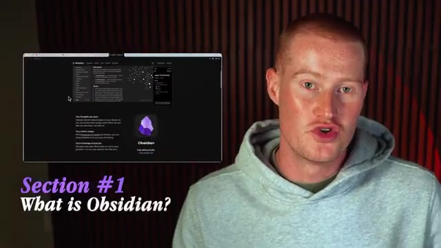
*⏱️ 00:00:27 — Le présentateur à droite, avec une capture d'écran du site officiel du logiciel Obsidian affichée sur la gauche, accompagnée du titre de section "Section #1 What is Obsidian?".*

---

### ⏱️ `[00:00:36 - 00:00:58]` | Segment #02

**🔊 Audio (Transcription Intégrale Mot pour Mot en Français) :**
> gratuit. Il vit sur votre ordinateur. Et une fois qu'il est configuré, il peut fonctionner en pilote automatique pendant que vous dormez. Donc, sans plus attendre, entrons dans le vif du sujet. Très bien. Alors, avant de vous expliquer précisément ce qu'est Obsidian et comment vous pouvez commencer à l'exploiter, laissez-moi vous montrer exactement à quoi cela ressemble. Et c'est assez fou. Il y a vraiment de quoi s'en mettre plein la vue ici. C'est plutôt sympa à regarder. Donc, c'est fondamentalement notre deuxième cerveau que nous sommes en train de former.

**👁️ Analyse Visuelle d'Écran (gemini-3.5-flash-lite) :**
**Interface & Outils** : Logiciel de prise de notes et gestion de connaissances Obsidian (Graph View).

**Contenu textuel & Code** : Arborescence de dossiers dans le panneau latéral gauche et vue relationnelle interactive sous forme de graphe de notes interconnectées au centre.

**Action / Démonstration** : Présentation de l'interface d'Obsidian et de sa vue en réseau pour illustrer la structuration des connaissances.

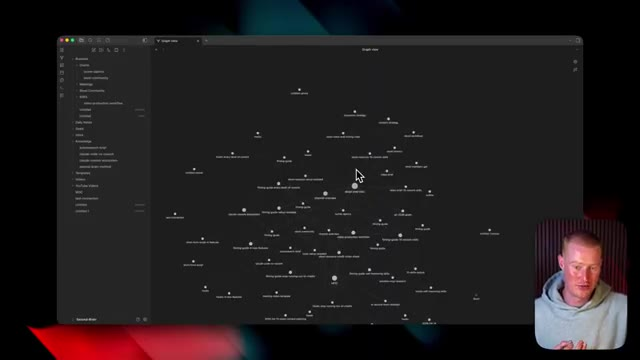
*⏱️ 00:00:47 — Interface d'Obsidian affichant la vue graphique (graph view) avec un réseau de nœuds interconnectés, et le présentateur visible en incrustation (PiP) dans le coin inférieur droit.*

---

### ⏱️ `[00:00:58 - 00:01:17]` | Segment #03

**🔊 Audio (Transcription Intégrale Mot pour Mot en Français) :**
> Il s'agit fondamentalement de prendre tout ce contexte et toutes ces informations provenant de Cloud Cowork et de nous donner ici un visuel et un endroit pour stocker toutes ces informations en tant que contexte. Et cela fonctionne de manière très similaire à un cerveau, dont nous allons parler plus tard dans cette vidéo. Mais si nous regardons ceci, ceci indique ici « aperçu de l'école », et ceci est connecté à tout un tas de documents différents ici.

**👁️ Analyse Visuelle d'Écran (gemini-3.5-flash-lite) :**
**Interface & Outils** : Obsidian (logiciel de prise de notes et gestion des connaissances)

**Contenu textuel & Code** : Interface de visualisation graphique de notes connectées (graph view) avec de multiples liens sémantiques entre les dossiers et fichiers de travail.

**Action / Démonstration** : Navigation et survol interactif dans la vue graphique d'Obsidian pour illustrer le concept de "cerveau" de stockage d'informations.

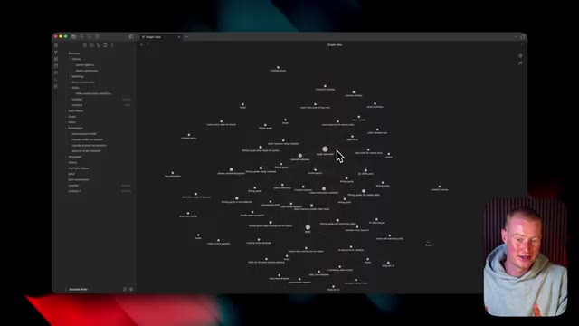
*⏱️ 00:01:03 — Capture d'écran montrant l'application Obsidian avec une vue graphique interactive représentant des nœuds interconnectés (Second Brain), avec le présentateur en incrustation.*

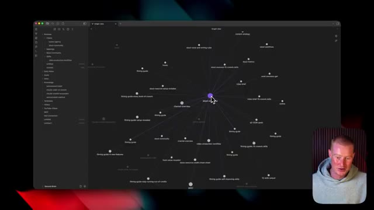
*⏱️ 00:01:12 — Capture d'écran montrant l'application Obsidian où un nœud spécifique est sélectionné et mis en surbrillance au centre de la vue graphique.*

---

### ⏱️ `[00:01:17 - 00:01:35]` | Segment #04

**🔊 Audio (Transcription Intégrale Mot pour Mot en Français) :**
> Et nous pouvions fondamentalement voir toutes les connexions entre ces différents documents. Donc si je clique dessus, cela va alors ouvrir ce fichier ici, qui est fondamentalement une analyse détaillée de toute ma communauté scolaire. Donc pensez à ceci comme à un neurone qui est entraîné sur ma communauté scolaire. Nous allons plonger plus profondément dans l'interface, mais parlons rapidement maintenant de la façon exacte dont cela fonctionne.

**👁️ Analyse Visuelle d'Écran (gemini-3.5-flash-lite) :**
**Interface & Outils** : Application de prise de notes / gestion de connaissances (Obsidian) avec volet de navigation latéral et vue détaillée.

**Contenu textuel & Code** : Document textuel contenant des informations sur une communauté Skool ("AI for Non-Techies"), des liens vers des notes associées (skool metrics, content strategy, etc.), des objectifs de revenus ($50K/month) et des tags.

**Action / Démonstration** : Le présentateur présente l'organisation de ses documents et navigue à travers les notes interconnectées de sa base de connaissances.

*⏱️ 00:01:21 — Capture d'écran montrant l'interface sombre d'une application de prise de notes et de gestion de connaissances (type Obsidian), affichant un document intitulé "AI for Non-Techies, Skool Community" avec des liens vers d'autres notes, des objectifs de revenus et des métadonnées. Le présentateur apparaît dans un encadré en bas à droite.*

---

### ⏱️ `[00:01:35 - 00:01:55]` | Segment #05

**🔊 Audio (Transcription Intégrale Mot pour Mot en Français) :**
> Donc je pense honnêtement que tout le monde de nos jours aimerait pouvoir avoir un second cerveau, un endroit où ils pourraient déverser tout ce contexte et toutes ces informations. Pensez à des choses comme OpenClaw. Les personnes essaient d'utiliser quelque chose comme ça comme leur second cerveau. Ce n'est pas seulement un endroit pour travailler, mais c'est un endroit pour stocker tout ce contexte et toutes ces informations que nous donnons à ces grands modèles de langage comme Claude et plus spécifiquement Claude Cowork.

**👁️ Analyse Visuelle d'Écran (gemini-3.5-flash-lite) :**
**Interface & Outils** : Navigateur web affichant une page de présentation.

**Contenu textuel & Code** : Texte centré sur l'écran : "Claude Cowork + Obsidian = The Ultimate Second Brain" avec une icône de cerveau rose.

**Action / Démonstration** : Présentation visuelle du concept de "second cerveau" associant Claude et Obsidian pour appuyer les propos audio.

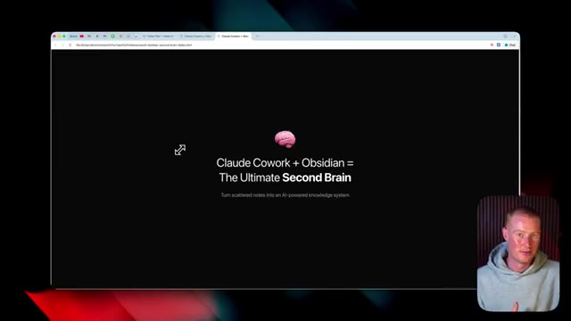
*⏱️ 00:01:40 — Une capture d'écran montrant une page web avec le titre "Claude Cowork + Obsidian = The Ultimate Second Brain" sur fond sombre, avec le présentateur visible en bas à droite.*

---

### ⏱️ `[00:01:55 - 00:02:16]` | Segment #06

**🔊 Audio (Transcription Intégrale Mot pour Mot en Français) :**
> Alors, ceci ici vous paraît probablement familier, et Obsidian va résoudre ce problème d'ici la fin de cette vidéo. Donc, par exemple, vous avez fait de superbes recherches la semaine dernière, mais vous n'avez aucune idée de là où c'est allé à l'intérieur de Claude. Vos notes de réunion sont éparpillées dans des dizaines de vos anciennes sessions. Vous devez sans cesse réexpliquer le même contexte toutes les quelques conversations. Et ensuite, vous pourriez même vous poser la question : que sais-je à propos de ce client ?

**👁️ Analyse Visuelle d'Écran (gemini-3.5-flash-lite) :**
**Interface & Outils** : Navigateur web affichant une page de présentation ou un document de notes.

**Contenu textuel & Code** : Texte listant les frustrations : 'You did great research last week. No idea where it went.', 'Meeting notes scattered across a dozen old sessions', 'You keep re-explaining the same context every few conversations', 'What do I know about this client?... no way to answer that'.

**Action / Démonstration** : Présentation des problématiques courantes liées à l'utilisation des outils d'IA comme Claude pour la prise de notes.

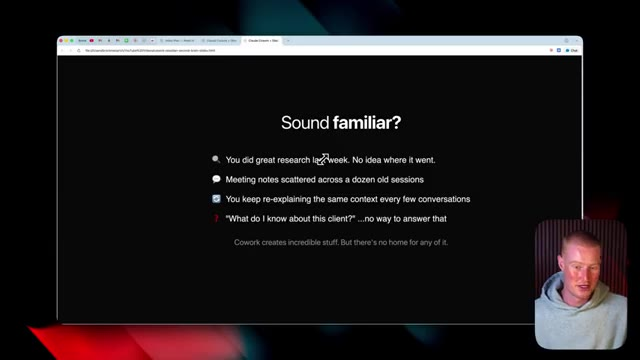
*⏱️ 00:02:00 — Une diapositive de présentation sur fond sombre affichant le texte 'Sound familiar?' avec une liste de problèmes liés à la gestion des notes et de la recherche avec l'intelligence artificielle.*

---

### ⏱️ `[00:02:16 - 00:02:38]` | Segment #07

**🔊 Audio (Transcription Intégrale Mot pour Mot en Français) :**
> Et il n'y a aucun moyen d'obtenir une réponse à cela parce que Claude oublie tout simplement. Donc, pour expliquer Obsidian en 30 secondes, voici exactement comment je le décomposerais. Alors, pensez à Notion, mais avec des fichiers qui résident sur votre ordinateur. Nous avons des notes spécifiques qui se lient les unes aux autres comme Wikipédia. Donc, tout ce que vous voyez ici et qui se trouve dans cette interface semblable à un cerveau n'est qu'un fichier Markdown à l'intérieur d'un dossier spécifique.

**👁️ Analyse Visuelle d'Écran (gemini-3.5-flash-lite) :**
**Interface & Outils** : Navigateur web affichant une présentation de diapositive avec une interface de prise de notes (Obsidian).

**Contenu textuel & Code** : Texte de présentation expliquant Obsidian : "Think Notion, but your files are on your computer", "Notes link to each other like Wikipedia", "Everything is just markdown files in a folder", "Which means Cowork can read and write all of it".

**Action / Démonstration** : Présentation visuelle des concepts clés d'Obsidian pour appuyer les explications données en audio.

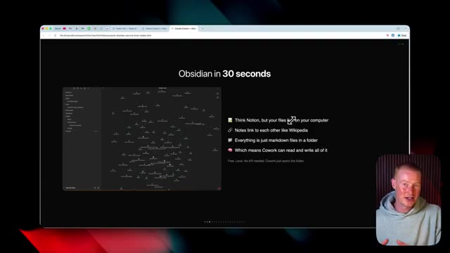
*⏱️ 00:02:27 — Capture d'écran d'une présentation sur fond sombre intitulée "Obsidian in 30 seconds", montrant une interface avec un graphique de notes interconnectées et du texte explicatif à droite.*

---

### ⏱️ `[00:02:38 - 00:02:58]` | Segment #08

**🔊 Audio (Transcription Intégrale Mot pour Mot en Français) :**
> Et cela signifie que Claude Cowork peut lire et écrire dans tout cela. Et c'est ainsi que nous stockons ces informations ici. C'est gratuit, c'est local, vous n'avez pas besoin de configurer d'API. Je vais vous montrer exactement comment faire cela plus tard dans cette vidéo, c'est vraiment simple à faire. Alors vous vous demandez peut-être comment cela fait-il un second cerveau ? Laissez-moi donc vous décomposer une analogie rapide dès maintenant pour que vous puissiez mieux comprendre.

**👁️ Analyse Visuelle d'Écran (gemini-3.5-flash-lite) :**
**Interface & Outils** : Navigateur web affichant une page web explicative sur Obsidian, avec le présentateur visible en incrustation vidéo dans le coin inférieur droit.

**Contenu textuel & Code** : Texte présentant Obsidian ("Think Notion, but your files live on your computer", "Notes link to each other like Wikipedia", "Everything is just markdown files in a folder", "Which means Cowork can read and write all of it") et une représentation visuelle du graphe de notes d'Obsidian.

**Action / Démonstration** : Présentation des fonctionnalités d'Obsidian et de sa compatibilité avec Claude Cowork pour la lecture et l'écriture de fichiers locaux en Markdown.

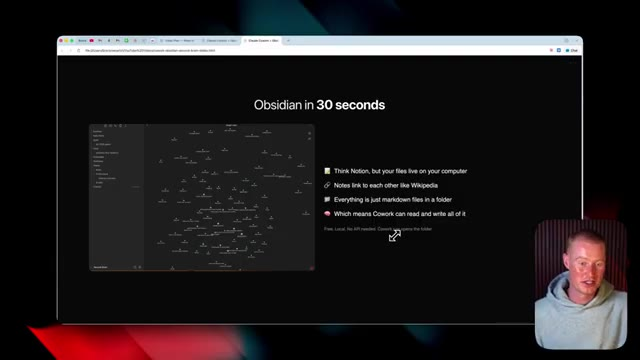
*⏱️ 00:02:43 — Capture d'écran montrant une interface de présentation intitulée "Obsidian in 30 seconds" avec un graphique en réseau des notes et du texte explicatif.*

---

### ⏱️ `[00:02:59 - 00:03:18]` | Segment #09

**🔊 Audio (Transcription Intégrale Mot pour Mot en Français) :**
> Donc notre coffre, qui est fondamentalement nos dossiers dans notre espace de travail à l'intérieur d'Obsidian, est fondamentalement juste notre cerveau. Chaque note est un neurone spécifique, comme vous pouvez le voir ici, qu'il s'agisse d'une note de réunion, de recherche, d'une idée spécifique, d'un objectif, d'une note quotidienne, d'une note de client, toutes ces différentes choses sont des neurones pour notre cerveau. Et puis, pensez aux liens entre eux comme à des synapses.

**👁️ Analyse Visuelle d'Écran (gemini-3.5-flash-lite) :**
**Interface & Outils** : Navigateur web affichant une présentation conceptuelle.

**Contenu textuel & Code** : Schéma textuel et visuel représentant un cerveau associé au concept "Your Vault = Your Brain".

**Action / Démonstration** : Le présentateur explique le concept du coffre Obsidian comparé à un cerveau humain.

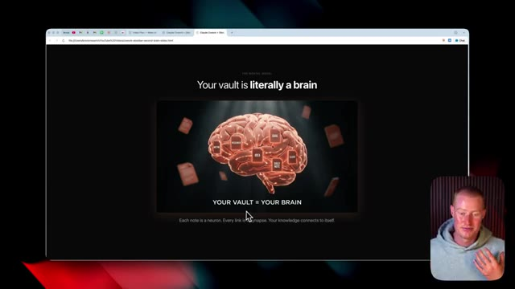
*⏱️ 00:03:04 — Capture d'écran montrant une page web avec le titre "Your vault is literally a brain" et une illustration graphique d'un cerveau humain symbolisant un espace de notes Obsidian.*

---

### ⏱️ `[00:03:19 - 00:03:38]` | Segment #10

**🔊 Audio (Transcription Intégrale Mot pour Mot en Français) :**
> Et avec cela, nos connaissances se connectent entre elles et nous pouvons fondamentalement voir les différentes connexions que nous avons avec chacun de ces différents documents et mémoires. Donc, décomposons simplement les bases ici pour que vous puissiez comprendre ce qu'est réellement Obsidian à la base. Un coffre-fort, ce sont en gros simplement des dossiers qui sont stockés sur votre ordinateur, tout comme lorsque vous utilisez Cloud Cowork.

**👁️ Analyse Visuelle d'Écran (gemini-3.5-flash-lite) :**
**Interface & Outils** : Navigateur web affichant une présentation sur Obsidian.

**Contenu textuel & Code** : Illustration visuelle métaphorique comparant le coffre-fort (vault) à un cerveau humain avec des notes connectées.

**Action / Démonstration** : Présentation du concept de base d'Obsidian et de l'interconnexion des notes de connaissances.

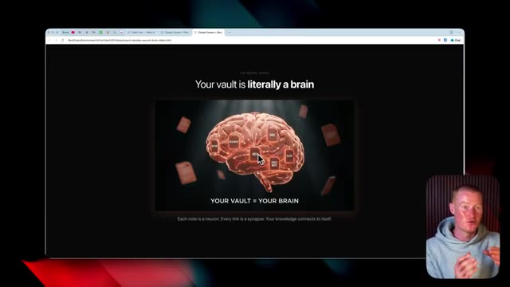
*⏱️ 00:03:23 — Capture d'écran montrant une page de présentation avec un graphique illustrant le cerveau et le concept 'Your vault is literally a brain', avec le présentateur incrusté en bas à droite.*

---

### ⏱️ `[00:03:38 - 00:03:59]` | Segment #11

**🔊 Audio (Transcription Intégrale Mot pour Mot en Français) :**
> Et le plus incroyable là-dedans, c'est que ce n'est pas stocké sur leurs serveurs. Donc si vous utilisez quelque chose comme Notion, c'est stocké sur les serveurs de Notion. Vous devez être connecté à Internet pour réellement ouvrir ces fichiers. Puisqu'il s'agit de vrais fichiers dans des dossiers sur votre ordinateur et qu'ils sont stockés localement, vous êtes propriétaire de toutes ces informations. En plus de cela, c'est 100 % gratuit et cela fonctionne entièrement hors ligne.

**👁️ Analyse Visuelle d'Écran (gemini-3.5-flash-lite) :**
**Interface & Outils** : Navigateur web affichant une présentation comparative visuelle avec le présentateur incrusté en bas à droite.

**Contenu textuel & Code** : Schéma comparatif visuel avec les mentions textuelles 'THEIR SERVERS' et 'YOUR COMPUTER'.
[DESC_IMAGE_1] Le présentateur explique la différence entre le stockage sur un serveur distant et le stockage local sur l'ordinateur de l'utilisateur.

**Action / Démonstration** : Explications face caméra et analyse conceptuelle des marchés.

*⏱️ 00:03:43 — Illustration comparative montrant deux options de stockage : 'Their servers' (serveur distant sécurisé avec signal Wi-Fi) versus 'Your computer' (ordinateur portable avec dossiers locaux), illustrant le mode de fonctionnement d'Obsidian par rapport à des applications cloud comme Notion.*

---

### ⏱️ `[00:03:59 - 00:04:19]` | Segment #12

**🔊 Audio (Transcription Intégrale Mot pour Mot en Français) :**
> Et encore une fois, Cowork ouvre simplement ce dossier et peut tout lire et écrire. Sans oublier que, si vous voulez utiliser ceci entre Cowork, Codex, Cloud Code, toutes ces différentes plateformes d'agents d'intelligence artificielle, vous pouvez le faire parce que tout est stocké dans un dossier. C'est fondamentalement aussi simple que cela. Alors pour vous montrer exactement ce que je veux dire, voici un dossier que j'ai sur mon bureau.

**👁️ Analyse Visuelle d'Écran (gemini-3.5-flash-lite) :**
**Interface & Outils** : Navigateur web affichant une page explicative sur le stockage local des coffres-forts (vaults).

**Contenu textuel & Code** : Texte explicatif : "Every note is a .md file in a folder on your computer", "No cloud, no database, no subscription", "100% free and works completely offline", "Cowork just opens the folder and reads everything".

**Action / Démonstration** : Le présentateur commente la nature locale des dossiers et la capacité de Cowork à y accéder directement.

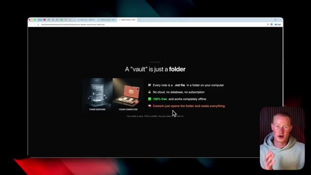
*⏱️ 00:04:04 — Capture d'écran montrant une page web avec le titre "A 'vault' is just a folder", expliquant le stockage local des fichiers Markdown et la compatibilité avec Cowork.*

---

### ⏱️ `[00:04:19 - 00:04:39]` | Segment #13

**🔊 Audio (Transcription Intégrale Mot pour Mot en Français) :**
> Il s'appelle Second Brain. Et à l'intérieur de celui-ci, nous avons de multiples sous-dossiers différents. Nous en avons un pour les affaires. Nous en avons un pour mes notes quotidiennes. Nous en avons un pour mes objectifs, la boîte de réception, les connaissances, les modèles et les vidéos, et bien d'autres encore à l'intérieur de ce dossier spécifique. Donc, à la base, voilà à quoi cela ressemble. Mais à l'intérieur d'Obsidian, c'est structuré comme ceci.

**👁️ Analyse Visuelle d'Écran (gemini-3.5-flash-lite) :**
**Interface & Outils** : Navigateur web affichant une interface de gestion de dossiers et de notes (style explorateur de fichiers / système de notes).

**Contenu textuel & Code** : Dossiers nommés Business, Daily Notes, Goals, Inbox, Knowledge, Templates et Videos au sein d'un répertoire 'Second Brain'.

**Action / Démonstration** : Le présentateur montre et liste les différents sous-dossiers qui composent le système de 'Second Brain'.

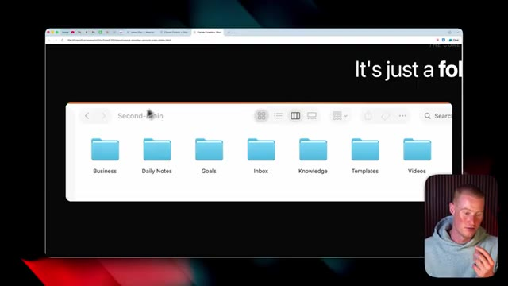
*⏱️ 00:04:24 — Un écran affichant l'interface d'un gestionnaire de fichiers avec le dossier principal 'Second Brain' ouvert, contenant plusieurs sous-dossiers : Business, Daily Notes, Goals, Inbox, Knowledge, Templates et Videos.*

---

### ⏱️ `[00:04:39 - 00:04:58]` | Segment #14

**🔊 Audio (Transcription Intégrale Mot pour Mot en Français) :**
> Et pour vous montrer exactement ce que je veux dire, laissez-moi aller dans mon dossier de notes quotidiennes à l'intérieur d'Obsidian. Donc si je viens ici sur le côté gauche, nous allons voir en gros comme un menu de quelques éléments différents. Ce sont précisément ces sous-dossiers que je viens de vous montrer. Je pourrais donc cliquer sur mon dossier de notes quotidiennes et je pourrais, par exemple, ouvrir l'une d'elles.

**👁️ Analyse Visuelle d'Écran (gemini-3.5-flash-lite) :**
**Interface & Outils** : Obsidian

**Contenu textuel & Code** : Arborescence des dossiers et vue graphique en réseau des notes du second cerveau.

**Action / Démonstration** : Navigation et présentation de la structure des dossiers dans le logiciel de prise de notes Obsidian.

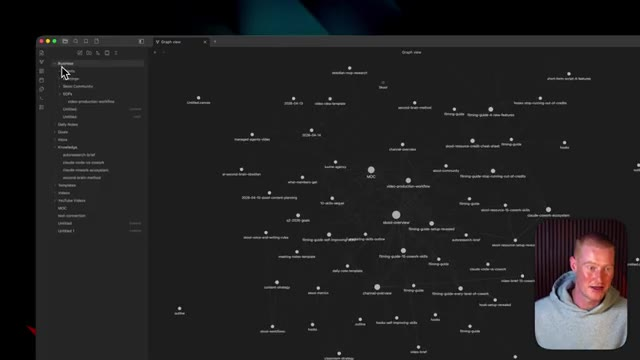
*⏱️ 00:04:49 — Interface du logiciel Obsidian affichant la vue graphique en réseau des notes sur le panneau principal et l'arborescence des dossiers sur le panneau latéral gauche.*

---

### ⏱️ `[00:04:59 - 00:05:19]` | Segment #15

**🔊 Audio (Transcription Intégrale Mot pour Mot en Français) :**
> C'est ma note quotidienne pour aujourd'hui. Et comme vous pouvez le voir, elle contient plusieurs éléments différents. Et un point essentiel que je tiens à souligner est que cela ressemble beaucoup à Notion, qui est un logiciel que j'utilise tous les jours pour m'aider à gérer mon entreprise depuis trois ans. Mais maintenant, au lieu d'avoir à utiliser Notion, je peux simplement l'utiliser automatiquement dans Obsidian. Et je peux y apporter des modifications manuellement, comme vous pouvez le voir, je suis en train de taper ici.

**👁️ Analyse Visuelle d'Écran (gemini-3.5-flash-lite) :**
**Interface & Outils** : Obsidian (logiciel de prise de notes)

**Contenu textuel & Code** : Page de note quotidienne (Daily Notes) structurée avec des sections telles que Properties, Calendar, What I'm Working On, Open Action Items et Active Video Pipeline.

**Action / Démonstration** : Le présentateur montre l'interface de son logiciel de prise de notes Obsidian pour illustrer sa gestion quotidienne.

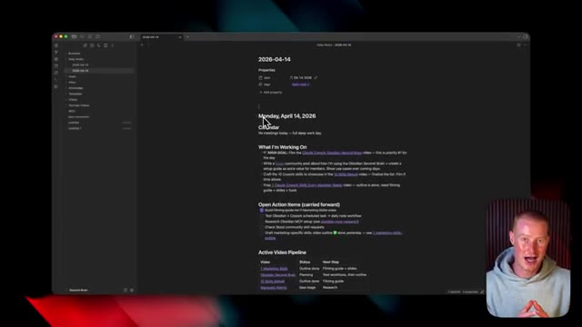
*⏱️ 00:05:04 — Capture d'écran montrant l'interface sombre d'Obsidian affichant une note quotidienne datée du 14 avril 2026, avec un panneau latéral et une petite fenêtre vidéo du présentateur en bas à droite.*

---

### ⏱️ `[00:05:19 - 00:05:52]` | Segment #16

**🔊 Audio (Transcription Intégrale Mot pour Mot en Français) :**
> Ou je pourrais simplement demander à Claude Cowork d'aller faire ces changements en pilotage automatique puisque ce sont fondamentalement juste des fichiers Markdown. Il a le contexte de ce sur quoi je travaille exactement donc il connaît les vidéos que je dois réellement filmer aujourd'hui. Il sait que je dois écrire une publication pour la communauté scolaire. toutes ces différentes choses ici, il a le contexte donc il sait sur quoi je travaille parce que j'ai fait des allers-retours avec Claude Cowork hier et il a sauvegardé ce contexte à l'intérieur de ce fichier. En plus de cela, nous allons voir différents hyperliens à l'intérieur de nos notes donc si je clique là-dessus, cela m'emmènera vers une autre note qui est fondamentalement une vidéo sur laquelle je travaille qui est celle-ci donc vous pouvez

**👁️ Analyse Visuelle d'Écran (gemini-3.5-flash-lite) :**
**Interface & Outils** : Application de prise de notes Obsidian et webcam du présentateur en incrustation.

**Contenu textuel & Code** : Texte au format Markdown décrivant les tâches de la journée, les objectifs (« What I'm Working On », « Open Action Items », « Active Video Pipeline ») et un tableau de suivi des vidéos YouTube.

**Action / Démonstration** : Le curseur de la souris sélectionne du texte dans la section des objectifs principaux de la journée.

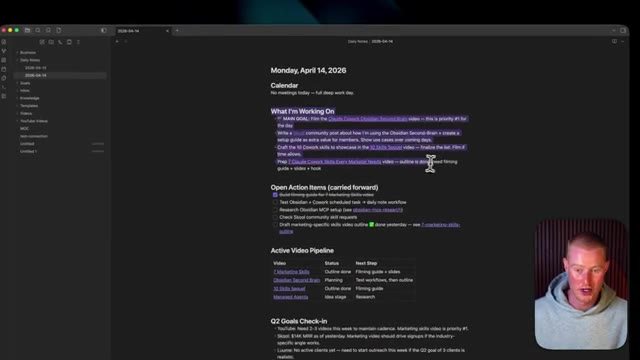
*⏱️ 00:05:27 — Une capture d'écran montrant l'application Obsidian avec une note quotidienne de planification, incluant des listes de tâches et un pipeline de vidéos en cours.*

---

### ⏱️ `[00:05:52 - 00:06:13]` | Segment #17

**🔊 Audio (Transcription Intégrale Mot pour Mot en Français) :**
> voir les concepts clés pour lesquels nous tournons cette vidéo, des démonstrations clés à montrer et même des titres potentiels, et à partir de là, je peux toujours basculer vers la vue graphique pour voir comment tous ces différents fichiers communiquent et se renvoient les uns aux autres. Très bien, alors laissez-moi vous montrer cela en direct pour que vous puissiez voir que cela fonctionne. Donc ce que nous allons faire, c'est que nous allons venir sur l'application de bureau Claude.

**👁️ Analyse Visuelle d'Écran (gemini-3.5-flash-lite) :**
**Interface & Outils** : Obsidian, Claude Cowork

**Contenu textuel & Code** : Document de planification Obsidian avec listes à puces et interface de gestion des tâches Claude Cowork avec liste de projets actifs.

**Action / Démonstration** : Le présentateur détaille sa structure de planification de contenu puis navigue dans l'interface de travail de Claude Cowork.

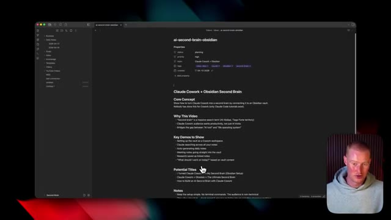
*⏱️ 00:05:57 — L'application Obsidian affichant une page de planification de contenu avec les concepts clés et titres potentiels pour une vidéo sur Claude Cowork et Obsidian.*

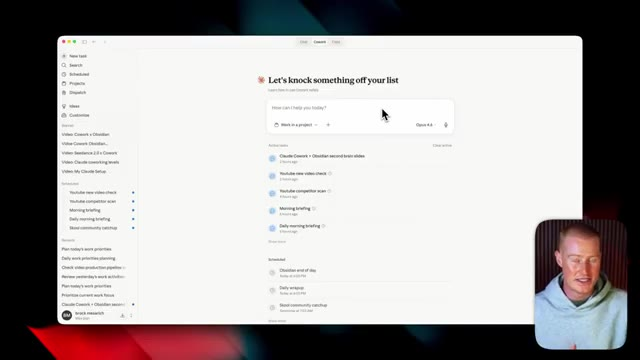
*⏱️ 00:06:08 — L'interface de Claude Cowork affichant le tableau de bord des tâches actives et planifiées (« Let's knock something off your list »).*

---

### ⏱️ `[00:06:13 - 00:06:32]` | Segment #18

**🔊 Audio (Transcription Intégrale Mot pour Mot en Français) :**
> Si vous ne l'avez pas déjà, assurez-vous de le télécharger. Il y aura un lien dans la description pour le faire. Une fois que nous sommes à l'intérieur d'ici, nous voulons nous assurer que nous avons le mode cowork activé à l'intérieur de Claude. Et ensuite, à partir d'ici, nous devons réellement sélectionner un dossier. Et cette partie est vraiment, vraiment importante parce que c'est fondamentalement la façon dont nous allons synchroniser cela avec Obsidian.

**👁️ Analyse Visuelle d'Écran (gemini-3.5-flash-lite) :**
**Interface & Outils** : Application Claude Desktop / Interface web de Claude.

**Contenu textuel & Code** : Tableau de bord Claude affichant le mode « Cowork », la barre de saisie « How can I help you today? » et des tâches récentes dans la barre latérale gauche.

**Action / Démonstration** : Navigation dans l'interface de Claude et préparation à l'activation ou l'utilisation du mode cowork.

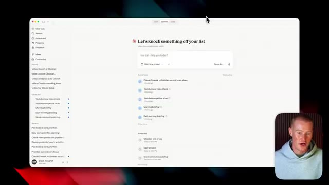
*⏱️ 00:06:18 — Capture d'écran montrant l'interface de l'application Claude sur macOS avec le mode cowork activé, et la webcam du présentateur en bas à droite.*

---

### ⏱️ `[00:06:32 - 00:06:52]` | Segment #19

**🔊 Audio (Transcription Intégrale Mot pour Mot en Français) :**
> Donc, personnellement, j'ai nommé ce dossier « second cerveau ». Vous pouvez le nommer comme vous voulez. Je vais cliquer sur « autoriser ». Et pour voir si cela fonctionne, laissez-moi juste lui donner cette invite rapide : « Où en suis-je avec toutes les vidéos sur lesquelles je travaille ? » La raison pour laquelle je pose cette question, c'est qu'hier, j'ai fait des allers-retours avec Claude Cowork et j'ai en gros expliqué toutes les vidéos sur lesquelles nous travaillions.

**👁️ Analyse Visuelle d'Écran (gemini-3.5-flash-lite) :**
**Interface & Outils** : Interface logicielle de Claude (Cowork / assistant IA).

**Contenu textuel & Code** : Fenêtre de permission d'accès aux fichiers et invite textuelle pour vérifier l'état d'avancement des vidéos.

**Action / Démonstration** : Autorisation d'accès au dossier et soumission d'une invite textuelle à l'assistant.

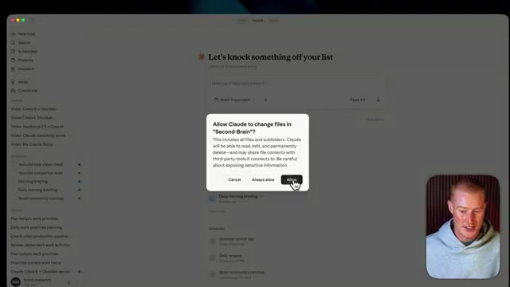
*⏱️ 00:06:37 — Interface de l'application montrant une boîte de dialogue contextuelle demandant l'autorisation d'accéder au dossier « Second-Brain ».*

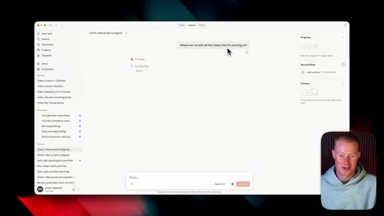
*⏱️ 00:06:47 — Interface de l'application affichant l'invite « Where am I at with all the videos that I'm working on? » en cours de traitement.*

---

### ⏱️ `[00:06:52 - 00:07:14]` | Segment #20

**🔊 Audio (Transcription Intégrale Mot pour Mot en Français) :**
> Donc je les avais stockées à l'intérieur de mon projet de vidéos YouTube ici, que nous pouvions effectivement voir à l'intérieur de Cowork juste ici. Donc il y a quelques vidéos différentes sur lesquelles j'ai travaillé. Et la façon dont il est capable de référencer ceci est parce que cette information a été sauvegardée à l'intérieur de ce dossier de second cerveau que nous utilisons à l'intérieur d'Obsidian. Chaque fois qu'il y a un changement dans Cowork, il est automatiquement ajouté ici parce que ce sont exactement les mêmes fichiers.

**👁️ Analyse Visuelle d'Écran (gemini-3.5-flash-lite) :**
**Interface & Outils** : Application logicielle Cowork (interface de gestion de projets et d'IA collaborative)

**Contenu textuel & Code** : Tableau de bord de projet nommé « YouTube Videos », zone de saisie de prompt, sections « Outputs », « Scheduled » (avec des tâches planifiées comme « Youtube new video check » et « Skool community catchup »), et l'arborescence des fichiers du projet.

**Action / Démonstration** : Navigation et présentation de l'interface du projet « YouTube Videos » dans l'application Cowork, expliquant comment l'outil référence et stocke le contenu des vidéos.

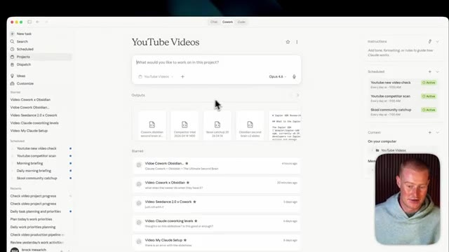
*⏱️ 00:06:57 — Interface de l'application Cowork affichant le projet « YouTube Videos » avec une liste de tâches planifiées et d'outputs récents, tandis que le présentateur apparaît en incrustation vidéo dans le coin inférieur droit.*

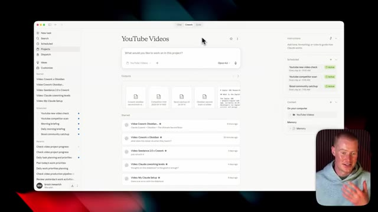
*⏱️ 00:07:03 — Vue similaire de l'interface Cowork montrant le tableau de bord du projet « YouTube Videos » avec le curseur de la souris positionné en haut, le présentateur gesticulant légèrement dans l'encadré vidéo.*

---

### ⏱️ `[00:07:15 - 00:07:35]` | Segment #21

**🔊 Audio (Transcription Intégrale Mot pour Mot en Français) :**
> Ils sont juste dans une autre vue. Très bien. Donc, juste comme ça, il a affiché ces quatre vidéos différentes sur lesquelles je travaille en ce moment. Nous avons 10 compétences de co-travail dans le cloud dont vous ignoriez l'existence, sept compétences de co-travail dans le cloud dont tout spécialiste du marketing a besoin, le second cerveau IA, qui est cette vidéo, les agents gérés dans le cloud. Et pour que je puisse vérifier cela dans Obsidian, laissez-moi afficher cela pour voir si nous pouvons y faire référence.

**👁️ Analyse Visuelle d'Écran (gemini-3.5-flash-lite) :**
**Interface & Outils** : Application de gestion de projet textuelle avec incrustation vidéo du présentateur en bas à droite.

**Contenu textuel & Code** : Liste détaillée des projets vidéo avec des statuts (Planning, Second Brain, Claude Managed Agents) et description des compétences.

**Action / Démonstration** : Le présentateur commente la liste des projets vidéo en cours affichée à l'écran.

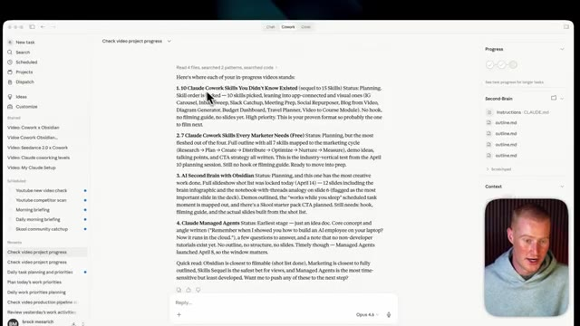
*⏱️ 00:07:20 — Vue d'ensemble de l'interface de gestion montrant une liste de quatre vidéos en cours de préparation.*

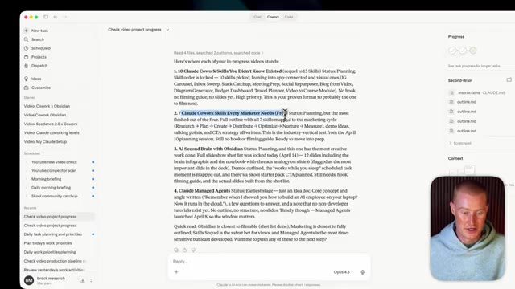
*⏱️ 00:07:25 — Gros plan sur le texte de l'interface décrivant les différentes étapes des projets vidéo.*

---

### ⏱️ `[00:07:35 - 00:07:54]` | Segment #22

**🔊 Audio (Transcription Intégrale Mot pour Mot en Français) :**
> Donc si je viens, nous venons sur des vidéos YouTube et je clique sur en cours. Vous pouvez voir que nous avons maintenant ces quatre sous-dossiers différents à l'intérieur d'Obsidian. Si je clique dessus, vous pouvez voir le plan pour chacun d'eux. Très bien. Alors essayons quelque chose. Je veux donner une instruction et faire un changement à l'intérieur de Coork. Et ensuite je veux voir si cela se reflète à l'intérieur d'Obsidian.

**👁️ Analyse Visuelle d'Écran (gemini-3.5-flash-lite) :**
**Interface & Outils** : Obsidian et application de gestion/notes.

**Contenu textuel & Code** : Structure de dossiers, graphiques de connexions entre notes et plans textuels détaillés pour des projets de vidéos YouTube (ex. : "1.7 Marketing Skills", "Claude Managed Agents").

**Action / Démonstration** : Navigation dans l'arborescence des dossiers et consultation des plans de vidéos dans l'outil de notes.

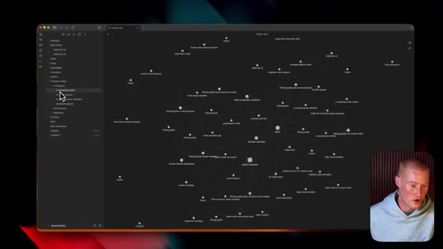
*⏱️ 00:07:40 — Capture d'écran montrant l'application Obsidian avec une vue en graphique des notes (Graph View) et la navigation dans les dossiers de projets vidéo.*

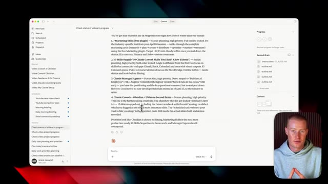
*⏱️ 00:07:50 — Capture d'écran montrant une interface de gestion de tâches ou un document de planification détaillant le statut des vidéos en cours ("In Progress").*

---

### ⏱️ `[00:07:55 - 00:08:15]` | Segment #23

**🔊 Audio (Transcription Intégrale Mot pour Mot en Français) :**
> De cette façon, nous pourrions savoir que notre second cerveau fonctionne correctement. Donc, laissez-moi faire ça maintenant. Hé, je veux que tu ailles changer la vidéo Claude Cowork Obsidian et que tu la marques comme terminée puisque nous avons fini de filmer ceci et que c'est prêt à être publié demain. Donc, nous allons lui donner cette invite, cela devrait apporter des modifications à ce fichier et cela devrait se refléter à l'intérieur d'Obsidian.

**👁️ Analyse Visuelle d'Écran (gemini-3.5-flash-lite) :**
**Interface & Outils** : Application de gestion de projet (interface de type Notion/Obsidian).

**Contenu textuel & Code** : Liste des vidéos en cours de production (Marketing Skills, 10 Skills Sequel, Claude Managed Agents, Claude Cowork + Obsidian + Ultimate Second Brain).

**Action / Démonstration** : Le présentateur interagit avec l'interface pour consulter l'état d'avancement des projets vidéo avant de donner une instruction.

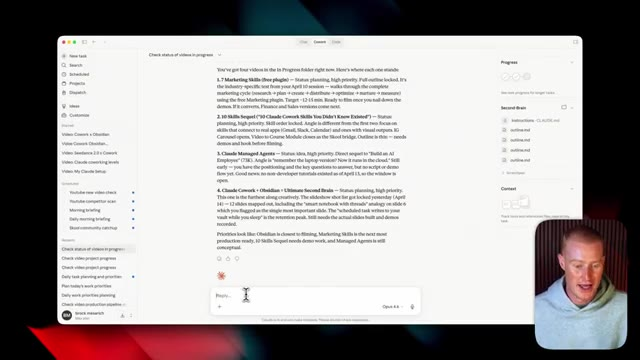
*⏱️ 00:08:00 — Vue d'ensemble de l'interface de l'application affichant le tableau de bord de gestion de projet de vidéos.*

---

### ⏱️ `[00:08:15 - 00:08:37]` | Segment #24

**🔊 Audio (Transcription Intégrale Mot pour Mot en Français) :**
> Mais allons voir ça de plus près dans un instant. Très bien. Donc, selon Claude, c'est terminé. Mais laissez-moi revenir dans Obsidian. Je vais dans les vidéos YouTube et je clique sur "en cours". Vous pouvez maintenant voir que la vidéo Obsidian n'est plus en cours. Elle devrait en fait se trouver dans le dossier "publié". Et comme vous pouvez le voir ici, c'est bien le cas. Le fichier Obsidian du "Second Cerveau IA" se trouve désormais dans le dossier "publié".

**👁️ Analyse Visuelle d'Écran (gemini-3.5-flash-lite) :**
**Interface & Outils** : Application de prise de notes Obsidian (interface de bureau avec panneau latéral de fichiers et affichage de notes / graphe).

**Contenu textuel & Code** : Structure de dossiers de gestion de contenu YouTube, notes sur 'Claude Cowork + Obsidian Second Brain', et graphe relationnel de notes interconnectées.

**Action / Démonstration** : Navigation dans l'arborescence des dossiers et visualisation du graphe de notes dans Obsidian pour suivre l'état d'avancement d'un projet.

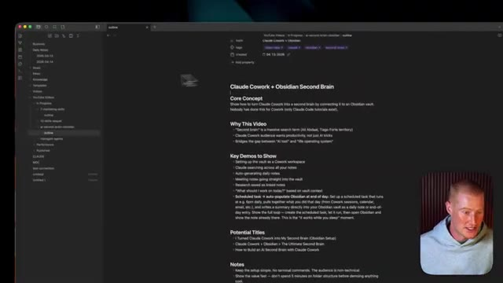
*⏱️ 00:08:21 — L'écran principal affiche une interface Obsidian avec une note intitulée 'Claude Cowork + Obsidian Second Brain', montrant des sections de concept et des plans de démonstration, tandis que le présentateur apparaît en bas à droite.*

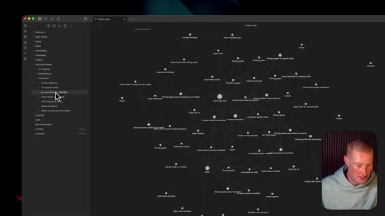
*⏱️ 00:08:32 — L'écran principal affiche la vue graphique en réseau (Graph View) d'Obsidian montrant l'interconnexion des notes, avec le curseur de la souris naviguant dans la barre latérale gauche.*

---

### ⏱️ `[00:08:37 - 00:09:07]` | Segment #25

**🔊 Audio (Transcription Intégrale Mot pour Mot en Français) :**
> Donc c'est fidèlement reflété. Et ensuite, pour vous montrer à quoi cela ressemble à l'intérieur de ce dossier réel sur mon bureau, nous pouvons voir exactement la même chose. Nous avons donc des vidéos YouTube, nous pouvons voir publiées, et nous avons maintenant le Cerveau Secondaire IA Obsidian juste ici ajouté à cela. Très bien. Alors afin de vous montrer que les changements peuvent être reflétés des deux côtés, depuis le côté Obsidian, mais aussi depuis le côté Co-work, laissez-moi venir dans Obsidian et changeons réellement un dossier ici. Donc je vais ouvrir des vidéos qui sont en cours. Ouvrons la vidéo sur les 10 compétences SQL.

**👁️ Analyse Visuelle d'Écran (gemini-3.5-flash-lite) :**
**Interface & Outils** : macOS Finder, Obsidian (Graph view)

**Contenu textuel & Code** : Arborescence de dossiers de productivité et graphe de connaissances interconnecté.

**Action / Démonstration** : Navigation dans l'arborescence du dossier Second Brain puis affichage de la vue graphique d'Obsidian.

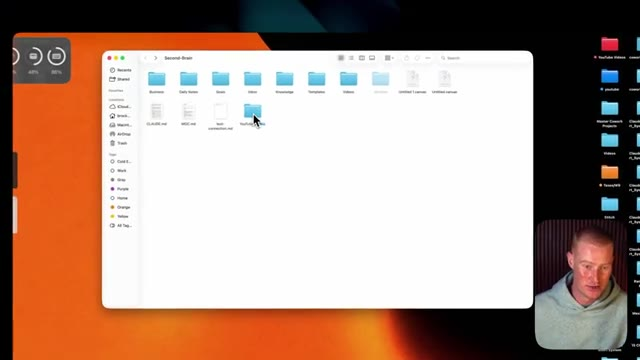
*⏱️ 00:08:45 — Vue d'un dossier nommé 'Second-Brain' sur macOS montrant plusieurs sous-dossiers et fichiers de gestion.*

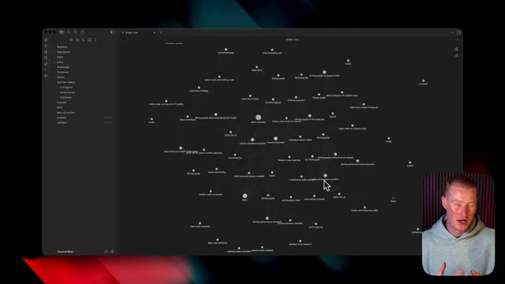
*⏱️ 00:08:52 — Interface d'Obsidian affichant la vue en graphique (Graph view) avec un réseau de nœuds interconnectés.*

---

### ⏱️ `[00:09:07 - 00:09:27]` | Segment #26

**🔊 Audio (Transcription Intégrale Mot pour Mot en Français) :**
> Donc, comme vous pouvez le voir ici, nous avons ce fichier Markdown. Nous avons le statut spécifique. Il indique des priorités de planification élevées. Le sujet est la séquence de compétences. Nous avons même ces tags ici ainsi qu'une date de création. Donc ce que je vais faire, c'est que je vais simplement venir ici et changer le titre pour celui-ci. Appelons donc cela 10 compétences Claude Cowork dont je ne peux pas me passer, volez-les.

**👁️ Analyse Visuelle d'Écran (gemini-3.5-flash-lite) :**
**Interface & Outils** : Application Obsidian (éditeur Markdown / gestionnaire de notes) avec la webcam du présentateur en bas à droite.

**Contenu textuel & Code** : Fichier Markdown structuré avec des propriétés (status: planning, priority: high, topic: 10 skills sequel) et une liste numérotée de compétences (Skill Order).

**Action / Démonstration** : Le présentateur survole les propriétés du fichier Markdown pour montrer la structure de planification du contenu.

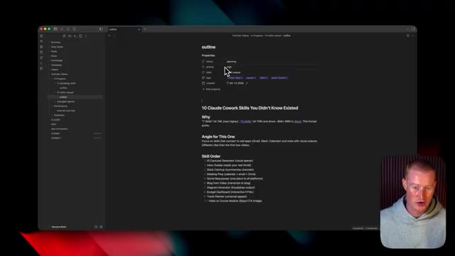
*⏱️ 00:09:12 — Un écran affichant une application de prise de notes/gestion de projet (Obsidian) avec un fichier Markdown ouvert, montrant les métadonnées (status, priority, topic, tags, created) et le contenu structuré d'une vidéo YouTube sur les compétences Claude.*

---

### ⏱️ `[00:09:27 - 00:10:02]` | Segment #27

**🔊 Audio (Transcription Intégrale Mot pour Mot en Français) :**
> Donc je vais juste appeler ça title. Donc maintenant, nous savons que cela va être le titre de la vidéo. Et comme nous avons fait ce changement ici, je vais revenir sur Cowork et je vais simplement dire : parle-moi de la vidéo sur laquelle nous travaillons à propos des 10 compétences de Claude. Quel en est le titre ? Comme nous venons de faire ce changement dans Obsidian, encore une fois, comme c'est juste un fichier markdown et que nous travaillons dans le même dossier à l'intérieur de ces deux plateformes, nous verrons alors cela fidèlement reflété ici, nous devrions avoir le nouveau titre ajouté ici. Et voilà. Nous avons obtenu cette réponse de Claude disant en gros que la vidéo est dans ce dossier. Voici le récapitulatif. Ici

**👁️ Analyse Visuelle d'Écran (gemini-3.5-flash-lite) :**
**Interface & Outils** : Cowork, Obsidian

**Contenu textuel & Code** : Plan de vidéo YouTube intitulé "10 Claude Cowork Skills I Can't Live Without (steal them)" avec une liste numérotée de compétences.

**Action / Démonstration** : Navigation entre l'outil de gestion Cowork et l'éditeur de notes Obsidian pour interroger l'IA sur le projet en cours.

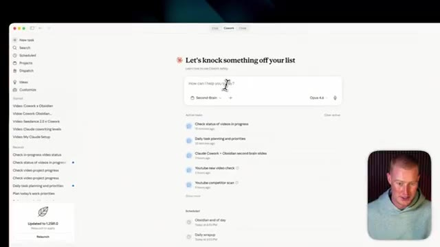
*⏱️ 00:09:36 — Interface de l'application Cowork affichant la page d'accueil avec une barre de recherche et des tâches actives.*

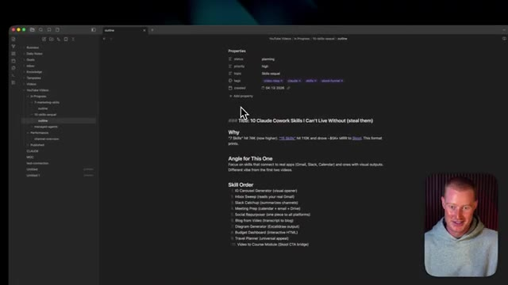
*⏱️ 00:09:44 — Éditeur de notes montrant le plan d'une vidéo YouTube sur les compétences Claude.*

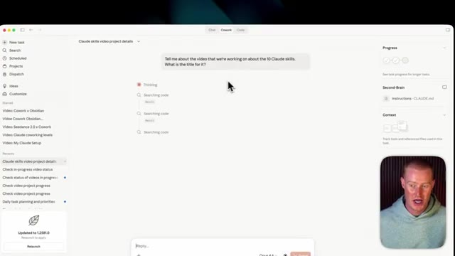
*⏱️ 00:09:53 — Interface de chat Cowork montrant la saisie d'un prompt concernant la vidéo sur les 10 compétences de Claude.*

---

### ⏱️ `[00:10:02 - 00:10:36]` | Segment #28

**🔊 Audio (Transcription Intégrale Mot pour Mot en Français) :**
> est le titre. Donc cette information est fidèlement reflétée d'Obsidian vers Claude. Ainsi, nous savons que tous les changements que nous effectuons directement ici seront répercutés dans Claude car, encore une fois, ce sont simplement des fichiers qui sont stockés à l'intérieur du même dossier. Très bien. Je vais donc continuer et vous montrer exactement comment vous pouvez télécharger ceci et le configurer vous-même dans Claude Coworks. Tout d'abord, nous allons aller sur obsidian.md. Il y habrá un lien dans la description pour le télécharger. C'est entièrement gratuit à télécharger. Donc ce que nous allons faire, c'est cliquer sur « Get Obsidian for macOS ». Le téléchargement va commencer dans notre navigateur ici. Laissez-moi aller

**👁️ Analyse Visuelle d'Écran (gemini-3.5-flash-lite) :**
**Interface & Outils** : Obsidian (logiciel de gestion de connaissances et éditeur Markdown en mode sombre).

**Contenu textuel & Code** : Document de plan intitulé « Title: 10 Claude Cowork Skills I Can't Live Without (steal them) », métadonnées du fichier, arborescence des dossiers à gauche et liste détaillée des compétences (« Skill Order »).

**Action / Démonstration** : Démonstration de l'organisation des fichiers de travail Markdown dans Obsidian et explication de leur synchronisation vers Claude.

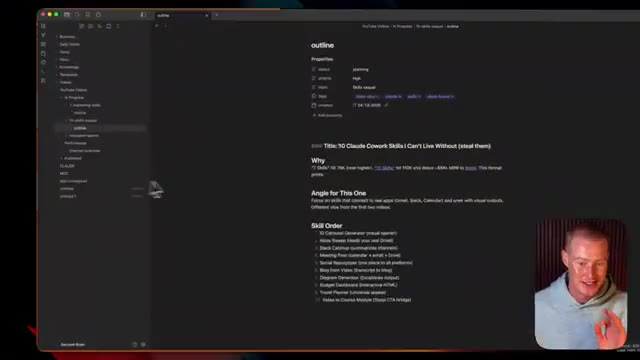
*⏱️ 00:10:10 — Capture d'écran de l'application Obsidian affichant un document Markdown « outline » pour une vidéo sur les compétences Claude, avec l'intervenant en vignette en bas à droite.*

---

### ⏱️ `[00:10:36 - 00:10:59]` | Segment #29

**🔊 Audio (Transcription Intégrale Mot pour Mot en Français) :**
> Allez-y et ouvrez ceci. Et ce que nous allons voir ici maintenant, ce sont plusieurs choses différentes. Nous pourrions donc créer un nouveau coffre-fort. Nous pourrions ouvrir un dossier en tant que coffre-fort ou ouvrir un coffre-fort avec Obsidian Sync. Il y a donc deux ou trois choses que vous pourriez faire dès maintenant. Vous pourriez ajouter un nouveau dossier sur votre bureau ou vous pourriez ouvrir un dossier existant que vous avez déjà. Mais pour les besoins de cette vidéo, je vais simplement en créer un à partir de zéro. Je vais donc simplement ouvrir un nouveau dossier sur mon ordinateur.

**👁️ Analyse Visuelle d'Écran (gemini-3.5-flash-lite) :**
**Interface & Outils** : Obsidian

**Contenu textuel & Code** : Menu principal d'Obsidian affichant les options : "Create new vault", "Open folder as vault", et "Open vault from Obsidian Sync".

**Action / Démonstration** : Présentation des différentes options de configuration initiale d'un coffre-fort dans Obsidian.

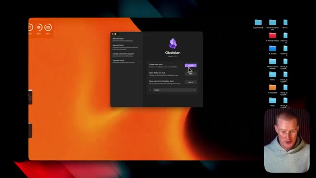
*⏱️ 00:10:41 — L'écran affiche l'interface d'accueil du logiciel Obsidian avec les options de création et d'ouverture de coffre-fort (vault).*

---

### ⏱️ `[00:10:59 - 00:11:19]` | Segment #30

**🔊 Audio (Transcription Intégrale Mot pour Mot en Français) :**
> Je vais nommer ce dossier Obsidian, puis je vais ouvrir le dossier en tant que coffre-fort. Et tout ce que je vais faire, c'est chercher ce dossier Obsidian ici dans le Finder. Et comme vous pouvez le voir, je peux cliquer dessus et l'ouvrir, et c'est un dossier vide. Il n'y a absolument rien ici. Si je l'affiche, vous pouvez voir qu'il n'y a rien dedans. Et maintenant, nous avons cette interface vide à l'intérieur d'Obsidian.

**👁️ Analyse Visuelle d'Écran (gemini-3.5-flash-lite) :**
**Interface & Outils** : macOS Finder

**Contenu textuel & Code** : Fenêtres de navigation de fichiers du système d'exploitation macOS et dossiers de stockage locaux

**Action / Démonstration** : Navigation et recherche d'un dossier pour l'ouvrir en tant que coffre-fort Obsidian

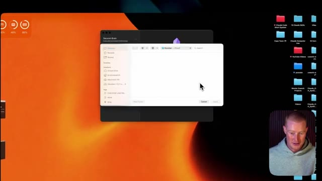
*⏱️ 00:11:04 — Image #1 montre l'interface du Finder sur macOS avec une fenêtre de sélection de dossier Obsidian ouverte au centre.*

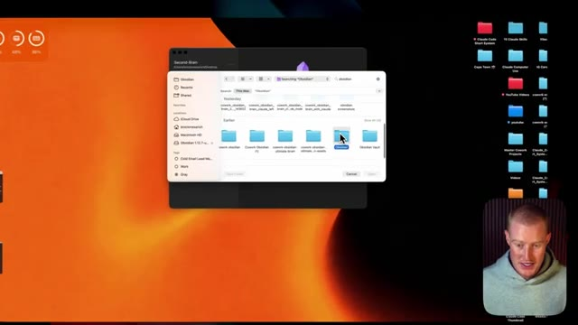
*⏱️ 00:11:09 — Image #2 montre l'utilisation de la barre de recherche du Finder pour localiser et sélectionner un dossier Obsidian spécifique.*

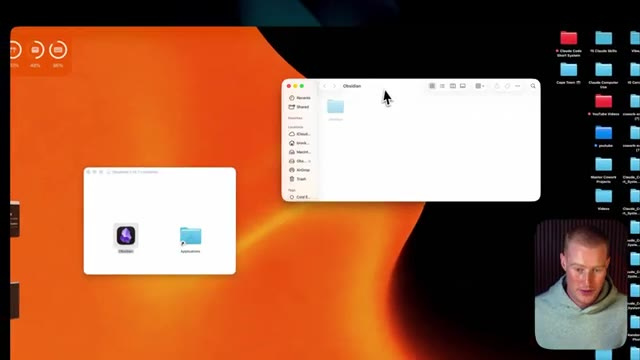
*⏱️ 00:11:14 — Image #3 montre le dossier Obsidian ouvert affichant son contenu vide dans le gestionnaire de fichiers.*

---

### ⏱️ `[00:11:19 - 00:11:39]` | Segment #31

**🔊 Audio (Transcription Intégrale Mot pour Mot en Français) :**
> Ensuite, nous devons revenir sur Cowork et concrètement pointer ceci vers ce dossier que nous venons de créer sur notre bureau. Donc ce que je vais faire, c'est que je vais aller sur Cowork, ouvrir une nouvelle tâche, et ensuite je vais cliquer sur ce dossier ici. Et je vais faire défiler vers le bas et cliquer sur choisir un dossier différent, et ensuite simplement chercher Obsidian ou quel que soit le nom que nous venons de donner à notre dossier là-bas.

**👁️ Analyse Visuelle d'Écran (gemini-3.5-flash-lite) :**
**Interface & Outils** : Interface logicielle de Cowork (application de gestion de tâches et de projets assistée par IA).

**Contenu textuel & Code** : Liste des tâches actives, options de configuration de projet, menu déroulant de sélection de répertoires de fichiers et paramètres du modèle Opus 4.6.

**Action / Démonstration** : Navigation dans l'interface de Cowork, ouverture d'une nouvelle tâche et sélection d'un dossier de projet pour pointer vers le répertoire de travail créé.

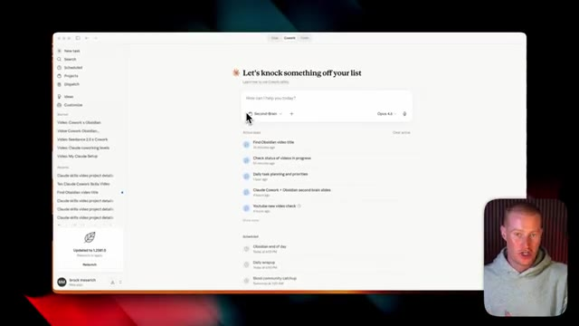
*⏱️ 00:11:24 — Interface de Cowork montrant le curseur interagissant avec les options de tâche et le sélecteur de dossier "Second-Brain".*

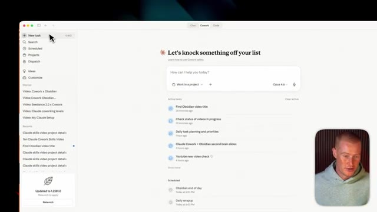
*⏱️ 00:11:29 — Navigation dans l'application Cowork avec le curseur se positionnant sur le bouton "New task" dans le panneau de gauche.*

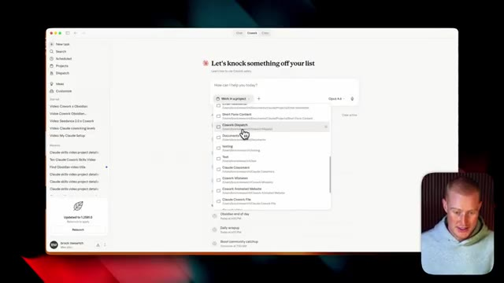
*⏱️ 00:11:34 — Déroulement du menu de sélection de projets/dossiers dans Cowork, affichant la liste des dossiers disponibles incluant "Cowork Dispatch".*

---

### ⏱️ `[00:11:39 - 00:12:01]` | Segment #32

**🔊 Audio (Transcription Intégrale Mot pour Mot en Français) :**
> Par exemple, laissez-moi juste cliquer sur ceci et l'ouvrir. Je vais cliquer sur toujours autoriser pour que cela puisse effectuer des modifications. Et juste comme ça, nous travaillons désormais à l'intérieur de ceci. Donc ce que je vais personnellement faire, c'est simplement donner un déversement d'idées sur tout ce que je veux que cela ait comme contexte. Pour que nous puissions réellement former ce second cerveau avec différents sous-dossiers et catégories. Très bien, donc je veux réellement former ceci comme mon second cerveau à l'intérieur d'Obsidian.

**👁️ Analyse Visuelle d'Écran (gemini-3.5-flash-lite) :**
**Interface & Outils** : Application Cowork sur bureau (interface de gestion de tâches et de productivité avec IA).

**Contenu textuel & Code** : Interface utilisateur de Cowork affichant le champ de saisie « How can I help you today? » et une liste de tâches actives et planifiées (« Find Obsidian video title », « Check status of videos in progress », etc.).

**Action / Démonstration** : Navigation et présentation de l'application Cowork par le créateur.

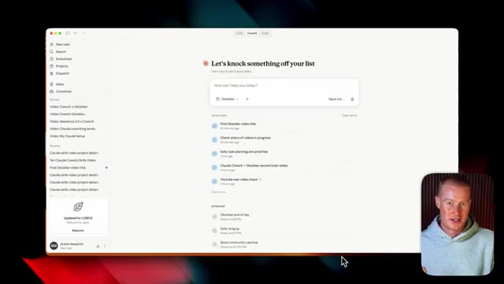
*⏱️ 00:11:50 — Interface de l'application Cowork affichant une liste de tâches, avec une petite fenêtre vidéo du présentateur en bas à droite.*

---

### ⏱️ `[00:12:01 - 00:12:37]` | Segment #33

**🔊 Audio (Transcription Intégrale Mot pour Mot en Français) :**
> Ce que je veux que tu fasses, c'est d'ajouter quelques sections différentes. Je veux que tu ajoutes un dossier appelé vidéos YouTube. Et c'est là que j'ai fondamentalement tout ce qui concerne les vidéos YouTube. C'est comme pour toute la préparation de mes vidéos. Je veux que tu gardes une trace des vidéos qui sont en cours, des vidéos qui ont été publiées, et ensuite même que tu gardes une trace des performances de toutes ces vidéos. Je veux aussi que tu crées une section séparée dans ce dossier, et ça va être pour la communauté School. Donc c'est tout ce qui concerne ma communauté School, ainsi que je veux que tu ajoutes une section ici pour tout le travail avec mes clients. Donc je vais juste envoyer ça. Et ce que ça va faire, c'est que ça va

**👁️ Analyse Visuelle d'Écran (gemini-3.5-flash-lite) :**
**Interface & Outils** : Application de productivité Cowork.

**Contenu textuel & Code** : Interface utilisateur avec liste de tâches et barre de recherche/prompt ("How can I help you today?").

**Action / Démonstration** : Navigation et présentation de l'interface de gestion de tâches.

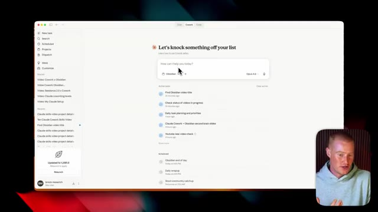
*⏱️ 00:12:10 — Capture d'écran montrant l'interface d'une application de productivité (Cowork) avec le visage du présentateur en incrustation.*

---

### ⏱️ `[00:12:37 - 00:13:12]` | Segment #34

**🔊 Audio (Transcription Intégrale Mot pour Mot en Français) :**
> crée ces différents sous-dossiers à l'intérieur de ce dossier, et cela devrait s'afficher dans Obsidian. Donc, donnons-lui juste une seconde. Très bien. Et juste comme ça, il est indiqué maintenant que notre structure de second cerveau est configurée dans Obsidian. Voici ce qu'il a construit. Il a ajouté le carrefour central des vidéos YouTube, il a ajouté la communauté d'école et il a ajouté le travail avec les clients. Donc, si je reviens sur Obsidian, vous pouvez maintenant voir que cela se reflète fidèlement ici. Nous avons donc le travail avec les clients. Nous avons les clients actifs, les archives. Nous avons les prospects, les modèles, toutes ces différentes sous-catégories. Et à l'intérieur de la communauté d'école, nous avons toutes ces autres choses. Nous avons le contenu, nous avons les cours, nous avons les événements, tout cela est maintenant structuré à l'intérieur d'Obsidian.

**👁️ Analyse Visuelle d'Écran (gemini-3.5-flash-lite) :**
**Interface & Outils** : Application de prise de notes Obsidian et interface de discussion.

**Contenu textuel & Code** : Texte détaillant la configuration d'un second cerveau avec des sections pour les vidéos YouTube, la communauté Skool et le travail client.

**Action / Démonstration** : Le présentateur montre et explique la structure de dossiers générée dans Obsidian.

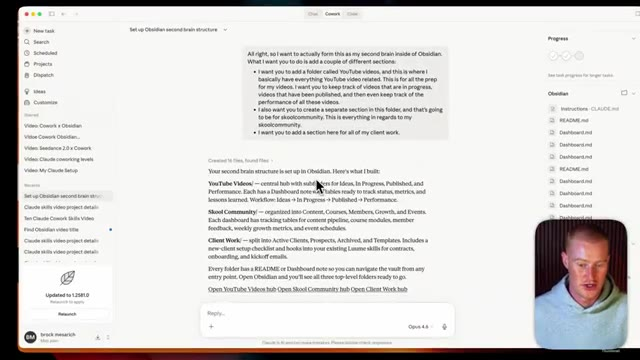
*⏱️ 00:12:46 — Interface d'une application montrant une structure de second cerveau configurée dans Obsidian avec du texte explicatif.*

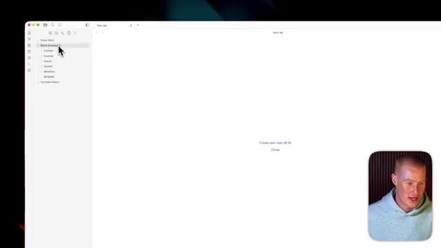
*⏱️ 00:13:03 — Navigation dans les dossiers de l'application Obsidian montrant la hiérarchie des répertoires.*

---

### ⏱️ `[00:13:12 - 00:13:34]` | Segment #35

**🔊 Audio (Transcription Intégrale Mot pour Mot en Français) :**
> Ensuite, nous devons parler du fichier ClaudeMD. Et ce sera fondamentalement la carte du cerveau. Donc, vous savez probablement déjà ce qu'est un fichier ClaudeMD. C'est essentiellement quelque chose qui est chargé à chaque conversation, indiquant à Claude comment il doit fonctionner. De cette façon, vous n'avez pas besoin de vous répéter sans cesse. C'est donc essentiellement pour expliquer qui vous êtes, comment vous voulez qu'il agisse, et des instructions très générales sur la façon dont Claude doit interagir avec vous.

**👁️ Analyse Visuelle d'Écran (gemini-3.5-flash-lite) :**
**Interface & Outils** : Navigateur web affichant une page web de présentation.

**Contenu textuel & Code** : Texte explicatif sur le fichier CLAUDE.md et une illustration centrale représentant le fichier connectant différents dossiers ("The map to your brain").

**Action / Démonstration** : Présentation visuelle de la page web expliquant le concept du fichier CLAUDE.md pour l'IA.

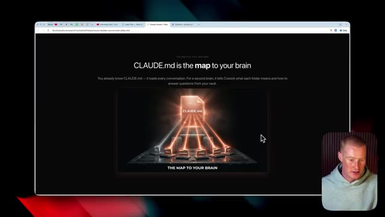
*⏱️ 00:13:17 — Une capture d'écran d'un navigateur web montrant une page de présentation avec le titre "CLAUDE.md is the map to your brain", ainsi qu'une illustration graphique du fichier et du présentateur en médaillon.*

---

### ⏱️ `[00:13:34 - 00:13:54]` | Segment #36

**🔊 Audio (Transcription Intégrale Mot pour Mot en Français) :**
> Donc pour un second cerveau, c'est super important parce que cela indique à Claude Cowork ce que signifie chaque dossier et comment répondre à des questions spécifiques provenant de votre coffre-fort, car nous allons avoir beaucoup, beaucoup de contexte à l'intérieur de notre second cerveau et il doit comprendre comment nous pouvons en tirer le meilleur parti. Très bien, alors ensuite ce que nous devons faire, c'est en fait créer ce fichier ClaudeMD.

**👁️ Analyse Visuelle d'Écran (gemini-3.5-flash-lite) :**
**Interface & Outils** : Navigateur web affichant une diapositive de présentation

**Contenu textuel & Code** : Texte « CLAUDE.md is the map to your brain » et une illustration visuelle du fichier centralisant l'accès aux dossiers du coffre-fort.

**Action / Démonstration** : Le présentateur explique le rôle du fichier CLAUDE.md comme carte directrice pour naviguer dans un second cerveau.

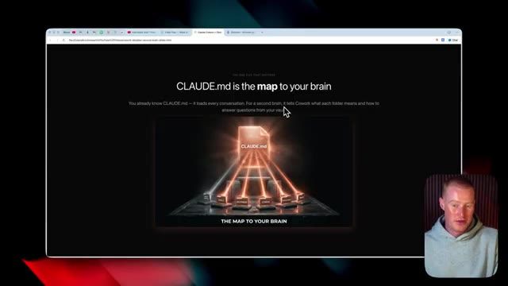
*⏱️ 00:13:39 — Une page web affichant une présentation sur le fichier CLAUDE.md, qualifié de « map to your brain », avec une illustration graphique montrant comment il connecte les différents dossiers d'un second cerveau.*

---

### ⏱️ `[00:13:54 - 00:14:28]` | Segment #37

**🔊 Audio (Transcription Intégrale Mot pour Mot en Français) :**
> Donc ce que je vais faire, c'est que je vais utiliser ce prompt. Je veux que tu écrives un fichier ClaudeMD pour la racine de ce coffre. C'est mon second cerveau. En gros, ça dit : regarde les dossiers que j'ai configurés. Pose-moi toutes les questions rapides dont tu as besoin sur qui je suis, à quoi sert chaque dossier. Fais ça court, environ 30 lignes. Donc en gros, il va y avoir quatre sections : qui je suis, la carte des dossiers, comment répondre aux questions courantes et les règles de style. Donc ce que ça va faire maintenant, c'est que ça va m'interviewer afin de remplir le CloudMD juste ici, qui contient en gros les instructions pour ce coffre. Très bien. Donc ça va me faire passer par une série de questions différentes. Du coup, je ne vais pas vous ennuyer. Je vais passer par tout ça et

**👁️ Analyse Visuelle d'Écran (gemini-3.5-flash-lite) :**
**Interface & Outils** : Application de gestion de tâches et de projets de type Cowork / Obsidian avec interface web épurée et vignette vidéo du présentateur en bas à droite.

**Contenu textuel & Code** : Texte du prompt : "I want you to write a CLAUDE.md file for the root of this vault. This is my second brain. Look at the folders I've set up, ask me any quick questions..."

**Action / Démonstration** : Saisie et sélection de texte dans un champ de prompt de l'application avant l'ouverture des instructions de dossier.

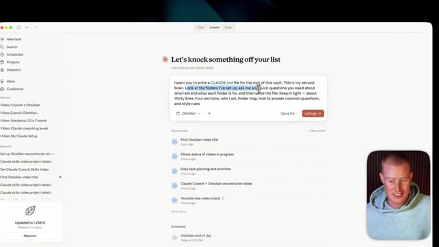
*⏱️ 00:14:03 — Interface logicielle affichant un prompt textuel lié à la configuration d'un fichier CLAUDE.md pour un coffre Obsidian (second cerveau).*

*⏱️ 00:14:19 — Fenêtre modale "Folder instructions" affichant des consignes et exemples d'utilisation pour structurer le travail dans un dossier.*

---

### ⏱️ `[00:14:28 - 00:15:02]` | Segment #38

**🔊 Audio (Transcription Intégrale Mot pour Mot en Français) :**
> puis vous montrer le résultat final du fichier CloudMD. Et voilà, il a généré le fichier markdown. Ce qu'on pourrait faire, c'est cliquer ici. En gros, ça détaille qui je suis, ça montre l'arborescence des dossiers. Donc les vidéos YouTube, la communauté school, tout ça. Et ensuite, ça montre même comment répondre aux questions courantes. Donc si je demande, sur quoi je travaille ? Ça lui donne essentiellement pour instruction de vérifier le dossier des vidéos YouTube en cours, plus le tableau de bord des contrats actifs des clients. Donc ça indique simplement à flawed où chercher à l'intérieur du sous-dossier afin d'obtenir des informations spécifiques. Et maintenant, pour tester ça, laissez-moi juste lui donner la consigne. Sur quoi je travaille et qu'est-ce que

**👁️ Analyse Visuelle d'Écran (gemini-3.5-flash-lite) :**
**Interface & Outils** : Application de prise de notes / assistant IA (type Claude / Obsidian) avec affichage du code Markdown en double volet.

**Contenu textuel & Code** : Fichier `CLAUDE.md` structuré avec les sections "Who I am", "Folder map" (YouTube Videos, Skool Community, Client Work) et "Style rules".

**Action / Démonstration** : Présentation et navigation dans le fichier markdown généré automatiquement par l'IA pour structurer le coffre-fort de notes.

*⏱️ 00:14:36 — Vue de l'interface montrant le fichier CLAUDE.md généré avec les sections "Who I am" et "Folder map".*

*⏱️ 00:14:45 — Gros plan sur le contenu du fichier markdown affichant les règles de style et les réponses aux questions courantes.*

*⏱️ 00:14:53 — Vue finale de l'interface avec le curseur soulignant la section "How to answer common questions".*

---

### ⏱️ `[00:15:02 - 00:15:34]` | Segment #39

**🔊 Audio (Transcription Intégrale Mot pour Mot en Français) :**
> ce qu'il va faire c'est qu'il va faire référence à ces différents dossiers que nous venons de configurer et d'instruire à l'intérieur de CloudMD. Donc il a dit que nous travaillons sur ces cinq-là. C'est formidable. Et ceci est juste, vous savez, rempli de fausses informations. Ce ne sont pas de réels livrables pour des clients. Puisque je viens de créer ce nouveau dossier pour vous les gars, j'avais besoin d'y ajouter un contexte spécifique. Maintenant, si nous retournons dans Obsidian que nous avons un dossier, vous savez, plus rempli. Donc nous avons le travail client, nous avons différents clients actifs. Nous pouvons jeter un œil à la vue d'ensemble ici. Toute cette information maintenant est précisément cartographiée à partir de ce que nous avons créé

**👁️ Analyse Visuelle d'Écran (gemini-3.5-flash-lite) :**
**Interface & Outils** : Application de notes et gestion de projet (Obsidian).

**Contenu textuel & Code** : Organisation des dossiers et fichiers de travail (Client Work, Skool Community, README, listes de tâches).

**Action / Démonstration** : Navigation et présentation de la structure des dossiers et de la configuration des espaces de travail.

*⏱️ 00:15:10 — Capture montrant l'interface d'un outil de notes/productivité (semblable à Obsidian) avec des listes de tâches et un panneau latéral.*

*⏱️ 00:15:26 — Capture montrant l'explorateur de dossiers et un fichier README d'une structure de projet communautaire.*

---

### ⏱️ `[00:15:34 - 00:16:00]` | Segment #40

**🔊 Audio (Transcription Intégrale Mot pour Mot en Français) :**
> à l'intérieur de cowork. Ce que je m'apprête à vous montrer, c'est là que ça devient vraiment puissant. Et ce dont je parle, c'est du moment où nous combinons des tâches planifiées avec des connecteurs, des serveurs MCP et Obsidian. De cette façon, nous ne faisons pas seulement que créer ce cerveau, pour ainsi dire, en faisant des allers-retours avec cowork, mais il extrait réellement tout ce contexte différent de toutes vos différentes applications en pilotage automatique et compile cela automatiquement dans Obsidian, autrement connu sous le nom de notre deuxième cerveau.

**👁️ Analyse Visuelle d'Écran (gemini-3.5-flash-lite) :**
**Interface & Outils** : Navigateur web affichant une page de présentation avec un schéma schématique et du texte.

**Contenu textuel & Code** : Schéma intitulé 'YOUR BRAIN WHILE YOU SLEEP' reliant 'SCHEDULED TASKS', 'CONNECTORS', 'ZAPIER MCP' et '8,000 APPS', avec des listes à puces explicatives sur le côté.

**Action / Démonstration** : Le présentateur commente le diagramme illustrant la combinaison des tâches planifiées, des connecteurs et d'Obsidian.

*⏱️ 00:15:41 — Capture d'écran montrant une page web avec le titre 'This is where it gets stupid powerful' et un diagramme explicatif sur le fonctionnement de l'IA pendant le sommeil, avec le présentateur visible en incrustation.*

---

### ⏱️ `[00:16:00 - 00:16:19]` | Segment #41

**🔊 Audio (Transcription Intégrale Mot pour Mot en Français) :**
> Donc, si nous ajoutons des connecteurs à "co-work", notre cerveau est capable de voir en gros tout ce que nous pouvons voir. Il peut donc se connecter à notre calendrier, Gmail, Slack, Google Drive, en gros n'importe laquelle des différentes applications que nous utilisons. Il est capable d'en extraire du contexte et de le stocker dans notre cerveau. Au lieu de simplement parler des tâches planifiées et de leur puissance, laissez-moi vous montrer cela en direct.

**👁️ Analyse Visuelle d'Écran (gemini-3.5-flash-lite) :**
**Interface & Outils** : Navigateur web, interface de gestion de tâches et de notes avec intégration d'applications tierces.

**Contenu textuel & Code** : Schéma conceptuel d'intégration de données et interface utilisateur de gestion montrant des résumés de tâches exécutées et des chemins de fichiers.

**Action / Démonstration** : Présentation des connexions possibles entre différentes applications et un coffre-fort numérique de notes.

*⏱️ 00:16:05 — Illustration schématique montrant des applications (Gmail, Calendar, Slack, Drive) connectées par des câbles lumineux à un dossier central nommé "Your Vault".*

*⏱️ 00:16:14 — Interface logicielle affichant un résumé de tâche planifiée avec des notes quotidiennes, des listes de tâches et des intégrations connectées (Gmail, Google Calendar).*

---

### ⏱️ `[00:16:19 - 00:16:38]` | Segment #42

**🔊 Audio (Transcription Intégrale Mot pour Mot en Français) :**
> Donc j'ai créé celui-ci qui s'exécute tous les jours à 18 heures. Non seulement il extrait les données de mon Google Agenda et vérifie quelles réunions j'ai, mais il extrait aussi les données de mon Gmail pour essentiellement signaler tous les e-mails urgents afin que je puisse y répondre le matin. Mais il remplit également la note quotidienne dans Obsidian que nous créons effectivement.

**👁️ Analyse Visuelle d'Écran (gemini-3.5-flash-lite) :**
**Interface & Outils** : Application de bureau (interface de type outil d'automatisation / assistant IA) avec intégration Obsidian, Google Calendar et Gmail.

**Contenu textuel & Code** : Résumé de tâche textuel montrant le chemin d'accès aux notes Obsidian (/Users/brockmesarich/Desktop/Obsidian/Daily Notes/2026-04-15.md) et le statut des e-mails prioritaires signalés.

**Action / Démonstration** : Le présentateur présente l'interface utilisateur d'une tâche automatisée affichant les résultats de l'extraction de données e-mail et agenda.

*⏱️ 00:16:24 — Capture d'écran montrant l'interface d'une application d'automatisation avec un résumé de tâche concernant le traitement des e-mails prioritaires et des notes Obsidian.*

*⏱️ 00:16:33 — Capture d'écran similaire à l'image 1, avec le curseur pointant sur le fichier de notes Obsidian généré automatiquement.*

---

### ⏱️ `[00:16:38 - 00:16:57]` | Segment #43

**🔊 Audio (Transcription Intégrale Mot pour Mot en Français) :**
> Donc, si j'ouvre ce fichier Markdown, vous pouvez voir ce qu'il y a sur mon calendrier pour demain. Il détaille les trois principales choses que je dois faire demain. Il détaille la priorité dans ma boîte de réception e-mail. Et il montre même les vidéos actives que j'ai en préparation. Et tout cela, là, est tiré de mon second cerveau Obsidian. Laissez-moi donc vous montrer exactement ce que je veux dire.

**👁️ Analyse Visuelle d'Écran (gemini-3.5-flash-lite) :**
**Interface & Outils** : Application de notes Obsidian / interface de gestion de tâches Markdown.

**Contenu textuel & Code** : Texte Markdown détaillant un calendrier, le top 3 des tâches à faire, les priorités d'e-mails et le pipeline de vidéos.

**Action / Démonstration** : Le présentateur fait défiler un fichier Markdown synthétisant ses tâches quotidiennes, son calendrier et ses projets de vidéos.

*⏱️ 00:16:43 — Capture d'écran montrant une application de prise de notes (Obsidian) avec le calendrier et les trois tâches prioritaires pour le lendemain.*

*⏱️ 00:16:47 — Capture d'écran montrant la suite du fichier Markdown avec le pipeline des vidéos actives en préparation.*

---

### ⏱️ `[00:16:57 - 00:17:18]` | Segment #44

**🔊 Audio (Transcription Intégrale Mot pour Mot en Français) :**
> Si je viens sur le côté gauche et que je regarde mes notes quotidiennes, vous pouvez voir que nous avons cette nouvelle qui vient d'être générée avec cette tâche planifiée. Cela crée cela automatiquement pour moi chaque jour. Et à l'intérieur d'ici, nous pouvons voir tout ce que je viens de vous montrer. Cela montre un calendrier, montre nos trois principales choses pour la journée. Cela montre tout dans notre boîte de réception e-mail. Cela montre même nos points d'action avec lesquels nous devons aller de l'avant.

**👁️ Analyse Visuelle d'Écran (gemini-3.5-flash-lite) :**
**Interface & Outils** : Application de prise de notes (Obsidian)

**Contenu textuel & Code** : Notes quotidiennes avec des listes de tâches à effectuer (action items), suivi de projets vidéo (active video pipeline) et gestion de clients.

**Action / Démonstration** : Le présentateur navigue et montre ses notes quotidiennes générées automatiquement par une tâche planifiée.

*⏱️ 00:17:02 — Vue d'une application de notes (Obsidian) avec la liste des fichiers sur le panneau de gauche et une page de notes quotidiennes structurée (Open action items, Active video pipeline) sur le panneau de droite.*

---

### ⏱️ `[00:17:18 - 00:17:44]` | Segment #45

**🔊 Audio (Transcription Intégrale Mot pour Mot en Français) :**
> Et ensuite voici ces vidéos sur lesquelles nous travaillons et qui étaient à l'intérieur du pipeline vidéo. Cela montre même l'hyperlien pour que je puisse ouvrir ce fichier séparé, qui est un autre fichier markdown à l'intérieur d'Obsidian, ainsi que nous pouvons cliquer dessus et voir chacun de nos clients actifs. Lه‌های [correction : laissez-moi] donc vous montrer exactement comment vous pouvez faire cette même chose. Donc ce que vous faites, c'est pratiquement venir à une nouvelle tâche, ouvrir ce dossier Obsidian ou quel que soit le dossier dans lequel vous travaillez, et ensuite simplement expliquer ce que vous voulez qu'il fasse.

**👁️ Analyse Visuelle d'Écran (gemini-3.5-flash-lite) :**
**Interface & Outils** : Obsidian, application de notes markdown

**Contenu textuel & Code** : Tableaux de suivi de projets, liste de tâches, liens hypertextes vers des fichiers markdown.

**Action / Démonstration** : Navigation dans l'application de notes Obsidian et survol d'un lien hypertexte pour ouvrir un fichier séparé.

*⏱️ 00:17:24 — Interface d'Obsidian affichant une note de gestion de projets avec une section "Active video pipeline" montrant des liens cliquables vers des fichiers markdown.*

---

### ⏱️ `[00:17:44 - 00:18:04]` | Segment #46

**🔊 Audio (Transcription Intégrale Mot pour Mot en Français) :**
> Par exemple, laissez-moi vous montrer ce que je veux dire. Je veux que vous parcouriez ma boîte de réception d'e-mails chaque jour, ainsi que que vous regardiez à l'intérieur du dossier concernant mes vidéos YouTube et que vous me fassiez savoir quelles vidéos sont en cours, quel est leur statut, et ensuite que vous décomposiez tous les e-mails auxquels je dois répondre demain. Exécutez ceci comme une tâche planifiée tous les jours à 18 heures. Et juste comme ça, nous avons une nouvelle tâche planifiée qui s'exécute tous les jours à 18 ou 21 heures.

**👁️ Analyse Visuelle d'Écran (gemini-3.5-flash-lite) :**
**Interface & Outils** : Application de bureau Claude Cowork

**Contenu textuel & Code** : Liste de tâches automatisées comprenant 'Find Obsidian video title', 'Check status of videos in progress', 'Daily task planning and priorities', et des tâches programmées comme 'Daily inbox priority' et 'YouTube new video check'.

**Action / Démonstration** : Présentation de l'interface de l'application montrant l'automatisation des tâches quotidiennes et de la gestion des projets YouTube.

*⏱️ 00:17:49 — Interface de l'application Claude Cowork affichant une liste de tâches, la barre de saisie et la caméra du présentateur en bas à droite.*

---

### ⏱️ `[00:18:04 - 00:18:25]` | Segment #47

**🔊 Audio (Transcription Intégrale Mot pour Mot en Français) :**
> Nous pourrions effectivement cliquer ici, voir les instructions ici, ou nous pourrions toujours voir toutes nos tâches programmées dans la barre latérale de gauche et voir toutes celles qui sont en cours d'exécution. Maintenant, tout cela est formidable, mais nous devons les connecter aux différentes applications que nous utilisons. Laissez-moi donc vous montrer exactement comment faire cela. Maintenant, nous allons revenir à Cowark. Et ensuite, ce que nous allons faire, c'est que nous allons descendre dans personnaliser, venir aux connecteurs, et nous allons simplement choisir toutes les différentes applications que nous utilisons.

**👁️ Analyse Visuelle d'Écran (gemini-3.5-flash-lite) :**
**Interface & Outils** : Application de gestion de tâches et diapositive de présentation.

**Contenu textuel & Code** : Liste de tâches automatisées et schéma conceptuel des connecteurs d'applications.

**Action / Démonstration** : Navigation dans l'interface de gestion et présentation des fonctionnalités de connexion.

*⏱️ 00:18:09 — Interface logicielle affichant le panneau des tâches programmées (Scheduled tasks) avec une barre latérale à gauche.*

*⏱️ 00:18:15 — Diapositive de présentation illustrant les connecteurs reliant divers services (Gmail, Calendar, Slack, Drive) au "Vault" central.*

---

### ⏱️ `[00:18:25 - 00:18:52]` | Segment #48

**🔊 Audio (Transcription Intégrale Mot pour Mot en Français) :**
> Donc, par exemple, si j'utilise Gmail et que je veux extraire des données de mes e-mails, je cliquerais là-dessus et je me contenterais pour l'essentiel de le connecter. Même chose pour Slack. Si je veux connecter Slack, je viendrais simplement ici et je cliquerais sur connecter. Et puis disons qu'il y a une application spécifique à l'intérieur de Claude à laquelle vous ne pouvez pas vous connecter. Eh bien, je vais vous montrer une astuce qui vous connectera instantanément à plus de 8 000 applications différentes. Vous pouvez donc essentiellement nourrir votre second cerveau avec du contexte provenant de toutes ces différentes applications que vous utilisez chaque jour. Et cela est possible grâce au MCP de Zapier.

**👁️ Analyse Visuelle d'Écran (gemini-3.5-flash-lite) :**
**Interface & Outils** : Interface de gestion de connecteurs d'applications et page web de présentation (Zapier MCP).

**Contenu textuel & Code** : Répertoire de connecteurs (Slack, Exa, Vibe Prospecting, etc.) et présentation Zapier MCP avec 8000 applications supportées.

**Action / Démonstration** : Navigation dans le répertoire de connecteurs et présentation visuelle de l'intégration Zapier MCP.

*⏱️ 00:18:32 — Interface logicielle affichant un répertoire de connecteurs avec Slack sélectionné.*

*⏱️ 00:18:45 — Page web présentant le connecteur Zapier MCP avec le texte "One connector, 8,000 apps."*

---

### ⏱️ `[00:18:52 - 00:19:14]` | Segment #49

**🔊 Audio (Transcription Intégrale Mot pour Mot en Français) :**
> Donc nous allons aller sur zapier.com slash MCP. Il y aura un lien dans la description pour utiliser ceci. Nous allons cliquer sur commencer à construire. Et à partir de là, nous allons simplement créer un nouveau serveur MCP. Donc je vais cliquer là-dessus. Ensuite, je vais sélectionner notre client comme étant Claude Cowork. Et à partir de là, vous pouvez voir que j'ai déjà quelques applications différentes ajoutées ici. J'ai School, j'ai HubSpot, Stripe, quelques autres.

**👁️ Analyse Visuelle d'Écran (gemini-3.5-flash-lite) :**
**Interface & Outils** : Navigateur web affichant l'interface de configuration Zapier MCP.

**Contenu textuel & Code** : Fenêtre modale 'New MCP Server' montrant la sélection des clients MCP populaires et autres.

**Action / Démonstration** : Sélection du client MCP dans l'interface de configuration Zapier.

*⏱️ 00:19:03 — Interface du site Zapier affichant une modale de configuration 'New MCP Server' avec une liste de clients compatibles (Claude, ChatGPT, Cursor, etc.).*

---

### ⏱️ `[00:19:14 - 00:19:34]` | Segment #50

**🔊 Audio (Transcription Intégrale Mot pour Mot en Français) :**
> Et pour ajouter une application, nous venons juste ici et nous cherchons simplement l'une des applications que nous utilisons. Disons donc que nous voulons nous connecter à HubSpot. Nous pouvons continuer et cliquer ici. Et il y aura alors un bouton ici qui dit simplement connecter. Et une fois que nous aurons connecté cela, nous aurons accès à toutes ces différentes actions dans toute cette application. Ensuite, pour connecter cela à Claude Cowork, nous allons simplement cliquer sur connecter, cliquer sur ce bouton ajouter à Claude.

**👁️ Analyse Visuelle d'Écran (gemini-3.5-flash-lite) :**
**Interface & Outils** : Navigateur web affichant l'interface de gestion Zapier MCP.

**Contenu textuel & Code** : Liste des applications configurées (Stripe, HubSpot, Google Drive, Skool, Google Docs) et fenêtre d'ajout d'outils.

**Action / Démonstration** : Le présentateur montre comment rechercher et ajouter une application comme HubSpot dans l'interface de configuration Zapier MCP.

*⏱️ 00:19:19 — Interface Zapier MCP montrant une fenêtre contextuelle pour ajouter des outils avec une barre de recherche.*

*⏱️ 00:19:24 — Interface Zapier MCP affichant la liste des outils connectés incluant Stripe, HubSpot, Google Drive, Skool et Google Docs.*

---

### ⏱️ `[00:19:35 - 00:19:55]` | Segment #51

**🔊 Audio (Transcription Intégrale Mot pour Mot en Français) :**
> Et ensuite, à partir d'ici, nous allons revenir à nos connecteurs. Nous allons cliquer sur parcourir les connecteurs, puis chercher Zapier. Et tout ce que nous allons faire, c'est coller cette URL que Zapier MCP nous a donnée. Et c'est aussi simple que ça, les gars, nous avons maintenant un second cerveau que nous pouvons commencer à alimenter et à développer. En ce moment, le mien a l'air petit parce que je faisais une démo pour la vidéo.

**👁️ Analyse Visuelle d'Écran (gemini-3.5-flash-lite) :**
**Interface & Outils** : Application de bureau avec un répertoire de connecteurs (Claude / assistant IA).

**Contenu textuel & Code** : Liste des connecteurs disponibles (Ticket Tailor, Linear, Hugging Face, Amplitude, Zapier) et détails de configuration du connecteur Zapier (Connector URL : https://mcp.zapier.com/api/v1/connect).

**Action / Démonstration** : Navigation dans le répertoire des connecteurs pour rechercher, sélectionner et configurer le connecteur Zapier.

*⏱️ 00:19:40 — Fenêtre de répertoire montrant l'onglet des connecteurs avec une barre de recherche pour trouver des applications et des services.*

*⏱️ 00:19:45 — Page détaillée du connecteur Zapier dans le répertoire, affichant la description, la version, l'auteur et l'URL du connecteur.*

---

### ⏱️ `[00:19:55 - 00:20:22]` | Segment #52

**🔊 Audio (Transcription Intégrale Mot pour Mot en Français) :**
> Mais si je retourne en arrière et que je vous en montre un que j'utilise actuellement, vous pourrez voir que cela cartographie essentiellement tous les différents documents que je crée à l'intérieur de Cloud Cowork et que vous utilisiez ou non l'interface à l'intérieur d'Obsidian, parce que vous ne l'utiliserez probablement pas beaucoup. Vous n'allez pas venir ici pour modifier individuellement ces fichiers. Vous pouvez simplement demander à Claude Cowork de le faire, mais vous remarquerez vraiment la puissance de ceci lorsque vous extrayez le contexte de conversations précédentes ou de fichiers spécifiques à l'intérieur de Claude Cowork au fil du temps.

**👁️ Analyse Visuelle d'Écran (gemini-3.5-flash-lite) :**
**Interface & Outils** : Obsidian (Graph view)

**Contenu textuel & Code** : Vue en réseau (graphe) de différents documents et fichiers interconnectés.

**Action / Démonstration** : Présentation de la cartographie visuelle des documents.

*⏱️ 00:20:02 — Capture d'écran montrant l'interface d'Obsidian avec la vue en graphique (Graph view) des documents interconnectés.*

---

### ⏱️ `[00:20:22 - 00:20:41]` | Segment #53

**🔊 Audio (Transcription Intégrale Mot pour Mot en Français) :**
> Donc cette banque de mémoire va simplement se construire avec le temps et devenir de plus en plus performante, et en savoir plus sur vous, en savoir plus sur votre entreprise. Très bien, les gars, voilà. C'est le second cerveau Obsidian que vous pouvez connecter à Claude Cowork. Si vous avez retiré de la valeur de cette vidéo, laissez un pouce bleu, abonnez-vous à cette chaîne pour plus de contenu. Et si vous voulez aller plus loin, assurez-vous de rejoindre ma communauté School.

**👁️ Analyse Visuelle d'Écran (gemini-3.5-flash-lite) :**
**Interface & Outils** : Obsidian (application de prise de notes)

**Contenu textuel & Code** : Structure de notes et plan de cours intitulé "7 Claude Cowork Skills Every Marketer Needs".

**Action / Démonstration** : Navigation dans l'arborescence des notes de l'application Obsidian pour illustrer le second cerveau.

*⏱️ 00:20:27 — Capture d'écran montrant l'application Obsidian ouverte avec un plan de cours marketing et le présentateur en médaillon.*

---

### ⏱️ `[00:20:41 - 00:20:54]` | Segment #54

**🔊 Audio (Transcription Intégrale Mot pour Mot en Français) :**
> Il y aura un lien dans la description. À l'intérieur de ma communauté, je donne les plus de 50 compétences de co-travail Claude que j'utilise chaque jour. Et je développe de plus en plus ce répertoire chaque semaine. Ceci étant dit, les gars, merci beaucoup d'avoir regardé jusqu'à la fin. Et je vous vois les gars dans la prochaine vidéo.

**👁️ Analyse Visuelle d'Écran (gemini-3.5-flash-lite) :**
**Interface & Outils** : Navigateur web affichant une plateforme communautaire (Skool ou similaire)

**Contenu textuel & Code** : Interface utilisateur de la communauté en ligne montrant les publications et le répertoire des compétences Claude.

**Action / Démonstration** : Le présentateur conclut la vidéo en montrant la communauté en ligne et en incitant les spectateurs à s'abonner.

---

