# 🎬 Claude Code 2.0 Just Dropped (Cowork Killer?)

> **Chaîne** : [Brock Mesarich | AI for Non Techies](https://www.youtube.com/@BrockMesarich)  
> **Lien YouTube** : [https://www.youtube.com/watch?v=YHx-E8NOg8s](https://www.youtube.com/watch?v=YHx-E8NOg8s)  
> **Date de publication** : 20260417  
> **Durée** : 00:19:33  
> **Identifiant vidéo** : `YHx-E8NOg8s`  
> **Transcription & Analyse** : `whisper-v3-large-turbo+gemini-3.5-flash-lite`  

---

## 📌 Synthèse Exécutive & Outils

### 💡 Résumé
Anthropic marque un tournant majeur dans l'automatisation des flux de travail et l'intelligence artificielle appliquée avec le lancement de Claude Code 2.0 et du modèle Opus 4.7. Cette mise à jour élimine la barrière historique entre les utilisateurs non techniques et les environnements de développement complexes en proposant une application de bureau unifiée, dotée d'une interface visuelle intuitive qui rappelle le mode « Co-Work », mais avec des capacités opérationnelles nettement supérieures. 

La vidéo met en lumière une avancée technologique cruciale pour l'automatisation avancée : les « routines ». Contrairement aux tâches planifiées classiques qui exigeaient que la machine hôte reste active et l'application ouverte, les routines de Claude Code 2.0 s'exécutent directement sur les serveurs d'Anthropic en arrière-plan. Cela permet un fonctionnement en pilotage automatique continu, même lorsque l'ordinateur est éteint, tout en offrant la possibilité de déclencher des processus à distance via l'application mobile.

À travers des démonstrations pratiques, telles que la génération et la publication automatisées de carrousels Instagram, la chaîne démontre comment un utilisateur non technique peut orchestrer des tâches complexes multi-agents. L'intégration de compétences transférables, de connecteurs d'applications et de fonctionnalités de « vibe coding » positionne cette solution comme un outil redoutable pour rationaliser la création de contenu et l'optimisation des processus métier sans avoir à manipuler de terminaux ou d'environnements de développement intégrés (IDE) ardus.

### 🛠️ Outils, Modèles & Logiciels Présentés
* **Claude Code 2.0** : Nouvelle application de bureau d'Anthropic combinant la puissance d'un environnement de développement et l'accessibilité visuelle du mode Co-Work.
* **Opus 4.7** : Modèle de langage de pointe d'Anthropic offrant des performances accrues pour le raisonnement et l'exécution de tâches complexes.
* **Claude Co-Work** : Interface de collaboration et d'automatisation préexistante d'Anthropic, dont les compétences et les configurations sont entièrement transférables vers le nouveau système.
* **Cursor** : Environnement de développement intégré (IDE) orienté code, mentionné comme référence technique traditionnelle pour illustrer la complexité évitée par la nouvelle application.
* **GitHub** : Plateforme de gestion de code source et de versioning pouvant servir de déclencheur (trigger) pour les routines automatisées.
* **Zapier / Make / n8n** : Outils d'automatisation de workflows tiers couramment employés pour connecter des applications et orchestrer des flux de données complexes (mentionnés dans le contexte global de l'écosystème d'automatisation).
* **Obsidian** : Application de prise de notes structurée utilisée comme « second cerveau » et connectée aux dossiers de travail de Claude pour la gestion de projets.
* **Grok / Gemini / ChatGPT** : Modèles d'intelligence artificielle concurrents évoluant dans l'écosystème des assistants conversationnels et des agents intelligents.

### 🔑 Points Clés & Enseignements Stratégiques
* **Démocratisation des outils de développement** : Claude Code 2.0 résout le problème de l'accessibilité en éliminant l'obligation de passer par un terminal textuel ou un IDE complexe comme Cursor, ouvrant ainsi l'accès à des fonctionnalités de codage avancées pour le grand public.
* **Exécution cloud sur serveurs distants** : L'introduction des « routines » permet aux processus automatisés de tourner en continu sur l'infrastructure d'Anthropic, sranchissant de la contrainte technique de laisser l'ordinateur allumé et l'application active.
* **Transférabilité des compétences** : Toutes les compétences (skills) et configurations préalablement développées dans Claude classique ou Co-Work sont automatiquement migrées et prises en charge dans la nouvelle application de bureau.
* **Pilotage multiplateforme à distance** : Grâce au mode d'expédition (shipping mode) et à l'application mobile de Claude, il est possible d'initier et de superviser des flux de travail complexes directement depuis son smartphone.
* **Gestion multi-dossiers et flexibilité de l'espace de travail** : L'application ne se limite pas à un seul répertoire local ; elle permet de naviguer et de travailler simultanément sur différents dossiers de projets, tels qu'un système de raccourcis de code ou un second cerveau sous Obsidian.
* **Planification flexible des routines** : Les routines peuvent être paramétrées pour s'exécuter selon des fréquences personnalisées (quotidiennes, hebdomadaires) ou être déclenchées dynamiquement via des webhooks, GitHub ou des appels API.
* **Interface latérale de contrôle et d'aperçu** : Le panneau latéral droit offre une visibilité granulaire incluant un mode aperçu (permettant de visualiser l'interface utilisateur des applications en cours de création), un terminal intégré optionnel et le suivi en temps réel des tâches.
* **Validation préalable des plans d'action** : Avant l'exécution de tâches critiques, Claude génère des plans structurés soumis à l'approbation de l'utilisateur, garantissant un contrôle total sur les actions entreprises par l'IA.
* **Approche « Vibe Coding »** : L'outil permet de concevoir, tester et ajuster des pipelines logiciels et des scripts de manière conversationnelle et visuelle, sans avoir à analyser directement les lignes de code sous-jacentes.
* **Automatisation marketing de bout en bout** : La démonstration de création et de publication automatisée de carrousels Instagram illustre la capacité de l'outil à gérer des chaînes de production de contenu complexes en pilote automatique complet.

---

## ⏱️ Chronologie & Transcription Complète Audio & Visuelle (Mot pour Mot)

### ⏱️ `[00:00:00 - 00:00:26]` | Segment #01

**🔊 Audio (Transcription Intégrale Mot pour Mot en Français) :**
> Anthropic vient de lancer Claude Code 2.0, et si vous êtes un utilisateur de Co-Work, vous devez absolument y prêter attention. Parce que pour la toute première fois, Claude Code n'a pas l'air ni la sensation d'un outil de développement. On a honnêtement l'impression d'utiliser Co-Work, mais il peut faire des choses que Co-Work ne peut tout simplement pas faire. Nous parlons de plusieurs agents fonctionnant en même temps, de tâches qui continuent même lorsque votre ordinateur est fermé, et ils viennent juste de lancer Opus 4.7, ce qui rend l'ensemble beaucoup plus performant.

**👁️ Analyse Visuelle d'Écran (gemini-3.5-flash-lite) :**
**Interface & Outils** : Application logicielle Claude Code 2.0 et interface de navigateur web localhost.

**Contenu textuel & Code** : Menu de session, options de chat « Type / for commands » et demande d'approbation d'agent (« slack_post_message » avec rapport d'incident de latence API).

**Action / Démonstration** : Navigation dans l'interface de Claude Code et validation ou refus d'une action d'agent IA nécessitant une approbation humaine.

*⏱️ 00:00:06 — Interface sombre de l'application Claude Code 2.0 présentant un espace de travail minimaliste avec un personnage pixelisé rouge au centre.*

*⏱️ 00:00:19 — Capture d'écran d'un navigateur web affichant une interface d'application avec une modale « Agent Requests Approval » demandant l'autorisation d'envoyer un message sur Slack.*

---

### ⏱️ `[00:00:26 - 00:00:44]` | Segment #02

**🔊 Audio (Transcription Intégrale Mot pour Mot en Français) :**
> Donc, dans cette vidéo, je vais décortiquer tout ça et le comparer à Claude Co-Work, et je vais même vous montrer comment je fais en sorte que Claude génère automatiquement des carrousels Instagram et les publie pour moi en pilotage automatique. Donc, si vous avez déjà eu l'impression de devenir trop grand pour CoWork, mais que vous ne vouliez pas avoir à toucher un terminal ou Cursor, c'est exactement ce que vous attendiez. Alors, sans plus tarder, plongeons-nous là-dedans.

**👁️ Analyse Visuelle d'Écran (gemini-3.5-flash-lite) :**
**Interface & Outils** : Éditeur de code Cursor, Terminal de commandes.

**Contenu textuel & Code** : Code source en arrière-plan et interface graphique de l'éditeur Cursor.

**Action / Démonstration** : Présentation de l'outil de développement et de codage Cursor.

*⏱️ 00:00:40 — Le logo de l'éditeur de code Cursor affiché au premier plan devant une fenêtre de terminal montrant du code source.*

---

### ⏱️ `[00:00:45 - 00:01:10]` | Segment #03

**🔊 Audio (Transcription Intégrale Mot pour Mot en Français) :**
> Très bien, parlons donc rapidement de ce qu'est le nouveau Claude Code 2.0. Ensuite, je vais détailler l'interface, la façon de l'utiliser, les nouveautés, et fondamentalement comparer cela à Claude CoWork. Alors tout d'abord, parlons très rapidement du problème auquel vous avez probablement été confronté dans Claude Code si vous êtes un utilisateur plutôt non technique. C'est beaucoup plus puissant que Claude CoWork, mais il y a cette barrière entre une personne non technique et la possibilité d'utiliser Claude Code.

**👁️ Analyse Visuelle d'Écran (gemini-3.5-flash-lite) :**
**Interface & Outils** : Navigateur web affichant un fichier HTML local de présentation (slides).

**Contenu textuel & Code** : Texte à l'écran : "CLAUDE CODE 2.0", "Claude Code 2.0 Just Dropped", et "Is this the end of Cowork?".

**Action / Démonstration** : Le présentateur introduit la nouvelle version de Claude Code et pose la question de son impact sur Claude CoWork.

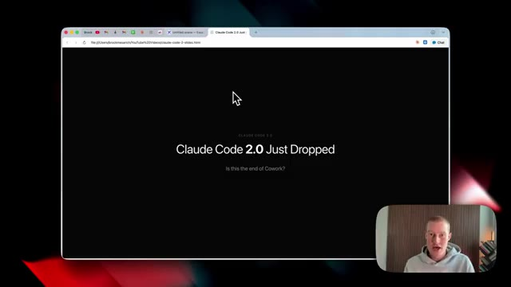
*⏱️ 00:00:51 — Une capture d'écran d'un navigateur web affichant une page de présentation de diapositives avec le titre principal "Claude Code 2.0 Just Dropped" sur fond noir, avec un encart vidéo du présentateur en bas à droite.*

---

### ⏱️ `[00:01:10 - 00:01:33]` | Segment #04

**🔊 Audio (Transcription Intégrale Mot pour Mot en Français) :**
> Parce qu'actuellement, avant cette nouvelle mise à jour, nous aurions dû utiliser Cloud dans le terminal ou dans un IDE tel que Cursor. Et c'est tout simplement un casse-tête pour la plupart des gens de devoir naviguer là-dedans. La plupart des gens n'ont jamais ouvert de terminal, et n'en ont pas envie non plus. Et les IDE comme Cursor donnent toujours l'impression d'être des outils de développeur. C'est donc pour cela que Cowork séduit le grand public depuis sa sortie.

**👁️ Analyse Visuelle d'Écran (gemini-3.5-flash-lite) :**
**Interface & Outils** : Navigateur web affichant une diapositive de présentation interactive.

**Contenu textuel & Code** : Texte 'TERMINAL', 'IDE', 'THE WALL' avec des illustrations d'ordinateurs portables et d'un petit robot confus.

**Action / Démonstration** : Le présentateur explique les obstacles techniques liés à l'utilisation d'outils de développement pour les non-techniciens.

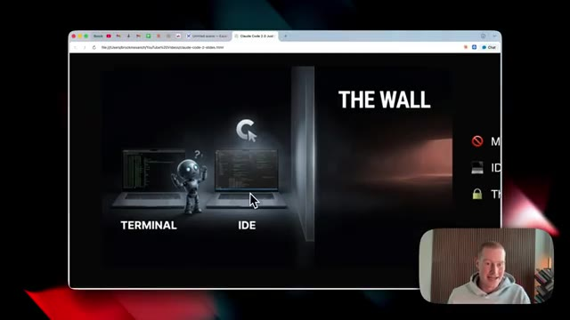
*⏱️ 00:01:16 — Une diapositive de présentation illustrant les difficultés d'utilisation du terminal et d'un IDE pour les débutants, intitulée 'The Wall', avec le présentateur incrusté en bas à droite.*

---

### ⏱️ `[00:01:33 - 00:01:55]` | Segment #05

**🔊 Audio (Transcription Intégrale Mot pour Mot en Français) :**
> Donc le point principal de ceci dont je veux parler est que la nouvelle interface ressemble à Cowork. Même s'ils ne sont pas pareils, elle y ressemble beaucoup plus. Donc si vous avez utilisé Cowork par le passé, migrer depuis celui-ci et passer à la nouvelle application de bureau Cloud Code sera probablement une transition simple. Décomposons donc très simplement ce qu'était l'expérience à l'intérieur de CloudCode auparavant.

**👁️ Analyse Visuelle d'Écran (gemini-3.5-flash-lite) :**
**Interface & Outils** : Navigateur web affichant une diapositive de présentation.

**Contenu textuel & Code** : Texte comparatif : "SAME FEEL", "Cowork", "Claude Code 2.0", et des puces expliquant la similarité d'utilisation.

**Action / Démonstration** : Présentation des similarités entre l'interface de Cowork et celle de Claude Code.

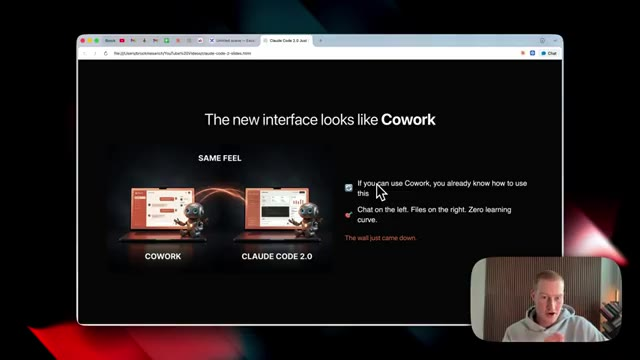
*⏱️ 00:01:38 — Capture d'écran montrant une présentation avec le titre "The new interface looks like Cowork" et deux sections de texte comparant Cowork et Claude Code 2.0.*

---

### ⏱️ `[00:01:55 - 00:02:14]` | Segment #06

**🔊 Audio (Transcription Intégrale Mot pour Mot en Français) :**
> Donc, avant, nous utilisions CloudCode dans un terminal, ce qui est, vous savez, fondamentalement une vue similaire à celle-ci. Laissez-moi ouvrir mon terminal très rapidement. C'est fondamentalement juste comme cette boîte de texte ici, où nous tapions des commandes et cela exécutait fondamentalement du code pour nous. Si vous n'êtes pas technique, croyez-moi, vous ne voulez pas passer beaucoup de temps ici. Ce n'est tout simplement pas très amusant. C'est donc une façon dont les gens utilisent CloudCode.

**👁️ Analyse Visuelle d'Écran (gemini-3.5-flash-lite) :**
**Interface & Outils** : Navigateur web (Excalidraw) et application Terminal macOS.

**Contenu textuel & Code** : Interface utilisateur de Claude Code v2.0.0 avec des messages d'accueil et invites de commandes textuelles, ainsi qu'un terminal de commande standard macOS.

**Action / Démonstration** : Le présentateur illustre visuellement à quoi ressemblait l'utilisation de Claude Code dans un terminal de commande textuel.

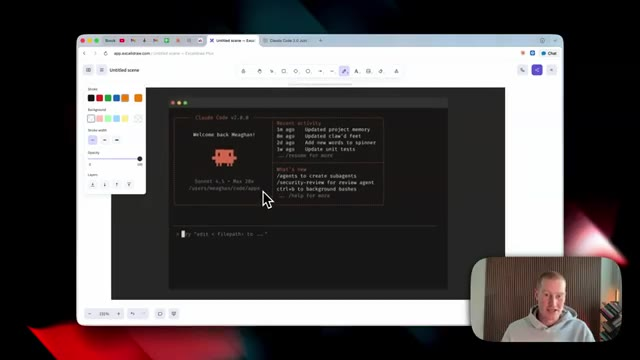
*⏱️ 00:02:00 — Capture montrant une interface d'application web (Excalidraw) affichant une fenêtre simulant le terminal Claude Code v2.0.0.*

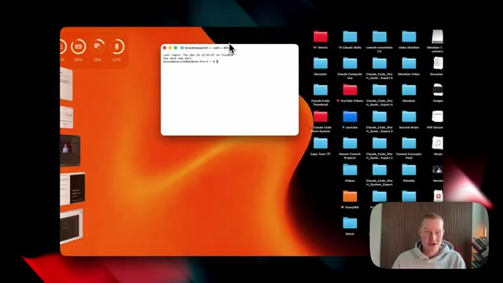
*⏱️ 00:02:05 — Capture montrant le bureau d'un ordinateur Mac avec une fenêtre de terminal ouverte au premier plan et des dossiers sur le côté.*

---

### ⏱️ `[00:02:14 - 00:02:38]` | Segment #07

**🔊 Audio (Transcription Intégrale Mot pour Mot en Français) :**
> Une autre façon est à l'intérieur de quelque chose appelé un IDE. Un exemple parfait d'un IDE est Cursor. Comme vous pouvez le voir ici, ceci est une capture d'écran de mon Cursor et de mes instances Cloud Code juste ici. Et si vous ne savez pas ce qu'est un IDE, cela signifie Environnement de Développement Intégré. Pensez-y comme à un endroit où les développeurs vont pour écrire du code, stocker du code, exécuter du code, le déboguer, tout ce genre de choses.

**👁️ Analyse Visuelle d'Écran (gemini-3.5-flash-lite) :**
**Interface & Outils** : Navigateur web affichant l'application Excalidraw avec intégration d'une capture d'écran de l'IDE Cursor.

**Contenu textuel & Code** : Texte manuscrit 'Claude Code in Cursor', définition de l'IDE ('Integrated Developer Environment') et notes textuelles de structure de projet.
[CGI] Présentation visuelle et explicative des concepts de développement avec l'IDE Cursor et les instances Cloud Code.

**Action / Démonstration** : Explications face caméra et analyse conceptuelle des marchés.

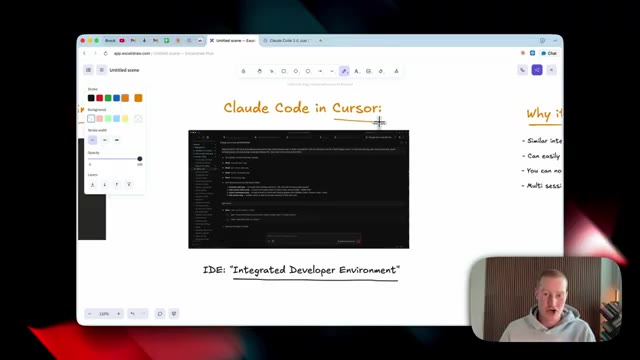
*⏱️ 00:02:20 — Vue d'ensemble du logiciel de tableau blanc Excalidraw montrant une capture d'écran intégrée de l'éditeur Cursor et l'annotation textuelle définissant 'IDE'.*

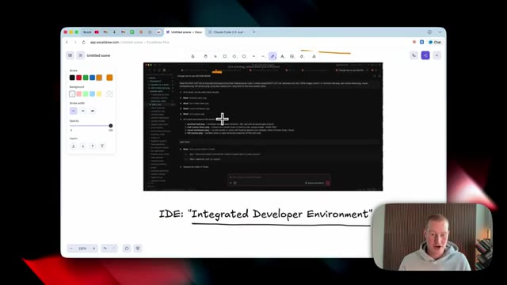
*⏱️ 00:02:26 — Zoom sur l'interface Excalidraw avec le curseur en mouvement, affichant le texte explicatif sur l'utilisation de Claude Code dans Cursor.*

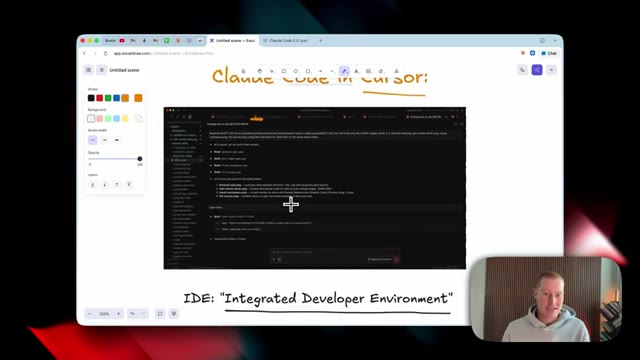
*⏱️ 00:02:32 — Capture similaire montrant la définition de l'IDE soulignée sous la fenêtre de démonstration de code.*

---

### ⏱️ `[00:02:38 - 00:03:01]` | Segment #08

**🔊 Audio (Transcription Intégrale Mot pour Mot en Français) :**
> Mais la chose essentielle sur laquelle il faut se concentrer ici, c'est que c'est conçu pour le code. Donc, si vous n'êtes pas technique, utiliser quelque chose comme Cursor ou une autre plateforme d'EDI, c'est un cran au-dessus de l'utilisation du terminal. Ce n'est presque pas aussi compliqué, mais c'est quand même un petit peu casse-tête et il y a des façons plus simples de l'utiliser. Très bien, donc pour commencer à utiliser le nouveau Claude Code revisité, nous devons d'abord nous assurer d'avoir téléchargé l'application de bureau Claude.

**👁️ Analyse Visuelle d'Écran (gemini-3.5-flash-lite) :**
**Interface & Outils** : Navigateur web, Excalidraw, site officiel d'Anthropic (Claude).

**Contenu textuel & Code** : Texte explicatif sur Claude Code dans Cursor et la définition d'un IDE ('Integrated Developer Environment').

**Action / Démonstration** : Présentation visuelle des concepts d'environnement de développement et de Claude Code par le présentateur.

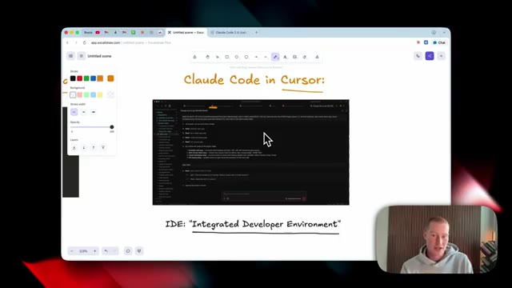
*⏱️ 00:02:44 — Capture d'écran montrant l'application Excalidraw avec le titre 'Claude Code in Cursor' et la définition de l'IDE, incluant un aperçu de l'interface de Cursor.*

---

### ⏱️ `[00:03:02 - 00:03:34]` | Segment #09

**🔊 Audio (Transcription Intégrale Mot pour Mot en Français) :**
> Donc il y aura un lien dans la description pour télécharger ceci. Si vous ne l'avez pas déjà, c'est différent du Claude de base dans le navigateur parce que si je clique sur ce mode de code ici, c'est une interface différente et nous allons entrer dans la nouvelle application de bureau. Une fois que nous l'aurons téléchargée, allons-y et ouvrons-la. Ce que nous allons voir, c'est que nous allons voir une interface complètement nouvelle dans toute l'application de bureau. Donc non seulement pour Cloud Code, mais nous allons voir une différence dans Cloud Cowork ainsi que dans le mode de chat normal. Comme vous pouvez le voir ici, nous sommes en mode de chat. Nous avons le bon vieux Opus 4.7, qui est très, très bon. Je vais aborder cela plus tard dans cette vidéo.

**👁️ Analyse Visuelle d'Écran (gemini-3.5-flash-lite) :**
**Interface & Outils** : Application de bureau Claude

**Contenu textuel & Code** : Interface utilisateur de Claude avec les options de chat, projets, et la barre de prompt "How can I help you today?".

**Action / Démonstration** : Présentation de la nouvelle application de bureau Claude distincte de la version navigateur.

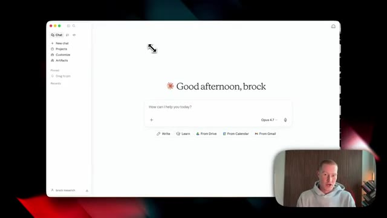
*⏱️ 00:03:18 — Capture d'écran affichant l'application de bureau de Claude avec le message d'accueil "Good afternoon, brock" et la barre de saisie des requêtes.*

---

### ⏱️ `[00:03:34 - 00:04:01]` | Segment #10

**🔊 Audio (Transcription Intégrale Mot pour Mot en Français) :**
> Ce que je vais faire, c'est que je vais basculer vers le mode Cowork pour vous montrer très simplement à quoi cela ressemble. Vous connaissez probablement déjà ceci si vous avez regardé cette chaîne. Je couvre pas mal de CloudCowork. Et juste ici, nous avons notre bouton de code, et c'est là-dessus que nous allons nous concentrer principalement dans cette vidéo. Donc, passons simplement en revue l'apparence actuelle de cette interface. Pour que vous puissiez vous faire une idée avant que je ne détaille les nouvelles fonctionnalités que nous avons ici et qui font passer les choses de ce niveau dans Cowork au niveau supérieur à l'intérieur de CloudCow. Donc, tout d'abord, nous allons voir ceci.

**👁️ Analyse Visuelle d'Écran (gemini-3.5-flash-lite) :**
**Interface & Outils** : Application Cowork / Claude Cowork sur macOS

**Contenu textuel & Code** : Interface utilisateur avec la barre latérale des tâches, le titre "Let's knock something off your list", un champ de texte pour interagir avec l'IA et une liste de tâches actives ("Retrieve Claude Code 2.0 video slides", "Youtube new video check", etc.).

**Action / Démonstration** : Le présentateur bascule vers l'interface de Cowork pour effectuer une démonstration en direct.

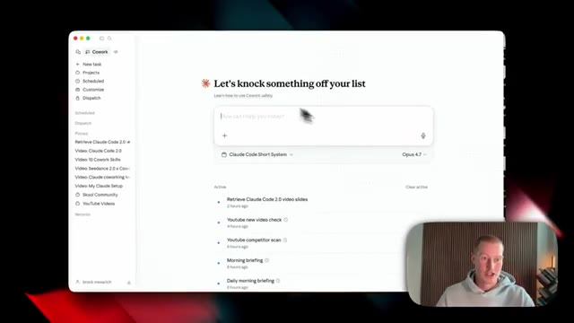
*⏱️ 00:03:41 — Capture d'écran montrant l'interface du mode Cowork avec un champ de saisie de prompt et la liste des tâches actives.*

---

### ⏱️ `[00:04:02 - 00:04:33]` | Segment #11

**🔊 Audio (Transcription Intégrale Mot pour Mot en Français) :**
> Nous pourrions fondamentalement voir toute notre utilisation des différents modèles ici même. C'est plutôt intéressant. Si vous êtes un utilisateur avancé, pour moi, je ne m'en soucie pas vraiment trop. Ensuite, sur le côté gauche, nous avons la possibilité de créer une nouvelle session. Nous avons les routines, que je vais aborder plus tard car c'est très, très intéressant lorsque nous commencerons réellement à utiliser ceci. Nous avons notre bouton personnalisé, qui nous amènera à nos compétences ainsi qu'à tous nos connecteurs, qui sont fondamentalement l'endroit où nous pouvons connecter nos applications que nous utilisons. Si vous ne savez pas ce que sont les compétences, ce sont fondamentalement des flux de travail que nous pourrions déclencher automatiquement. Nous pourrions donc apprendre à Claude comment effectuer une tâche spécifique.

**👁️ Analyse Visuelle d'Écran (gemini-3.5-flash-lite) :**
**Interface & Outils** : Application logicielle de bureau (interface de type assistant IA / espace de travail).

**Contenu textuel & Code** : Métriques d'utilisation (sessions, messages, tokens), graphiques d'activité et liste de connecteurs (Bitly, Canva, GitHub, Gmail, Notion, Slack, Zapier).

**Action / Démonstration** : Navigation dans les menus de l'application, survol de l'option "New session" puis affichage des connecteurs de l'application.

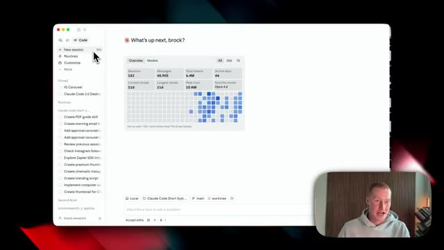
*⏱️ 00:04:09 — Interface d'une application d'intelligence artificielle affichant un tableau de bord d'utilisation avec des statistiques et le curseur sur "New session".*

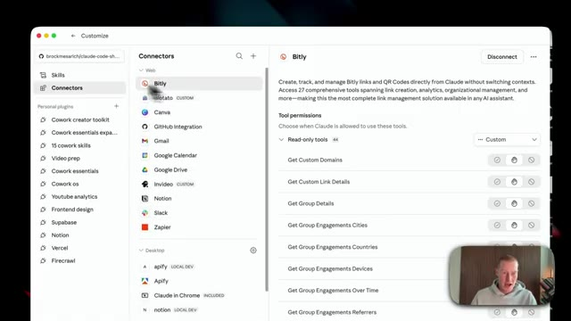
*⏱️ 00:04:25 — Panneau de configuration des connecteurs et plugins d'une application logicielle, montrant Bitly sélectionné et ses autorisations d'outils.*

---

### ⏱️ `[00:04:33 - 00:05:08]` | Segment #12

**🔊 Audio (Transcription Intégrale Mot pour Mot en Français) :**
> Et chaque fois que nous lui demandons de le faire, nous n'avons pas besoin de lui donner un long prompt. Une chose clé que je veux mentionner dès maintenant, c'est que toutes les compétences que vous avez à l'intérieur de Claude classique ou de Cowork sont transférées vers Claude Code dans l'application de bureau. Donc, comme vous pouvez le voir, j'ai des tonnes de compétences différentes ici que j'ai utilisées à travers Claude Cowork et n'apparaitront ici également. De plus, si vous êtes intéressé, si vous voulez l'une de ces compétences que je vous ai montrées, j'ai bien plus de 50 compétences que j'utilise chaque jour au sein de ma communauté scolaire. Il y a un lien pour la rejoindre dans la description. Passant au reste de l'interface, nous avons ce bouton « plus » ici,

**👁️ Analyse Visuelle d'Écran (gemini-3.5-flash-lite) :**
**Interface & Outils** : Interface utilisateur de gestion des compétences et navigateur web présentant un catalogue de ressources.

**Contenu textuel & Code** : Liste détaillée des compétences (pdf-guide, autoresearch, slide-infographics, prompter, etc.) et page d'accueil de la bibliothèque de compétences.
[DESC_IMAGE_2] Navigation et présentation des outils et compétences intégrés dans l'écosystème de travail.

**Action / Démonstration** : Affichage des différentes options de compétences et exploration du répertoire de ressources de l'application.

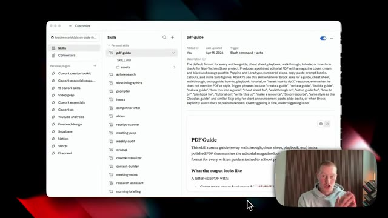
*⏱️ 00:04:42 — Interface de personnalisation montrant la liste des compétences (Skills) disponibles dans l'application avec leurs détails et configurations.*

*⏱️ 00:04:59 — Page Web présentant les différentes compétences et ressources utilisées quotidiennement, avec un bouton de téléchargement central.*

---

### ⏱️ `[00:05:08 - 00:05:43]` | Segment #13

**🔊 Audio (Transcription Intégrale Mot pour Mot en Français) :**
> ce qui nous amènera au mode d'expédition, qui est essentiellement une façon pour nous de déclencher ceci depuis notre téléphone. Donc si nous voulions partir et faire certaines choses à l'intérieur de Claude Code, je pourrais simplement sortir l'application mobile de Claude et envoyer une instruction, et elle peut s'exécuter et faire fondamentalement tout ce que nous pouvons faire directement ici sur notre ordinateur. Ensuite, j'ai quelques tâches épinglées différentes ici. J'ai un carrousel Instagram dans celle-ci également, ainsi que, si j'ouvre ceci, nous avons maintenant des routines juste ici, ce qui, si j'ouvre cela, vous pouvez voir que c'est fondamentalement un flux de travail juste ici. Et cela montre essentiellement chaque fois que ceci est déclenché. Et je vais vous montrer exactement à quel point celles-ci sont puissantes

**👁️ Analyse Visuelle d'Écran (gemini-3.5-flash-lite) :**
**Interface & Outils** : Application Claude (interface web ou application de bureau) avec un tableau de bord analytique et un menu de navigation latéral.

**Contenu textuel & Code** : Statistiques d'utilisation (sessions, messages, total de tokens, jours actifs, séries et modèle favori) ainsi qu'un menu contextuel affichant l'option "Dispatch".

**Action / Démonstration** : Le présentateur clique sur l'option "Dispatch" dans le menu déroulant de l'application Claude pour démontrer le mode d'expédition.

*⏱️ 00:05:17 — L'interface de l'application Claude affichant un tableau de bord avec des statistiques d'utilisation et un menu déroulant où l'option "Dispatch" est sélectionnée.*

---

### ⏱️ `[00:05:43 - 00:06:20]` | Segment #14

**🔊 Audio (Transcription Intégrale Mot pour Mot en Français) :**
> et comment configurer tout cela plus tard dans cette vidéo. La chose suivante que je veux souligner, c'est que dans la barre latérale ici, si j'ouvre un peu plus, nous avons quelques éléments différents. Nous avons donc ce dossier spécifique. C'est donc un dossier sur mon ordinateur appelé Cloud Code Short System. Ce sont donc toutes les tâches que je fais à l'intérieur de ce dossier, mais je pourrais aussi ouvrir d'autres dossiers de travail dans lesquels je me trouve. J'ai donc aussi un dossier de second cerveau, en gros là où j'ai configuré mon Obsidian pour agir comme un second cerveau. Et nous pouvons donc travailler sur tous nos différents projets ici même. Nous ne sommes pas limités à un seul dossier dans lequel nous travaillons sur notre ordinateur. Ensuite, si

**👁️ Analyse Visuelle d'Écran (gemini-3.5-flash-lite) :**
**Interface & Outils** : Interface logicielle de type environnement de développement ou assistant de code (Claude Code / interface similaire), avec webcam du présentateur en bas à droite.

**Contenu textuel & Code** : Noms de dossiers et de routines dans la barre latérale ("Daily Claude Trending Carousel", "claude-code-short-system", "Second-Brain"), et journaux d'exécution ("Runs") dans le panneau droit.

**Action / Démonstration** : Navigation et sélection de différents dossiers et routines dans la barre latérale de l'application.

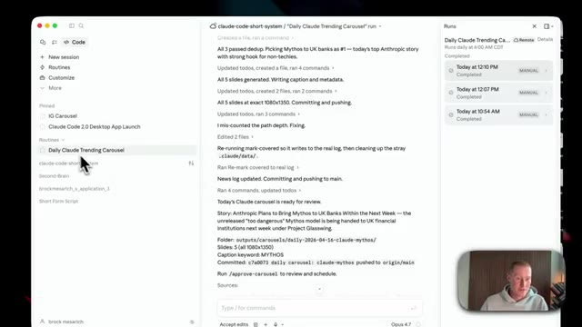
*⏱️ 00:05:52 — Vue d'une interface de développement avec une barre latérale montrant divers dossiers et routines, et un panneau central affichant l'historique d'exécution de tâches liées à Claude.*

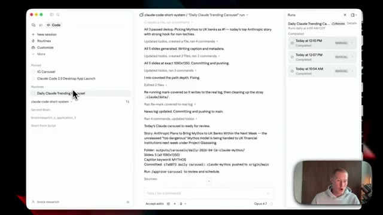
*⏱️ 00:06:01 — Vue similaire à l'image précédente montrant la navigation dans la barre latérale gauche de l'application de code.*

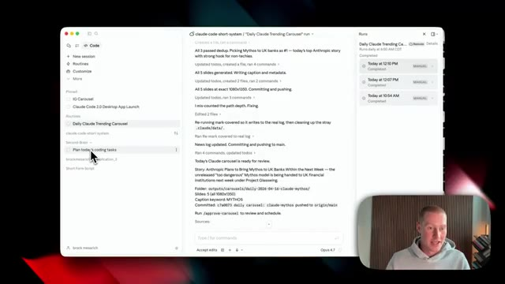
*⏱️ 00:06:11 — L'utilisateur clique sur un autre élément ("Plan today's coding tasks") dans la barre latérale gauche de l'interface de l'application.*

---

### ⏱️ `[00:06:20 - 00:06:54]` | Segment #15

**🔊 Audio (Transcription Intégrale Mot pour Mot en Français) :**
> vous êtes intéressés et que vous n'aimez pas ce mode clair, nous pouvons le passer en mode sombre. Je trouve que c'est plutôt propre aussi. Mais laissez-moi le remttre en mode clair. J'aime un tout petit peu plus cette version. Très bien. Donc si je rentre dans une tâche existante que j'ai, nous allons également voir cette barre latérale droite. Donc si je clique dessus, nous pouvons voir deux ou trois choses différentes. Nous avons donc le mode aperçu. Donc si je lance ça, laissez-moi vous montrer exactement ce que c'est. Cela montre essentiellement une interface utilisateur de n'importe quelle application sur laquelle nous travaillons. J'étais donc en train de faire du "vibe coding" sur le pipeline de scripts. Nous pouvons donc maintenant voir ce que nous sommes en train de "vibe coder" et coder directement à l'intérieur d'ici. Ensuite

**👁️ Analyse Visuelle d'Écran (gemini-3.5-flash-lite) :**
**Interface & Outils** : Application de bureau Claude Code et tableau de bord web local (localhost).

**Contenu textuel & Code** : Texte généré automatiquement pour des slides de carrousel (fichiers PNG, structures de slides) et métriques du tableau de bord de tâches (26, 9, 2, etc.).

**Action / Démonstration** : Présentation de la structure de fichiers générée pour un carrousel et affichage d'un tableau de bord de gestion de tâches.

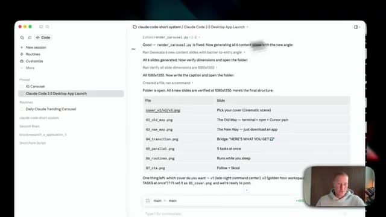
*⏱️ 00:06:29 — Image #1 : Interface logicielle affichant un assistant textuel ou un outil de génération de contenu (Claude Code) en mode clair, avec une miniature vidéo du présentateur en bas à droite.*

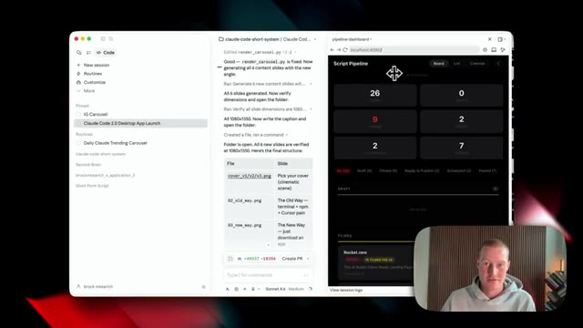
*⏱️ 00:06:46 — Image #2 : Interface d'un tableau de bord de pipeline de scripts (Script Pipeline) s'ouvrant à côté de l'application principale, affichant des statistiques et des statuts de tâches.*

---

### ⏱️ `[00:06:54 - 00:07:22]` | Segment #16

**🔊 Audio (Transcription Intégrale Mot pour Mot en Français) :**
> nous pourrions voir toutes nos différences ici. Donc c'est plutôt pour ces codeurs. Si vous voulez vraiment voir ce qui se passe avec le code, moi personnellement, je ne veux pas voir ça. Ça me fait peur. Ensuite, nous pourrions en fait avoir notre terminal directement à l'intérieur d'ici. Donc nous pourrions taper des commandes spécifiques si nous le voulons. Nous avons également toutes nos tâches. Donc pour l'instant, je n'ai aucune tâche en cours d'exécution, mais si je devais exécuter ce flux de travail et avoir un tas de choses différentes qui se déclenchent, nous pourrions voir chacune d'elles individuellement directement à l'intérieur de cette vue latérale, tout comme nous avons tous nos plans ici.

**👁️ Analyse Visuelle d'Écran (gemini-3.5-flash-lite) :**
**Interface & Outils** : Application de bureau Claude Code 2.0 / Interface de développement intégrée.

**Contenu textuel & Code** : Édition de script Python (render_carousel.py), affichage des modifications de code, structure de fichiers de diapositives et panneau de tâches.
[DESC_IMAGE_3] Navigation et manipulation des différents panneaux de l'interface de l'application de bureau.

**Action / Démonstration** : Explications face caméra et analyse conceptuelle des marchés.

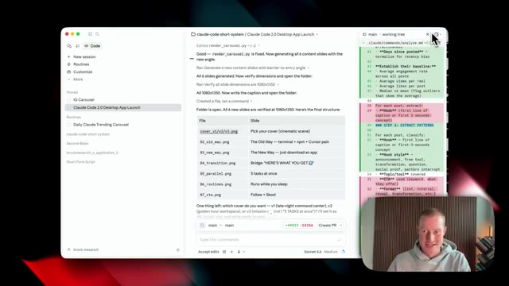
*⏱️ 00:07:01 — Vue générale de l'application de bureau avec un panneau de code/terminal ouvert sur la droite montrant des lignes de code colorées.*

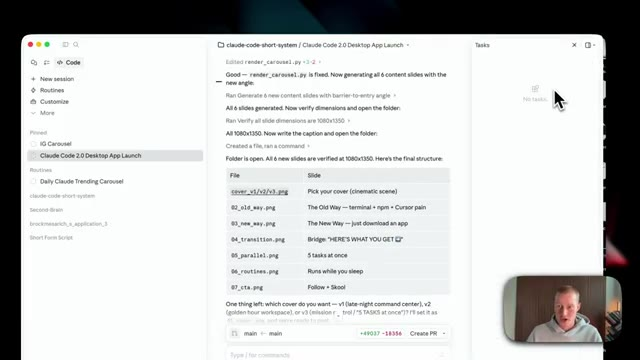
*⏱️ 00:07:08 — Le panneau latéral droit se ferme pour afficher un panneau de tâches vide intitulé "Tasks".*

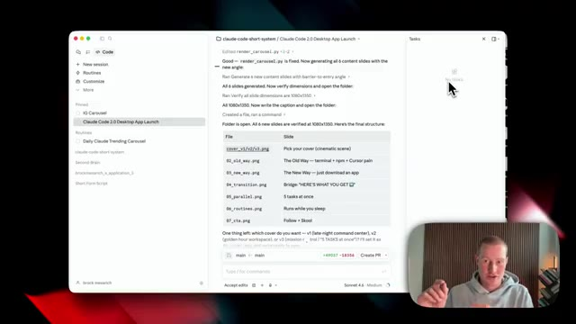
*⏱️ 00:07:15 — Le curseur interagit avec l'interface pour fermer ou manipuler les panneaux latéraux de l'application de bureau.*

---

### ⏱️ `[00:07:22 - 00:07:42]` | Segment #17

**🔊 Audio (Transcription Intégrale Mot pour Mot en Français) :**
> Donc par exemple, j'allais et venais et je cherchais comment améliorer cette compétence spécifique que j'ai. Donc c'est en train de rédiger le plan ici pour que je puisse l'approuver avant que nous n'allions plus loin avec. Très bien. Donc maintenant que nous comprenons à quoi ressemble l'interface à l'intérieur de la nouvelle application de bureau de Claude, parlons maintenant des routines parce que c'est là que les choses deviennent vraiment intéressantes.

**👁️ Analyse Visuelle d'Écran (gemini-3.5-flash-lite) :**
**Interface & Outils** : Application de bureau Claude Code et navigateur web affichant une présentation de diapositives.

**Contenu textuel & Code** : Texte de planification, structures de fichiers pour les diapositives, et explications des fonctionnalités de l'IA.

**Action / Démonstration** : Le présentateur montre l'interface de développement et les diapositives de présentation pour expliquer les capacités de l'application.

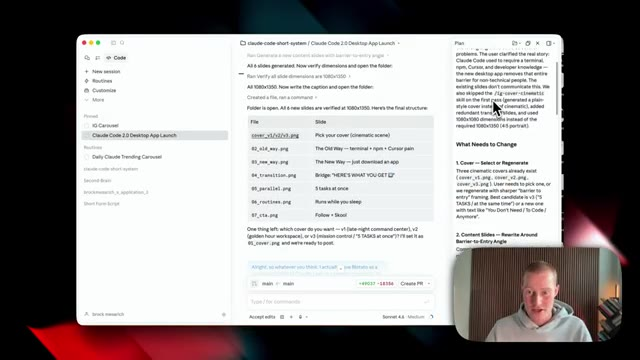
*⏱️ 00:07:27 — L'application de bureau Claude Code affichant des plans, du code et le flux de discussion avec l'IA.*

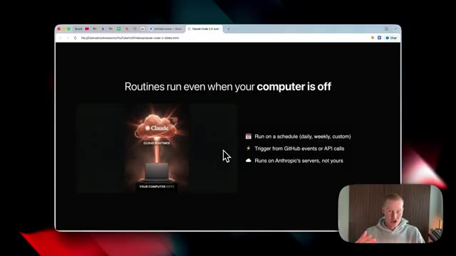
*⏱️ 00:07:37 — Une présentation de diapositives dans un navigateur web montrant la fonctionnalité 'Routines run even when your computer is off'.*

---

### ⏱️ `[00:07:43 - 00:08:04]` | Segment #18

**🔊 Audio (Transcription Intégrale Mot pour Mot en Français) :**
> Et si nous utilisons cela correctement, cela peut être extrêmement puissant intégré dans nos systèmes à l'intérieur de Claude. En gros, qu'est-ce qu'une routine ? sur un calendrier, cela pourrait être quotidien, hebdomadaire, ou personnalisé. Et celles-ci peuvent effectivement être déclenchées depuis GitHub ou des appels API. Et cela les rend différentes des tâches planifiées dont vous avez probablement entendu parler à l'intérieur de Cloud Cowork.

**👁️ Analyse Visuelle d'Écran (gemini-3.5-flash-lite) :**
**Interface & Outils** : Navigateur web affichant une diapositive de présentation avec incrustation vidéo du présentateur en bas à droite.

**Contenu textuel & Code** : Texte explicatif : 'Routinize run even when your computer is off', 'Run on a schedule (daily, weekly, custom)', 'Trigger from GitHub events or API calls', 'Runs on Anthropic's servers, not yours'.

**Action / Démonstration** : Présentation de la fonctionnalité de routines automatisées sur le cloud par le présentateur.

*⏱️ 00:07:48 — Capture d'écran montrant une présentation sur les routines cloud de Claude, avec le texte 'Routines run even when your computer is off' et des points explicatifs sur la planification et les déclencheurs.*

---

### ⏱️ `[00:08:04 - 00:08:26]` | Segment #19

**🔊 Audio (Transcription Intégrale Mot pour Mot en Français) :**
> Et en plus de tout cela, cela fonctionne sur les serveurs d'Anthropic, pas sur les nôtres. Et ce que cela signifie, c'est que cela peut tourner en pilotage automatique même si notre ordinateur est fermé. C'est un gros problème auquel nous avons été confrontés dans Cowork en utilisant des tâches planifiées. Oui, vous pouvez exécuter des compétences et des flux de travail spécifiques en pilotage automatique, mais votre ordinateur et votre application de bureau Claude devaient être ouverts.

**👁️ Analyse Visuelle d'Écran (gemini-3.5-flash-lite) :**
**Interface & Outils** : Navigateur web affichant une diapositive de présentation

**Contenu textuel & Code** : Texte de la diapositive détaillant les fonctionnalités des routines : exécution programmée (quotidienne, hebdomadaire, personnalisée), déclenchement par des événements GitHub ou des appels API, et exécution sur les serveurs d'Anthropic plutôt que sur l'ordinateur de l'utilisateur.

**Action / Démonstration** : Présentation visuelle des avantages du cloud pour l'exécution de tâches automatisées.

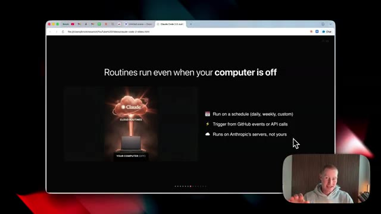
*⏱️ 00:08:10 — Une diapositive de présentation affichant le titre 'Routines run even when your computer is off', illustrée par un graphique montrant le cloud Claude et un ordinateur éteint, ainsi que trois points clés sur la droite.*

---

### ⏱️ `[00:08:27 - 00:08:54]` | Segment #20

**🔊 Audio (Transcription Intégrale Mot pour Mot en Français) :**
> Eh bien, ce n'est plus le cas avec les routines. Laissez-moi donc vous montrer exactement comment vous pouvez configurer une routine. Et je vais vous montrer cette routine de carrousel Instagram que j'ai en cours d'exécution, qui trouve automatiquement des idées de contenu et les génère pour moi pendant que je ne touche pas à mon ordinateur. Très bien, donc si je reviens sur l'application de bureau Claude et que je clique sur routines, vous pouvez voir que j'ai personnellement un carrousel quotidien de tendances Claude qui s'exécute tous les jours à 6 heures du matin, et nous avons également cette nouvelle vue calendrier.

**👁️ Analyse Visuelle d'Écran (gemini-3.5-flash-lite) :**
**Interface & Outils** : Navigateur web affichant des diapositives de présentation et interface de gestion des routines.

**Contenu textuel & Code** : Texte expliquant le fonctionnement des routines cloud (exécution planifiée, déclencheurs par événements ou API, exécution sur les serveurs d'Anthropic) et liste des routines configurées.

**Action / Démonstration** : Présentation des fonctionnalités des routines cloud et démonstration de la routine de carrousel Instagram configurée.

*⏱️ 00:08:33 — Diapositive de présentation expliquant que les routines s'exécutent même lorsque l'ordinateur est éteint, avec les avantages décrits sur le côté.*

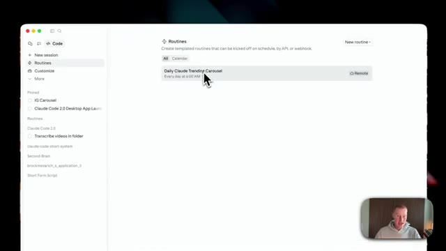
*⏱️ 00:08:47 — Interface logicielle affichant le menu des routines avec la routine 'Daily Claude Trending Carousel' programmée quotidiennement à 6h00 AM.*

---

### ⏱️ `[00:08:54 - 00:09:16]` | Segment #21

**🔊 Audio (Transcription Intégrale Mot pour Mot en Français) :**
> Donc, pour toutes ces automatisations que nous avons, nous pourrions en fait voir sur le calendrier quand elles vont s'exécuter. Et je peux imaginer que ça va devenir assez cool quand nous aurons de multiples flux de travail différents déclenchés à différents moments de la journée ou de la semaine. C'est une touche plutôt cool de leur part d'ajouter ça, honnêtement. Il y a donc plusieurs façons de commencer à créer ces routines. Tout d'abord, nous pourrions venir ici, cliquer sur nouvelle routine.

**👁️ Analyse Visuelle d'Écran (gemini-3.5-flash-lite) :**
**Interface & Outils** : Interface de gestion de routines et d'automatisations avec vue calendrier.

**Contenu textuel & Code** : Calendrier des exécutions planifiées affichant la routine 'Daily Claude Trending Carousel' programmée à 6h00 pour différents jours de la semaine (jeudi 16 au mercredi 22).

**Action / Démonstration** : Présentation de la vue calendrier des automatisations et des flux de travail planifiés.

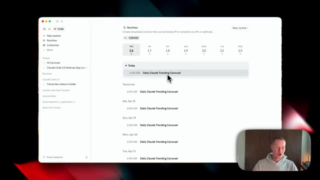
*⏱️ 00:09:00 — Une interface logicielle affichant un calendrier de routines automatisées, avec une vue par calendrier montrant l'exécution planifiée de flux de travail.*

---

### ⏱️ `[00:09:16 - 00:09:36]` | Segment #22

**🔊 Audio (Transcription Intégrale Mot pour Mot en Français) :**
> Et à partir de là, nous avons deux options. Nous pouvons exécuter cela localement ou nous pouvons l'exécuter à distance. Laissez-moi donc décomposer les différences ici même, très simplement. Donc, pour les besoins de cette vidéo, je vais créer une routine à distance. De cette façon, cela pourra s'exécuter même si mon ordinateur est éteint. Ensuite, ce que nous allons faire, c'est simplement lui donner un nom. Donc, fondamentalement, nous pouvons nommer ceci "revue de code quotidienne", quel que soit le cas.

**👁️ Analyse Visuelle d'Écran (gemini-3.5-flash-lite) :**
**Interface & Outils** : Interface logicielle de type application de bureau (style dashboard de gestion de routines IA/Claude) avec vue calendrier et formulaires de configuration.

**Contenu textuel & Code** : Menu de sélection des options d'exécution ('Local' / 'Remote') et formulaire de configuration de routine avec options de déclenchement (Schedule, GitHub event, API) et connecteurs d'intégrations.

**Action / Démonstration** : Navigation dans l'interface et sélection de l'option d'exécution à distance ('Remote') pour créer une nouvelle routine automatisée.

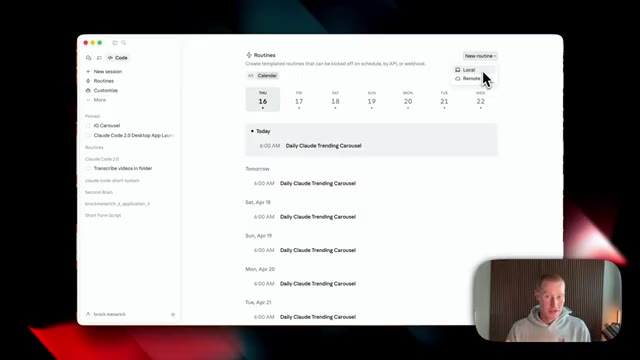
*⏱️ 00:09:21 — Vue d'une interface de gestion de routines avec un menu déroulant affichant les options 'Local' et 'Remote' au survol de la souris.*

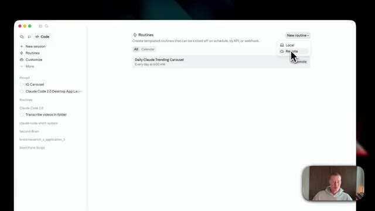
*⏱️ 00:09:26 — Vue de l'interface montrant la sélection de l'option 'Remote' dans le menu déroulant des routines.*

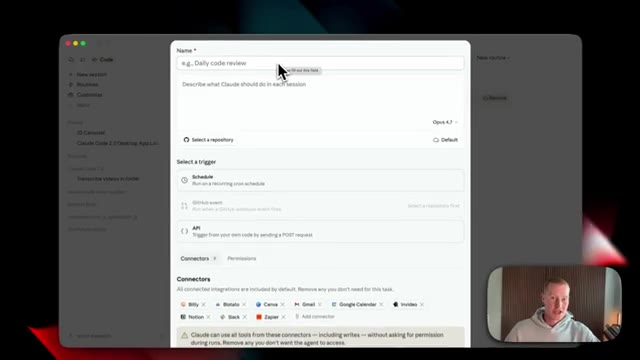
*⏱️ 00:09:31 — Formulaire de création d'une nouvelle routine avec des champs pour nommer la routine, décrire les tâches de Claude, configurer des déclencheurs (Schedule, GitHub, API) et gérer les connecteurs.*

---

### ⏱️ `[00:09:36 - 00:09:56]` | Segment #23

**🔊 Audio (Transcription Intégrale Mot pour Mot en Français) :**
> Ensuite, nous allons simplement décrire ce que nous voulons qu'il fasse pour chaque session. Ensuite, nous pourrions sélectionner le modèle que nous voulons utiliser. Nous allons utiliser Opus 4.7 parce qu'il vient de sortir aujourd'hui. C'est de loin le modèle le plus capable. Nous pouvons sélectionner un dépôt spécifique de GitHub dans lequel nous voulons travailler. Et à partir de là, nous pourrions effectivement planifier notre déclencheur.

**👁️ Analyse Visuelle d'Écran (gemini-3.5-flash-lite) :**
**Interface & Outils** : Application de bureau / Interface utilisateur de Claude / Logiciel de productivité.

**Contenu textuel & Code** : Menu de sélection de modèle affichant Opus 4.7, Sonnet 4.6, Haiku 4.5 et l'option Adaptive thinking.

**Action / Démonstration** : Sélection du modèle d'IA (Opus 4.7) pour la configuration d'une tâche ou routine.

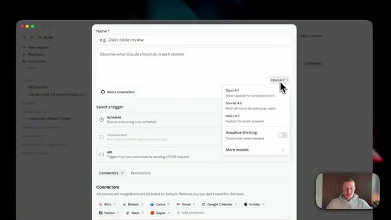
*⏱️ 00:09:41 — Interface de configuration montrant le menu déroulant de sélection du modèle (avec Opus 4.7 sélectionné).*

---

### ⏱️ `[00:09:56 - 00:10:29]` | Segment #24

**🔊 Audio (Transcription Intégrale Mot pour Mot en Français) :**
> Donc nous pourrions le faire toutes les heures à des minutes spécifiques. Nous pourrions le faire tous les jours à une heure précise. Nous pourrions le faire en semaine, chaque semaine, ou de manière personnalisée. Donc par exemple, si je veux que cela s'exécute tous les jours à 9 heures du matin, je n'aurais qu'à sélectionner cela. Je pourrais également ajouter un autre déclencheur ici. Donc si nous voulons que cela soit déclenché via un appel API, nous pourrions le faire également. Ensuite, vous allez voir que nous pourrions ajouter n'importe quel connecteur spécifique que nous voulons utiliser pour ce flux de travail. Donc si nous voulons pouvoir accéder à Gmail, Slack, Google Agenda, toutes ces différentes applications, nous pourrions continuer et configurer cela. C'est donc capable de faire cela automatiquement. Très bien. C'est donc une routine spécifique que j'ai.

**👁️ Analyse Visuelle d'Écran (gemini-3.5-flash-lite) :**
**Interface & Outils** : Interface de configuration d'application (Claude Code / assistant IA de bureau).

**Contenu textuel & Code** : Options de planification horaire/journalière, fuseau horaire CDT, liste des connecteurs et intégrations disponibles (Notion, Slack, Zapier, etc.).

**Action / Démonstration** : Configuration d'un déclencheur temporel quotidien pour automatiser l'exécution d'une tâche à 9h00 du matin.

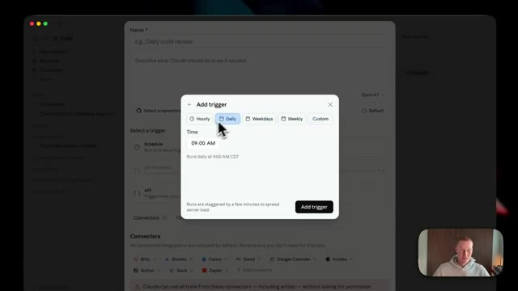
*⏱️ 00:10:04 — Fenêtre contextuelle "Add trigger" affichant les options de récurrence (Hourly, Daily, Weekdays, Weekly, Custom) réglée sur 09:00 AM.*

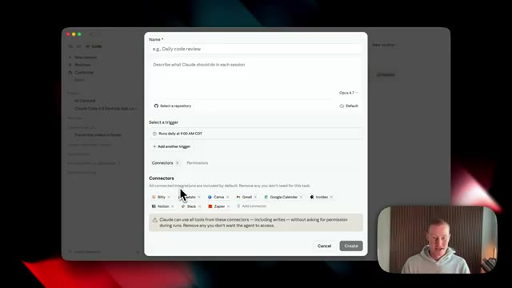
*⏱️ 00:10:20 — Interface principale montrant le déclencheur configuré "Runs daily at 9:00 AM CDT" et les connecteurs intégrés en bas (Bitly, Canva, Gmail, Google Calendar, Notion, Slack, Zapier).*

---

### ⏱️ `[00:10:29 - 00:10:58]` | Segment #25

**🔊 Audio (Transcription Intégrale Mot pour Mot en Français) :**
> Voici ma création quotidienne de carrousel Instagram. Donc, cela va essentiellement parcourir tout ce qui vaut la peine que j'en fasse un carrousel Instagram. Et ça me reviendra avec différentes idées tous les matins à 6 heures. Donc si je clique sur exécuter maintenant, vous pouvez voir que cela va réellement lancer cette exécution et je pourrais jeter un œil à toutes mes précédentes. Une autre façon de créer ces routines est de revenir soit à une nouvelle session, soit à une session précédente. Je vais commencer par une nouvelle. C'est ma compétence qui générera des carrousels Instagram en pilotage automatique.

**👁️ Analyse Visuelle d'Écran (gemini-3.5-flash-lite) :**
**Interface & Outils** : Interface de bureau d'un outil de développement/automatisation (type application Claude Code / Desktop App).

**Contenu textuel & Code** : Paramètres de routines automatisées, instructions de génération de carrousels, et métriques d'utilisation (184 sessions, 49k messages, 6.4M tokens).

**Action / Démonstration** : Navigation dans l'interface et lancement manuel d'une tâche d'automatisation pour un carrousel Instagram.

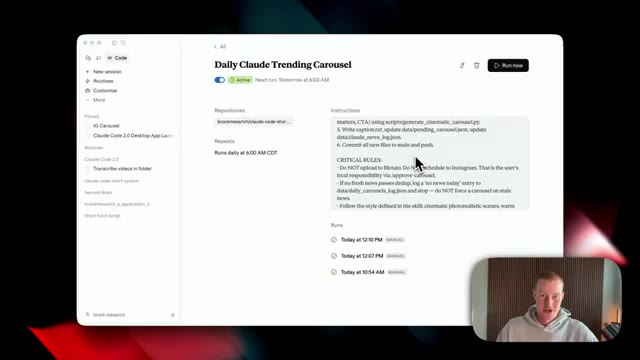
*⏱️ 00:10:36 — Interface logicielle affichant le projet 'Daily Claude Trending Carousel' avec ses instructions et historique d'exécutions.*

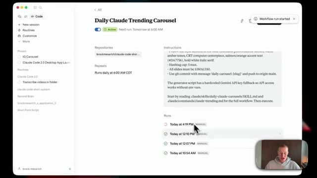
*⏱️ 00:10:43 — Même interface montrant le déclenchement manuel du workflow en cours via le bouton 'Run now'.*

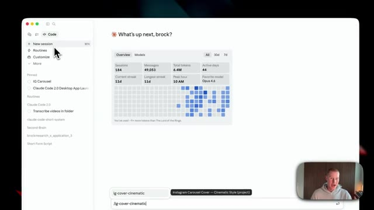
*⏱️ 00:10:50 — Tableau de bord d'utilisation avec des statistiques de sessions, de messages et un graphique d'activité (heatmap).*

---

### ⏱️ `[00:10:58 - 00:11:16]` | Segment #26

**🔊 Audio (Transcription Intégrale Mot pour Mot en Français) :**
> Alors laissez-moi vous montrer exactement ce que je veux dire. Donc tous ceux-ci ici ont été générés directement avec cette compétence spécifique. Je n'ai pas eu à lui donner un long prompt. Tout ce que j'ai fait, c'est invoquer cette compétence. Elle a en gros dit, je veux que tu en fasses un sur mes cinq compétences de code Claude dont je ne peux pas me passer et regardez à quel point ils ont l'air solides. Ils sont absolument phénoménaux.

**👁️ Analyse Visuelle d'Écran (gemini-3.5-flash-lite) :**
**Interface & Outils** : Navigateur web affichant l'outil de dessin et de schématisation en ligne Excalidraw, avec un encart vidéo du présentateur en bas à droite.

**Contenu textuel & Code** : Quatre visuels ou miniatures de posts (notamment "5 Claude Code Skills", "Morning Briefing", "IG Carousel Generator") affichés sur le canevas blanc.

**Action / Démonstration** : Le présentateur montre des exemples de visuels générés automatiquement via une compétence spécifique sans nécessiter de long prompt.

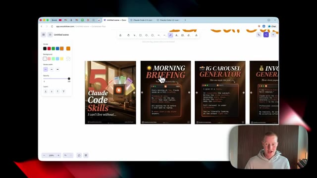
*⏱️ 00:11:02 — Capture d'écran montrant l'interface d'Excalidraw avec plusieurs exemples de visuels générés pour les réseaux sociaux.*

---

### ⏱️ `[00:11:16 - 00:11:35]` | Segment #27

**🔊 Audio (Transcription Intégrale Mot pour Mot en Français) :**
> Genre, ceux-là ont l'air super bien. En voici un autre que j'ai créé aujourd'hui à propos de Claude Opus 4.7. Je veux dire, ceux-là sont super solides. Et encore une fois, une fois que j'ai créé cette compétence et conçu exactement à quoi je veux que le résultat ressemble, ça fonctionne presque exactement de la même manière à chaque fois que je lance ceci. Et si on vient sur mon Instagram, vous pouvez voir que j'ai publié des choses à ce sujet.

**👁️ Analyse Visuelle d'Écran (gemini-3.5-flash-lite) :**
**Interface & Outils** : Navigateur web, application Excalidraw.

**Contenu textuel & Code** : Modèles visuels et carrousels marketing pour réseaux sociaux concernant Claude Opus 4.7 et Claude Code (titres textuels, illustrations générées par IA, mise en page de posts).

**Action / Démonstration** : Le présentateur présente et survole les différents visuels de carrousels qu'il a créés pour ses publications.

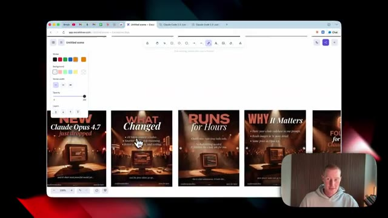
*⏱️ 00:11:21 — Vue d'un navigateur affichant Excalidraw avec une série de visuels et de carrousels sur Claude Opus 4.7, avec le présentateur en médaillon en bas à droite.*

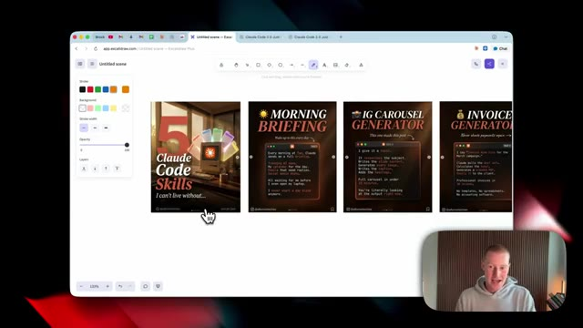
*⏱️ 00:11:25 — Vue de l'interface Excalidraw montrant d'autres visuels et carrousels graphiques sur les compétences Claude Code, avec le présentateur en bas à droite.*

---

### ⏱️ `[00:11:35 - 00:12:00]` | Segment #28

**🔊 Audio (Transcription Intégrale Mot pour Mot en Français) :**
> Celui-ci juste ici performait très bien. Il a plus de 1200 commentaires. Celui-ci cartonne complètement. Il en est à près de 2000 commentaires. Donc ceci juste ici est fondamentalement juste la preuve que cette compétence peut créer du contenu Instagram incroyable directement à l'intérieur de Cloud Code. Le problème auquel j'ai fait face avant, c'est que j'utilisais ceci à l'intérieur de Cloud Cowork, ou du moins j'essayais, mais je n'étais pas capable de générer des images parce que c'est dans un environnement isolé.

**👁️ Analyse Visuelle d'Écran (gemini-3.5-flash-lite) :**
**Interface & Outils** : Application Claude Code et navigateur web affichant Instagram.

**Contenu textuel & Code** : Métriques d'utilisation (184 sessions, 49 053 messages, 6,4M de tokens, 44 jours actifs) et graphiques d'activité.

**Action / Démonstration** : Navigation et présentation des outils d'IA et de leurs performances sur les réseaux sociaux.

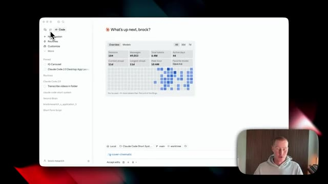
*⏱️ 00:11:53 — Interface de l'application Claude Code affichant des métriques d'utilisation, des sessions et des graphiques d'activité.*

---

### ⏱️ `[00:12:00 - 00:12:20]` | Segment #29

**🔊 Audio (Transcription Intégrale Mot pour Mot en Français) :**
> Donc je n'ai pas pu utiliser d'API externes pour générer ces images parce que j'utilise Nano Banana Pro, qui est le modèle d'image d'IA de Google. Et il n'y a aucun moyen pour nous de faire ça à l'intérieur de Cowork. Je suis donc très heureux qu'ils aient publié cette nouvelle mise à jour de l'application de bureau. Je peux donc maintenant exécuter ceci directement à l'intérieur de l'application de bureau sans avoir besoin d'aller dans Cursor.

**👁️ Analyse Visuelle d'Écran (gemini-3.5-flash-lite) :**
**Interface & Outils** : Application logicielle de type assistant IA ou interface de gestion (Cowork / outil similaire)

**Contenu textuel & Code** : Statistiques d'utilisation affichées sous forme de grille et de métriques (Sessions, Messages, Total tokens, Active days, Current streak, Longest streak, Peak hour, Favorite model) ainsi qu'un panneau latéral avec des options de navigation.

**Action / Démonstration** : Le présentateur commente les fonctionnalités de l'application et les contraintes d'utilisation des API et des modèles d'IA.

*⏱️ 00:12:05 — Une capture d'écran montrant l'interface d'une application logicielle avec un tableau de bord analytique et des statistiques d'utilisation, tandis que le présentateur apparaît en médaillon dans le coin inférieur droit.*

---

### ⏱️ `[00:12:21 - 00:12:44]` | Segment #30

**🔊 Audio (Transcription Intégrale Mot pour Mot en Français) :**
> Donc je lui ai donné cette commande juste ici. Mais ce que je vais faire, c'est que je vais expliquer comment je veux qu'il transforme cela en une routine qui peut fonctionner en pilotage automatique. Très bien. Donc je veux que tu utilises cette compétence. Et chaque jour à 8 heures du matin, je veux que tu ailles chercher les dernières nouvelles sur Claude et Anthropic, s'il y a de superbes nouveautés. Et ensuite, je veux que tu reviennes avec différentes idées de carrousels Instagram à publier pour moi.

**👁️ Analyse Visuelle d'Écran (gemini-3.5-flash-lite) :**
**Interface & Outils** : Application de bureau (Interface de type Claude Code ou outil de développement IA)

**Contenu textuel & Code** : Panneau 'Overview' affichant des métriques d'utilisation (Sessions, Messages, Tokens totaux, Jours actifs) et une zone de saisie contenant une commande `/ig-cover-cinematic`.

**Action / Démonstration** : Le présentateur explique comment transformer une commande en routine automatisée.

*⏱️ 00:12:26 — Interface d'une application logicielle avec un panneau de statistiques d'utilisation et une zone de saisie de prompt où un utilisateur tape une commande.*

---

### ⏱️ `[00:12:44 - 00:13:04]` | Segment #31

**🔊 Audio (Transcription Intégrale Mot pour Mot en Français) :**
> Je veux en publier un chaque jour. Donc je veux que tu transformes ceci en une routine pour que ça puisse fonctionner pendant que je dors. Donc la raison pour laquelle je veux te montrer ceci, c'est parce que oui, nous pouvons créer une routine si nous venons ici et la configurons manuellement ou nous pourrions simplement la créer de manière conversationnelle grâce à une tâche spécifique à l'intérieur de Cloud Code. Ensuite, je vais cliquer sur contourner l'autorisation pour que ça ne continue pas à me demander si ça peut faire certaines choses.

**👁️ Analyse Visuelle d'Écran (gemini-3.5-flash-lite) :**
**Interface & Outils** : Application de bureau (interface type Claude / assistant IA) avec barre latérale, statistiques d'utilisation et zone de prompt.

**Contenu textuel & Code** : Un panneau "Overview" affichant des métriques (184 sessions, 49 053 messages, 6.4M tokens, 44 active days) et un graphique de type heatmap d'activité, ainsi qu'une ligne de commande avec le prompt "/ig-cover-cinematic".

**Action / Démonstration** : Navigation dans l'application et visualisation des statistiques d'utilisation et des options de routines.

*⏱️ 00:12:49 — Une capture d'écran montrant l'interface d'une application de bureau avec un tableau de bord analytique et une zone de saisie de commandes en bas.*

---

### ⏱️ `[00:13:04 - 00:13:37]` | Segment #32

**🔊 Audio (Transcription Intégrale Mot pour Mot en Français) :**
> Ça va accélérer le processus. Très bien, nous avons donc notre routine maintenant créée et nous pouvons la voir à deux endroits. Si je viens dans les routines, nous pouvons la voir juste ici, ou nous pouvons la voir sur le calendrier. Vous pouvez voir qu'aujourd'hui j'ai deux routines spécifiques qui s'exécutent. Et si je clique dessus, laissez-moi l'ouvrir. Nous pouvons voir les instructions ici et vous pouvez voir qu'en fait, je l'exécute en ce moment même. Donc ce que je vous suggère fortement de faire, c'est de cliquer sur Exécuter maintenant pour tester et voir si ce flux de travail fonctionne. Et comme je l'ai fait juste ici, nous pouvons cliquer dessus et voir exactement où dans le processus cela se trouve. Très bien. Donc ça s'est exécuté parfaitement. Comme

**👁️ Analyse Visuelle d'Écran (gemini-3.5-flash-lite) :**
**Interface & Outils** : Application logicielle de gestion de routines et de code sur macOS (avec incrustation vidéo du présentateur en bas à droite).

**Contenu textuel & Code** : Configuration de routines automatisées, instructions textuelles pour la génération de contenu et planification des exécutions.

**Action / Démonstration** : Navigation dans l'interface pour montrer les routines configurées et leurs détails de planification.

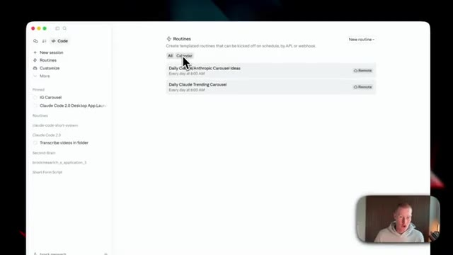
*⏱️ 00:13:12 — Vue d'ensemble de l'interface montrant la liste des routines créées (Daily Claude/Anthropic Carousel Ideas et Daily Claude Trending Carousel).*

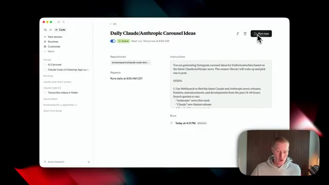
*⏱️ 00:13:29 — Détail d'une routine spécifique avec ses instructions textuelles, ses paramètres de répétition quotidienne et le bouton d'exécution manuelle.*

---

### ⏱️ `[00:13:37 - 00:14:12]` | Segment #33

**🔊 Audio (Transcription Intégrale Mot pour Mot en Français) :**
> vous pouvez voir ici, voici les idées pour ces diapos. Et si je fais défiler vers le bas, vous pouvez voir toutes ces différentes images de carrousel Instagram. Je veux dire, elles ont l'air plutôt solides. Évidemment, nous pourrions faire des aller-retours et modifier un peu tout cela. Ce n'est pas parfait, mais vous pouvez voir que nous pouvons maintenant générer ces images avec l'API Nano Banana directement à l'intérieur d'ici. Et tout cela a été fait en pilotage automatique avec cette routine spécifique qui s'exécute. Très bien. Nous avons donc généré nos carrousels et la routine s'exécute. La question est donc de savoir comment nous pouvons maintenant les publier automatiquement ? Bien sûr, vous pouvez aller les publier individuellement vous-même. Cependant, étant le geek de l'IA que je suis, je veux

**👁️ Analyse Visuelle d'Écran (gemini-3.5-flash-lite) :**
**Interface & Outils** : Application de bureau Claude Code / Anthropic

**Contenu textuel & Code** : Génération de visuels de carrousel Instagram, résumés de diapositives et métriques d'utilisation de l'API (sessions : 185, tokens totaux : 6,4M).

**Action / Démonstration** : Navigation et défilement dans les résultats générés par l'assistant IA.

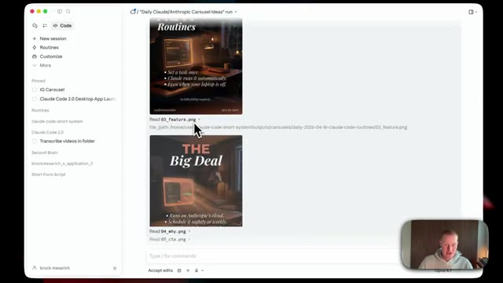
*⏱️ 00:13:46 — Aperçu dans l'application Claude Code affichant des visuels générés pour un carrousel Instagram sur les routines automatisées.*

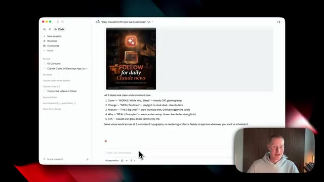
*⏱️ 00:13:54 — Interface de Claude Code affichant le résumé des 5 diapositives du carrousel Instagram validées.*

*⏱️ 00:14:03 — Tableau de bord d'activité de Claude montrant les statistiques d'utilisation (sessions, messages, tokens).*

---

### ⏱️ `[00:14:12 - 00:14:44]` | Segment #34

**🔊 Audio (Transcription Intégrale Mot pour Mot en Français) :**
> capable d'automatiser tout ce processus. Je vais donc vous montrer exactement comment nous pouvons planifier ces publications en pilotage automatique sans avoir à le faire manuellement. Je vais donc remonter dans les connecteurs. Et si vous ne savez pas ce que sont les connecteurs, c'est essentiellement la façon dont vous connectez vos applications à toute l'application de bureau Claude. Et vous pouvez voir que j'en ai configuré quelques-uns différents ici. Si je clique sur parcourir les connecteurs, il y en a des tonnes de différents que nous pouvons ajouter à Claude. Mais s'il y a une application à laquelle vous voulez vous connecter et que vous ne voyez pas ici, je vais vous montrer une astuce rapide pour vous permettre de le faire. J'utilise personnellement une plateforme appelée Zapier MCP qui vous permet de vous connecter à 9 000

**👁️ Analyse Visuelle d'Écran (gemini-3.5-flash-lite) :**
**Interface & Outils** : Interface logicielle de Claude (application de bureau ou interface web de personnalisation).

**Contenu textuel & Code** : Menus de configuration, liste des connecteurs web et bureau, permissions d'outils, répertoire des intégrations partenaires (Notion, Stripe, Supabase, Vercel, Wix).

**Action / Démonstration** : Navigation à travers les menus de personnalisation et de gestion des connecteurs de l'assistant IA.

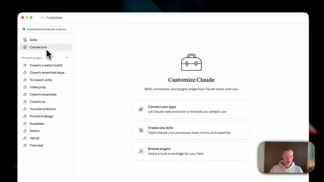
*⏱️ 00:14:20 — Vue d'ensemble de l'interface de personnalisation de Claude montrant le menu des connecteurs et les options de configuration.*

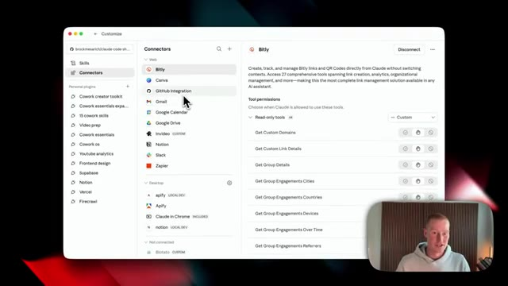
*⏱️ 00:14:28 — Liste des connecteurs disponibles (Bitly, Canva, GitHub, Gmail, Google Calendar, etc.) avec le panneau de configuration détaillé pour Bitly.*

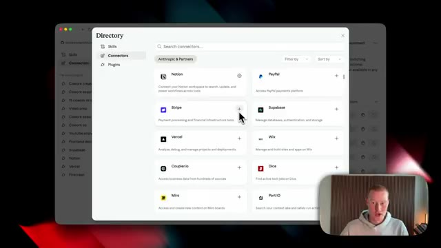
*⏱️ 00:14:36 — Fenêtre modale du répertoire affichant les différents connecteurs et outils partenaires intégrables (Notion, Stripe, Supabase, Vercel, Wix, etc.).*

---

### ⏱️ `[00:14:44 - 00:15:12]` | Segment #35

**🔊 Audio (Transcription Intégrale Mot pour Mot en Français) :**
> plus différentes applications automatiquement. C'est juste très simple et facile à utiliser. Je vais vous montrer rapidement en environ 30 secondes comment vous pouvez configurer ceci. Donc nous allons cliquer sur créer un nouveau serveur MCP. Nous allons juste cliquer sur Cloud Cowork comme nos clients. Ne vous inquiétez pas. Bien sûr, nous utilisons Cloud Code maintenant, mais nous avons juste besoin de nous connecter à l'application de bureau Cloud. Donc à partir d'ici, nous allons simplement ajouter n'importe quel des différents outils que nous voulons ajouter. Vous pouvez voir que j'ai Stripe, HubSpot, Google Drive, School, fondamentalement n'importe quelle application que vous voulez ajouter, vous pouvez l'ajouter ici.

**👁️ Analyse Visuelle d'Écran (gemini-3.5-flash-lite) :**
**Interface & Outils** : Navigateur web affichant l'interface de gestion Zapier MCP (mcp.zapier.com)

**Contenu textuel & Code** : Liste d'applications connectées au serveur MCP (Stripe, HubSpot, Google Drive, Google Docs, Skool, Synthflow AI) et catalogue d'applications intégrables

**Action / Démonstration** : Navigation et configuration des serveurs et outils MCP au sein de l'interface Zapier

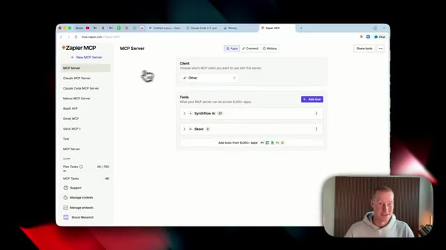
*⏱️ 00:14:51 — Interface Zapier MCP montrant la configuration d'un serveur MCP avec les outils Synthflow AI et Skool.*

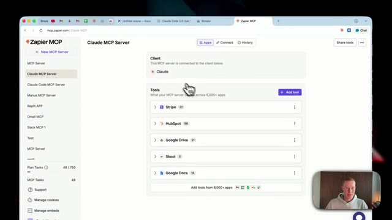
*⏱️ 00:14:58 — Interface Zapier MCP affichant un serveur configuré pour Claude avec plusieurs applications connectées (Stripe, HubSpot, Google Drive, Skool, Google Docs).*

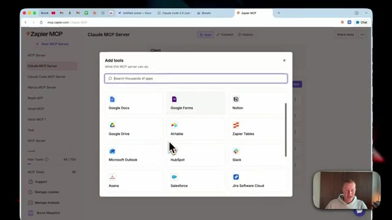
*⏱️ 00:15:05 — Fenêtre modale de sélection d'applications à ajouter ("Add tools") avec des icônes pour Google Docs, Notion, Airtable, Microsoft Outlook, etc.*

---

### ⏱️ `[00:15:12 - 00:15:33]` | Segment #36

**🔊 Audio (Transcription Intégrale Mot pour Mot en Français) :**
> Et nous avons différentes actions pour chaque application qu'elle peut réellement exécuter pour vous. Ensuite, nous allons cliquer sur connecter, puis sur ajouter à Claude. À partir d'ici, nous allons simplement cliquer sur connecter. Et ensuite, nous aurons accès à toutes ces applications que nous avons configurées à l'intérieur de ce serveur. Maintenant, afin de planifier automatiquement ces publications, je vais utiliser un outil appelé Blatato. Laissez-moi donc vous montrer exactement comment configurer cela dès maintenant.

**👁️ Analyse Visuelle d'Écran (gemini-3.5-flash-lite) :**
**Interface & Outils** : Navigateur web affichant l'interface Zapier MCP et les paramètres de l'assistant Claude (claude.ai).

**Contenu textuel & Code** : Documentation de connexion Zapier MCP, détails de la version du connecteur (1.0.0) et liste des applications connectées avec leurs permissions.

**Action / Démonstration** : Navigation à travers les interfaces de configuration pour connecter les applications tierces à l'assistant Claude.

*⏱️ 00:15:17 — Interface de Zapier MCP montrant les instructions pour connecter le serveur à Claude.*

*⏱️ 00:15:23 — Interface de Claude affichant le répertoire des connecteurs avec Zapier installé et configuré.*

*⏱️ 00:15:28 — Panneau de configuration des connecteurs de Claude listant diverses applications tierces (Bitly, Canva, GitHub, Gmail, Notion, Zapier).*

---

### ⏱️ `[00:15:33 - 00:15:53]` | Segment #37

**🔊 Audio (Transcription Intégrale Mot pour Mot en Français) :**
> Si je vais dans mon compte Blatato, vous pouvez voir que j'ai 17 publications différentes. Celle-ci a été mise en ligne aujourd'hui. Je peux réellement voir cette publication. Je peux parcourir chacune de ces publications que j'ai réellement programmées, mais je vais vous montrer exactement comment nous pouvons les programmer dès maintenant. La première chose que nous devons faire est donc de créer un compte. Il y a un lien dans la description ci-dessous. Et ensuite, nous allons aller dans les paramètres.

**👁️ Analyse Visuelle d'Écran (gemini-3.5-flash-lite) :**
**Interface & Outils** : Navigateur web affichant l'interface de l'application Blatato.

**Contenu textuel & Code** : Liste de publications avec miniatures, textes descriptifs (ex: "Comment OPUS...", "Comment dispatch..."), dates de programmation et boutons "View".

**Action / Démonstration** : Navigation et présentation du tableau de bord de gestion des publications sur l'outil Blatato.

*⏱️ 00:15:38 — Capture d'écran montrant l'interface du tableau de bord Blatato affichant la liste des publications programmées (17+ Published Posts).*

---

### ⏱️ `[00:15:53 - 00:16:25]` | Segment #38

**🔊 Audio (Transcription Intégrale Mot pour Mot en Français) :**
> À partir d'ici, nous allons configurer toutes nos différentes applications que nous voulons connecter. Nous pourrions donc nous connecter à X, nous pourrions nous connecter à LinkedIn, TikTok, Instagram, toutes ces différentes plateformes auxquelles nous voulons nous connecter. Personnellement, je suis juste connecté à Instagram et à LinkedIn en ce moment. Donc, une fois que vous avez connecté votre application, nous pouvons passer à l'étape suivante. À partir d'ici, nous allons venir sur API. Nous allons donc venir sur connecteurs. Nous allons cliquer sur ajouter un connecteur personnalisé, et nous allons lui donner un nom. Je vais simplement l'appeler Blatato. Et ce que nous allons faire, c'est que nous allons revenir à nos paramètres Blatato. Nous allons copier cette URL

**👁️ Analyse Visuelle d'Écran (gemini-3.5-flash-lite) :**
**Interface & Outils** : Navigateur web, interface de gestion de comptes et de connecteurs applicatifs.

**Contenu textuel & Code** : Boutons de connexion aux réseaux sociaux (Twitter, LinkedIn, Facebook, TikTok, Instagram, Threads, Pinterest, Bluesky, YouTube) et formulaire d'ajout de connecteur personnalisé (nom et URL du serveur MCP distant).

**Action / Démonstration** : Navigation et démonstration de la configuration et de l'intégration de différentes plateformes et applications.

*⏱️ 00:16:01 — Interface web montrant des boutons pour connecter divers réseaux sociaux (Twitter, LinkedIn, Facebook, TikTok, Instagram, etc.) avec la webcam du présentateur en bas à droite.*

*⏱️ 00:16:17 — Interface de configuration avec une fenêtre modale « Add custom connector » permettant de connecter Claude à des données et outils externes via une URL de serveur MCP distant.*

---

### ⏱️ `[00:16:25 - 00:16:54]` | Segment #39

**🔊 Audio (Transcription Intégrale Mot pour Mot en Français) :**
> ici même. Nous allons simplement le coller là, cliquer sur ajouter, puis nous allons voir ce petit bouton qui dit connecter. Nous allons cliquer dessus. Cela va nous ramener à notre compte Blatato. Nous allons approuver l'accès directement à l'intérieur d'ici. Nous allons réouvrir Claude. Donc nous devrions voir ceci dans nos connecteurs. Comme vous pouvez le voir, je l'ai juste ici et nous pouvons aller de l'avant et changer les permissions juste ici. Je vais simplement cliquer sur toujours autoriser. Comme ça, il ne me demande pas toujours comment faire les choses. Aussi, je voulais mentionner qu'il y a plein d'autres choses que vous pouvez faire à l'intérieur de Blatato.

**👁️ Analyse Visuelle d'Écran (gemini-3.5-flash-lite) :**
**Interface & Outils** : Interface de configuration et de gestion des connecteurs/MCP (Model Context Protocol).

**Contenu textuel & Code** : Liste des connecteurs web et bureau (Bitly, Blotato, Canva, GitHub, Gmail, Google Calendar, Notion, Zapier) et permissions d'outils pour Blotato (blotato_create_post, blotato_get_user, etc.).

**Action / Démonstration** : Navigation et configuration des connecteurs pour lier les services externes à l'interface de l'assistant IA.

*⏱️ 00:16:39 — Interface de gestion des connecteurs avec la liste des applications web disponibles (Bitly, Blotato, Canva, etc.) et les permissions de l'outil Blotato sélectionné.*

*⏱️ 00:16:47 — Vue détaillée des permissions d'outils pour Blotato avec les options pour autoriser ou restreindre l'utilisation par Claude.*

---

### ⏱️ `[00:16:54 - 00:17:14]` | Segment #40

**🔊 Audio (Transcription Intégrale Mot pour Mot en Français) :**
> Vous pouvez voir toutes vos publications ici en une seule vue. Je peux donc voir tout ce que j'ai publié et tout ce qui va être publié. Et il y a même de bons modèles ici si vous voulez créer automatiquement du contenu en utilisant un design spécifique, par exemple. Ensuite, je vais simplement revenir à ma tâche où nous avons généré ces images de carrousel et dire simplement : peux-tu maintenant programmer cette publication pour qu'elle soit en ligne ?

**👁️ Analyse Visuelle d'Écran (gemini-3.5-flash-lite) :**
**Interface & Outils** : Navigateur web, tableau de bord de planification de contenu et application de type interface de chat ou assistant IA.

**Contenu textuel & Code** : Calendrier de publications pour avril 2026, aperçus de posts de réseaux sociaux, retours d'analyse de slides et invite de chat.

**Action / Démonstration** : Navigation dans le calendrier de publication et revue de contenu généré par l'IA.

*⏱️ 00:16:59 — Interface web montrant un calendrier de publication de contenu avec une vue mensuelle détaillée et une pop-up affichant un aperçu de post, ainsi qu'une incrustation vidéo du présentateur en bas à droite.*

*⏱️ 00:17:09 — Interface logicielle affichant du texte généré par une IA avec des options de révision et une invite de commande en bas, ainsi qu'une incrustation vidéo du présentateur en bas à droite.*

---

### ⏱️ `[00:17:14 - 00:17:35]` | Segment #41

**🔊 Audio (Transcription Intégrale Mot pour Mot en Français) :**
> Boum, et hop, planifiez la mise en ligne pour demain, le 17 avril à 9 heures. Et si je reviens sur Blatato et que je vérifie mon compte, nous devrions pouvoir voir ceci sur le calendrier. Et voilà, vous pouvez voir que Cloud Code vient d'obtenir une application de bureau. C'est maintenant prévu pour 8 heures. Maintenant, en revenant à Cloud Code sur le bureau, je veux vous montrer que vous pouvez également exécuter plusieurs sessions en même temps.

**👁️ Analyse Visuelle d'Écran (gemini-3.5-flash-lite) :**
**Interface & Outils** : Blatato (outil de programmation de publications), Instagram, Claude Code

**Contenu textuel & Code** : Calendrier des publications, planification de contenu pour les réseaux sociaux (Instagram), carrousel intitulé "Claude Code just got a desktop app" prévu pour le 17 avril à 9h00.

**Action / Démonstration** : Navigation et vérification de la publication programmée sur le calendrier de Blatato.

*⏱️ 00:17:25 — Interface de Blatato affichant le calendrier des publications programmées, incluant un carrousel pour Instagram prévu le vendredi 17 avril à 9h00.*

---

### ⏱️ `[00:17:35 - 00:17:55]` | Segment #42

**🔊 Audio (Transcription Intégrale Mot pour Mot en Français) :**
> Donc disons simplement que je veux faire un résumé d'e-mails, ce qui en gros va parcourir ma boîte de réception, trouver tous les différents e-mails auxquels je dois répondre. Je pourrais donc exécuter cette tâche, tout comme je pourrais ouvrir celle-ci, et faisons un carrousel Instagram, et je pourrais les regrouper. Nous pourrions ainsi voir chacune de ces différentes tâches s'exécuter en même temps. Je pourrais même en ouvrir d'autres.

**👁️ Analyse Visuelle d'Écran (gemini-3.5-flash-lite) :**
**Interface & Outils** : Application de bureau Claude Code / interface de développement personnalisée.

**Contenu textuel & Code** : Commandes textuelles et scripts de tâches automatisées ('/email-briefing', '/g-carousel', options de configuration, statistiques de tokens).

**Action / Démonstration** : Sélection et exécution de tâches automatisées de résumé d'e-mails et de création de carrousels Instagram.

*⏱️ 00:17:40 — Interface de l'application montrant le tableau de bord avec des statistiques d'utilisation et une commande de résumé d'e-mails en bas.*

*⏱️ 00:17:45 — Interface montrant le menu déroulant des commandes avec différentes options comme 'ig-carousel' et 'insights'.*

*⏱️ 00:17:50 — Vue divisée en deux fenêtres montrant l'exécution simultanée de scripts pour la création de carrousels Instagram et le résumé d'e-mails.*

---

### ⏱️ `[00:17:55 - 00:18:13]` | Segment #43

**🔊 Audio (Transcription Intégrale Mot pour Mot en Français) :**
> Donc par exemple, ici même, j'ai quatre sessions différentes qui s'exécutent directement à l'intérieur de Cloud Code. C'est donc une façon pour nous de devenir vraiment plus productifs directement à l'intérieur de l'application de bureau. La grande question que vous pourriez vous poser est donc : est-ce que Cloud Co-Work est mort ? Ai-je perdu tout mon temps à essayer d'apprendre ceci ? Et la réponse est non. Ce sont deux outils différents pour deux personnes différentes.

**👁️ Analyse Visuelle d'Écran (gemini-3.5-flash-lite) :**
**Interface & Outils** : Application de bureau Cloud Code et navigateur web affichant des diapositives de présentation.

**Contenu textuel & Code** : Quatre fenêtres de sessions actives distinctes dans Cloud Code gérant différents projets et routines d'automatisation.

**Action / Démonstration** : Le présentateur démontre l'utilisation multitâche de l'application de bureau Cloud Code avec quatre sessions en parallèle.

*⏱️ 00:18:00 — Vue d'ensemble de l'interface de bureau Cloud Code affichant quatre sessions de travail simultanées, avec le présentateur en médaillon dans le coin inférieur droit.*

---

### ⏱️ `[00:18:13 - 00:18:32]` | Segment #44

**🔊 Audio (Transcription Intégrale Mot pour Mot en Français) :**
> Vous avez probablement commencé avec Co-Work et maintenant vous atteignez peut-être des limites et vous vous demandez quelles prochaines étapes vous pourriez franchir, mais vous ne voulez pas avoir à plonger dans le terminal ou à utiliser quelque chose comme cursor ou VS code. Et c'est la réponse. J'ai pratiquement instruit les gens de ma communauté. J'ai eu des tonnes de personnes dans ma communauté scolaire qui m'ont demandé s'ils devaient passer de cowork à code.

**👁️ Analyse Visuelle d'Écran (gemini-3.5-flash-lite) :**
**Interface & Outils** : Navigateur web affichant une diapositive de présentation et vignette vidéo du présentateur

**Contenu textuel & Code** : Texte comparatif 'Different tools for different people', 'Cowork (Safe + Simple)' vs 'Claude Code (Powerful + Open)' avec des points clés sur les applications et le système de fichiers

**Action / Démonstration** : Le présentateur explique les différences d'utilisation et de complexité entre Cowork et Claude Code

*⏱️ 00:18:18 — Diapositive de présentation comparant Cowork et Claude Code avec les mentions 'Safe + Simple' et 'Powerful + Open'*

*⏱️ 00:18:23 — Diapositive de présentation affichant la comparaison des fonctionnalités entre Cowork et Claude Code*

*⏱️ 00:18:28 — Diapositive de présentation illustrant les différents outils selon les besoins des utilisateurs*

---

### ⏱️ `[00:18:32 - 00:18:51]` | Segment #45

**🔊 Audio (Transcription Intégrale Mot pour Mot en Français) :**
> Et je pense que c'est l'occasion parfaite pour les gens de faire de tout petits pas vers cela. Moi personnellement, j'ai l'impression que cowork n'est pas la destination finale. C'est plutôt la bretelle d'accès pour utiliser un outil comme CloudCode, mais seulement si c'est vraiment facile à utiliser pour vous. Et j'ai honnêtement l'impression que cette nouvelle refonte du bureau rend cette transition tellement plus facile.

**👁️ Analyse Visuelle d'Écran (gemini-3.5-flash-lite) :**
**Interface & Outils** : Navigateur web affichant une présentation et interface utilisateur de Claude Code.

**Contenu textuel & Code** : Texte explicatif sur l'utilisation de Cowork comme tremplin vers des outils plus puissants, et panneaux de configuration de l'application Claude Code.

**Action / Démonstration** : Le présentateur explique la transition entre l'utilisation de Cowork et des outils de développement avancés via Claude Code.

*⏱️ 00:18:37 — Diapositive montrant le texte "Cowork isn't the destination. It's the on-ramp." avec une illustration de progression (Start here, Build skills, Graduate).*

*⏱️ 00:18:46 — Interface de l'application Claude Code affichant des sessions de développement et l'historique des interactions avec des agents IA.*

---

### ⏱️ `[00:18:51 - 00:19:14]` | Segment #46

**🔊 Audio (Transcription Intégrale Mot pour Mot en Français) :**
> Et le meilleur dans tout ça, c'est que vous pouvez toujours utiliser Claude Cowork directement à l'intérieur d'ici. Et s'il y a jamais une tâche que vous voulez faire et que vous ne pouvez pas faire à l'intérieur de Cowork, alors vous pouvez simplement activer Claude Code et reprendre là où vous vous étiez arrêté. Et si vous voulez utiliser cette compétence exacte de carrousel Instagram que je vous ai montrée, il y a un lien dans ma communauté School pour télécharger cela, ainsi que j'ai ce guide ici, qui détaille fondamentalement exactement comment vous pouvez le configurer.

**👁️ Analyse Visuelle d'Écran (gemini-3.5-flash-lite) :**
**Interface & Outils** : Interface utilisateur de Claude (Cowork et Claude Code) et lecteur de PDF sur macOS.

**Contenu textuel & Code** : Listes de tâches, routines de code, instructions de prompts et diagrammes de flux de travail.
[DESC_IMAGE_1] Navigation et présentation de l'interface de travail de Claude Cowork.
[DESC_IMAGE_2] Affichage de l'exécution de tâches multiples dans Claude Code.
[DESC_IMAGE_3] Présentation d'un document schématique détaillant un processus automatisé par IA.

**Action / Démonstration** : Explications face caméra et analyse conceptuelle des marchés.

*⏱️ 00:18:57 — Interface de l'application Claude Cowork affichant une liste de tâches actives et un champ de saisie de prompt.*

*⏱️ 00:19:02 — Interface de Claude Code avec des onglets de projet actifs ("Build Instagram carousel component" et "Build email briefing feature") et des panneaux de discussion.*

*⏱️ 00:19:08 — Visualisation d'un document PDF ouvert montrant un schéma de workflow expliquant le fonctionnement d'un carrousel Instagram automatisé avec Claude.*

---

### ⏱️ `[00:19:14 - 00:19:32]` | Segment #47

**🔊 Audio (Transcription Intégrale Mot pour Mot en Français) :**
> En plus de cela, vous aurez accès aux plus de 50 compétences Claude Code dont je ne peux plus me passer, que j'utilise pratiquement chaque jour directement au sein de la communauté de l'école. Et cela étant dit, les gars, si vous voulez du contenu plus précieux comme celui-ci, abonnez-vous à cette chaîne. Je couvre tout ce qui concerne Claude et l'IA pour les utilisateurs non techniques. Cela étant dit, merci d'être restés jusqu'à la fin et je vous vois dans la prochaine vidéo.

**👁️ Analyse Visuelle d'Écran (gemini-3.5-flash-lite) :**
**Interface & Outils** : Navigateur web affichant une plateforme communautaire (School) et une page de chaîne YouTube.

**Contenu textuel & Code** : Miniatures de vidéos YouTube aux titres axés sur l'IA (ex: "Claude Code vs Cowork", "Credit Killers", "Top 1%").

**Action / Démonstration** : Navigation et présentation visuelle de la chaîne YouTube et de la communauté en ligne du présentateur.

---

### ⏱️ `[00:19:32 - 00:19:33]` | Segment #48

**🔊 Audio (Transcription Intégrale Mot pour Mot en Français) :**
> Paix.

**👁️ Analyse Visuelle d'Écran (gemini-3.5-flash-lite) :**
**Interface & Outils** : Navigateur web affichant une page HTML locale ou un site web de ressources.

**Contenu textuel & Code** : Texte de présentation des compétences Claude Cowork, statistiques chiffrées (50 compétences, 9 catégories) et un bouton "Download All Skills".

**Action / Démonstration** : Présentation des ressources et des compétences utilisées au quotidien par le créateur.

*⏱️ 00:19:32 — Capture d'écran montrant une page web au design sombre intitulée "Every Skill & Resource Brock Uses Every Day" avec des statistiques et un bouton de téléchargement, ainsi qu'une incrustation vidéo du présentateur en bas à droite.*

---

