# 🎬 Anthropic Just Changed Design Forever... (Claude Design)

> **Chaîne** : [Brock Mesarich | AI for Non Techies](https://www.youtube.com/@BrockMesarich)  
> **Lien YouTube** : [https://www.youtube.com/watch?v=ow8dl9gfjCI](https://www.youtube.com/watch?v=ow8dl9gfjCI)  
> **Date de publication** : 20260417  
> **Durée** : 00:12:52  
> **Identifiant vidéo** : `ow8dl9gfjCI`  
> **Transcription & Analyse** : `whisper-v3-large-turbo+gemini-3.5-flash-lite`  

---

## 📌 Synthèse Exécutive & Outils

### 💡 Résumé
Dans cette vidéo, la chaîne « Brock Mesarich | AI for Non Techies » analyse en profondeur la nouvelle fonctionnalité de design d'Anthropic propulsée par le modèle **Claude Opus 4.7**. L'animateur démystifie le battage médiatique (« hype ») autour de l'outil pour se concentrer sur ses capacités réelles : générer des prototypes visuels, des présentations, des pages de destination et des chartes graphiques de manière conversationnelle, à la manière d'un outil de « *vibe coding* ». 

La démonstration met en avant la puissance des entrées multimodales de l'IA (textes, images, dépôts GitHub, fichiers HTML ou maquettes Figma) pour concevoir des systèmes de design sur mesure. En important des éléments de code préexistants, l'utilisateur peut contraindre Claude à respecter strictement sa charte graphique, sa typographie et ses composants de marque pour tous ses livrables futurs, qu'il s'agisse de diaporamas ou de tableaux de bord.

### 🛠️ Outils, Modèles & Logiciels Présentés
* **Claude (Claude.ai / Claude Design)** : L'application web d'Anthropic intégrant désormais un outil de conception dédié pour générer des interfaces et des présentations via le langage naturel.
* **Claude Opus 4.7** : Le modèle linguistique de pointe d'Anthropic servant de moteur sous-jacent à cette nouvelle interface de design.
* **Claude Code / Claude Cowork** : Environnements de travail et assistants de codage permettant d'interfacer des bases de code et des fichiers de développement avec les outils de l'écosystème Anthropic.
* **Figma** : Logiciel de design de référence dont les formats de fichiers peuvent être importés pour alimenter les systèmes de design de Claude.
* **GitHub** : Plateforme de gestion de code source utilisée pour lier des dépôts et extraire des styles de design existants.
* **Lovable / Bolt / Replit** : Outils de « *vibe coding* » mentionnés pour situer l'expérience utilisateur interactive et conversationnelle de Claude Design.
* **Coda** : Application de productivité évoquée pour sa gestion similaire des compétences et des composants modulaires.

### 🔑 Points Clés & Enseignements Stratégiques
* **Génération conversationnelle de visuels** : Il est possible de créer des diaporamas, des pages de destination, des chartes graphiques ou des fonds d'écran complexes par simple saisie textuelle en anglais simple.
* **Accès par abonnement** : La fonctionnalité est déployée en version préliminaire de recherche pour les abonnés Pro, Max, Team et Enterprise (forfaits payants à partir de 20 $ par mois).
* **Interface de type « Vibe Coding »** : L'environnement de travail combine un mode de discussion à gauche et le rendu du prototype en temps réel à droite, rappelant des plateformes comme Bolt ou Lovable.
* **Toile de croquis interactive** : L'outil intègre une interface de dessin libre permettant de formaliser des idées graphiques et de les transformer instantanément en prototypes fonctionnels.
* **Entrées multimodales avancées** : Claude Design accepte des invites textuelles, des images, des documents PowerPoint, des bases de code et des captures web pour alimenter sa créativité.
* **Création de systèmes de design unifiés** : La fonctionnalité « Systèmes de Design » permet de centraliser les directives de marque pour garantir la cohérence visuelle de tous les livrables générés.
* **Intégration de code et de fichiers tiers** : L'utilisateur peut importer des dossiers locaux, lier des dépôts GitHub ou intégrer des fichiers Figma pour reproduire fidèlement un style visuel existant.
* **Processus de configuration itératif** : La génération d'un système de design prend une dizaine de minutes et inclut une phase de révision humaine (validation de l'iconographie, des logos et des composants).
* **Affinement par retours textuels** : Si un élément généré ne correspond pas aux attentes, l'utilisateur peut demander des modifications correctives en décrivant précisément ses préférences dans le chat.
* **Modularité des composants** : Chaque élément individuel (diapositives, appels à l'action, captures d'écran) peut être audité et modifié séparément après la génération initiale.

---

## ⏱️ Chronologie & Transcription Complète Audio & Visuelle (Mot pour Mot)

### ⏱️ `[00:00:00 - 00:00:36]` | Segment #01

**🔊 Audio (Transcription Intégrale Mot pour Mot en Français) :**
> Très bien, alors Anthropic vient de lancer la nouvelle fonctionnalité de design de Claude, et je vais l'analyser dans cette vidéo. Avant d'aller plus loin, je ne vais pas juste rester assis ici à faire du battage médiatique et dire que cela tue Figma, que cela tue Lovable. Je vais expliquer très simplement ce qu'est ce produit, ce qu'il n'est pas. Ainsi, à la fin de cette vidéo, vous saurez si cela vous convient. Comme vous pouvez le voir ici, c'est un design que j'ai imaginé. Je lui aibasically donné mon guide de style de marque que je voulais recréer, et il a généré ce diaporama magnifique en seulement quelques minutes. Très bien, donc si vous n'avez pas vécu sous une roche et que vous avez été sur Twitter, vous avez probablement vu que les gens parlent de ce nouvel outil de design d'Anthropic qui a été

**👁️ Analyse Visuelle d'Écran (gemini-3.5-flash-lite) :**
**Interface & Outils** : Navigateur web, interface de démonstration de Claude Design et application de présentation.

**Contenu textuel & Code** : Texte descriptif sur le produit, structure de présentation en 12 points, paramètres de design et de configuration de la landing page.
[DESC_IMAGE_3] Démonstration et analyse des fonctionnalités de design d'Anthropic par le créateur de contenu.

**Action / Démonstration** : Explications face caméra et analyse conceptuelle des marchés.

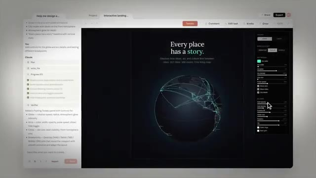
*⏱️ 00:00:09 — Interface utilisateur montrant la génération d'une landing page interactive avec un globe terrestre stylisé et des options de personnalisation dans une barre latérale.*

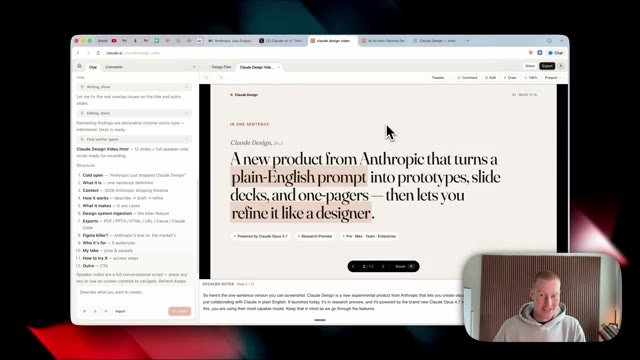
*⏱️ 00:00:18 — Présentation des notes de conférencier et d'un slide de présentation expliquant le nouveau produit d'Anthropic, Claude Design.*

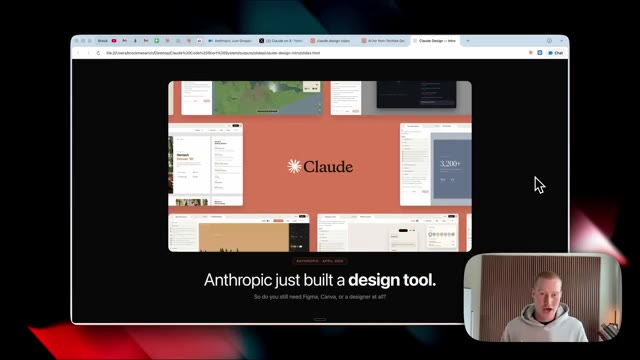
*⏱️ 00:00:27 — Vue d'ensemble du site web avec le logo Claude et le titre principal 'Anthropic just built a design tool.' aux côtés du présentateur en incrustation.*

---

### ⏱️ `[00:00:36 - 00:01:14]` | Segment #02

**🔊 Audio (Transcription Intégrale Mot pour Mot en Français) :**
> supposément en train de sortir, et oui, c'est bien devenu en ligne aujourd'hui, et tout cela est propulsé par le nouveau modèle Claude Opus 4.7 qui est sorti hier. En un mot, c'est fondamentalement comme ça que ça fonctionne. Nous pouvons taper une phrase ou une consigne spécifique, et nous pouvons obtenir un visuel terminé. Donc nous écrivons simplement ce que nous voulons en anglais simple. Claude construit ce design spécifique pour nous et nous pouvons le modifier rien qu'en lui disant quoi changer. C'est une façon conversationnelle pour nous de concevoir des choses comme des présentations, des diaporamas, des pages de destination, ou même simplement des chartes graphiques. Donc comme je l'ai dit, c'est propulsé par Claude Opus 4.7, qui est un nouveau modèle. Ceci est en version préliminaire de recherche pour les abonnés Pro, Max, Team et Enterprise.

**👁️ Analyse Visuelle d'Écran (gemini-3.5-flash-lite) :**
**Interface & Outils** : Navigateur web, interface de design Claude Design.

**Contenu textuel & Code** : Textes explicatifs, paramètres typographiques (police Space Grotesk, taille, couleur), options de téléchargement et d'export.
[DESC_IMAGE_1] Diapositive de présentation sur le fonctionnement de Claude Design montrant le passage d'un prompt textuel à un visuel finalisé.
[DESC_IMAGE_2] Interface de personnalisation de documents avec un panneau latéral 'Knobs' permettant d'ajuster la typographie et le style.
[DESC_IMAGE_3] Menu déroulant 'Export' d'une application web proposant différentes options d'exportation comme ZIP, PDF, PPTX ou HTML.

**Action / Démonstration** : Explications face caméra et analyse conceptuelle des marchés.

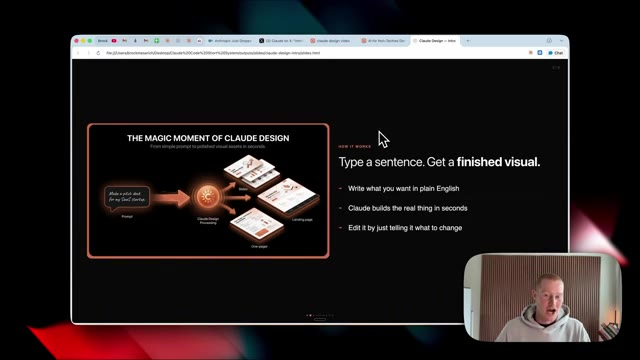
*⏱️ 00:00:46 — Diapositive de présentation sur le fonctionnement de Claude Design montrant le passage d'un prompt textuel à un visuel finalisé.*

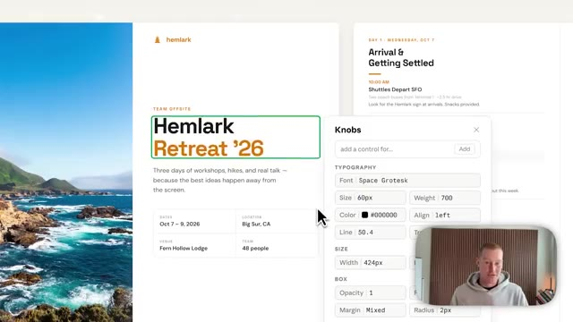
*⏱️ 00:00:55 — Interface de personnalisation de documents avec un panneau latéral 'Knobs' permettant d'ajuster la typographie et le style.*

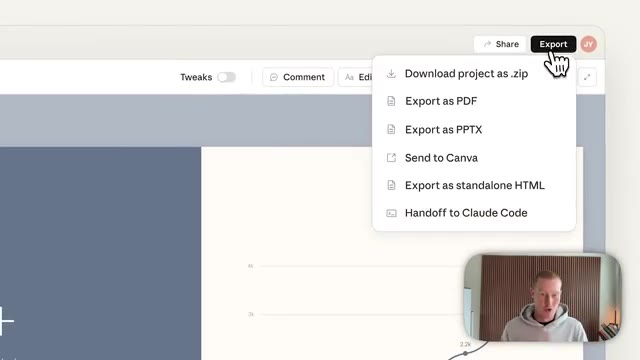
*⏱️ 00:01:05 — Menu déroulant 'Export' d'une application web proposant différentes options d'exportation comme ZIP, PDF, PPTX ou HTML.*

---

### ⏱️ `[00:01:14 - 00:01:50]` | Segment #03

**🔊 Audio (Transcription Intégrale Mot pour Mot en Français) :**
> utilisateurs. Donc si vous êtes sur le forfait gratuit, vous ne verrez probablement pas ceci, mais si vous payez 20 dollars par mois, cela devrait vous être déployé d'ici la fin de la journée. Ceci est un exemple de ce à quoi ressemble notre interface. Il y a ce design. Ils sélectionnent réellement le mode de conception spécifique ici, les différentes couleurs, et nous pouvons créer des choses comme des prototypes, des présentations, des pages de destination, des pages uniques, toutes ces différentes choses que nous pouvons désormais générer directement à l'intérieur de ce produit. Donc sans plus attendre, laissez-moi vous montrer exactement à quoi cela ressemble et comment vous pouvez commencer à l'utiliser dès maintenant. Donc tout d'abord, c'est accessible sur l'application web de Claude. Donc si vous cherchez simplement Claude.ai,

**👁️ Analyse Visuelle d'Écran (gemini-3.5-flash-lite) :**
**Interface & Outils** : Navigateur web affichant des pages de présentation et l'interface de Claude.

**Contenu textuel & Code** : Texte descriptif des fonctionnalités de Claude Design (Prototypes, Slide decks, Landing pages, One-pagers) et interface de chat Claude.

**Action / Démonstration** : Navigation et présentation des fonctionnalités de design de l'application Claude.

---

### ⏱️ `[00:01:50 - 00:02:27]` | Segment #04

**🔊 Audio (Transcription Intégrale Mot pour Mot en Français) :**
> vous devriez maintenant pouvoir voir ceci dans votre compte. Nous avons désormais ce bouton sur la barre latérale de gauche. Si vous ne voyez pas la barre latérale, cliquez ici. Et tout en bas, nous avons un nouvel outil ici appelé design. Et je peux aller de l'avant et ouvrir ceci. À partir d'ici, nous allons voir plusieurs choses différentes. Vous pouvez voir tous mes designs récents. Sur le côté gauche, vous pouvez voir nos prototypes spécifiques. Et si je clique sur exemples ici, nous avons des exemples spécifiques afin de nous donner une idée de ce que nous pouvons faire directement à l'intérieur de l'outil de design de Claude, ainsi que nous pouvons même cliquer sur utiliser ce prompt, et il va en fait commencer à générer un duplicata de ce spécifique

**👁️ Analyse Visuelle d'Écran (gemini-3.5-flash-lite) :**
**Interface & Outils** : Navigateur web affichant l'interface de Claude et l'outil Claude Design d'Anthropic.

**Contenu textuel & Code** : Menus de navigation, options de design, listes de projets récents et composants d'interface utilisateur (wireframes, prototypes haute fidélité).

**Action / Démonstration** : Navigation dans l'interface de Claude et sélection de l'outil de design pour créer ou visualiser des prototypes.

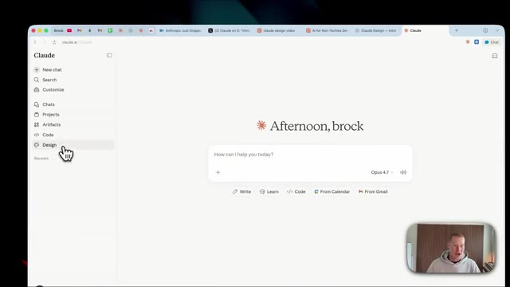
*⏱️ 00:01:59 — Interface de l'application Claude montrant la barre latérale gauche avec le curseur pointant sur l'option 'Design'.*

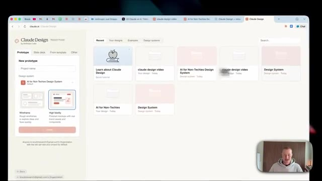
*⏱️ 00:02:08 — Tableau de bord 'Claude Design' affichant divers projets récents et options de prototypes.*

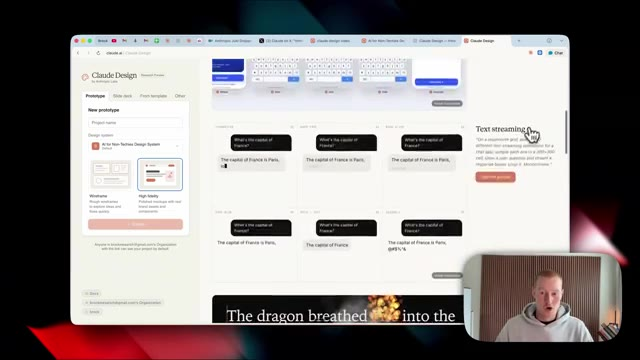
*⏱️ 00:02:18 — Page de l'interface Claude Design montrant des aperçus de composants d'interface utilisateur et de texte en streaming.*

---

### ⏱️ `[00:02:27 - 00:03:00]` | Segment #05

**🔊 Audio (Transcription Intégrale Mot pour Mot en Français) :**
> design que nous voulons recréer. Très bien, donc une fois que nous sommes à l'intérieur d'un projet de design réel, ça va ressembler beaucoup à quelque chose comme Lovable, Bolt ou Replit, l'un de ces outils de "vibe coding" que nous avons déjà vus auparavant. Sur le côté gauche, nous avons essentiellement notre mode de discussion, ainsi que la possibilité de voir tout ce qui est en cours. Voici mon prompt. Imaginez que vous créez un fond d'écran pour un système d'exploitation futuriste, bla, bla, bla. En gros, c'est mon prompt. Et il est en train de passer par ce processus. On dirait qu'il est en train d'écrire ce code et qu'il va me montrer le prototype sur le côté droit très bientôt. De plus, nous pouvons commencer

**👁️ Analyse Visuelle d'Écran (gemini-3.5-flash-lite) :**
**Interface & Outils** : Navigateur web affichant l'interface de Claude Artifacts / design avec une disposition en deux colonnes (chat textuel et zone de rendu/canvas).

**Contenu textuel & Code** : Texte de prompt et réponses de l'IA détaillant un projet de shaders GLSL (Plasma Field, Liquid Metal, Starfield Tunnel, Neon Grid, Crystal Caustics), avec une zone principale intitulée "Creations will appear here".

**Action / Démonstration** : Présentation de l'interface de l'outil de création et explication de la structure du projet de design en cours.

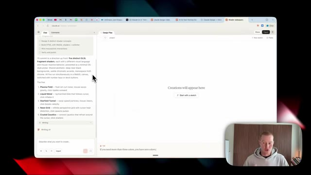
*⏱️ 00:02:35 — Capture d'écran montrant l'interface d'un outil de développement de design (probablement Claude) avec un panneau de chat à gauche et un espace de prévisualisation à droite.*

---

### ⏱️ `[00:03:00 - 00:03:36]` | Segment #06

**🔊 Audio (Transcription Intégrale Mot pour Mot en Français) :**
> avec un croquis spécifique. Donc si je clique là-dessus, ça va maintenant nous amener sur cette toile où nous pourrions effectivement aller noter nos différentes pensées ici. Nous pourrions même écrire sur cette toile également. Donc si nous sommes une personne créative et que nous voulons être capables de simplement genre écrire un design, le visualiser, nous pourrions ensuite le transformer en un prototype fonctionnel directement à l'intérieur de cet outil. Et si je clique sur fichiers de design, vous pouvez voir que nous avons tous nos fichiers à l'intérieur de ce projet de design directement ici. C'est le design qu'il a créé. Donc nous avons ce petit fond d'écran sympa ici que nous pouvons peut-être ajouter à notre page de planification peu importe ce que nous créons nous avons même du métal liquide

**👁️ Analyse Visuelle d'Écran (gemini-3.5-flash-lite) :**
**Interface & Outils** : Navigateur web, interface Claude (Artifacts / Canvas / WebGL preview).

**Contenu textuel & Code** : Toile de brainstorming interactive, post-it virtuel, dessins à main levée, code ou interface de rendu WebGL interactif.

**Action / Démonstration** : Navigation et démonstration d'une toile interactive sur Claude permettant d'écrire, dessiner et d'afficher des rendus visuels.

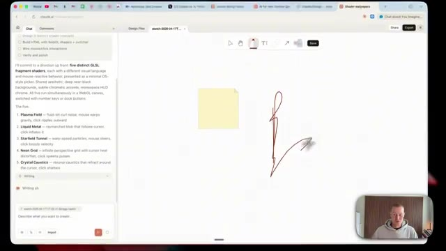
*⏱️ 00:03:09 — Interface de Claude affichant une toile blanche (canvas) avec un post-it jaune et un dessin tracé à main levée, ainsi qu'une vignette du présentateur en bas à droite.*

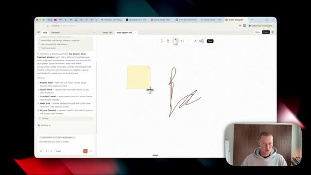
*⏱️ 00:03:18 — Même interface de toile blanche sur Claude avec le curseur positionné près du post-it jaune et les tracés à main levée.*

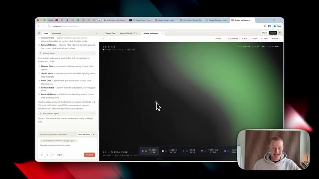
*⏱️ 00:03:27 — Interface de Claude montrant un rendu interactif en plein écran avec des graphismes animés sombres et des commandes de sélection en bas.*

---

### ⏱️ `[00:03:36 - 00:04:12]` | Segment #07

**🔊 Audio (Transcription Intégrale Mot pour Mot en Français) :**
> ici je veux dire c'est assez hallucinant on a une grille néon donc ça a généré cinq versions différentes de genres d'arrière-plans futuristes ici qu'on pourrait commencer à utiliser c'est plutôt cool évidemment c'est juste le premier prompt qu'on lui a donné donc on pourrait faire des allers-retours et affiner ça si on veut donc en revenant à notre tableau de bord principal à l'intérieur de Claw Design on a plusieurs options différentes juste ici on peut générer un prototype à partir de zéro comme vous pouvez le voir on donnerait juste un nom à ça et on sélectionnerait notre système de design spécifique que j'ai déjà créé et je vais vous montrer exactement comment vous pouvez créer un système de design basé sur vos directives de marque préexistantes ou

**👁️ Analyse Visuelle d'Écran (gemini-3.5-flash-lite) :**
**Interface & Outils** : Claude Design (claude.ai)

**Contenu textuel & Code** : Liste des styles de fonds d'écran (Plasma Flow, Liquid Metal, Neon Grid, Particle Field, Aurora Ribbons) et interface de génération de design de prototypes.

**Action / Démonstration** : Navigation et présentation des différents types de fonds d'écran générés par l'IA dans l'interface de Claude Design.

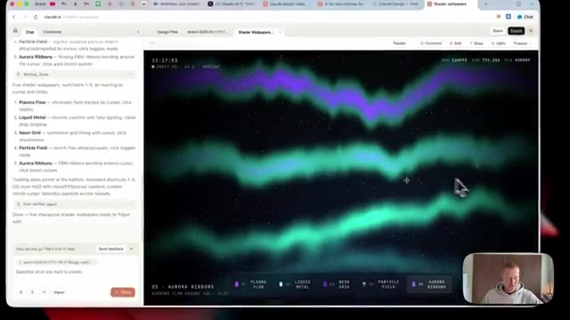
*⏱️ 00:03:45 — Interface de Claude Design montrant un projet de fonds d'écran interactifs (Shader Wallpapers) avec des vagues lumineuses colorées en arrière-plan et un panneau de configuration sur la gauche.*

---

### ⏱️ `[00:04:12 - 00:04:46]` | Segment #08

**🔊 Audio (Transcription Intégrale Mot pour Mot en Français) :**
> votre logo toutes ces différentes préférences que vous avez qui pourraient ensuite être reflétées dans n'ensuite importe quel design que vous faites à l'intérieur de Claude Design. Ensuite, nous pourrions même générer un diaporama ici encore vous pouvez voir ce système de design pour non-techniciens que j'ai créé et c'est exactement ce que j'ai utilisé afin de générer ce diaporama ici, que j'ai fait en une seule invite simple. Avant de vous montrer comment nous pouvons soit importer soit créer un système de design ou un guide de style spécifique, parlons rapidement de quelques fonctionnalités clés ici qui font vraiment de ceci un outil intéressant. Nous avons donc du multi

**👁️ Analyse Visuelle d'Écran (gemini-3.5-flash-lite) :**
**Interface & Outils** : Navigateur web affichant l'interface de l'application Claude Design (claude.ai).

**Contenu textuel & Code** : Tableaux de projets, options de création de diaporamas et schémas explicatifs sur les entrées multimodales de l'IA.

**Action / Démonstration** : Navigation dans l'interface et présentation des fonctionnalités de génération de diaporamas et d'entrées multimodales.

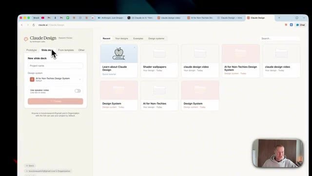
*⏱️ 00:04:20 — Interface de Claude Design montrant le tableau de bord avec les projets récents et les options de création de diaporamas.*

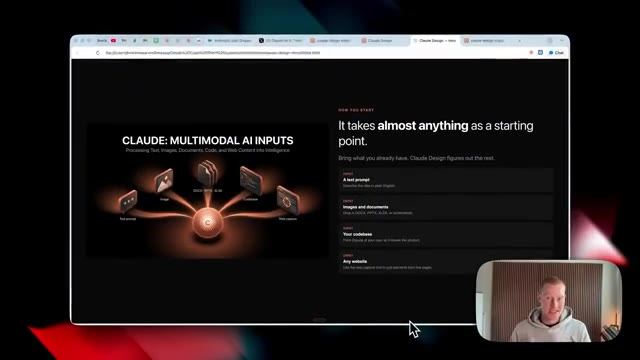
*⏱️ 00:04:37 — Page de présentation de Claude Design illustrant les entrées multimodales de l'IA (texte, images, documents, code, captures web).*

---

### ⏱️ `[00:04:46 - 00:05:15]` | Segment #09

**🔊 Audio (Transcription Intégrale Mot pour Mot en Français) :**
> entrées multimodales pour l'IA. Donc, cela signifie essentiellement que nous pouvons donner à Claude plusieurs entrées différentes, telles que des invites textuelles, des images spécifiques, des documents PowerPoint, des bases de code spécifiques, et même une capture web, il peut aller chercher différentes informations sur des sites Web. Et une fois que nous avons fourni ces entrées spécifiques, il peut alors apprendre nos systèmes de design. Donc, comme je l'ai dit, nous pouvons le pointer vers notre base de code ou nos fichiers de design que nous avons préexistants dans quelque chose comme Claude Code, par exemple.

**👁️ Analyse Visuelle d'Écran (gemini-3.5-flash-lite) :**
**Interface & Outils** : Navigateur web affichant une diapositive de présentation avec un encart vidéo du présentateur en bas à droite.

**Contenu textuel & Code** : Schéma illustrant "Claude: Multimodal AI Inputs" avec des icônes pour le texte, les images, les documents (DOCX, PPTX, XLSX), la base de code et la capture web. Texte explicatif : "It takes almost anything as a starting point."

**Action / Démonstration** : Le curseur de la souris survole l'icône de saisie de texte, illustrant les différentes options d'entrées multimodales prises en charge par Claude.

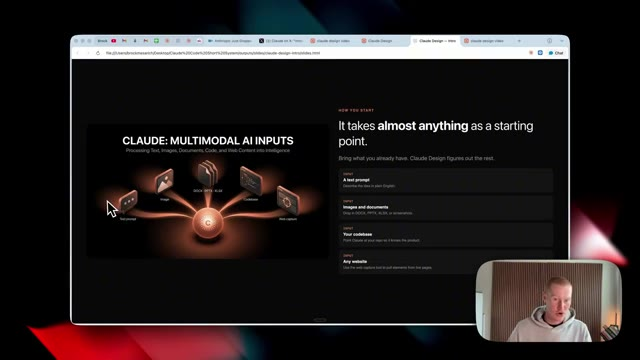
*⏱️ 00:04:53 — Capture d'écran montrant une présentation web sur les entrées multimodales de Claude avec différentes catégories d'entrées (texte, images, documents, code, capture web).*

---

### ⏱️ `[00:05:15 - 00:05:52]` | Segment #10

**🔊 Audio (Transcription Intégrale Mot pour Mot en Français) :**
> Et ensuite, chaque résultat utilisera nos couleurs, nos polices et nos composants spécifiques. Considérez donc cela comme des compétences en design si vous avez déjà utilisé Coda auparavant. De cette façon, chaque fois que nous générons des diaporamas, des sites web et des documents, ils ont tous l'air d'avoir été créés par la même marque, et c'est parce que nous avons spécifié notre propre système de design directement ici, et c'est vraiment puissant, alors laissez-moi vous montrer exactement comment faire cela. Afin de générer un système de design, ce que nous allons faire, c'est revenir à notre tableau de bord principal ici, et à partir de là, nous allons venir cliquer sur systèmes de design. Et vous pouvez voir plusieurs choses différentes directement dans mon compte. Nous avons donc

**👁️ Analyse Visuelle d'Écran (gemini-3.5-flash-lite) :**
**Interface & Outils** : Navigateur web affichant l'interface de l'application Claude Design et une présentation de diapositive HTML.

**Contenu textuel & Code** : Texte de présentation "It learns your design system" avec des puces explicatives sur l'utilisation des couleurs, polices et composants, ainsi que les vignettes des projets récents de l'utilisateur.

**Action / Démonstration** : Navigation et présentation des fonctionnalités de personnalisation du design system par l'intelligence artificielle.

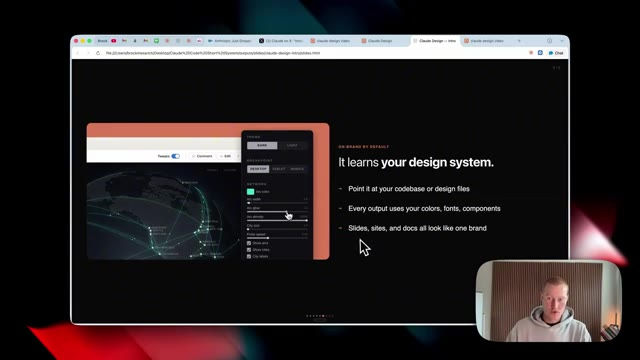
*⏱️ 00:05:24 — Capture d'écran montrant une diapositive de présentation sur le système de design avec du texte explicatif à droite et une maquette interactive à gauche.*

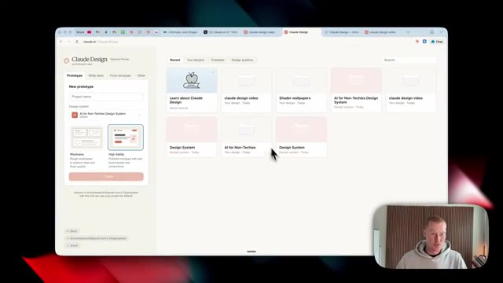
*⏱️ 00:05:43 — Capture d'écran de l'interface de l'application Claude Design montrant la bibliothèque de projets récents et le menu de création.*

---

### ⏱️ `[00:05:52 - 00:06:28]` | Segment #11

**🔊 Audio (Transcription Intégrale Mot pour Mot en Français) :**
> le système de design d'IA pour les non-techniciens, qui est celui que vous avez vu pour ce PowerPoint spécifique que j'ai créé ici même. Et puis en bas, nous pouvons en créer un nouveau. Laissez-moi donc vous montrer exactement comment faire cela maintenant. Ce que nous allons voir maintenant, c'est plusieurs choses différentes. Nous pouvons écrire le nom de notre entreprise. Nous pourrions même lier notre code que nous avons sur GitHub. Donc si vous avez une base de code spécifique que vous stockez sur GitHub, nous pourrions extraire ces informations afin de répliquer exactement ce style de design. Nous pourrions aussi lier du code provenant de notre ordinateur. Donc si nous avons des fichiers différents que nous voulons télécharger, nous pourrions le faire. Nous pourrions même télécharger un fichier Figma également. Et nous

**👁️ Analyse Visuelle d'Écran (gemini-3.5-flash-lite) :**
**Interface & Outils** : Navigateur web affichant l'interface de Claude (claude.ai).

**Contenu textuel & Code** : Formulaire de création de système de design avec des sections pour nommer l'entreprise, lier du code GitHub, importer des fichiers depuis l'ordinateur, un fichier Figma, et ajouter des polices/logos.

**Action / Démonstration** : Navigation sur l'interface web pour configurer un nouveau système de design d'IA.

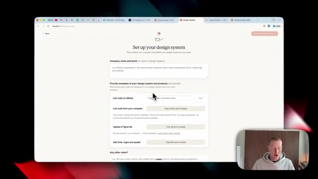
*⏱️ 00:06:10 — Interface de Claude affichant le formulaire de configuration « Set up your design system » avec des champs pour le nom de l'entreprise et des liens vers des ressources.*

---

### ⏱️ `[00:06:28 - 00:06:48]` | Segment #12

**🔊 Audio (Transcription Intégrale Mot pour Mot en Français) :**
> pourrait ajouter toutes les polices, logos ou actifs spécifiques que nous utilisons. Donc laissez-moi commencer et simplement donner un nom à ce système de conception. Donc je vais appeler ceci AI for non-techies. Nommez cela comme vous voulez. Ce sera fondamentalement juste le nom de votre modèle pour ce système de conception. ensuite, si j'avais un dépôt GitHub, je pourrais aller de l'avant et le lier. Mais laissez-moi simplement récupérer certains fichiers que je veux référencer.

**👁️ Analyse Visuelle d'Écran (gemini-3.5-flash-lite) :**
**Interface & Outils** : Interface web Claude.ai (Design System setup)

**Contenu textuel & Code** : Formulaire de configuration avec les champs : Company name and blurb, Link code on GitHub, Link code from your computer, Upload a Figma file, Add fonts, logos and assets.

**Action / Démonstration** : Saisie du nom du design system 'AI for Non-Techies' dans le formulaire de configuration de Claude.ai.

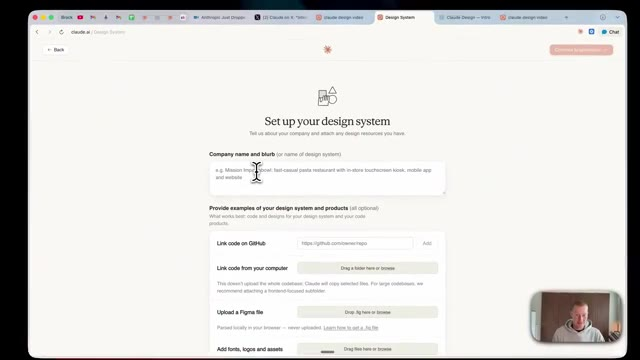
*⏱️ 00:06:33 — Interface web de configuration d'un design system sur claude.ai avec le champ de texte vide.*

*⏱️ 00:06:38 — Interface web de configuration sur claude.ai montrant le texte 'AI for Non-Techies' saisi dans le champ 'Company name and blurb'.*

---

### ⏱️ `[00:06:48 - 00:07:07]` | Segment #13

**🔊 Audio (Transcription Intégrale Mot pour Mot en Français) :**
> Très bien, donc ce que je veux reproduire, c'est ceci juste ici. C'est mon tableau de bord des compétences. C'est une compétence spécifique que j'ai créée à l'intérieur de Claude Cowork. Cela ajoute automatiquement toutes mes compétences que j' possède. Et j'aime honnêtement juste la façon dont ce tableau de bord a l'air. Donc ce que je vais faire, c'est que je vais trouver ce fichier HTML existant à l'intérieur de l'un des dossiers dans lesquels je travaille à l'intérieur de Cowork.

**👁️ Analyse Visuelle d'Écran (gemini-3.5-flash-lite) :**
**Interface & Outils** : Navigateur web affichant une page HTML locale personnalisée pour Claude Cowork (tableau de bord des compétences).

**Contenu textuel & Code** : Statistiques de compétences (78 total, 11 skills, 67 commands, 8 categories) et grille de cartes de compétences (Claude Trending, Daily Claude Curriculum, Description, Film, Filmed, Help, Hooks, etc.).

**Action / Démonstration** : Présentation et navigation sur le tableau de bord personnalisé listant l'ensemble des compétences et commandes installées.

*⏱️ 00:06:53 — Vue d'ensemble du tableau de bord "My Skills Dashboard" affichant le titre, des statistiques globales et l'état du système.*

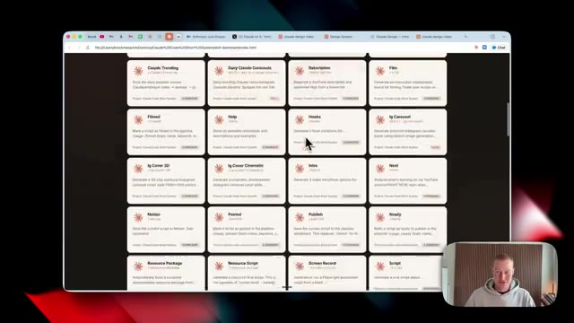
*⏱️ 00:06:58 — Vue détaillée du tableau de bord montrant une grille de cartes interactives représentant les différentes compétences et commandes.*

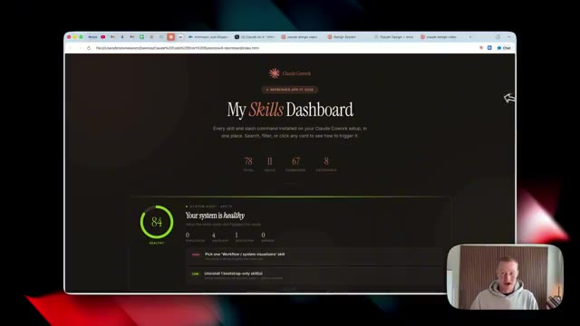
*⏱️ 00:07:02 — Retour à la vue d'ensemble du tableau de bord avec le compteur de compétences et les indicateurs de santé du système.*

---

### ⏱️ `[00:07:07 - 00:07:26]` | Segment #14

**🔊 Audio (Transcription Intégrale Mot pour Mot en Français) :**
> J'ai ce tableau de bord de compétences intitulé. Donc ce que je vais faire, c'est que je vais simplement le glisser dans Claude Design. Donc je vais juste le prendre, le glisser ici. Et juste comme ça, nous avons maintenant ce dossier de tableau de bord de compétences lié. Et je pourrais ajouter plusieurs dossiers différents ici ou des fichiers que j'aimerais ajouter, mais je pense que c'est bien pour l'instant.

**👁️ Analyse Visuelle d'Écran (gemini-3.5-flash-lite) :**
**Interface & Outils** : Navigateur web affichant l'interface de Claude Design (claude.ai/Design System).

**Contenu textuel & Code** : Formulaire de création de design system incluant le nom de l'entreprise ('AI for Non-Techies'), un champ GitHub, une zone de dépôt de dossiers locaux ('Link code from your computer'), et une section pour importer un fichier Figma.

**Action / Démonstration** : Glisser-déposer d'un dossier de compétences local dans l'interface de Claude Design pour lier le code source.

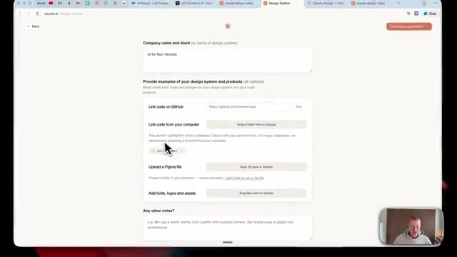
*⏱️ 00:07:17 — L'interface de Claude Design affichant un formulaire de configuration avec le champ pour lier le code depuis l'ordinateur.*

*⏱️ 00:07:21 — L'interface de Claude Design avec le curseur pointant vers la zone de dépôt pour lier le code depuis l'ordinateur.*

---

### ⏱️ `[00:07:26 - 00:07:45]` | Segment #15

**🔊 Audio (Transcription Intégrale Mot pour Mot en Français) :**
> Et je vais juste venir ici et dire, je veux répliquer ce style que j'ai téléchargé. J'aime vraiment le style de design d'Anthropic. Essayons donc de recréer cela avec une typographie similaire ainsi que des couleurs. Nous allons donc simplement spécifier toutes ces informations. ensuite, je vais venir et cliquer sur continuer vers la génération, cliquer sur générer, et apparemment, cela prendra environ 15 minutes pour configurer cela.

**👁️ Analyse Visuelle d'Écran (gemini-3.5-flash-lite) :**
**Interface & Outils** : Navigateur web affichant l'interface de Claude.ai pour la création d'un design system.

**Contenu textuel & Code** : Formulaire de configuration du design system avec options de téléchargement d'actifs visuels et de fichiers Figma.

**Action / Démonstration** : Configuration et lancement de la génération automatique d'un design system basé sur des styles téléchargés.

*⏱️ 00:07:31 — Interface web montrant les options pour importer des exemples de design system, avec des champs pour lier GitHub, un dépôt local, un fichier Figma ou ajouter des polices et logos.*

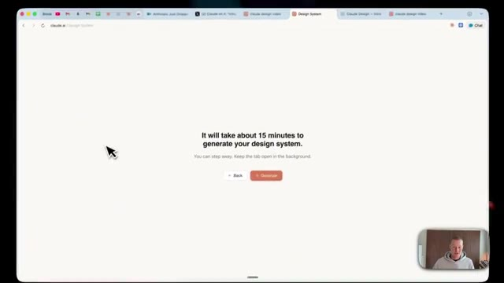
*⏱️ 00:07:40 — Écran de confirmation indiquant que la génération du design system prendra environ 15 minutes, avec un bouton de lancement.*

---

### ⏱️ `[00:07:45 - 00:08:06]` | Segment #16

**🔊 Audio (Transcription Intégrale Mot pour Mot en Français) :**
> Très bien, donc en revenant à ceci, cela a pris environ 10, 12 minutes plus ou moins. En gros, il y a quelques éléments qui nécessitent une révision. Donc par exemple, l'iconographie de la marque juste ici, cela me demande essentiellement si je trouve que ça a l'air bien ou si ça a besoin de travail, je pense que ça a l'air bien. Donc laissez-moi simplement avancer avec ça. Aussi, les logos de la marque, vous pouvez voir que cela demande toutes ces différentes préférences que j'ai.

**👁️ Analyse Visuelle d'Écran (gemini-3.5-flash-lite) :**
**Interface & Outils** : Navigateur web affichant l'interface de Claude (claude.ai) et le système de design généré.

**Contenu textuel & Code** : Composants de design système, icônes de marque, logos et options de révision "Needs review".

**Action / Démonstration** : Le présentateur examine et survole les éléments d'iconographie et de logo générés dans l'interface de design.

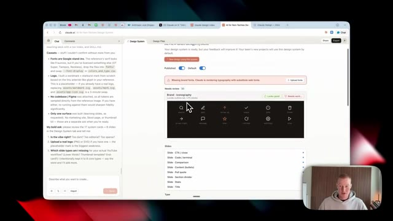
*⏱️ 00:07:50 — Interface Claude montrant le système de design avec la section "Brand - Iconography" et le curseur pointant sur les options d'évaluation.*

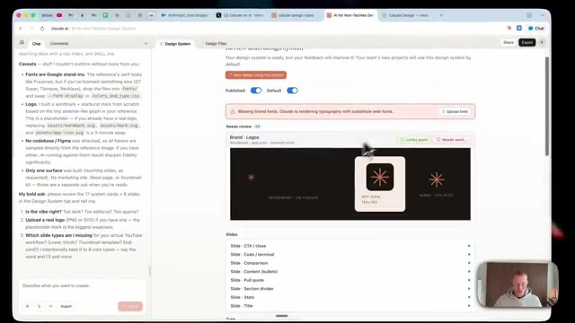
*⏱️ 00:08:00 — Interface Claude montrant le système de design avec la section "Brand - Logos" et les options d'évaluation "Looks good" et "Needs work".*

---

### ⏱️ `[00:08:06 - 00:08:24]` | Segment #17

**🔊 Audio (Transcription Intégrale Mot pour Mot en Français) :**
> Et nous pourrions faire des allers-retours si nous n'aimons pas leur apparence, je pourrais cliquer sur à retravailler, décrire ce que nous préférons, et il ira modifier cela jusqu'à ce que cela corresponde exactement à ce que nous voulons qu'il devienne. Donc par exemple, voici le modèle de diaporama qu'il est en train de créer pour ce système de design spécifique. Je trouve que c'est absolument canon.

**👁️ Analyse Visuelle d'Écran (gemini-3.5-flash-lite) :**
**Interface & Outils** : Interface web de Claude.ai (Design System)

**Contenu textuel & Code** : Spécifications de design, codes de couleurs textuelles, aperçus de diapositives de présentation et panneau de révision des composants visuels.

**Action / Démonstration** : Navigation et révision des composants de diapositives générés par l'IA dans le système de design.

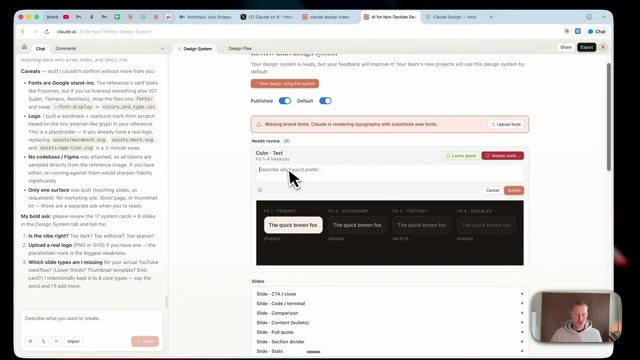
*⏱️ 00:08:11 — Interface de Claude affichant un système de design de diapositives avec une zone de texte pour laisser des commentaires sur les couleurs de texte.*

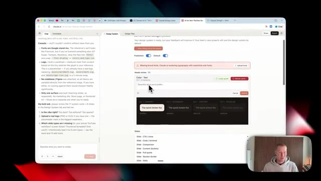
*⏱️ 00:08:15 — Vue similaire de l'interface de Claude montrant les options de révision du système de design des diapositives.*

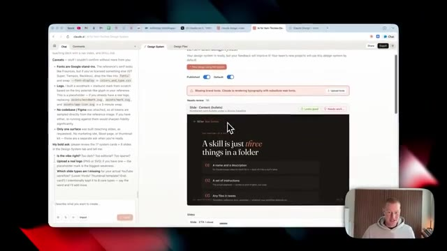
*⏱️ 00:08:20 — Aperçu d'une diapositive de contenu générée avec du texte formaté et des puces numérotées dans l'interface de Claude.*

---

### ⏱️ `[00:08:24 - 00:08:46]` | Segment #18

**🔊 Audio (Transcription Intégrale Mot pour Mot en Français) :**
> C'est super cool. Honnêtement, je pense que c'est un super outil jusqu'à présent. C'est plutôt amusant de l'utiliser, et j'ai hâte de voir ce que vous en pensez. Une fois que tout cela est confirmé, nous pouvons cliquer sur tout cela. pour nos diapos, vous pouvez voir des exemples de ce à quoi ressemble notre appel à l'action. Celui-ci, juste ici. S'il y a jamais quoi que ce soit que nous voulons changer, nous pouvons revenir à chacun de ces composants individuels et les modifier.

**👁️ Analyse Visuelle d'Écran (gemini-3.5-flash-lite) :**
**Interface & Outils** : Interface web de claude.ai affichant un Design System et des exemples de diapositives générées.

**Contenu textuel & Code** : Modèles de diapositives de présentation avec titres, texte descriptif, boutons d'appel à l'action et blocs de code ou terminal.

**Action / Démonstration** : Navigation et visualisation des différentes diapositives générées par l'intelligence artificielle dans le Design System.

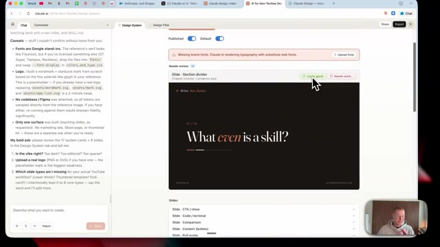
*⏱️ 00:08:30 — Aperçu d'une diapositive de séparation de section sur claude.ai avec le titre 'What even is a skill?'.*

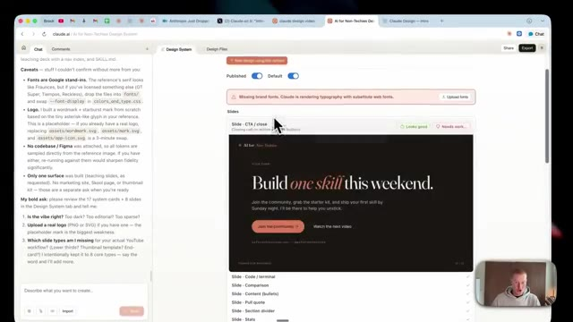
*⏱️ 00:08:35 — Aperçu d'une diapositive de type 'CTA / close' sur claude.ai avec le texte 'Build one skill this weekend'.*

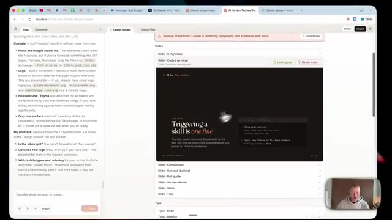
*⏱️ 00:08:40 — Aperçu d'une diapositive de type 'Code / terminal' sur claude.ai montrant un exemple de code et une interface de terminal.*

---

### ⏱️ `[00:08:46 - 00:09:06]` | Segment #19

**🔊 Audio (Transcription Intégrale Mot pour Mot en Français) :**
> Ensuite, si je clique sur les fichiers de conception, nous pouvons voir tous nos éléments spécifiques. Nous pouvons voir nos captures d'écran, pratiquement chaque fichier que nous avons créé directement à l'intérieur de notre dossier. Une chose que j'ai oubliée de mentionner, c'est que nous pouvons toujours changer le modèle que nous voulons utiliser. Nous allons utiliser Claude Opus 4.7 parce que c'est leur modèle le plus récent et le meilleur, spécifiquement pour les tâches visuelles.

**👁️ Analyse Visuelle d'Écran (gemini-3.5-flash-lite) :**
**Interface & Outils** : Interface web de Claude.ai (Design Files / Design System)

**Contenu textuel & Code** : Arborescence de dossiers de projet (assets, screenshots, slides, ui_kits), feuilles de style CSS et documents Markdown (SKILL.md, README.md).

**Action / Démonstration** : Navigation dans les fichiers du projet et interaction avec les options de l'interface de l'assistant IA.

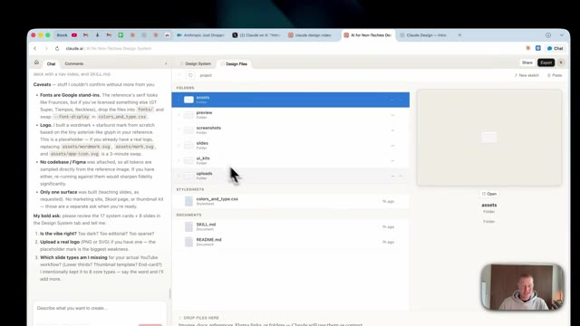
*⏱️ 00:08:51 — Vue de l'interface de Claude.ai montrant l'onglet des fichiers de conception avec les dossiers du projet (assets, preview, screenshots, slides, ui_kits, uploads).*

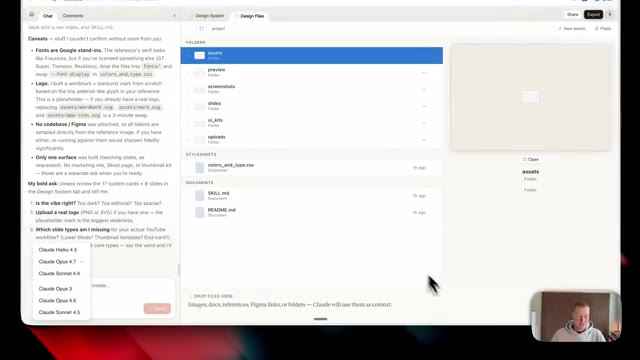
*⏱️ 00:08:56 — Vue de l'interface montrant les dossiers de conception et un menu déroulant de sélection des modèles de langage Claude en bas à gauche.*

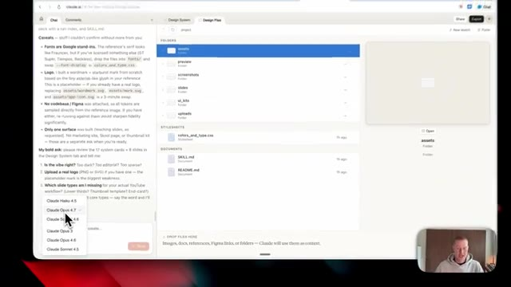
*⏱️ 00:09:01 — Vue similaire avec le menu déroulant des versions de Claude ouvert, affichant les différentes options de modèles (Haiku, Opus, Sonnet).*

---

### ⏱️ `[00:09:06 - 00:09:32]` | Segment #20

**🔊 Audio (Transcription Intégrale Mot pour Mot en Français) :**
> Ensuite, laissez-moi venir et simplement créer une page de destination avec ce système de design spécifique que nous avons créé. Je vais donc simplement venir ici et lui donner cette invite. Très bien, donc j'adore ce système de design. Je veux que vous alliez de l'avant et conceviez une page de destination pour ma communauté scolaire. Celle-ci va s'appeler AI for non-techies (IA pour les non-techniciens). Et l'appel à l'action va être fondamentalement de rejoindre ma communauté scolaire pour obtenir l'accès à toutes les compétences de Claude que j'utilise chaque jour, ainsi qu'à une plongée plus approfondie dans la façon d'utiliser Claude code et Claude cowork si vous dirigez votre propre entreprise.

**👁️ Analyse Visuelle d'Écran (gemini-3.5-flash-lite) :**
**Interface & Outils** : Interface web Claude Artifacts / Projets

**Contenu textuel & Code** : Fichiers du système de design, dossiers de projet, feuilles de style et instructions textuelles

**Action / Démonstration** : Navigation dans l'interface de Claude pour préparer la création d'une page de destination

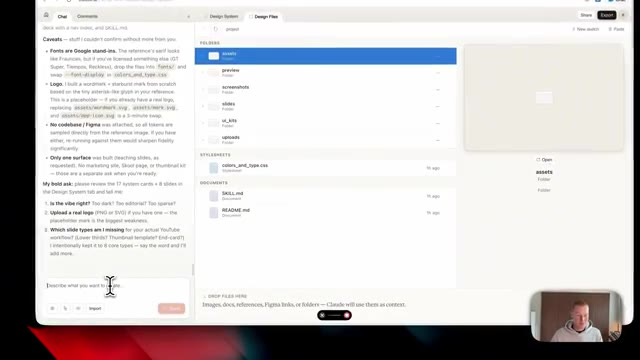
*⏱️ 00:09:12 — Interface Claude montrant le système de design avec des dossiers de projet et une zone de texte pour les invites.*

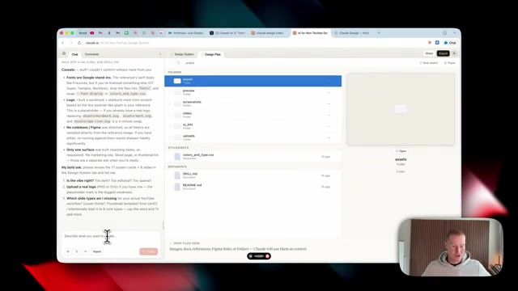
*⏱️ 00:09:19 — Vue similaire de l'interface Claude avec la liste des fichiers de design et le panneau de discussion.*

---

### ⏱️ `[00:09:32 - 00:10:01]` | Segment #21

**🔊 Audio (Transcription Intégrale Mot pour Mot en Français) :**
> Donc tout comme Lovable, je pourrais juste lui donner une invite d'ambiance comme ça en utilisant quelque chose comme Whisperflow, et ensuite il va commencer à élaborer notre plan ici. Revenons donc une fois qu'il aura généré cette page de destination pour nous. Et pendant que nous attendons une réponse ici, je veux parler rapidement de ceci. Nous pourrions donc exporter ces informations n'importe où. Pensez donc à Claude comme à un système de design, comme vous pouvez le voir dans cette infographie, c'est ce qui combine en quelque sorte tous ces autres outils différents. Donc tout ce que nous concevons ici est modifiable dans Canva.

**👁️ Analyse Visuelle d'Écran (gemini-3.5-flash-lite) :**
**Interface & Outils** : Navigateur web, interface Claude AI / Claude Design

**Contenu textuel & Code** : Arborescence de fichiers de projet (assets, preview, UI kits), code Markdown et styles CSS.

**Action / Démonstration** : Navigation dans l'interface de développement et de design de Claude AI.

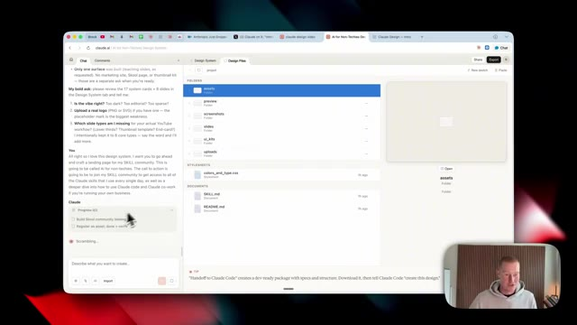
*⏱️ 00:09:39 — Interface d'un navigateur affichant l'application Claude.ai avec un panneau de chat à gauche et un explorateur de fichiers/système de design à droite.*

---

### ⏱️ `[00:10:01 - 00:10:21]` | Segment #22

**🔊 Audio (Transcription Intégrale Mot pour Mot en Français) :**
> Nous pourrions en fait le générer sous forme de, nous pourrions le transformer en une véritable présentation PowerPoint. Nous pourrions lui donner une URL spécifique pour que nous puissions le voir sur le web. Nous pourrions le transmettre à Claude Code. Toutes ces choses différentes. Considérez Claude Design comme la chose qui connecte tous ces différents outils de conception. Très bien, donc environ deux minutes plus tard, nous avons maintenant cette page de destination qui a vraiment fière allure.

**👁️ Analyse Visuelle d'Écran (gemini-3.5-flash-lite) :**
**Interface & Outils** : Navigateur web affichant une interface de présentation interactive avec un schéma schématique central.

**Contenu textuel & Code** : Schéma "CLAUDE DESIGN ECOSYSTEM" montrant les différentes options d'exportation et d'intégration : Canva (éditable), PPTX (Présentation), URL (Lien web), PDF (Document), HTML (Web), et Claude Code (handoff Dev).

**Action / Démonstration** : Le présentateur explique les différentes possibilités de transformation et d'exportation des présentations et designs générés avec l'écosystème Claude.

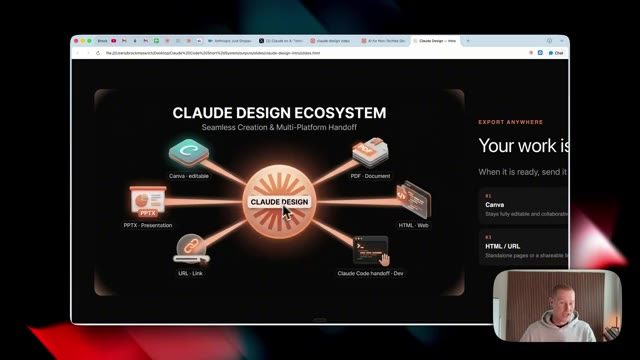
*⏱️ 00:10:06 — Capture d'écran montrant une page web intitulée "Claude Design - Intro" illustrant l'écosystème de création et d'exportation de Claude Design.*

---

### ⏱️ `[00:10:21 - 00:10:40]` | Segment #23

**🔊 Audio (Transcription Intégrale Mot pour Mot en Français) :**
> Alors laissez-moi ouvrir ça dans un nouvel onglet ici pour qu'on puisse voir à quoi ça ressemblerait si quelqu'un est vraiment dessus. Je veux dire, c'est vraiment du solide. Ça suit exactement nos préférences de design qu'on lui a données. Ça a vraiment, vraiment l'air super. Honnêtement, je suis vraiment emballé par ça. Ce n'est rien de fou, mais avec un prompt unique, c'est vraiment du solide pour une landing page.

**👁️ Analyse Visuelle d'Écran (gemini-3.5-flash-lite) :**
**Interface & Outils** : Navigateur web (aperçu de site web généré via Claude / claudeusercontent.com).

**Contenu textuel & Code** : Interface d'un site web au thème sombre pour "AI for Non-Techies", titre "Use Claude like it's actually your job", sections sur la bibliothèque de compétences (Skill Library), Claude Code et Claude Cowork.

**Action / Démonstration** : Présentation du rendu final et défilement sur la landing page créée sur mesure selon les préférences de design.

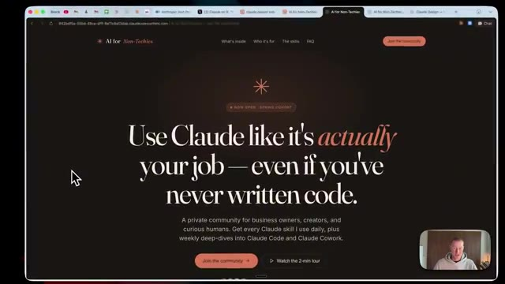
*⏱️ 00:10:26 — Page d'accueil du site web "AI for Non-Techies" générée par IA, affichant le titre principal et les boutons d'appel à l'action.*

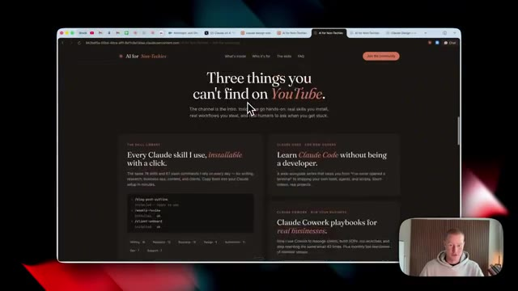
*⏱️ 00:10:31 — Section inférieure du site web présentant la partie "Three things you can't find on YouTube" et des cartes de fonctionnalités détaillées.*

---

### ⏱️ `[00:10:40 - 00:11:16]` | Segment #24

**🔊 Audio (Transcription Intégrale Mot pour Mot en Français) :**
> Nous pourrions évidemment continuer à faire des allers-retours, à critiquer cela comme nous le souhaitons, mais je vais vous montrer exactement comment nous pouvons exporter ceci et répondre à certaines des questions que vous vous posez probablement après avoir vu cela. Nous pourrions donc partager ceci avec un coéquipier. Donc, comme vous pouvez le voir, nous pourrions en gros sélectionner le niveau d'autorisation. Ainsi, les coéquipiers peuvent soit consulter ceci, ils peuvent commenter, ou ils pourraient même modifier. Donc, si vous avez quelques personnes différentes dans votre équipe avec lesquelles vous souhaitez pouvoir en gros collaborer, vous êtes en mesure de le faire directement à l'intérieur de cet outil de design. Maintenant, nous pourrions dupliquer ceci sous forme de modèle. De cette façon, chaque fois que nous créons une page de destination, elle pourrait être exactement dans ce style. Et nous pourrions même les exporter dans quelques différents...

**👁️ Analyse Visuelle d'Écran (gemini-3.5-flash-lite) :**
**Interface & Outils** : Navigateur web, interface Claude.ai (prévisualisation d'artefact HTML / Design System).

**Contenu textuel & Code** : Maquette de page web ("Use Claude like it's actually your job — even if you've never written code"), volet d'instructions textuelles à gauche, menu déroulant d'exportation/partage avec paramètres d'accès.

**Action / Démonstration** : Navigation sur l'interface Claude.ai et ouverture du menu d'export pour partager ou dupliquer le projet généré.

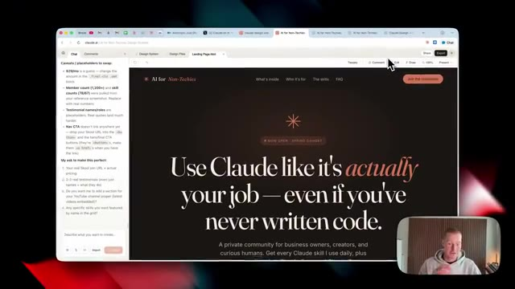
*⏱️ 00:10:49 — Aperçu de la page d'atterrissage "AI for Non-Techies" générée dans l'interface Claude.ai, avec les notes du prompt à gauche et le rendu visuel à droite.*

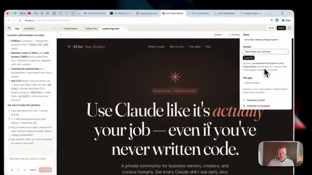
*⏱️ 00:11:07 — Menu de partage et d'exportation ouvert en haut à droite sur Claude.ai, affichant les options de permissions, le bouton "Copy link" et la duplication du projet.*

---

### ⏱️ `[00:11:16 - 00:11:37]` | Segment #25

**🔊 Audio (Transcription Intégrale Mot pour Mot en Français) :**
> façons. Nous pourrions l'exporter sous forme de PDF, de PowerPoint, nous pourrions l'envoyer à Canva, l'exporter sous forme de fichier HTML autonome, ou nous pouvons même le confier à Claude Code. Alors, laissez-moi cliquer ici. Et à partir de là, tout ce que nous aurions à faire, c'est copier cette commande et ensuite elle reprendra là où nous nous étions arrêtés à l'intérieur de Claude Code. Très bien, je dois fixer certaines attentes ici parce que je ne veux pas faire cette vidéo juste pour faire l'éloge de ce produit.

**👁️ Analyse Visuelle d'Écran (gemini-3.5-flash-lite) :**
**Interface & Outils** : Claude.ai (application web), module d'intégration Claude Code / agent de codage local.
CONTENU] Options d'exportation de fichiers de design, prompt/commande d'agent CLI Claude Code (`Fetch this design file, read its readme, and implement... Implement: Landing Page.html`), lien API d'Anthropic.

**Contenu textuel & Code** : Explications orales des stratégies et mise en contexte méthodologique du marché.

**Action / Démonstration** : Démonstration de l'exportation d'un design

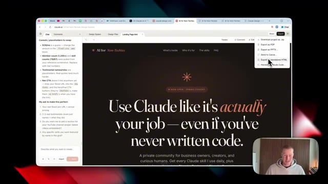
*⏱️ 00:11:21 — Menu déroulant d'exportation ouvert dans l'interface Claude.ai présentant les différentes options d'export (PDF, PPTX, Canva, HTML, Claude Code) pour le projet "AI for Non-Techies".*

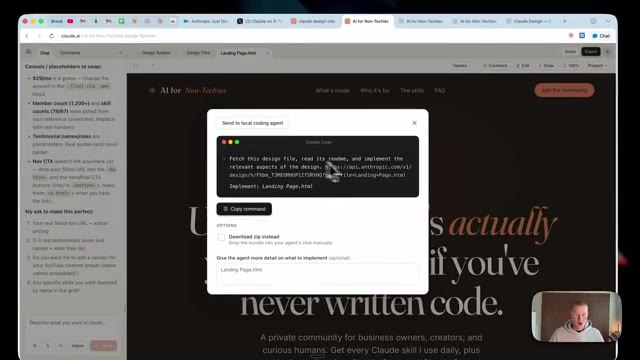
*⏱️ 00:11:26 — Pop-up "Send to local coding agent" affichant la commande CLI générée pour charger et implémenter la page de destination via Claude Code, avec un bouton "Copy command".*

---

### ⏱️ `[00:11:37 - 00:12:00]` | Segment #26

**🔊 Audio (Transcription Intégrale Mot pour Mot en Français) :**
> Ce n'est pas du tout en train de tuer Lovable ou Cursor. Laissez-moi vous expliquer exactement pourquoi. Donc, tout d'abord, que fait ce nouveau nouvel outil Cloud Design ? Il crée des prototypes visuels et des maquettes. Il peut générer des présentations et des documents d'une page comme je viens de vous le montrer, la conception de pages de destination, des sites web statiques qui ont l'air réels, et nous pouvons transmettre des fichiers à votre équipe, mais ce qu'il ne fera pas, c'est créer une application Web entièrement fonctionnelle.

**👁️ Analyse Visuelle d'Écran (gemini-3.5-flash-lite) :**
**Interface & Outils** : Navigateur web (Google Chrome) affichant un fichier HTML local de slides de présentation (`claude-design-intro/slides.html`).

**Contenu textuel & Code** : - Titre : "This is not Lovable or Cursor."
- Section "WHAT IT DOES" : Prototypes visuels, diapositives/documents d'une page, designs de landing pages, sites web statiques réalistes, fichiers de transmission d'équipe.
- Section "WHAT IT WONT DO" : Création d'applications web fonctionnelles, bases de données, gestion d'identifiants/paiements, remplacement de Lovable/Bolt/Cursor, déploiement de code de production.
- Devise : "Think designer, not developer."

**Action / Démonstration** : Explication synthétique des limites et cas d'usage de l'outil Claude Design par rapport aux générateurs d'applications web de type Lovable ou Cursor.

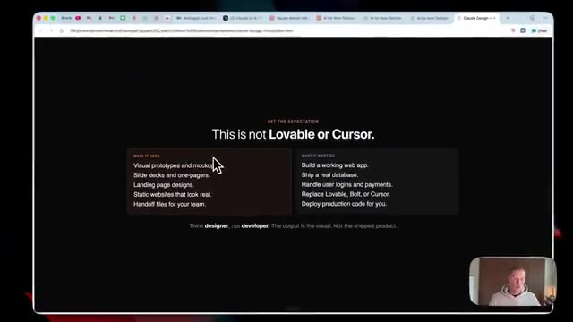
*⏱️ 00:11:43 — Page HTML de présentation affichée dans le navigateur avec le titre "This is not Lovable or Cursor", comparant les capacités de Claude Design ("WHAT IT DOES" vs "WHAT IT WONT DO").*

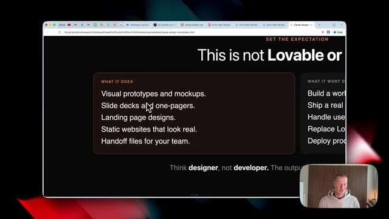
*⏱️ 00:11:48 — Zoom sur le panneau "WHAT IT DOES" de la présentation, détaillant la création de prototypes visuels, présentations, maquettes et sites statiques.*

---

### ⏱️ `[00:12:00 - 00:12:20]` | Segment #27

**🔊 Audio (Transcription Intégrale Mot pour Mot en Français) :**
> Il n'y aura pas de base de données intégrée, cela ne gère pas les connexions et les paiements. Donc pour répondre à votre question, si vous vous la posiez, cela ne remplace pas Lovable, Bolt, Cursor, Replit, toutes ces plateformes de Vibe Coding parce que ce n'est pas une plateforme complète de Vibe Coding. C'est plutôt juste un outil de design. Donc après avoir joué avec ça toute la matinée, sans blabla, je pense que c'est un outil vraiment cool.

**👁️ Analyse Visuelle d'Écran (gemini-3.5-flash-lite) :**
**Interface & Outils** : Navigateur web affichant une page de présentation de diapositives (HTML/slides) avec un petit encadré vidéo du présentateur en bas à droite.

**Contenu textuel & Code** : Texte principal : "This is not Lovable or Cursor." Colonne de gauche (ce que l'outil fait) : prototypes visuels, maquettes, présentations, pages de destination, sites web statiques. Colonne de droite (ce que l'outil ne fait pas) : construire une application web fonctionnelle, base de données, connexions et paiements, remplacer Lovable, Bolt ou Cursor, déployer du code de production.

**Action / Démonstration** : Le curseur de la souris survole la ligne "Replace Lovable, Bolt, or Cursor." dans la colonne de droite, illustrant les limites de l'outil présenté.

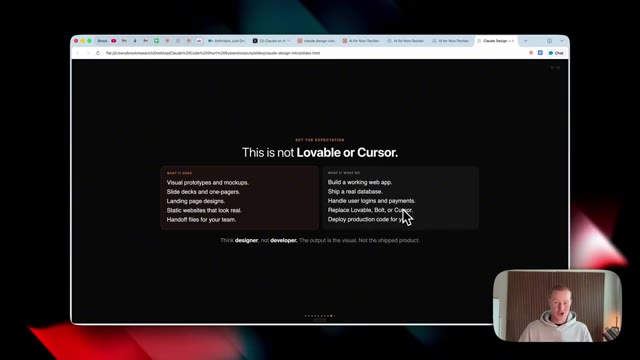
*⏱️ 00:12:05 — Une capture d'écran d'une présentation de diapositives affichant le texte "This is not Lovable or Cursor." avec deux colonnes de détails.*

---

### ⏱️ `[00:12:20 - 00:12:44]` | Segment #28

**🔊 Audio (Transcription Intégrale Mot pour Mot en Français) :**
> C'est évidemment en mode aperçu. Je pense qu'il y a de très bons cas d'usage pour cela, mais cela ne va pas remplacer complètement le besoin de quelque chose comme Lovable ou Figma. Avant qu'on se quitte, je voulais juste vous faire savoir que j'ai une communauté Skool où je plonge très en profondeur dans la façon d'utiliser des choses comme Claude Code, Claude Cowork et maintenant Claude Design. Donc, si vous voulez l'une des ressources que j'ai montrées dans cette vidéo, elles seront dans ma communauté Skool, avec les plus de 50 compétences Claude que j'utilise chaque jour pour gérer mon entreprise.

**👁️ Analyse Visuelle d'Écran (gemini-3.5-flash-lite) :**
**Interface & Outils** : Navigateur web affichant la plateforme Skool.

**Contenu textuel & Code** : Page de la communauté Skool "AI for Non-Techies" avec des publications épinglées (Meetup, présentation, astuces Claude).

**Action / Démonstration** : Présentation de la communauté Skool par le créateur.

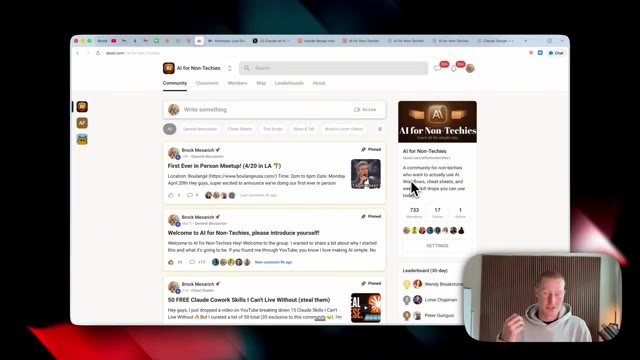
*⏱️ 00:12:32 — Capture d'écran du navigateur affichant la plateforme communautaire Skool pour "AI for Non-Techies", illustrant les discussions et publications du créateur.*

---

### ⏱️ `[00:12:44 - 00:12:52]` | Segment #29

**🔊 Audio (Transcription Intégrale Mot pour Mot en Français) :**
> Cela étant dit, les gars, merci beaucoup d'être restés jusqu'à la fin de cette vidéo. J'ai hâte de vous voir dans la prochaine et abonnez-vous pour plus de contenu de ce genre gratuitement. Santé, passez une bonne journée.

**👁️ Analyse Visuelle d'Écran (gemini-3.5-flash-lite) :**
**Interface & Outils** : Navigateur web affichant le tableau de bord local de Claude Cowork et incrustation vidéo du présentateur.

**Contenu textuel & Code** : Métriques du système : 78 total, 11 skills, 67 commands, 8 categories, et score de santé du système à 84 avec l'indication "Your system is healthy".

**Action / Démonstration** : Présentation finale du tableau de bord et conclusion de la vidéo par le présentateur.

*⏱️ 00:12:46 — Capture d'écran montrant le tableau de bord "My Skills Dashboard" de Claude Cowork avec des statistiques globales et l'état du système.*

---

