# 🎬 Master 95% of Claude Design in 17 Minutes

> **Chaîne** : [Brock Mesarich | AI for Non Techies](https://www.youtube.com/@BrockMesarich)  
> **Lien YouTube** : [https://www.youtube.com/watch?v=e7ngdzwzRZ0](https://www.youtube.com/watch?v=e7ngdzwzRZ0)  
> **Date de publication** : 20260418  
> **Durée** : 00:16:52  
> **Identifiant vidéo** : `e7ngdzwzRZ0`  
> **Transcription & Analyse** : `whisper-v3-large-turbo+gemini-3.5-flash-lite`  

---

## 📌 Synthèse Exécutive & Outils

### 💡 Résumé

Cette vidéo présentée par Brock Mesarich pour la chaîne *AI for Non Techies* dévoile les capacités de **Claude Design**, le nouvel outil de conception visuelle propulsé par Anthropic. Réservé aux forfaits payants (Pro, Team, Enterprise), cet agent d'intelligence artificielle se distingue des plateformes de développement d'applications web complètes (type Lovable) par sa focalisation exclusive sur la création de prototypes visuels, de présentations, de pages de destination, de rapports synthétiques et de maquettes d'interfaces avant l'étape du codage. L'analyste démontre l'efficacité redoutable de l'outil à travers des cas pratiques, notamment la transformation instantanée de documents PDF ou de feuilles de calcul en présentations dynamiques et le prototypage rapide de parcours utilisateurs pour applications mobiles.

L'intervention met particulièrement en lumière l'architecture contextuelle de l'IA, capable d'absorber l'identité visuelle d'une marque en extrayant les styles directement à partir de bases de code, de fichiers locaux ou de documents de référence. Grâce à des options de configuration avancées telles que le choix entre des wireframes schématiques et des maquettes haute fidélité, combinées à des fonctionnalités collaboratives en temps réel (commentaires ciblés et gestion des droits de partage), Claude Design s'impose comme un levier d'automatisation et de productivité incontournable pour optimiser les workflows de design sans nécessiter de compétences techniques approfondies.

### 🛠️ Outils, Modèles & Logiciels Présentés

* **Claude Design** : Agent de conception visuelle et de prototypage d'Anthropic, intégré aux forfaits payants, permettant de générer des présentations, des interfaces et des maquettes à partir de simples prompts ou de fichiers importés.
* **Claude AI (Forfaits Pro, Team, Enterprise)** : Plateforme conversationnelle et d'assistance intelligente servant de socle pour accéder aux fonctionnalités de design avancées.
* **Claude Code Desktop** : Application de bureau d'Anthropic dédiée au développement, dont la documentation et les guides servent de cas d'usage pour l'import de styles.
* **Lovable** : Plateforme de développement web full-stack mentionnée pour souligner la différence fonctionnelle avec Claude Design (gestion de bases de données, backends, paiements Stripe et hébergement).
* **21st.dev** : Répertoire de composants d'interface utilisateur et de modèles de code évoqué pour illustrer la logique de réutilisation de design.
* **GitHub** : Plateforme de gestion de code source pouvant être connectée pour extraire les systèmes de design et les bases de code d'une marque.

### 🔑 Points Clés & Enseignements Stratégiques

* **Positionnement fonctionnel précis** : Claude Design se concentre exclusivement sur les visuels, les présentations et le prototypage d'interfaces, et ne gère pas le déploiement de backends, de bases de données ou de solutions de paiement en ligne.
* **Accessibilité tarifaire** : L'outil est immédiatement disponible pour tous les abonnés payants d'Anthropic, incluant le forfait Pro (20 $/mois) ainsi que les versions Team et Enterprise.
* **Intégration contextuelle de la marque** : L'IA peut analyser des documents de marque, des répertoires de code ou des fichiers locaux pour assimiler et reproduire fidèlement l'identité visuelle (typographies, chartes graphiques, agencements).
* **Diversité des intrants (Inputs)** : Il est possible d'importer une grande variété de formats de documents (PDF, Word, PowerPoint, feuilles de calcul Excel) pour alimenter directement l'agent de conception.
* **Génération de présentations dynamiques** : L'import d'un document de référence permet à l'outil de structurer automatiquement un diaporama complet doté d'infographies contextuelles fidèles au style original.
* **Niveaux de fidélité modulables** : L'utilisateur peut choisir entre des wireframes de base (pour explorer rapidement des concepts et des parcours de navigation) et des maquettes haute fidélité (pour des rendus visuels finaux).
* **Prototypage d'applications mobiles** : La plateforme permet de concevoir des parcours utilisateurs complets (comme un tunnel d'inscription iOS) visualisables directement sur un canevas interactif.
* **Importation de code source** : L'utilisateur peut connecter un dépôt GitHub ou glisser-déposer un dossier local contenant sa base de code pour que l'IA en extrait les composants et les intègre au prototype.
* **Collaboration en temps réel** : La présence d'un système de commentaires intégré permet aux membres d'une équipe de laisser des retours textuels directement sur les éléments de la maquette.
* **Gestion granulaire des partages** : L'outil offre la possibilité de définir des permissions spécifiques (visualisation, commentaire, édition) ou de générer des liens privés pour sécuriser les projets.
* **Édition granulaire post-génération** : Une fois le prototype généré, il est possible d'ajuster manuellement les éléments textuels, de modifier les codes couleurs ou d'utiliser des outils de dessin directement sur la toile.
* **Industrialisation des systèmes de design** : La structuration de systèmes de design centralisés permet d'assurer une cohérence graphique absolue sur l'ensemble des créations produites par l'agent.

---

## ⏱️ Chronologie & Transcription Complète Audio & Visuelle (Mot pour Mot)

### ⏱️ `[00:00:00 - 00:00:24]` | Segment #01

**🔊 Audio (Transcription Intégrale Mot pour Mot en Français) :**
> Anthropic vient de lancer Claude Design, et c'est un outil extrêmement puissant, mais seulement si vous l'utilisez correctement. Donc dans cette vidéo, je vais vous expliquer exactement ce que c'est, comment il fonctionne, comment le configurer, et le maîtriser avant tout le monde. Vous allez obtenir tout ce qu'il vous faut pour commencer réellement à l'utiliser de la bonne manière dès le départ. Et donc, d'ici la fin de cette vidéo, vous en saurez plus sur Claude Design que 99 % des gens qui l'utilisent.

**👁️ Analyse Visuelle d'Écran (gemini-3.5-flash-lite) :**
**Interface & Outils** : Interface de Claude Design

**Contenu textuel & Code** : Interface utilisateur de Claude Design avec prévisualisation graphique interactive et options d'édition.

**Action / Démonstration** : Présentation visuelle de l'outil Claude Design à l'écran.

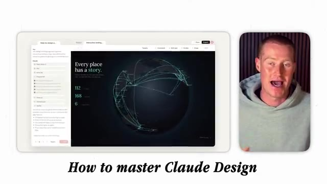
*⏱️ 00:00:12 — Une capture d'écran de l'interface de Claude Design affichant une application interactive sur le globe terrestre, avec le présentateur incrusté à droite.*

---

### ⏱️ `[00:00:24 - 00:00:49]` | Segment #02

**🔊 Audio (Transcription Intégrale Mot pour Mot en Français) :**
> Alors sans plus attendre, plongeons-nous dedans. Très bien, donc tout d'abord, parlons de ce qu'est même le nouvel outil de design Claude AI. Parlons-en donc dès maintenant avant de plonger en profondeur dans toutes les nouvelles fonctionnalités, comment vous pouvez commencer à les utiliser et quelques cas d'usage formidables différents que vous pouvez commencer à tester dès maintenant. Une chose clé que je tiens à noter très tôt dans cette vidéo est que c'est spécifique aux visuels et aux designs, et non aux applications web entièrement fonctionnelles.

**👁️ Analyse Visuelle d'Écran (gemini-3.5-flash-lite) :**
**Interface & Outils** : Navigateur web affichant une page de présentation locale (HTML) et incrustation vidéo de la webcam.

**Contenu textuel & Code** : Texte affiché : "Anthropic's AI design tool" et trois blocs descriptifs sur "Claude Opus 4.7", "Visuals, not web apps" et "Reads your brand".

**Action / Démonstration** : Présentation et explication du nouvel outil de design Claude AI par le présentateur.

*⏱️ 00:00:30 — Présentation des slides de l'outil de design Claude AI d'Anthropic avec trois cartes de caractéristiques principales et la vidéo du présentateur en incrustation.*

---

### ⏱️ `[00:00:49 - 00:01:25]` | Segment #03

**🔊 Audio (Transcription Intégrale Mot pour Mot en Français) :**
> Donc si vous pensez à quelque chose comme Lovable, vous pouvez non seulement créer le design avec l'IA, mais vous pouvez aussi intégrer des bases de données spécifiques, des backends, collecter des paiements via Stripe, toutes ces différentes choses, et même héberger vos applications, applications web ou applications mobiles sur la plateforme. Ce n'est pas ce que fait cet outil de design par IA. Je voulais donc préciser cela avant d'aller plus loin. Ensuite, l'une des choses les plus cool à ce sujet, c'est qu'il a du contexte sur votre marque. Nous pouvons donc extraire votre style de votre base de code, de différents documents de marque que vous possédez, ou même de fichiers que vous avez sur votre ordinateur. Et vous vous demandez probablement, Brock, est-ce que j'ai accès à

**👁️ Analyse Visuelle d'Écran (gemini-3.5-flash-lite) :**
**Interface & Outils** : Navigateur web affichant une page de présentation/diaporama (« Claude Design »).

**Contenu textuel & Code** : Texte explicatif sur l'outil d'IA d'Anthropic (« Anthropic's AI design tool ») avec des sections telles que « SCOPE: Visuals, not web apps » et « CONTEXT: Reads your brand ».

**Action / Démonstration** : Présentation des fonctionnalités et des limites d'un outil de conception graphique par l'IA.

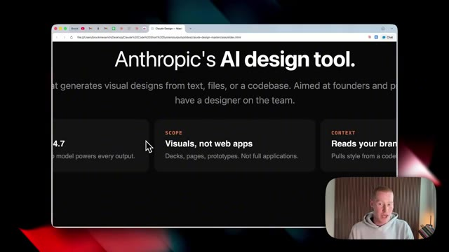
*⏱️ 00:00:58 — Une capture d'écran montrant une interface de présentation web sur un outil de design d'Anthropic, avec un encart vidéo du présentateur en bas à droite.*

---

### ⏱️ `[00:01:25 - 00:01:54]` | Segment #04

**🔊 Audio (Transcription Intégrale Mot pour Mot en Français) :**
> ceci. Je suis un utilisateur payant de Claude et voici la réponse rapide. C'est donc disponible sur tous les forfaits payants. Donc si vous êtes sur le forfait pro, qui coûte 20 dollars par mois, vous y aurez accès ainsi que sur le forfait max. Les utilisateurs des forfaits Claude Team et Enterprise devraient l'avoir dans leurs comptes dès aujourd'hui. Il y a donc quatre types de résultats différents que nous pouvons obtenir de l'agent de design de Claude. Laissez-moi donc les détailler dès maintenant. Nous pouvons lui donner une invite, par exemple, ou même télécharger une capture d'écran.

**👁️ Analyse Visuelle d'Écran (gemini-3.5-flash-lite) :**
**Interface & Outils** : Navigateur web affichant une page de présentation des tarifs et forfaits Claude, avec la vidéo du présentateur en bas à droite.

**Contenu textuel & Code** : Texte indiquant "Available on every paid plan" et quatre blocs pour les forfaits : Claude Pro ($20/mo), Claude Max ($100-$200/mo), Claude Team ($25/seat), Enterprise.

**Action / Démonstration** : Le présentateur commente les différents abonnements payants de Claude permettant d'accéder aux fonctionnalités présentées.

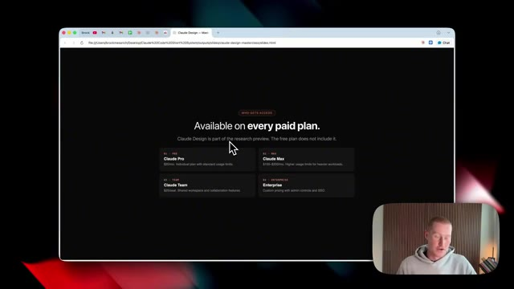
*⏱️ 00:01:32 — Capture d'écran montrant une page web avec le titre "Available on every paid plan" et les différentes options d'abonnement Claude (Pro, Max, Team, Enterprise).*

---

### ⏱️ `[00:01:54 - 00:02:12]` | Segment #05

**🔊 Audio (Transcription Intégrale Mot pour Mot en Français) :**
> il va passer par ce processus de conception et il pourrait générer des choses comme des présentations, des pages de destination, des documents d'une seule page, ce qui correspond fondamentalement à des choses comme des notes de synthèse, des résumés de présentation, ou différents rapports. Et nous pourrions même créer des maquettes visuelles et des prototypes d'une interface avant de commencer réellement à en écrire le code.

**👁️ Analyse Visuelle d'Écran (gemini-3.5-flash-lite) :**
**Interface & Outils** : Navigateur web affichant une page HTML locale de présentation (Claude Design).

**Contenu textuel & Code** : Schéma illustrant le processus 'The Magic Moment of Claude Design' avec quatre types de sorties : Slide decks, Landing pages, One-pagers et Prototypes.

**Action / Démonstration** : Le présentateur explique les différents types de formats générés par l'outil de conception IA.

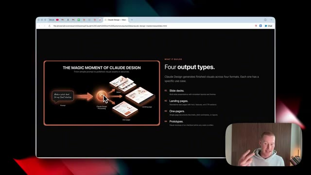
*⏱️ 00:01:58 — Une page web affichant une présentation intitulée 'Four output types' avec un schéma explicatif de Claude Design et un encart vidéo du présentateur en bas à droite.*

---

### ⏱️ `[00:02:12 - 00:02:33]` | Segment #06

**🔊 Audio (Transcription Intégrale Mot pour Mot en Français) :**
> Très bien, assez bavardé, passons directement à ce nouvel outil de design. Donc, pour y accéder, vous devez vous rendre sur claude.ai sur le Web. Il y aura un lien dans la description pour le faire. Donc, si vous avez votre compte et que vous êtes un utilisateur pro ou supérieur, vous devriez maintenant voir ceci sur le côté gauche de votre écran. Si vous ne le voyez pas, assurez-vous d'ouvrir la barre latérale.

**👁️ Analyse Visuelle d'Écran (gemini-3.5-flash-lite) :**
**Interface & Outils** : Navigateur web affichant l'interface de Claude AI (claude.ai)

**Contenu textuel & Code** : Page d'accueil de Claude avec la barre de recherche/prompt centrale ("Type / for skills"), le message "Afternoon, brock", et le menu latéral avec les options Chats, Projects, Artifacts, Code et Design.

**Action / Démonstration** : Navigation sur le site web de Claude pour présenter l'accès à l'outil de design.

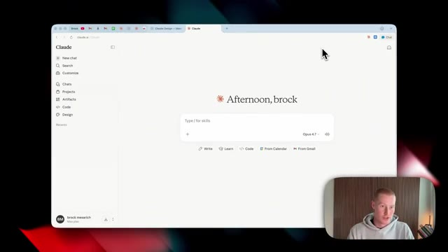
*⏱️ 00:02:17 — Capture d'écran montrant l'interface web de Claude AI sur le site claude.ai avec le tableau de bord principal et le présentateur en médaillon.*

---

### ⏱️ `[00:02:33 - 00:02:54]` | Segment #07

**🔊 Audio (Transcription Intégrale Mot pour Mot en Français) :**
> Vous le trouverez directement sous le bouton de code Claude. Donc si je clique dessus, nous verrons ensuite notre nouvelle interface juste ici. Laissez-moi vous faire une brève visite de la plateforme de conception Claude et de l'interface afin que vous puissiez avoir une idée de ce qu'elle peut faire. Et ensuite, nous allons plonger plus en profondeur dans chacune de ces fonctionnalités. Ne vous inquiétez donc pas pour cela. Tout d'abord, nous avons notre onglet récent ici.

**👁️ Analyse Visuelle d'Écran (gemini-3.5-flash-lite) :**
**Interface & Outils** : Interface web de Claude Design par Anthropic Labs affichée dans un navigateur.

**Contenu textuel & Code** : Tableau de bord avec des projets récents tels que "Learn about Claude Design", "AI for Non-Techies Design System", et "Design System".

**Action / Démonstration** : Présentation et navigation guidée à travers l'interface utilisateur de la plateforme de conception Claude.

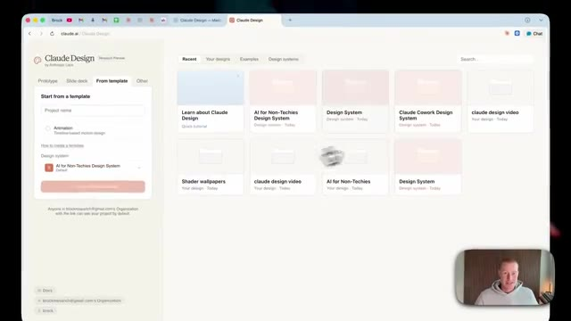
*⏱️ 00:02:38 — Interface principale de Claude Design affichant les différents projets récents et options de modèles.*

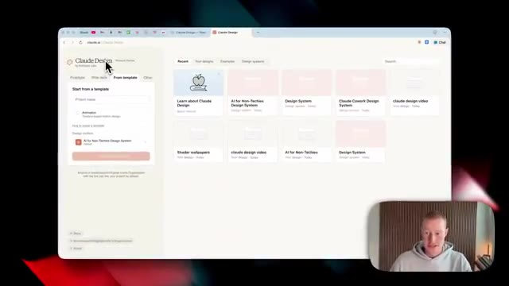
*⏱️ 00:02:43 — Navigation dans l'interface de Claude Design avec le curseur pointant sur les éléments de l'espace de travail.*

---

### ⏱️ `[00:02:54 - 00:03:13]` | Segment #08

**🔊 Audio (Transcription Intégrale Mot pour Mot en Français) :**
> C'est fondamentalement ici que nous allons voir tous nos différents designs. J'en ai quelques-uns différents ici. Nous pourrions voir nos designs. Nous avons différents exemples, qui sont fondamentalement des modèles préexistants que vous pourriez utiliser. Et vous pourriez cliquer sur ce bouton "utiliser ce prompt", et il commencera réellement à coder cela pour vous et reproduira fondamentalement exactement ce que vous voyez ici.

**👁️ Analyse Visuelle d'Écran (gemini-3.5-flash-lite) :**
**Interface & Outils** : Claude Design (interface web)

**Contenu textuel & Code** : Galerie de projets, modèles de design, options de création (Prototype, Slide deck, From template).

**Action / Démonstration** : Navigation à travers les différents designs et exemples de modèles préexistants dans l'interface.

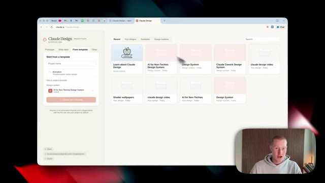
*⏱️ 00:02:59 — Interface de Claude Design montrant une grille de projets récents et de modèles préexistants.*

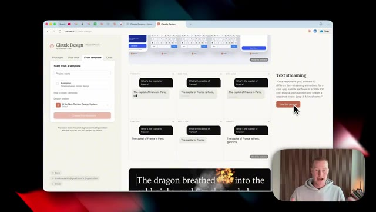
*⏱️ 00:03:08 — Interface de Claude Design affichant des exemples de designs et le bouton pour utiliser un projet.*

---

### ⏱️ `[00:03:13 - 00:03:33]` | Segment #09

**🔊 Audio (Transcription Intégrale Mot pour Mot en Français) :**
> Si vous avez déjà utilisé une plateforme comme 21st.dev, vous pouviez fondamentalement copier des composants d'interface utilisateur et copier le code et les invites derrière ceux-ci. Et c'est une idée très similaire. C'est un peu comme un répertoire de différents composants d'interface utilisateur que vous pourriez utiliser. Ensuite, dans cette barre de menu, nous avons des systèmes de design. Et c'est quelque chose dont je vais parler beaucoup plus dans cette vidéo.

**👁️ Analyse Visuelle d'Écran (gemini-3.5-flash-lite) :**
**Interface & Outils** : Navigateur web affichant l'interface de Claude Design par Anthropic Labs.

**Contenu textuel & Code** : Modèles de composants d'interface utilisateur, prompts textuels associés et aperçus visuels interactifs.

**Action / Démonstration** : Navigation et présentation des différents modèles et composants d'interface utilisateur disponibles sur la plateforme.

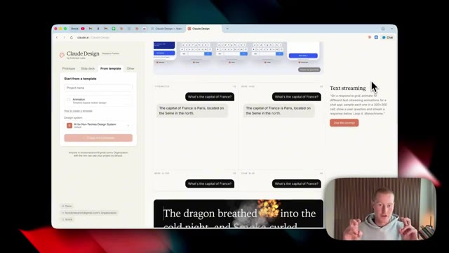
*⏱️ 00:03:18 — Interface web de Claude Design montrant des templates de composants d'interface utilisateur textuels et interactifs.*

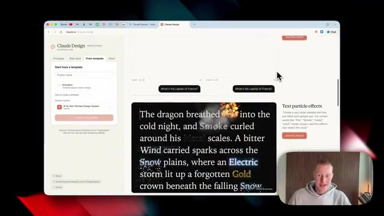
*⏱️ 00:03:23 — Interface web de Claude Design présentant des effets visuels et des templates de texte animés.*

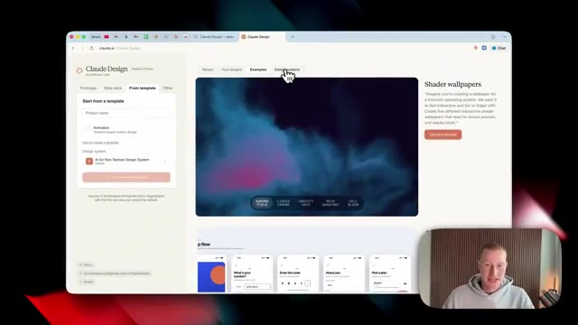
*⏱️ 00:03:28 — Interface web de Claude Design affichant des exemples de fonds d'écran animés (Shader wallpapers) avec des options de sélection.*

---

### ⏱️ `[00:03:33 - 00:03:54]` | Segment #10

**🔊 Audio (Transcription Intégrale Mot pour Mot en Français) :**
> Et c'est là que ça devient vraiment, vraiment intéressant et où cet outil peut devenir très puissant si vous l'utilisez correctement. Je vais donc approfondir ce sujet plus tard dans cette vidéo. Assurez-vous donc de rester jusqu'à la fin. Très bien. Je veux donc parler maintenant des différentes entrées que nous pouvons réellement donner à notre agent de conception Cloud. Il existe donc de nombreux formats de documents différents que nous pouvons réellement télécharger sur notre agent Cloud.

**👁️ Analyse Visuelle d'Écran (gemini-3.5-flash-lite) :**
**Interface & Outils** : Navigateur web affichant l'application Claude Design et une page de présentation HTML locale.

**Contenu textuel & Code** : Paramètres de systèmes de design ("AI for Non-Techies Design System") et description des formats acceptés (DOCX, PPTX, XLSX).

**Action / Démonstration** : Navigation dans l'interface de l'outil Claude Design pour présenter les options de configuration et les fonctionnalités.

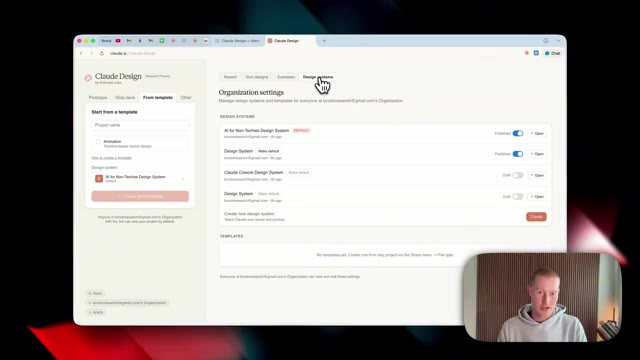
*⏱️ 00:03:38 — Capture d'écran montrant l'interface web de Claude Design avec le panneau "Design systems" et les réglages d'organisation.*

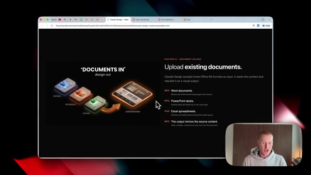
*⏱️ 00:03:44 — Capture d'écran présentant une diapositive de présentation sur la fonctionnalité de téléchargement de documents de Claude Design.*

---

### ⏱️ `[00:03:55 - 00:04:15]` | Segment #11

**🔊 Audio (Transcription Intégrale Mot pour Mot en Français) :**
> Tout d'abord, nous pouvons télécharger des documents Word, deuxièmement, des documents PowerPoint, des feuilles de calcul Excel, tous ces différents formats peuvent être téléchargés directement sur notre agent de design Cloud. Pour vous montrer exactement ce que je veux dire, laissez-moi ouvrir un projet ici. Et ce que je vais faire, c'est que je vais prendre ce document PDF, qui est essentiellement un guide sur la façon d'utiliser la nouvelle application de bureau Cloud Code.

**👁️ Analyse Visuelle d'Écran (gemini-3.5-flash-lite) :**
**Interface & Outils** : Navigateur web, interface de l'outil de design Claude AI.
[DESC_IMAGE_1] Page de présentation listant les formats acceptés (Word, PowerPoint, Excel) et les règles de sortie visuelle.
[DESC_IMAGE_2] Options de contexte de l'outil de design ("Start with context", "Design System", "Add screenshot").
[DESC_IMAGE_3] Manipulation des fenêtres du bureau avec l'application Claude et des icônes de fichiers.

**Contenu textuel & Code** : Explications orales des stratégies et mise en contexte méthodologique du marché.

**Action / Démonstration** : Le présentateur explique et montre les différents formats de fichiers acceptés et l'interface de l'agent de design.

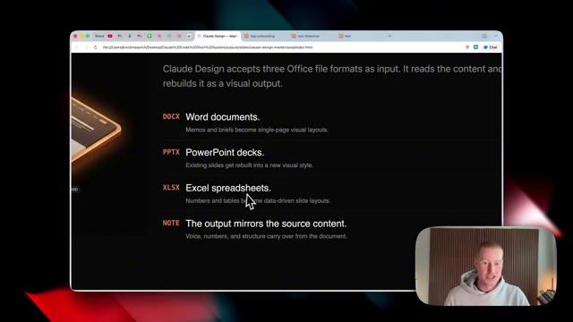
*⏱️ 00:04:00 — Page web présentant les trois formats de fichiers Office acceptés par Claude Design (DOCX, PPTX, XLSX) avec le présentateur en médaillon.*

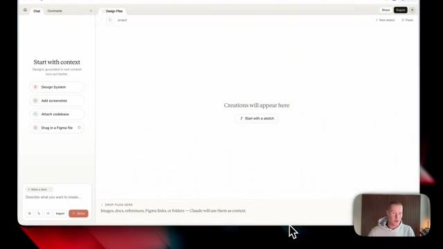
*⏱️ 00:04:05 — Interface de l'application Claude montrant la zone de travail pour les fichiers de design et les options de contexte.*

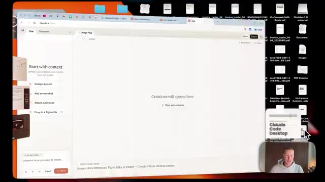
*⏱️ 00:04:10 — Vue du bureau de l'ordinateur montrant l'application Claude et l'explorateur de fichiers en arrière-plan pendant la navigation.*

---

### ⏱️ `[00:04:15 - 00:04:40]` | Segment #12

**🔊 Audio (Transcription Intégrale Mot pour Mot en Français) :**
> J'adore vraiment le design de ceci. Je trouve que ça a l'air vraiment solide. J'aimerais donc essayer de recréer ce style exact. Ce que je pourrais faire maintenant, c'est revenir à mon application de design défectueuse et je pourrais simplement faire glisser ceci et télécharger ce PDF. Nous pouvons maintenant voir qu'un PDF est joint ici ainsi qu'à l'intérieur de nos fichiers de design. Et puis je vais juste dire, je veux que tu transformes ceci en une présentation de diapositives dans le style exact de ce PDF ici.

**👁️ Analyse Visuelle d'Écran (gemini-3.5-flash-lite) :**
**Interface & Outils** : Application de design web (interface de type Claude AI / outil de création de design).

**Contenu textuel & Code** : Options de contexte (« Start with context », « Design System », « Add screenshot ») et zone de dépôt de fichiers.

**Action / Démonstration** : Glisser-déposer d'un fichier PDF dans l'interface de design pour l'utiliser comme référence de style.

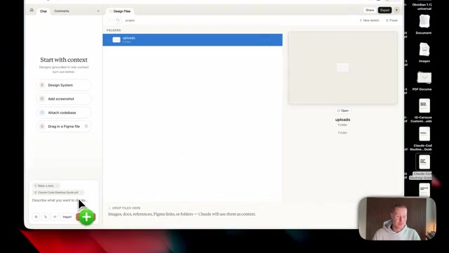
*⏱️ 00:04:28 — L'application de design en ligne montrant une interface avec des options pour ajouter du contexte et glisser des fichiers.*

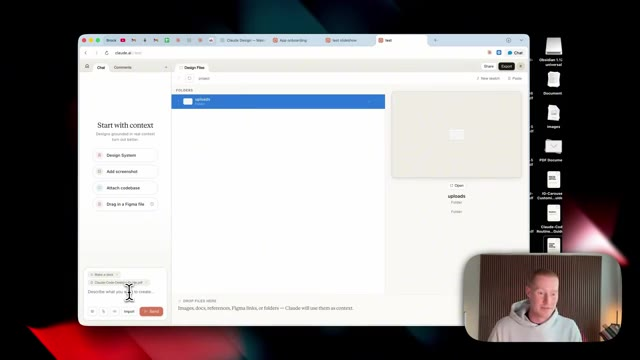
*⏱️ 00:04:34 — L'application de design montrant le curseur de la souris en train de glisser et déposer le fichier PDF de référence.*

---

### ⏱️ `[00:04:40 - 00:05:00]` | Segment #13

**🔊 Audio (Transcription Intégrale Mot pour Mot en Français) :**
> Je veux que tu crées des infographies qui ressemblent aussi beaucoup aux graphiques montrés dans le PDF. Comme ça, je pourrais l'envoyer. Et encore une fois, si nous avons des feuilles de calcul Excel spécifiques, par exemple, nous pourrions les télécharger directement ici et ensuite les transformer en prototype d'application ou peut-être en présentation ou quelque chose comme ça, sans que nous ayons à reformater cela et fondamentalement à le télécharger sous forme de texte, par exemple.

**👁️ Analyse Visuelle d'Écran (gemini-3.5-flash-lite) :**
**Interface & Outils** : Navigateur web affichant l'interface de Claude.ai avec un espace de travail de design de fichiers et une vidéo du présentateur en incrustation.

**Contenu textuel & Code** : Prompt utilisateur demandant la création d'un diaporama et d'infographies au même style qu'un PDF joint, avec affichage d'un script en cours d'exécution par l'IA.

**Action / Démonstration** : Le présentateur démontre l'utilisation de Claude pour analyser un document PDF et générer automatiquement des présentations ou infographies au style correspondant.

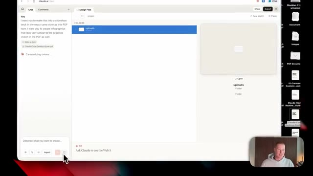
*⏱️ 00:04:45 — Interface de Claude.ai affichant un chat de conception avec le prompt utilisateur pour créer une présentation et des infographies basées sur un PDF importé.*

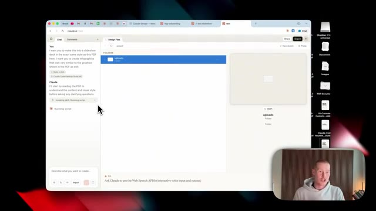
*⏱️ 00:04:50 — Interface de Claude.ai montrant la réponse de l'IA qui indique qu'elle lit le PDF pour comprendre le contenu et le style visuel ("Invoking skill, Running script").*

---

### ⏱️ `[00:05:01 - 00:05:21]` | Segment #14

**🔊 Audio (Transcription Intégrale Mot pour Mot en Français) :**
> Très bien. Et quelques minutes plus tard, nous avons maintenant ce diaporama ici, Cloud Code Desktop. Cela ressemble beaucoup au PDF que nous avons téléchargé. Le fond a l'air un peu plus jaune, j'ai l'impression, mais c'est vraiment solide. Et un point essentiel à noter ici, c'est qu'il a pris toutes les informations de ce PDF existant que je lui ai fourni, et tout est affiché directement à l'intérieur.

**👁️ Analyse Visuelle d'Écran (gemini-3.5-flash-lite) :**
**Interface & Outils** : Navigateur web affichant l'interface de création de diapositives Claude.ai avec une webcam du présentateur en bas à droite.

**Contenu textuel & Code** : Présentation de diapositives professionnelles au design épuré sur l'application Claude Code Desktop, avec texte explicatif et panneaux d'édition latéraux.

**Action / Démonstration** : Navigation et présentation visuelle des diapositives de Claude Code Desktop par le créateur.

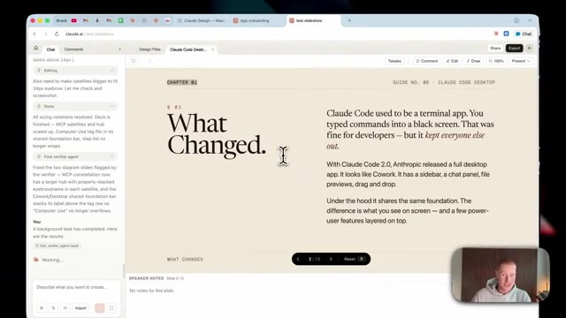
*⏱️ 00:05:06 — Interface web montrant la diapositive 'What Changed.' avec un fond beige clair et des notes d'édition sur le panneau de gauche.*

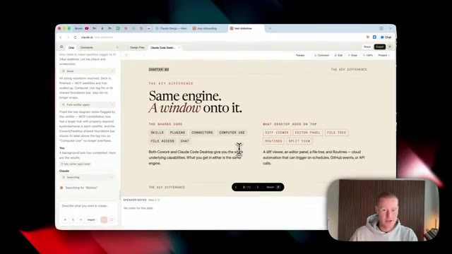
*⏱️ 00:05:11 — Interface web montrant la diapositive 'Same engine. A window onto it.' détaillant le fonctionnement de Claude Code Desktop.*

---

### ⏱️ `[00:05:21 - 00:05:40]` | Segment #15

**🔊 Audio (Transcription Intégrale Mot pour Mot en Français) :**
> Donc, vous pourriez voir les serveurs MCP. Il y a ce petit graphique sympa, un autre graphique ici. Je veux dire, c'est plutôt solide pour un tableur que j'ai créé en un seul prompt, et je lui ai juste donné une image de référence, et il a été capable de recréer un style similaire. Je viens de vous montrer comment créer un diaporama, mais ce n'est pas la seule chose que nous pouvons faire ici. C'est beaucoup plus puissant que ça.

**👁️ Analyse Visuelle d'Écran (gemini-3.5-flash-lite) :**
**Interface & Outils** : Interface web de Claude Design par Anthropic Labs.

**Contenu textuel & Code** : Projets de design, wireframes, prototypes de diapositives et notes de génération par IA.

**Action / Démonstration** : Navigation et démonstration de la création de présentations et de designs de diapositives via l'interface de Claude.

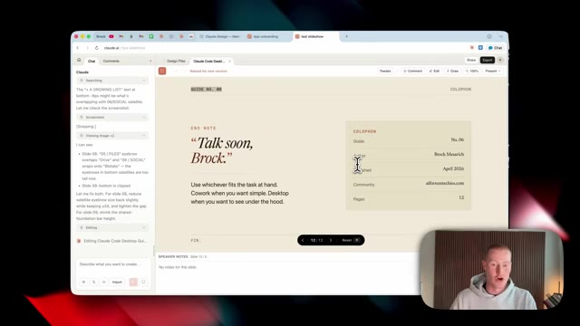
*⏱️ 00:05:26 — Interface de Claude affichant une présentation de diapositives avec un design épuré, des notes de conférencier et le présentateur en médaillon vidéo.*

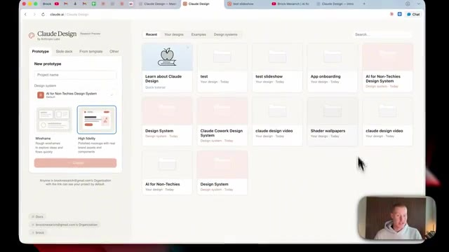
*⏱️ 00:05:36 — Tableau de bord de Claude Design listant différents projets et prototypes récents sous forme de vignettes.*

---

### ⏱️ `[00:05:40 - 00:06:09]` | Segment #16

**🔊 Audio (Transcription Intégrale Mot pour Mot en Français) :**
> Donc je vais vous montrer comment créer un prototype d'application mobile directement à l'intérieur de la plateforme de conception Claude ici. Donc ce que je pourrais faire, c'est simplement venir ici et lui donner un nom. Appelons simplement cela application mobile. Il y a quelques distinctions clés et choses que je veux mentionner ici, c'est que nous pouvons sélectionner notre système de design. En ce moment, j'ai sélectionné le système de design AI for non-techies, mais pour ce cas d'utilisation, je vais sélectionner aucun. Et encore une fois, je vais vous montrer comment créer votre propre système de design ici juste après cette petite démo rapide. Il y a quelques choses différentes que nous pouvons sélectionner.

**👁️ Analyse Visuelle d'Écran (gemini-3.5-flash-lite) :**
**Interface & Outils** : Navigateur web affichant Claude Design par Anthropic (claude.ai/design).

**Contenu textuel & Code** : Panneau de création de nouveau prototype avec un champ de saisie de texte "Project name", des options de design system (Wireframe ou High fidelity), et divers projets récents affichés sous forme de vignettes (Learn about Claude Design, test, App onboarding, etc.).

**Action / Démonstration** : Le présentateur s'apprête à nommer un nouveau prototype d'application mobile dans l'interface de Claude Design.

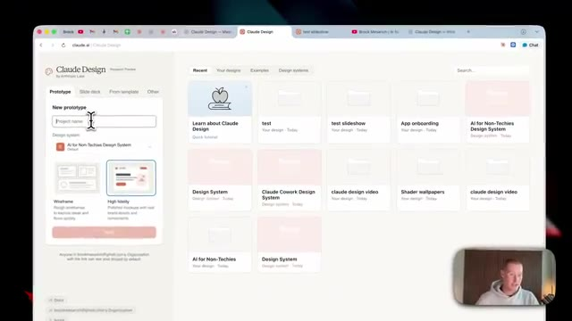
*⏱️ 00:05:48 — Interface de la plateforme Claude Design montrant le tableau de bord avec les projets existants et un panneau latéral gauche ouvert pour créer un nouveau prototype.*

---

### ⏱️ `[00:06:09 - 00:06:32]` | Segment #17

**🔊 Audio (Transcription Intégrale Mot pour Mot en Français) :**
> Nous pouvons cliquer sur les wireframes, qui sont en fait de simples wireframes approximatifs pour explorer rapidement différentes idées et parcours. Donc, si nous voulons en quelque sorte travailler sur le modèle ou le cadre de notre site web avant de vraiment finaliser le design et de passer plus de temps à le concevoir, nous pouvons sélectionner ceci ou nous pouvons sélectionner la haute fidélité, ce qui va réellement créer ces maquettes plus soignées que vous avez probablement envie de créer.

**👁️ Analyse Visuelle d'Écran (gemini-3.5-flash-lite) :**
**Interface & Outils** : Navigateur web affichant l'interface de Claude Design (Claude.ai) avec une vue des projets récents et un panneau latéral de configuration de prototype.

**Contenu textuel & Code** : Options de création de prototype avec choix du type de design system et sélection entre l'option Wireframe (pour explorer rapidement des idées) et High fidelity (maquettes polies).

**Action / Démonstration** : Le présentateur survole et clique sur les options de prototype (Wireframe et High fidelity) dans l'interface de Claude Design.

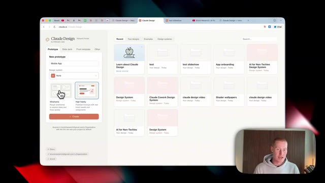
*⏱️ 00:06:15 — Vue de l'interface de Claude Design montrant le panneau de création de prototype avec l'option Wireframe sélectionnée.*

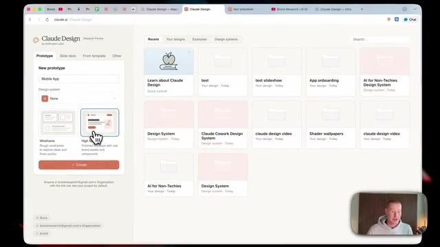
*⏱️ 00:06:26 — Vue de l'interface de Claude Design montrant le panneau de création de prototype avec le curseur se déplaçant sur l'option High fidelity.*

---

### ⏱️ `[00:06:32 - 00:06:57]` | Segment #18

**🔊 Audio (Transcription Intégrale Mot pour Mot en Français) :**
> Donc je vais cliquer sur ce bouton de création et cela va maintenant m'emmener vers cette interface. Ça ressemble beaucoup à Lovable. Quelques petites différences. Je peux ouvrir des systèmes de design. Je peux ajouter une capture d'écran et je peux même y attacher une base de code, ce qui est plutôt cool. Donc si nous utilisons GitHub, par exemple, je pourrais cliquer ici ou je peux simplement télécharger un dossier depuis mon bureau contenant tout mon code, et il peut extraire tout cela pour le transformer ensuite en prototype fonctionnel.

**👁️ Analyse Visuelle d'Écran (gemini-3.5-flash-lite) :**
**Interface & Outils** : Interface web de Claude Design / Lovable.

**Contenu textuel & Code** : Options de contexte : Design System, Add screenshot, Attach codebase, Drag in a Figma file, et la fenêtre modale de téléchargement de code.

**Action / Démonstration** : Navigation dans l'interface et sélection de l'option pour attacher une base de code.

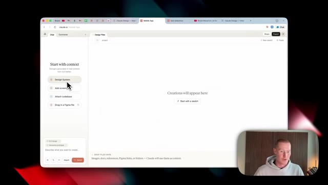
*⏱️ 00:06:38 — Interface de l'outil montrant les options de contexte avec le curseur sur "Design System".*

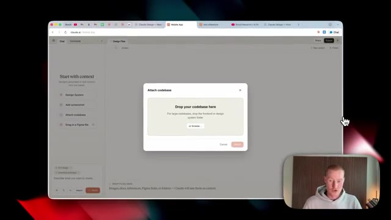
*⏱️ 00:06:51 — Fenêtre modale "Attach codebase" ouverte pour permettre de glisser-déposer une base de code.*

---

### ⏱️ `[00:06:58 - 00:07:21]` | Segment #19

**🔊 Audio (Transcription Intégrale Mot pour Mot en Français) :**
> Je vais simplement lui donner cette invite très simple. Donc, créez un parcours d'inscription iOS pour une application de vélos en libre-service, affichez les écrans sur un canevas. C'est donc une invite vraiment, vraiment simple. Je vais donc lui donner ceci et ensuite je vais vous montrer ce que cela va générer ici dans une seconde. Pendant que cela charge, je veux parler de quelques points clés. Nous avons donc ce bouton de commentaires ici même. Et c'est parce que la nouvelle application Claude Design est conçue pour collaborer avec votre équipe.

**👁️ Analyse Visuelle d'Écran (gemini-3.5-flash-lite) :**
**Interface & Outils** : Navigateur web affichant Claude AI (claude.ai) et son interface de design/canevas de projet.

**Contenu textuel & Code** : Prompt utilisateur : "Create a simple iOS signup flow for a bikesharing app. Show screens on a canvas. Blue + orange modern color scheme." et fichiers JSX générés.

**Action / Démonstration** : Saisie d'un prompt textuel pour générer des interfaces mobiles et visualisation des composants générés dans l'espace de travail.

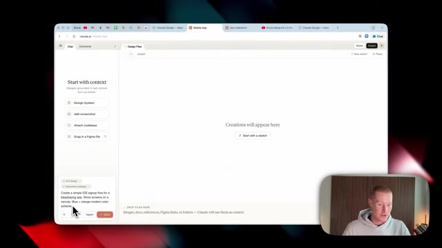
*⏱️ 00:07:04 — Interface de Claude AI montrant l'éditeur de design avec un champ de saisie de prompt contenant la demande de création d'une application de vélos en libre-service.*

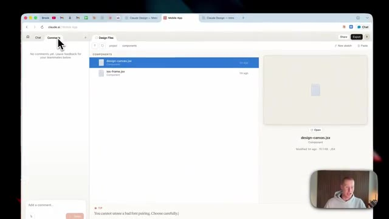
*⏱️ 00:07:15 — Interface de Claude AI montrant les fichiers de composants générés (design-canvas.jsx et ios-frame.jsx) avec un aperçu visuel du projet.*

---

### ⏱️ `[00:07:21 - 00:07:42]` | Segment #20

**🔊 Audio (Transcription Intégrale Mot pour Mot en Français) :**
> Disons que quelqu'un dans votre équipe apporte une modification à notre application. Vous pourriez laisser différents commentaires ici et dire simplement, hé, c'est nul. Par exemple, nous pourrions l'envoyer. Et maintenant, tout le monde dans notre équipe peut voir tous ces différents commentaires que nous faisons sur ce projet spécifique. Et puis une autre chose, c'est que nous avons un bouton de partage ici. Nous pourrions donc donner un nom à ceci et donner un accès spécifique à nos coéquipiers.

**👁️ Analyse Visuelle d'Écran (gemini-3.5-flash-lite) :**
**Interface & Outils** : Interface web de Claude AI (section design de projet et gestion des commentaires).

**Contenu textuel & Code** : Composants de fichiers (design-canvas.jsx, ios-frame.jsx, screens.jsx) et panneau latéral de commentaires.
[DESC_IMAGE_3] Un utilisateur rédige et soumet un commentaire sur un composant avant d'ouvrir le menu de partage pour l'équipe.

**Action / Démonstration** : Explications face caméra et analyse conceptuelle des marchés.

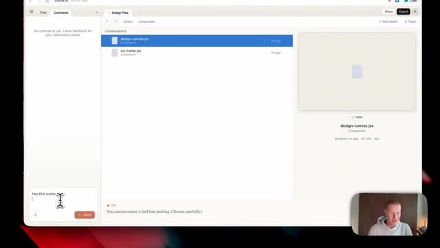
*⏱️ 00:07:26 — Saisie d'un commentaire critique dans l'interface de l'application Claude AI.*

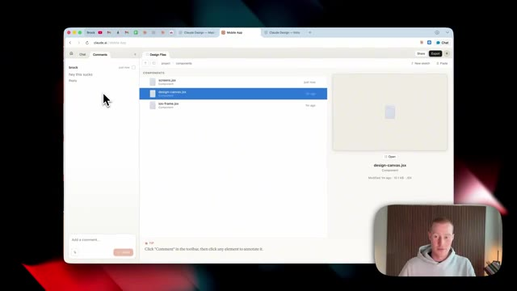
*⏱️ 00:07:32 — Affichage du commentaire publié dans l'onglet dédié de l'interface.*

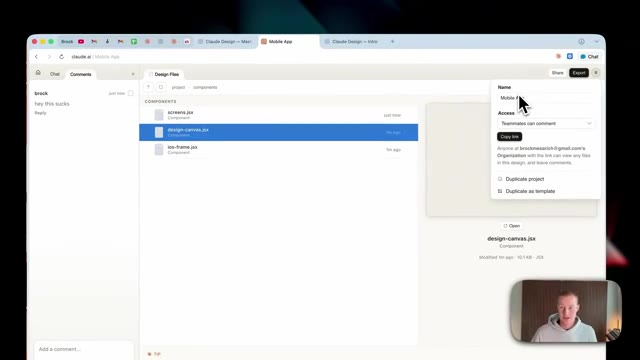
*⏱️ 00:07:37 — Ouverture du menu de partage et de configuration des accès du projet.*

---

### ⏱️ `[00:07:42 - 00:08:02]` | Segment #21

**🔊 Audio (Transcription Intégrale Mot pour Mot en Français) :**
> Donc nous pouvons leur permettre de le voir, nous pouvons leur permettre de le commenter, et nous pouvons leur permettre de l'éditer, ou nous pouvons garder ceci comme privé. Donc nous pourrions aller de l'avant et faire cela, copier le lien, et nous pourrions même dupliquer ceci comme un projet spécifique ou comme un modèle. À tout moment, je pourrais ouvrir notre onglet de fichiers de conception juste ici et voir tous les différents composants que nous avons à l'intérieur de ce prototype.

**👁️ Analyse Visuelle d'Écran (gemini-3.5-flash-lite) :**
**Interface & Outils** : Interface web de Claude.ai (Claude Design).

**Contenu textuel & Code** : Options de gestion des accès utilisateurs, copie de lien et duplication de projets.

**Action / Démonstration** : Configuration des permissions de partage du projet et navigation dans l'arborescence des fichiers.

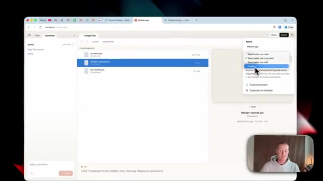
*⏱️ 00:07:47 — Menu déroulant des options de partage affichant les droits d'accès (view, comment, edit, private).*

*⏱️ 00:07:52 — Options de partage sélectionnées avec le bouton 'Copy link' et les options de duplication.*

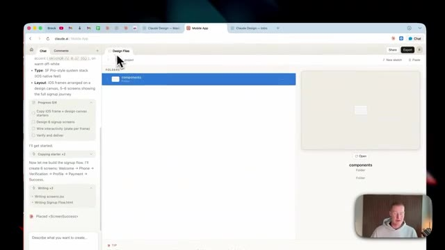
*⏱️ 00:07:57 — Navigation dans les dossiers 'Design Files' et 'components' de l'interface Claude.*

---

### ⏱️ `[00:08:02 - 00:08:21]` | Segment #22

**🔊 Audio (Transcription Intégrale Mot pour Mot en Français) :**
> Donc, si j'ouvre ceci, il y a quelques éléments différents là-dedans, ainsi que toutes les pages qui sont générées, que nous pouvons également visualiser juste ici. Ensuite, si je clique sur ce fichier HTML de flux d'inscription, nous pouvons maintenant voir cette interface utilisateur pour notre application. Cela a l'air plutôt solide. Ce n'est vraiment pas ce qui se fait de mieux, mais je lui ai donné une consigne très, très simple.

**👁️ Analyse Visuelle d'Écran (gemini-3.5-flash-lite) :**
**Interface & Outils** : Interface web de Claude.ai affichant un projet de conception d'application mobile (Mobile App).

**Contenu textuel & Code** : Fichiers du projet (composants, design-canvas, ios-frame, screens, Signup-Flow.html) et écrans maquettés d'une application mobile (« loop »).

**Action / Démonstration** : Navigation et clic sur le fichier HTML du flux d'inscription pour visualiser les maquettes et le prototype interactif.

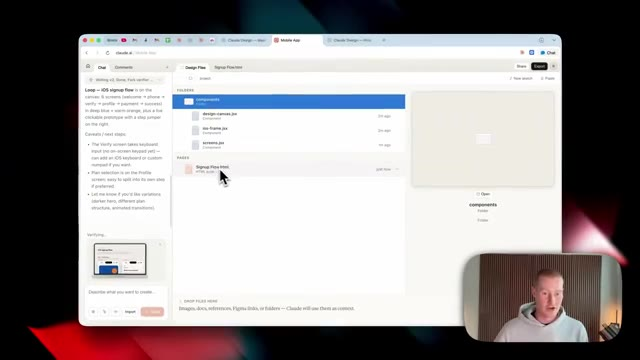
*⏱️ 00:08:07 — Vue d'une interface de gestion de fichiers avec des dossiers de composants et un lien vers le fichier HTML du flux d'inscription.*

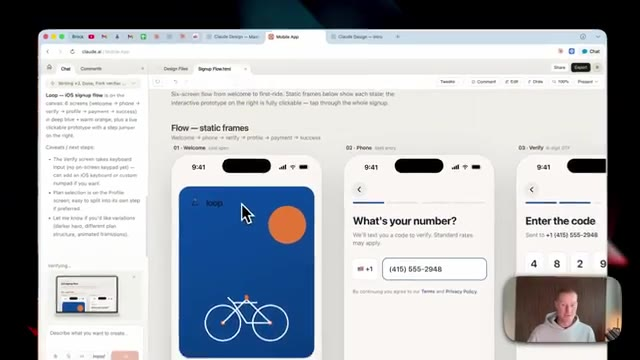
*⏱️ 00:08:12 — Affichage de l'interface utilisateur du flux d'inscription pour application mobile montrant les écrans statiques de bienvenue et de saisie de numéro.*

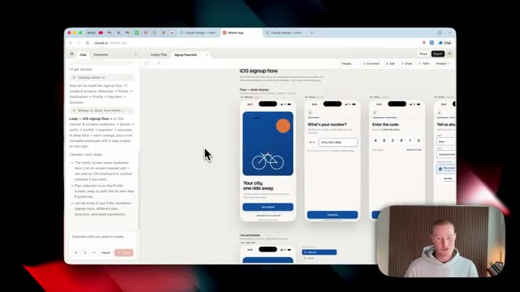
*⏱️ 00:08:16 — Défilement de l'interface utilisateur montrant le prototype interactif complet du flux d'inscription sur application mobile avec plusieurs étapes.*

---

### ⏱️ `[00:08:21 - 00:08:39]` | Segment #23

**🔊 Audio (Transcription Intégrale Mot pour Mot en Français) :**
> En gros, ça résume à quoi sert cette application. Ça montre le parcours. Donc nous avons notre page de bienvenue. Nous avons notre page d'inscription. C'est plutôt cool. Et à partir d'ici, nous pouvons faire plusieurs choses différentes. Évidemment, nous pourrions revenir sur le côté gauche et faire des modifications directement ici. Ou nous pourrions modifier des éléments spécifiques directement. Donc disons que je veux changer le texte juste ici.

**👁️ Analyse Visuelle d'Écran (gemini-3.5-flash-lite) :**
**Interface & Outils** : Navigateur web affichant l'interface de prototypage Claude AI / design d'application mobile avec encart vidéo du présentateur en bas à droite.

**Contenu textuel & Code** : Maquettes d'écrans mobiles pour une application de vélo en libre-service (flux d'inscription, saisie du numéro de téléphone, code de vérification, profil et paiement).

**Action / Démonstration** : Navigation et présentation du parcours utilisateur (signup flow) généré par l'intelligence artificielle sur le canvas.

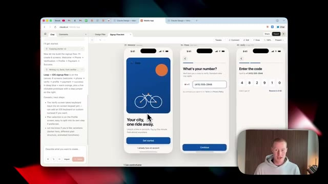
*⏱️ 00:08:26 — Interface web montrant un prototype d'application mobile avec plusieurs écrans de parcours utilisateur (welcome, phone, verify).*

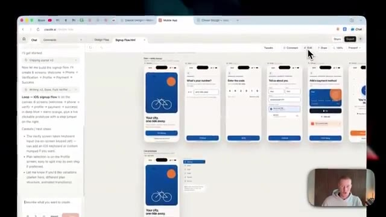
*⏱️ 00:08:35 — Vue d'ensemble élargie du canvas montrant l'intégralité du parcours d'inscription généré (écrans multiples et prototype interactif).*

---

### ⏱️ `[00:08:40 - 00:08:58]` | Segment #24

**🔊 Audio (Transcription Intégrale Mot pour Mot en Français) :**
> Je pourrais simplement modifier le texte. Ou je pourrais sélectionner n'importe quel autre élément et en changer la couleur spécifique, par exemple. Ou je pourrais même sélectionner l'option de dessin et dessiner sur notre toile et apporter toutes les modifications que nous voulons. Comme par exemple, laissez-moi juste faire comme ça et barrer ce vélo avec une croix. Ensuite, fondamentalement, cela irait de l'avant et examinerait cela, puis supprimerait le vélo, par exemple.

**👁️ Analyse Visuelle d'Écran (gemini-3.5-flash-lite) :**
**Interface & Outils** : Interface web de prototypage (Claude AI / outil de design)

**Contenu textuel & Code** : Maquettes de téléphones portables affichant un parcours utilisateur (iOS signup flow) avec des éléments textuels et graphiques.

**Action / Démonstration** : Modification d'éléments visuels et utilisation de l'outil de dessin pour annoter le prototype directement sur la toile.

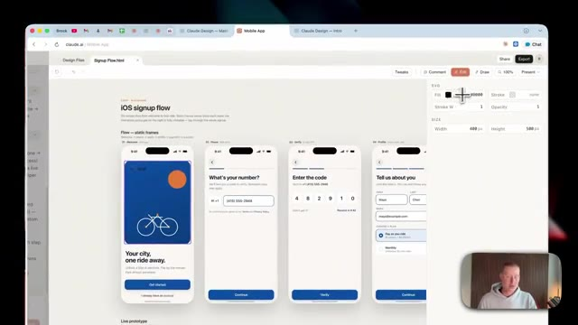
*⏱️ 00:08:44 — Interface de conception d'application mobile montrant le flux d'inscription iOS avec des écrans de démonstration et des options de modification.*

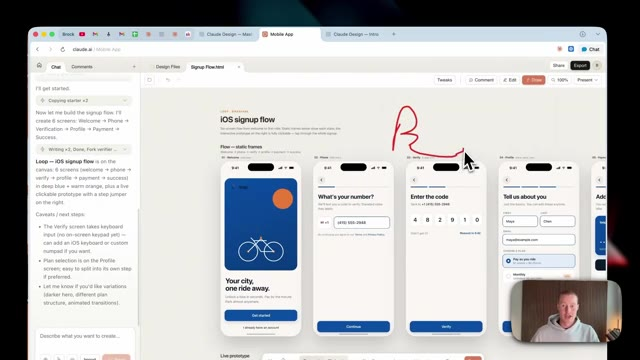
*⏱️ 00:08:49 — Utilisation de l'outil de dessin pour tracer un trait rouge directement sur la toile de conception du prototype.*

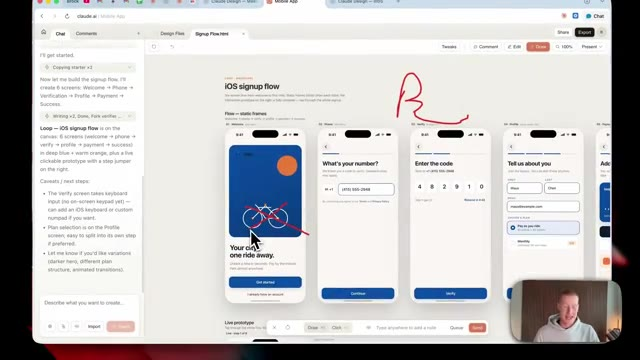
*⏱️ 00:08:53 — Continuation du dessin d'annotation par dessus l'illustration d'un écran d'application mobile sur la toile.*

---

### ⏱️ `[00:08:58 - 00:09:23]` | Segment #25

**🔊 Audio (Transcription Intégrale Mot pour Mot en Français) :**
> Donc, si vous voulez modifier vos prototypes ou vos designs simplement en dessinant sur ce canevas, vous pouvez le faire. Cela donne vraiment une impression très similaire à un autre produit de design appelé Google Stitch. Si vous connaissez cela, ça crée de superbes interfaces utilisateur que vous pouvez ensuite exporter vers CloudCode ou AntiGravity, n'importe laquelle de ces autres plateformes de codage. Donc, ça donne une impression assez similaire à ça, mais honnêtement, ça n'a pas cette même sensation de haute qualité que Stitch possède, je dois bien l'avouer.

**👁️ Analyse Visuelle d'Écran (gemini-3.5-flash-lite) :**
**Interface & Outils** : Google Stitch et navigateur web présentant des diapositives de design.

**Contenu textuel & Code** : Maquettes d'interfaces utilisateur (UI/UX), texte descriptif de design, panneaux de génération et options de style.

**Action / Démonstration** : Navigation et présentation des fonctionnalités de design itératif sur Google Stitch.

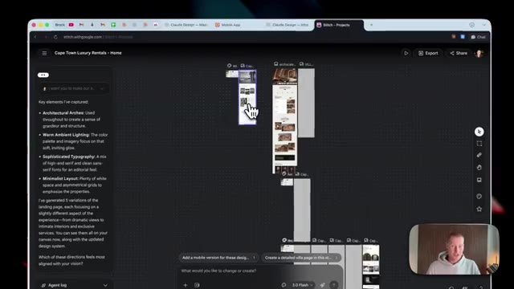
*⏱️ 00:09:04 — Vue d'ensemble de l'interface de Google Stitch montrant un canevas infini avec des wireframes et des variations de designs pour une application de location de luxe.*

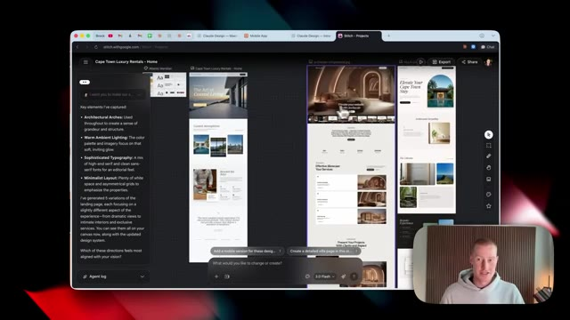
*⏱️ 00:09:10 — Gros plan sur Google Stitch affichant les détails du projet et les différentes maquettes générées sur le canevas de design.*

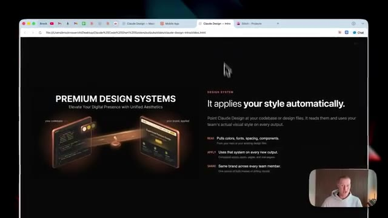
*⏱️ 00:09:16 — Présentation d'une interface de diapositives intitulée 'Premium Design Systems' montrant comment le style est appliqué automatiquement.*

---

### ⏱️ `[00:09:23 - 00:09:58]` | Segment #26

**🔊 Audio (Transcription Intégrale Mot pour Mot en Français) :**
> Ensuite, ce que nous pourrions faire si nous sommes satisfaits de ce design, par exemple, nous pourrions venir et cliquer sur exporter. Et il y a plusieurs façons différentes de l'exporter. Nous pouvons télécharger ce projet sous forme de fichier zip. Nous pourrions l'exporter au format PDF, en document PowerPoint. Nous pourrions l'envoyer directement sur Canva pour y apporter d'autres modifications, l'exporter sous forme de fichier HTML autonome, ou nous pouvons le transmettre à Claude Code pour commencer à le transformer en une application entièrement fonctionnelle. Parce qu'actuellement, ce n'est qu'un prototype. Je ne peux pas venir ici et réellement tester l'application pour voir si elle fonctionne correctement. Ce n'est qu'un outil de conception pour l'instant. D'accord, tout cela est formidable. Mais ce sur quoi je veux me concentrer,

**👁️ Analyse Visuelle d'Écran (gemini-3.5-flash-lite) :**
**Interface & Outils** : Interface web de Claude.ai et maquettes d'application mobile (prototypage).

**Contenu textuel & Code** : Maquettes d'écrans d'application mobile (flux d'inscription) et options d'exportation (télécharger en zip, PDF, PPTX, HTML, etc.).

**Action / Démonstration** : Démonstration du menu d'exportation et des différentes options de téléchargement du projet design.

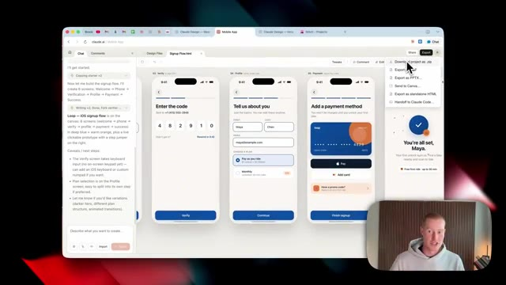
*⏱️ 00:09:31 — Capture d'écran montrant l'interface de Claude avec un menu déroulant d'exportation affichant les options pour télécharger le projet ou l'exporter sous différents formats.*

---

### ⏱️ `[00:09:58 - 00:10:20]` | Segment #27

**🔊 Audio (Transcription Intégrale Mot pour Mot en Français) :**
> parce que c'est l'un des éléments clés ici qui rend ce produit très intéressant. La fonctionnalité de système de design est vraiment, vraiment cool. Je vais donc détailler cela dès maintenant. C'est donc une façon d'apprendre à Claude Design notre style exact automatiquement. Et le truc génial là-dedans, c'est que nous n'avons pas besoin de fournir un prompt super complet pour concevoir et créer ce système de design.

**👁️ Analyse Visuelle d'Écran (gemini-3.5-flash-lite) :**
**Interface & Outils** : Navigateur web affichant une page de présentation de design (slides HTML).

**Contenu textuel & Code** : Titre principal « PREMIUM DESIGN SYSTEMS » et sous-titre « It applies your style automatically. Point Claude Design at your codebase or design files... ».

**Action / Démonstration** : Le présentateur explique la fonctionnalité de système de design permettant d'appliquer automatiquement le style visuel.

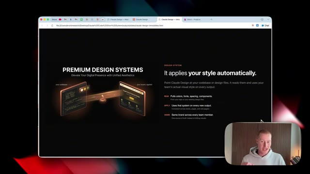
*⏱️ 00:10:03 — Capture d'écran montrant une présentation web sur le système de design avec un texte explicatif et une illustration visuelle, accompagnée d'une incrustation vidéo du présentateur en bas à droite.*

---

### ⏱️ `[00:10:20 - 00:10:42]` | Segment #28

**🔊 Audio (Transcription Intégrale Mot pour Mot en Français) :**
> Nous pouvons concevoir cela en faisant quelques choses différentes. Nous pouvons pointer Claude Design vers notre base de code ou vers des fichiers de conception spécifiques qui se trouvent sur notre ordinateur. Il peut les lire et utilisera réellement ces visuels provenant de ces différentes sources directement dans ce style qu'il va créer. Il va donc lire et extraire différentes couleurs, différentes polices, la typographie, et différents composants, et appliquera ce système à absolument chaque résultat.

**👁️ Analyse Visuelle d'Écran (gemini-3.5-flash-lite) :**
**Interface & Outils** : Navigateur web affichant une page HTML de présentation sur les systèmes de design (Claude Design).

**Contenu textuel & Code** : Texte explicatif et sections relatives aux méthodes d'intégration du design (Website, Brand Kit, Deck ou doc, Codebase).

**Action / Démonstration** : Navigation et survol du texte explicatif de la page web par le présentateur.

*⏱️ 00:10:26 — Présentation des systèmes de design montrant les différentes manières d'appliquer son propre style visuel.*

*⏱️ 00:10:31 — Suite de la présentation web avec un zoom sur la section 'It applies your style automatically'.*

---

### ⏱️ `[00:10:43 - 00:11:09]` | Segment #29

**🔊 Audio (Transcription Intégrale Mot pour Mot en Français) :**
> Considérez cela comme un fichier MD de design, pour ainsi dire, où chaque fois que nous générons un prototype, il utilisera toujours ce style spécifique. Et il y a quatre façons spécifiques dont nous pourrions lui enseigner notre style. Nous n'avons pas besoin d'avoir une base de code si nous n'en avons pas déjà une. Ce que nous pourrions faire, c'est insérer l'URL d'un site web spécifique. Donc, qu'il s'agisse de votre site web ou d'un site web que nous voulons recréer, nous pourrions insérer un kit de marque qui contient différents logos et polices directement stockés dans un dossier spécifique.

**👁️ Analyse Visuelle d'Écran (gemini-3.5-flash-lite) :**
**Interface & Outils** : Navigateur web affichant une page de présentation de design system (Claude Design - Intro).

**Contenu textuel & Code** : Texte explicatif sur l'application automatique du style (Read, Apply, Share) et les fonctionnalités de lecture des couleurs, polices et composants.

**Action / Démonstration** : Présentation visuelle d'un système de design automatisé appliqué aux prototypes.

*⏱️ 00:10:49 — Capture d'écran montrant une page web de présentation intitulée "Design Systems" avec le texte "It applies your style automatically", tandis que le présentateur apparaît en bas à droite.*

---

### ⏱️ `[00:11:09 - 00:11:30]` | Segment #30

**🔊 Audio (Transcription Intégrale Mot pour Mot en Français) :**
> Nous pourrions lui donner une présentation ou un document. Et comme je l'ai dit, nous pourrions extraire directement de notre base de code qui est stockée dans un dépôt tel que GitHub. Maintenant, afin d'en concevoir un, nous revenons à Claude Design et cliquons sur ce bouton qui indique systèmes de design. Juste ici, j'en ai quelques-uns que j'ai créés avant de faire cette vidéo. J'ai mon système de design AI for non-techies, et c'est mon système par défaut.

**👁️ Analyse Visuelle d'Écran (gemini-3.5-flash-lite) :**
**Interface & Outils** : Navigateur web affichant l'interface de l'application Claude Design (claude.ai) et une page explicative sur les design systems.

**Contenu textuel & Code** : Texte descriptif des méthodes de configuration de style (Website, Brand Kit, Design Files, Codebase) et liste des design systems de l'organisation.

**Action / Démonstration** : Navigation sur l'interface de Claude Design et survol de l'onglet des systèmes de design.

---

### ⏱️ `[00:11:31 - 00:11:52]` | Segment #31

**🔊 Audio (Transcription Intégrale Mot pour Mot en Français) :**
> Donc nous pourrions fondamentalement choisir un système par défaut. Donc chaque fois que nous générons quelque chose, il utilisera automatiquement ce style. Donc si j'ouvre ceci, nous pourrions examiner exactement à quoi cela ressemble. Donc nous avons tous nos dossiers ici avec nos différentes icônes d'application, nos maquettes de logo. Fondamentalement, chaque composant d'interface utilisateur que nous utilisons à l'intérieur de ce style de conception sera stocké juste ici.

**👁️ Analyse Visuelle d'Écran (gemini-3.5-flash-lite) :**
**Interface & Outils** : Interface web de Claude Design / Claude AI

**Contenu textuel & Code** : Dossiers de projet, fichiers SVG d'icônes, aperçus HTML et instructions de design system.

**Action / Démonstration** : Navigation dans les dossiers de ressources du projet et visualisation des différents éléments graphiques.

*⏱️ 00:11:41 — L'interface affiche l'explorateur de dossiers et de fichiers de conception avec les différents dossiers d'actifs graphiques.*

*⏱️ 00:11:46 — Vue détaillée des dossiers contenant les différentes icônes et éléments graphiques du projet.*

---

### ⏱️ `[00:11:52 - 00:12:10]` | Segment #32

**🔊 Audio (Transcription Intégrale Mot pour Mot en Français) :**
> Ensuite, si je fais apparaître ceci, voici un exemple de page de destination que j'ai créée pour ma communauté scolaire en utilisant ce style de design exact que j'ai élaboré. Et ça a l'air plutôt solide. J'ai fondamentalement essayé de recréer le style, la typographie et les couleurs d'Anthropic et de Claude, vous savez. Ça a l'air plutôt cool. Mais laissez-moi vous montrer maintenant comment vous pourriez fabriquer exactement la même chose.

**👁️ Analyse Visuelle d'Écran (gemini-3.5-flash-lite) :**
**Interface & Outils** : Navigateur web, interface Claude.ai (Artefacts / LandingPage.html).

**Contenu textuel & Code** : Page web responsive style Anthropic avec typographie soignée, palette de couleurs sombres et orangées, et panneau latéral de discussion (chat).

**Action / Démonstration** : Présentation et défilement d'une page de destination générée et conçue pour une communauté en ligne.

*⏱️ 00:11:56 — Capture d'écran montrant l'interface de Claude.ai avec un aperçu de page de destination pour « AI for Non-Techies » utilisant le style d'Anthropic.*

*⏱️ 00:12:01 — Capture d'écran montrant la suite de la page de destination sur Claude.ai avec la section « Three things you can't find on YouTube ».*

---

### ⏱️ `[00:12:10 - 00:12:35]` | Segment #33

**🔊 Audio (Transcription Intégrale Mot pour Mot en Français) :**
> Si nous revenons à nos systèmes de design, nous pourrions juste en créer un nouveau ici même. Et ce que nous allons faire maintenant, c'est faire plusieurs choses différentes. Nous allons lui donner un nom. Laissez-moi donc appeler ceci Claude Design, et nous pourrions lier notre code depuis GitHub si nous avons du code spécifique que nous voulons référencer. Nous pourrions glisser des dossiers spécifiques directement ici. Et en plus de tout cela, nous pourrions télécharger n'importe quels logos, polices ou actifs spécifiques directement en bas et ajouter toutes autres notes.

**👁️ Analyse Visuelle d'Écran (gemini-3.5-flash-lite) :**
**Interface & Outils** : Navigateur web sur l'application claude.ai (Interface de configuration de Design System).

**Contenu textuel & Code** : Formulaire de configuration "Set up your design system" comprenant le nom "Claude Design", des options pour lier GitHub ("Link code on GitHub"), importer du code local, et téléverser des fichiers .fig ou des assets graphiques.

**Action / Démonstration** : Saisie du nom "Claude Design" dans le champ de configuration du système de design et présentation des options de liaison avec GitHub.

*⏱️ 00:12:23 — L'interface de claude.ai montre le champ "Company name and blurb" rempli avec "Claude Design" et les options pour lier le code GitHub, un dossier local ou des fichiers de design.*

---

### ⏱️ `[00:12:35 - 00:12:57]` | Segment #34

**🔊 Audio (Transcription Intégrale Mot pour Mot en Français) :**
> Personnellement, je vais récupérer quelques fichiers pour télécharger en quelque sorte le style que je recherche. Et ensuite, je vais vous montrer exactement comment il recrée cela. C'est donc mon tableau de bord de compétences que j'ai créé. J'aime vraiment l'apparence de ceci. Je pense que la typographie, le style, c'est vraiment très propre. J'aime vraiment ça. Je veux donc copier ceci directement. C'est un fichier HTML qui est stocké sur mon ordinateur que j'utilise à l'intérieur de Claude.

**👁️ Analyse Visuelle d'Écran (gemini-3.5-flash-lite) :**
**Interface & Outils** : Navigateur web affichant une interface utilisateur personnalisée (Claude AI / tableau de bord de compétences).

**Contenu textuel & Code** : Cartes de fonctionnalités/compétences pour la création de contenu (Angle, Approve Carousel, Batch, Checkin, Claude Trending, etc.).
[DESC_IMAGE_3] Navigation et visualisation du tableau de bord de compétences du présentateur.

**Action / Démonstration** : Le présentateur présente et commente son tableau de bord de compétences personnalisé.

*⏱️ 00:12:46 — Tableau de bord de compétences (skills dashboard) affichant une grille de cartes blanches sur fond sombre.*

*⏱️ 00:12:51 — Vue similaire du tableau de bord de compétences avec une barre de recherche active en haut.*

---

### ⏱️ `[00:12:57 - 00:13:17]` | Segment #35

**🔊 Audio (Transcription Intégrale Mot pour Mot en Français) :**
> Donc, laissez-moi juste aller récupérer ce fichier spécifique sur mon ordinateur et le déposer là comme référence. Voici le dossier que je vais copier et ramener dans Claude. Ensuite, je vais cliquer sur parcourir, ouvrir ceci. Et maintenant, nous avons notre dossier du tableau de bord des compétences stocké juste ici. Ensuite, je vais juste cliquer sur continuer la génération. Et apparemment, cela prendra environ 15 minutes.

**👁️ Analyse Visuelle d'Écran (gemini-3.5-flash-lite) :**
**Interface & Outils** : macOS Finder et navigateur web sur l'interface de Claude (claude.ai).

**Contenu textuel & Code** : Explorateur de fichiers et interface de configuration de projet avec liaison de dossier local.

**Action / Démonstration** : Sélection et importation d'un dossier local (« skill-dashboard ») dans l'interface de Claude.

*⏱️ 00:13:02 — Vue du bureau Mac du présentateur affichant une fenêtre du Finder avec différents dossiers, dont le dossier 'skill-dashboard'.*

*⏱️ 00:13:07 — Interface de Claude (claude.ai) affichant une fenêtre modale de sélection de dossier pour l'importation de ressources.*

*⏱️ 00:13:12 — Interface de configuration du design system dans Claude montrant le dossier 'skill-dashboard' lié avec succès.*

---

### ⏱️ `[00:13:17 - 00:13:38]` | Segment #36

**🔊 Audio (Transcription Intégrale Mot pour Mot en Français) :**
> Alors laissons-le faire son travail. C'est donc là que les choses deviennent vraiment intéressantes, parce qu'en ce moment même, Claude est toujours en train de travailler comme c'est indiqué juste ici, mais nous pourrions commencer à donner des retours sur le travail qu'il a fait jusqu'à présent. Et c'est ainsi que nous sommes en mesure de concevoir les directives de marque exactes que nous voulons créer. Et nous pourrions le faire en passant en revue chacun de ces éléments individuels qui nécessitent une révision.

**👁️ Analyse Visuelle d'Écran (gemini-3.5-flash-lite) :**
**Interface & Outils** : Navigateur web affichant l'interface de Claude (claude.ai) et la section 'Design System'.

**Contenu textuel & Code** : Étapes de génération textuelles, sections 'Review draft design system', 'README', 'Type' et 'Colors'.

**Action / Démonstration** : Navigation et survol des éléments générés pour examiner le travail en cours de l'agent IA.

*⏱️ 00:13:22 — Vue d'ensemble de l'interface Claude montrant le panneau 'Design System' et le fil d'exécution à gauche.*

*⏱️ 00:13:28 — Le curseur se déplace le long du panneau latéral gauche pour afficher les étapes de génération de Claude.*

*⏱️ 00:13:33 — Gros plan sur le panneau central listant les composants du projet (README, Type, Colors).*

---

### ⏱️ `[00:13:38 - 00:13:57]` | Segment #37

**🔊 Audio (Transcription Intégrale Mot pour Mot en Français) :**
> Par exemple, nous avons ce "read me" juste ici, qui explique pour ainsi dire comment ce système fonctionne. Nous pourrions aller de l'avant et cliquer sur "ça a l'air bien", ou nous pourrions ajouter "nécessite du travail" et donner des commentaires là-dessus. Je vais cliquer sur "ça a l'air bien". Ça me montre les couleurs Bedrock ici. Je vais parcourir tout ça assez rapidement. D'après ce qu'on peut voir, elles ont l'air plutôt bien. Et nous pourrions toujours revenir en arrière et les changer si nous le voulons.

**👁️ Analyse Visuelle d'Écran (gemini-3.5-flash-lite) :**
**Interface & Outils** : Claude.ai (outil web de révision et génération de Design System / Artefacts AI).

**Contenu textuel & Code** : Document de Design System généré par Claude, section README, cartes de palette de couleurs ("Paper colors" avec hex #faf3ef, #f5ede4, #f7e1e7, #e8ddd0), options de feedback ("Looks good" / "Needs work").

**Action / Démonstration** : Évaluation et validation interactive ("Looks good") des composants d'un Design System généré par l'IA.

*⏱️ 00:13:43 — Interface Claude.ai montrant la section "README" d'un Design System généré avec le curseur positionné sur le bouton de validation "Looks good".*

*⏱️ 00:13:52 — Interface Claude.ai montrant la section des couleurs ("Paper colors") avec les codes hexadécimaux et le bouton "Looks good".*

---

### ⏱️ `[00:13:57 - 00:14:19]` | Segment #38

**🔊 Audio (Transcription Intégrale Mot pour Mot en Français) :**
> Par exemple, voici à quoi ressemblera notre section principale. Ça a l'air super bien. Notre échelle d'affichage, la police du corps de texte, genre tout ça, c'est des trucs dont je ne comprends même pas vraiment ce que c'est, mais je trouve que ça a l'air bien. Et si jamais on veut faire des modifications, je peux juste venir ici, cliquer sur « à retravailler », décrire ce qu'on veut changer, et ça l'ajoutera directement à la file d'attente sur le côté gauche où Claude s'en occupe et crée ça pour nous.

**👁️ Analyse Visuelle d'Écran (gemini-3.5-flash-lite) :**
**Interface & Outils** : Navigateur web affichant l'interface Claude AI (claude.ai) et le système de design généré.

**Contenu textuel & Code** : Éléments de design d'interface utilisateur (UI kit), échelles de typographie, affichage de composants graphiques et panneaux de configuration de design.

**Action / Démonstration** : Le présentateur passe en revue et commente les éléments du système de design générés par l'IA, notamment l'échelle d'affichage et l'espacement.

*⏱️ 00:14:03 — Interface Claude Design System montrant les composants visuels, l'échelle d'affichage et les polices avec une miniature vidéo du présentateur en bas à droite.*

*⏱️ 00:14:13 — Interface Claude Design System montrant l'échelle d'espacement (Spacing scale) avec le curseur de la souris interagissant sur les éléments visuels.*

---

### ⏱️ `[00:14:19 - 00:14:42]` | Segment #39

**🔊 Audio (Transcription Intégrale Mot pour Mot en Français) :**
> Et environ 15 minutes plus tard, nous avons notre système de design conçu et je peux cliquer sur les fichiers de design. Juste ici se trouvent en gros tous ces fichiers, directement à l'intérieur de ce système. Nous avons notre document de compétences, notre fichier skill MD, que nous pouvons tout à fait modifier si nous le voulons. Nous pouvons simplement apporter n'importe quelle modification directement ici. Mais ce que je veux faire maintenant, c'est juste cliquer sur publier et je peux en faire mon système de design par défaut.

**👁️ Analyse Visuelle d'Écran (gemini-3.5-flash-lite) :**
**Interface & Outils** : Navigateur web affichant l'interface de claude.ai (Claude Design System) avec webcam du présentateur en bas à droite.

**Contenu textuel & Code** : Fichiers du système de design, dossiers (assets, preview, ui_kits), feuilles de style (colors_and_type.css) et documents de compétences (SKILL.md, README.md).

**Action / Démonstration** : Navigation à travers les fichiers du système de design et ouverture d'un document markdown (SKILL.md).

*⏱️ 00:14:25 — Capture montrant l'interface de claude.ai affichant l'onglet "Design Files" du système de design avec les dossiers assets, preview, ui_kits et les documents colors_and_type.css, SKILL.md et README.md.*

*⏱️ 00:14:30 — Capture montrant l'interface de claude.ai avec un nouvel onglet "SKILL.md" en cours de chargement ("Loading...").*

---

### ⏱️ `[00:14:42 - 00:15:02]` | Segment #40

**🔊 Audio (Transcription Intégrale Mot pour Mot en Français) :**
> Maintenant, la question que vous vous posez probablement, c'est : comment utiliser ce système de design ? Comment le déclencher ? Et c'est très simple. Chaque fois que nous venons créer un prototype, un diaporama ou un modèle spécifique, nous pouvons toujours spécifier quel système de design nous voulons utiliser. Le système de design de Claude est celui que nous venons juste de créer. Laissez-moi donc essayer cela maintenant. Disons que je veux créer une présentation.

**👁️ Analyse Visuelle d'Écran (gemini-3.5-flash-lite) :**
**Interface & Outils** : Navigateur web affichant l'interface de Claude Design (claude.ai/Claude Design).

**Contenu textuel & Code** : Menu de création de prototype avec les options de nom de projet, sélection du système de design (Claude Design System), et choix entre Wireframe et High fidelity.

**Action / Démonstration** : Navigation et présentation des options de création de prototypes et de sélection du système de design dans l'interface.

*⏱️ 00:14:47 — Interface web de Claude Design montrant le tableau de bord avec les projets récents et le panneau de création de prototype à gauche.*

*⏱️ 00:14:52 — Vue similaire de l'interface Claude Design avec le curseur sur l'onglet Prototype du panneau de création.*

---

### ⏱️ `[00:15:02 - 00:15:21]` | Segment #41

**🔊 Audio (Transcription Intégrale Mot pour Mot en Français) :**
> Je pourrais simplement commencer ici, sélectionner mon système de design et ensuite dire, je veux que vous créiez une présentation sur les nouvelles routines de code Claude qui viennent de sortir. Je vais donc simplement envoyer cela et maintenant il va commencer à construire ce diaporama pour moi. C'est plutôt cool. Notre agent de design Claude va nous poser deux ou trois questions différentes sur ce dont nous voulons parler dans ce diaporama.

**👁️ Analyse Visuelle d'Écran (gemini-3.5-flash-lite) :**
**Interface & Outils** : Interface web de Claude.ai / outil de génération de présentations

**Contenu textuel & Code** : Prompt utilisateur demandant un diaporama sur les nouvelles routines Claude Code, options de système de design et questions de configuration de l'IA (audience, durée, ton, angle).

**Action / Démonstration** : Sélection du système de design, envoi du prompt et affichage des questions de clarification par l'assistant IA.

*⏱️ 00:15:07 — Interface web montrant la sélection d'un système de design et les options de contexte pour la création d'une présentation.*

*⏱️ 00:15:12 — Interface web montrant la soumission du prompt demandant de créer un diaporama sur les nouvelles routines de code Claude.*

*⏱️ 00:15:17 — Interface web montrant les questions de l'assistant IA concernant l'audience, la durée et le ton de la présentation.*

---

### ⏱️ `[00:15:21 - 00:15:40]` | Segment #42

**🔊 Audio (Transcription Intégrale Mot pour Mot en Français) :**
> Donc je pourrais tout à fait pré-sélectionner tout ça. Disons que je veux que ce soit un exposé de 15 minutes. Je pourrais essentiellement décomposer toutes ces différentes choses. Disons que c'est un aperçu d'annonce de produit. Je vais donc simplement avancer avec quelques-unes de ces différentes spécifications et ensuite voir ce que cela crée réellement. Très bien, c'est parti. Voici notre diaporama avec exactement le même design.

**👁️ Analyse Visuelle d'Écran (gemini-3.5-flash-lite) :**
**Interface & Outils** : Navigateur web affichant l'interface de Claude AI avec un panneau latéral de configuration et une webcam du présentateur en bas à droite.

**Contenu textuel & Code** : Formulaire de questions interactif pour configurer une présentation (audience, durée de 15 minutes, angle de l'exposé, ton et style des titres de diapositives) et panneau de suivi des tâches de génération.

**Action / Démonstration** : Le présentateur configure les paramètres de la présentation en ajustant la durée de l'exposé et en sélectionnant les options de l'outil d'IA.

*⏱️ 00:15:26 — Interface de l'application montrant le formulaire interactif avec des questions de configuration pour le deck, incluant un curseur pour la durée de l'exposé (réglé sur 15 minutes).*

*⏱️ 00:15:35 — Interface de l'application affichant le panneau de génération et de planification du deck avec les paramètres validés dans le volet latéral gauche.*

---

### ⏱️ `[00:15:40 - 00:15:58]` | Segment #43

**🔊 Audio (Transcription Intégrale Mot pour Mot en Français) :**
> Ça a l'air très similaire. Si vous regardez ceci, ça a l'air plutôt identique. Honnêtement, la typographie est très similaire. Nous avons même ce logo Claude qui tourne. J'ai pu récupérer ça parce qu'il regarde en fait le code qui a été écrit pour ce site HTML et le reconstruit et construit à partir de là. Donc si je parcours rapidement ceci, tout a l'air super solide.

**👁️ Analyse Visuelle d'Écran (gemini-3.5-flash-lite) :**
**Interface & Outils** : Navigateur web affichant des pages HTML locales et des interfaces web de design.

**Contenu textuel & Code** : Interface utilisateur avec typographie stylisée, logo Claude, statistiques et métriques de compétences (78 total, 11 skills, 67 commands).

**Action / Démonstration** : Navigation et présentation de code HTML reconstruit affichant un tableau de bord de compétences et de routines.

*⏱️ 00:15:44 — Image #1 montre une interface de navigateur affichant une page web de test avec le logo "Claude Code" et le titre "Routines.".*

*⏱️ 00:15:49 — Image #2 présente un tableau de bord HTML local intitulé "My Skills Dashboard" avec un indicateur de santé système affichant 84.*

*⏱️ 00:15:53 — Image #3 affiche le même tableau de bord HTML local "My Skills Dashboard" avec une légère variation du curseur et du contenu visible.*

---

### ⏱️ `[00:15:58 - 00:16:20]` | Segment #44

**🔊 Audio (Transcription Intégrale Mot pour Mot en Français) :**
> Évidemment, c'est exactement dans ce même style. Et encore une fois, si nous voulons y apporter des modifications, nous le pouvons tout à fait. Mais à mes yeux, cela passe la liste de contrôle du style de design. Et je suis vraiment content de ça. Ensuite, à partir d'ici, nous pourrions exporter ceci pratiquement partout où nous le voudrions. Nous pourrions l'exporter sous forme de PDF, d'URL partageable, de document PowerPoint. Nous pourrions même le prendre et l'importer dans Canva, ou sur un site HTML autonome.

**👁️ Analyse Visuelle d'Écran (gemini-3.5-flash-lite) :**
**Interface & Outils** : Navigateur web affichant l'interface de Claude et des présentations de slides.

**Contenu textuel & Code** : Schémas d'écosystème, options d'exportation (PDF, URL, PPTX, Canva, HTML, Code) et textes de présentation.

**Action / Démonstration** : Présentation des fonctionnalités d'export et de l'écosystème de design Claude.

*⏱️ 00:16:04 — Interface Claude.ai affichant une slide de présentation avec le titre "Package a prompt once. Run it automatically." et un panneau de chat sur la gauche.*

*⏱️ 00:16:09 — Slide intitulée "CLAUDE DESIGN ECOSYSTEM" montrant les différentes options d'exportation vers PowerPoint, PDF, HTML, etc.*

*⏱️ 00:16:15 — Même slide sur l'écosystème Claude Design montrant les six options de sortie et d'export (PDF, URL, PowerPoint, Canva, HTML, Code).*

---

### ⏱️ `[00:16:20 - 00:16:52]` | Segment #45

**🔊 Audio (Transcription Intégrale Mot pour Mot en Français) :**
> Et nous pourrions même l'envoyer à Claude Code et commencer à en faire une application entièrement fonctionnelle ou un site web spécifique, et même l'héberger sur quelque chose comme Vercel. Donc les gars, voilà le nouveau design de Claude qui vient de sortir. Si vous voulez plus de contenu comme celui-ci, abonnez-vous à la chaîne YouTube. Si vous souhaitez obtenir les 50 compétences Claude que j'use et j'abuse chaque jour, ainsi que rejoindre des entrepreneurs qui utilisent Claude et Claude Cowork au quotidien dans leur entreprise, alors assurez-vous de rejoindre ma communauté School. Il y a un lien dans la description pour le faire. Mais cela étant dit, les gars, merci d'avoir regardé jusqu'à la fin et je vous vois dans la prochaine vidéo.

**👁️ Analyse Visuelle d'Écran (gemini-3.5-flash-lite) :**
**Interface & Outils** : Navigateur web affichant des fichiers HTML locaux (pages de présentation et sites web générés).

**Contenu textuel & Code** : Interface utilisateur de sites web modernes avec des éléments textuels, des boutons de téléchargement et des compteurs de compétences.

**Action / Démonstration** : Navigation et présentation des interfaces web et des diagrammes d'écosystème de design.

*⏱️ 00:16:28 — Présentation des slides de l'écosystème Claude Design montrant les six options d'exportation disponibles.*

*⏱️ 00:16:36 — Page web locale intitulée "Claude Cowork" affichant les ressources et compétences de Brock.*

*⏱️ 00:16:44 — Page web locale "Claude Cowork" similaire à la précédente, avec la souris positionnée sur le titre principal.*

---

