# 🎬 Claude Cowork Live Artifacts Just Dropped (changes everything)

> **Chaîne** : [Brock Mesarich | AI for Non Techies](https://www.youtube.com/@BrockMesarich)  
> **Lien YouTube** : [https://www.youtube.com/watch?v=xYr_hc9Q2yc](https://www.youtube.com/watch?v=xYr_hc9Q2yc)  
> **Date de publication** : 20260422  
> **Durée** : 00:10:31  
> **Identifiant vidéo** : `xYr_hc9Q2yc`  
> **Transcription & Analyse** : `whisper-v3-large-turbo+gemini-3.5-flash-lite`  

---

## 📌 Synthèse Exécutive & Outils

### 💡 Résumé
La vidéo de la chaîne *Brock Mesarich | AI for Non Techies* met en lumière une avancée majeure d'Anthropic : **Claude Cowork Live Artifacts**, couplé à un système de connecteurs natifs. Jusqu'à présent, l'utilisation de tâches planifiées ou de tableaux de bord HTML statiques générait une obsolescence rapide des données, obligeant les utilisateurs à relancer manuellement des requêtes énergivores en jetons (*tokens*). Avec cette mise à jour, l'application de bureau Claude se transforme en un véritable centre de commandement opérationnel capable de synchroniser en temps réel des sources hétérogènes (Gmail, Google Agenda, Bitly, Notion, HubSpot) sans intervention humaine constante. 

Le démonstrateur décortique la création d'un système d'exploitation quotidien automatisé — allant du briefing matinal au suivi analytique des liens marketing. En s'appuyant sur des interfaces de type mini-applications web embarquées, le flux d'informations est géré de manière asynchrone et dynamique. Cette architecture réduit drastiquement le gaspillage de crédits sur les abonnements Pro ou Max tout en s'affranchissant du développement complexe d'applications sur des plateformes tierces comme Lovable ou Replit.

L'analyse démontre comment l'automatisation des flux de travail par IA générative passe d'une logique de requêtes textuelles isolées à une exécution contextuelle continue. En connectant directement les applications de productivité aux artefacts dynamiques de Claude, l'utilisateur gagne en efficacité opérationnelle, structurant un écosystème où l'intelligence artificielle agit en arrière-plan pour prioriser les tâches urgentes et agréger des métriques de performance exploitables.

### 🛠️ Outils, Modèles & Logiciels Présentés
* **Claude (Anthropic)** : Modèle d'intelligence artificielle et application de bureau centrale utilisée pour exécuter le mode Cowork, gérer les connecteurs et générer les artefacts dynamiques.
* **Claude Cowork Live Artifacts** : Fonctionnalité avancée de Claude permettant de créer des mini-applications web interactives et auto-actualisables au sein de l'interface.
* **Google Agenda** : Outil de gestion du temps et de planification connecté à Claude pour l'extraction automatique des réunions et des agendas de la semaine.
* **Gmail** : Messagerie électronique intégrée via les connecteurs pour trier, analyser et préparer des suggestions de réponses aux e-mails urgents.
* **Bitly** : Plateforme de gestion de liens et de suivi analytique connectée pour surveiller en temps réel les performances des clics, des sources de trafic et des appareils des utilisateurs.
* **Google Drive** : Espace de stockage cloud synchronisé via les connecteurs natifs pour l'importation et l'extraction automatisée de documents.
* **Notion** : Application de productivité et de gestion de bases de données mentionnée comme intégration potentielle dans l'écosystème de connecteurs.
* **HubSpot** : Logiciel CRM et de gestion de la relation client cité parmi les applications connectables pour alimenter les tableaux de bord en temps réel.
* **Whisperflow** : Outil de dictée vocale utilisé pour alimenter rapidement Claude en instructions complexes sous forme de "déversement de cerveau" (*brain dump*).
* **Lovable** : Plateforme de développement d'applications web mentionnée comme alternative plus complexe aux artefacts en direct de Claude.
* **Replit** : Environnement de développement cloud également évoqué pour la création d'applications, rendu moins indispensable grâce aux nouvelles fonctionnalités natives de Claude.
* **Zapier / n8n / Make / Grok / Gemini / ChatGPT** : Outils d'automatisation et modèles concurrents cités dans l'écosystème global de l'intelligence artificielle et de l'intégration de données.

### 🔑 Points Clés & Enseignements Stratégiques
* **Obsolescence des artefacts statiques** : Les tableaux de bord HTML générés par le passé nécessitaient des actualisations manuelles et répétitives, gaspillant massivement les jetons de l'API ou de l'abonnement.
* **Révolution des artefacts en direct** : Introduction de mini-applications web intégrées à Claude qui s'actualisent automatiquement à l'arrivée de nouvelles données sans intervention de l'utilisateur.
* **Optimisation des coûts d'utilisation** : Élimination de la régénération quotidienne forcée de tableaux de bord complexes, réduisant significativement la consommation de crédits sur les forfaits Pro et Max de Claude.
* **Architecture des connecteurs natifs** : Utilisation d'une passerelle de connexion directe permettant à Claude de puiser et d'injecter des données en arrière-plan à travers différentes applications tierces.
* **Prérequis technique d'accès** : L'accès aux fonctionnalités de Cowork et aux artefacts en direct nécessite obligatoirement le téléchargement et l'utilisation de l'application de bureau Claude.
* **Configuration du dossier de travail** : Structuration d'un répertoire local dédié sur l'ordinateur de l'utilisateur pour stocker de manière centralisée les projets, les fichiers et les codes HTML des tableaux de bord.
* **Centralisation de la barre latérale** : Accès persistant aux artefacts générés directement depuis la navigation de gauche, évitant de fouiller l'historique des conversations pour retrouver un tableau de bord.
* **Agrégation multi-sources automatisée** : Capacité à fusionner en un unique centre de commandement des flux de données hétérogènes provenant de la messagerie, des agendas et des outils d'analytique de liens.
* **Transcription vocale pour le prompt engineering** : Utilisation d'outils de dictée rapide (*Whisperflow*) pour structurer des instructions complexes et détaillées sous forme de flux de pensée continu (*brain dump*).
* **Personnalisation graphique des interfaces** : Application de chartes visuelles cohérentes (comme le thème de style Anthropic) pour standardiser l'ergonomie des centres de commandement générés.
* **Suivi analytique en temps réel** : Intégration de métriques de performance marketing (provenance géographique, types d'appareils, volume de clics à la minute) directement exploitables pour la création de contenu.
* **Système d'exploitation quotidien (OS)** : Transformation de l'IA en un tableau de bord décisionnel permanent qui filtre les urgences, priorise les tâches et automatise le pilotage opérationnel sans nécessiter de compétences en programmation.

---

## ⏱️ Chronologie & Transcription Complète Audio & Visuelle (Mot pour Mot)

### ⏱️ `[00:00:00 - 00:00:19]` | Segment #01

**🔊 Audio (Transcription Intégrale Mot pour Mot en Français) :**
> Anthropic vient de lancer Claude Cowork Live Artifacts et cela change complètement ma façon de l'utiliser. Et je pense sincèrement qu'il n'y a pas assez de gens qui parlent de la puissance réelle de cet outil. Donc, dans cette vidéo, je vais vous l'expliquer en termes simples pour que tout le monde puisse comprendre et vous montrer comment vous pouvez commencer à l'utiliser dès maintenant. Alors, sans plus attendre, entrons tout de suite dans le vif du sujet.

**👁️ Analyse Visuelle d'Écran (gemini-3.5-flash-lite) :**
**Interface & Outils** : Navigateur web / Application web interactive (Rhythm Machine).

**Contenu textuel & Code** : Interface utilisateur d'une boîte à rythmes interactive avec pistes audio (Kick, Snare, Hihat, Openhat, Clap), boutons de contrôle (Play, Stop, Tempo) et tags de genres musicaux.

**Action / Démonstration** : Démonstration visuelle d'une application interactive générée ou alimentée par une intelligence artificielle.

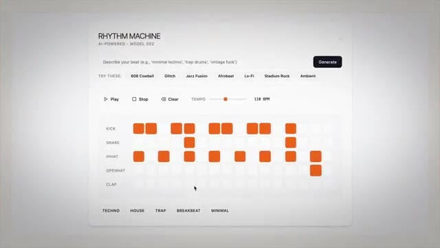
*⏱️ 00:00:10 — Interface d'une application web interactive appelée « Rhythm Machine » (modèle d'intelligence artificielle de génération de rythmes).*

---

### ⏱️ `[00:00:19 - 00:00:38]` | Segment #02

**🔊 Audio (Transcription Intégrale Mot pour Mot en Français) :**
> Laissez-moi souligner rapidement ce problème que résout le nouveau Cowork Live Artifacts, et ensuite je vais l'analyser en profondeur. Et ce problème, c'est que les artefacts statiques deviennent obsolètes très rapidement. Pour vous montrer exactement ce que je veux dire, voici ma compétence de briefing matinal qui s'exécute comme une tâche planifiée tous les matins à 8 heures.

**👁️ Analyse Visuelle d'Écran (gemini-3.5-flash-lite) :**
**Interface & Outils** : Navigateur web et application Cowork / interface de productivité.

**Contenu textuel & Code** : Titre de présentation, puces textuelles, sources d'actualités sur l'IA (GPT-6, Claude Mythos, Gemma 4, Muse Spark), calendrier et e-mails.

**Action / Démonstration** : Le présentateur introduit le problème des artefacts statiques et montre un exemple concret de briefing matinal.

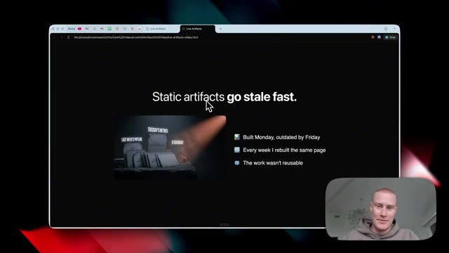
*⏱️ 00:00:24 — Présentation affichant le titre 'Static artifacts go stale fast' avec le présentateur en médaillon en bas à droite.*

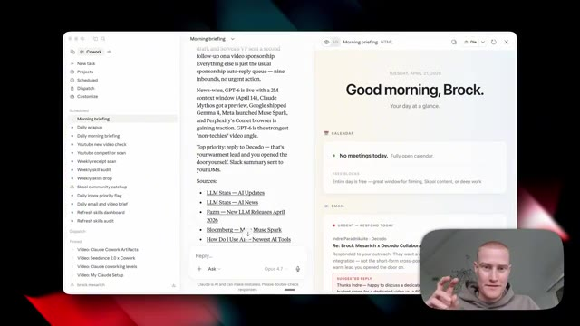
*⏱️ 00:00:33 — Interface de l'application Cowork montrant un briefing matinal avec des blocs de calendrier, des e-mails et des sources textuelles, et le présentateur en médaillon.*

---

### ⏱️ `[00:00:38 - 00:00:57]` | Segment #03

**🔊 Audio (Transcription Intégrale Mot pour Mot en Français) :**
> Il extrait automatiquement les données de mon Google Agenda et de mon adresse e-mail, puis décompose fondamentalement tous les e-mails qui nécessitent une réponse ainsi que des suggestions de réponses, et ventile même les trois principales priorités de la journée, et cela a changé la donne pour moi personnellement. Mais le gros problème avec cela, c'est qu'il s'agit d'un tableau de bord HTML statique.

**👁️ Analyse Visuelle d'Écran (gemini-3.5-flash-lite) :**
**Interface & Outils** : Application de productivité Cowork avec vue sur les e-mails et les briefings.

**Contenu textuel & Code** : Résumé des e-mails, priorités de la journée, suggestions de réponses automatiques pour chaque e-mail, sources d'actualités sur l'IA et barre de commande textuelle en bas.

**Action / Démonstration** : Présentation de l'interface et lecture des e-mails analysés par l'intelligence artificielle.

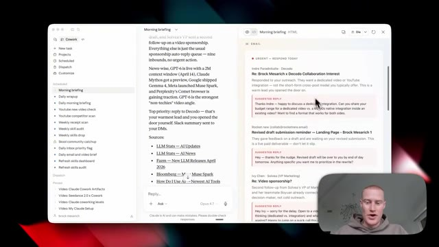
*⏱️ 00:00:42 — Capture d'écran montrant l'interface d'un outil de productivité propulsé par l'IA (Cowork) affichant un briefing matinal avec des e-mails analysés et des suggestions de réponses.*

---

### ⏱️ `[00:00:57 - 00:01:19]` | Segment #04

**🔊 Audio (Transcription Intégrale Mot pour Mot en Français) :**
> Laissez-moi donc vous expliquer dès maintenant ce que cela signifie en français simple. Cela signifie essentiellement que chaque fois que je veux que cela se mette à jour avec des informations en direct, je dois venir voir Claude et lui dire, hé, rafraîchis ces informations. Et il doit passer par là, extraire les données de mon Google Agenda. Il doit à nouveau extraire les données de mes e-mails et générer automatiquement ce tableau de bord à partir de zéro, ce qui gaspille tellement de mes jetons Claude.

**👁️ Analyse Visuelle d'Écran (gemini-3.5-flash-lite) :**
**Interface & Outils** : Application de productivité Cowork (interface web/bureau avec panneau latéral, sources d'actualités et zone de chat IA).

**Contenu textuel & Code** : Texte d'un briefing matinal sur l'intelligence artificielle (GPT-6, Claude, actualités technologiques), calendrier vide et aperçu des e-mails.

**Action / Démonstration** : Présentation de l'interface de l'application et démonstration de la zone de discussion pour rafraîchir les informations.

*⏱️ 00:01:02 — Interface de l'application Cowork affichant un briefing matinal (« Good morning, Brock ») avec des actualités sur l'IA et un panneau de discussion en bas.*

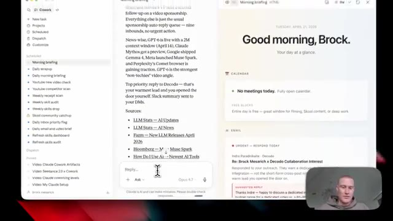
*⏱️ 00:01:08 — Gros plan sur la zone de saisie du chat (« Reply... Ask ») dans l'interface de Cowork, illustrant la zone où l'utilisateur interagit avec l'IA.*

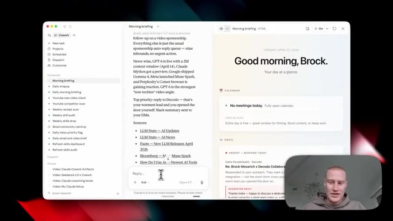
*⏱️ 00:01:14 — Vue similaire de l'application de productivité Cowork montrant le tableau de bord avec les tâches planifiées et les sources d'information.*

---

### ⏱️ `[00:01:19 - 00:01:44]` | Segment #05

**🔊 Audio (Transcription Intégrale Mot pour Mot en Français) :**
> Et vous avez probablement rencontré exactement le même problème. Eh bien, ce n'est plus un problème avec les nouveaux artefacts en direct. Ceci, juste ici, est un artefact en direct que j'ai créé en environ deux minutes et qui me donne automatiquement un résumé matinal. Il analyse donc tous les e-mails auxquels je dois répondre. Il me montre tout ce qui se trouve sur mon agenda Google pour la semaine, détaille mes principales priorités, et détaille même différentes conversations en cours que j'ai et qui nécessitent une réponse.

**👁️ Analyse Visuelle d'Écran (gemini-3.5-flash-lite) :**
**Interface & Outils** : Interface web "Claude Cowork" / Tableau de bord de gestion des e-mails.

**Contenu textuel & Code** : Statistiques des e-mails (19 nouveaux e-mails, 7 priorités, 4 réunions), widgets de résumé matinal, calendrier hebdomadaire et liste des e-mails prioritaires.
[ACCESS] Navigation et présentation du tableau de bord de résumé des e-mails par l'orateur.

**Action / Démonstration** : Explications face caméra et analyse conceptuelle des marchés.

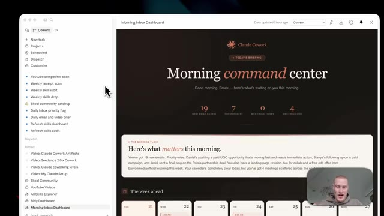
*⏱️ 00:01:26 — Vue d'ensemble du tableau de bord "Morning command center" affichant les statistiques des e-mails et les tâches prioritaires.*

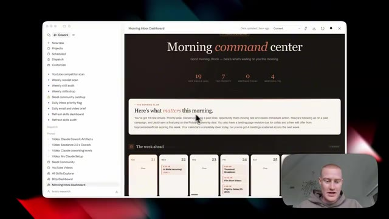
*⏱️ 00:01:32 — Défilement sur le tableau de bord montrant la section "The week ahead" avec le calendrier des réunions et des événements.*

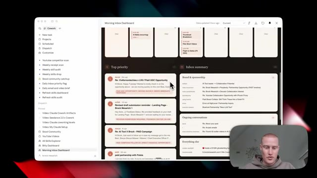
*⏱️ 00:01:38 — Vue détaillée des sections "Top priority" et "Inbox summary" classant les e-mails par catégories et priorités.*

---

### ⏱️ `[00:01:44 - 00:02:14]` | Segment #06

**🔊 Audio (Transcription Intégrale Mot pour Mot en Français) :**
> La chose clé à noter ici, c'est que lorsque je reçois un nouvel e-mail, cet artéfact en direct va automatiquement intégrer cet e-mail sans que j'aie besoin d'aller cliquer sur actualiser ou de demander à Claude d'analyser toute ma boîte de réception et de régénérer ceci. C'est pourquoi c'est une telle révolution, car nous pouvons désormais commencer à utiliser ces mini applications web au sein de Claude Cowork qui utilisent nos données provenant des différentes applications que nous utilisons, sans que nous ayons besoin d'aller créer quelque chose dans Lovable ou Replit, par exemple.

**👁️ Analyse Visuelle d'Écran (gemini-3.5-flash-lite) :**
**Interface & Outils** : Application de type tableau de bord / Claude Cowork avec panneau latéral et affichage central interactif.

**Contenu textuel & Code** : Titre « Morning command center », statistiques (« 19 NEW EMAILS », « 7 TOP PRIORITY », « 0 MEETINGS TODAY », « 4 MEETINGS (7D) »), et aperçu de la semaine à venir.

**Action / Démonstration** : Présentation et explication du fonctionnement dynamique et en direct du tableau de bord d'e-mails.

*⏱️ 00:01:52 — Capture d'écran montrant une interface de tableau de bord nommée « Morning Inbox Dashboard » avec un panneau latéral de navigation et un espace de travail central affichant des résumés d'e-mails et de planning, tandis que le présentateur apparaît en médaillon dans le coin inférieur droit.*

---

### ⏱️ `[00:02:14 - 00:02:34]` | Segment #07

**🔊 Audio (Transcription Intégrale Mot pour Mot en Français) :**
> Voici un exemple d'un autre artéfact en direct que j'ai créé qui suit automatiquement tous les liens qui suit automatiquement tous les liens dans mes descriptions pour mes vidéos YouTube, récupère à partir d'une plateforme appelée Bitly que j'ai connectée à Claude. Et je peux voir en temps réel quels liens de vidéos obtiennent des clics et combien de clics il obtient à la minute.

**👁️ Analyse Visuelle d'Écran (gemini-3.5-flash-lite) :**
**Interface & Outils** : Application Claude Cowork, interface de tableau de bord Bitly intégrée.

**Contenu textuel & Code** : Statistiques de clics en temps réel, graphiques d'évolution temporelle, métriques par pays, par source (YouTube) et par système d'exploitation (macOS), ainsi qu'un classement des liens les plus performants.

**Action / Démonstration** : Présentation et navigation dans le tableau de bord interactif des liens Bitly connectés à Claude.

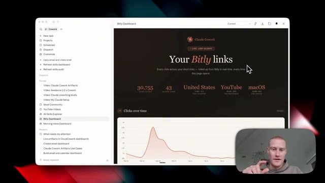
*⏱️ 00:02:19 — Capture d'écran montrant le tableau de bord Bitly (Bitly Dashboard) intégré dans Claude Cowork, affichant des statistiques globales de clics sur les liens YouTube.*

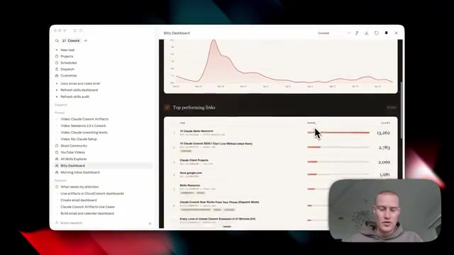
*⏱️ 00:02:29 — Capture d'écran montrant la suite du tableau de bord avec la liste des liens les plus performants (Top performing links) et leurs métriques de clics.*

---

### ⏱️ `[00:02:34 - 00:02:56]` | Segment #08

**🔊 Audio (Transcription Intégrale Mot pour Mot en Français) :**
> Donc, par exemple, je pourrais voir quel pays clique sur ces vidéos. Je pourrais voir d'où cela vient, que ce soit YouTube, Instagram, et cetera. Je pourrais voir les différents appareils que les gens utilisent pour cliquer sur ces ressources. Et tout cela provient d'un logiciel appelé Bitly que je connecte simplement à Claude. Et encore une fois, pour que cela se mette à jour avec de nouvelles informations, je n'ai pas besoin d'aller sur Claude et de lui dire de régénérer cela comme je devais le faire avant.

**👁️ Analyse Visuelle d'Écran (gemini-3.5-flash-lite) :**
**Interface & Outils** : Interface web de tableau de bord analytique (Claude Cowork / Bitly Dashboard)

**Contenu textuel & Code** : Statistiques de clics, graphiques circulaires par pays, source de trafic et OS, graphiques d'évolution temporelle et métriques agrégées.

**Action / Démonstration** : Présentation et explication des différentes métriques de suivi des liens par le présentateur.

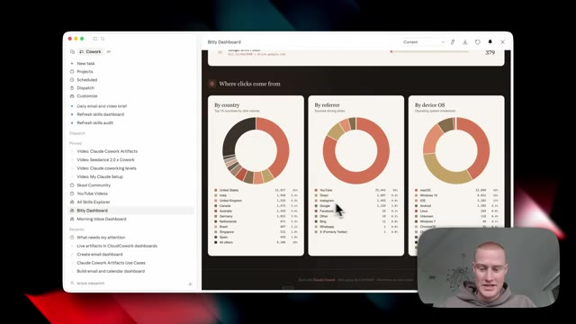
*⏱️ 00:02:40 — Dashboard analytique affichant les statistiques détaillées des clics par pays, source de trafic (referrer) et système d'exploitation des appareils.*

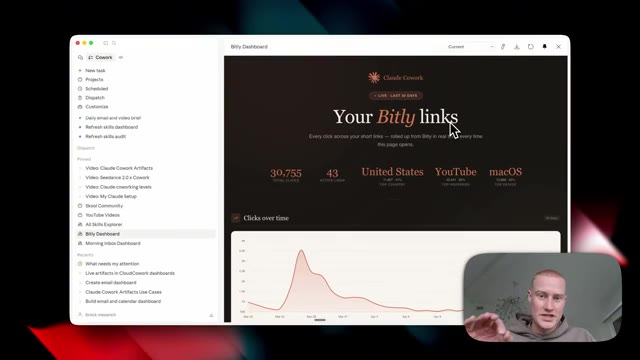
*⏱️ 00:02:45 — Vue d'ensemble du tableau de bord 'Bitly links' avec des indicateurs clés (total des clics, liens actifs, pays et appareil principaux) et un graphique temporel.*

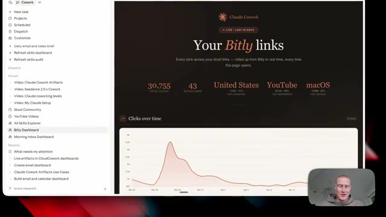
*⏱️ 00:02:51 — Suite de la vue d'ensemble du tableau de bord 'Bitly links' montrant le graphique d'évolution des clics au fil du temps.*

---

### ⏱️ `[00:02:56 - 00:03:30]` | Segment #09

**🔊 Audio (Transcription Intégrale Mot pour Mot en Français) :**
> J'avais littéralement une tâche programmée où, chaque jour à 17 heures, le système allait chercher toutes ces informations sur Bitly, régénérait tout ce tableau de bord, et honnêtement, me faisait gaspiller des tonnes de crédits. Si vous êtes sur le forfait pro à 20 dollars par mois avec Claude ou même sur le forfait max, cela va vous faire économiser tellement d'argent si vous générez des tableaux de bord HTML comme je le fais personnellement tout le temps. Tout cela est possible grâce aux artefacts en direct avec la fonction de connecteurs à l'intérieur de Claude. Et si vous n'êtes pas familiarisé avec ça, c'est fondamentalement ainsi que vous connectez vos applications à Claude, afin que vous puissiez extraire des données de votre e-mail. Vous pourriez rédiger des réponses à des e-mails.

**👁️ Analyse Visuelle d'Écran (gemini-3.5-flash-lite) :**
**Interface & Outils** : Application de bureau Claude Cowork et navigateur web affichant une interface de tableau de bord et une présentation.

**Contenu textuel & Code** : Statistiques de liens Bitly (total des clics, liens actifs, pays, source de trafic, appareil) et graphiques d'évolution temporelle.

**Action / Démonstration** : Présentation et explication du fonctionnement des tableaux de bord automatisés et des artefacts dynamiques.

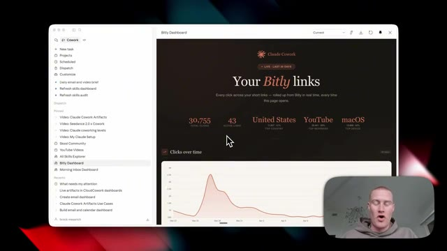
*⏱️ 00:03:05 — Capture d'écran montrant le tableau de bord Bitly (Claude Cowork) avec des statistiques de clics et un graphique temporel.*

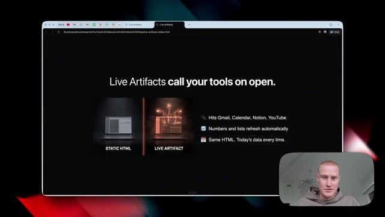
*⏱️ 00:03:22 — Diapositive de présentation illustrant le concept de "Live Artifacts" comparant le HTML statique aux artefacts dynamiques.*

---

### ⏱️ `[00:03:30 - 00:03:51]` | Segment #10

**🔊 Audio (Transcription Intégrale Mot pour Mot en Français) :**
> Vous pouvez extraire des données de votre agenda Google et fondamentalement faire différentes choses à travers ces applications en ayant accès à cela via ces connecteurs. Ceci ici même est un visuel parfait de ce dont je parle. Nous avons Gmail, Agenda, Notion, HubSpot, toutes ces différentes applications que nous utilisons connectées à Claude. Et cela génère en fait ces artefacts en direct, en temps réel, alors que nous ne sommes même pas sur notre ordinateur.

**👁️ Analyse Visuelle d'Écran (gemini-3.5-flash-lite) :**
**Interface & Outils** : Navigateur web affichant une page de présentation de type slide avec une incrustation vidéo du présentateur en bas à droite.

**Contenu textuel & Code** : Titre 'Live Artifacts call your tools on open', comparaison entre 'STATIC HTML' et 'LIVE ARTIFACT', ainsi qu'une liste d'intégrations (Gmail, Calendar, Notion, YouTube).

**Action / Démonstration** : Le présentateur explique visuellement comment les artefacts en direct se connectent à différents outils et applications.

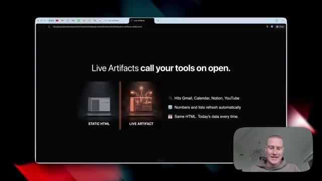
*⏱️ 00:03:35 — Capture d'écran montrant une présentation web sur le thème des 'Live Artifacts', illustrant l'intégration avec différents outils.*

---

### ⏱️ `[00:03:51 - 00:04:10]` | Segment #11

**🔊 Audio (Transcription Intégrale Mot pour Mot en Français) :**
> Laissez-moi maintenant vous montrer exactement comment vous pouvez commencer à utiliser ceci dès maintenant et exactement comment cela fonctionne. Tout d'abord, assurez-vous d'avoir téléchargé l'application de bureau Claude. Vous ne pourrez pas y accéder à moins d'être dans l'application de bureau. Donc, si vous ne l'avez pas téléchargée, il y a un lien dans la description pour le faire. Une fois que nous aurons téléchargé l'application de bureau et que nous l'aurons ouverte, nous verrons cette interface ici même.

**👁️ Analyse Visuelle d'Écran (gemini-3.5-flash-lite) :**
**Interface & Outils** : Navigateur web affichant le site claude.com et application de bureau Claude.

**Contenu textuel & Code** : Page de téléchargement de l'application Claude et interface de chat de bureau avec options de saisie.

**Action / Démonstration** : Présentation du site de téléchargement de Claude puis affichage de l'application de bureau installée.

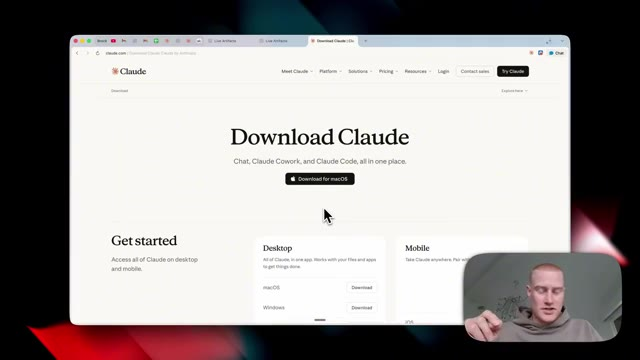
*⏱️ 00:03:56 — Page web officielle de téléchargement de Claude affichant le bouton pour macOS et les options pour ordinateur et mobile.*

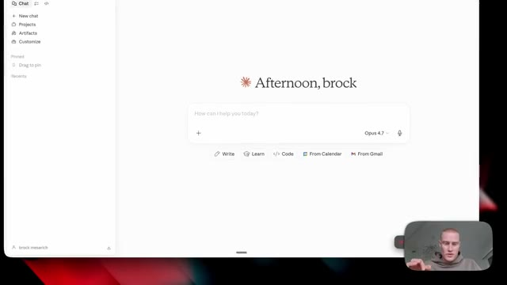
*⏱️ 00:04:05 — Interface principale de l'application de bureau Claude affichant le message d'accueil et la barre de saisie pour démarrer une conversation.*

---

### ⏱️ `[00:04:10 - 00:04:46]` | Segment #12

**🔊 Audio (Transcription Intégrale Mot pour Mot en Français) :**
> ils ont récemment redessiné ceci. Donc, afin d'accéder au mode co-travail, qui est l'endroit où nous devons être pour essayer ceci, nous devons venir ici et activer ce bouton de co-travail. Il a cette petite liste de tâches, cette sorte de liste de contrôle. Donc, cliquez dessus et nous allons voir cette interface. Nous devons nous assurer de sélectionner le dossier de travail de notre choix que nous voulons ajouter. Donc, si vous n'en avez pas déjà un, vous pouvez venir ici et créer un dossier différent. C'est fondamentalement là que vos projets et tous vos tableaux de bord HTML et vos fichiers vont être stockés sur votre ordinateur. Ensuite, si vous faites défiler vers le bas juste ici sur la barre latérale gauche, j'ai personnellement ces différents artefacts que

**👁️ Analyse Visuelle d'Écran (gemini-3.5-flash-lite) :**
**Interface & Outils** : Interface de l'application Claude / Bureau virtuel.

**Contenu textuel & Code** : Menu de co-travail, liste de tâches programmées (Scheduled, Dispatch, Pinned) et sélection de dossiers de projets (Claude Code Short System, Obsidian, Receipts, etc.).

**Action / Démonstration** : Navigation dans l'interface de co-travail, clic sur le bouton Cowork et sélection d'un dossier de projet.

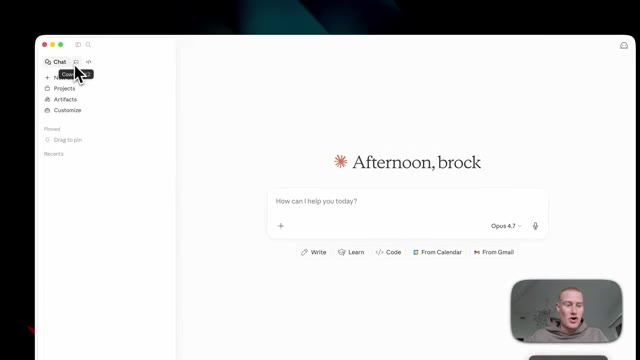
*⏱️ 00:04:19 — Interface principale montrant le menu latéral avec le curseur sur le bouton de co-travail (Cowork).*

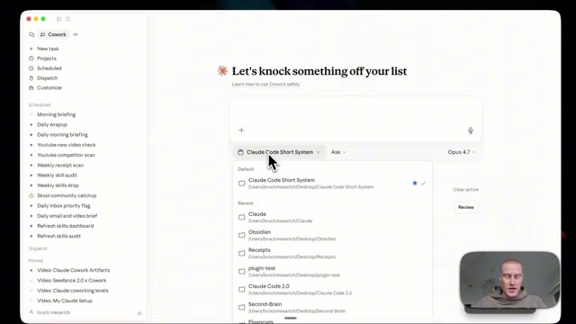
*⏱️ 00:04:28 — Interface de co-travail active avec le menu déroulant affichant les dossiers de projets disponibles.*

*⏱️ 00:04:37 — Interface de co-travail affichant la liste des tâches actives et planifiées.*

---

### ⏱️ `[00:04:46 - 00:05:20]` | Segment #13

**🔊 Audio (Transcription Intégrale Mot pour Mot en Français) :**
> sont stockés directement ici même. Et c'est l'une des meilleures choses à ce sujet parce qu'une fois que nous générons un artéfact en direct, nous pouvons toujours y accéder dans la barre latérale. Nous n'avons donc pas besoin de chercher dans toutes nos conversations pour comprendre où se trouve ce tableau de bord HTML spécifique. Cela va honnêtement être un gain de temps considérable. J'ai donc ceux-ci juste ici. Par exemple, j'ai celui-ci d'ouvert. Ce sont toutes mes différentes compétences Claude que j'utilise, un total de 237 ici dans co-work et littéralement à chaque fois que je génère une nouvelle compétence, cela va se remplir automatiquement sans que j'aie besoin d'aller demander à Claude de mettre à jour et de balayer tous mes

**👁️ Analyse Visuelle d'Écran (gemini-3.5-flash-lite) :**
**Interface & Outils** : Interface logicielle Cowork (application de gestion de tâches et d'IA collaborative)

**Contenu textuel & Code** : Barre latérale de navigation avec des projets épinglés, zone de saisie centrale, et grille de modules/compétences (skills) sous forme de cartes.

**Action / Démonstration** : Navigation dans l'interface de l'application Cowork et survol de la section 'All Skills Explorer' avec le curseur de la souris.

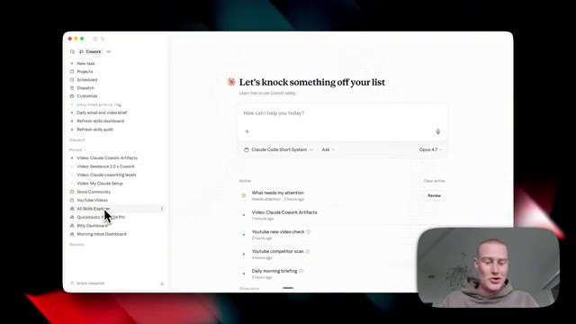
*⏱️ 00:04:54 — Interface principale de l'application Cowork montrant le tableau de bord avec une barre latérale à gauche listant les tâches et projets, et la webcam du présentateur en bas à droite.*

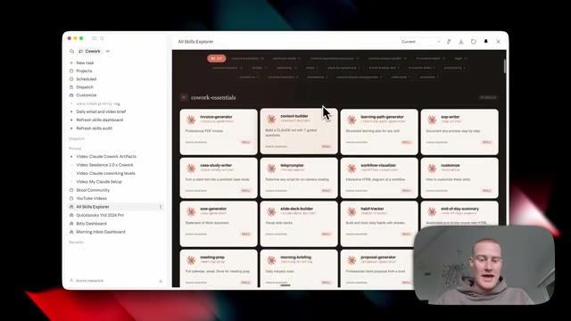
*⏱️ 00:05:11 — Vue de l'explorateur de compétences (All Skills Explorer) dans l'application Cowork, affichant une grille de cartes interactives (invoice-generator, context-builder, sop-writer, etc.).*

---

### ⏱️ `[00:05:20 - 00:05:56]` | Segment #14

**🔊 Audio (Transcription Intégrale Mot pour Mot en Français) :**
> différentes compétences et met cela à jour quotidiennement. Ensuite, vous pouvez voir que j'ai mon tableau de bord bit.ly ici que je vous ai déjà montré plus tôt dans cette vidéo et ensuite j'ai mon tableau de bord de boîte de réception du matin également et si je clique dessus, cela prendra juste quelques secondes et il se remplira automatiquement avec toutes ces informations ici. Donc vous vous demandez probablement comment je crée ces artefacts en direct, alors voici comment vous le faites dès maintenant. Vous allez simplement venir sur nouvelle tâche. Et par exemple, je vais juste dire, hé, crée-moi un tableau de bord qui catégorise automatiquement tous mes différents emails avec ceux auxquels je dois répondre. Et ensuite, décompose également toutes les différentes réunions que j'ai dans Google Calendar. En plus de cela, pouvez-vous également ajouter différentes informations de suivi bit.ly pour que je puisse

**👁️ Analyse Visuelle d'Écran (gemini-3.5-flash-lite) :**
**Interface & Outils** : Interface de type application de productivité / tableau de bord personnel (« Claude Cowork »).

**Contenu textuel & Code** : Tableaux de bord de productivité, statistiques de la semaine, calendrier hebdomadaire et liste de tâches en cours (« What needs my attention », « Video: Claude Cowork Artifacts », etc.).

**Action / Démonstration** : Navigation et présentation des différents tableaux de bord et outils de gestion quotidienne par le présentateur.

---

### ⏱️ `[00:05:56 - 00:06:20]` | Segment #15

**🔊 Audio (Transcription Intégrale Mot pour Mot en Français) :**
> voir quels liens de vidéo obtiennent la majorité des clics. Je veux que ce soit mon système d'exploitation quotidien. Je ne veux donc plus jamais avoir à parcourir manuellement ces différentes applications. Je pourrais simplement regarder ce tableau de bord et faire en sorte qu'il devienne mon principal système d'exploitation quotidien. Je lui donne donc ce déversement de cerveau sur le moment. J'utilise simplement Whisperflow pour parler à mon ordinateur et déverser automatiquement tout cela dans Claude. Et à partir de là, ce qu'il va faire, c'est quelques choses différentes.

**👁️ Analyse Visuelle d'Écran (gemini-3.5-flash-lite) :**
**Interface & Outils** : Application Cowork sur macOS, interface de tableau de bord de productivité propulsée par IA.

**Contenu textuel & Code** : Texte du prompt utilisateur : "Hey, create me a dashboard that: automatically categorizes all of my different emails... breaks down all the different meetings... adds different Bitly tracking information so I could see which video links are getting the majority of clicks..."

**Action / Démonstration** : Saisie et envoi d'un prompt complexe à l'assistant IA pour automatiser la création d'un système d'exploitation quotidien unifié.

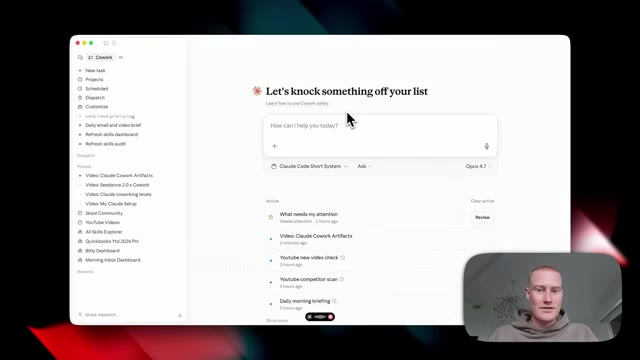
*⏱️ 00:06:02 — Interface principale de l'application Cowork montrant le tableau de bord avec une barre de recherche textuelle et des listes de tâches actives.*

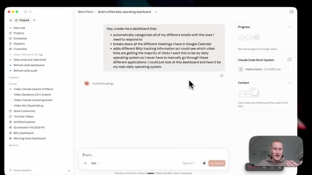
*⏱️ 00:06:14 — Interface de Cowork affichant un prompt textuel détaillé demandant la création d'un tableau de bord opérationnel unifié.*

---

### ⏱️ `[00:06:20 - 00:06:53]` | Segment #16

**🔊 Audio (Transcription Intégrale Mot pour Mot en Français) :**
> Ça va extraire de mon Gmail en utilisant des connecteurs, que je vais vous montrer comment connecter tout de suite. Ça va extraire de mon Google Agenda et ça va automatiquement extraire de Bitly afin de voir toutes ces informations différentes. Avant cela, je devais aller sur le site Web de Bitly et récupérer tous ces liens différents, faire défiler tous ces liens, voir quel est le niveau d'engagement. Je devais cliquer dessus individuellement pour voir ces différentes données. Donc maintenant, avec cette nouvelle fonction des artéfacts en direct, cela va automatiquement alimenter mon tableau de bord du système d'exploitation quotidien que je n'ai pas besoin d'actualiser sans cesse et de gaspiller des jetons. Très bien.

**👁️ Analyse Visuelle d'Écran (gemini-3.5-flash-lite) :**
**Interface & Outils** : Navigateur web affichant l'application Bitly (app.bitly.com) et interface de l'outil de productivité IA.

**Contenu textuel & Code** : Liens Bitly suivis (ex: "Claude Code 2.0 + Opus 4.7"), métriques d'engagement (347 engagements), codes QR associés.

**Action / Démonstration** : Navigation dans l'interface de Bitly pour consulter les performances et statistiques des différents liens de suivi.

*⏱️ 00:06:36 — Interface du tableau de bord Bitly affichant la liste des liens raccourcis avec leurs statistiques d'engagement et dates.*

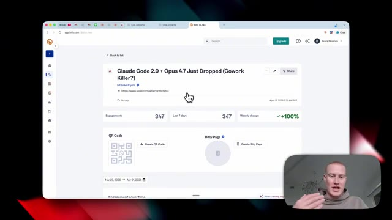
*⏱️ 00:06:44 — Vue détaillée d'un lien spécifique sur Bitly montrant les métriques d'engagement (347 clics, +100% de variation hebdomadaire).*

---

### ⏱️ `[00:06:53 - 00:07:28]` | Segment #17

**🔊 Audio (Transcription Intégrale Mot pour Mot en Français) :**
> Et comme par magie, deux minutes plus tard, nous avons maintenant notre centre de commandement quotidien qui est généré. Et je tiens à mentionner que c'est dans le style que j'ai demandé à Claude d'utiliser toujours pour générer ces tableaux de bord. Vous pouvez voir que c'est dans le thème de style d'Anthropic. C'est parce que je l'ai configuré personnellement ainsi. J'aime tout simplement beaucoup ce design, mais vous pouvez en faire le design que vous voulez. Nous avons maintenant notre tri de boîte de réception qui montre tous nos e-mails importants juste ici. Vous pouvez voir ceux qui sont urgents par rapport à ceux qui peuvent attendre. C'est plutôt cool. Nous avons tout sur notre calendrier parce qu'il extrait les données de notre Google Agenda et il montre même la performance de nos liens via Bitly. Ainsi, je peux voir quelles vidéos sont

**👁️ Analyse Visuelle d'Écran (gemini-3.5-flash-lite) :**
**Interface & Outils** : Interface de l'application Claude Cowork / Claude Artifacts avec un affichage en écran partagé.

**Contenu textuel & Code** : Tableau de bord 'Daily Operating System' affichant des métriques d'e-mails, de calendrier et de liens (Bitly), ainsi qu'une interface de chat interactive.

**Action / Démonstration** : Navigation et présentation du centre de commandement quotidien généré automatiquement par l'IA.

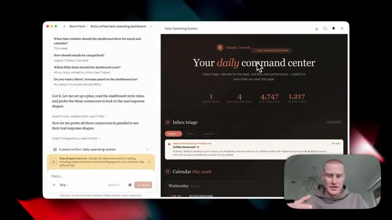
*⏱️ 00:07:01 — Interface divisée en deux montrant le chat de Claude à gauche et le tableau de bord 'Daily Operating System' généré à droite avec des métriques.*

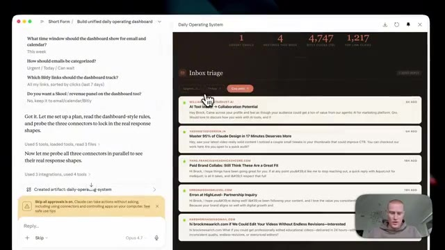
*⏱️ 00:07:19 — Vue rapprochée de la section 'Inbox triage' du tableau de bord avec une liste d'e-mails catégorisés dans l'interface de Claude.*

---

### ⏱️ `[00:07:28 - 00:07:56]` | Segment #18

**🔊 Audio (Transcription Intégrale Mot pour Mot en Français) :**
> qui génère le plus de trafic vers ma communauté scolaire. Je pourrais donc recréer des vidéos similaires. C'est maintenant mon système d'exploitation quotidien que j'ai généré en environ deux minutes et qui se met à jour automatiquement sans que j'aie besoin de l'actualiser. Tout cela est formidable, pouvoir générer des artefacts en direct, mais il n'y a honnêtement aucun intérêt à pouvoir faire cela à moins de puiser dans nos véritables informations provenant de toutes nos applications. Voici donc exactement comment nous configurons cela en quelques étapes simples. Nous allons donc nous rendre sur la barre latérale de gauche et cliquer sur personnaliser.

**👁️ Analyse Visuelle d'Écran (gemini-3.5-flash-lite) :**
**Interface & Outils** : Interface web de Claude Cowork / application de tableau de bord personnel.

**Contenu textuel & Code** : Tableau de bord opérationnel personnalisé affichant des métriques d'e-mails, de calendrier et de performances de liens Bitly, ainsi qu'une barre latérale listant des scripts de suivi automatisés.

**Action / Démonstration** : Présentation du système d'exploitation quotidien automatisé généré par l'IA et de son interface de pilotage.

*⏱️ 00:07:35 — Interface de Claude Cowork affichant le tableau de bord quotidien « Your daily command center » avec des métriques de clics et un volet de discussion contextuel sur la gauche.*

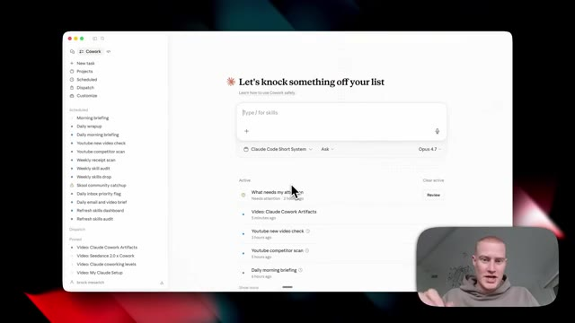
*⏱️ 00:07:42 — Interface de gestion de tâches et de compétences « Cowork » avec un champ de saisie de commandes et la liste des tâches actives (Morning briefing, YouTube competitor scan, etc.).*

---

### ⏱️ `[00:07:56 - 00:08:24]` | Segment #19

**🔊 Audio (Transcription Intégrale Mot pour Mot en Français) :**
> Si nous ne voyons pas cette barre latérale, assurez-vous d'ouvrir cette petite icône juste ici, et ensuite nous verrons « personnaliser » juste sous « dispatch ». Et puis à partir d'ici, nous cliquons sur « connecteurs », qui se trouve en dessous des compétences. Et ici, nous pouvons ajouter nos différentes applications. Vous pouvez voir que j'en ai configuré quelques-unes différentes ici. Nous viendrions simplement ici, en cliquant sur « parcourir les connecteurs », et nous pourrions aller de l'avant et ajouter tous ces différents éléments. Laissez-moi simplement ajouter Google Drive, par exemple. Tout ce que j'ai à faire est de cliquer sur « continuer » pour accorder l'accès ici. Et puis juste comme ça, vous pouvez maintenant voir que Google Drive est connecté.

**👁️ Analyse Visuelle d'Écran (gemini-3.5-flash-lite) :**
**Interface & Outils** : Interface de configuration/personnalisation de l'outil d'IA et navigateur web.

**Contenu textuel & Code** : Liste des applications connectables et options de configuration des permissions d'outils.

**Action / Démonstration** : Navigation dans les menus de personnalisation et sélection des connecteurs.

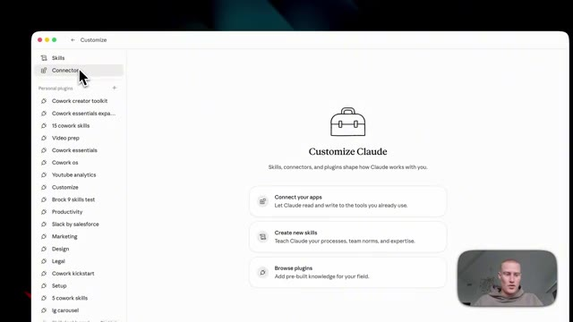
*⏱️ 00:08:03 — Vue principale de l'interface de personnalisation montrant la section des connecteurs et des compétences.*

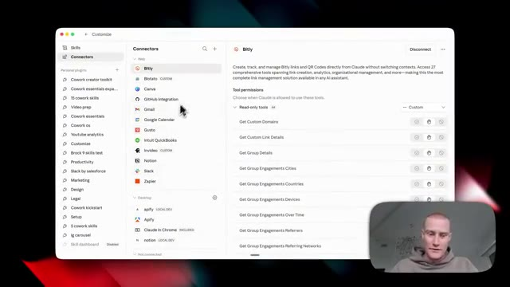
*⏱️ 00:08:10 — Liste détaillée des connecteurs disponibles (Bitly, Canva, GitHub, Gmail, Notion, etc.) avec leurs permissions.*

---

### ⏱️ `[00:08:24 - 00:08:42]` | Segment #20

**🔊 Audio (Transcription Intégrale Mot pour Mot en Français) :**
> donc je pourrais commencer à extraire des informations de là. Et ensuite, je pourrais même faire en sorte que Cowork importe des choses pour moi sur Google Drive en pilote automatique. Maintenant, disons que vous parcourez toute cette liste sur Claude et qu'il y a ici une application à laquelle vous voulez vous connecter qui n'est pas incluse ici et qui ne se connecte pas de manière native. Si vous voulez faire cela, vous pourriez utiliser quelque chose appelé un serveur MCP. Laissez-moi donc vous montrer comment configurer cela maintenant.

**👁️ Analyse Visuelle d'Écran (gemini-3.5-flash-lite) :**
**Interface & Outils** : Application de gestion de connecteurs et d'intégrations (style tableau de bord de configuration d'IA).

**Contenu textuel & Code** : Liste des connecteurs web et bureau (Google Drive, Notion, Slack, Zoom, Canva, Microsoft 365, etc.) avec leurs permissions de lecture et d'écriture.

**Action / Démonstration** : Navigation et présentation des différents connecteurs et outils d'intégration disponibles pour automatiser les tâches avec l'IA.

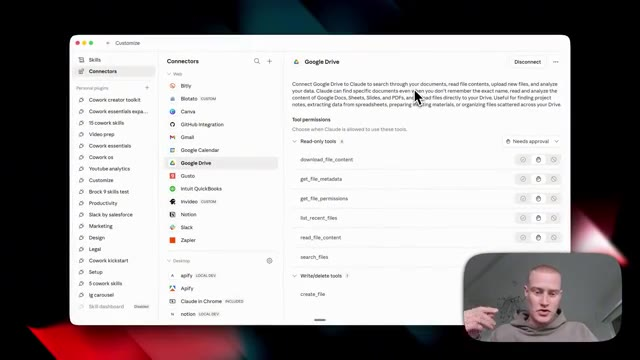
*⏱️ 00:08:28 — Interface des connecteurs avec Google Drive sélectionné, affichant les autorisations d'outils et de fichiers.*

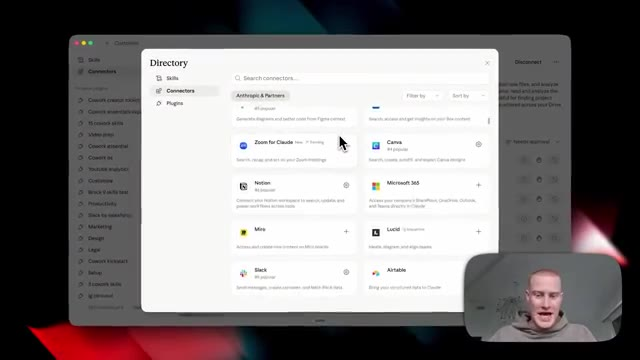
*⏱️ 00:08:33 — Fenêtre modale du répertoire affichant une liste d'intégrations logicielles disponibles comme Zoom, Canva, Notion et Slack.*

---

### ⏱️ `[00:08:42 - 00:09:18]` | Segment #21

**🔊 Audio (Transcription Intégrale Mot pour Mot en Français) :**
> Personnellement, j'utilise un outil appelé Zapier MCP. Il vous permet de vous connecter à plus de 9 000 applications différentes. Et un point essentiel que je tiens à mentionner ici, c'est que vous n'êtes pas obligé de l'utiliser. Utilisez-le simplement s'il y a une application spécifique que vous voulez utiliser et que vous ne pouvez pas connecter directement à l'intérieur de Claude. Une fois que nous sommes dans Zapier MCP, nous allons simplement cliquer sur ajouter un nouveau serveur MCP. Et les gars, ça prend environ 30 secondes. Laissez-moi donc vous expliquer cela simplement. Vous allez venir sur Cowork comme notre client. Et juste ici, j'ai déjà quelques applications différentes configurées. Donc si vous voulez connecter différentes applications, vous cliquez simplement sur ajouter des outils, vous recherchez l'un des outils que vous voulez ajouter, vous les configurez ici. Et ensuite, une fois que vous voulez connecter cela à votre Claude, vous cliquez simplement

**👁️ Analyse Visuelle d'Écran (gemini-3.5-flash-lite) :**
**Interface & Outils** : Navigateur Web affichant l'application Zapier MCP et l'interface de configuration des serveurs MCP.

**Contenu textuel & Code** : Liste des clients MCP compatibles (Claude, ChatGPT, Cursor, Gemini CLI, etc.) et intégrations d'applications tierces (Stripe, HubSpot, Google Drive).

**Action / Démonstration** : Navigation sur la page d'accueil de Zapier MCP, sélection d'un client dans la modale de configuration et affichage des outils connectés au serveur MCP.

*⏱️ 00:08:51 — Page d'accueil du site Web de Zapier MCP présentant le slogan « Your AI can talk. Zapier MCP makes it act. » avec un encart vidéo du présentateur en bas à droite.*

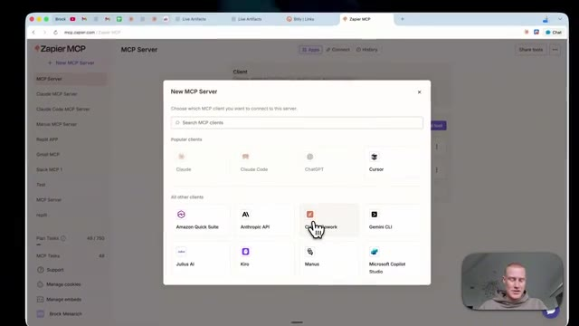
*⏱️ 00:09:00 — Fenêtre modale de sélection d'un client MCP sur l'interface de Zapier MCP montrant plusieurs clients populaires comme Claude, Claude Code, ChatGPT et Cursor.*

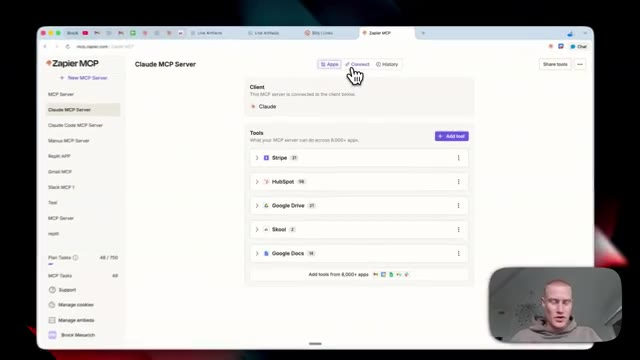
*⏱️ 00:09:09 — Tableau de bord du serveur Claude MCP sur Zapier affichant la liste des outils connectés tels que Stripe, HubSpot, Google Drive, Skool et Google Docs.*

---

### ⏱️ `[00:09:18 - 00:09:37]` | Segment #22

**🔊 Audio (Transcription Intégrale Mot pour Mot en Français) :**
> On clique sur connecter, puis sur ajouter à Claude. Ça va vous ramener directement ici sur Claude. Assurez-vous simplement de connecter Zapier. Et une fois que c'est connecté, vous devriez voir Zapier juste ici. Et nous pourrons commencer à utiliser n'importe lequel de ces outils que nous avons configurés à l'intérieur de ce serveur. Ensuite, pour voir tous les artefacts en direct que vous avez créés sur la barre latérale de gauche, vous devriez les voir juste ici.

**👁️ Analyse Visuelle d'Écran (gemini-3.5-flash-lite) :**
**Interface & Outils** : Interface web de Claude / Cowork et panneau de configuration des connecteurs.

**Contenu textuel & Code** : Intégrations d'applications (Zapier, Google Docs, Google Drive, HubSpot) et paramètres de permissions de l'assistant IA.
[Candidat sélectionné] Navigation dans l'interface de configuration des connecteurs tiers et retour à l'espace de travail principal.

**Action / Démonstration** : Explications face caméra et analyse conceptuelle des marchés.

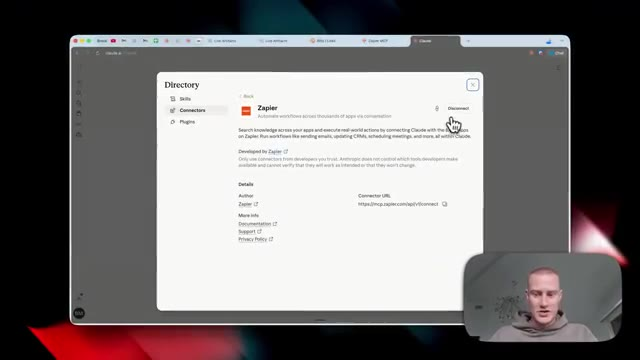
*⏱️ 00:09:23 — Vue d'une fenêtre de navigateur affichant l'annuaire des connecteurs de Claude avec l'intégration Zapier sélectionnée.*

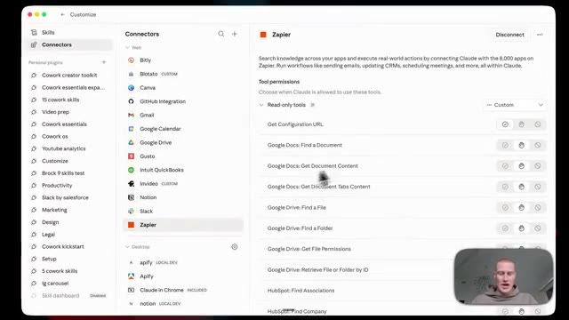
*⏱️ 00:09:28 — Interface de configuration montrant les permissions des outils Zapier connectés, avec une liste d'applications associées.*

*⏱️ 00:09:32 — Interface principale de Cowork (Claude) affichant le champ de saisie de texte et la liste des tâches actives récentes.*

---

### ⏱️ `[00:09:37 - 00:09:56]` | Segment #23

**🔊 Audio (Transcription Intégrale Mot pour Mot en Français) :**
> Vous pouvez voir évidemment mon système d'exploitation quotidien que je vous ai montré. Et puis aussi, il y a un bouton ici en haut où vous pouvez cliquer sur "artefacts en direct". Et cela montre tous les différents artefacts que vous avez créés, ainsi que vous pouvez cliquer sur "nouvel artefact" et en créer un à partir d'ici. Et cela ajoute même ces différents invites ici pour vous donner des idées d'artefacts en direct spécifiques que vous pouvez créer.

**👁️ Analyse Visuelle d'Écran (gemini-3.5-flash-lite) :**
**Interface & Outils** : Interface web de Claude Cowork (système d'exploitation quotidien).

**Contenu textuel & Code** : Tableaux de bord, listes d'artefacts en direct, métriques de productivité et de marketing (e-mails, réunions, clics).

**Action / Démonstration** : Navigation dans l'interface de Claude Cowork pour présenter le centre de commande et les artefacts dynamiques.

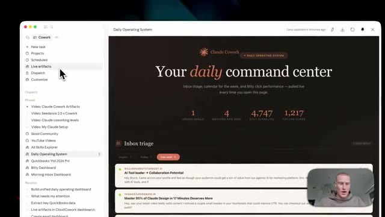
*⏱️ 00:09:42 — Vue du tableau de bord "Daily Operating System" dans Claude Cowork, montrant les e-mails urgents, réunions et clics Bitly.*

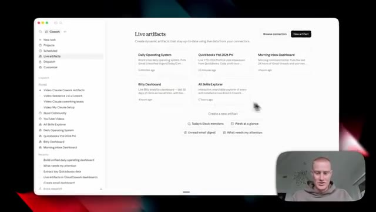
*⏱️ 00:09:46 — Vue de la section "Live artifacts" montrant les différents artefacts créés (Daily Operating System, QuickBooks, Bitly Dashboard, etc.) et le bouton "New artifact".*

---

### ⏱️ `[00:09:56 - 00:10:21]` | Segment #24

**🔊 Audio (Transcription Intégrale Mot pour Mot en Français) :**
> Donc par exemple, celui-ci juste ici indique ce qui nécessite mon attention. Vous cliquez dessus, cela va alors générer cet artefact dynamique et ils résident tous fondamentalement sur la barre latérale de gauche à laquelle vous pouvez accéder à tout moment. Si vous voulez approfondir encore plus Claude et Claude Cowork et spécifiquement les artefacts dynamiques, vous pouvez rejoindre ma communauté School. Il y a un lien dans la description pour le faire, je vais publier un guide complet sur exactement comment utiliser et exploiter les artefacts, ainsi qu'à partager différents cas d'usage que je trouve pour cela dans ma communauté.

**👁️ Analyse Visuelle d'Écran (gemini-3.5-flash-lite) :**
**Interface & Outils** : Application de type interface utilisateur IA (Claude Cowork) et plateforme communautaire Skool.

**Contenu textuel & Code** : Liste d'artefacts récents dans la barre latérale ("What needs my attention", "Build unified daily operating dashboard", etc.) et invite textuelle principale en cours de traitement.

**Action / Démonstration** : Navigation et démonstration de l'interface des artefacts dynamiques et de la barre latérale gauche.

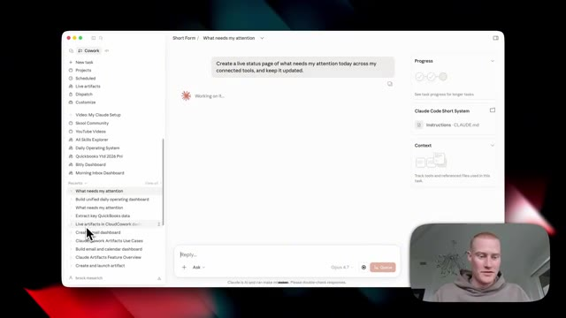
*⏱️ 00:10:02 — Interface d'une application avec une barre latérale à gauche affichant l'historique des artefacts et un panneau central montrant une requête active de type tableau de bord.*

---

### ⏱️ `[00:10:22 - 00:10:31]` | Segment #25

**🔊 Audio (Transcription Intégrale Mot pour Mot en Français) :**
> Cela étant dit, si vous voulez plus de contenu gratuit comme celui-ci, abonnez-vous à cette chaîne. Je couvre tous les sujets liés à l'IA pour les non-techniciens. Et cela étant dit, les gars, merci beaucoup d'être restés jusqu'à la fin et je vous vois dans la prochaine vidéo.

**👁️ Analyse Visuelle d'Écran (gemini-3.5-flash-lite) :**
**Interface & Outils** : Navigateur web affichant la plateforme Skool et la chaîne YouTube de Brock Mesarich.

**Contenu textuel & Code** : Interface de communauté en ligne avec des publications de discussions ("Claude Cowork Live Artifacts Just Dropped") et liste de vidéos YouTube sur l'IA (Claude Cowork, automatisation).

**Action / Démonstration** : Navigation et présentation de la communauté Skool et de la chaîne YouTube pour encourager les spectateurs à s'abonner.

---

