# 🎬 5 Insane Claude Cowork Live Artifacts Use Cases (steal them)

> **Chaîne** : [Brock Mesarich | AI for Non Techies](https://www.youtube.com/@BrockMesarich)  
> **Lien YouTube** : [https://www.youtube.com/watch?v=CwvqbHREnYQ](https://www.youtube.com/watch?v=CwvqbHREnYQ)  
> **Date de publication** : 20260423  
> **Durée** : 00:16:20  
> **Identifiant vidéo** : `CwvqbHREnYQ`  
> **Transcription & Analyse** : `whisper-v3-large-turbo+gemini-3.5-flash-lite`  

---

## 📌 Synthèse Exécutive & Outils

### 💡 Résumé
Anthropic redéfinit l'interaction homme-machine avec le lancement de Claude Cowork Live Artifacts, une avancée majeure qui fait basculer l'écosystème technologique dans l'ère des logiciels sur mesure générés à la demande. Dans cette vidéo, Brock Mesarich décortique ce nouveau paradigme où les utilisateurs n'ont plus besoin de jongler entre des dizaines d'applications tierces (Gmail, Google Calendar, Stripe, Bitly). À la place, Claude agit comme un véritable système d'exploitation centralisé capable de concevoir des tableaux de bord dynamiques et vivants, actualisés en temps réel grâce à des connecteurs natifs. 

L'analogie centrale repose sur le concept d'artefacts dynamiques : des interfaces graphiques interactives stockées dans la barre latérale gauche de Claude, persistantes et auto-alimentées. La démonstration s'articule autour de deux cas d'usage puissants et immédiatement reproductibles. D'une part, le « centre de commande matinal » synthétise en un clin d'œil les e-mails non lus classés par urgence (partenariats, newsletters, urgences), le planning de la semaine en cours et les performances de liens trackés via Bitly. D'autre part, le tableau de bord des revenus Stripe combine l'extraction de données financières en direct (solde disponible, revenus récents, valeur vie client, concentration des contrats de marque) et une couche de « vibe coding » personnalisé permettant de suivre manuellement les factures impayées et les créances.

Cette approche révolutionne l'efficacité opérationnelle des professionnels, des entrepreneurs et des traders en éliminant la friction de la navigation multi-plateforme. En combinant la puissance de calcul d'Anthropic, le prompt engineering avancé et l'intégration d'API en temps réel, Claude Cowork permet de prototyper et déployer des applications métiers complexes en quelques minutes, tout en conservant un historique de version granulaire pour itérer sans risque sur le design et les fonctionnalités.

### 🛠️ Outils, Modèles & Logiciels Présentés
* **Claude / Claude Cowork** : Modèle d'intelligence artificielle et environnement de travail d'Anthropic intégrant les Live Artifacts et des connecteurs en temps réel pour générer des logiciels personnalisés à la demande.
* **ChatGPT** : Modèle conversationnel d'OpenAI, mentionné dans le paysage concurrentiel de l'IA générative.
* **Gemini** : Assistant IA de Google, évoqué parmi les solutions alternatives du marché.
* **Grok** : Modèle d'intelligence artificielle développé par xAI, cité dans l'écosystème global des LLM.
* **n8n** : Plateforme d'automatisation de flux de travail (workflow automation) open-source et auto-hégeable pour connecter des applications entre elles.
* **Make** : Outil d'intégration et d'automatisation No-Code (anciennement Integromat) permettant de lier des services cloud.
* **Zapier** : Solution pionnière d'automatisation et de connectivité inter-applications.
* **Stripe** : Passerelle de paiement en ligne utilisée pour l'extraction de données financières, le suivi des abonnés et la gestion des flux transactionnels.
* **Gmail** : Service de messagerie de Google connecté pour l'analyse, le résumé et la catégorisation intelligente des e-mails entrants.
* **Google Calendar** : Outil de gestion d'agenda synchronisé pour afficher en temps réel les événements et la charge de travail à venir.
* **Bitly** : Service de gestion et de raccourcissement de liens, utilisé ici pour tracker les taux de clics et l'engagement sur les vidéos YouTube.

### 🔑 Points Clés & Enseignements Stratégiques
* **Avénement des logiciels à la demande** : Rupture avec le modèle traditionnel des applications cloisonnées (SaaS multiples) au profit d'une interface unifiée et auto-construite par l'IA selon les besoins précis de l'utilisateur.
* **Architecture des Live Artifacts** : Tableaux de bord dynamiques et persistants, accessibles instantanément via la barre latérale gauche de Claude, qui s'actualisent en continu sans nécessiter de rafraîchissement manuel.
* **Centre de commande matinal automatisé** : Regroupement synthétique (TLDR) des e-mails manqués et du calendrier Google, permettant un gain de temps cognitif considérable dès le début de la journée de travail.
* **Catégorisation intelligente des flux de communication** : Tri automatisé de la boîte de réception par l'IA pour isoler immédiatement les opportunités de partenariats, les parrainages et les conversations prioritaires.
* **Monitoring analytique cross-canal** : Intégration transparente de métriques externes (comme les clics Bitly sur les ressources YouTube) directement au sein du tableau de bord quotidien pour un suivi sans friction.
* **Extraction de données financières en temps réel** : Connexion native à Stripe pour visualiser instantanément le solde disponible, les revenus récents, la valeur vie client (LTV) et les abonnés actifs récurrents.
* **Enrichissement applicatif par « Vibe Coding »** : Capacité à coder intuitivement par-dessus les données brutes extraites d'une API (comme l'ajout d'un module de suivi manuel pour les factures impayées et les créances clients sur Stripe).
* **Sécurité et utilisation de comptes de test** : Méthodologie rigoureuse consistant à utiliser des environnements sandbox ou de test (comme sur Stripe) pour concevoir et démontrer des tableaux de bord sans exposer de données financières sensibles ou réelles.
* **Gestion de versions et itération visuelle** : Utilisation de l'historique des versions des artefacts pour revenir à une itération antérieure en cas de modification non souhaitée lors de la phase de design ou de codage.
* **Personnalisation esthétique et identitaire** : Application de prompts comportementaux pour imposer une charte graphique cohérente (typographie, codes couleur inspirés d'Anthropic) à l'ensemble des applications générées.
* **Rapidité de prototypage extrême** : Conception, configuration et mise en production d'une application métier personnalisée connectée à des API en seulement 2 à 3 minutes grâce au prompt engineering conversationnel.
* **Communauté et montée en compétences continue** : Importance stratégique de s'entourer de professionnels et d'entrepreneurs au sein de groupes spécialisés (type communauté School) pour partager des dizaines de compétences et cas d'usage avancés mis à jour chaque semaine.

---

## ⏱️ Chronologie & Transcription Complète Audio & Visuelle (Mot pour Mot)

### ⏱️ `[00:00:00 - 00:00:36]` | Segment #01

**🔊 Audio (Transcription Intégrale Mot pour Mot en Français) :**
> Anthropic vient de lancer Claude Cowork Live Artifacts et je pense sincèrement qu'il n'y a pas assez de gens qui prêtent attention à cette nouvelle sortie. Dans cette vidéo, je vais décortiquer ce que c'est, pourquoi vous devriez y prêter attention, et vous montrer cinq cas d'usage clés que j'ai trouvés personnellement et que vous pouvez reproduire. Donc, sans plus attendre, plongeons directement dans le sujet. Avant de plonger dans ces cinq cas d'usage différents que j'utilise personnellement et que vous pouvez reproduire, parlons rapidement de ce que sont exactement les "live artifacts" afin que vous puissiez bien comprendre tout le reste dont je vais parler dans cette vidéo. Je veux que vous pensiez à cela comme à un tableau de bord qui s'actualise automatiquement à chaque fois que vous l'ouvrez. Et cela peut puiser dans toutes les différentes

**👁️ Analyse Visuelle d'Écran (gemini-3.5-flash-lite) :**
**Interface & Outils** : Navigateur web affichant une page de présentation HTML/slides et la webcam du présentateur.

**Contenu textuel & Code** : Texte explicatif sur les Live Artifacts ("Not a screenshot. Not a dead chat response. A real page that calls your tools for fresh data every open.") et schéma explicatif des connexions d'API.

**Action / Démonstration** : Le présentateur introduit la notion de "Live Artifacts" à l'aide d'une page de présentation visuelle sur son écran.

*⏱️ 00:00:18 — Capture d'écran montrant une présentation web sur fond noir intitulée "A page that refreshes every time you open it", illustrant le concept des Live Artifacts avec des connexions vers des outils comme Gmail, Calendar et Stripe, et le présentateur visible dans un encadré en bas à droite.*

---

### ⏱️ `[00:00:36 - 00:01:04]` | Segment #02

**🔊 Audio (Transcription Intégrale Mot pour Mot en Français) :**
> applications que vous utilisez à l'intérieur de Claude et plus spécifiquement de Claude Cowork. Il peut donc extraire des informations de votre Gmail, de votre Google Calendar, de vos données Stripe, et il va transformer cela en un artefact dynamique, qui est fondamentalement un tableau de bord vivant sur votre ordinateur. Pour vous montrer exactement ce que je veux dire, voici un tableau de bord des revenus Stripe que j'ai créé à l'intérieur de Claude en tant qu'artefact dynamique qui extrait automatiquement mes informations Stripe et les intègre dans ce tableau de bord sans que j'aie besoin de l'actualiser.

**👁️ Analyse Visuelle d'Écran (gemini-3.5-flash-lite) :**
**Interface & Outils** : Application Claude Cowork et interface web de tableau de bord dynamique ("Live Artifacts").

**Contenu textuel & Code** : Métriques financières et graphiques de revenus connectés à Stripe (revenus récents, paiements cumulés, répartition par marque).

**Action / Démonstration** : Navigation et présentation d'un tableau de bord dynamique interactif alimenté par des données en temps réel.

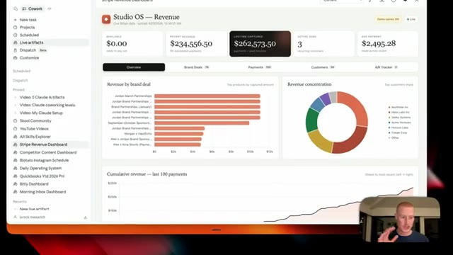
*⏱️ 00:00:50 — Tableau de bord dynamique nommé "Studio OS — Revenue" affichant des graphiques de revenus Stripe avec un diagramme à barres et un diagramme circulaire.*

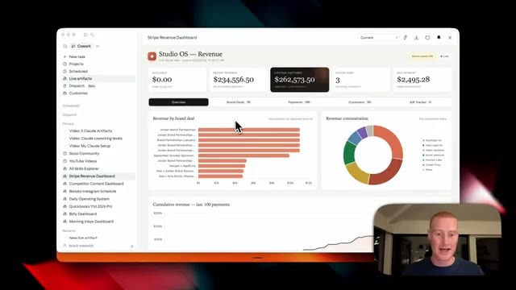
*⏱️ 00:00:57 — Vue similaire du tableau de bord "Studio OS — Revenue" avec la souris survolant les graphiques de données financières.*

---

### ⏱️ `[00:01:04 - 00:01:40]` | Segment #03

**🔊 Audio (Transcription Intégrale Mot pour Mot en Français) :**
> Et vous pourriez faire cela à travers n'importe laquelle des différentes applications qui se connectent à votre compte Claude. Il y a quelque chose de vraiment important que vous devez comprendre à propos de cette sortie. Et c'est que nous basculons dans ce nouveau monde de logiciels personnalisés construits à la demande. Donc, au lieu que nous ayons besoin d'utiliser toutes ces différentes plates-formes et de devoir ouvrir Stripe, ouvrir notre e-mail, ouvrir Google Calendar, bref, ouvrir n'importe laquelle de ces différentes applications que nous utilisons, nous pouvons construire un système d'exploitation directement à l'intérieur de Claude qui rassemble toutes ces informations dans une interface que nous pouvons facilement consulter à l'intérieur de Claude Cowork. Le premier est un centre de commande matinal. Laissez-moi donc vous montrer

**👁️ Analyse Visuelle d'Écran (gemini-3.5-flash-lite) :**
**Interface & Outils** : Navigateur web affichant une diapositive de présentation.

**Contenu textuel & Code** : Texte explicatif sur le logiciel personnalisé à la demande : "One prompt, a running page", "Calls your real tools", "Different next week? Rebuild next week".

**Action / Démonstration** : Présentation du concept de transition vers le logiciel personnalisé généré par IA.

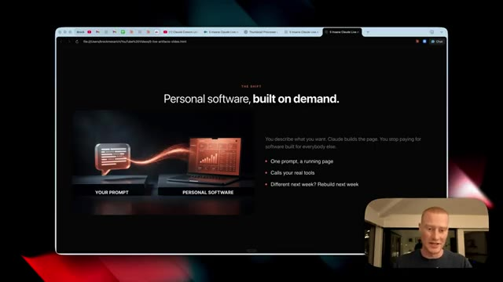
*⏱️ 00:01:13 — Capture d'écran montrant une page de présentation avec le titre "Personal software, built on demand." et le présentateur en médaillon en bas à droite.*

---

### ⏱️ `[00:01:40 - 00:01:58]` | Segment #04

**🔊 Audio (Transcription Intégrale Mot pour Mot en Français) :**
> tu vois exactement ce que je veux dire. Très bien, voici donc l'artefact du centre de commande du matin. C'est à quoi cela ressemble. Celui-ci est l'un de mes préférés. Et je pense sincèrement que c'est un outil que tout le monde peut implémenter dès maintenant et en retirer des bénéfices immédiats. Laisse-moi t'expliquer cela rapidement. Tout d'abord, j'ai ce design spécifique que j'ai créé.

**👁️ Analyse Visuelle d'Écran (gemini-3.5-flash-lite) :**
**Interface & Outils** : Application Claude Cowork / Navigateur affichant le tableau de bord du centre de commande du matin.

**Contenu textuel & Code** : Résumé des e-mails (18 nouveaux e-mails, 7 priorités, 1 réunion aujourd'hui, 5 réunions cette semaine) et aperçu du calendrier hebdomadaire.

**Action / Démonstration** : Présentation visuelle de l'artefact du centre de commande du matin et de son interface utilisateur.

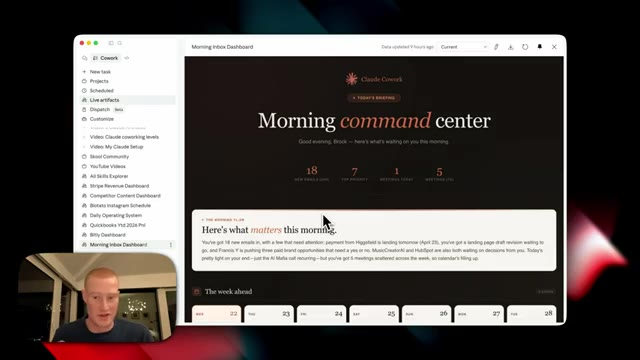
*⏱️ 00:01:44 — Capture d'écran montrant l'interface du "Morning Inbox Dashboard" ou "Morning command center" propulsé par Claude Cowork, affichant divers widgets et résumés d'e-mails et de réunions.*

---

### ⏱️ `[00:01:59 - 00:02:26]` | Segment #05

**🔊 Audio (Transcription Intégrale Mot pour Mot en Français) :**
> J'ai une compétence Claude qui génère automatiquement tous mes tableaux de bord dans un style très similaire à celui-ci avec ce type de typographie, cette couleur, qui correspond en quelque sorte à l'ambiance d'Anthropic. Personnellement, j'aime juste ça. C'est pourquoi c'est dans ce style. Mais vous pouvez les personnaliser pour qu'ils aient l'apparence que vous voulez. Tout en haut de notre centre de commande matinal, nous obtenons un résumé TLDR, qui décompose fondamentalement chaque chose que nous avons ratée dans notre e-mail, ainsi que sur notre agenda Google.

**👁️ Analyse Visuelle d'Écran (gemini-3.5-flash-lite) :**
**Interface & Outils** : Interface logicielle personnalisée / application web type tableau de bord Claude Cowork.

**Contenu textuel & Code** : Métriques de productivité et de communication (18 nouveaux e-mails, 7 priorités, 1 réunion aujourd'hui, 5 réunions cette semaine) et aperçu du calendrier hebdomadaire.

**Action / Démonstration** : Présentation et navigation visuelle à travers le tableau de bord personnalisé généré par une compétence Claude.

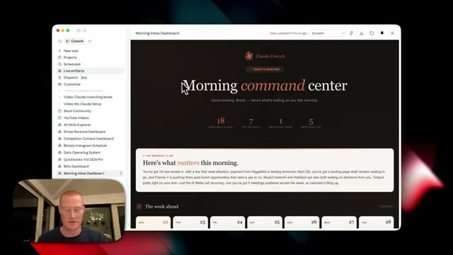
*⏱️ 00:02:06 — Interface d'un tableau de bord 'Morning command center' dans un style épuré aux couleurs sombres, avec une barre latérale listant différents projets et compétences Claude.*

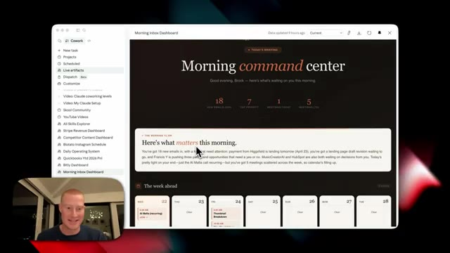
*⏱️ 00:02:19 — Même tableau de bord 'Morning command center' avec le curseur se déplaçant légèrement sur le texte de résumé matinal ('Here's what matters this morning').*

---

### ⏱️ `[00:02:26 - 00:02:58]` | Segment #06

**🔊 Audio (Transcription Intégrale Mot pour Mot en Français) :**
> Il pioche dans ces deux endroits différents via ces connecteurs en temps réel. Donc par exemple, si je lis ceci, ça dit que vous avez 18 nouveaux e-mails avec quelques-uns qui nécessitent de l'attention et en gros, ça détaille quelques-uns de ceux auxquels je dois répondre aujourd'hui. Ensuite, évidemment, nous pouvons voir la semaine à venir, en gros tout ce qui est sur mon agenda Google en temps réel. Comme vous pouvez le voir, mon emploi du temps est plutôt dégagé. Et ensuite, ça détaille même les principales priorités ici et ça montre même quand ces e-mails ont été reçus. Donc celui-ci juste ici, c'était il y a 15 heures. Celui-ci, c'était il y a six heures. Et un élément clé à noter ici, c'est que si je devais recevoir un e-mail maintenant, cela

**👁️ Analyse Visuelle d'Écran (gemini-3.5-flash-lite) :**
**Interface & Outils** : Application de type tableau de bord / interface de gestion de tâches personnalisée (Cowork / Morning Inbox Dashboard).

**Contenu textuel & Code** : Statistiques sur les e-mails (18 nouveaux, 7 priorités), aperçus de messages, calendrier hebdomadaire et sections de priorités.

**Action / Démonstration** : Navigation et défilement à travers le tableau de bord pour présenter les e-mails et les tâches en attente.

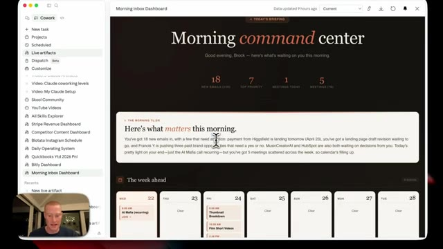
*⏱️ 00:02:34 — Vue d'ensemble du tableau de bord 'Morning Command Center' affichant les résumés d'e-mails et le calendrier.*

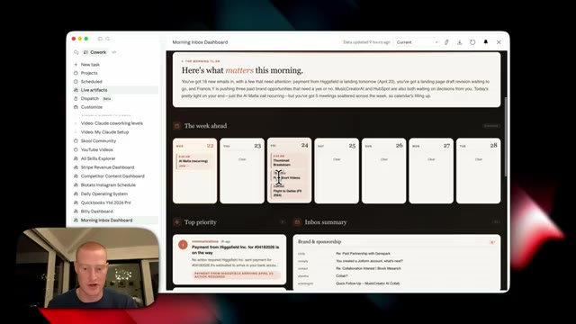
*⏱️ 00:02:42 — Défilement vers le bas du tableau de bord montrant la section calendrier de la semaine et les priorités principales.*

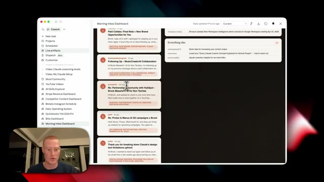
*⏱️ 00:02:50 — Poursuite du défilement affichant la liste détaillée des e-mails par ordre de priorité et le résumé de la boîte de réception.*

---

### ⏱️ `[00:02:58 - 00:03:20]` | Segment #07

**🔊 Audio (Transcription Intégrale Mot pour Mot en Français) :**
> se remplir automatiquement sur ce tableau de bord grâce à la nouvelle fonctionnalité d'artefacts en direct. C'est vraiment ce qui change la donne, honnêtement. Et ensuite, ça décompose même ma boîte de réception par catégorie spécifique. Ça identifie donc lesquels de ces éléments sont des partenariats de marque et des parrainages potentiels. Ça catégorise également les conversations en cours, les bulletins d'information et les mises à jour, et fondamentalement tout le reste auquel je dois répondre.

**👁️ Analyse Visuelle d'Écran (gemini-3.5-flash-lite) :**
**Interface & Outils** : Application Cowork (interface de tableau de bord de gestion de tâches et d'e-mails)

**Contenu textuel & Code** : Morning Inbox Dashboard, sections 'The week ahead' (calendrier), 'Top priority' (e-mails urgents) et 'Inbox summary' (ventilé par catégories : Brand & sponsorship, Ongoing conversations, Newsletters & updates).

**Action / Démonstration** : Navigation et défilement dans le tableau de bord pour présenter la catégorisation automatique de la boîte de réception.

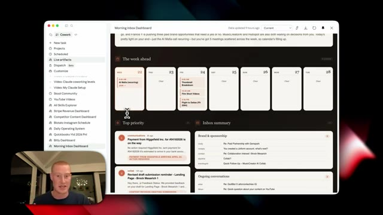
*⏱️ 00:03:04 — Vue d'ensemble du tableau de bord 'Morning Inbox Dashboard' dans l'application Cowork, affichant le calendrier de la semaine et les e-mails prioritaires.*

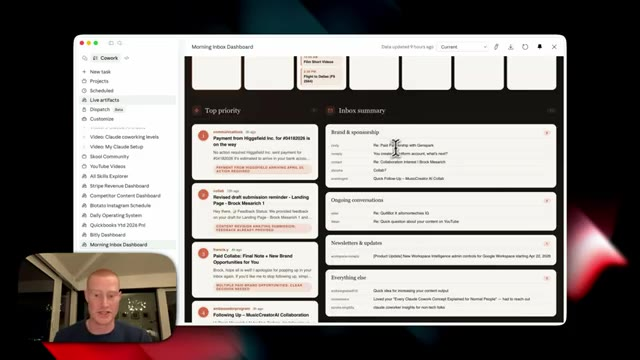
*⏱️ 00:03:09 — Gros plan sur la section 'Inbox summary' du tableau de bord, détaillant les catégories comme 'Brand & sponsorship' et 'Ongoing conversations'.*

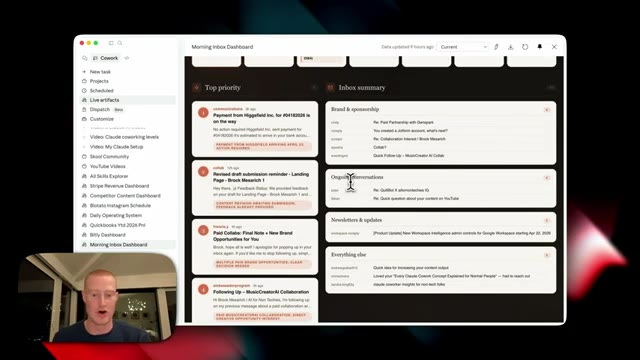
*⏱️ 00:03:15 — Vue défilée du tableau de bord montrant la ventilation des e-mails avec les catégories 'Ongoing conversations', 'Newsletters & updates' et 'Everything else'.*

---

### ⏱️ `[00:03:20 - 00:03:40]` | Segment #08

**🔊 Audio (Transcription Intégrale Mot pour Mot en Français) :**
> Et l'une des parties les plus cool à ce sujet, chaque fois que je veux y accéder, tout ce que j'ai à faire est d'aller dans la barre latérale de gauche, et nous pouvons voir tous nos artefacts directement à l'intérieur d'ici. Donc tout ce que j'ai à faire est d'ouvrir le tableau de bord de la boîte de réception du matin, et il se chargera automatiquement, et cela prendra probablement environ 5 à 10 secondes, et ensuite toutes ces informations se rempliront.

**👁️ Analyse Visuelle d'Écran (gemini-3.5-flash-lite) :**
**Interface & Outils** : Interface web de Claude Cowork (Morning Inbox Dashboard) avec barre latérale de gestion des artefacts.

**Contenu textuel & Code** : Tableau de bord 'Morning command center', résumés d'e-mails, aperçu des priorités et calendrier de la semaine à venir.

**Action / Démonstration** : Navigation et sélection des différents artefacts et tableaux de bord depuis la barre latérale de l'application.

*⏱️ 00:03:25 — Interface Claude Cowork affichant le tableau de bord 'Morning command center' avec le panneau latéral gauche listant les différents artefacts.*

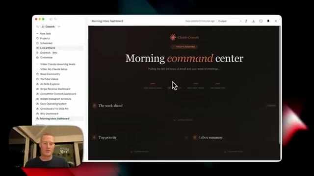
*⏱️ 00:03:35 — Navigation dans la barre latérale gauche du tableau de bord de Claude Cowork vers la sélection de l'artefact 'Morning Inbox Dashboard'.*

---

### ⏱️ `[00:03:40 - 00:04:10]` | Segment #09

**🔊 Audio (Transcription Intégrale Mot pour Mot en Français) :**
> Donc nous n'avons pas besoin d'aller chercher une conversation spécifique où nous avons généré ceci. Nous pouvons simplement le voir automatiquement dans la barre latérale de gauche chaque fois que nous voulons y accéder. Pour configurer celui-ci vous-même, c'est très facile. En gros, vous pouvez simplement venir sur Claude. Vous pouvez simplement lui donner l'invite et dire quelque chose du genre, je veux que vous génériez un tableau de bord de briefing matinal qui extrait tous les e-mails pertinents de ma boîte de réception, les catégorise en fonction de l'urgence, et extrait également des données de mon Google Agenda, et il générera un résultat très similaire à exactement ce que je vous ai montré.

**👁️ Analyse Visuelle d'Écran (gemini-3.5-flash-lite) :**
**Interface & Outils** : Interface web de Claude Cowork

**Contenu textuel & Code** : Tableau de bord personnalisé "Morning command center" avec des indicateurs chiffrés (18 e-mails, 7 priorités, réunions) et une barre latérale de navigation avec des artefacts épinglés.

**Action / Démonstration** : Navigation et présentation de l'interface du tableau de bord interactif dans Claude Cowork.

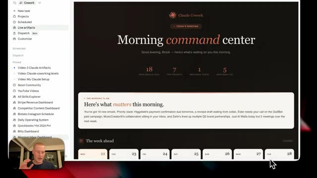
*⏱️ 00:03:47 — Interface Claude Cowork affichant le tableau de bord "Morning command center" avec une barre latérale listant différents projets et artefacts épinglés.*

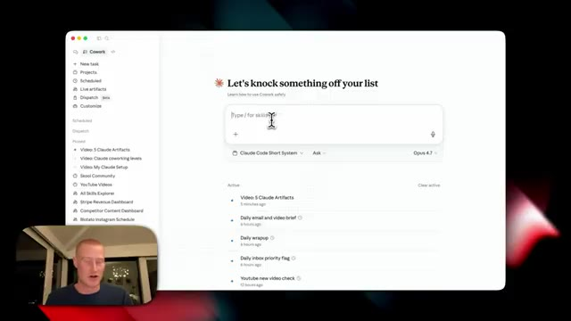
*⏱️ 00:03:55 — Interface Claude Cowork montrant la page principale de création ou de gestion de tâches avec une barre de recherche et les éléments actifs en bas.*

---

### ⏱️ `[00:04:10 - 00:04:41]` | Segment #10

**🔊 Audio (Transcription Intégrale Mot pour Mot en Français) :**
> Et ensuite, afin de connecter Gmail, vous allez simplement aller dans les connecteurs. Vous devez vous assurer que vous avez configuré Gmail et Google Agenda, ainsi que toutes les autres applications que vous souhaitez réellement y ajouter. Il vous suffit donc de cliquer sur Gmail, de veiller à le connecter, de faire de même pour Google Agenda, et il pourra alors extraire ces informations en temps réel. Un autre exemple de cas d'usage personnel que j'ai sur mon tableau de bord de centre de commande quotidien, c'est que je pourrais aussi extraire des informations en direct de Bitly, ce qui me permet fondamentalement de suivre combien de personnes cliquent sur des liens spécifiques dans mes vidéos YouTube.

**👁️ Analyse Visuelle d'Écran (gemini-3.5-flash-lite) :**
**Interface & Outils** : Interface de gestion de connecteurs et d'applications tierces.

**Contenu textuel & Code** : Liste des applications disponibles pour l'intégration (Gmail, Google Drive, Google Calendar, HubSpot, etc.).

**Action / Démonstration** : Navigation et sélection des connecteurs pour configurer les intégrations d'applications.

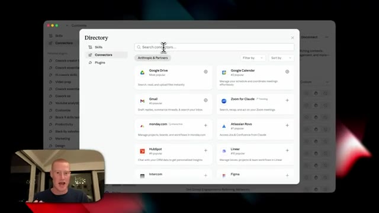
*⏱️ 00:04:18 — Fenêtre de répertoire des connecteurs affichant différentes applications comme Google Drive, Gmail, Google Calendar et Zoom.*

---

### ⏱️ `[00:04:41 - 00:05:04]` | Segment #11

**🔊 Audio (Transcription Intégrale Mot pour Mot en Français) :**
> Donc, si je veux voir combien de personnes cliquent sur ce lien de ressource ici, au lieu d'avoir à être dans l'application Bitly. Pour vous montrer ce que je veux dire, ceci est à l'intérieur de Bitly. Auparavant, je devrais réellement venir ici et regarder chaque lien individuel, voir combien de personnes ont interagi avec. Je devrais cliquer dessus pour voir toutes ces données spécifiques. Eh bien, maintenant, j'ai simplement cela ajouté à mon artéfact en direct de système d'exploitation quotidien et cela se met à jour en temps réel.

**👁️ Analyse Visuelle d'Écran (gemini-3.5-flash-lite) :**
**Interface & Outils** : Application Bitly et interface d'un espace de travail logiciel personnalisé.

**Contenu textuel & Code** : Listes de liens raccourcis, titres de vidéos ou publications, liens Bitly, nombres d'engagements et graphiques de performance classés.

**Action / Démonstration** : Navigation et défilement dans le tableau de bord Bitly, puis basculement vers une vue de performance centralisée des liens.

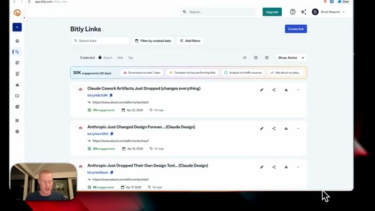
*⏱️ 00:04:47 — Vue générale du tableau de bord de l'application Bitly montrant une liste de liens raccourcis et leurs métriques d'engagement.*

*⏱️ 00:04:52 — Défilement de la liste des liens raccourcis sur l'interface Bitly avec affichage des statistiques de clics pour chaque publication.*

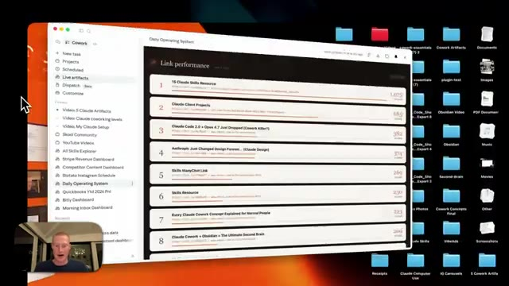
*⏱️ 00:04:58 — Transition montrant un tableau de bord personnalisé de performances de liens (Link performance) intégré au sein d'un espace de travail logiciel.*

---

### ⏱️ `[00:05:04 - 00:05:26]` | Segment #12

**🔊 Audio (Transcription Intégrale Mot pour Mot en Français) :**
> donc je n'ai pas besoin de quitter cette page. Très rapidement, si vous appréciez cette vidéo et que vous souhaitez aller plus loin, il y a un lien pour rejoindre ma communauté School dans la description ci-dessous. J'aborde encore plus en profondeur Claude et spécifiquement Claude Cowork et je partage même les plus de 50 compétences dont je ne peux pas me passer et je mets cela à jour chaque semaine. Ainsi que des tonnes d'entrepreneurs et de professionnels qui utilisent Claude Cowork chaque jour dans leur entreprise et leur vie professionnelle.

**👁️ Analyse Visuelle d'Écran (gemini-3.5-flash-lite) :**
**Interface & Outils** : Navigateur web, plateforme communautaire Skool et interface utilisateur.

**Contenu textuel & Code** : Publications textuelles de membres, classements (leaderboard) et onglets de discussion de la communauté.

**Action / Démonstration** : Navigation et présentation de la communauté Skool liée à la vidéo.

---

### ⏱️ `[00:05:26 - 00:06:01]` | Segment #13

**🔊 Audio (Transcription Intégrale Mot pour Mot en Français) :**
> Donc si vous voulez rejoindre cela, il y a un lien dans la description pour le faire. Cas d'usage numéro deux, nous avons le suivi des revenus. C'est fondamentalement une façon de récupérer toutes vos informations depuis Stripe, de voir tous les différents paiements, de voir toutes les données de tendances, ainsi qu'en plus de cela, j'ai codé au feeling à ma façon pour suivre les factures impayées que je dois encaisser. Tout d'abord, laissez-moi vous montrer exactement à quoi cela ressemble. Et ensuite, je vais vous montrer étape par étape comment vous pouvez configurer cela pour vous aussi. Très bien. Donc c'est à cela que ressemble notre tableau de bord des revenus Stripe. Et c'est plutôt cool. Nous pouvons voir plusieurs choses différentes ici. Nous pouvons voir notre solde disponible. Nous pouvons

**👁️ Analyse Visuelle d'Écran (gemini-3.5-flash-lite) :**
**Interface & Outils** : Navigateur web affichant une application de tableau de bord de suivi des revenus et des interfaces de présentation de type diaporama.

**Contenu textuel & Code** : Données financières connectées à Stripe, graphiques à barres horizontales pour les partenariats de marques, diagramme circulaire de concentration des revenus, et graphiques de cumul des 100 derniers paiements.

**Action / Démonstration** : Navigation et présentation du cas d'usage du suivi des revenus connecté à Stripe, illustrant les visualisations de données financières.

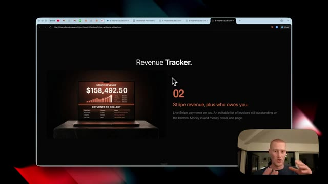
*⏱️ 00:05:35 — Diapositive de présentation montrant le titre 'Revenue Tracker' et le cas d'usage numéro deux lié aux revenus Stripe, avec une incrustation vidéo du présentateur en bas à droite.*

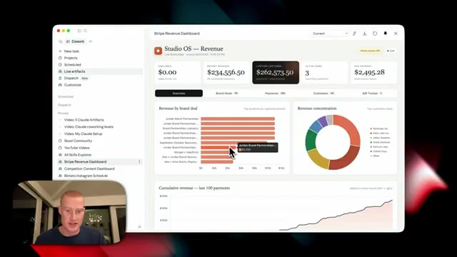
*⏱️ 00:05:52 — Capture d'écran détaillée d'un tableau de bord 'Stripe Revenue Dashboard' affichant des graphiques de revenus, des répartitions par partenariats et des métriques financières, avec le présentateur visible en incrustation.*

---

### ⏱️ `[00:06:01 - 00:06:34]` | Segment #14

**🔊 Audio (Transcription Intégrale Mot pour Mot en Français) :**
> voir nos revenus récents. Nous pouvons voir la valeur vie client capturée, les abonnés actifs spécifiques qui sont des clients récurrents. Nous pouvons voir le paiement moyen sur l'ensemble de notre écosystème Stripe. Et juste ici, vous pouvez voir tous les différents contrats de marque. Nous pouvons voir la concentration de nos revenus. Et une chose que je tiens à préciser, c'est que toutes ces informations ici sont en fait de faux données. Je ne voulais pas montrer mes revenus Stripe réels. J'utilise donc un compte de test Stripe afin de montrer toutes ces informations. Vous pouvez voir que c'est également catégorisé automatiquement en fonction de ce que

**👁️ Analyse Visuelle d'Écran (gemini-3.5-flash-lite) :**
**Interface & Outils** : Tableau de bord d'application (Stripe Revenue Dashboard) sur macOS, avec une incrustation vidéo du présentateur en bas à gauche.

**Contenu textuel & Code** : Métriques financières affichées : $0,00 (disponible), $234 556,50 (revenu récent), $262 573,50 (valeur vie client capturée), 3 (abonnés actifs), $2 495,28 (paiement moyen). Graphiques en barres des revenus par contrat de marque, graphique circulaire de concentration des revenus, et graphique linéaire des revenus cumulés sur les 100 derniers paiements.

**Action / Démonstration** : Le présentateur commente les différentes métriques et sources de revenus affichées sur le tableau de bord.

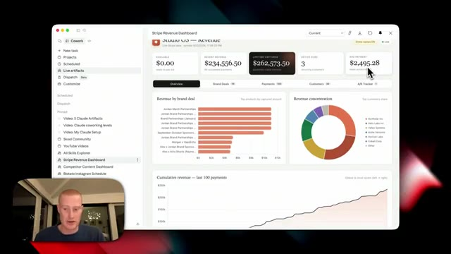
*⏱️ 00:06:09 — Capture d'écran montrant un tableau de bord des revenus Stripe affichant différentes métriques financières et graphiques.*

---

### ⏱️ `[00:06:34 - 00:07:09]` | Segment #15

**🔊 Audio (Transcription Intégrale Mot pour Mot en Français) :**
> type de paiements dont il s'agit. Donc par exemple, tous ces différents liens de paiement qui contiennent le mot partenariats, cela les catégorise automatiquement comme des contrats de marque. Je n'have donc pas besoin d'aller trier l'ensemble de mes paiements afin de voir combien de contrats de marque j'ai réalisés via mes paiements Stripe. Ensuite, nous pouvons même voir le statut de toutes ces informations. Nous pouvons voir le montant qui a été payé. Nous pouvons voir l'identifiant du paiement, le client spécifique. Si nous avons un client lié à cela, nous pouvons également voir notre liste de clients ici. Et puis, si je clique sur ce bouton de suivi sur le côté droit, c'est là que je peux fondamentalement ajouter n'importe lequel des différents paiements dont j'ai besoin

**👁️ Analyse Visuelle d'Écran (gemini-3.5-flash-lite) :**
**Interface & Outils** : Tableau de bord personnalisé (Studio OS / Stripe Revenue Dashboard) affiché dans une application de type interface de gestion.

**Contenu textuel & Code** : Données financières de revenus, liste de contrats de marque catégorisés ("Jordan March Partnerships", etc.), métriques globales (Available, Recent revenue, Lifetime captured, Active subs, Avg payment) et liste de clients avec le nombre de factures et montants payés.

**Action / Démonstration** : Navigation et présentation des fonctionnalités de catégorisation automatique des paiements et des contrats de marque dans le tableau de bord.

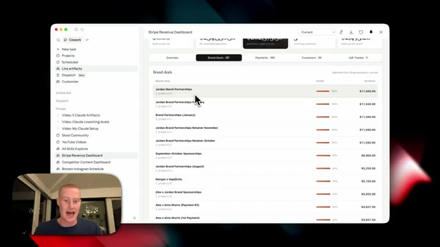
*⏱️ 00:06:43 — Vue du tableau de bord Stripe montrant la liste des contrats de marque (Brand deals) avec les montants de revenus associés.*

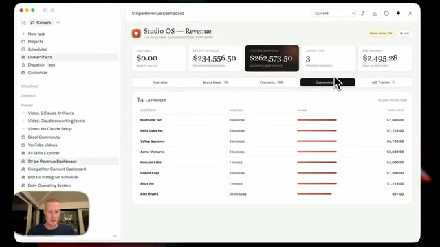
*⏱️ 00:07:00 — Vue générale du tableau de bord Studio OS — Revenue avec les métriques financières globales et la liste des meilleurs clients (Top customers).*

---

### ⏱️ `[00:07:09 - 00:07:46]` | Segment #16

**🔊 Audio (Transcription Intégrale Mot pour Mot en Français) :**
> pour les collecter afin que je puisse suivre cela. Disons donc qu'on me doit de l'argent pour un Airbnb à Los Angeles, quelque chose comme ça. Je peux indiquer un montant de paiement. Disons simplement 2 500 dollars. Disons que cela a été facturé. Je pourrais écrire des notes spécifiques, puis je pourrais cliquer sur « ajouter des paiements ». Et juste ici, vous pouvez voir que nous avons tous nos paiements en attente ainsi que le statut du paiement. Et ensuite, nous avons notre solde impayé ici. Ainsi, non seulement nous extrayons des données en direct et des informations en direct de notre compte Stripe via ce connecteur spécifique que nous avons dans Claude, mais nous sommes capables de coder intuitivement par-dessus ces données et cette application spécifiques. Donc cela pourrait

**👁️ Analyse Visuelle d'Écran (gemini-3.5-flash-lite) :**
**Interface & Outils** : Application web "Stripe Revenue Dashboard" affichée dans un navigateur avec une barre latérale de gestion des tâches.

**Contenu textuel & Code** : Métriques financières (revenus récents, paiements à vie capturés) et formulaire d'ajout de paiement en attente (Client, Montant en USD, Date d'échéance, Statut).

**Action / Démonstration** : Saisie et ajout d'un paiement en attente de 2 500 dollars pour "LA Airbnb" dans l'interface du tableau de bord.

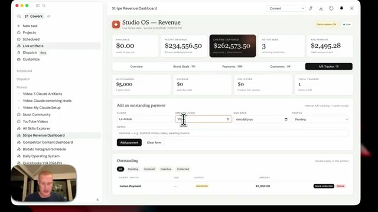
*⏱️ 00:07:19 — Le présentateur ajoute un paiement en attente dans un tableau de bord Stripe de démonstration, en saisissant "LA Airbnb" et un montant de 2 500 dollars.*

*⏱️ 00:07:28 — Le tableau de bord Stripe mis à jour affiche "LA Airbnb" avec un montant de 2 500 dollars dans la section des paiements en attente ("Outstanding").*

---

### ⏱️ `[00:07:46 - 00:08:21]` | Segment #17

**🔊 Audio (Transcription Intégrale Mot pour Mot en Français) :**
> résoudre un problème pour vous si vous êtes un utilisateur de Stripe, mais disons que vous voulez enrichir vos données Stripe et les transformer en une application personnalisée pour vous-même. C'est un moyen très simple de le faire désormais directement à l'intérieur de Claude. Et franchement les gars, ça m'a pris probablement deux à trois minutes à configurer. Une fois que j'avais connecté Stripe, tout ce que j'avais à faire était de venir voir Claude et de dire : Hé, je veux que tu crées un tableau de bord montrant l'ensemble de mes revenus Stripe, et je veux aussi pouvoir ajouter des paiements spécifiques que je dois percevoir. Un autre point clé ici, c'est disons que nous apportons des modifications à cet artefact. Je pourrais venir ici et consulter différents historiques de versions. Donc si nous

**👁️ Analyse Visuelle d'Écran (gemini-3.5-flash-lite) :**
**Interface & Outils** : Interface web d'une application personnalisée (Claude Artifacts / Cowork) simulant un tableau de bord de revenus Stripe.

**Contenu textuel & Code** : Métriques financières affichées : "Recent Revenue" ($234,556.50), "Lifetime Capture" ($262,573.50), "Active Subs" (3), "A/R Payment" ($2,495.28), ainsi que des formulaires d'ajout de paiement et des listes de factures en suspens.

**Action / Démonstration** : Présentation et navigation dans l'application personnalisée générée par Claude pour enrichir et suivre les données Stripe.

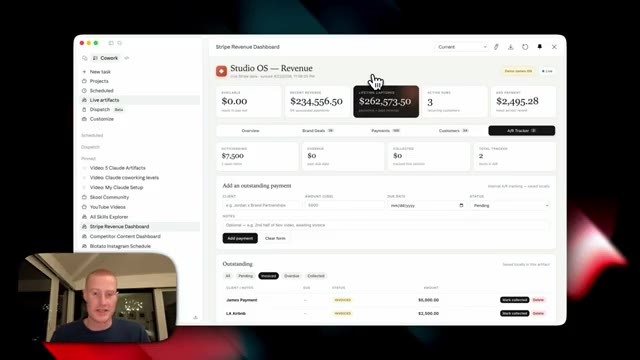
*⏱️ 00:07:55 — Capture d'écran montrant un tableau de bord personnalisé "Studio OS - Revenue" créé avec les artefacts Claude à partir de données Stripe, affichant divers indicateurs financiers.*

---

### ⏱️ `[00:08:21 - 00:08:57]` | Segment #18

**🔊 Audio (Transcription Intégrale Mot pour Mot en Français) :**
> le vibe coding et en construisant cette interface, en construisant notre application personnalisée, nous pouvons toujours revenir à une version précédente si nous préférons cette version. Très bien, donc la première chose que nous devons faire est de configurer le connecteur spécifique que nous voulons ajouter. Donc pour ce cas d'utilisation, nous allons utiliser Stripe. Nous allons venir sur Cowork, s'assurer que la barre latérale est ouverte. À partir de là, nous allons cliquer sur Personnaliser. C'est ici que nous ajoutons nos différents connecteurs afin de récupérer et de publier des informations sur ces différentes applications que nous utilisons. Nous allons voir Compétences ainsi que Connecteurs. Cliquez sur Connecteurs. Et à partir de là, j'en ai configuré quelques-uns moi-même,

**👁️ Analyse Visuelle d'Écran (gemini-3.5-flash-lite) :**
**Interface & Outils** : Application de productivité/interface de type Cowork avec assistant IA.

**Contenu textuel & Code** : Menu de personnalisation avec les sections "Connect your apps", "Create new skills" et "Browse plugins", et la liste des plugins et connecteurs sur le panneau latéral gauche.

**Action / Démonstration** : Navigation dans l'application et sélection de l'onglet "Connectors" pour configurer les intégrations d'applications.

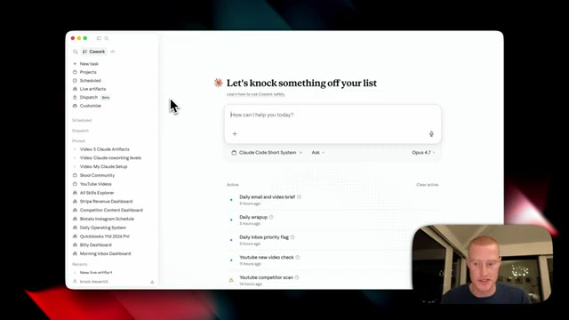
*⏱️ 00:08:30 — Interface de l'application Cowork affichant une liste de tâches, un champ de saisie prompt et le panneau latéral de navigation.*

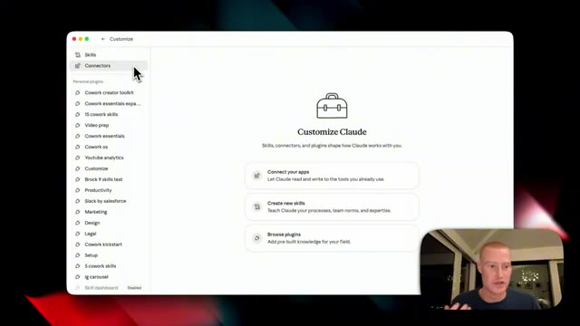
*⏱️ 00:08:48 — Page de personnalisation de Claude dans l'application avec les options Connectors, Skills et Browse plugins.*

---

### ⏱️ `[00:08:58 - 00:09:32]` | Segment #19

**🔊 Audio (Transcription Intégrale Mot pour Mot en Français) :**
> mais nous voulons juste cliquer sur Ajouter puis sur Parcourir les connecteurs. À partir d'ici, vous pouvez soit faire défiler vers le bas, soit pour faire simple, je vais juste cliquer sur cette barre de recherche, cliquer sur Stripe, cliquer sur ce bouton plus. Et à partir d'ici, nous devons autoriser notre compte Stripe. Alors allez-y et assurez-vous de configurer ceci. Je vais cliquer sur écriture pour toutes les autorisations. Je vais cliquer sur autoriser et cela devrait nous renvoyer directement vers Claude. Je vais donc cliquer sur ouvrir Claude et nous devrions maintenant voir cette notification de connexion à Stripe ici. Et ensuite, afin de s'assurer que cela est ajouté à notre Claude, si nous descendons, vous pouvez maintenant voir Stripe juste ici. Ensuite,

**👁️ Analyse Visuelle d'Écran (gemini-3.5-flash-lite) :**
**Interface & Outils** : Interface de configuration d'assistant IA et page web d'autorisation Stripe.

**Contenu textuel & Code** : Répertoire des connecteurs (Stripe, Bitly, etc.) et demandes de permissions d'API.

**Action / Démonstration** : Recherche et sélection du connecteur Stripe, puis autorisation de l'accès au compte.

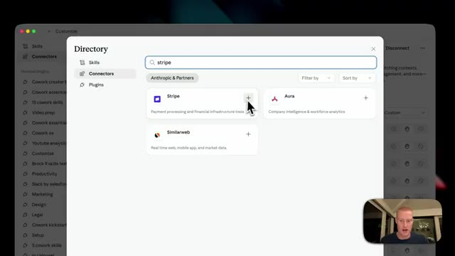
*⏱️ 00:09:06 — Fenêtre de recherche de connecteurs montrant "Stripe" dans le répertoire avec un bouton d'ajout.*

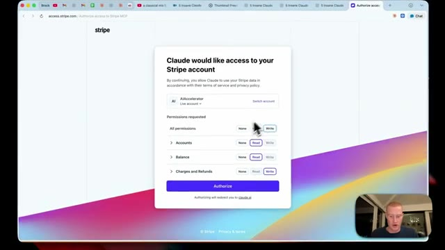
*⏱️ 00:09:15 — Page d'autorisation Stripe demandant l'accès pour Claude à un compte Stripe avec différents niveaux de permissions.*

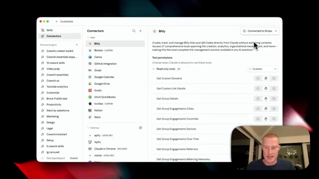
*⏱️ 00:09:23 — Interface de configuration des connecteurs montrant les permissions pour Bitly et la notification "Connected to Stripe".*

---

### ⏱️ `[00:09:32 - 00:10:06]` | Segment #20

**🔊 Audio (Transcription Intégrale Mot pour Mot en Français) :**
> ce que nous devons faire, c'est récupérer notre clé API Stripe. Laissez-moi donc vous montrer exactement comment faire cela maintenant. Nous allons donc revenir sur notre navigateur. Nous allons simplement chercher Stripe, et nous assurer que nous sommes connectés. À partir d'ici, nous allons simplement dans les paramètres, puis nous voulons cliquer sur développeurs. Ensuite, nous allons voir cette petite interface ici. Cliquez simplement sur gérer les clés API. Et ce que nous allons faire, c'est cliquer sur créer une clé restreinte. Et vous ne devez partager ceci avec personne. Laissez-moi donc cliquer ici. Je vais sélectionner alimenter une intégration que vous avez construite. Cliquez sur continuer. Je vais donner un nom à ceci. Je vais donc simplement appeler cela Claude.

**👁️ Analyse Visuelle d'Écran (gemini-3.5-flash-lite) :**
**Interface & Outils** : Navigateur web (Google Chrome / Perplexity AI)

**Contenu textuel & Code** : Barre de recherche avec des suggestions automatiques incluant "stripe", barres de favoris et onglets ouverts.

**Action / Démonstration** : Le présentateur utilise le navigateur pour chercher Stripe afin de récupérer sa clé API.

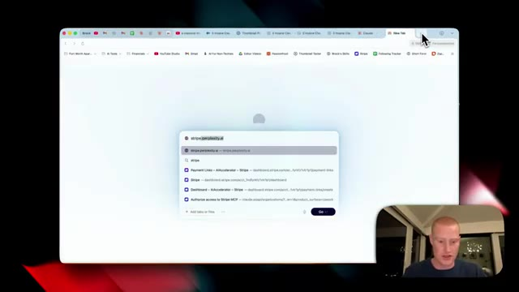
*⏱️ 00:09:40 — Capture d'écran montrant un navigateur web avec la barre de recherche en cours d'utilisation pour rechercher Stripe, ainsi qu'une incrustation vidéo du présentateur en bas à droite.*

---

### ⏱️ `[00:10:06 - 00:10:40]` | Segment #21

**🔊 Audio (Transcription Intégrale Mot pour Mot en Français) :**
> Et ensuite, nous devons sélectionner nos autorisations spécifiques. Je vais autoriser l'écriture pour toutes ces différentes autorisations ici. Ensuite, nous descendons simplement et nous sélectionnons « créer la clé ». Et puis, une fois que nous avons notre API key, nous allons simplement revenir sur Claude et la coller directement ici. Voici le prompt que j'ai personnellement utilisé. Si vous voulez l'utiliser, il y a un lien dans la description pour copier essentiellement les prompts exacts que j'ai utilisés pour la vidéo. Sinon, vous pouvez simplement faire une capture d'écran de ceci, le mettre dans Claude et recréer exactement le même prompt, et cela générera un résultat très similaire pour vous. Cependant, le style de design sera un peu différent parce que j'ai personnalisé le mien pour qu'il ait un aspect spécifique,

**👁️ Analyse Visuelle d'Écran (gemini-3.5-flash-lite) :**
**Interface & Outils** : Navigateur web affichant le tableau de bord Stripe et une page de présentation de prompts.

**Contenu textuel & Code** : Fenêtre de vérification de sécurité Stripe et texte d'un prompt pour générer un artefact interactif de suivi des revenus.

**Action / Démonstration** : Le présentateur effectue une vérification de sécurité sur Stripe avant d'expliquer l'utilisation d'un prompt pour Claude.

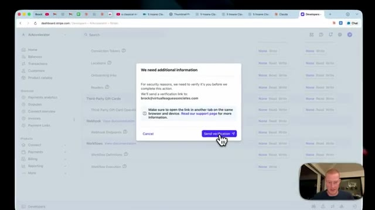
*⏱️ 00:10:14 — Capture d'écran du tableau de bord Stripe affichant une fenêtre modale de vérification de sécurité demandant l'envoi d'un lien de validation.*

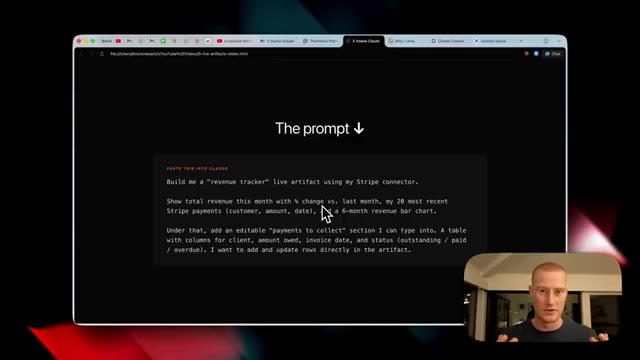
*⏱️ 00:10:23 — Capture d'écran montrant une diapositive avec un exemple de prompt destiné à Claude pour créer un outil de suivi des revenus avec le connecteur Stripe.*

---

### ⏱️ `[00:10:40 - 00:11:06]` | Segment #22

**🔊 Audio (Transcription Intégrale Mot pour Mot en Français) :**
> mais assurez-vous simplement de le personnaliser comme vous aimiez qu'il apparaisse. Ensuite, pour le cas d'usage numéro trois, nous avons un tableau de bord de préparation de réunion. Je pense que c'est un artefact assez universel que beaucoup de personnes peuvent utiliser. Par exemple, disons que c'est quelques minutes avant une réunion à laquelle vous devez participer. Ce tableau de bord va remplir automatiquement qui y participe, les e-mails précédents que vous avez eus avec cette personne, trois sujets de discussion différents, et tout cela va être actualisé à chaque fois que vous l'ouvrez car cela se met à jour automatiquement en temps réel.

**👁️ Analyse Visuelle d'Écran (gemini-3.5-flash-lite) :**
**Interface & Outils** : Navigateur web affichant une page de présentation de cas d'usage.

**Contenu textuel & Code** : Texte de présentation du tableau de bord de préparation de réunion (cas d'usage numéro trois) avec illustration d'un smartphone.

**Action / Démonstration** : Présentation du troisième cas d'usage illustrant un tableau de bord de préparation de réunion.

*⏱️ 00:10:46 — Capture d'écran montrant une diapositive de présentation intitulée "Meeting Prep Dashboard" avec le numéro 03 et le texte "Two minutes before any meeting."*

---

### ⏱️ `[00:11:06 - 00:11:28]` | Segment #23

**🔊 Audio (Transcription Intégrale Mot pour Mot en Français) :**
> Très bien, voici à quoi cela ressemble. Ça s'appelle la préparation de réunion, et cela montre la prochaine réunion que j'ai sur mon Google Agenda. Ça fait cela en extrayant les données de Google Agenda puisque celui-ci est connecté via les connecteurs dans Claude. Je peux voir toutes les personnes qui participent à la réunion, et cela me donne même trois sujets de discussion différents dont je peux parler lors de cette réunion pour me rafraîchir la mémoire sur les différentes choses qui se sont produites dans ce fil de discussion par e-mail.

**👁️ Analyse Visuelle d'Écran (gemini-3.5-flash-lite) :**
**Interface & Outils** : Interface web de Claude (Artifacts / Cowork).

**Contenu textuel & Code** : Détails de la prochaine réunion (Podcast Recording avec Nathan Reese), liste des participants et sujets récents extraits via les connecteurs de Google Agenda.

**Action / Démonstration** : Présentation et démonstration du tableau de bord de préparation de réunion généré par l'IA à partir des données de Google Agenda.

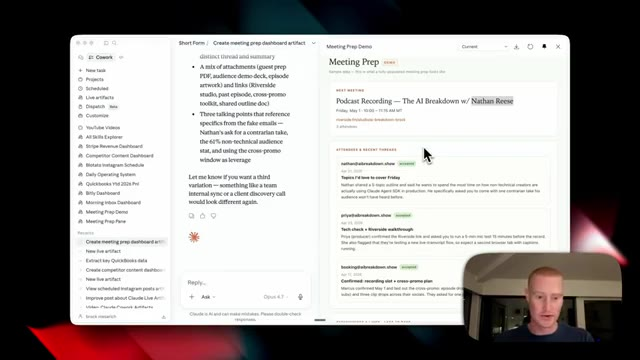
*⏱️ 00:11:11 — Interface de Claude affichant un tableau de bord de préparation de réunion (Meeting Prep) avec les détails de la prochaine réunion et les participants.*

---

### ⏱️ `[00:11:28 - 00:11:52]` | Segment #24

**🔊 Audio (Transcription Intégrale Mot pour Mot en Français) :**
> Et encore une fois, je pense que celui-ci est super universel. Je pense que tout le monde peut l'utiliser et en tirer parti. Et le meilleur dans tout ça, c'est que lorsque nous le lançons, il sera toujours sur le côté gauche et nous le verrons toujours juste ici. Donc, chaque fois que nous avons besoin de voir ce qui est sur notre planning, nous pouvons facilement y accéder directement ici, à l'intérieur de Claude. Voici le prompt que vous pouvez utiliser. Encore une fois, celui-ci sera lié dans la description pour que vous puissiez réellement le copier ou simplement faire une capture d'écran, le donner à Claude et recréer exactement ce même prompt.

**👁️ Analyse Visuelle d'Écran (gemini-3.5-flash-lite) :**
**Interface & Outils** : Interface web de Claude et navigateur de fichiers d'artefacts.

**Contenu textuel & Code** : Menu latéral avec des options comme « Meeting Prep Demo », et un prompt de configuration pour générer un tableau de bord de préparation de réunion.

**Action / Démonstration** : Navigation dans l'interface et présentation d'un prompt pour automatiser la création d'un tableau de bord.

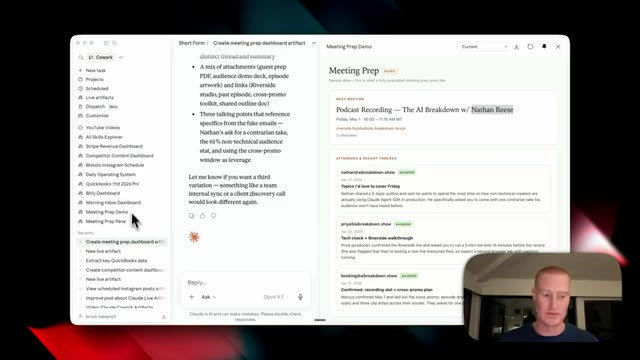
*⏱️ 00:11:34 — Interface d'un tableau de bord avec une barre latérale à gauche montrant différents fichiers et artefacts.*

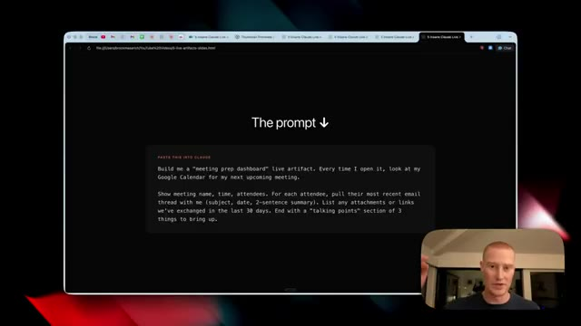
*⏱️ 00:11:46 — Diapositive affichant le titre « The prompt » avec un exemple de code ou de texte à copier dans Claude.*

---

### ⏱️ `[00:11:52 - 00:12:12]` | Segment #25

**🔊 Audio (Transcription Intégrale Mot pour Mot en Français) :**
> Passons au numéro quatre, celui-ci est incroyablement utile pour moi. C'est une façon pour moi de suivre toutes les vidéos tendances dans mon domaine en utilisant une plateforme appelée Appify. De cette façon, je peux avoir un tableau de bord mis à jour en temps réel sur le contenu que font mes concurrents. Et je n'ai jamais besoin de l'actualiser car il se met à jour en direct puisque c'est un artefact en direct.

**👁️ Analyse Visuelle d'Écran (gemini-3.5-flash-lite) :**
**Interface & Outils** : Navigateur web affichant une diapositive de présentation.

**Contenu textuel & Code** : Texte et visuels sur la performance du contenu et les vidéos tendances.

**Action / Démonstration** : Présentation du quatrième point sur le suivi des vidéos tendances avec Apify.

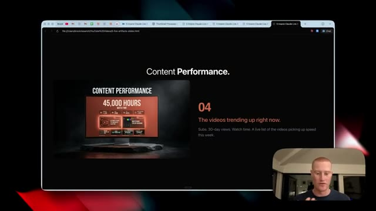
*⏱️ 00:11:57 — Capture d'écran montrant une présentation avec le titre 'Content Performance' et le point '04: The videos trending up right now'.*

---

### ⏱️ `[00:12:12 - 00:12:34]` | Segment #26

**🔊 Audio (Transcription Intégrale Mot pour Mot en Français) :**
> Voici exactement à quoi ressemble le tableau de bord des contenus des concurrents. Je dois dire que celui-ci, je suis encore en train de l'affiner, mais il fonctionne plutôt bien. Évidemment, il ne montre pas les vraies miniatures ici, mais laissez-moi vous faire une visite guidée de la façon exacte dont cela fonctionne. Ainsi, je peux voir les différents meilleurs performeurs de différentes vidéos qui ont bien fonctionné pour les personnes dans la niche. Je peux voir différentes mises en ligne récentes de personnes qui ont publié des vidéos ces derniers jours.

**👁️ Analyse Visuelle d'Écran (gemini-3.5-flash-lite) :**
**Interface & Outils** : Application de gestion de tâches et de projets avec un tableau de bord personnalisé.

**Contenu textuel & Code** : Statistiques de publications (79 posts totaux, 77 vidéos YouTube, 2 publications IG, 22.3M de vues combinées, 6 chaînes suivies) et grille de miniatures masquées par "NA" ou initiales.

**Action / Démonstration** : Présentation et explication du tableau de bord de suivi des performances des concurrents par le présentateur.

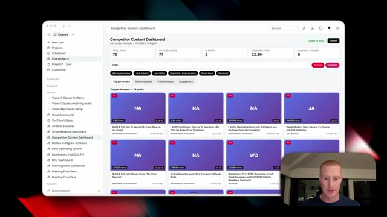
*⏱️ 00:12:18 — Capture d'écran montrant le tableau de bord des contenus des concurrents ("Competitor Content Dashboard") avec des métriques de chaînes YouTube et Instagram.*

---

### ⏱️ `[00:12:34 - 00:13:07]` | Segment #27

**🔊 Audio (Transcription Intégrale Mot pour Mot en Français) :**
> Nous pourrions voir différents sujets tendance. Je pourrais voir tous les différents mots-clés tendance à travers toutes ces différentes vidéos YouTube qui ont été publiées. Et cela montre même les différents engagements ici. Et la façon dont c'est capable de faire cela est en utilisant Appify afin de scraper toutes ces différentes chaînes YouTube et comptes Instagram en temps réel. Pour faire cela, vous allez simplement dans les connecteurs, assurez-vous d'activer Appify, de configurer votre compte Appify. Mais si vous n'êtes pas un YouTuber ou un créateur de contenu, vous n'avez peut-être pas besoin de cela. Mais je me suis dit que j'allais montrer cela parce que c'est un cas d'usage que j'utilise personnellement et cela a été assez percutant pour moi et utile pour moi-même.

**👁️ Analyse Visuelle d'Écran (gemini-3.5-flash-lite) :**
**Interface & Outils** : Dashboard de contenu concurrentiel (Competitor Content Dashboard) et annuaire de connecteurs.

**Contenu textuel & Code** : Statistiques de vues, métriques de chaînes YouTube, filtres de mots-clés et intégration d'Apify.

**Action / Démonstration** : Navigation et présentation des outils de scraping et d'analyse de données YouTube via Apify.

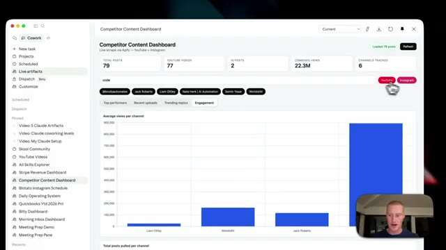
*⏱️ 00:12:43 — Image #1 : Dashboard affichant les analyses d'engagement par canal YouTube des concurrents.*

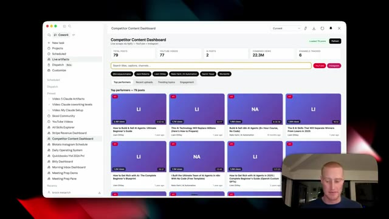
*⏱️ 00:12:51 — Image #2 : Grille de vidéos top performers issues du scraping des chaînes concurrentes.*

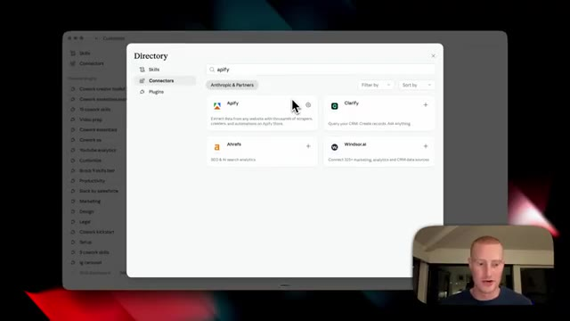
*⏱️ 00:12:59 — Image #3 : Annuaire montrant la sélection et la connexion de l'intégration Apify.*

---

### ⏱️ `[00:13:07 - 00:13:27]` | Segment #28

**🔊 Audio (Transcription Intégrale Mot pour Mot en Français) :**
> Donc, je me suis dit que j'allais partager celui-ci. Pour le cas d'usage numéro cinq, nous avons un tableau de bord des compétences. C'est un outil que beaucoup de gens dans ma communauté scolaire adorent vraiment. C'est un outil qui m'aide personnellement à rester beaucoup plus organisé, car avec toutes ces différentes compétences cloud que nous créons, nous devons vraiment rester à jour afin de pouvoir voir chacune d'entre elles que nous possédons ainsi que différents cas d'usage pour celles-ci.

**👁️ Analyse Visuelle d'Écran (gemini-3.5-flash-lite) :**
**Interface & Outils** : Navigateur web affichant une page de présentation locale (HTML) avec un design épuré sur fond noir.

**Contenu textuel & Code** : Texte "Skills Dashboard", "05", "Every Claude skill you own, auto-updated." et une illustration de tableau de bord de compétences.

**Action / Démonstration** : Le présentateur introduit et commente le cas d'usage numéro 5 du tableau de bord des compétences.

*⏱️ 00:13:12 — Capture d'écran montrant une présentation web avec le titre "Skills Dashboard" et le cas d'usage numéro 5, avec le présentateur visible en incrustation vidéo en bas à droite.*

---

### ⏱️ `[00:13:27 - 00:13:46]` | Segment #29

**🔊 Audio (Transcription Intégrale Mot pour Mot en Français) :**
> De cette façon, ils ne se perdent pas dans Claude et nous ne les oublions pas complètement. Et je tiens à dire que, avant que la nouvelle fonctionnalité d'artefacts en direct ne sorte, j'avais une tâche planifiée qui s'exécutait tous les jours pour parcourir, examiner toutes les compétences que j'avais créées et mettre à jour cela automatiquement. Et cela consommait mes jetons Claude. Donc celui-ci va non seulement me faire économiser de l'argent, mais il est beaucoup plus efficace.

**👁️ Analyse Visuelle d'Écran (gemini-3.5-flash-lite) :**
**Interface & Outils** : Navigateur web affichant une page HTML locale/personnalisée.

**Contenu textuel & Code** : Texte "Skills Dashboard.", numéro "05", et la description "Every Claude skill you own, auto-updated. One live artifact that reads your Cowork skills folder every open."

**Action / Démonstration** : Présentation visuelle du tableau de bord des compétences Claude lors de la démonstration.

*⏱️ 00:13:32 — Capture d'écran montrant une page web intitulée "Skills Dashboard" avec un design moderne sur fond noir et un aperçu vidéo en bas à droite.*

---

### ⏱️ `[00:13:46 - 00:14:20]` | Segment #30

**🔊 Audio (Transcription Intégrale Mot pour Mot en Français) :**
> Très bien, alors pour vous montrer exactement ce que je veux dire, ceci est mon tableau de bord des compétences qui se met à jour automatiquement à chaque fois que j'ouvre ceci. Donc si je vais créer une nouvelle compétence, celle-ci sera automatiquement alimentée sans que j'aie besoin d'aller dire à Claude de rafraîchir ceci et de gaspiller mes jetons en créant un tout nouveau tableau de bord HTML qui n'affiche pas réellement d'informations en temps réel. Donc si je fais défiler vers le bas, vous pouvez voir que j'ai l'ensemble de mes 237 compétences différentes ici que j'utilise à l'intérieur de Claude. Je pourrais aller cliquer sur celles-ci et cela détaillera à quoi elles servent, ainsi que les différentes commandes

**👁️ Analyse Visuelle d'Écran (gemini-3.5-flash-lite) :**
**Interface & Outils** : Application de bureau (interface personnalisée Claude Cowork / Skills Explorer).

**Contenu textuel & Code** : Statistiques chiffrées (237 total skills, 20 plugins), barres de recherche, filtres et cartes de compétences individuelles.

**Action / Démonstration** : Navigation et présentation du tableau de bord des compétences par le présentateur.

*⏱️ 00:13:55 — Vue d'ensemble de l'interface "All Skills Explorer" avec les métriques globales et le panneau de navigation latéral.*

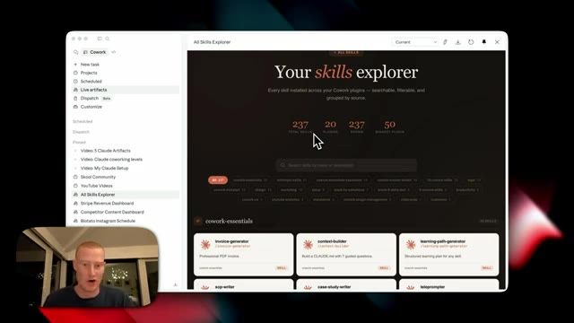
*⏱️ 00:14:03 — Gros plan sur le tableau de bord montrant les statistiques des compétences et plugins installés.*

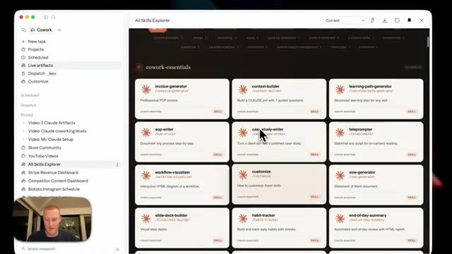
*⏱️ 00:14:12 — Défilement vers le bas de la page montrant la grille des différentes compétences (invoice-generator, context-builder, etc.).*

---

### ⏱️ `[00:14:20 - 00:14:55]` | Segment #31

**🔊 Audio (Transcription Intégrale Mot pour Mot en Français) :**
> commandes que je peux utiliser afin de déclencher ces flux de travail. Pour mettre les choses en perspective, la façon dont je faisais cela avant la sortie des nouveaux artefacts Cloud Cowork Live, je exécutais en fait des tâches planifiées où à la fin de chaque journée, cela extrayait automatiquement toutes mes compétences, régénérait tout ce tableau de bord HTML, gaspillait mes jetons, puis me mettait à jour. Mais maintenant, c'est aussi simple que d'ouvrir simplement cet artefact d'explorateur de toutes les compétences et celui-ci sera toujours alimenté par des informations en direct sur l'ensemble de mon écosystème de compétences cloud. Disons qu'il y a une application spécifique

**👁️ Analyse Visuelle d'Écran (gemini-3.5-flash-lite) :**
**Interface & Outils** : Application Claude Cowork / Interface de gestion de flux de travail (Workflow Dashboard)

**Contenu textuel & Code** : Tableaux de bord de compétences, statistiques de plugins, listes de tâches planifiées (Scheduled tasks) avec horaires d'exécution (ex: "Every day at 7:00 AM", "Weekly receipt scan", "Youtube new video check").

**Action / Démonstration** : Navigation et présentation des outils d'automatisation et de gestion des tâches planifiées dans Claude Cowork.

*⏱️ 00:14:29 — Interface de Claude Cowork affichant le tableau de bord "All Skills Explorer" avec les statistiques des compétences installées.*

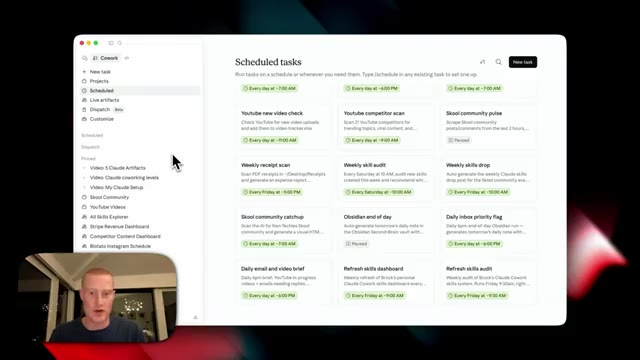
*⏱️ 00:14:38 — Interface de Claude Cowork affichant la section "Scheduled tasks" avec de multiples tâches automatisées programmées.*

*⏱️ 00:14:46 — Retour sur l'interface de "All Skills Explorer" de Claude Cowork montrant la navigation dans les différentes catégories de compétences.*

---

### ⏱️ `[00:14:55 - 00:15:30]` | Segment #32

**🔊 Audio (Transcription Intégrale Mot pour Mot en Français) :**
> que vous voulez connecter à l'intérieur de Claude que vous ne voyez pas dans la liste des connecteurs. Une excellente façon de faire cela est d'utiliser un serveur MCP comme Zapier MCP. Fondamentalement, cela vous permet de vous connecter à plus de 9000 applications différentes, dont certaines ne sont pas intégrées de manière native dans Claude. Donc, pour faire cela, nous allons cliquer sur "commencer". Et cela ne prendra que 30 secondes environ à configurer. Tout d'abord, ce que nous allons faire, c'est que nous allons cliquer sur "nouveau serveur MCP" et sélectionner Claude Cowork comme notre client ici. Ensuite, nous allons voir toutes nos différentes applications que nous avons dans ce serveur. Donc par exemple, j'ai HubSpot, Stripe, Google Drive, School, toutes celles-ci

**👁️ Analyse Visuelle d'Écran (gemini-3.5-flash-lite) :**
**Interface & Outils** : Navigateur web affichant le site officiel de Zapier MCP.

**Contenu textuel & Code** : Le titre principal de la page Zapier MCP mentionnant la connexion entre l'IA (Claude, ChatGPT, Cursor) et plus de 9000 applications, ainsi qu'un bouton « Get started ».

**Action / Démonstration** : Le présentateur présente la page d'accueil de Zapier MCP sur son écran et clique sur le bouton de démarrage.

*⏱️ 00:15:04 — La page d'accueil du site Zapier avec l'en-tête Zapier MCP et le slogan « Your AI can talk. Zapier MCP makes it act. »*

---

### ⏱️ `[00:15:30 - 00:16:03]` | Segment #33

**🔊 Audio (Transcription Intégrale Mot pour Mot en Français) :**
> différentes applications. Et pour ajouter nos applications, nous cliquons simplement sur ajouter un outil et pratiquement recherchons n'importe laquelle des applications que nous voulons ajouter. Donc si nous voulons ajouter Zendesk, par exemple, nous viendrions ici, cliquons sur sélectionner tous les outils, connectons notre compte Zendesk, ce qui prendra juste quelques clics. Et une fois que nous avons toutes les applications ajoutées, que nous voulons ajouter, nous cliquons sur ce bouton connecter, cliquons sur ajouter à Claude. Et ensuite nous allons être amenés ici. Il suffit simplement de cliquer sur connecter à Zapier. Et ensuite maintenant nous pourrions accéder à toutes ces différentes applications et commencer à exécuter différentes actions à travers celles-ci. Si vous voulez accéder à toutes les plus de 50 compétences que j'ai créées

**👁️ Analyse Visuelle d'Écran (gemini-3.5-flash-lite) :**
**Interface & Outils** : Navigateur web, interface Zapier MCP, plateforme Claude AI.

**Contenu textuel & Code** : Listes d'outils et d'applications intégrées (HubSpot, Stripe, Google Drive, Zendesk, Google Docs).

**Action / Démonstration** : Navigation et configuration des intégrations d'applications sur Zapier MCP et Claude.

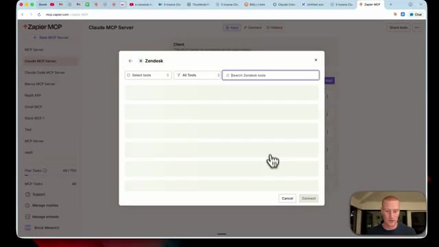
*⏱️ 00:15:38 — Interface Zapier MCP montrant une fenêtre de recherche pour ajouter des outils Zendesk.*

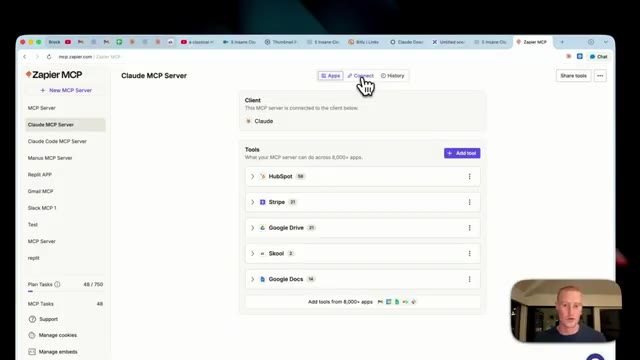
*⏱️ 00:15:47 — Tableau de bord Zapier MCP listant les applications connectées comme HubSpot, Stripe et Google Drive.*

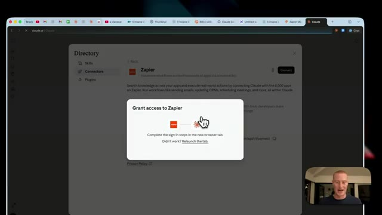
*⏱️ 00:15:55 — Interface de Claude affichant une invite de connexion et d'autorisation pour Zapier.*

---

### ⏱️ `[00:16:03 - 00:16:20]` | Segment #34

**🔊 Audio (Transcription Intégrale Mot pour Mot en Français) :**
> à l'intérieur de Claude, ainsi que ceux que je partage chaque semaine, au fur et à mesure que je les conçois, assurez-vous de rejoindre ma communauté School. Il y a un lien dans la description pour le faire. Cependant, si vous voulez continuer à obtenir plus de contenu gratuit comme celui-ci, assurez-vous de vous abonner à cette chaîne YouTube. Je vous remercie vraiment d'être restés jusqu'à la fin et je vous vois dans la prochaine vidéo.

**👁️ Analyse Visuelle d'Écran (gemini-3.5-flash-lite) :**
**Interface & Outils** : Skool, Navigateur Web, YouTube

**Contenu textuel & Code** : Interface de la plateforme Skool et liste des vidéos de la chaîne YouTube

**Action / Démonstration** : Navigation et présentation de la communauté Skool et des ressources associées

---

