# 🎬 9 Claude Skills I Can’t Live Without (steal them)

> **Chaîne** : [Brock Mesarich | AI for Non Techies](https://www.youtube.com/@BrockMesarich)  
> **Lien YouTube** : [https://www.youtube.com/watch?v=OK9c7UWl24M](https://www.youtube.com/watch?v=OK9c7UWl24M)  
> **Date de publication** : 20260425  
> **Durée** : 00:23:02  
> **Identifiant vidéo** : `OK9c7UWl24M`  
> **Transcription & Analyse** : `whisper-v3-large-turbo+gemini-3.5-flash-lite`  

---

## 📌 Synthèse Exécutive & Outils

### 💡 Résumé

Cette vidéo présentée par Brock Mesarich pour la chaîne *AI for Non Techies* dévoile l'utilisation avancée de Claude au travers de 50 compétences (skills) quotidiennes, permettant de piloter une entreprise en solo et en mode entièrement automatisé. L'approche repose sur la création de fichiers Markdown structurés qui agissent comme des instructions permanentes ou des SOPs (Standard Operating Procedures), invoquées par des mots-clés ou déclenchées automatiquement via des tâches planifiées. Brock démontre comment industrialiser la production de contenu et la gestion de systèmes complexes sans nécessiter d'intervention humaine continue.

Au-delà de la simple génération de texte, la stratégie présentée transforme l'assistant textuel en un véritable système d'exploitation d'entreprise doté de ses propres directives de marque, de tableaux de bord visuels et de mécanismes d'auto-audit. En couplant l'intelligence artificielle à des environnements d'exécution automatisés, l'utilisateur gagne en scalabilité et structure des flux de travail complexes (workflows) capables de s'auto-analyser, de détecter les redondances et de se mettre à jour en arrière-plan à des horaires programmés.

La démonstration met en lumière la puissance de la personnalisation des outputs grâce à des guides de style HTML injectés par défaut, garantissant une cohérence visuelle professionnelle (style Anthropic). L'intégration de répertoires open-source sécurisés et l'utilisation de compétences d'explication visuelle permettent de transformer des concepts abstraits ou des architectures logicielles tentaculaires en interfaces digestes et exploitables immédiatement pour la prise de décision stratégique.

### 🛠️ Outils, Modèles & Logiciels Présentés

* **Claude** : Le modèle de langage central utilisé pour exécuter, structurer et automatiser les compétences à l'aide de fichiers Markdown et de tâches planifiées.
* **ChatGPT** : Mentionné comme solution alternative de traitement du langage naturel dans l'écosystème global de l'intelligence artificielle.
* **Gemini** : Modèle linguistique concurrent évoqué dans le paysage des outils d'IA conversationnelle.
* **Grok** : Modèle d'IA conversationnelle utilisé pour le traitement des données et la génération de contenu.
* **n8n** : Outil d'automatisation de flux de travail (workflows) open-source ou auto-hébergé pour connecter différentes applications et déclencher des actions programmées.
* **Make** : Plateforme d'intégration et d'automatisation no-code (anciennement Integromat) pour relier des services tiers.
* **Zapier** : Solution d'automatisation no-code de référence pour interconnecter des logiciels et exécuter des tâches répétitives.
* **skills.sh** : Répertoire communautaire de compétences open-source permettant de rechercher et d'importer des milliers de prompts et de configurations pré-édités.

### 🔑 Points Clés & Enseignements Stratégiques

* **Définition d'une "compétence" (Skill)** : Un fichier Markdown simple stocké dans l'écosystème de l'IA, définissant un flux de travail précis et déclenchable par un simple mot-clé pour garantir une exécution normalisée à chaque sollicitation.
* **Standardisation visuelle par guide de style** : Intégration d'une compétence de "tableau de bord de style" qui force toutes les sorties HTML de Claude à respecter des directives de marque strictes (typographie, palette de couleurs Anthropic, composants UI propres).
* **Sécurité et vérification des sources externes** : Lors du téléchargement de compétences depuis des répertoires communautaires comme `skills.sh`, il est impératif de privilégier les créateurs vérifiés (Microsoft, Vercel, Remotion) pour éviter l'injection de logiciels malveillants.
* **Personnalisation modulaire** : Utilisation d'une compétence dédiée baptisée « customize » pour adapter rapidement des scripts ou des modèles tiers aux besoins spécifiques de l'entreprise ou au style personnel de l'utilisateur.
* **Visualisation systémique des flux** : Recours à la compétence d'explication visuelle pour cartographier et représenter graphiquement des architectures complexes, comme le fonctionnement interne de Claude Cowork et ses interactions de données.
* **Tableau de bord centralisé des compétences** : Création d'un répertoire HTML dynamique recensant l'ensemble des compétences installées, catégorisées par usage (création de contenu, recherche, design) pour lutter contre la surcharge cognitive.
* **Automatisation par tâches planifiées (Cron Jobs)** : Configuration d'exécutions automatiques (par exemple, chaque vendredi à 9h00) pour rafraîchir le tableau de bord des compétences sans intervention manuelle de l'utilisateur.
* **Audit de santé et score d'intégrité** : Mise en place d'une compétence d'audit qui attribue un score de 0 à 100 au répertoire, analysant les doublons, les conflits potentiels et les dysfonctionnements des flux de travail.
* **Gestion d'entreprise mono-opérateur (Solopreneuriat)** : Démontrage de la faisabilité de gérer des opérations complexes à grande échelle en déléguant des tâches récurrentes à un assistant IA hautement structuré et automatisé.

---

## ⏱️ Chronologie & Transcription Complète Audio & Visuelle (Mot pour Mot)

### ⏱️ `[00:00:00 - 00:00:19]` | Segment #01

**🔊 Audio (Transcription Intégrale Mot pour Mot en Français) :**
> PodCowork peut être extrêmement puissant, mais seulement si vous l'équipez des bonnes compétences. J'utilise personnellement 50 compétences chaque jour pour gérer mon entreprise sans aucun employé. Et aujourd'hui, j'en offre 9 tout à fait gratuitement. Et le meilleur, c'est que la plupart d'entre elles sont associées à des tâches planifiées, ce qui signifie qu'elles s'exécutent alors que je ne suis même pas sur mon ordinateur.

**👁️ Analyse Visuelle d'Écran (gemini-3.5-flash-lite) :**
**Interface & Outils** : Présentation vidéo avec graphismes textuels et illustration.

**Contenu textuel & Code** : Texte affiché à l'écran illustrant les propos de la vidéo ('to run my business with no employees', 'Scheduled Tasks').

**Action / Démonstration** : Illustration visuelle du sujet abordé par le présentateur sans manipulation technique complexe.

---

### ⏱️ `[00:00:19 - 00:00:40]` | Segment #02

**🔊 Audio (Transcription Intégrale Mot pour Mot en Français) :**
> Et si vous restez jusqu'à la fin de cette vidéo, je vais vous montrer ma compétence de carrousel Instagram qui génère des publications Instagram en pilotage automatique pour moi, et je vais également décortiquer chacune de ces 9 compétences individuellement. Et elles sont toutes regroupées sous forme de plugin, vous pouvez donc les télécharger sur Claude en quelques secondes. Entrons donc dans le vif du sujet. Tout d'abord, si vous ne savez pas ce qu'est une compétence, laissez-moi vous l'expliquer très simplement pour que vous puissiez comprendre le reste de cette vidéo.

**👁️ Analyse Visuelle d'Écran (gemini-3.5-flash-lite) :**
**Interface & Outils** : Navigateur web affichant une diapositive de présentation sur les compétences Claude Code, avec interface macOS.

**Contenu textuel & Code** : Texte de présentation "First — what even IS a skill?" et schéma montrant le fonctionnement d'un fichier markdown de compétence déclenché par une phrase clé.

**Action / Démonstration** : Le présentateur explique et illustre le concept théorique d'une compétence Claude Code à l'aide de diapositives.

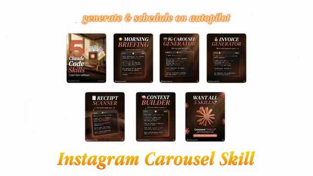
*⏱️ 00:00:24 — Présentation visuelle de différentes compétences Claude Code sous forme de cartes d'aperçu Instagram, incluant le générateur de carrousel.*

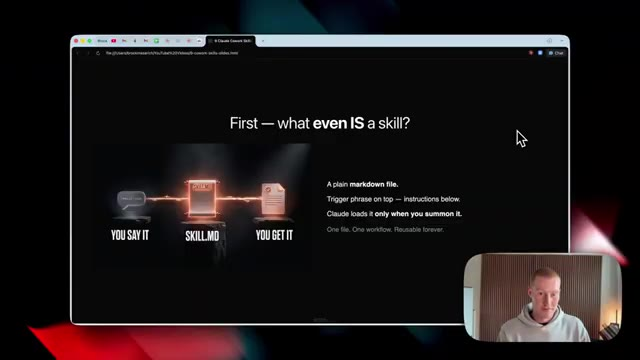
*⏱️ 00:00:35 — Capture d'écran d'une présentation web expliquant ce qu'est une "skill" (compétence) avec un schéma explicatif ("You say it -> SKILL.MD -> You get it") et une vignette vidéo du présentateur en bas à droite.*

---

### ⏱️ `[00:00:40 - 00:01:06]` | Segment #03

**🔊 Audio (Transcription Intégrale Mot pour Mot en Français) :**
> Donc, une compétence est un fichier Markdown simple qui est stocké à l'intérieur de Claude que vous pouvez déclencher et qui explique fondamentalement exactement comment réaliser un flux de travail ou une automatisation spécifique. Ensuite, pour la déclencher, tout ce que nous avons à faire est de lui donner un mot-clé. Elle invoquera cet ensemble complet d'instructions et exécutera cette tâche pour vous de la même manière à chaque fois que vous l'exécutez. Considérez cela comme le fait de former un employé une seule fois sur la façon de faire quelque chose et qu'il le fait correctement à chaque fois sans que vous ayez besoin de le lui expliquer.

**👁️ Analyse Visuelle d'Écran (gemini-3.5-flash-lite) :**
**Interface & Outils** : Navigateur web affichant une diapositive de présentation sur les compétences Claude.

**Contenu textuel & Code** : Texte explicatif : 'First — what even IS a skill?', 'A plain markdown file. Trigger phrase on top — instructions below. Claude loads it only when you summon it. One file. One workflow. Reusable forever.'

**Action / Démonstration** : Le présentateur explique la définition et le fonctionnement d'une compétence Claude sous forme de fichier Markdown.

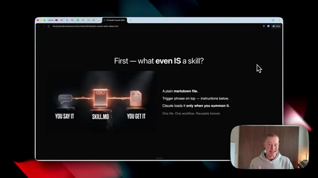
*⏱️ 00:00:47 — Une diapositive de présentation web montrant le concept d'une 'compétence' (skill) sous forme de fichier Markdown avec une illustration du flux : 'You say it' -> 'SKILL.MD' -> 'You get it'.*

---

### ⏱️ `[00:01:06 - 00:01:30]` | Segment #04

**🔊 Audio (Transcription Intégrale Mot pour Mot en Français) :**
> Avant de vous présenter toutes ces compétences une par une, je tiens à préciser qu'elles sont regroupées sous forme de plugin que vous pouvez télécharger et importer dans Claude. Je vais vous montrer exactement comment faire plus loin dans cette vidéo. C'est entièrement gratuit. Vous pouvez récupérer toutes ces compétences et les intégrer directement dans votre système. Une chose que je tiens à mentionner avant que vous ne les installiez et ne commenciez à les utiliser vous-même, c'est que je les ai toutes créées pour mon propre usage personnel.

**👁️ Analyse Visuelle d'Écran (gemini-3.5-flash-lite) :**
**Interface & Outils** : Navigateur web affichant une page de présentation locale ou de diapositives.

**Contenu textuel & Code** : Texte explicatif indiquant que les neuf compétences sont regroupées en un seul plugin installable rapidement, avec un lien dans la description.

**Action / Démonstration** : Le présentateur illustre visuellement le regroupement des compétences sous forme de plugin unique disponible via un lien.

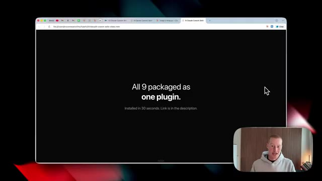
*⏱️ 00:01:12 — Une capture d'écran montrant une présentation sur fond noir avec le texte « All 9 packaged as one plugin. Installed in 30 seconds. Link is in the description », avec une petite incrustation vidéo du présentateur en bas à droite.*

---

### ⏱️ `[00:01:30 - 00:02:08]` | Segment #05

**🔊 Audio (Transcription Intégrale Mot pour Mot en Français) :**
> Vous pourriez donc avoir besoin de les personnaliser à votre goût, de changer le style, de changer les résultats, etc. Mais heureusement, comme les compétences sont simplement des fichiers Markdown, il est très facile pour vous de les modifier. Et par chance, j'ai créé une compétence personnalisée appelée « customize » qui vous aidera réellement à les adapter à vos cas d'usage. Elle vous guidera donc exactement sur la façon de les personnaliser et vous posera également quelques questions différentes afin de les adapter à vous. En commençant par l'une des compétences que j'utilise sincèrement tous les jours, à savoir ma compétence de style de tableau de bord. Laissez-moi donc vous décomposer cela dès maintenant. Chaque sortie HTML

**👁️ Analyse Visuelle d'Écran (gemini-3.5-flash-lite) :**
**Interface & Outils** : Interface de gestion de compétences et d'application web de type dashboard ou plateforme de productivité.

**Contenu textuel & Code** : Liste de compétences modulaires affichant des options de personnalisation de texte et de configuration (Hook Generator, Inbox Sweep, Slide Deck Builder, etc.).

**Action / Démonstration** : Navigation et présentation des fichiers de compétences personnalisables au format Markdown.

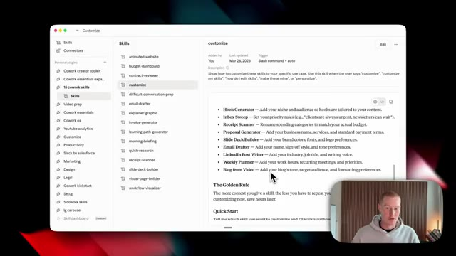
*⏱️ 00:01:49 — Une interface logicielle affichant un panneau de configuration avec une liste de compétences (skills) et des options de personnalisation dans un éditeur de texte ou un dashboard.*

---

### ⏱️ `[00:02:08 - 00:02:43]` | Segment #06

**🔊 Audio (Transcription Intégrale Mot pour Mot en Français) :**
> que j'obtiens à l'intérieur de Claude Cowork a toujours la même apparence et respecte mes directives de marque spécifiques que j'ai configurées pour lui. Donc, personnellement, voilà à quoi ça ressemble pour me. Ça correspond à ce genre de style anthropic. Je trouve que c'est super, super propre. J'ai pris les devants et j'ai conçu ceci dans ce style, mais maintenant, chaque fois que je génère un tableau de bord HTML, il aura exactement cette apparence. C'est un autre exemple. C'est mon tableau de bord des compétences, que je vais montrer plus loin dans cette vidéo, mais n'importe quel graphique ou n'importe quel code HTML qu'il génère pour moi est toujours dans ce style sans que j'aie besoin de le lui demander. Pour vous montrer exactement à quoi cela ressemble, je vais aller sur Claude

**👁️ Analyse Visuelle d'Écran (gemini-3.5-flash-lite) :**
**Interface & Outils** : Navigateur web affichant une application locale HTML/Web de Claude Cowork.

**Contenu textuel & Code** : Documentation et tableau de bord interactif sur les compétences (skills) et fonctionnalités de Claude Cowork.

**Action / Démonstration** : Navigation et présentation visuelle de l'interface et du design de Claude Cowork.

*⏱️ 00:02:16 — Page web affichant la section 'The big idea' avec le texte 'Cowork is a desktop teammate, not a chatbot'.*

*⏱️ 00:02:25 — Page web de présentation intitulée 'How Claude Cowork works' avec un design épuré aux tons sombres.*

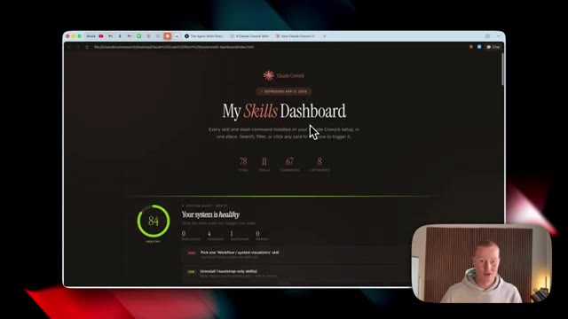
*⏱️ 00:02:34 — Tableau de bord utilisateur intitulé 'My Skills Dashboard' avec des statistiques et des indicateurs de santé du système.*

---

### ⏱️ `[00:02:43 - 00:03:05]` | Segment #07

**🔊 Audio (Transcription Intégrale Mot pour Mot en Français) :**
> et cliquez sur cette compétence. Elle s'appelle style de tableau de bord. Et si vous téléchargez ceci, vous pouvez évidemment le personnaliser comme bon vous semble. C'est simplement un modèle spécifique que je voulais. J'aime vraiment le genre d'esthétique Claude ici. Je trouve que ça a l'air super propre et que ça correspond à ma marque, mais vous pouvez voir que cela détaille toutes les couleurs, la typographie spécifique, les différents éléments de design et les composants de l'interface utilisateur.

**👁️ Analyse Visuelle d'Écran (gemini-3.5-flash-lite) :**
**Interface & Outils** : Application de gestion de compétences ou interface de personnalisation logicielle.

**Contenu textuel & Code** : Variables CSS définissant les couleurs et les styles du tableau de bord (fond marron foncé, cartes couleur crème, orange signature Claude).

**Action / Démonstration** : Sélection et présentation de la compétence « dashboard-style » pour configurer l'esthétique visuelle.

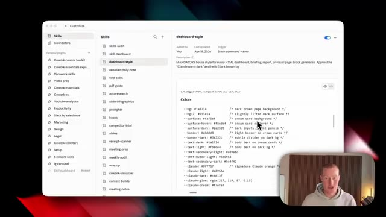
*⏱️ 00:02:49 — Capture d'écran montrant l'interface de personnalisation avec la compétence « dashboard-style » sélectionnée et son code CSS associé pour l'esthétique Claude.*

---

### ⏱️ `[00:03:05 - 00:03:31]` | Segment #08

**🔊 Audio (Transcription Intégrale Mot pour Mot en Français) :**
> Toutes ces différentes choses sont fondamentalement codées en dur dans ce fichier markdown, qui est essentiellement l'ensemble des instructions. De cette façon, chaque fois que j'utilise l'une de mes compétences qui génère effectivement des tableaux de bord HTML, il utilisera ceci comme guide de style de marque automatiquement sans même que j'aie à le mentionner. Très rapidement, si vous voulez les plus de 50 compétences que j'utilise tous les jours, ainsi que les nouvelles que j'ajoute chaque semaine, vous pouvez les obtenir dans ma communauté School.

**👁️ Analyse Visuelle d'Écran (gemini-3.5-flash-lite) :**
**Interface & Outils** : Interface de gestion de compétences et navigateur web affichant une page de ressources.

**Contenu textuel & Code** : Instructions et lignes directrices de style pour la génération de tableaux de bord et pages HTML ("Claude warm dark" aesthetic).

**Action / Démonstration** : Présentation et explication des configurations markdown utilisées pour guider la génération de tableaux de bord par les compétences IA.

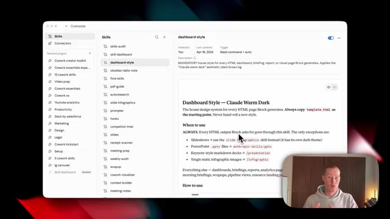
*⏱️ 00:03:12 — Interface logicielle affichant un document markdown de configuration intitulé "Dashboard Style - Claude Warm Dark", avec une petite fenêtre vidéo du présentateur en bas à droite.*

*⏱️ 00:03:24 — Page web de présentation "Every Skill & Resource Brock Uses Every Day" affichant les compétences et ressources, avec le présentateur visible en incrustation vidéo.*

---

### ⏱️ `[00:03:31 - 00:03:59]` | Segment #09

**🔊 Audio (Transcription Intégrale Mot pour Mot en Français) :**
> Il y a un lien dans la description pour le rejoindre. Très bien. Donc la compétence numéro deux est une compétence de recherche de compétences. Nous pouvons décrire ce dont nous avons besoin et Claude va piocher dans un répertoire spécifique qui est une liste de milliers de compétences différentes créées par la communauté. Nous pourrions donc simplement décrire quel est notre problème et il installera une compétence spécifique que quelquonque a déjà créée pour ce cas d'utilisation. Cela utilise ce répertoire appelé skills.sh. Ce que nous pourrions faire, c'est parcourir toutes les différentes compétences.

**👁️ Analyse Visuelle d'Écran (gemini-3.5-flash-lite) :**
**Interface & Outils** : Navigateur web affichant une diapositive de présentation puis le site web skills.sh.

**Contenu textuel & Code** : Texte descriptif de la compétence '/find-skills' et tableau de classement (skills leaderboard) avec les modules les plus installés comme 'find-skills' (vercel-labs/skills).

**Action / Démonstration** : Navigation et présentation visuelle de la deuxième compétence permettant de rechercher et d'installer des compétences pour les agents IA.

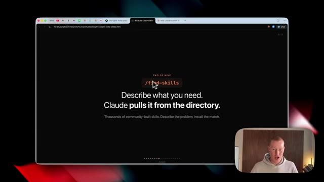
*⏱️ 00:03:38 — Diapositive de présentation montrant la compétence numéro deux, '/find-skills', avec le texte 'Describe what you need. Claude pulls it from the directory.' et la vidéo du présentateur en bas à droite.*

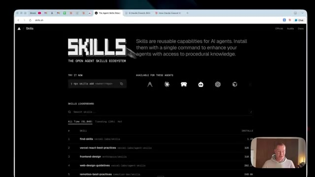
*⏱️ 00:03:52 — Capture d'écran du site web 'skills.sh' affichant l'écosystème de compétences pour agents IA, avec le classement des compétences ('find-skills' en première position).*

---

### ⏱️ `[00:04:00 - 00:04:26]` | Segment #10

**🔊 Audio (Transcription Intégrale Mot pour Mot en Français) :**
> Il y a en fait un classement ici. Nous pouvons voir combien d'installations de chacune de leurs compétences il y a. Une chose essentielle à noter ici, c'est que nous pouvons voir qui a mis en ligne toutes ces compétences. Vous pouvez voir que celle-ci indique Vercel, Remotion, Microsoft. Je vous conseillerais donc de vous en tenir à ces compétences qui ont beaucoup de téléchargements et qu'une entreprise vérifiée a créées, car vous ne voulez pas télécharger une compétence aléatoire d'une personne quelconque, ce qui pourrait potentiellement installer des logiciels malveillants.

**👁️ Analyse Visuelle d'Écran (gemini-3.5-flash-lite) :**
**Interface & Outils** : Navigateur web affichant la plateforme skills.sh

**Contenu textuel & Code** : Liste classée des compétences avec les noms des créateurs (Vercel, Anthropic, Microsoft) et le nombre d'installations (ex: 1.1M, 328.1K)

**Action / Démonstration** : Le présentateur commente le classement des compétences et les créateurs de ces outils d'IA.

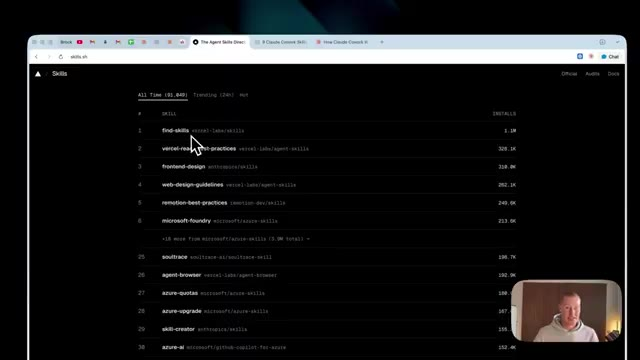
*⏱️ 00:04:06 — Capture montrant le site web skills.sh avec un classement des compétences d'IA listées par nombre d'installations, avec une petite fenêtre vidéo du présentateur en bas à droite.*

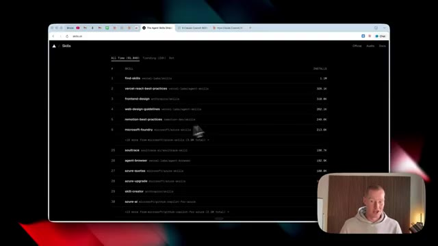
*⏱️ 00:04:13 — Capture similaire du site web skills.sh mettant en évidence le classement des compétences (Vercel, Remotion, Microsoft, etc.) avec le curseur se déplaçant.*

---

### ⏱️ `[00:04:26 - 00:04:48]` | Segment #11

**🔊 Audio (Transcription Intégrale Mot pour Mot en Français) :**
> Il faut donc faire très attention à ce que vous installez. Mais c'est un excellent répertoire d'où l'on peut télécharger automatiquement. Ensuite, nous avons une compétence d'explication visuelle, et celle-ci est formidable pour décomposer des sujets complexes, qu'il s'agisse de quelque chose que vous essayez d'apprendre personnellement ou, par exemple, moi-même, j'aime parfois l'utiliser pour voir un visuel de la façon dont tout mon système Claude fonctionne.

**👁️ Analyse Visuelle d'Écran (gemini-3.5-flash-lite) :**
**Interface & Outils** : Navigateur web affichant une page de présentation (slides).

**Contenu textuel & Code** : Texte de présentation : "/visual-explainer - Any concept -> interactive HTML page."

**Action / Démonstration** : Le présentateur commente la diapositive introduisant la compétence d'explication visuelle interactive.

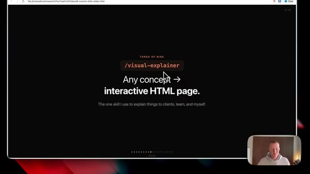
*⏱️ 00:04:32 — Diapositive de présentation affichant la compétence '/visual-explainer' avec le texte "Any concept -> interactive HTML page." sur fond noir.*

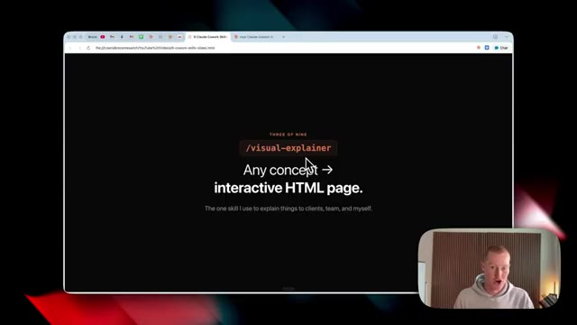
*⏱️ 00:04:37 — Même diapositive de présentation sur '/visual-explainer' avec le curseur de la souris sur le titre, le présentateur apparaissant en encadré vidéo en bas à droite.*

---

### ⏱️ `[00:04:49 - 00:05:12]` | Segment #12

**🔊 Audio (Transcription Intégrale Mot pour Mot en Français) :**
> Donc je peux voir toutes les compétences qui s'exécutent, tous les différents flux de travail que j'ai, toutes ces différentes choses. C'est donc une excellente compétence pour visualiser en quelque sorte tout ce que vous aimeriez. Pour vous montrer ce que je veux dire dans Claude, je viens de dire de visualiser le fonctionnement de Claude Cowork afin de l'expliquer. Et je pourrais cliquer sur le site HTML. Vous pouvez voir que c'est évidemment dans le style de marque que j'ai configuré plus tôt dans cette vidéo.

**👁️ Analyse Visuelle d'Écran (gemini-3.5-flash-lite) :**
**Interface & Outils** : Navigateur web, interface de l'application Claude Cowork, éditeur de code.

**Contenu textuel & Code** : Texte explicatif structuré en cinq sections et interface interactive HTML générée par l'IA.

**Action / Démonstration** : Navigation et démonstration de la génération d'une page HTML explicative interactive par Claude Cowork.

*⏱️ 00:04:54 — Page web affichant un visual-explainer interactif sur fond noir avec une police élégante.*

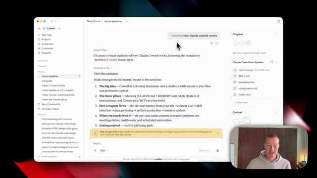
*⏱️ 00:05:00 — Interface de Claude Cowork montrant un prompt utilisateur et la génération d'un récapitulatif textuel.*

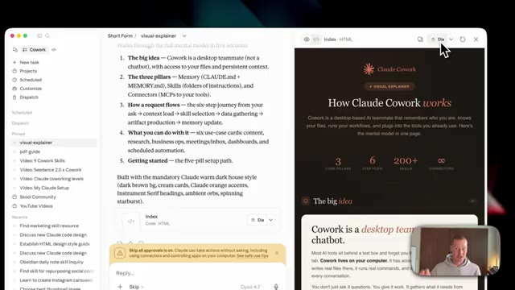
*⏱️ 00:05:06 — Affichage en écran partagé avec le code HTML d'un côté et la page Web générée de l'autre.*

---

### ⏱️ `[00:05:12 - 00:05:31]` | Segment #13

**🔊 Audio (Transcription Intégrale Mot pour Mot en Français) :**
> Donc, si vous créez ce guide de style de marque pour vous-même et que vous le personnalisez, vous pourriez automatiquement obtenir ce site HTML dans ce même style. Mais je peux l'ouvrir. Et cela détaille fondamentalement exactement comment fonctionne Claude. Trois piliers fondamentaux, un flux de travail en six étapes, plus de 200 compétences, tout un tas de connecteurs différents, cela détaille la grande idée. C'est donc très facile à digérer.

**👁️ Analyse Visuelle d'Écran (gemini-3.5-flash-lite) :**
**Interface & Outils** : Navigateur web, éditeur de documents, interface de prévisualisation HTML.

**Contenu textuel & Code** : Texte explicatif sur les flux de travail de Claude Cowork, les trois piliers (Memory, Skills, Connectors) et les statistiques de l'outil.

**Action / Démonstration** : Navigation et défilement à travers la page web de présentation stylisée de Claude Cowork.

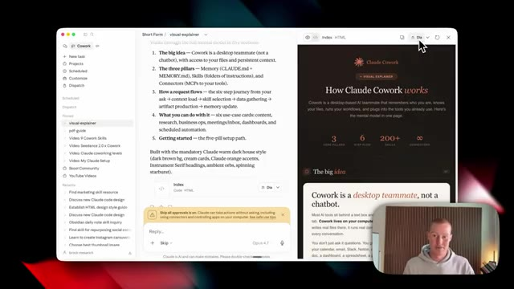
*⏱️ 00:05:17 — Vue d'ensemble d'une application affichant un document de texte à gauche et une page web stylisée intitulée "How Claude Cowork works" à droite.*

*⏱️ 00:05:22 — Gros plan sur la page web HTML au design soigné expliquant le fonctionnement de Claude Cowork avec un arrière-plan sombre et des polices élégantes.*

*⏱️ 00:05:26 — Défilement de la page web montrant les sections détaillant les piliers fondamentaux de Claude Cowork.*

---

### ⏱️ `[00:05:31 - 00:05:53]` | Segment #14

**🔊 Audio (Transcription Intégrale Mot pour Mot en Français) :**
> On peut voir que cela décompose les trois piliers. Il y a la mémoire, les compétences et les connecteurs, la façon dont une requête circule. C'est donc un explicateur visuel. Au lieu de simplement lire le texte que Claude vous donne en guise de sortie, c'est vraiment bien parfois de l'avoir simplement décomposé d'une manière plus facile à digérer, juste comme ça. C'est peut-être ainsi que mon cerveau fonctionne. Je fonctionne mieux de cette façon, mais je sais que beaucoup d'autres personnes pourraient probablement trouver une utilité à cette compétence.

**👁️ Analyse Visuelle d'Écran (gemini-3.5-flash-lite) :**
**Interface & Outils** : Navigateur web affichant une page HTML locale expliquant le fonctionnement de Claude Cowork.

**Contenu textuel & Code** : Texte descriptif détaillant le concept, les trois piliers (mémoire, compétences, connecteurs) et le flux d'une requête.

**Action / Démonstration** : Le présentateur fait défiler une page web explicative pour illustrer les mécanismes internes de Claude Cowork.

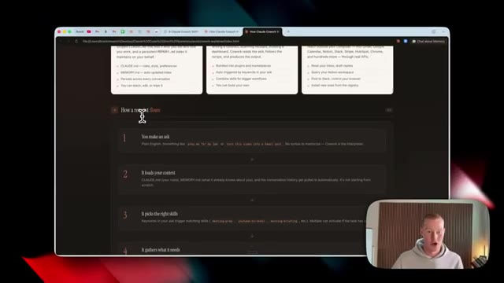
*⏱️ 00:05:37 — Vue détaillée d'une page web expliquant le fonctionnement de Claude Cowork avec les étapes du flux de requêtes.*

*⏱️ 00:05:42 — Vue d'ensemble de la page web 'How Claude Cowork works' présentant l'assistant IA de bureau et ses piliers.*

---

### ⏱️ `[00:05:53 - 00:06:12]` | Segment #15

**🔊 Audio (Transcription Intégrale Mot pour Mot en Français) :**
> Très bien, alors ensuite, numéro cinq, nous avons une autre compétence visuelle en HTML. J'aime vraiment beaucoup pouvoir visualiser les choses. Donc c'est super utile pour moi. Et je pense que celle-ci sera très intéressante pour pas mal d'entre vous. Puisque nous sélectionnons et compilons un tas de compétences différentes au sein de Claude, cela peut devenir très vite écrasant.

**👁️ Analyse Visuelle d'Écran (gemini-3.5-flash-lite) :**
**Interface & Outils** : Navigateur web affichant un fichier HTML local

**Contenu textuel & Code** : Titre '/skill-dashboard', 'Five of Nine', 'One dashboard', et l'explication du problème et de la solution

**Action / Démonstration** : Le présentateur montre et commente l'interface web de gestion des compétences

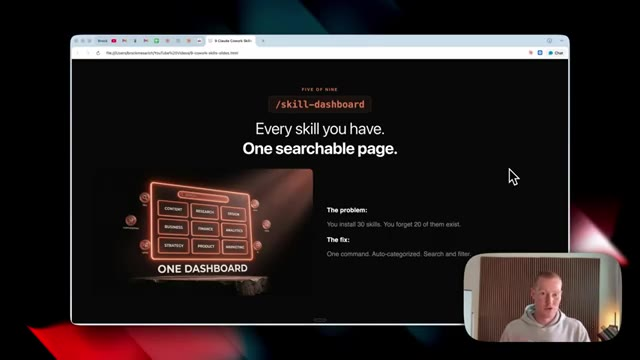
*⏱️ 00:05:57 — Une page web affichant un tableau de bord visuel pour la compétence HTML numéro 5 avec le titre 'Every skill you have. One searchable page.'*

---

### ⏱️ `[00:06:12 - 00:06:31]` | Segment #16

**🔊 Audio (Transcription Intégrale Mot pour Mot en Français) :**
> Pour moi personnellement, j'oublie beaucoup de celles que j'ai même téléchargées. Donc, cela résout honnêtement ce problème pour moi. Très bien, alors voici cette compétence. J'ai basically just dit— J'ai simplement dit tableau de bord des compétences et cela a automatiquement généré ceci pour moi. C'est un répertoire de toutes les compétences que j'ai installées dans Claude. Je pourrais ouvrir ceci. Je pourrais voir ceci dans mon navigateur.

**👁️ Analyse Visuelle d'Écran (gemini-3.5-flash-lite) :**
**Interface & Outils** : Navigateur web affichant une page de présentation et interface de l'application Claude Cowork.

**Contenu textuel & Code** : Texte de présentation du tableau de bord des compétences, interface utilisateur montrant le résumé de 81 compétences, 14 compétences, 67 commandes et 8 catégories.

**Action / Démonstration** : Navigation sur la page de présentation et affichage du tableau de bord des compétences généré automatiquement par la commande.

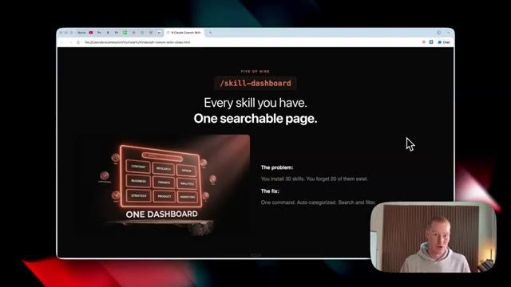
*⏱️ 00:06:17 — Capture d'écran montrant une page web avec le titre '/skill-dashboard' et la description 'Every skill you have. One searchable page.'*

*⏱️ 00:06:22 — Capture d'écran montrant l'interface de l'application Claude Cowork avec un tableau de bord des compétences généré ('My Skills Dashboard' avec 81 compétences indexées).*

---

### ⏱️ `[00:06:31 - 00:06:53]` | Segment #17

**🔊 Audio (Transcription Intégrale Mot pour Mot en Français) :**
> Je veux dire, c'est super solide. C'est évidemment dans le style de ma marque ici. Ça détaille toutes les compétences que j'ai, différentes commandes, catégories, et ça détaille même mon système, dont je vais parler ici dans un instant. Et puis en bas, ce sont toutes les différentes compétences catégorisées. Vous pouvez voir que j'ai toutes ces différentes options pour la création de contenu, toutes celles-ci pour la recherche et la stratégie, le design et les visuels.

**👁️ Analyse Visuelle d'Écran (gemini-3.5-flash-lite) :**
**Interface & Outils** : Navigateur web affichant un tableau de bord HTML local ("My Skills Dashboard").

**Contenu textuel & Code** : Statistiques du système, score de santé (84/100), décompte des compétences (81 total, 14 skills, 67 commands) et cartes interactives de compétences.
[DESC_IMAGE_3] Navigation dans le tableau de bord et présentation des différentes catégories de compétences de l'assistant IA.

**Action / Démonstration** : Explications face caméra et analyse conceptuelle des marchés.

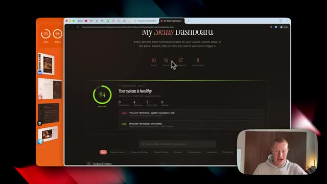
*⏱️ 00:06:37 — Vue d'ensemble du tableau de bord "My Skills Dashboard" affichant les compteurs de compétences, de commandes et l'audit du système.*

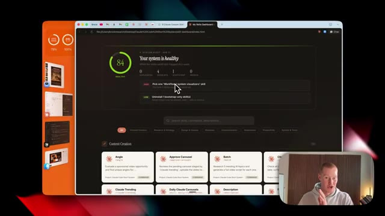
*⏱️ 00:06:42 — Défilement vers le bas du tableau de bord montrant la section d'audit système "Your system is healthy" et les cartes de compétences.*

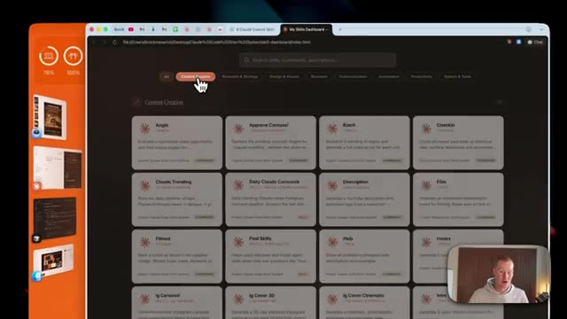
*⏱️ 00:06:47 — Gros plan sur les différentes cartes de compétences organisées par catégories telles que "Content Creation" avec le curseur pointant sur les filtres.*

---

### ⏱️ `[00:06:53 - 00:07:12]` | Segment #18

**🔊 Audio (Transcription Intégrale Mot pour Mot en Français) :**
> Et je pourrais cliquer sur n'importe lequel d'entre eux et il m'indiquera même comment l'utiliser. Je pourrais donc dire à Claude, utilise la compétence de site Web animé et cela détaille exactement ce qu'elle fait. Celui-ci convertit donc des fichiers vidéo en sites Web animés par défilement. C'est plutôt cool. Et encore une fois, je pourrais parcourir et cliquer sur n'importe lequel d'entre eux et cela détaille simplement toutes ces différentes compétences que j'ai compilées.

**👁️ Analyse Visuelle d'Écran (gemini-3.5-flash-lite) :**
**Interface & Outils** : Navigateur web affichant un tableau de bord local interactif de gestion des compétences (Skills Dashboard).

**Contenu textuel & Code** : Cartes de compétences interactives (Animated Website, Analogy, Cowork Visualizer, Diagram, etc.) avec descriptions textuelles et instructions d'utilisation.

**Action / Démonstration** : Navigation et sélection d'une carte de compétence pour afficher ses détails et instructions d'utilisation.

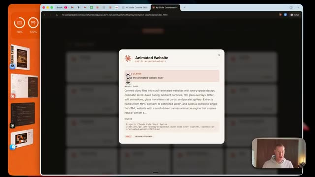
*⏱️ 00:06:58 — Interface affichant les détails d'une compétence spécifique "Animated Website" avec sa description et son prompt d'utilisation.*

*⏱️ 00:07:07 — Tableau de bord des compétences "My Skills Dashboard" présentant une grille de différentes cartes de compétences organisées par catégories.*

---

### ⏱️ `[00:07:12 - 00:07:31]` | Segment #19

**🔊 Audio (Transcription Intégrale Mot pour Mot en Français) :**
> Mais ce n'est même pas la partie la plus cool de tout ce système. La meilleure partie de cette compétence est qu'elle s'exécute comme une tâche planifiée. Donc, chaque semaine, cela se met à jour automatiquement sans que j'aie besoin d'aller lui demander de parcourir toutes mes nouvelles compétences. Donc, pour vous montrer comment faire cela, vous venez dans les tâches planifiées.

**👁️ Analyse Visuelle d'Écran (gemini-3.5-flash-lite) :**
**Interface & Outils** : Interface logicielle de Claude Cowork (navigateur / application de bureau) avec un volet latéral et des panneaux de prévisualisation.

**Contenu textuel & Code** : Texte indiquant "Dashboard refreshed - 81 skills + slash commands indexed", des statistiques sur les compétences ("81 Total", "14 Tools", "67 Commands", "8 Categories") et un score de santé système de 84.

**Action / Démonstration** : Le présentateur montre l'exécution et l'affichage du tableau de bord automatisé des compétences.

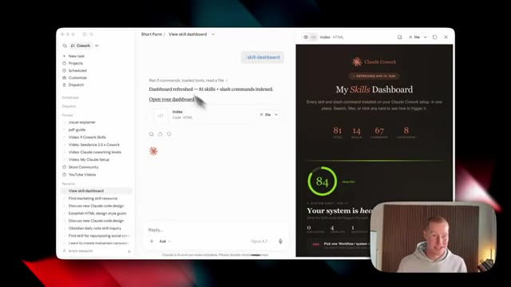
*⏱️ 00:07:17 — Capture d'écran montrant l'interface de Claude Cowork avec un tableau de bord des compétences actualisé et un aperçu vidéo du présentateur en bas à droite.*

---

### ⏱️ `[00:07:31 - 00:07:49]` | Segment #20

**🔊 Audio (Transcription Intégrale Mot pour Mot en Français) :**
> J'en ai un qui s'appelle tableau de bord de rafraîchissement des compétences, et celui-ci s'exécute tous les vendredis à 9 heures. Je pourrais regarder les instructions. Ça dit simplement de rafraîchir le tableau de bord des compétences Claude Coworks personnel de Brock. Je pourrais cliquer sur l'exécuter maintenant et cela commencera à le déclencher. Je peux configurer cela aussi souvent que je le souhaite.

**👁️ Analyse Visuelle d'Écran (gemini-3.5-flash-lite) :**
**Interface & Outils** : Interface logicielle de gestion de tâches et de productivité (Cowork)

**Contenu textuel & Code** : Instructions bash pour exécuter un script Python de mise à jour du tableau de bord de compétences Claude Coworks, avec chemins de fichiers locaux.

**Action / Démonstration** : Le présentateur survole les instructions et s'apprête à cliquer sur le bouton d'exécution immédiate ("Run now").

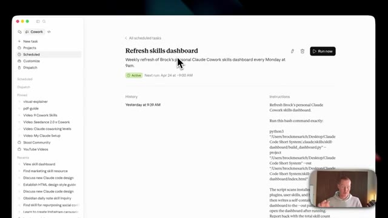
*⏱️ 00:07:36 — Vue d'ensemble de l'interface de gestion de tâches avec le détail de la tâche "Refresh skills dashboard" et les instructions bash associées.*

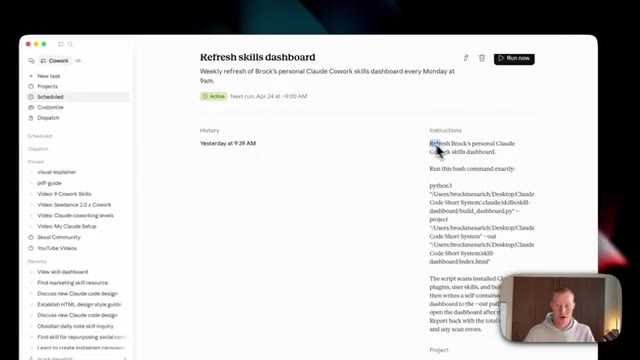
*⏱️ 00:07:40 — Gros plan sur le curseur de la souris qui survole les instructions textuelles du tableau de bord des compétences.*

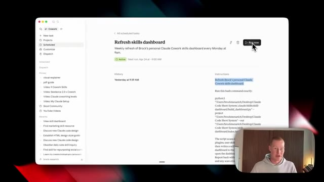
*⏱️ 00:07:45 — Le curseur de la souris se déplace vers le bouton "Run now" en haut à droite de la tâche planifiée.*

---

### ⏱️ `[00:07:49 - 00:08:11]` | Segment #21

**🔊 Audio (Transcription Intégrale Mot pour Mot en Français) :**
> Donc, disons que je veux que cela s'exécute quotidiennement ou toutes les heures. Nous pouvons configurer cela juste là. Donc, cela pourrait s'exécuter à la fréquence que vous souhaitez. Ensuite, passons à la compétence numéro six. Et celle-ci s'appuie sur ce tableau de bord des compétences que je viens de vous montrer. Et celle-ci est notre audit des compétences. Cela nous donne un score de santé de zéro à 100 basé sur notre répertoire que nous avons créé.

**👁️ Analyse Visuelle d'Écran (gemini-3.5-flash-lite) :**
**Interface & Outils** : Application de gestion de tâches (Cowork) et navigateur web affichant une diapositive de présentation au design sombre.

**Contenu textuel & Code** : Paramètres de planification de tâche (fréquence hebdomadaire, commande bash Python) et présentation de l'outil d'audit de compétences avec un "Health Score" de 87.

**Action / Démonstration** : Configuration de la fréquence d'exécution d'une tâche planifiée puis transition vers la présentation de la compétence d'audit.

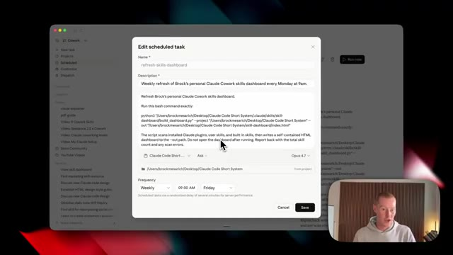
*⏱️ 00:07:55 — Fenêtre de configuration "Edit scheduled task" permettant de planifier l'exécution d'une tâche de rafraîchissement du tableau de bord de compétences.*

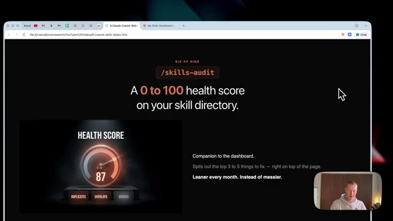
*⏱️ 00:08:00 — Diapositive de présentation affichant la compétence numéro six nommée "/skills-audit" avec un score de santé de 87 sur 100.*

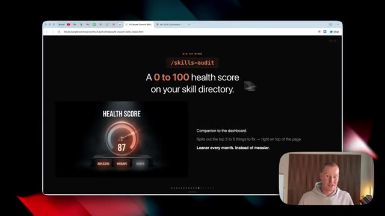
*⏱️ 00:08:05 — Même diapositive de présentation sur la compétence numéro six "/skills-audit", montrant le score de santé de 87 avec les options "Duplicates", "Overlaps" et "Broken".*

---

### ⏱️ `[00:08:11 - 00:08:30]` | Segment #22

**🔊 Audio (Transcription Intégrale Mot pour Mot en Français) :**
> Donc laissez-moi vous montrer exactement ce que je veux dire par là. Si je viens sur mon tableau de bord, vous pouvez voir qu'il est écrit 84 % sain. Fondamentalement, cela analyse s'il existe ou non différents doublons de compétences qui pourraient se chevaucher. Cela analyse toutes celles qui sont cassées. Et par exemple, cela me donne quelques suggestions ici basées sur mon répertoire.

**👁️ Analyse Visuelle d'Écran (gemini-3.5-flash-lite) :**
**Interface & Outils** : Navigateur web affichant une interface utilisateur personnalisée ("My Skills Dashboard").

**Contenu textuel & Code** : Métriques du système incluant un indicateur "84% HEALTHY", ainsi que des statistiques chiffrées (81 au total, 14 compétences, 67 commandes, 8 catégories) et des alertes de doublons ou de chevauchements.

**Action / Démonstration** : Le présentateur montre et commente les statistiques de santé du système et l'analyse des doublons sur le tableau de bord.

*⏱️ 00:08:16 — Capture d'écran montrant le tableau de bord "My Skills Dashboard" dans un navigateur web, avec un score de santé de 84 %.*

---

### ⏱️ `[00:08:30 - 00:08:49]` | Segment #23

**🔊 Audio (Transcription Intégrale Mot pour Mot en Français) :**
> Donc il est dit de choisir une compétence de visualiseur de système de flux de travail, parce qu'en ce moment j'en ai cinq qui se chevauchent un peu et cela peut causer de la confusion. Donc honnêtement, ce tableau de bord est en quelque sorte mon système d'exploitation des compétences. Et cela me permet de jongler avec de plus en plus de compétences sans que cela ne devienne trop écrasant pour moi. J'ai aussi une tâche planifiée qui s'exécute pour celle-ci.

**👁️ Analyse Visuelle d'Écran (gemini-3.5-flash-lite) :**
**Interface & Outils** : Navigateur web affichant un tableau de bord HTML personnalisé nommé 'My Skills Dashboard'.

**Contenu textuel & Code** : Statistiques du système : 81 total, 14 compétences, 67 commandes, 8 catégories, score de santé de 84 et recommandations d'optimisation.

**Action / Démonstration** : Le présentateur présente son tableau de bord de compétences et pointe la recommandation d'audit du système.

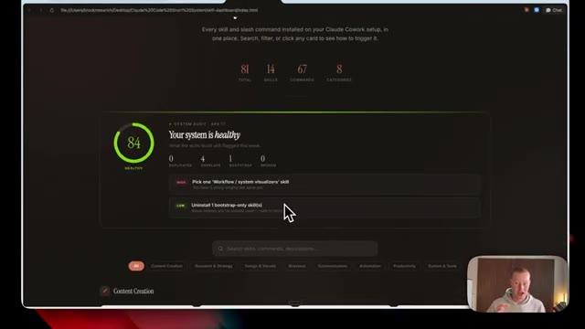
*⏱️ 00:08:35 — Capture montrant le tableau de bord 'My Skills Dashboard' affichant un score de santé de 84, avec un curseur pointant sur l'alerte concernant les compétences de visualiseur de système.*

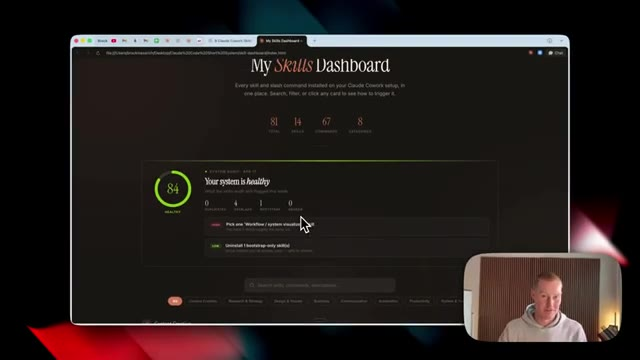
*⏱️ 00:08:39 — Vue légèrement élargie du même tableau de bord de compétences montrant l'interface complète du navigateur avec les statistiques globales du système.*

---

### ⏱️ `[00:08:49 - 00:09:07]` | Segment #24

**🔊 Audio (Transcription Intégrale Mot pour Mot en Français) :**
> Donc je n'ai pas besoin d'y toucher et de mettre cela à jour moi-même. Cette tâche planifiée s'appelle rafraîchir l'audit des compétences. Et tout ce que cela fait, c'est de parcourir l'ensemble de mes compétences. Ce que cela fait, c'est de parcourir toutes mes différentes compétences, de voir si certaines se chevauchent et de mettre automatiquement à jour ce tableau de bord pour moi.

**👁️ Analyse Visuelle d'Écran (gemini-3.5-flash-lite) :**
**Interface & Outils** : Interface de gestion de projets et de tâches planifiées (type application de productivité / Cowork).

**Contenu textuel & Code** : Texte descriptif de la tâche planifiée "Refresh skills audit", instructions avec commandes python et chemins d'accès aux scripts bash.

**Action / Démonstration** : Le présentateur parcourt l'interface de l'application pour expliquer les détails et les scripts associés à la tâche planifiée d'audit des compétences.

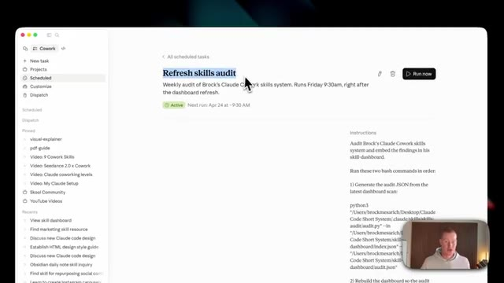
*⏱️ 00:08:54 — Vue d'ensemble de l'interface de gestion de tâches avec la tâche planifiée "Refresh skills audit" sélectionnée et le curseur pointant vers le haut.*

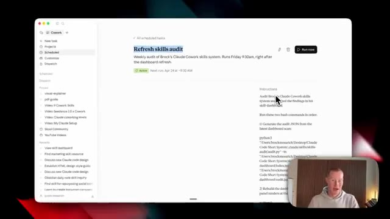
*⏱️ 00:08:58 — L'interface montre les instructions de la tâche planifiée avec le curseur se déplaçant vers le bas de la page.*

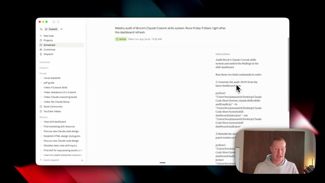
*⏱️ 00:09:03 — Défilement de la page montrant les détails des instructions bash pour exécuter l'audit des compétences et régénérer le tableau de bord.*

---

### ⏱️ `[00:09:07 - 00:09:28]` | Segment #25

**🔊 Audio (Transcription Intégrale Mot pour Mot en Français) :**
> Et personnellement, j'ai celui-ci qui s'exécute tous les vendredis à 9h30. Passons à la compétence numéro quatre. Et encore une fois, c'est l'une de mes préférées que j'ai conçue. Je suis assez fier de celle-ci. Celle-ci crée automatiquement des guides au format PDF que je peux soit partager avec mon équipe, soit même utiliser comme aimants à prospects pour du matériel marketing. Et ce sont fondamentalement des guides PDF explicatifs, qui décortiquent les choses en profondeur.

**👁️ Analyse Visuelle d'Écran (gemini-3.5-flash-lite) :**
**Interface & Outils** : Navigateur web affichant une diapositive de présentation

**Contenu textuel & Code** : Texte indiquant 'FOUR OF NINE', la commande '/pdf-guide' et la description 'Magazine cover. Cream and orange. Serif headings. One command.'

**Action / Démonstration** : Présentation de la compétence numéro 4 pour créer automatiquement des guides au format PDF.

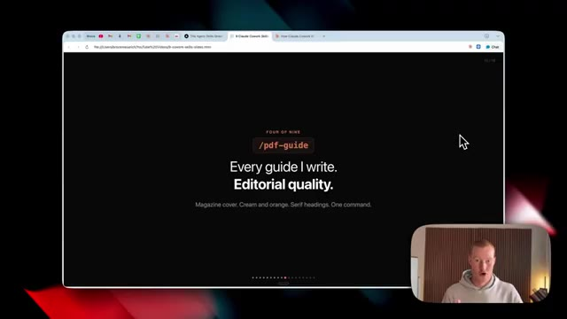
*⏱️ 00:09:12 — Une diapositive de présentation affichée dans un navigateur web montrant le titre '/pdf-guide' et le texte 'Every guide I write. Editorial quality.'*

---

### ⏱️ `[00:09:29 - 00:10:03]` | Segment #26

**🔊 Audio (Transcription Intégrale Mot pour Mot en Français) :**
> Donc laissez-moi vous montrer exactement ce que je veux dire. Très bien. Jetons donc un œil au résultat de cette compétence. Il s'agit d'un guide PDF. Si j'ouvre ceci sur le côté droit, nous avons maintenant ce PDF qui est dans ce style éditorial. Et si vous avez déjà lu le livre, The Almanac of Naval Ravikant, c'est un peu dans ce même style que le livre est écrit. Et j'ai fait ça exprès. Je trouve que ça a vraiment fière allure. Et honnêtement, c'est une excellente compétence pour générer soit des PDF qui expliquent certaines choses comme des procédures opérationnelles standardisées à votre équipe, ou même pour les offrir en tant qu'aimants à prospects pour peu importe ce que vous proposez.

**👁️ Analyse Visuelle d'Écran (gemini-3.5-flash-lite) :**
**Interface & Outils** : Application de bureau (Cowork / assistant IA) avec prévisualisation PDF intégrée et vignette vidéo du présentateur en bas à gauche.

**Contenu textuel & Code** : Guide PDF intitulé 'Claude skills mastery guide' avec un design éditorial professionnel, comprenant des sections sur 'The Problem' et 'The Specialist Analogy'.

**Action / Démonstration** : Le présentateur fait défiler et présente le guide PDF généré par l'IA dans l'interface de l'application.

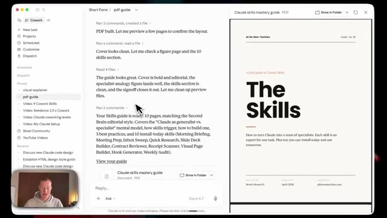
*⏱️ 00:09:37 — Interface logicielle affichant le chat de l'assistant IA à gauche et la couverture du guide PDF 'The Skills' au format éditorial à droite.*

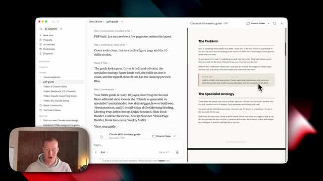
*⏱️ 00:09:46 — Interface logicielle montrant le fil de discussion de l'assistant IA à gauche et le contenu de la deuxième page du guide PDF à droite.*

---

### ⏱️ `[00:10:03 - 00:10:36]` | Segment #27

**🔊 Audio (Transcription Intégrale Mot pour Mot en Français) :**
> Imaginez venir ici et taper simplement "guide PDF" pour ensuite décomposer un sujet complexe. Peut-être que Claude a du contexte sur votre entreprise et que vous faites du référencement naturel. Vous pourriez alors créer un guide comme celui-ci sur le SEO. Une idée pour vous serait même de lancer une automatisation du genre "commentez SEO, et je vous enverrai un guide complet sur la façon de le configurer". Nous pourrions ensuite l'envoyer comme aimant à clients potentiels pour qu'ils s'inscrivent en tant que client de votre agence SEO. Par exemple, si je clique sur "afficher dans le Finder", cela ouvre le véritable guide PDF et je peux aller l'envoyer avec mon équipe. Mais c'est

**👁️ Analyse Visuelle d'Écran (gemini-3.5-flash-lite) :**
**Interface & Outils** : Interface logicielle de type espace de travail IA / assistant de documentation avec panneau de prévisualisation PDF.

**Contenu textuel & Code** : Texte de prompt `/pdf-guide`, instructions de génération de contenu, et aperçu de la couverture d'un guide PDF intitulé "The Skills".

**Action / Démonstration** : Présentation de la génération automatisée d'un guide PDF à l'aide d'un assistant IA.

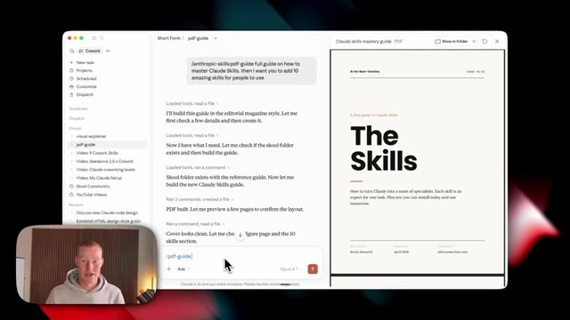
*⏱️ 00:10:12 — Capture d'écran montrant une interface de type agent IA ou assistant textuel avec un panneau latéral, une conversation avec des instructions de création de PDF, et l'aperçu du document généré intitulé "The Skills".*

---

### ⏱️ `[00:10:36 - 00:11:10]` | Segment #28

**🔊 Audio (Transcription Intégrale Mot pour Mot en Français) :**
> l'une de mes compétences préférées. J'utilise ceci tous les jours pour créer des guides comme celui-ci, et ça a vraiment tout changé pour moi. Pour vous montrer exactement comment j'utilises cela, allons sur mon Instagram. Juste ici, j'ai ces Reels Instagram, et beaucoup d'entre eux montrent des ressources gratuites. Donc par exemple, celui-ci juste ici détaille toutes les nouvelles fonctionnalités de Claude, et ça se termine toujours par commentez X, et je vous l'enverrai. Et j'ai configuré de l'automatisation ManyChat qui va envoyer automatiquement un message privé à cette personne, répondre à ses commentaires et nous allons leur envoyer le véritable guide de configuration et j'utilise ceci juste ici comme configuration

**👁️ Analyse Visuelle d'Écran (gemini-3.5-flash-lite) :**
**Interface & Outils** : Navigateur web affichant le site Instagram.

**Contenu textuel & Code** : Profil utilisateur (@aifornontechies) et miniatures de vidéos Reels portant sur des outils d'IA.

**Action / Démonstration** : Navigation et présentation visuelle du profil Instagram et des publications du présentateur.

---

### ⏱️ `[00:11:10 - 00:11:44]` | Segment #29

**🔊 Audio (Transcription Intégrale Mot pour Mot en Français) :**
> guide que nous envoyons aux gens. C'est un moyen très simple et accessible pour les gens de configurer les choses spécifiques dont je parle dans les vidéos. Passant à la compétence numéro sept, il s'agit de notre résumé de fin de journée et cela nous donne essentiellement un rapport visuel de tout ce que nous et Claude Cowork avons fait tout au long de la journée et j'ai aussi cela qui s'exécute comme une tâche planifiée donc chaque jour à 18 heures, cela m'enverra ce rapport visuel détaillant tout ce qu'il a fait tout au long de la journée. Pour vous montrer exactement ce que je veux dire, voici la fin de journée pour aujourd'hui, samedi 18 avril, et juste

**👁️ Analyse Visuelle d'Écran (gemini-3.5-flash-lite) :**
**Interface & Outils** : Navigateur web affichant une page de présentation de diapositives.

**Contenu textuel & Code** : Texte de présentation de la compétence numéro sept (/end-of-day-summary) avec les mentions "Runs at 6pm. Opens in your browser. Catches what you forgot."

**Action / Démonstration** : Présentation visuelle de la compétence numéro sept sur le résumé de fin de journée.

*⏱️ 00:11:18 — Capture d'écran montrant une diapositive de présentation web avec un fond sombre, titrée "SEVEN OF NINE /end-of-day-summary" et le texte explicatif "A visual report of what you actually did today." Un curseur de souris est visible au centre, et la webcam du présentateur apparaît en incrustation dans le coin inférieur droit.*

---

### ⏱️ `[00:11:44 - 00:12:08]` | Segment #30

**🔊 Audio (Transcription Intégrale Mot pour Mot en Français) :**
> Ici, vous pouvez voir que c'est évidemment dans mon style de design que j'ai créé plus tôt dans cette vidéo, donc quel que soit votre style, il peut le reproduire facilement. Il montre absolument tout ce qu'il a livré, donc il a fait ces carrousels Instagram pour moi avec six diapositives cinématographiques. Il a créé le PDF du guide de maîtrise des compétences de Claude, que vous avez effectivement vu plus tôt dans cette vidéo. Il a exécuté l'audit hebdomadaire des compétences. Il a exécuté un rapport de dépenses, et il a même fait cette automatisation de notification de carrousel.

**👁️ Analyse Visuelle d'Écran (gemini-3.5-flash-lite) :**
**Interface & Outils** : Navigateur web affichant une page HTML de suivi de productivité et de contenu (Content Business OS).

**Contenu textuel & Code** : Statistiques de productivité (7 Shipped, 8 Updated, 60+ Files touched, 6 Carousel slides) et aperçus de blocs de contenu.

**Action / Démonstration** : Navigation et présentation visuelle du récapitulatif quotidien généré par l'IA montrant les livrables du jour.

*⏱️ 00:11:50 — Vue d'un navigateur affichant le tableau de bord de résumé quotidien « Today's wrapup » avec des statistiques et des blocs de contenu livrés.*

*⏱️ 00:11:56 — Le même tableau de bord avec le curseur pointant sur le premier bloc de contenu « IG carousel – Claude Design launch ».*

---

### ⏱️ `[00:12:08 - 00:12:36]` | Segment #31

**🔊 Audio (Transcription Intégrale Mot pour Mot en Français) :**
> Il montre absolument tout ce qu'il a créé. Il montre tout ce qu'il a mis à jour. Vous pouvez voir que j'ai apporté quelques modifications à certaines de mes compétences ici. Il montre différentes choses qui sont encore en cours à la fin de la journée. Et puis il montrerait même ici les différents obstacles que j'ai s'il y a quelque chose qui bloque l'ensemble de mon processus de travail. Et il montre même les trois grandes priorités que j'ai pour demain sur la base des conversations que j'ai eues avec Claude aujourd'hui. Donc pour moi, il est indiqué que je dois publier le carrousel Instagram au design de Claude qu'il a généré pour moi.

**👁️ Analyse Visuelle d'Écran (gemini-3.5-flash-lite) :**
**Interface & Outils** : Navigateur web affichant un tableau de bord HTML généré localement pour le suivi de projet.

**Contenu textuel & Code** : Listes de tâches classées par catégories (Updated, In progress, Blockers, Tomorrow) avec des descriptions textuelles.

**Action / Démonstration** : Navigation et défilement à travers le tableau de bord pour présenter l'avancement des tâches quotidiennes.

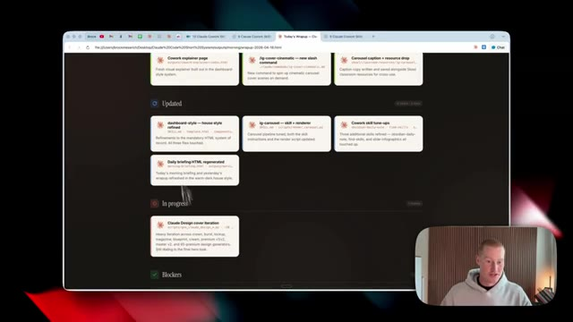
*⏱️ 00:12:15 — Vue d'un tableau de bord affichant les sections 'Updated' et 'In progress' avec des cartes de tâches.*

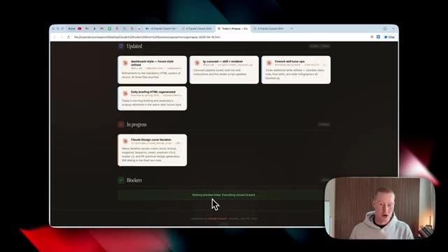
*⏱️ 00:12:22 — Vue du tableau de bord montrant la section 'Blockers' indiquant qu'aucun blocage n'est présent.*

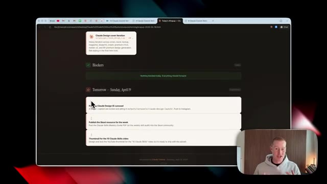
*⏱️ 00:12:29 — Vue du tableau de bord faisant défiler vers la section 'Tomorrow' listant les tâches prévues pour le lendemain.*

---

### ⏱️ `[00:12:36 - 00:13:10]` | Segment #32

**🔊 Audio (Transcription Intégrale Mot pour Mot en Français) :**
> Je dois publier la ressource scolaire de la semaine et je dois générer la miniature pour cette vidéo en fait. Si je reviens à ma tâche où j'ai exécuté ceci, je lui ai simplement donné la commande résumé de fin de journée et il a suivi tout ce processus. Mais encore une fois, vous pouvez facilement programmer cela comme une tâche planifiée. Donc pour ce faire, vous iriez dans planifié. À partir de là, nous cliquons simplement sur ajouter une nouvelle tâche. Nous lui donnons un nom. Donc je appelle simplement ceci résumé de fin de journée, je lui donne une description, résumer tout ce que Claude a fait pour moi tout au long de la journée. Ensuite, j'aime juste lui donner une description plus détaillée, en expliquant fondamentalement ce que je veux qu'il fasse, choisir quel modèle nous voulons

**👁️ Analyse Visuelle d'Écran (gemini-3.5-flash-lite) :**
**Interface & Outils** : Interface de l'application Cowork sur macOS.

**Contenu textuel & Code** : Texte récapitulatif d'activités quotidiennes, liste de tâches planifiées, et formulaire de création de tâche automatisée.

**Action / Démonstration** : Navigation dans l'application Cowork, affichage d'un rapport d'activité et configuration d'une tâche planifiée de résumé de fin de journée.

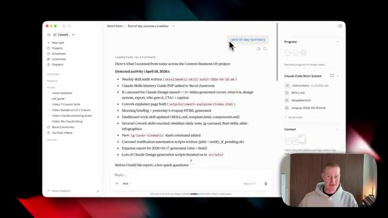
*⏱️ 00:12:45 — Vue d'une interface de gestion montrant le résultat d'une tâche de résumé de fin de journée avec les activités détectées.*

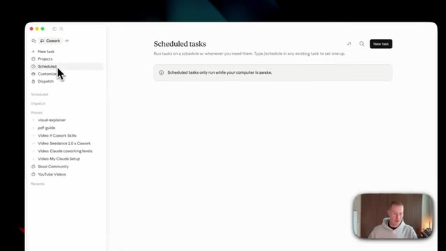
*⏱️ 00:12:53 — Écran des tâches planifiées montrant le panneau vide pour configurer des routines automatisées.*

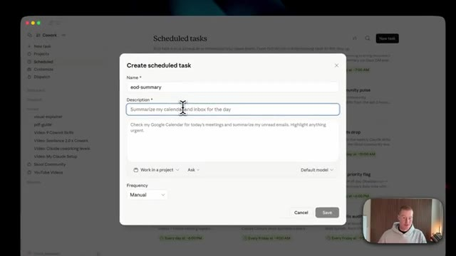
*⏱️ 00:13:01 — Fenêtre modale de création d'une tâche planifiée nommée 'eod-summary' avec une description et un champ de fréquence.*

---

### ⏱️ `[00:13:10 - 00:13:30]` | Segment #33

**🔊 Audio (Transcription Intégrale Mot pour Mot en Français) :**
> exécuter la fréquence. Donc je vais dire tous les jours à 18h. Je dois sélectionner dans quel dossier cela va fonctionner. Et à partir de là, je pourrais simplement cliquer sur enregistrer. Et toutes les tâches planifiées que nous avons configurées, nous pouvons les voir dans notre menu juste ici. Personnellement, j'ai environ 10 ou 12 tâches planifiées différentes qui s'exécutent chaque jour. Ce sont donc des automatisations qui font tourner mes compétences pendant que je ne touche pas à mon ordinateur.

**👁️ Analyse Visuelle d'Écran (gemini-3.5-flash-lite) :**
**Interface & Outils** : Interface logicielle de Cowork (tableau de bord de gestion de tâches automatisées).

**Contenu textuel & Code** : Liste de tâches planifiées (Morning briefing, Youtube new video check, Skool community pulse, etc.) avec leurs fréquences d'exécution respectives.

**Action / Démonstration** : Configuration d'une tâche planifiée avec sélection de l'horaire et visualisation de la liste complète des tâches dans le menu latéral.

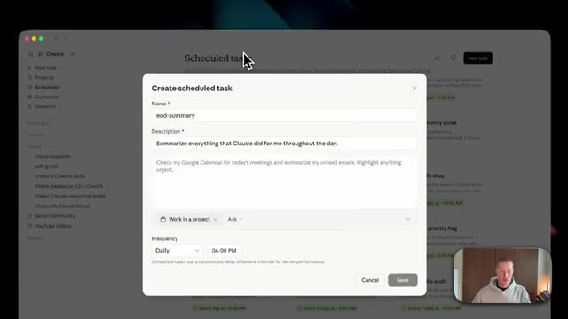
*⏱️ 00:13:15 — Fenêtre modale de création d'une tâche planifiée dans Cowork avec le nom 'eod-summary' et une fréquence quotidienne réglée à 18h00.*

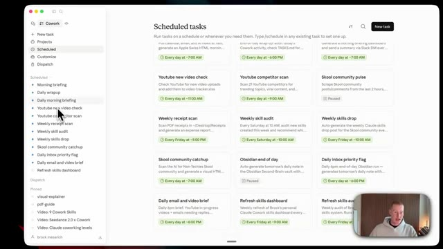
*⏱️ 00:13:20 — Vue d'ensemble du tableau de bord 'Scheduled tasks' dans Cowork montrant de nombreuses tâches automatisées configurées.*

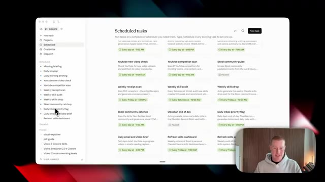
*⏱️ 00:13:25 — Vue similaire du menu des tâches planifiées montrant le panneau latéral avec la liste des différentes automatisations.*

---

### ⏱️ `[00:13:30 - 00:13:49]` | Segment #34

**🔊 Audio (Transcription Intégrale Mot pour Mot en Français) :**
> Ensuite, nous avons la compétence numéro huit. Il s'agit de la note quotidienne Obsidian. Et c'est là que je construis essentiellement mon second cerveau. Donc, si vous ne savez pas ce qu'est Obsidian, c'est une plateforme qui vous aide à organiser tous les fichiers Markdown que vous avez à l'intérieur de vos dossiers auxquels nous pouvons accéder dans Cowork. Et comme vous pouvez le voir ici, cela ressemble littéralement à un cerveau.

**👁️ Analyse Visuelle d'Écran (gemini-3.5-flash-lite) :**
**Interface & Outils** : Navigateur web affichant une page de présentation et application Obsidian (gestionnaire de notes Markdown).

**Contenu textuel & Code** : Page de présentation de l'automatisation de notes quotidiennes et interface d'Obsidian contenant des listes de tâches et des notes structurées.

**Action / Démonstration** : Navigation et présentation du système de seconde cerveau basé sur Obsidian et ses notes quotidiennes automatisées.

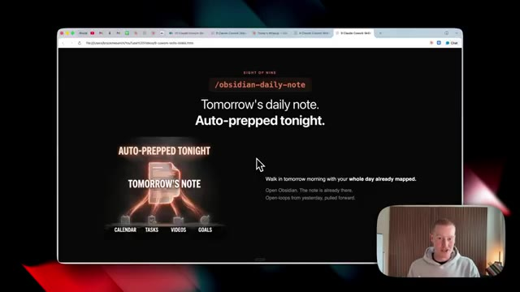
*⏱️ 00:13:35 — Présentation du concept de note quotidienne Obsidian avec le titre '/obsidian-daily-note' et le slogan 'Tomorrow's daily note. Auto-prepped tonight.'*

*⏱️ 00:13:40 — Interface de l'application Obsidian affichant une note quotidienne datée du 15 avril 2026 avec des sections 'What I'm Working On' et 'Open Action Items'.*

---

### ⏱️ `[00:13:49 - 00:14:12]` | Segment #35

**🔊 Audio (Transcription Intégrale Mot pour Mot en Français) :**
> Nous pouvions voir tous ces différents fichiers que nous avons, les différentes connexions. Et chacune d'entre elles ici représente des notes différentes que nous pouvons ouvrir et cela fonctionne de manière très similaire à Notion. Personnellement, j'utilise Claude Cowork qui fait référence à ceci puisque cela fonctionne dans le même dossier. Et chaque jour, j'ai une note qui détaille exactement sur quoi je travaille, les décisions clés qui ont été prises, et les différentes tâches à accomplir que j'ai à la fin de la journée.

**👁️ Analyse Visuelle d'Écran (gemini-3.5-flash-lite) :**
**Interface & Outils** : Application de prise de notes Obsidian / Notion avec panneau latéral de fichiers et miniatures vidéo de l'orateur.

**Contenu textuel & Code** : Arborescence de fichiers, notes structurées en markdown, propriétés de notes (tags, dates), listes de tâches et plans de contenu vidéo YouTube.

**Action / Démonstration** : Navigation et présentation de l'arborescence des fichiers et des différentes notes de planification dans l'application.

*⏱️ 00:13:55 — Vue d'une interface de notes (type Obsidian) montrant une page de stratégie de contenu avec des tags et des sections structurées.*

*⏱️ 00:14:01 — Défilement vers le bas de la même note montrant les détails sur la stratégie de contenu Skool et le format des guides de ressources.*

*⏱️ 00:14:06 — Navigation dans la barre latérale vers une note quotidienne datée du 15 avril 2026 avec des listes de tâches et de projets en cours.*

---

### ⏱️ `[00:14:12 - 00:14:32]` | Segment #36

**🔊 Audio (Transcription Intégrale Mot pour Mot en Français) :**
> Et il détaille même toutes les différentes vidéos que j'ai en préparation afin que Claude ait du contexte sur tout ce qui se passe dans mon entreprise ou dans ma vie personnelle. Je sais que vous avez probablement des questions en ce moment et je ne plonge pas très profondément là-dedans, mais si vous voulez approfondir, je l'explique en détail dans cette vidéo de 20 minutes que je mettrai en lien dans la description pour que vous puissiez aller la voir.

**👁️ Analyse Visuelle d'Écran (gemini-3.5-flash-lite) :**
**Interface & Outils** : Obsidian et navigateur web (YouTube Studio).

**Contenu textuel & Code** : Planification de contenu, pipeline de vidéos YouTube en cours de production ("Active Video Pipeline") et notes personnelles.

**Action / Démonstration** : Navigation dans l'application Obsidian pour illustrer la gestion de projets et le contexte fourni à Claude.

*⏱️ 00:14:17 — Capture montrant l'interface d'Obsidian affichant les notes quotidiennes et un tableau de suivi des vidéos en préparation (Active Video Pipeline).*

---

### ⏱️ `[00:14:32 - 00:14:53]` | Segment #37

**🔊 Audio (Transcription Intégrale Mot pour Mot en Français) :**
> Personnellement, j'ai configuré ceci comme une tâche planifiée. Donc, cela s'exécute tous les jours pour moi à 18 heures. Pour vous montrer exactement ce que je veux dire, je pourrais ouvrir cette tâche planifiée qui s'est exécutée le 16 avril et cela crée ce fichier Markdown qui détaille exactement tout ce qui était sur mon calendrier, sur quoi je travaille, différents points d'action, et cetera. Et ensuite, cela est transféré vers Obsidian, qui est ce que vous regardez en ce moment même.

**👁️ Analyse Visuelle d'Écran (gemini-3.5-flash-lite) :**
**Interface & Outils** : Application Cowork, interface de gestion de tâches planifiées, éditeur Markdown, intégration Google Calendar.

**Contenu textuel & Code** : Fichiers Markdown, structure de dossiers Second-Brain (Daily Notes, Goals, YouTube Videos), instructions Claude Code, tâches planifiées quotidiennes.

**Action / Démonstration** : Navigation dans l'interface de Cowork pour examiner les résultats d'une tâche planifiée automatisée et le fichier Markdown généré.

*⏱️ 00:14:37 — Interface de Cowork montrant le journal d'une tâche planifiée d'automatisation quotidienne exécutée le 16 avril.*

*⏱️ 00:14:43 — Affichage côte à côte de Cowork et du fichier Markdown généré détaillant la note quotidienne pour le lendemain.*

*⏱️ 00:14:48 — Vue détaillée du contenu du fichier Markdown généré par l'IA dans l'application avec les sections sur les tâches en cours.*

---

### ⏱️ `[00:14:53 - 00:15:22]` | Segment #38

**🔊 Audio (Transcription Intégrale Mot pour Mot en Français) :**
> et je pourrais toujours basculer sur cette vue quand je le souhaiterais. En résumé, si vous êtes confus, c'est fondamentalement juste l'endroit où je stocke tout mon contexte pour Claude afin de le garder organisé. Très bien, alors compétence numéro neuf, et c'est une dont je suis super fier. J'ai absolument adoré jouer avec ça. C'est ma compétence de carrousel Instagram qui recherchera automatiquement des idées de contenu pour me permettre de créer des carrousel Instagram, et créera ensuite automatiquement les graphismes pour moi, et je pourrais même les publier directement dans Claude sans avoir à toucher à mon ordinateur.

**👁️ Analyse Visuelle d'Écran (gemini-3.5-flash-lite) :**
**Interface & Outils** : Obsidian (vue graphique) et navigateur web.

**Contenu textuel & Code** : Nœuds interconnectés dans Obsidian représentant les dossiers et fichiers de contexte pour Claude, et page de présentation web sur l'automatisation de carrousels Instagram.

**Action / Démonstration** : Navigation dans l'application Obsidian pour montrer l'organisation du contexte, puis passage à une page web pour présenter une nouvelle compétence.

*⏱️ 00:15:00 — Vue graphique d'Obsidian montrant l'organisation en réseau des notes du second cerveau, avec le présentateur en médaillon en bas à droite.*

*⏱️ 00:15:08 — Page web de présentation d'un projet de carrousels Instagram automatisés, avec des schémas explicatifs et le présentateur en médaillon en bas à droite.*

---

### ⏱️ `[00:15:22 - 00:15:42]` | Segment #39

**🔊 Audio (Transcription Intégrale Mot pour Mot en Français) :**
> Pour vous montrer exactement ce que je veux dire, voici trois versions différentes de carrousels Instagram que j'ai générés avec cette compétence. Et je n'ai même pas eu à lui donner de consigne. Elle a simplement exécuté la compétence automatiquement après avoir recherché différents sujets tendances. Donc celui-ci, c'est cinq compétences de code Claude dont je ne peux pas me passer, qui détaille tout cela. En voici un autre qu'elle a créé pour la sortie du nouveau Claude Opus 4.7.

**👁️ Analyse Visuelle d'Écran (gemini-3.5-flash-lite) :**
**Interface & Outils** : Navigateur web, Excalidraw, application de visioconférence/capture vidéo.

**Contenu textuel & Code** : Maquettes et visuels graphiques de carrousels Instagram thématisés sur les compétences Claude Code.

**Action / Démonstration** : Le présentateur fait défiler et commente les différents modèles de carrousels Instagram générés automatiquement.

---

### ⏱️ `[00:15:42 - 00:16:01]` | Segment #40

**🔊 Audio (Transcription Intégrale Mot pour Mot en Français) :**
> Et puis celui-ci, il me l'a créé aujourd'hui à propos du design d'Anthropic qui vient juste de sortir. Je veux dire, c'est insensé si on y réfléchit vraiment. On dirait qu'un designer professionnel a conçu ça. Et je pourrais même programmer cela automatiquement. Comme ça, ça publie pour moi et je n'ai même pas besoin de le vérifier. Et pour vous donner la preuve que ça fonctionne, j'ai testé ça sur mon Instagram. Nous avons plusieurs carrousels différents.

**👁️ Analyse Visuelle d'Écran (gemini-3.5-flash-lite) :**
**Interface & Outils** : Navigateur web affichant un outil d'édition graphique et un profil de réseau social.

**Contenu textuel & Code** : Visuels de marketing de contenu et miniatures de publications sur l'intelligence artificielle et Claude d'Anthropic.

**Action / Démonstration** : Navigation et présentation visuelle de designs créés pour des publications automatisées.

---

### ⏱️ `[00:16:01 - 00:16:20]` | Segment #41

**🔊 Audio (Transcription Intégrale Mot pour Mot en Français) :**
> Celui-ci juste ici a plus de genre 60 000 vues. Il a 1 800 j'aime, il a 2 200 commentaires. Et encore une fois, tout cela a été créé avec Claude. Je n'ai même pas eu à y toucher et ça publie automatiquement pour moi. Très bien, alors retournons sur Claude. Je vais vous montrer exactement comment faire cela maintenant. Et je tiens à préciser en préambule que celui-ci est un peu plus complexe que tous les autres.

**👁️ Analyse Visuelle d'Écran (gemini-3.5-flash-lite) :**
**Interface & Outils** : Navigateur web affichant l'interface de l'application Claude Cowork.

**Contenu textuel & Code** : Interface utilisateur de Claude Cowork avec les options "How can I help you today?", les tâches actives ("Weekly skill audit", "Morning briefing") et le menu latéral de navigation.

**Action / Démonstration** : Navigation et présentation de l'interface de travail de Claude Cowork.

*⏱️ 00:16:15 — Interface de l'application Claude Cowork avec un champ de saisie et des tâches récentes listées.*

---

### ⏱️ `[00:16:20 - 00:16:41]` | Segment #42

**🔊 Audio (Transcription Intégrale Mot pour Mot en Français) :**
> Il y a donc deux ou trois choses ici que je dois mentionner afin que vous puissiez configurer cela. Ce ne sera pas aussi simple que de simplement télécharger ceci et de le faire fonctionner parfaitement, car nous devons lui donner suffisamment de contexte pour générer cela dans notre style. Mais nous devons aussi utiliser une API pour générer ces images, parce que je les génère avec l'API Nano Banana, qui est un modèle d'image de Gemini.

**👁️ Analyse Visuelle d'Écran (gemini-3.5-flash-lite) :**
**Interface & Outils** : Application logicielle Cowork avec barre de saisie de texte et menu latéral de navigation.

**Contenu textuel & Code** : Barre de saisie de texte « How can I help you today? » et liste de tâches actives (Weekly skill audit, Morning briefing, YouTube competitor scan, etc.).

**Action / Démonstration** : Présentation de l'interface de l'outil Cowork et de ses fonctionnalités de configuration et de gestion de tâches.

*⏱️ 00:16:26 — Capture d'écran montrant l'interface utilisateur d'une application de gestion de tâches et de productivité assistée par IA appelée Cowork, avec une barre de prompt centrale et des tâches actives listées en dessous.*

---

### ⏱️ `[00:16:41 - 00:17:01]` | Segment #43

**🔊 Audio (Transcription Intégrale Mot pour Mot en Français) :**
> Donc, première chose à faire, nous devons activer le mode code. Donc, si nous sommes dans l'application Cloud Desktop, nous ouvrons le code. Et si vous n'avez jamais utilisé ceci auparavant, et que vous avez seulement utilisé co-work, laissez-moi vous expliquer très simplement ce que nous allons faire. Nous allons ouvrir exactement le même dossier de travail dans lequel nous allons travailler à l'intérieur de co-work, ou vous pouvez en créer un nouveau, mais personnellement, j'utilise simplement le même que j'utilise toujours.

**👁️ Analyse Visuelle d'Écran (gemini-3.5-flash-lite) :**
**Interface & Outils** : Application Claude Desktop sur macOS

**Contenu textuel & Code** : Interface utilisateur de l'application avec la barre latérale gauche affichant les options "Co-work", "New task", "Projects", etc., et la zone principale avec le champ de saisie de prompt "How can I help you today?".

**Action / Démonstration** : Le présentateur clique sur l'option "Code" pour basculer vers le mode code dans l'application Cloud Desktop.

*⏱️ 00:16:46 — Capture d'écran montrant l'application Claude Desktop avec un curseur sur le point de cliquer sur le bouton "Code" pour activer le mode code.*

---

### ⏱️ `[00:17:01 - 00:17:21]` | Segment #44

**🔊 Audio (Transcription Intégrale Mot pour Mot en Français) :**
> Et nous avons accès à toutes les compétences que nous avons à l'intérieur de Claude, donc nous devrions déjà avoir cela chargé. Ensuite, la première chose que j'ai faite, c'est de demander si nous avons la compétence de test pour le carrousel Instagram. J'en ai créé un de test pour m'assurer que cette compétence commence à zéro pour vous permettre de la personnaliser réellement au lieu qu'elle soit adaptée à ma marque et à mon style, et cetera.

**👁️ Analyse Visuelle d'Écran (gemini-3.5-flash-lite) :**
**Interface & Outils** : Interface de bureau Claude Code / Application de développement.

**Contenu textuel & Code** : Requêtes textuelles sur les compétences Instagram, réponses de l'assistant de configuration, et questions de paramétrage (Instagram handle, CTA line).

**Action / Démonstration** : Saisie et exécution de requêtes textuelles pour vérifier et configurer les compétences de carrousel Instagram.

*⏱️ 00:17:06 — Interface de l'application montrant le tableau de bord avec les statistiques d'utilisation et une liste de routines dans la barre latérale.*

*⏱️ 00:17:11 — Conversation dans l'interface de développement montrant une requête sur la compétence de test du carrousel Instagram et la configuration initiale en cours.*

*⏱️ 00:17:16 — Vue similaire à la précédente montrant la continuité de la conversation avec l'assistant de code interactif.*

---

### ⏱️ `[00:17:21 - 00:17:40]` | Segment #45

**🔊 Audio (Transcription Intégrale Mot pour Mot en Français) :**
> Donc ça indique que j'ai bien cette compétence de créée et j'ai essentiellement dit, lance-la. Ensuite, ça va passer par une série de différentes questions pour moi. J'ai donc ajouté ceci à la compétence pour que de cette façon ça puisse vous aider à la personnaliser. Donc question numéro un, quel est votre identifiant Instagram ? Donc allez-y et ajoutez-le. À partir de là, ça demande quelle est votre ligne d'appel à l'action pour la diapositive finale.

**👁️ Analyse Visuelle d'Écran (gemini-3.5-flash-lite) :**
**Interface & Outils** : Interface logicielle de type assistant IA / terminal (Claude Code).

**Contenu textuel & Code** : Historique de conversation avec des prompts utilisateur (« run the test one », « it is brockmesarich », « follow for more like this ») et des questions posées par l'assistant concernant la configuration d'un carrousel Instagram.

**Action / Démonstration** : Exécution d'une compétence personnalisée et réponse aux questions de configuration guidées par l'IA.

*⏱️ 00:17:26 — Interface d'une application montrant une conversation interactive avec des questions de personnalisation et un encart vidéo du présentateur en bas à droite.*

---

### ⏱️ `[00:17:40 - 00:18:01]` | Segment #46

**🔊 Audio (Transcription Intégrale Mot pour Mot en Français) :**
> Donc, ajoutez tout ce que vous voulez qu'il soit. La question suivante, la numéro trois, est une courte phrase pour un appel à l'action. La question numéro quatre consiste à définir les différentes couleurs que nous voulons utiliser. Pour ma part, j'utilise l'orange parce que c'est un peu le thème de Claude, mais vous pourriez le faire en bleu, violet, vert, ce que vous voulez. Et ensuite, il va nous demander notre clé API. Nous devons effectivement générer celle-ci sur Google AI Studio.

**👁️ Analyse Visuelle d'Écran (gemini-3.5-flash-lite) :**
**Interface & Outils** : Application de bureau Claude Code / interface de discussion textuelle.

**Contenu textuel & Code** : Texte affichant les questions 3 et 4 sur l'appel à l'action (Call-to-Action) et la sélection des codes couleur hexadécimaux.

**Action / Démonstration** : Navigation et lecture des instructions de configuration de l'outil pour la création d'un carrousel Instagram.

*⏱️ 00:17:45 — Capture d'écran montrant une interface de type assistant de code ou agent conversationnel avec des questions sur l'appel à l'action et le choix des couleurs.*

---

### ⏱️ `[00:18:02 - 00:18:24]` | Segment #47

**🔊 Audio (Transcription Intégrale Mot pour Mot en Français) :**
> Donc ça va vous guider exactement sur la façon de faire cela. Donc vous viendriez sur votre tableau de bord et créeriez une nouvelle clé API, copieriez cette clé API, et nous revenons à Claude Code, collons notre clé API, et ça va vous donner chaque étape individuelle sur la façon de configurer cela. J'ai personnellement demandé à Claude de me guider étape par étape sur la façon de configurer cela parce que je n'étais pas capable de le comprendre par moi-même, mais il est vraiment doué pour simplement l'expliquer et vous le décomposer étape par étape.

**👁️ Analyse Visuelle d'Écran (gemini-3.5-flash-lite) :**
**Interface & Outils** : Navigateur web (Google AI Studio) et application de terminal/interface Claude Code.

**Contenu textuel & Code** : URL aistudio.google.com/apikey, boîte de dialogue de création de clé API, commande shell `export GOOGLE_AI_API_KEY=your_key_here`.

**Action / Démonstration** : Création d'une clé API dans Google AI Studio et affichage des instructions de configuration dans Claude Code.

*⏱️ 00:18:07 — Interface Google AI Studio affichant la fenêtre pop-up de création d'une nouvelle clé API Gemini.*

*⏱️ 00:18:13 — Interface de l'application Claude Code montrant les instructions pour configurer la clé API Gemini avec la commande export.*

*⏱️ 00:18:18 — Interface de l'application Claude Code avec du texte sélectionné à la souris expliquant comment rendre la clé API permanente.*

---

### ⏱️ `[00:18:24 - 00:18:49]` | Segment #48

**🔊 Audio (Transcription Intégrale Mot pour Mot en Français) :**
> Ensuite, ça va vous demander quel style vous voulez adopter. Donc ce que je ferais, c'est de trouver quelques carrousels Instagram différents dont vous aimeriez recréer l'ambiance et le style similaires. Prenez des captures d'écran, téléchargez-les comme référence, et ensuite cela servira de point de départ et vous pourrez commencer à personnaliser à partir de là. Pour vous montrer ce carrousel Instagram que j'ai généré, je suis venu ici et j'ai basically dit carrousel IG et j'ai dit design Claude, qui vient de sortir hier.

**👁️ Analyse Visuelle d'Écran (gemini-3.5-flash-lite) :**
**Interface & Outils** : Application Claude Code, interface de terminal/assistant de code.

**Contenu textuel & Code** : Questions de configuration pour un carrousel Instagram (choix de couleur, clé API Gemini) et documentation de code source (SKILL.md, render_carousel.py).

**Action / Démonstration** : Navigation et démonstration de l'utilisation de l'assistant de code pour configurer et générer des carrousels Instagram.

*⏱️ 00:18:30 — Interface d'un outil de développement (Claude Code) affichant des questions de configuration pour un carrousel Instagram, avec la vidéo du présentateur en incrustation en bas à droite.*

*⏱️ 00:18:42 — Interface de Claude Code affichant le résultat d'une fusion de scripts (merge ig-carousel) avec des explications techniques détaillées, et la vidéo du présentateur en bas à droite.*

---

### ⏱️ `[00:18:49 - 00:19:08]` | Segment #49

**🔊 Audio (Transcription Intégrale Mot pour Mot en Français) :**
> Il est allé faire des recherches pour tout cela. Il a généré toutes ces diapos en parallèle et il a créé chacune d'elles. Il les a décomposées ici et il a même ouvert les images. Laissez-moi donc vous montrer les résultats. Il a ajouté tout cela dans un dossier sur mon bureau. Vous pouvez donc voir qu'il est écrit qu'Anthropic vient de lancer Claude design et que Figma a des sueurs froides.

**👁️ Analyse Visuelle d'Écran (gemini-3.5-flash-lite) :**
**Interface & Outils** : Interface de terminal/outil CLI et gestionnaire de fichiers macOS (Finder).

**Contenu textuel & Code** : Texte récapitulatif des diapositives (01_cover.png, 02_what_it_does.png, etc.) et aperçus miniatures d'images.
[DESC_IMAGE_1] Navigation et explication des résultats textuels générés par le système d'IA.
[DESC_IMAGE_2] Visualisation du dossier contenant les images créées et prêtes à l'emploi.

**Action / Démonstration** : Explications face caméra et analyse conceptuelle des marchés.

*⏱️ 00:18:54 — Vue d'une interface de terminal avec le résumé des diapositives générées et les options de publication.*

*⏱️ 00:19:03 — Affichage d'un dossier Finder sur macOS contenant les vignettes des images générées par l'IA.*

---

### ⏱️ `[00:19:08 - 00:19:26]` | Segment #50

**🔊 Audio (Transcription Intégrale Mot pour Mot en Français) :**
> Ce qu'il fait, c'est qu'il décompose toutes les fonctionnalités clés ici. Je veux dire, c'est vraiment solide. Et encore une fois, les gars, c'est parce que je lui ai donné de véritables images de référence de différents carrousels Instagram que je voulais générer. Vous pouvez donc venir et simplement personnaliser un style comme vous le souhaitez. Il est vraiment doué pour recréer à partir d'une capture d'écran. Assurez-vous donc de lui donner suffisamment d'images de référence.

**👁️ Analyse Visuelle d'Écran (gemini-3.5-flash-lite) :**
**Interface & Outils** : macOS Finder et explorateur de fichiers

**Contenu textuel & Code** : Un visuel de carrousel Instagram montrant différentes options d'exportation (PDF, URL, PPTX, CANVA).

**Action / Démonstration** : Présentation d'un exemple de contenu visuel généré et de sa visualisation dans un dossier sur l'ordinateur.

---

### ⏱️ `[00:19:27 - 00:20:00]` | Segment #51

**🔊 Audio (Transcription Intégrale Mot pour Mot en Français) :**
> Ensuite, vous vous demandez sûrement : comment pouvons-nous planifier ces publications ? Laissez-moi vous montrer ça tout de suite. D'abord, nous allons aller dans personnaliser, puis cliquer sur connecteurs. Et nous devons ajouter un nouveau connecteur ici. Et ensuite, à partir d'ici, je vais vous montrer ce que nous allons faire. Cliquez sur ajouter un connecteur personnalisé. Et personnellement, j'utilise cette plateforme tierce appelée potato qui m'aide à publier automatiquement ce contenu pour moi et à intégrer cette fonctionnalité directement dans cloud. Vous n'êtes pas obligé de faire cela. Si vous voulez publier tout ça par vous-même, vous pouvez le faire aussi, mais je veux juste automatiser tout ça de bout en bout. Donc j'utilise potato ensuite. Une fois que nous sommes à l'intérieur de notre

**👁️ Analyse Visuelle d'Écran (gemini-3.5-flash-lite) :**
**Interface & Outils** : Interface de configuration et navigateur web (Blotato, Claude).

**Contenu textuel & Code** : Listes de connecteurs (Bitly, Canva, Slack, Zapier) et interface de rédaction de posts Instagram.

**Action / Démonstration** : Navigation dans les paramètres de connecteurs et présentation d'une plateforme de publication automatisée.

*⏱️ 00:19:35 — Interface de personnalisation montrant les connecteurs d'applications.*

*⏱️ 00:19:43 — Page d'accueil du site Web Blotato pour la création de contenu par IA.*

*⏱️ 00:19:52 — Interface de planification de publications pour Instagram sur Blotato.*

---

### ⏱️ `[00:20:00 - 00:20:20]` | Segment #52

**🔊 Audio (Transcription Intégrale Mot pour Mot en Français) :**
> compte, cliquez sur les paramètres et nous devons configurer Instagram. J'ai déjà le mien connecté, mais c'est aussi simple que de cliquer simplement sur ceci et cela vous guidera étape par étape sur la façon de le faire. Ça va juste vous envoyer sur Instagram. Vous cliquez sur approuver, puis il sera connecté à Blatato. Et vous pouvez ajouter n'importe laquelle de vos différentes plateformes de médias sociaux ici. Ainsi, vous pouvez publier sur toutes ces plateformes en même temps.

**👁️ Analyse Visuelle d'Écran (gemini-3.5-flash-lite) :**
**Interface & Outils** : Navigateur web affichant une application SaaS de gestion ou d'automatisation des réseaux sociaux.

**Contenu textuel & Code** : Boutons de connexion aux différentes plateformes sociales (Login with Twitter, Login with Instagram, Login with YouTube, etc.) et section 'Connected accounts' listant les comptes déjà reliés.

**Action / Démonstration** : Le présentateur montre l'interface permettant de connecter ou de configurer les différents comptes de réseaux sociaux.

*⏱️ 00:20:05 — Capture d'écran montrant l'interface Web d'une application de gestion de réseaux sociaux avec plusieurs boutons de connexion (Twitter, LinkedIn, Facebook, TikTok, Instagram, Threads, Pinterest, Bluesky, YouTube) et la liste des comptes connectés en bas.*

---

### ⏱️ `[00:20:20 - 00:20:40]` | Segment #53

**🔊 Audio (Transcription Intégrale Mot pour Mot en Français) :**
> Ensuite, nous allons passer à l'API et cela vous guide directement ici. Sabrina a une bonne vidéo qui explique en détail comment configurer cela. Mais nous copions simplement cette URL, nous revenons à notre connecteur personnalisé ici, nous lui donnons un nom. Donc je vais juste l'appeler Blatato, nous collons notre URL MCP, puis nous cliquons sur se connecter. À partir de là, tout ce que nous avons à faire est d'approuver l'accès.

**👁️ Analyse Visuelle d'Écran (gemini-3.5-flash-lite) :**
**Interface & Outils** : Interface de configuration Claude / Navigateur web.

**Contenu textuel & Code** : Formulaire d'ajout de connecteur personnalisé avec champs "Name" et "Remote MCP server URL".

**Action / Démonstration** : Saisie du nom et de l'URL pour ajouter un connecteur personnalisé ("Blatato").

*⏱️ 00:20:25 — Page web affichant les instructions de configuration de Claude avec le lien vers une vidéo explicative de Sabrina.*

*⏱️ 00:20:30 — Fenêtre modale "Add custom connector" affichant les champs de saisie pour le nom et l'URL du serveur MCP distant.*

*⏱️ 00:20:35 — Interface de configuration affichant la liste des connecteurs avec "Blatato CUSTOM" en cours de vérification de connexion.*

---

### ⏱️ `[00:20:40 - 00:20:58]` | Segment #54

**🔊 Audio (Transcription Intégrale Mot pour Mot en Français) :**
> cliquez sur ouvrir dans Claude, cela va nous ramener en arrière. Et maintenant, notre connecteur personnalisé est enregistré et nous avons accès à tous ces outils. Il peut créer des publications pour nous. Il peut créer un visuel, supprimer un programme, toutes ces différentes choses que Claude peut désormais faire pour nous. Donc maintenant, nous avons toutes ces images qui ont été générées en utilisant cette compétence de carrousel Instagram.

**👁️ Analyse Visuelle d'Écran (gemini-3.5-flash-lite) :**
**Interface & Outils** : Interface de gestion des connecteurs personnalisés et application de type assistant conversationnel.

**Contenu textuel & Code** : Liste des connecteurs configurés (Bitly, Canva, Notion, Slack, Zapier, Blotato) et outils disponibles (blotato_create_post, blotato_create_visual, etc.).

**Action / Démonstration** : Navigation et présentation des outils du connecteur personnalisé Blotato nouvellement enregistré.

*⏱️ 00:20:44 — Interface de personnalisation montrant les connecteurs enregistrés, notamment Blotato avec ses permissions d'outils disponibles.*

*⏱️ 00:20:49 — Vue rapprochée de la liste des permissions d'outils du connecteur Blotato permettant à Claude d'interagir.*

*⏱️ 00:20:53 — Interface de l'application montrant l'historique d'une conversation avec des aperçus d'images générées et des options de planification de publication.*

---

### ⏱️ `[00:20:58 - 00:21:19]` | Segment #55

**🔊 Audio (Transcription Intégrale Mot pour Mot en Français) :**
> Et maintenant, je vais dire : "Programme ça pour que ça soit en ligne demain à 8 heures du matin, heure de Chicago." Maintenant, ça va utiliser automatiquement Blatato et ça devrait programmer ça automatiquement. Donc, à l'intérieur de Claude Code, ça dit maintenant que ça a été programmé pour demain avec nos cinq diapositives. Donc, si je reviens sur Plotato et que je clique sur calendrier, nous pouvons voir que c'est bien programmé et que ça sera en ligne demain à 8 heures du matin.

**👁️ Analyse Visuelle d'Écran (gemini-3.5-flash-lite) :**
**Interface & Outils** : Application Claude Desktop / Claude Code, plateforme SaaS Blatato (my.blotato.com - outil d'automatisation et de programmation pour réseaux sociaux).

**Contenu textuel & Code** : - Prompt : « schedule this to go live tomorrow at 8 am chicago time ».
- Données de publication : Compte Instagram @aifornontechies, horaire planifié 8:00 AM, texte explicatif sur l'outil « Claude Design » et carrousel de 5 visuels (« What is Claude Design? », « It learns your brand », « Export anywhere », « How to try it »).

**Action / Démonstration** : Envoi d'un prompt dans Claude Code pour automatiser la programmation d'un contenu sur Instagram via l'intégration avec Blatato, suivi de la vérification du post programmé sur le tableau de bord Blatato.

*⏱️ 00:21:03 — Interface Claude Code/Desktop affichant la saisie de l'instruction « schedule this to go live tomorrow at 8 am chicago time » sous l'aperçu du carrousel.*

*⏱️ 00:21:14 — Interface de l'outil de programmation Blatato (my.blotato.com) affichant le post Instagram généré et planifié à 8h00 avec le texte descriptif et les visuels du carrousel.*

---

### ⏱️ `[00:21:20 - 00:21:56]` | Segment #56

**🔊 Audio (Transcription Intégrale Mot pour Mot en Français) :**
> Nous pouvons voir ici tout notre calendrier hebdomadaire des différents posts à venir, tout comme je peux voir tous mes posts publiés juste ici. Et le dernier conseil de pro que je veux vous donner, c'est que vous pouvez connecter toutes les différentes applications que vous utilisez. Donc, si vous voulez récupérer des données de vos e-mails, de votre Google Agenda, de Slack, de Google Drive, ou de n'importe laquelle de ces différentes applications que vous utilisez, cela démultipliera instantanément la puissance de toutes les compétences que vous utilisez et commencez à créer dans Claude. Comme je vous l'ai montré, nous avons créé un connecteur personnalisé avec Blatato ici même, mais il y a une tonne d'applications différentes auxquelles vous pouvez vous connecter nativement dans Claude. Vous pouvez faire défiler la liste juste ici, et s'il y en a une à laquelle vous ne pouvez pas vous connecter, Zapier MCP vous le permet probablement.

**👁️ Analyse Visuelle d'Écran (gemini-3.5-flash-lite) :**
**Interface & Outils** : Navigateur web présentant une interface de présentation de diapositives et un répertoire de connecteurs.

**Contenu textuel & Code** : Schéma d'architecture des connecteurs de Claude et liste des applications intégrables (Canva, Miro, Slack, Airtable, etc.).

**Action / Démonstration** : Le présentateur explique comment connecter différentes applications à Claude pour automatiser des flux de travail.

*⏱️ 00:21:29 — Présentation des connecteurs de Claude illustrant l'intégration avec différents outils.*

*⏱️ 00:21:47 — Fenêtre modale affichant l'annuaire des connecteurs disponibles pour Claude (Canva, Miro, Slack, etc.).*

---

### ⏱️ `[00:21:56 - 00:22:19]` | Segment #57

**🔊 Audio (Transcription Intégrale Mot pour Mot en Français) :**
> Cela connecte Claude à plus de 9 000 applications différentes, donc s'il y a une application à laquelle vous souhaitez vous connecter, cela pourrait vous être utile. Laissez-moi donc vous montrer exactement comment configurer cela très simplement. Une fois que nous sommes connectés à notre compte, nous allons voir ce nouveau bouton de serveur MCP. Nous allons cliquer sur Claude Cowork. Personnellement, j'ai configuré ce serveur MCP avec Stripe, HubSpot, Google Calendar, Skool, toutes ces applications différentes.

**👁️ Analyse Visuelle d'Écran (gemini-3.5-flash-lite) :**
**Interface & Outils** : Site web Zapier (zapier.com) et tableau de bord de gestion Zapier MCP (mcp.zapier.com).

**Contenu textuel & Code** : Zapier MCP, intégrations d'applications tiers (Stripe, HubSpot, Google Drive, Skool, Google Docs, Synthflow AI), options de configuration du client IA (Claude).

**Action / Démonstration** : Démonstration de la configuration et du démarrage de Zapier MCP pour connecter Claude à diverses applications.

*⏱️ 00:22:02 — Page d'accueil Zapier MCP mettant en avant la connexion de Claude à plus de 9 000 applications.*

*⏱️ 00:22:07 — Tableau de bord Zapier MCP montrant la création de serveurs MCP et des outils configurés.*

*⏱️ 00:22:13 — Page de configuration du serveur MCP dédié à Claude avec les outils intégrés (Stripe, HubSpot, Google Drive, Skool, Google Docs).*

---

### ⏱️ `[00:22:19 - 00:22:38]` | Segment #58

**🔊 Audio (Transcription Intégrale Mot pour Mot en Français) :**
> Pour pouvoir ajouter les différentes applications que l'on souhaite utiliser, on vient ici, on cherche parmi n'importe laquelle de ces applications, on clique dessus, on sélectionne toutes ces différentes actions que l'on veut utiliser. Donc je vais juste toutes les connecter. On cliquerait ensuite sur connecter, ajouter notre application. Et une fois qu'on a ajouté toutes nos applications à notre serveur MCP, on va venir par ici, cliquer sur connecter, cliquer sur ajouter à Claude et juste appuyer sur connecter.

**👁️ Analyse Visuelle d'Écran (gemini-3.5-flash-lite) :**
**Interface & Outils** : Navigateur web affichant l'interface Zapier MCP.

**Contenu textuel & Code** : Liste des applications connectées et fenêtres modales de configuration des outils Zendesk.

**Action / Démonstration** : Sélection et connexion des outils d'une application tierce (Zendesk) à un serveur MCP Zapier.

*⏱️ 00:22:24 — Interface Zapier MCP montrant une fenêtre modale de sélection des outils Zendesk.*

*⏱️ 00:22:29 — Interface Zapier MCP montrant l'étape de connexion du compte Zendesk.*

*⏱️ 00:22:34 — Interface Zapier MCP affichant la liste des outils connectés (Stripe, HubSpot, Google Drive, Skool, Google Docs).*

---

### ⏱️ `[00:22:39 - 00:22:59]` | Segment #59

**🔊 Audio (Transcription Intégrale Mot pour Mot en Français) :**
> Et ensuite, nous pourrons accéder à n'importe laquelle de ces différentes applications. Et voilà, les amis. Ce sont les neuf compétences Claude dont je ne peux plus me passer à ce stade. Si vous voulez les 50 que j'utilise, ainsi que rester à jour sur toutes les différentes compétences que j'ajoute chaque semaine, assurez-vous de rejoindre ma communauté Skool. Il y a un lien dans la description pour le faire. Mais ceci étant dit, les amis, si vous voulez plus de contenu gratuit comme celui-ci, assurez-vous de vous abonner à cette chaîne.

**👁️ Analyse Visuelle d'Écran (gemini-3.5-flash-lite) :**
**Interface & Outils** : Navigateur Web Google Chrome (application web HTML locale "Claude Cowork"), plateforme communautaire Skool.

**Contenu textuel & Code** : Application web "Claude Cowork": titre "Every Skill & Resource Brock Uses Every Day", statistiques (50 Skills, 9 Categories), bouton "Download All Skills", filtres de catégories (Content Creation, Research & Strategy, Design & Visuals, Business, Automation, Productivity). Plateforme Skool: publication "50 FREE Claude Cowork Skills I Can't Live Without (steal them)", classement (Leaderboard 30-day), bannière "join my Skool community today".

**Action / Démonstration** : Présentation du tableau de bord de ressources d'IA et invitation à rejoindre la communauté Skool pour télécharger les 50 compétences Claude.

*⏱️ 00:22:44 — Tableau de bord interactif "Claude Cowork" affichant la bibliothèque des 50 compétences et ressources d'IA réparties en 9 catégories.*

*⏱️ 00:22:54 — Interface de la communauté Skool présentant le fil de discussion avec le post donnant accès aux 50 compétences Claude gratuites et le classement des membres.*

---

### ⏱️ `[00:22:59 - 00:23:02]` | Segment #60

**🔊 Audio (Transcription Intégrale Mot pour Mot en Français) :**
> Ceci étant dit, merci d'être resté jusqu'à la fin et on se retrouve dans la prochaine vidéo.

**👁️ Analyse Visuelle d'Écran (gemini-3.5-flash-lite) :**
**Interface & Outils** : Navigateur web affichant une interface personnalisée "Claude Cowork" avec des onglets et un bouton de téléchargement de compétences.

**Contenu textuel & Code** : Page affichant le titre "Every Skill & Resource Brock Uses Every Day", un compteur indiquant 50 compétences et 9 catégories, ainsi qu'une barre de recherche et un bouton de téléchargement ("Download All Skills").

**Action / Démonstration** : Présentation de la ressource web récapitulant les compétences et outils utilisés par le présentateur, en conclusion de la vidéo.

*⏱️ 00:23:00 — Capture d'écran montrant une page web intitulée "Every Skill & Resource Brock Uses Every Day" avec une interface de type catalogue de ressources et un encart vidéo du présentateur en bas à droite.*

---

