# 🎬 The Best Claude Cowork Feature Of The Year (it's hidden)

> **Chaîne** : [Brock Mesarich | AI for Non Techies](https://www.youtube.com/@BrockMesarich)  
> **Lien YouTube** : [https://www.youtube.com/watch?v=6cu14oQCL3Q](https://www.youtube.com/watch?v=6cu14oQCL3Q)  
> **Date de publication** : 20260428  
> **Durée** : 00:15:39  
> **Identifiant vidéo** : `6cu14oQCL3Q`  
> **Transcription & Analyse** : `whisper-v3-large-turbo+gemini-3.5-flash-lite`  

---

## 📌 Synthèse Exécutive & Outils

### 💡 Résumé
Dans cette vidéo, Brock Mesarich explore une fonctionnalité avancée et méconnue de l'écosystème d'intelligence artificielle : les *Claude Cowork Live Artifacts*. Face au problème récurrent de l'obsolescence rapide des tableaux de bord HTML traditionnels — qui nécessitent des actualisations constantes, gaspillent de précieux jetons et exigent des tâches planifiées complexes via des outils d'automatisation tiers —, cette innovation transforme l'IA en un véritable système d'exploitation quotidien. En combinant le raisonnement contextuel de Claude à des pages HTML autonomes connectées en temps réel à des API externes, les utilisateurs peuvent piloter leur activité sans multiplier les allers-retours entre différentes applications.

La démonstration se concentre sur la création de centres de commandement personnalisés, illustrés par deux cas d'usage majeurs : un tableau de bord de revenus Stripe et un outil de suivi des clics Bitly. Contrairement aux interfaces statiques, ces artefacts en direct intègrent des capacités d'interaction directe (comme l'ajout et le suivi manuel de factures impayées) et agrègent des flux de données dynamiques (provenance géographique, plateformes, appareils). Cette approche préfigure un changement de paradigme fondamental où l'intelligence artificielle ne se contente plus de générer du contenu textuel ou du code jetable, mais conçoit et maintient des mini-logiciels sur mesure adaptés aux flux de travail opérationnels.

L'analyse démontre comment s'affranchir des limites des applications web classiques grâce à l'application de bureau Claude. En structurant l'environnement de travail par dossiers et en exploitant des prompts directifs précis, l'orateur montre qu'il est possible d'automatiser la supervision de métriques critiques (financières, marketing) tout en conservant une ergonomie visuelle totalement alignée sur ses besoins spécifiques, réduisant ainsi la friction cognitive et l'épuisement des ressources de calcul.

### 🛠️ Outils, Modèles & Logiciels Présentés
* **Claude Cowork (Application de bureau)** : Environnement de travail local de bureau indispensable pour accéder au mode Cowork et exploiter les artefacts dynamiques.
* **Claude Cowork Live Artifacts** : Fonctionnalité avancée générant des pages HTML autonomes connectées en temps réel aux connecteurs et applications de l'utilisateur.
* **Claude Code** : Mode de programmation et d'interaction technique accessible depuis la barre latérale de l'application Claude.
* **Stripe** : Passerelle de paiement en ligne connectée pour l'extraction de données financières en temps réel et la gestion des flux de trésorerie.
* **Bitly** : Outil de gestion de liens et de raccourcissement utilisé pour suivre l'analytique des clics, les sources de trafic et la géolocalisation des audiences.
* **Google Calendar** : Outil de planification et de gestion d'agenda interconnectable pour l'extraction contextuelle de données temporelles.
* **Gmail** : Messagerie électronique intégrée comme source de données pour l'analyse des communications et des flux entrants.
* **Notion** : Espace de travail collaboratif et de documentation pouvant être synchronisé avec l'écosystème Claude.
* **Skool** : Communauté en ligne et plateforme de cours hébergeant les guides exclusifs, diagrammes et prompts détaillés de l'orateur.
* **ChatGPT** : Modèle conversationnel de référence mentionné à titre de comparaison pour illustrer les limites des interfaces de chat traditionnelles.
* **Gemini** : Modèle linguistique alternatif d'intelligence artificielle évoqué dans le paysage concurrentiel global des LLM.
* **Grok** : Solution d'intelligence artificielle conversationnelle intégrée dans l'écosystème technologique actuel.
* **Make** : Plateforme d'automatisation de flux de travail sans code (anciennement Integromat) utilisée pour l'orchestration de tâches planifiées.
* **n8n** : Outil d'automatisation de workflows open-source et technique pour l'exécution de tâches planifiées et d'appels API.
* **Zapier** : Logiciel d'automatisation d'intégration inter-applications de référence sur le marché.

### 🔑 Points Clés & Enseignements Stratégiques
* **Dépassement des tableaux de bord statiques** : Les tableaux de bord HTML conventionnels deviennent obsolètes dès le lendemain de leur création, obligeant à une régénération constante qui gaspille des jetons et des ressources financières.
* **Élimination des tâches planifiées redondantes** : L'utilisation des artefacts en direct évite d'avoir à exécuter des scripts quotidiens lourds (comme l'extraction de liens Bitly ou l'analyse d'e-mails) pour maintenir l'information à jour.
* **Architecture des *Live Artifacts*** : Un artefact en direct fonctionne comme un mini-logiciel autonome intégré à Claude, agissant comme un centre de commandement centralisé qui interagit directement avec les applications connectées.
* **Connexion bidirectionnelle en temps réel** : Au-delà de la simple lecture de données (comme les transactions Stripe), les artefacts permettent d'écrire, de modifier et de mettre à jour des informations directement depuis l'interface visuelle.
* **Prérequis technique d'installation** : L'accès aux fonctionnalités de Cowork et aux artefacts dynamiques nécessite impérativement le téléchargement et l'utilisation de l'application de bureau Claude, la version web étant insuffisante.
* **Sélection rigoureuse des modes d'interface** : L'utilisateur doit basculer explicitement du mode chat standard vers le mode Cowork via le sélecteur d'interface situé dans le coin supérieur gauche.
* **Isolation par dossiers locaux** : La configuration et le stockage des artefacts nécessitent de cibler un dossier spécifique sur le système informatique local pour structurer proprement l'espace de travail.
* **Épinglage et accessibilité latérale** : Le menu latéral de l'application permet d'épingler et de retrouver instantanément les différents artefacts en direct sans avoir à fouiller dans l'historique des discussions textuelles.
* **Personnalisation granulaire des vues** : Les tableaux de bord peuvent être architecturés sur mesure (vue d'ensemble, partenariats de marque, paiements, comptes clients) selon les exigences analytiques spécifiques de l'utilisateur.
* **Fonctionnalités transactionnelles intégrées** : Il est possible d'encoder des logiques métier personnalisées directement dans le code généré, comme un module de saisie manuelle pour le suivi des factures en retard et des paiements en attente.
* **Granularité analytique marketing** : Le tableau de bord Bitly illustre la capacité à croiser des métriques complexes : volume de clics par vidéo, identification des URLs spécifiques, segmentation géographique par pays, plateformes sources et types d'appareils utilisés.
* **Industrialisation des processus via des ressources partagées** : L'utilisation de guides PDF et de prompts textuels prêts à l'emploi (distribués via une communauté dédiée) permet de répliquer ces architectures logicielles sur mesure en quelques secondes.

---

## ⏱️ Chronologie & Transcription Complète Audio & Visuelle (Mot pour Mot)

### ⏱️ `[00:00:00 - 00:00:21]` | Segment #01

**🔊 Audio (Transcription Intégrale Mot pour Mot en Français) :**
> Il y a une fonctionnalité cachée à l'intérieur de Cloud Cowork qui a complètement changé ma façon de l'utiliser. Et c'est un aperçu du futur de la façon dont le travail va changer dans la nouvelle ère de l'IA. Je pense personnellement que c'est l'un des plus grands changements fondamentaux que j'ai vus dans le domaine de l'IA. Et dans cette vidéo, je vais décortiquer ce que c'est, comment n'importe qui peut commencer à l'utiliser dès maintenant et vous montrer exactement comment je l'exploite pour m'aider à gérer mon entreprise.

**👁️ Analyse Visuelle d'Écran (gemini-3.5-flash-lite) :**
**Interface & Outils** : AUCUNE

**Contenu textuel & Code** : AUCUNE

**Action / Démonstration** : Explications face caméra et analyse conceptuelle des marchés.

---

### ⏱️ `[00:00:21 - 00:00:41]` | Segment #02

**🔊 Audio (Transcription Intégrale Mot pour Mot en Français) :**
> Donc sans plus tarder, plongeons-nous là-dedans. Très bien, il y a donc une fonctionnalité cachée à l'intérieur de Claude Cowork que la plupart des gens n'utilisent pas. Et je suis sidéré que plus de gens n'en parlent pas, car sincèrement pour moi, ça a été l'un des plus grands changements que j'ai eus en utilisant Cowork. Alors tout d'abord, parlons du problème que cela résout. Et c'est le fait que la plupart des tableaux de bord HTML deviennent obsolètes très rapidement.

**👁️ Analyse Visuelle d'Écran (gemini-3.5-flash-lite) :**
**Interface & Outils** : Navigateur web affichant une interface de présentation minimaliste.

**Contenu textuel & Code** : Texte affiché : "A hidden Cowork feature most people miss." et "Build a dashboard once. It refreshes itself." avec un curseur de souris pointant sur le texte.

**Action / Démonstration** : Le présentateur introduit la fonctionnalité cachée de Claude Cowork illustrée par la page web à l'écran.

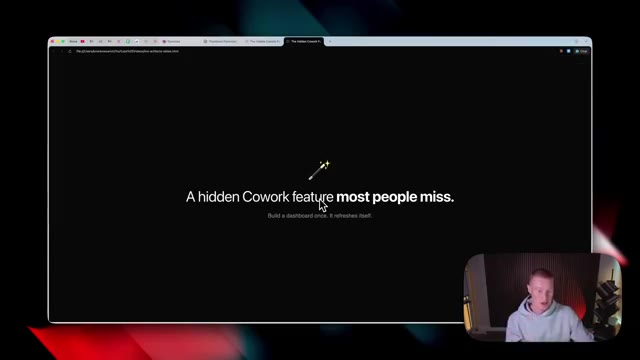
*⏱️ 00:00:26 — Capture d'écran montrant une page web au design épuré avec le texte "A hidden Cowork feature most people miss." et une icône de baguette magique, tandis que le présentateur apparaît dans un encadré en bas à droite.*

---

### ⏱️ `[00:00:41 - 00:01:00]` | Segment #03

**🔊 Audio (Transcription Intégrale Mot pour Mot en Français) :**
> Fondamentalement, si vous avez déjà généré un tableau de bord à l'intérieur de Cloud Coork, c'est super. C'est plutôt cool. C'est plutôt novateur. Mais le problème avec ça, c'est que si vous l'avez construit un lundi, il va fondamentalement devenir inutile d'ici demain. Pour obtenir des informations à jour, vous devez exécuter une automatisation ou l'actualiser et cela gaspille des jetons. il doit être généré à partir de zéro à chaque fois.

**👁️ Analyse Visuelle d'Écran (gemini-3.5-flash-lite) :**
**Interface & Outils** : Navigateur web affichant une diapositive de présentation interactive avec une incrustation vidéo du présentateur en bas à droite.

**Contenu textuel & Code** : Texte à l'écran : "Most dashboards go stale fast", "Built Monday, useless by Friday", "Same questions, fresh tokens", "Every refresh runs the full model". Une illustration représentant des écrans de métriques ("Monday Metrics", "Q1 Pipeline", "Last Week").

**Action / Démonstration** : Le présentateur expose visuellement le problème de l'obsolescence rapide des tableaux de bord statiques construits en début de semaine.

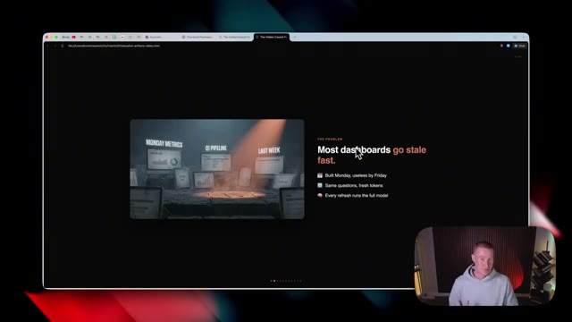
*⏱️ 00:00:46 — Une diapositive de présentation sombre intitulée "Most dashboards go stale fast" avec une illustration à gauche et des points clés textuels à droite, illustrant la problématique des tableaux de bord obsolètes.*

---

### ⏱️ `[00:01:00 - 00:01:24]` | Segment #04

**🔊 Audio (Transcription Intégrale Mot pour Mot en Français) :**
> Et je vous dis que cela va dévorer vos précieux jetons pour lesquels vous dépensez l'argent que vous avez gagné à la sueur de votre front. Avant que cette nouvelle fonctionnalité ne sorte, je devais exécuter une tâche planifiée, qui est fondamentalement une automatisation qui s'exécute chaque jour à une heure spécifique afin de ré-analyser mon e-mail, extraire chaque lien de Bitly et extraire des informations de mon Google Agenda, tout en devant reconstruire ce tableau de bord à partir de zéro à chaque fois.

**👁️ Analyse Visuelle d'Écran (gemini-3.5-flash-lite) :**
**Interface & Outils** : Présentation de diapositives web avec encadré vidéo du présentateur en bas à droite.

**Contenu textuel & Code** : Texte explicatif sur les tâches planifiées ('Re-scraped Gmail at 7am', 'Pulled every Bitly link', 'Hit Google Calendar', 'Rebuilt the dashboard from scratch').

**Action / Démonstration** : Le présentateur explique sa configuration d'automatisation quotidienne avec les tâches exécutées chaque matin.

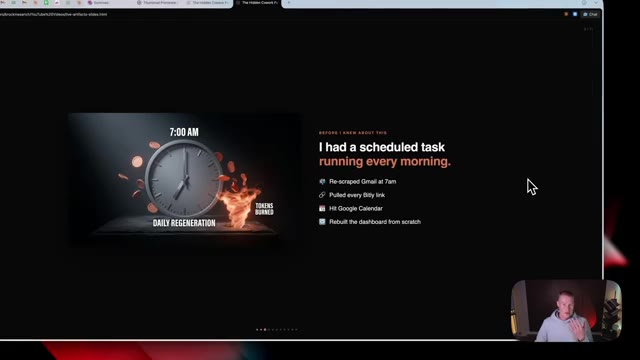
*⏱️ 00:01:06 — Diapositive montrant le texte 'I had a scheduled task running every morning' avec une illustration d'une horloge à 7h00 et des détails de tâches.*

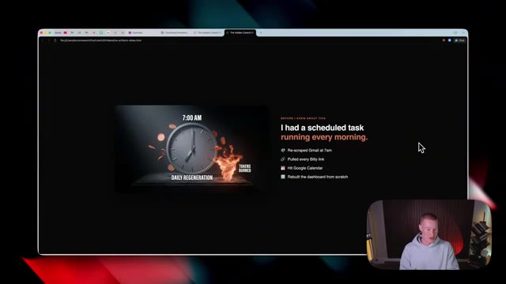
*⏱️ 00:01:12 — Diapositive similaire à l'image 1 avec la liste des tâches automatisées matinales affichées à droite.*

---

### ⏱️ `[00:01:24 - 00:01:47]` | Segment #05

**🔊 Audio (Transcription Intégrale Mot pour Mot en Français) :**
> Et encore une fois, cela me faisait gaspiller des tonnes de crédits. Mais avec une nouvelle fonctionnalité cachée à l'intérieur de Claude Cowork, cela résout complètement ce problème. Ça s'appelle Claude Cowork Live Artifacts. Et je vais décortiquer exactement ce que c'est en profondeur et vous montrer différents cas d'utilisation que vous pouvez utiliser et que j'ai trouvés pour moi-même, que vous pouvez copier. Donc, ce que c'est, c'est une page HTML autonome qui fait appel à tous les différents connecteurs que nous avons à l'intérieur de Claude.

**👁️ Analyse Visuelle d'Écran (gemini-3.5-flash-lite) :**
**Interface & Outils** : Navigateur web affichant une page de présentation/diapositive.

**Contenu textuel & Code** : Texte : « Claude Cowork ships live artifacts. One self-contained HTML page. Calls your connectors directly. No model call on refresh. » et illustration « Live Artifact Refreshes Itself ».

**Action / Démonstration** : Présentation de la fonctionnalité « Claude Cowork Live Artifacts » par le présentateur.

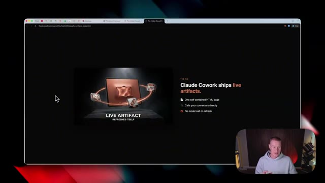
*⏱️ 00:01:30 — Capture d'écran montrant une présentation web sur « Claude Cowork Live Artifacts » avec un visuel illustratif à gauche et du texte explicatif à droite, et la vidéo incrustée du présentateur en bas à droite.*

---

### ⏱️ `[00:01:47 - 00:02:07]` | Segment #06

**🔊 Audio (Transcription Intégrale Mot pour Mot en Français) :**
> Donc, si vous êtes connecté à Gmail, que vous êtes connecté à Google Calendar, à Notion, à n'importe laquelle de ces différentes applications, nous pouvons non seulement extraire des informations en temps réel, mais nous pouvons également apporter des modifications à ces applications directement à l'intérieur de ce tableau de bord. Ceci, juste ici, est un graphique parfait de ce que c'est exactement. Pensez donc à ceci : nous avons Claude comme cerveau. Il possède toutes les connaissances sur nous, sur notre entreprise, sur tous ces différents éléments.

**👁️ Analyse Visuelle d'Écran (gemini-3.5-flash-lite) :**
**Interface & Outils** : Navigateur web affichant une page de présentation de type slides/documentation.

**Contenu textuel & Code** : Texte : 'Claude Cowork ships live artifacts.', avec des puces listant des caractéristiques techniques (One self-contained HTML page, Calls your connectors directly, No model call on refresh) et une image centrale titrée 'LIVE ARTIFACT - REFRESHES ITSELF'.

**Action / Démonstration** : Présentation visuelle de concepts liés à l'intelligence artificielle et aux artefacts interactifs en direct.

*⏱️ 00:01:52 — Capture d'écran montrant une présentation web sur les 'Live Artifacts' de Claude Cowork avec des illustrations et du texte explicatif.*

---

### ⏱️ `[00:02:07 - 00:02:26]` | Segment #07

**🔊 Audio (Transcription Intégrale Mot pour Mot en Français) :**
> Nous avons l'artefact en direct, qui est fondamentalement notre propre mini-logiciel que nous avons à l'intérieur de Claude qui extrait automatiquement de nos différents outils. Donc si vous ne savez pas ce qu'est un centre de commandement ou comme un système d'exploitation quotidien, c'est fondamentalement notre centre de commandement que nous pouvons personnaliser à notre guise. et je ne pense pas que suffisamment de personnes parlent de l'importance de cela.

**👁️ Analyse Visuelle d'Écran (gemini-3.5-flash-lite) :**
**Interface & Outils** : Navigateur web affichant une présentation interactive ou une application web personnalisée (« Live Artifact ») et flux vidéo du présentateur.

**Contenu textuel & Code** : Schéma visuel avec les mentions « CLAUDE », « LIVE ARTIFACT », « YOUR TOOLS » et le texte « STRAIGHT TO YOUR TOOLS » ainsi que « Refresh » sur le côté droit.

**Action / Démonstration** : Le présentateur commente le fonctionnement du mini-logiciel intégré à Claude qui extrait les données des différents outils.

*⏱️ 00:02:12 — Capture d'écran montrant une interface web avec un schéma illustrant le concept de « Live Artifact » connectant Claude aux différents outils de l'utilisateur, avec le présentateur visible en incrustation vidéo en bas à droite.*

---

### ⏱️ `[00:02:27 - 00:02:46]` | Segment #08

**🔊 Audio (Transcription Intégrale Mot pour Mot en Français) :**
> Avoir un système d'exploitation personnalisé pour vous-même ainsi que pour votre équipe est l'avenir de l'intelligence artificielle. C'est une façon de rester organisé et de faire différentes choses dans toute votre entreprise ou votre travail sans avoir besoin d'utiliser directement chacune de ces différentes applications. Et c'est un changement fondamental que je vois dans l'intelligence artificielle qui va vraiment changer notre façon de travailler à l'avenir.

**👁️ Analyse Visuelle d'Écran (gemini-3.5-flash-lite) :**
**Interface & Outils** : Navigateur web affichant une diapositive de présentation interactive avec un schéma visuel et une incrustation vidéo (picture-in-picture) du présentateur.

**Contenu textuel & Code** : Texte à l'écran : 'STRAIGHT TO YOUR TOOLS.', 'WHY THIS MATTERS', 'Refreshes skip the model.', 'window.cowork.callMcpTool runs in the page', 'Same connectors you already have', 'No new keys, no new accounts'.

**Action / Démonstration** : Le présentateur explique le fonctionnement des outils et des connecteurs intégrés à la page web sans passer directement par le modèle à chaque rafraîchissement.

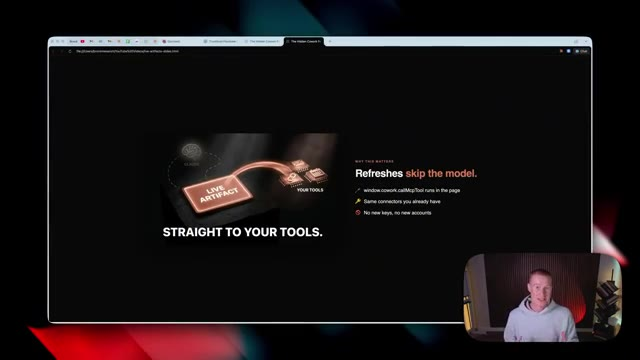
*⏱️ 00:02:31 — Capture d'écran montrant une page de présentation avec un schéma explicatif sur fond sombre, illustrant le concept 'Straight to your tools' et 'Refreshes skip the model', avec une incrustation vidéo du présentateur en bas à droite.*

---

### ⏱️ `[00:02:46 - 00:03:04]` | Segment #09

**🔊 Audio (Transcription Intégrale Mot pour Mot en Français) :**
> Et c'est donc le premier aperçu que j'ai vu où l'on a l'impression que nous faisons un grand pas dans la bonne direction lorsqu'il s'agit de créer des logiciels personnalisés pour nos propres cas d'utilisation pour nous-mêmes, mais aussi pour toute notre équipe si nous avons une équipe que nous gérons. Premièrement, afin de commencer à utiliser les artefacts de Cowork Live, nous devons avoir téléchargé l'application de bureau.

**👁️ Analyse Visuelle d'Écran (gemini-3.5-flash-lite) :**
**Interface & Outils** : Navigateur web affichant une page de présentation de diapositives et le site officiel de téléchargement de l'application Claude.

**Contenu textuel & Code** : Textes explicatifs sur les artefacts en direct, les connecteurs et les liens vers les différentes versions de téléchargement de l'application Claude (Desktop et Mobile).

**Action / Démonstration** : Navigation et présentation visuelle de concepts logiciels et de pages de téléchargement de l'outil d'IA Claude.

*⏱️ 00:02:51 — Une diapositive de présentation sombre intitulée "Refreshes skip the model" avec des graphismes illustrant les "Live Artifacts" connectés aux outils personnels, et une petite vignette du présentateur en bas à droite.*

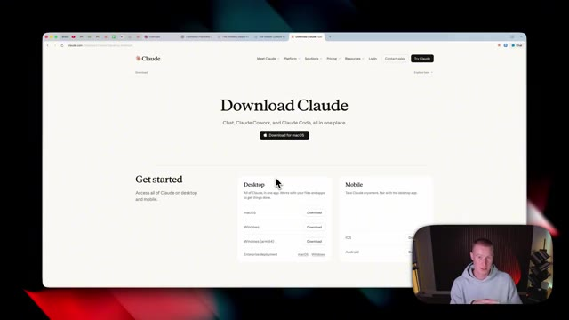
*⏱️ 00:03:00 — La page web officielle de téléchargement de Claude (claude.com/download) montrant les options pour macOS, Windows, et mobile, avec la webcam du présentateur en bas à droite.*

---

### ⏱️ `[00:03:04 - 00:03:23]` | Segment #10

**🔊 Audio (Transcription Intégrale Mot pour Mot en Français) :**
> Nous ne pouvons pas y accéder sur l'application Web. Donc, si vous ne l'avez pas téléchargée, assurez-vous de la télécharger maintenant. Il va y avoir un lien dans la description pour vous inscrire. Ensuite, une fois que nous aurons téléchargé l'application et que nous l'aurons ouverte, nous allons voir cette interface. Et une chose que je tiens à mentionner, c'est que ça va démarrer en mode chat. C'est fondamentalement de cette façon que nous utilisons Claude, tout comme ChatGPT.

**👁️ Analyse Visuelle d'Écran (gemini-3.5-flash-lite) :**
**Interface & Outils** : Navigateur web affichant la page de téléchargement de Claude et interface logicielle de l'application de bureau Claude.

**Contenu textuel & Code** : Liens de téléchargement pour macOS, Windows, ainsi que l'interface utilisateur de l'application Claude avec le modèle Opus 4.7 sélectionné.

**Action / Démonstration** : Présentation de la page de téléchargement de l'application Claude puis affichage de l'interface principale une fois l'application ouverte.

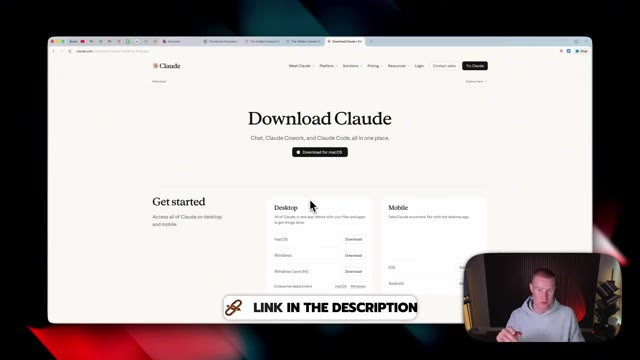
*⏱️ 00:03:09 — Page web de téléchargement de l'application Claude sur le site officiel, montrant les différentes options pour macOS et Windows.*

*⏱️ 00:03:13 — Interface de l'application de bureau Claude ouverte, affichant le message d'accueil personnalisé « Happy Monday, brock » et la barre de saisie.*

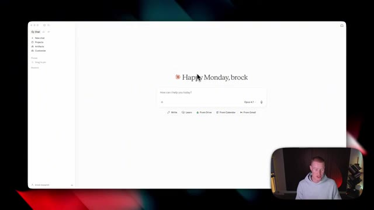
*⏱️ 00:03:18 — Interface de l'application de bureau Claude avec la barre de saisie du chat visible au centre et le menu latéral de navigation.*

---

### ⏱️ `[00:03:23 - 00:03:44]` | Segment #11

**🔊 Audio (Transcription Intégrale Mot pour Mot en Français) :**
> on pourrait faire des aller-retours, mais nous ne pouvons pas lancer des artefacts en direct et faire plein d'autres choses que nous pourrions faire à l'intérieur de co-work. Donc, si vous ne l'avez jamais utilisé auparavant, ici en haut sur le côté gauche, nous avons essentiellement nos différentes versions que nous pouvons utiliser. Tout d'abord, nous avons le mode chat juste ici. Nous avons le mode co-work et ensuite le mode code. Assurez-vous donc de cliquer sur ce petit bouton de case à cocher qui vous mènera à Claude Co-work. Et maintenant, nous allons voir cette interface à partir d'ici.

**👁️ Analyse Visuelle d'Écran (gemini-3.5-flash-lite) :**
**Interface & Outils** : Application de type interface conversationnelle / outil d'intelligence artificielle avec menu latéral.

**Contenu textuel & Code** : Interface utilisateur affichant un champ de texte de discussion, un message d'accueil personnalisé et un menu de navigation (Chat, New chat, Projects, Artifacts, Customize).

**Action / Démonstration** : Le présentateur présente l'interface et pointe du curseur les différentes sections de la barre latérale gauche.

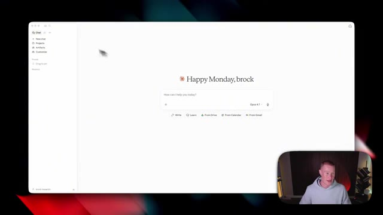
*⏱️ 00:03:28 — Vue générale de l'interface de l'application avec la barre latérale gauche visible et un message d'accueil "Happy Monday, brock".*

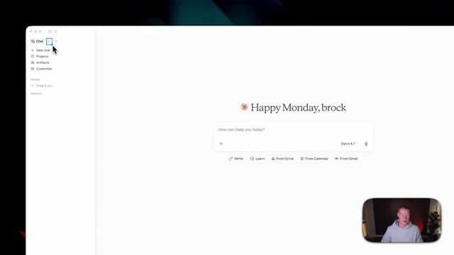
*⏱️ 00:03:39 — Gros plan sur le curseur pointant les différentes options de la barre latérale en haut à gauche de l'interface.*

---

### ⏱️ `[00:03:44 - 00:04:11]` | Segment #12

**🔊 Audio (Transcription Intégrale Mot pour Mot en Français) :**
> Nous avons juste besoin de nous assurer que nous travaillons à l'intérieur d'un dossier. J'ai donc ouvert le dossier système court de Claude Code. Ce que nous pourrions faire, c'est simplement venir ici et sélectionner n'importe quel dossier existant sur notre ordinateur où nous voulons stocker ces informations, ou nous pouvons en créer un nouveau à partir de zéro. Nous pourrions donc venir ici et lui donner simplement un nom, quelque chose comme live artifacts, ou honnêtement, peu importe comment vous voulez l'appeler, créer ce dossier, cliquer sur autoriser. Et puis maintenant, vous pouvez voir ici, nous avons live artifacts et c'est le dossier dans lequel nous travaillons.

**👁️ Analyse Visuelle d'Écran (gemini-3.5-flash-lite) :**
**Interface & Outils** : Application de gestion de tâches et de productivité (Cowork / Claude Code).

**Contenu textuel & Code** : Menu de sélection de dossiers avec des chemins d'accès locaux (Financials, VibeAds, Desktop, etc.) et liste de tâches en cours.
[COMPORTEMENT] Navigation dans les dossiers et sélection du répertoire de stockage au sein de l'application.

**Action / Démonstration** : Explications face caméra et analyse conceptuelle des marchés.

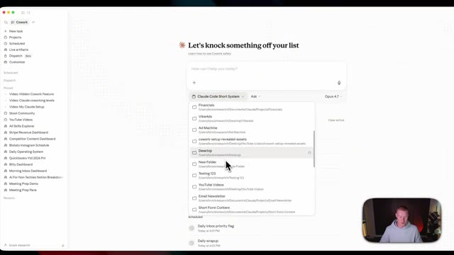
*⏱️ 00:03:51 — L'écran montre l'interface de l'application avec un menu déroulant ouvert listant plusieurs dossiers de stockage de fichiers.*

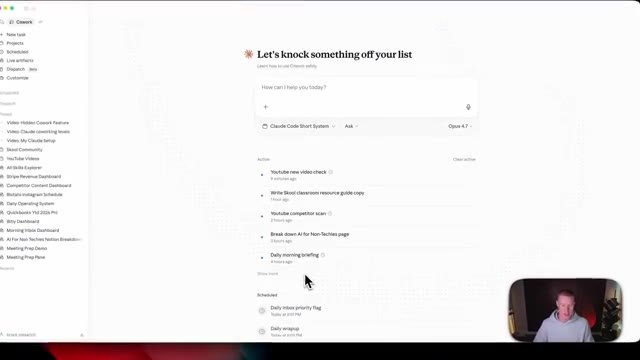
*⏱️ 00:03:57 — L'écran affiche l'interface principale de l'application avec une liste de tâches intitulée "Let's knock something off your list".*

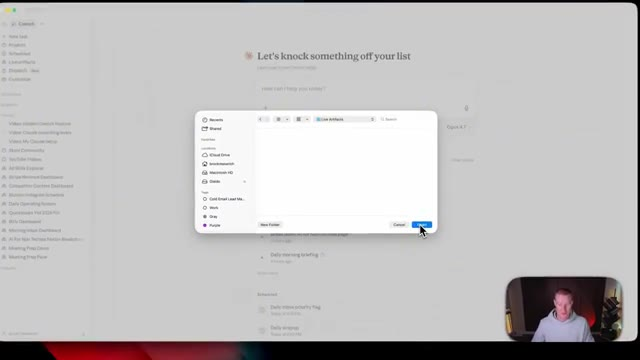
*⏱️ 00:04:04 — L'écran présente une fenêtre modale du système de fichiers superposée sur l'interface principale pour sélectionner ou ouvrir un dossier.*

---

### ⏱️ `[00:04:11 - 00:04:48]` | Segment #13

**🔊 Audio (Transcription Intégrale Mot pour Mot en Français) :**
> Maintenant, laissez-moi vous montrer les artefacts en direct que j'utilise personnellement. Pour que vous puissiez vous faire une idée de ce donc c'est capable avant que nous ne plongeions plus profondément dans la façon exacte de l'utiliser. Afin de vous montrer exactement ce que je veux decir, laissez-moi venir sur Claude. En ce moment, nous sommes à l'intérieur de CoWork et si vous n'avez jamais utilisé CoWork auparavant, nous allons le voir ici en haut à tout à gauche. Tout d'abord, nous avons notre mode de discussion, qui est ce petit bouton de discussion. Nous avons le mode CoWork, qui est juste ici et le bouton sur la droite est Claude code. Assurez-vous que nous avons CoWork sélectionné parce que pour l'instant c'est le seul endroit où nous pouvons commencer à utiliser les artefacts en direct dont nous parlons dans cette vidéo. La première chose que nous allons remarquer est que dans la barre latérale gauche, nous avons maintenant ce direct

**👁️ Analyse Visuelle d'Écran (gemini-3.5-flash-lite) :**
**Interface & Outils** : Interface logicielle de Cowork (assistant IA / gestion de tâches).

**Contenu textuel & Code** : Liste de tâches actives (ex. "Write Skool classroom resource guide copy", "Youtube competitor scan"), options de configuration de l'IA (Claude Code Short System, Opus 4.7) et barre de recherche.
[DESC_IMAGE_3] Présentation de l'interface utilisateur et navigation dans le tableau de bord des artefacts et des tâches en cours.

**Action / Démonstration** : Explications face caméra et analyse conceptuelle des marchés.

*⏱️ 00:04:20 — Interface de l'application Cowork affichant une liste de tâches actives et un champ de saisie avec le modèle Opus 4.7.*

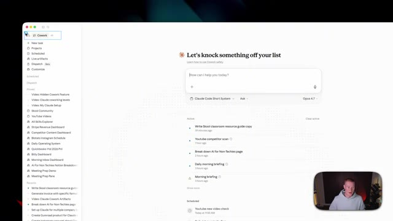
*⏱️ 00:04:30 — Navigation dans la barre latérale gauche de l'interface Cowork avec les différentes sections de projets et de tâches.*

*⏱️ 00:04:39 — Vue générale de l'interface Cowork montrant le tableau de bord de productivité de l'utilisateur.*

---

### ⏱️ `[00:04:48 - 00:05:19]` | Segment #14

**🔊 Audio (Transcription Intégrale Mot pour Mot en Français) :**
> bouton d'artefacts sur lequel nous pouvons cliquer. Je vais vous montrer cela dans une seconde. Mais aussi l'une des meilleures parties à ce sujet est que nous avons tous nos artefacts en direct épinglés ici même dans notre menu. Si nous avons un artefact en direct spécifique auquel nous voulons accéder, nous n'avons pas besoin d'aller chercher dans l'une des discussions. Nous les avons simplement automatiquement directement ici et nous pouvons cliquer dessus et les afficher à tout moment. Donc, pour vous montrer ce que je veux dire, laissez-moi d'abord vous montrer mon tableau de bord des revenus Stripe qui extrait des informations en direct de mon compte Stripe et génère ce tableau de bord.

**👁️ Analyse Visuelle d'Écran (gemini-3.5-flash-lite) :**
**Interface & Outils** : Interface web Cowork / Claude Cowork avec panneau latéral et zone de chat.

**Contenu textuel & Code** : Menus déroulants, listes d'artefacts et de tâches ("All Skills Explorer", "Stripe Revenue Dashboard", "Video: Hidden Cowork Feature").

**Action / Démonstration** : Survol et navigation dans le menu latéral pour montrer les artefacts en direct épinglés.

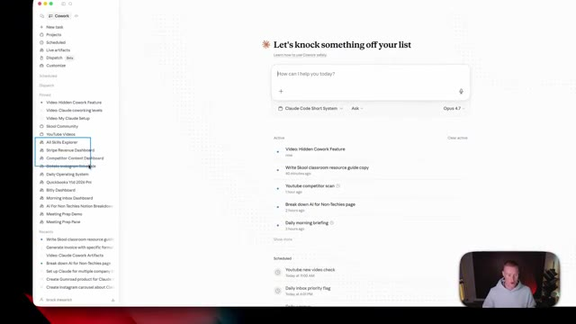
*⏱️ 00:04:56 — Interface Cowork montrant le menu latéral avec la liste des éléments épinglés et le champ de saisie principal.*

*⏱️ 00:05:04 — Navigation dans la liste des éléments récents du menu latéral de l'application Cowork.*

---

### ⏱️ `[00:05:19 - 00:05:47]` | Segment #15

**🔊 Audio (Transcription Intégrale Mot pour Mot en Français) :**
> Comme ça, je n'ai pas besoin d'aller dans Stripe. Par exemple, vous pouvez maintenant voir cette interface. Elle est personnalisée exactement comme je le veux personnellement. Nous pourrions la personnaliser de la manière que nous voulons. Tout d'abord, nous avons la vue d'ensemble. Nous avons ensuite cette section juste ici qui s'appelle partenariats de marque. Nous avons les paiements, les clients, le suivi des comptes clients. C'est donc personnalisé selon la façon dont je veux l'utiliser. Et c'est l'un des meilleurs aspects de ces artefacts en direct. Ensuite, nous pouvons voir le chiffre d'affaires par partenariat de marque. Et ce sont toutes de fausses informations. Je ne voulais pas vous montrer mon véritable compte Stripe.

**👁️ Analyse Visuelle d'Écran (gemini-3.5-flash-lite) :**
**Interface & Outils** : Tableau de bord personnalisé affiché dans une application de type interface de gestion ou interface web.

**Contenu textuel & Code** : Graphiques à barres horizontales pour les revenus par "brand deal", graphique circulaire de concentration des revenus, et graphique linéaire cumulé des 100 derniers paiements.

**Action / Démonstration** : Navigation et présentation des différentes vues personnalisées du tableau de bord des revenus.

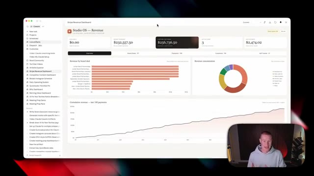
*⏱️ 00:05:26 — Vue d'ensemble d'un tableau de bord Stripe Revenue personnalisé avec des graphiques de revenus et des statistiques.*

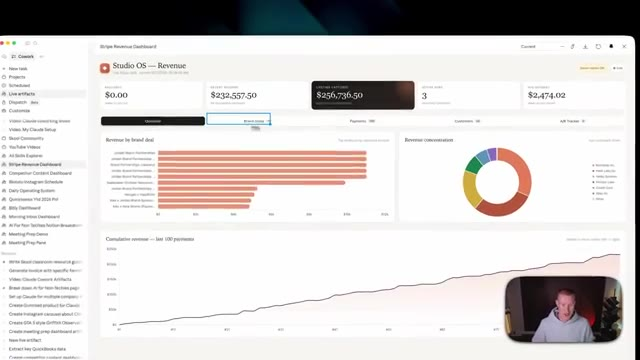
*⏱️ 00:05:33 — Navigation dans le tableau de bord avec le curseur sur une section de l'onglet "Brand Deals".*

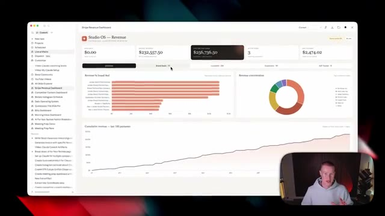
*⏱️ 00:05:40 — Interaction avec les onglets du tableau de bord pour basculer vers la vue "Brand Deals".*

---

### ⏱️ `[00:05:47 - 00:06:23]` | Segment #16

**🔊 Audio (Transcription Intégrale Mot pour Mot en Français) :**
> Nous pouvons même voir le chiffre d'affaires cumulé sur les 100 derniers paiements, en décomposant fondamentalement ce graphique ici et quelques autres éléments différents. Nous pourrions voir tous nos différents contrats de marque ici. Je veux donc que vous remarquiez qu'à l'intérieur de cet artefact en direct, il catégorise automatiquement chaque type de paiement, puis le place dans une section spécifique à l'intérieur de ce tableau de bord. Je pourrais voir tous les différents paiements avec mes informations de paiement Stripe. Je pourrais voir les différents clients. Et puis, une chose sympa à l'intérieur d'ici, disons que nous voulons suivre tous les paiements en attente et les factures que nous avons envoyées. Eh bien, j'ai construit ce système de suivi des paiements, je l'ai codé à l'instinct directement à l'intérieur de Claude et je l'ai intégré directement dans notre artefact. Donc je peux juste venir ici et

**👁️ Analyse Visuelle d'Écran (gemini-3.5-flash-lite) :**
**Interface & Outils** : Interface utilisateur de tableau de bord de revenus Stripe intégré dans une application web (Cowork).

**Contenu textuel & Code** : Métriques financières incluant le chiffre d'affaires total (Lifetime captured : 256 736,50 $), les revenus récents, la liste des contrats de marques et l'historique des paiements.

**Action / Démonstration** : Navigation à travers les différents onglets (Brand deals, Payments, A/R Tracker) du tableau de bord financier.

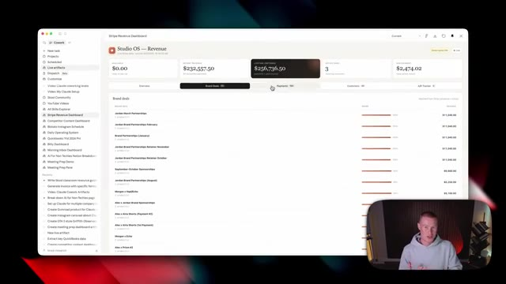
*⏱️ 00:05:56 — Capture montrant l'onglet 'Brand deals' du tableau de bord des revenus Stripe affichant la liste des différents partenariats de marques.*

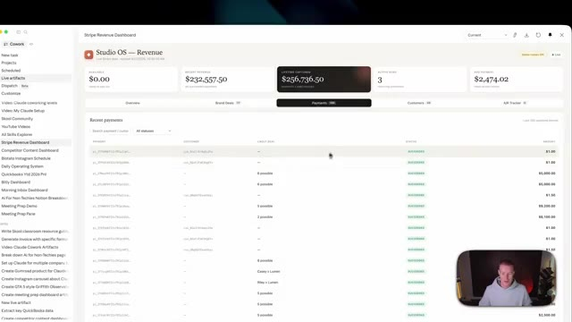
*⏱️ 00:06:05 — Capture montrant l'onglet 'Payments (100)' du tableau de bord Stripe avec le détail des 100 derniers paiements reçus.*

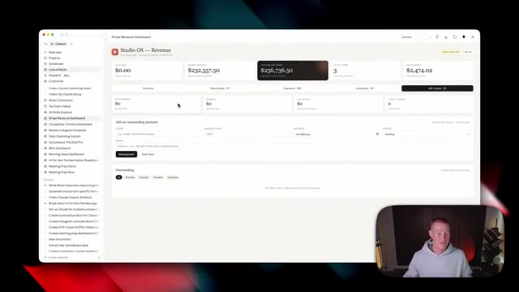
*⏱️ 00:06:14 — Capture montrant l'onglet 'A/R Tracker' du tableau de bord Stripe avec les informations sur les paiements en attente et les factures.*

---

### ⏱️ `[00:06:23 - 00:06:57]` | Segment #17

**🔊 Audio (Transcription Intégrale Mot pour Mot en Français) :**
> il suffit de dire facture pour Austin. Je pourrais y mettre un montant, disons 5 000 dollars. Nous pourrions lui donner une date spécifique et je pourrais réellement choisir le statut de celle-ci. Disons donc qu'elle est en retard, puis je pourrais cliquer sur paiement et cela s'ajoute à notre total impayé que vous pouvez voir ici même, tout en ayant tous nos différents paiements directement à l'intérieur de notre artefact. Non seulement cela affiche des informations en temps réel provenant de Stripe, mais cela possède également des fonctionnalités personnalisées comme la possibilité de suivre tous les paiements qui me sont dus. J'ai préparé un guide sur ce que sont les artefacts en direct, comment vous pouvez les utiliser. Et je vous donne même cinq cas d'utilisation que vous pouvez me piquer pour commencer à construire

**👁️ Analyse Visuelle d'Écran (gemini-3.5-flash-lite) :**
**Interface & Outils** : Tableau de bord de revenus (Studio OS - Revenue Dashboard) sur une interface web.

**Contenu textuel & Code** : Données financières affichées : "Invoice for Austin", montant de 5 000 $, statut défini sur "Overdue" (en retard), et divers indicateurs de revenus globaux.

**Action / Démonstration** : Sélection du statut de la facture "Overdue" (en retard) pour l'ajouter au suivi des paiements en attente.

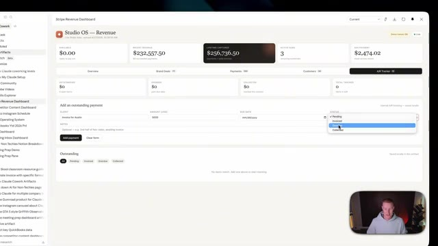
*⏱️ 00:06:32 — Image #1 montre le tableau de bord avec le menu déroulant du statut ouvert, sélectionnant "Overdue" pour l'élément "Invoice for Austin".*

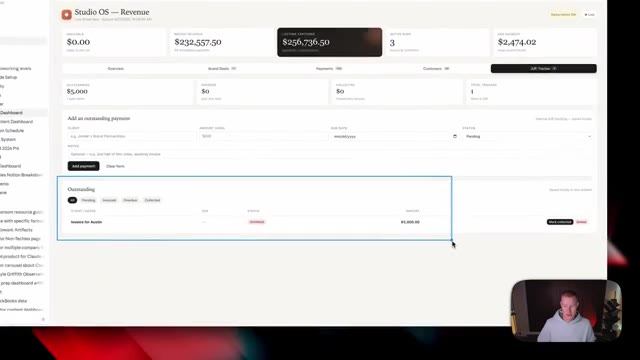
*⏱️ 00:06:40 — Image #2 montre l'élément "Invoice for Austin" ajouté dans la section "Outstanding" avec le statut "OVERDUE" et un montant de 5 000,00 $.*

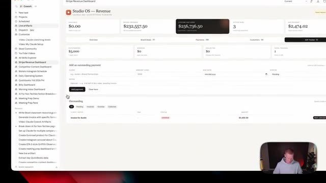
*⏱️ 00:06:48 — Image #3 montre le tableau de bord avec la liste des factures et le panneau latéral de navigation visible à gauche.*

---

### ⏱️ `[00:06:57 - 00:07:33]` | Segment #18

**🔊 Audio (Transcription Intégrale Mot pour Mot en Français) :**
> ces derniers en quelques secondes. Je vous donne même le prompt exact que vous pourriez utiliser pour recréer ceux que j'ai conçus. Et si vous voulez y accéder, c'est à l'intérieur de ma communauté School. Vous allez dans l'espace de cours, vous cliquez sur les exclusivités de la communauté. Et si vous cliquez ici, vous pouvez voir cette analyse détaillée exacte ainsi que ce guide PDF, qui détaille tout cela pour vous avec les prompts que vous pouvez piquer afin de les créer en littéralement quelques secondes. Pour vous montrer exactement ce que je veux dire, il y a ce petit diagramme ainsi que ce prompt que vous pouvez littéralement copier et coller dans Cowork afin de recréer ces cas d'usage que j'ai trouvés pour vous-même. Pour vous montrer un autre exemple d'artefact en direct que j'utilise personnellement et qui a changé la donne pour moi, juste ici nous avons le Bitly

**👁️ Analyse Visuelle d'Écran (gemini-3.5-flash-lite) :**
**Interface & Outils** : Navigateur web affichant la plateforme Skool et un document de cours.

**Contenu textuel & Code** : Modules de formation, rubriques de la communauté et documentation sur l'intelligence artificielle.

**Action / Démonstration** : Navigation à l'intérieur de la plateforme communautaire et présentation du contenu des cours.

*⏱️ 00:07:06 — Capture d'écran montrant l'espace de cours (Classroom) de la communauté Skool avec différentes sections de formation.*

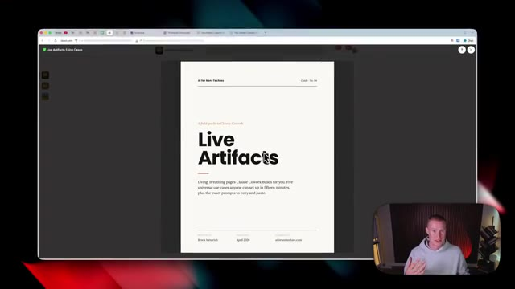
*⏱️ 00:07:15 — Affichage d'un document ou guide intitulé 'Live Artifacts' avec des informations textuelles.*

---

### ⏱️ `[00:07:33 - 00:07:57]` | Segment #19

**🔊 Audio (Transcription Intégrale Mot pour Mot en Français) :**
> tableau de bord que je peux simplement sélectionner dans mon menu latéral, et celui-ci est

**👁️ Analyse Visuelle d'Écran (gemini-3.5-flash-lite) :**
**Interface & Outils** : Application Claude / Cowork (interface de gestion d'artefacts) - Tableau de bord "Bitly Dashboard".

**Contenu textuel & Code** : Métriques Bitly (27 280 clics totaux, 42 liens actifs, pays top: United States, plateforme top: YouTube, OS top: macOS), graphique "Clicks over time", section "Top performing links" avec le classement des liens (ex. "15 Claude Skills Resource" avec 10 740 clics).

**Action / Démonstration** : Démonstration de la sélection et du suivi d'un tableau de bord dynamique intégré directement dans le menu latéral de l'outil d'IA.

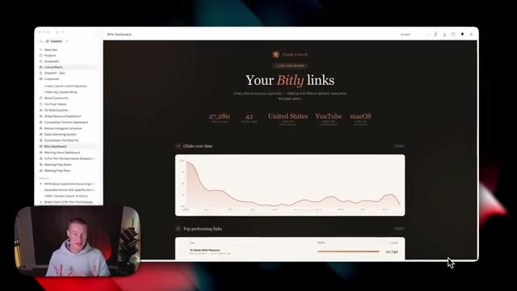
*⏱️ 00:07:39 — Vue de l'interface montrant le tableau de bord "Bitly Dashboard" sélectionné dans le menu latéral sous "Live artifacts", avec des métriques et un graphique de clics.*

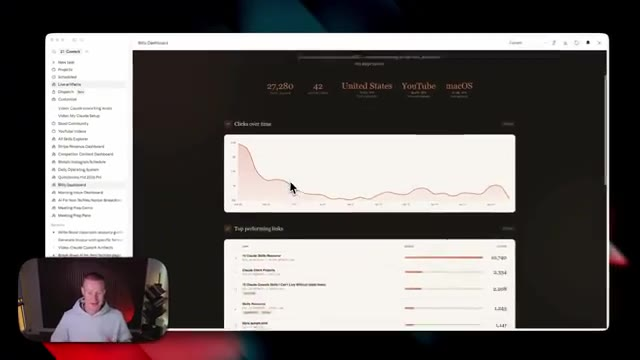
*⏱️ 00:07:45 — Survol à la souris du graphique "Clicks over time" au centre du tableau de bord analytique Bitly.*

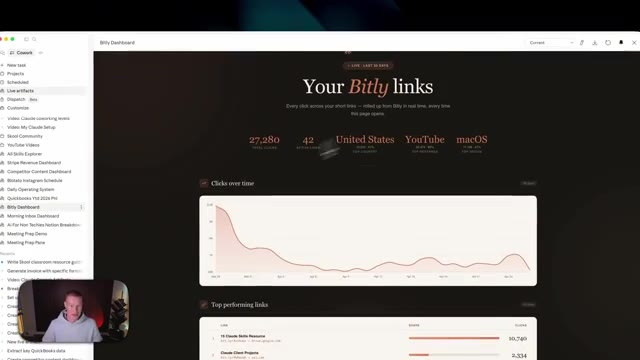
*⏱️ 00:07:51 — Vue globale du tableau de bord "Your Bitly links" affichant les statistiques de performance, le graphique temporel et les liens les plus performants.*

---

### ⏱️ `[00:07:57 - 00:08:32]` | Segment #20

**🔊 Audio (Transcription Intégrale Mot pour Mot en Français) :**
> Donc, je peux personnellement voir combien de personnes cliquent sur le lien de ma communauté Skool depuis chaque vidéo différente. Juste ici, cela montre que le lien numéro un est la vidéo de ressources sur les 15 compétences Claude. Cela montre le nombre de clics qu'il enregistre. Cela montre même l'URL Bitly spécifique là, et cela détaille par pays d'où tout le monde clique. Cela montre de quelle plateforme ils viennent, et cela montre même quel appareil clique sur ces différents liens. Avant d'avoir ce tableau de bord d'artefact en direct, je devais aller sur Bitly. Je devais cliquer sur des liens et voir tous ces différents liens ici. Et pour moi, cela me fait gagner beaucoup de temps. Et honnêtement, rien que pour m'éviter les maux de tête, le fait que maintenant je puisse simplement être déjà à l'intérieur de Claude, cliquer sur mon live...

**👁️ Analyse Visuelle d'Écran (gemini-3.5-flash-lite) :**
**Interface & Outils** : Tableau de bord Bitly (application web de gestion et d'analyse de liens).

**Contenu textuel & Code** : Statistiques de clics, graphiques d'évolution temporelle, liens performants, répartition géographique et sources de trafic (YouTube, direct, Instagram).

**Action / Démonstration** : Navigation et présentation des métriques de clics et des performances des liens de la communauté.

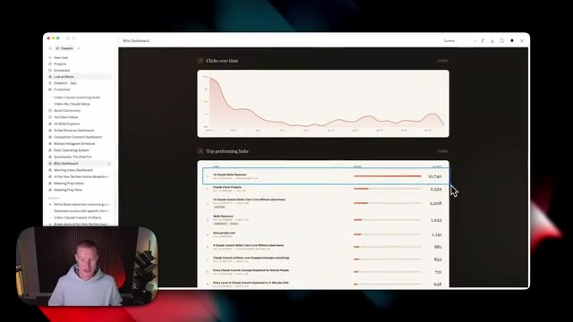
*⏱️ 00:08:06 — Tableau de bord Bitly montrant les graphiques de clics au fil du temps et la liste des liens les plus performants, avec en tête la ressource des compétences Claude.*

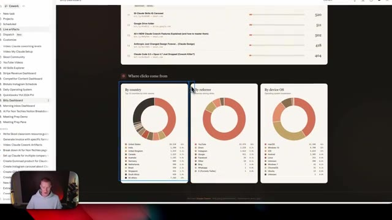
*⏱️ 00:08:15 — Suite du tableau de bord Bitly affichant la répartition géographique, les sources de trafic (référents) et les systèmes d'exploitation des utilisateurs sous forme de graphiques circulaires.*

*⏱️ 00:08:24 — Vue d'ensemble de l'interface de gestion des liens Bitly listant les URL raccourcies et leurs engagements respectifs.*

---

### ⏱️ `[00:08:32 - 00:08:52]` | Segment #21

**🔊 Audio (Transcription Intégrale Mot pour Mot en Français) :**
> des artefacts et voir cela avec des informations mises à jour en temps réel. Et une chose essentielle que je veux noter ici, c'est que si quelqu'un clique sur un lien, je n'ai pas besoin de rafraîchir toute cette page, cela rafraîchira automatiquement le nombre de clics sans que j'aie besoin d'aller générer toute cette page à nouveau. Un autre exemple d'artefact que je veux vous montrer, les gars, parce que je sais que vous êtes nombreux à utiliser Notion.

**👁️ Analyse Visuelle d'Écran (gemini-3.5-flash-lite) :**
**Interface & Outils** : Navigateur web affichant un tableau de bord personnalisé (Bitly Dashboard) sur une interface de type Notion/Cowork.

**Contenu textuel & Code** : Statistiques de liens (27 280 clics totaux, 42 liens actifs), graphique de clics au fil du temps et classement des liens les plus cliqués.

**Action / Démonstration** : Navigation et présentation du tableau de bord de suivi des liens en temps réel par le présentateur.

*⏱️ 00:08:37 — Vue générale du tableau de bord 'Bitly Dashboard' affichant les statistiques de liens avec un graphique temporel et les liens les plus performants.*

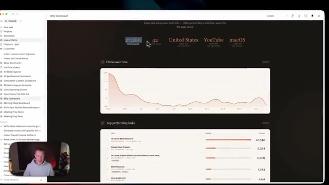
*⏱️ 00:08:42 — Gros plan sur les statistiques globales en haut du tableau de bord avec sélection du nombre total de clics (27 280).*

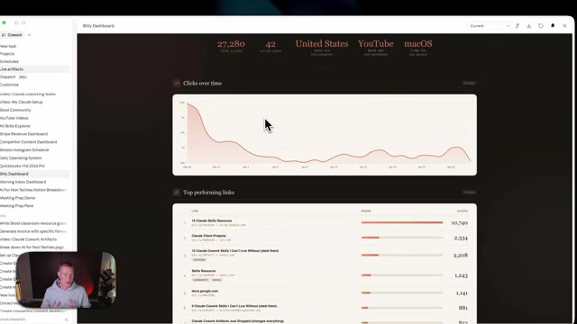
*⏱️ 00:08:47 — Vue centrée sur le graphique 'Clicks over time' et la liste des liens performants du tableau de bord.*

---

### ⏱️ `[00:08:52 - 00:09:14]` | Segment #22

**🔊 Audio (Transcription Intégrale Mot pour Mot en Français) :**
> Voici un artefact qui montre en gros tout ce qu'il y a dans Notion. Cela me permet de voir très facilement ce qui se passe au sein de mon entreprise. Donc, si votre entreprise utilise Notion comme un genre de second cerveau et que vous suivez tous vos différents projets ici, cela pourrait être un moyen vraiment utile de voir en gros ce qui se passe dans l'ensemble de votre entreprise. Donc par exemple, j'ai quelques pages différentes dans Notion.

**👁️ Analyse Visuelle d'Écran (gemini-3.5-flash-lite) :**
**Interface & Outils** : Application Notion, macOS window, webcam du présentateur en bas à gauche.

**Contenu textuel & Code** : Tableaux de bord de gestion de projet, catégories (Top-Level Hubs, Financials), listes de tâches, métriques de contenu (sections, linked pages, long-form videos, short-form shorts).

**Action / Démonstration** : Navigation et présentation visuelle d'un espace de travail Notion utilisé comme système de gestion d'entreprise.

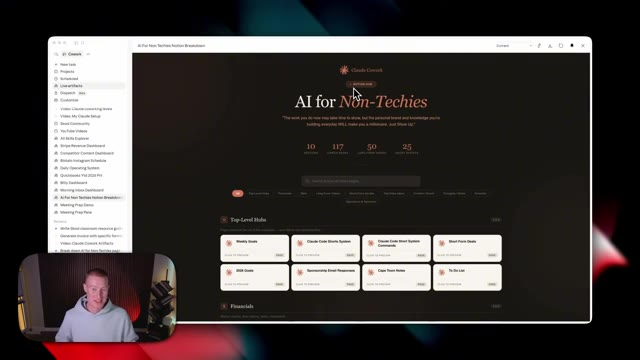
*⏱️ 00:08:57 — Vue d'ensemble d'un tableau de bord Notion personnalisé nommé "AI for Non-Techies Notion Breakdown", montrant divers hubs et sections de gestion de projet.*

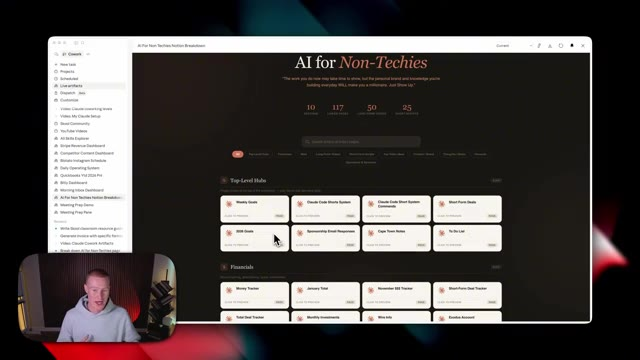
*⏱️ 00:09:03 — Défilement vers le bas du tableau de bord Notion révélant la section "Financials" avec différents trackers financiers.*

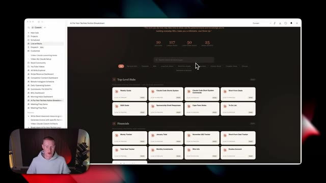
*⏱️ 00:09:08 — Vue continue du tableau de bord Notion avec le curseur de la souris naviguant dans l'interface de gestion.*

---

### ⏱️ `[00:09:14 - 00:09:32]` | Segment #23

**🔊 Audio (Transcription Intégrale Mot pour Mot en Français) :**
> Laissez-moi ouvrir ma page Notion ici pour que vous puissiez voir à quoi elle ressemble. Nous avons cette sous-page appelée AI for non-techies. En gros, je détaille mes objectifs hebdomadaires. J'ai différentes sous-pages qui suivent toutes mes finances, un suivi des revenus. Ensuite, j'ai même toutes les différentes vidéos. Donc, quand je vais travailler sur une vidéo, je viens ici, j'ajoute les différentes idées de titres.

**👁️ Analyse Visuelle d'Écran (gemini-3.5-flash-lite) :**
**Interface & Outils** : Navigateur web affichant une page de l'application Notion.

**Contenu textuel & Code** : Listes à puces, titres de sous-pages (Weekly Goals, Financials, Videos, etc.) et liens de gestion de contenu.
[DESC_IMAGE_3] Navigation et défilement vertical d'une page Notion pour présenter son organisation interne.

**Action / Démonstration** : Explications face caméra et analyse conceptuelle des marchés.

---

### ⏱️ `[00:09:32 - 00:09:51]` | Segment #24

**🔊 Audio (Transcription Intégrale Mot pour Mot en Français) :**
> En gros, je fais un peu de script et de plan de vidéo. Donc pour que je puisse intégrer ces informations dans Claude, j'ai cet artefact en direct qui va automatiquement remplir ceci dès que je fais des modifications dans Notion. Et ensuite, je peux voir toutes ces différentes pages ici. Par exemple, si je clique sur celle-ci juste là, c'est une vidéo sur laquelle je travaillais. Je peux alors voir tout ce qui se trouvait à l'intérieur de cette page Notion.

**👁️ Analyse Visuelle d'Écran (gemini-3.5-flash-lite) :**
**Interface & Outils** : Notion / Application de gestion de projet (interface web)

**Contenu textuel & Code** : Tableaux de bord, listes de pages, sections "Top-Level Hubs", "Financials" et "Long-Form Videos"

**Action / Démonstration** : Navigation et présentation des différentes pages et structures de projets dans Notion intégrées avec Claude

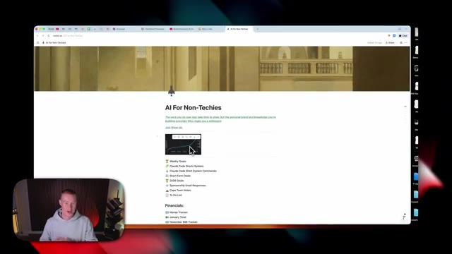
*⏱️ 00:09:37 — Vue d'une page Notion claire avec les en-têtes "AI For Non-Techies" et différentes sections de gestion.*

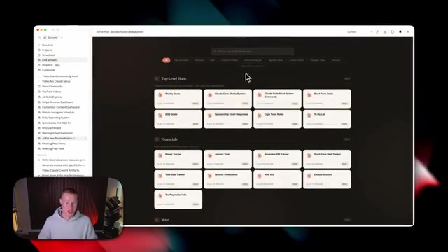
*⏱️ 00:09:42 — Interface de gestion de projets sur une application de type Notion ou outil interne en mode sombre, affichant divers hubs et sections financières.*

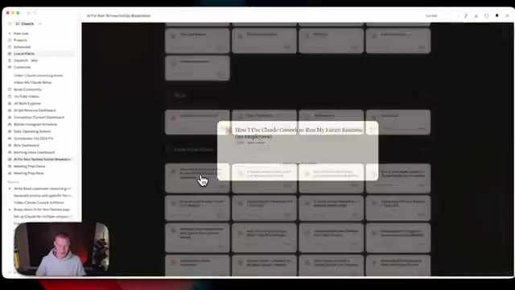
*⏱️ 00:09:47 — Gros plan sur une liste de pages et de tâches dans l'interface, avec un élément en surbrillance intitulé "How I Use Claude Cowork to Run My Entire Business".*

---

### ⏱️ `[00:09:51 - 00:10:14]` | Segment #25

**🔊 Audio (Transcription Intégrale Mot pour Mot en Français) :**
> Donc, si nous voulons afficher tous nos différents artéfacts, il y a plusieurs façons différentes de le faire. Tout d'abord, nous avons la barre latérale gauche juste ici, qui les décompose tous. Nous pouvons simplement épingler ceux que nous utilisons fréquemment. Donc, par exemple, j'utilise beaucoup le tableau de bord Revenue Stripe. J'utilise aussi le tableau de bord Bitly. Assurez-vous d'épingler simplement ceux que vous utilisez beaucoup juste là, afin qu'ils soient toujours faciles d'accès. Ainsi que notre bouton d'artéfacts en direct juste ici, sur lequel nous pouvons simplement cliquer et il affichera tous nos différents artéfacts.

**👁️ Analyse Visuelle d'Écran (gemini-3.5-flash-lite) :**
**Interface & Outils** : Interface utilisateur de l'application Claude Cowork, affichant un tableau de bord analytique (Bitly Dashboard) et une barre latérale de gestion des artéfacts.

**Contenu textuel & Code** : Liste des artéfacts disponibles (All Skills Explorer, Stripe Revenue Dashboard, Bitly Dashboard, etc.) et graphiques de performance des liens Bitly.

**Action / Démonstration** : Navigation et survol des différents artéfacts et menus dans la barre latérale gauche pour illustrer leur organisation.

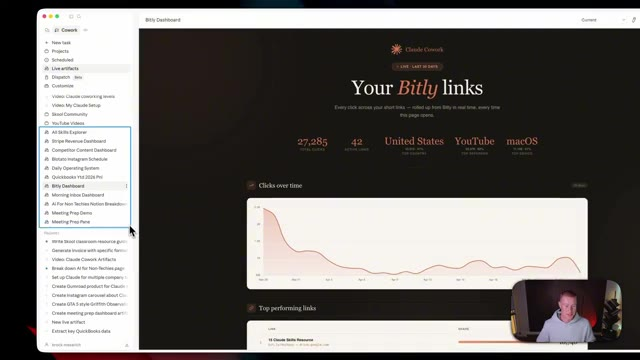
*⏱️ 00:09:57 — Vue du tableau de bord "Bitly Dashboard" avec le panneau latéral gauche affichant la liste des artéfacts et un curseur pointant sur les options.*

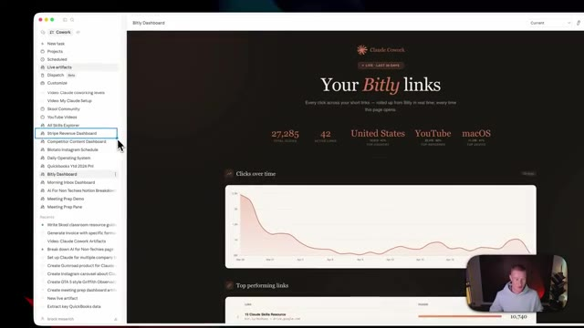
*⏱️ 00:10:03 — Navigation dans le panneau latéral gauche de l'interface avec surbrillance sur "Stripe Revenue Dashboard".*

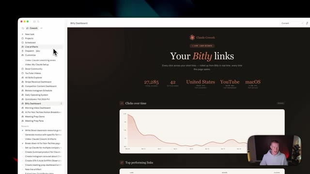
*⏱️ 00:10:09 — Déplacement du curseur vers l'onglet "Live artifacts" dans la barre latérale gauche de l'application Claude Cowork.*

---

### ⏱️ `[00:10:14 - 00:10:35]` | Segment #26

**🔊 Audio (Transcription Intégrale Mot pour Mot en Français) :**
> Donc, disons que nous en avons ajouté des tonnes. C'est un moyen facile pour nous de trier et de simplement cliquer sur l'un d'entre eux. Donc, par exemple, si je clique sur celui-ci, voici mon tableau de bord de boîte de réception du matin qui récupère les données de mon Google Agenda. Et cela agit essentiellement comme l'ensemble de mon système d'exploitation pour toute mon entreprise. Donc, c'est capable de récupérer les données des différentes applications que je utilise, ainsi que je peux voir toutes mes données et informations Bitly à l'intérieur d'ici également.

**👁️ Analyse Visuelle d'Écran (gemini-3.5-flash-lite) :**
**Interface & Outils** : Interface web de Claude Cowork / gestionnaire d'artefacts.

**Contenu textuel & Code** : Tableaux de bord personnalisés, widgets de planification hebdomadaire, compteurs de messages et intégration de Google Agenda.

**Action / Démonstration** : Navigation et clic sur un tableau de bord spécifique pour afficher les données agrégées de la boîte de réception et du calendrier.

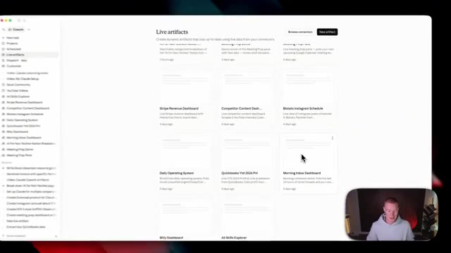
*⏱️ 00:10:20 — Vue d'ensemble de l'interface montrant une grille de tableaux de bord et d'artefacts en direct, avec le curseur pointant sur "Morning Inbox Dashboard".*

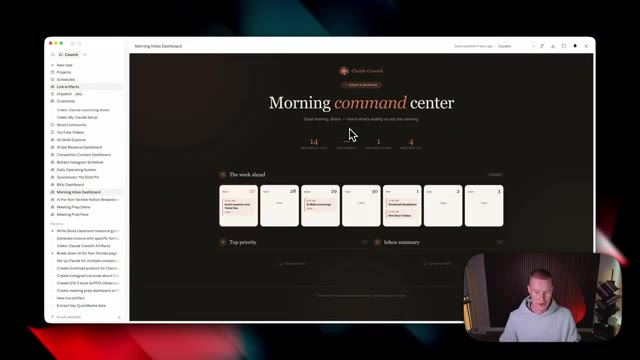
*⏱️ 00:10:25 — Affichage détaillé du tableau de bord "Morning command center" avec des widgets de calendrier Google Agenda et des indicateurs de messagerie.*

---

### ⏱️ `[00:10:35 - 00:10:55]` | Segment #27

**🔊 Audio (Transcription Intégrale Mot pour Mot en Français) :**
> Alors laissez-moi vous montrer maintenant comment nous pouvons commencer à utiliser et à créer des artéfacts à partir de zéro. Donc, une fois que nous avons ouvert Cowork, il y a plusieurs façons de procéder. Nous pouvons venir sur la barre latérale de gauche où nous avons nos artéfacts en direct. Nous pouvons cliquer dessus. Évidemment, nous allons voir tous ceux que nous avons générés auparavant. Nous pouvons maintenant cliquer sur nouvel artéfact en haut à droite.

**👁️ Analyse Visuelle d'Écran (gemini-3.5-flash-lite) :**
**Interface & Outils** : Interface logicielle Cowork (application de productivité / intelligence artificielle).

**Contenu textuel & Code** : Menu latéral avec sections (New task, Projects, Scheduled, Live artifacts, etc.) et grille d'artéfacts en direct (AI For Non Techies Notion..., Meeting Prep-Demo, Stripe Revenue Dashboard, etc.).

**Action / Démonstration** : Navigation dans l'application Cowork et clic sur l'onglet "Live artifacts" dans la barre latérale pour afficher les artéfacts dynamiques.

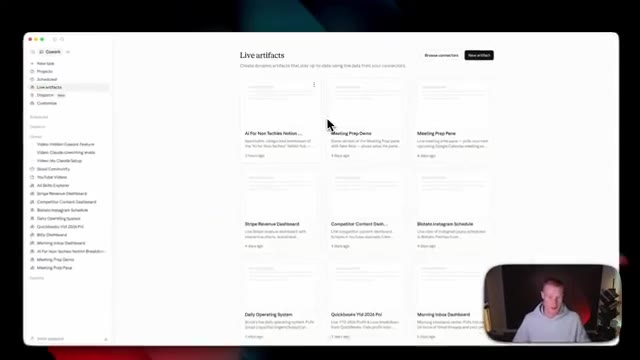
*⏱️ 00:10:50 — Vue de l'interface Cowork affichant la section "Live artifacts" avec une grille de différents tableaux de bord et fiches d'artéfacts.*

---

### ⏱️ `[00:10:55 - 00:11:13]` | Segment #28

**🔊 Audio (Transcription Intégrale Mot pour Mot en Français) :**
> Nous avons ce bouton noir. Nous cliquons dessus. Nous pouvons cliquer sur « discuter avec Claude » et, en gros, expliquer simplement en français courant ce que nous voulons créer. Ensuite, il va vous poser une série de deux ou trois questions différentes. Il me demande donc si je veux créer un outil de suivi des revenus scolaires, un pipeline vidéo et les performances sur YouTube. Et tout cela est entièrement personnalisé, en gros, en fonction de qui vous êtes.

**👁️ Analyse Visuelle d'Écran (gemini-3.5-flash-lite) :**
**Interface & Outils** : Interface Cowork (application web de productivité et d'IA)

**Contenu textuel & Code** : Prompt utilisateur et questions à choix multiples (« Which area would the live artifact help you most with? » avec des options comme Skool revenue tracker, Video pipeline + YouTube perf, etc.)
[DESC_IMAGE_3] Saisie et sélection d'une option de configuration proposée par l'assistant IA.

**Action / Démonstration** : Explications face caméra et analyse conceptuelle des marchés.

*⏱️ 00:10:59 — Saisie d'un prompt pour créer un artefact en direct dans l'interface Cowork.*

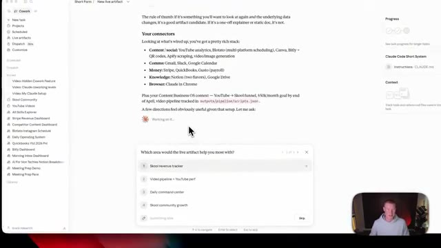
*⏱️ 00:11:04 — Affichage d'une liste de choix à choix multiples générée par l'IA pour préciser l'outil souhaité.*

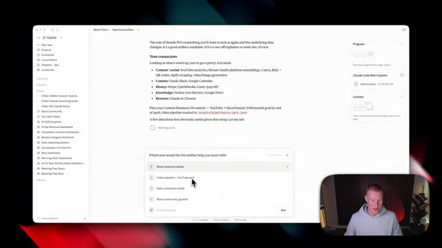
*⏱️ 00:11:09 — Sélection de la deuxième option dans le menu interactif proposé par l'assistant.*

---

### ⏱️ `[00:11:14 - 00:11:33]` | Segment #29

**🔊 Audio (Transcription Intégrale Mot pour Mot en Français) :**
> Donc tout le contexte que Claude a sur moi, il me recommande différents cas d'utilisation pour moi personnellement. Donc cela peut être un excellent point de départ si vous ne savez pas par quoi commencer à construire. Donc personnellement, je pense que je vais opter pour le centre de commande quotidien juste pour vous montrer exactement comment cela fonctionne. C'est assez universel pour que tout le monde l'utilise. Je suppose donc que vous pourriez probablement en tirer de la valeur instantanément. Ensuite, à quelle fréquence l'ouvrez-vous réellement plusieurs fois par jour ?

**👁️ Analyse Visuelle d'Écran (gemini-3.5-flash-lite) :**
**Interface & Outils** : Interface web de Claude Cowork / assistant IA avec panneau latéral et options interactives.

**Contenu textuel & Code** : Texte listant les connecteurs de l'utilisateur (Stripe, QuickBooks, Gmail, Slack, Notion) et options de sondage interactif pour configurer un tableau de bord personnalisé (Daily command center).

**Action / Démonstration** : Navigation et sélection interactive dans l'interface de Claude pour choisir le cas d'usage du centre de commande quotidien.

*⏱️ 00:11:23 — Interface de l'application Claude montrant les connecteurs connectés (Content/social, Comms, Money, Knowledge, Browser) et une liste de suggestions interactive avec les options « Skool revenue tracker », « Video pipeline », et le curseur sélectionnant « Daily command center ».*

*⏱️ 00:11:28 — Interface de l'application Claude affichant une pop-up interactive demandant à quelle fréquence l'utilisateur ouvrirait le tableau de bord, avec les choix « Multiple times a day », « Once a day », et « Weekly ».*

---

### ⏱️ `[00:11:33 - 00:11:54]` | Segment #30

**🔊 Audio (Transcription Intégrale Mot pour Mot en Français) :**
> Qu'est-ce qui importe le plus pour les chiffres et les graphiques de design ? Un mélange des deux, pour être honnête. Donc maintenant, une fois qu'on lui a donné cette information, on va continuer, lancer cet artefact, et je vais vous montrer exactement à quoi ça ressemble. Entre-temps, ce qu'on doit faire, c'est s'assurer d'ajouter nos applications spécifiques que nous avons et auxquelles nous voulons nous connecter. Si vous ne l'avez jamais fait auparavant, afin d'ajouter des connecteurs, nous devons venir sur la barre latérale gauche.

**👁️ Analyse Visuelle d'Écran (gemini-3.5-flash-lite) :**
**Interface & Outils** : Application Cowork / Claude Artifacts avec une vue en panneau latéral et une incrustation vidéo du présentateur en bas à droite.

**Contenu textuel & Code** : Texte descriptif sur les connecteurs, les outils (YouTube, Stripe, Notion) et des questions interactives sur la configuration d'un centre de commande.

**Action / Démonstration** : Navigation et interaction dans l'application Cowork pour configurer et lancer un nouvel artefact dynamique.

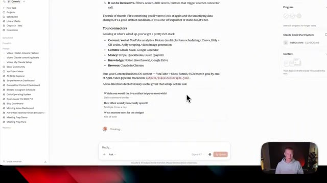
*⏱️ 00:11:38 — Interface Cowork montrant un document textuel en cours de génération avec les choix de design de l'utilisateur et une zone de chat en bas.*

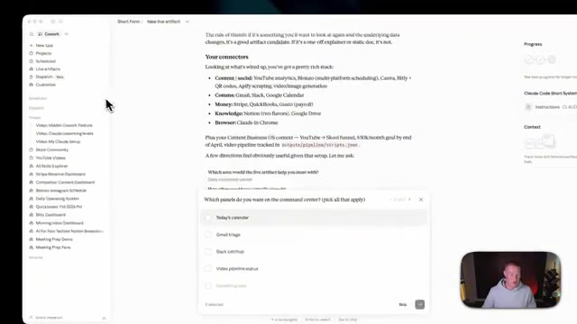
*⏱️ 00:11:44 — Interface Cowork affichant une pop-up interactive demandant de sélectionner les panneaux pour le centre de commande.*

---

### ⏱️ `[00:11:54 - 00:12:15]` | Segment #31

**🔊 Audio (Transcription Intégrale Mot pour Mot en Français) :**
> Il y aura ce petit bouton de personnalisation, alors assurez-vous de le sélectionner. Une fois que je l'aurai sélectionné, nous allons voir quelques éléments différents. Nous avons ici toutes nos différentes compétences que nous possedons. Nous avons nos connecteurs et nos plugins. Ensuite, nous devons ajouter des connecteurs. Alors cliquez là-dessus. J'ai personnellement une grande liste de différents connecteurs que j'utilise personnellement. Ce sont des applications que j'utilise chaque jour dans mon entreprise, mais aussi directement à l'intérieur de Claude.

**👁️ Analyse Visuelle d'Écran (gemini-3.5-flash-lite) :**
**Interface & Outils** : Interface web de personnalisation de l'assistant Claude.

**Contenu textuel & Code** : Liste des connecteurs disponibles (Web et Desktop) et permissions associées pour Bitly (Get Custom Domains, Get Custom Link Details, etc.).

**Action / Démonstration** : Navigation dans le panneau latéral pour sélectionner et afficher les différents connecteurs et plugins disponibles.

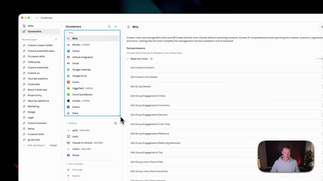
*⏱️ 00:12:10 — Panneau des connecteurs de Claude affichant une liste d'applications intégrées telles que Bitly, Canva, GitHub, Gmail et Google Drive, avec les permissions détaillées pour Bitly.*

---

### ⏱️ `[00:12:15 - 00:12:34]` | Segment #32

**🔊 Audio (Transcription Intégrale Mot pour Mot en Français) :**
> Donc, sélectionnez n'importe lesquels de ceux que vous voulez utiliser. Et pour ce faire, venez simplement dans "parcourir les connecteurs". D'ici, nous allons avoir en gros un marché de différentes applications auxquelles nous pouvons nous connecter. J'ai ajouté Gmail, Google Drive, Google Calendar. On dirait qu'on pourrait même ajouter Spotify. C'est plutôt cool. Disons donc que nous voulons ajouter Spotify, par exemple. Nous cliquons simplement là-dessus et c'est automatiquement connecté.

**👁️ Analyse Visuelle d'Écran (gemini-3.5-flash-lite) :**
**Interface & Outils** : Interface web d'intégration d'applications (Cowork / Connectors Directory) avec une vue en grille des connecteurs disponibles.

**Contenu textuel & Code** : Liste des applications connectables : Google Drive, Gmail, Google Calendar, Tray.ai, Spotify, Monday.com, HubSpot, Figma, Intercom, Atlassian Rovo, Booking.com, Box.

**Action / Démonstration** : Navigation dans le répertoire des connecteurs pour sélectionner et ajouter des applications tierces.

*⏱️ 00:12:20 — Fenêtre contextuelle "Directory" affichant la liste des connecteurs disponibles (Google Drive, Gmail, Google Calendar, Spotify, etc.) avec le curseur pointant sur l'onglet Connectors.*

*⏱️ 00:12:25 — Même interface de répertoire de connecteurs, avec le curseur survolant l'application Gmail.*

---

### ⏱️ `[00:12:34 - 00:12:57]` | Segment #33

**🔊 Audio (Transcription Intégrale Mot pour Mot en Français) :**
> Et donc maintenant, je peux commencer à demander à Claude de récupérer des informations depuis Spotify. Assurez-vous donc de configurer toutes les différentes applications que vous utilisez, car sinon les artefacts en direct ne vont pas être aussi utiles, étant donné que nous voulons récupérer des informations en direct à partir de ces différentes applications. Et vous devez d'abord configurer des connecteurs pour pouvoir le faire. Et disons que vous parcourez tous ces différents connecteurs qui se trouvent à l'intérieur de Claude, et que l'application que vous voulez utiliser n'y est pas ajoutée.

**👁️ Analyse Visuelle d'Écran (gemini-3.5-flash-lite) :**
**Interface & Outils** : Application de gestion et de productivité (Cowork / interface de configuration d'agents IA) montrant un répertoire de connecteurs d'applications.

**Contenu textuel & Code** : Liste des connecteurs disponibles (Anthropic & Partners) avec des intégrations telles que Outreach, ClickUp, Ahrefs, Mixpanel, Postman et Snowflake.
[DESC_IMAGE_3] Navigation dans le répertoire des applications et des connecteurs pour configurer les intégrations tierces.

**Action / Démonstration** : Sélection et configuration des connecteurs d'applications pour lier les différents services à l'outil d'intelligence artificielle.

*⏱️ 00:12:51 — Fenêtre du répertoire des connecteurs (Directory - Connectors) affichant diverses intégrations logicielles disponibles (Outreach, ClickUp, Ahrefs, Mixpanel, etc.).*

---

### ⏱️ `[00:12:57 - 00:13:15]` | Segment #34

**🔊 Audio (Transcription Intégrale Mot pour Mot en Français) :**
> Eh bien, il y a un moyen de contourner cela. Laissez-moi donc vous montrer exactement comment je fais personnellement en ce moment. J'utilise personnellement Zapier. J'ai donc configuré un serveur MCP Zapier et Zapier se connecte fondamentalement à plus de 9 000 applications différentes. Donc, pour faire cela, nous pouvons cliquer sur ce bouton plus. Cela va vous amener à Zapier MCP. Nous allons cliquer sur autoriser.

**👁️ Analyse Visuelle d'Écran (gemini-3.5-flash-lite) :**
**Interface & Outils** : Interface de configuration logicielle et navigateur web.

**Contenu textuel & Code** : Recherche de connecteurs, module Zapier pour automatiser des flux de travail entre applications.

**Action / Démonstration** : Navigation et recherche du connecteur Zapier dans l'annuaire d'applications.

*⏱️ 00:13:01 — Interface d'un répertoire de connecteurs affichant une recherche pour "zapier" avec le résultat Zapier visible.*

*⏱️ 00:13:06 — Vue légèrement élargie du même répertoire de connecteurs affichant l'application Zapier avec l'option d'automatisation.*

---

### ⏱️ `[00:13:15 - 00:13:35]` | Segment #35

**🔊 Audio (Transcription Intégrale Mot pour Mot en Français) :**
> Ensuite, ça va ouvrir ceci dans votre navigateur. Je pourrais donc simplement cliquer sur ouvrir Claude et nous avons fondamentalement juste besoin d'accorder l'accès à Zapier. Et une fois que nous sommes à l'intérieur du MCP de Zapier, il y a quelques choses que nous devons faire pour configurer ceci. Nous allons donc cliquer sur ajouter un nouveau serveur MCP. Et ensuite, pour nos clients, nous voulons sélectionner Claude Cowork. Juste ici, j'ai déjà quelques applications différentes connectées comme HubSpot, Stripe, School, et cetera.

**👁️ Analyse Visuelle d'Écran (gemini-3.5-flash-lite) :**
**Interface & Outils** : Navigateur web, interface de configuration Zapier MCP et paramètres Claude.

**Contenu textuel & Code** : Liste des outils configurés via le serveur MCP de Zapier (Hubspot, Stripe, Google Drive, etc.) et paramètres de permissions.
[ACCÈS] Navigation dans l'interface de Zapier MCP pour configurer les intégrations et outils connectés à Claude.

**Action / Démonstration** : Explications face caméra et analyse conceptuelle des marchés.

*⏱️ 00:13:25 — Interface du tableau de bord Zapier MCP affichant les configurations de serveur MCP.*

*⏱️ 00:13:30 — Vue détaillée du serveur Claude MCP dans Zapier avec la liste des outils connectés (HubSpot, Stripe, Google Drive, Skool, Google Docs).*

---

### ⏱️ `[00:13:35 - 00:13:55]` | Segment #36

**🔊 Audio (Transcription Intégrale Mot pour Mot en Français) :**
> Donc, pour ajouter vos outils, vous venez simplement ici, vous recherchez les outils que vous voulez ajouter. Disons que je veux ajouter ClickUp. Je pourrais sélectionner toutes ces différentes actions. Ce sont différentes choses qu'il peut exécuter pour vous. Vous cliquez sur "connecter". Et ensuite, tout ce que vous avez à faire, c'est de configurer votre compte ClickUp. Et c'est aussi simple que ça, nous avons maintenant ClickUp d'ajouté à notre serveur MCP. Donc, nous pourrions ajouter toutes les différentes applications que nous utilisons. Il y en a plus de 8 000 auxquelles nous pouvons nous connecter.

**👁️ Analyse Visuelle d'Écran (gemini-3.5-flash-lite) :**
**Interface & Outils** : Navigateur web, interface Zapier MCP, interface de configuration d'outils.

**Contenu textuel & Code** : Liste des applications configurables (HubSpot, Stripe, Google Drive, Skool, Google Docs, ClickUp).

**Action / Démonstration** : Ajout et connexion de l'outil ClickUp au serveur MCP Zapier.

*⏱️ 00:13:40 — Fenêtre modale de recherche d'outils pour "ClickUp" sur Zapier MCP.*

*⏱️ 00:13:45 — Clic sur le bouton de connexion ouvrant une fenêtre pop-up d'authentification.*

*⏱️ 00:13:50 — Interface principale affichant la liste des outils connectés dont ClickUp.*

---

### ⏱️ `[00:13:55 - 00:14:15]` | Segment #37

**🔊 Audio (Transcription Intégrale Mot pour Mot en Français) :**
> Et ensuite, pour connecter ceci à Claude, nous cliquons simplement sur connecter, puis sur "ajouter à Claude". Cela va vous ramener sur Claude, et ensuite il suffit de cliquer sur connecter et nous serons connectés ici. Je tiens à préciser en préambule que c'est uniquement nécessaire s'il y a une application à l'intérieur de Claude à laquelle vous ne pouvez pas vous connecter de manière native. C'est juste une astuce qui, honnêtement, a fait gagner tellement de temps à moi et aux membres de ma communauté. Très bien. Et ça a généré ce nouvel artefact en direct de centre de commande quotidien.

**👁️ Analyse Visuelle d'Écran (gemini-3.5-flash-lite) :**
**Interface & Outils** : Navigateur web affichant l'interface de l'assistant Claude et le répertoire d'intégrations Zapier.

**Contenu textuel & Code** : Détails de la connexion Zapier, URL du connecteur, et tableau de bord des flux de travail actifs.

**Action / Démonstration** : Présentation de la configuration des connecteurs tiers et de l'intégration des flux de travail dans Claude.

*⏱️ 00:14:00 — Image #1 : Fenêtre affichant l'intégration et la configuration de Zapier avec l'assistant Claude.*

---

### ⏱️ `[00:14:15 - 00:14:36]` | Segment #38

**🔊 Audio (Transcription Intégrale Mot pour Mot en Français) :**
> On dirait qu'on n'a rien sur le calendrier juste ici. Ça montre qu'on a zéro réunion, zéro heure. Ça montre qu'on a 16 e-mails différents auxquels je dois répondre. Et ensuite, j'ai aussi connecté Slack et il n'y a aucun message auquel je dois personnellement répondre sur Slack. Ensuite, on a tout notre tri Gmail, qui est en fait tous ces e-mails différents ici. Et les gars, c'est ce qui a été généré à partir d'un seul et unique simple prompt.

**👁️ Analyse Visuelle d'Écran (gemini-3.5-flash-lite) :**
**Interface & Outils** : Application Notion (Daily Command Center)

**Contenu textuel & Code** : Indicateurs chiffrés : 0 réunion, 0 heure, 16 e-mails à traiter (Gmail triage) et 0 mention Slack.

**Action / Démonstration** : Le présentateur commente les différentes métriques de productivité affichées sur son tableau de bord Notion.

*⏱️ 00:14:20 — Vue du tableau de bord 'Daily Command Center' montrant les compteurs de réunions, d'heures et d'e-mails (16 e-mails à traiter).*

*⏱️ 00:14:31 — Vue du tableau de bord 'Daily Command Center' mettant en surbrillance la section de tri des e-mails Gmail.*

---

### ⏱️ `[00:14:36 - 00:14:57]` | Segment #39

**🔊 Audio (Transcription Intégrale Mot pour Mot en Français) :**
> Donc nous pouvons personnaliser cela comme nous le voulons, mais c'est à quel point il est simple de générer ces différents artefacts en direct. Encore une fois, si vous ne voulez pas passer par les tracas d'écrire un prompt spécifique afin de générer ces artefacts en direct au sein de la communauté scolaire, nous avons ce guide qui détaille cinq prompts différents que vous pouvez utiliser avec différents cas d'utilisation qui sont universels pour tout le monde. C'est donc une ressource que vous pouvez définitivement utiliser si vous souhaitez y accéder.

**👁️ Analyse Visuelle d'Écran (gemini-3.5-flash-lite) :**
**Interface & Outils** : Interface web de gestion de productivité (Cowork) et plateforme communautaire.

**Contenu textuel & Code** : Tableaux de bord de productivité, listes de tâches, e-mails et guides pratiques pour l'utilisation d'outils d'IA.

**Action / Démonstration** : Navigation à l'écran pour présenter les différents artéfacts et cas d'usage intégrés dans la plateforme.

*⏱️ 00:14:41 — Vue d'un tableau de bord de type "Daily Command Center" affichant des widgets de gestion de tâches et d'e-mails.*

*⏱️ 00:14:47 — Affichage d'un article ou guide communautaire détaillant l'utilisation des "Live Artifacts" et des cas d'usage.*

---

### ⏱️ `[00:14:57 - 00:15:18]` | Segment #40

**🔊 Audio (Transcription Intégrale Mot pour Mot en Français) :**
> Et les gars, je veux juste dire que j'ai atteint 100 000 abonnés sur YouTube cette semaine. Je ne pourrai jamais assez vous remercier de faire partie de cette communauté. Et si vous n'êtes pas abonné, je tiens à dire que 82 % d'entre vous ne sont en fait pas abonnés à la chaîne, ce qui m'a plutôt surpris. Alors si vous voulez aider la chaîne, tout en restant à jour et en comprenant tout ce qui se passe dans l'écosystème de Claude, assurez-vous de vous abonner à cette chaîne.

**👁️ Analyse Visuelle d'Écran (gemini-3.5-flash-lite) :**
**Interface & Outils** : YouTube Studio

**Contenu textuel & Code** : Compteur d'abonnés de la chaîne (101 174 abonnés) et graphique de croissance de la chaîne sur 28 jours.

**Action / Démonstration** : Le présentateur commente l'atteinte du cap des 100 000 abonnés sur sa chaîne YouTube.

---

### ⏱️ `[00:15:18 - 00:15:38]` | Segment #41

**🔊 Audio (Transcription Intégrale Mot pour Mot en Français) :**
> Cela compte vraiment énormément pour moi. Mais merci infiniment les gars. Ça a été un long voyage pour arriver ici à 100 000 abonnés. Je ne peux pas remercier chacun d'entre vous individuellement, mais sachez simplement que cela compte énormément pour moi. Alors merci beaucoup les gars non seulement d'être restés jusqu'à la fin de cette vidéo, mais aussi d'être restés et d'avoir regardé ma chaîne YouTube. Cela étant dit, les gars, abonnez-vous, likez, laissez un commentaire. Ça aide beaucoup et je vous vois les gars dans la prochaine vidéo.

**👁️ Analyse Visuelle d'Écran (gemini-3.5-flash-lite) :**
**Interface & Outils** : YouTube Studio

**Contenu textuel & Code** : Statistiques de la chaîne YouTube affichant 101 174 abonnés et un graphique de croissance de la chaîne sur les derniers mois.

**Action / Démonstration** : Présentation du jalon des 100 000 abonnés atteints par la chaîne.

---

