# 🎬 Claude Video Just Changed Content Creation Forever…

> **Chaîne** : [Brock Mesarich | AI for Non Techies](https://www.youtube.com/@BrockMesarich)  
> **Lien YouTube** : [https://www.youtube.com/watch?v=k8igQH7SLwI](https://www.youtube.com/watch?v=k8igQH7SLwI)  
> **Date de publication** : 20260504  
> **Durée** : 00:26:07  
> **Identifiant vidéo** : `k8igQH7SLwI`  
> **Transcription & Analyse** : `whisper-v3-large-turbo+gemini-3.5-flash-lite`  

---

## 📌 Synthèse Exécutive & Outils

### 💡 Résumé
La vidéo de la chaîne *Brock Mesarich | AI for Non Techies* marque un tournant dans l'automatisation et la création de contenu pilotée par l'intelligence artificielle en levant l'une des limitations historiques de l'application Claude Desktop et de son mode « Cowork » : l'incapacité d'accéder à des outils de génération d'images et de vidéos au sein de son environnement de sandbox sécurisé. Grâce à l'intégration du connecteur Higgsfield, les utilisateurs peuvent désormais automatiser de bout en bout la production de visuels publicitaires et de contenus dynamiques directement depuis Claude, éliminant ainsi le recours laborieux à des API externes ou des plateformes tierces cloisonnées.

L'analyse de cette transition met en lumière une méthodologie rigoureuse basée sur l'ingénierie de compétences modulaires, la structuration de dossiers locaux dédiés et l'optimisation des flux de travail par l'usage de « Claude Projects ». En déployant des fichiers de configuration personnalisés (`Claude.md`) et des packs de compétences open-source pré-intégrés via des plugins zippés, l'intervenant démontre comment transformer un assistant textuel en un véritable collaborateur autonome capable d'exécuter des tâches complexes, d'itérer sur des briefs créatifs et de planifier des productions de contenu automatisées en arrière-plan.

Cette approche s'inscrit dans une logique de productivité avancée où la réduction des coûts en jetons (*token costs*) et la compartimentation des écosystèmes d'IA garantissent des performances opérationnelles maximales. En combinant la puissance logique des grands modèles de langage, l'automatisation des dossiers locaux et des outils génératifs spécialisés, cette stratégie ouvre la voie à des workflows de marketing digital et de création de contenu entièrement autonomes, exécutables sans compétences techniques préalables.

### 🛠️ Outils, Modèles & Logiciels Présentés
* **Claude Desktop App** : Application de bureau indispensable pour exécuter l'environnement de travail sécurisé et accéder aux fonctionnalités avancées de Cowork.
* **Claude Cowork Mode** : Mode opérationnel interactif permettant à l'IA d'interagir directement avec la structure des dossiers et des fichiers locaux d'un ordinateur.
* **Higgsfield Connector** : Connecteur natif intégré à Claude permettant la génération automatisée d'images et de vidéos directement dans l'environnement de sandbox.
* **Claude Projects** : Écosystème sectoriel compartimenté au sein de Claude permettant d'isoler les contextes, les instructions et les historiques pour des cas d'usage précis.
* **Claude.md (Fichiers Markdown)** : Documents de configuration contextuelle définissant le ton, la voix, les règles et les préférences d'un agent IA pour un projet donné.
* **ChatGPT** : Modèle conversationnel d'OpenAI mentionné comme référence comparative de sandbox cloisonné.
* **Gemini** : Modèle d'intelligence artificielle de Google cité parmi les outils d'imagerie et de génération bloqués par les anciennes limitations de sandbox.
* **Grok** : Modèle conversationnel et agent d'intelligence artificielle évoqué dans l'écosystème global des outils IA actuels.
* **MidJourney** : Modèle de référence en génération d'images par IA dont l'intégration directe était auparavant impossible dans Cowork.
* **Runway** : Plateforme de génération vidéo par IA traditionnellement inaccessible via l'API directe de l'environnement sécurisé Claude.
* **n8n & Make & Zapier** : Outils d'automatisation de workflows et d'intégration de flux de données mentionnés pour l'interconnexion de plateformes tierces.

### 🔑 Points Clés & Enseignements Stratégiques
* **Résolution du verrouillage des bacs à sable (*Sandboxing*)** : L'intégration de Higgsfield résout le principal frein technique de Claude Cowork qui bloquait l'accès aux API de génération visuelle en raison de restrictions de sécurité strictes.
* **Configuration initiale de l'application de bureau** : L'utilisation de Cowork requiert obligatoirement le téléchargement et l'installation de l'application desktop officielle de Claude, disponible sur macOS et Windows.
* **Sélection et structuration des dossiers de travail** : L'efficacité de Cowork repose sur la liaison directe avec un répertoire local spécifique sur l'ordinateur (ex. : dossier « advertisements ») pour centraliser les actifs générés.
* **Importation de plugins via des archives ZIP** : Les compétences personnalisées se déploient massivement dans l'interface de Claude en regroupant des ensembles de scripts dans un fichier compressé, injecté via l'onglet de personnalisation des plugins.
* **Optimisation des coûts par l'utilisation des Projets** : La segmentation des cas d'usage en projets distincts évite la surcharge des contextes et réduit drastiquement la consommation de jetons (*tokens*) par rapport à l'utilisation d'un fichier de configuration unique et surdimensionné.
* **Rôle stratégique des fichiers `Claude.md`** : Ces fichiers markdown agissent comme des manuels de formation permanents pour un "employé IA", dictant instantanément le ton rédactionnel, les règles métier et les préférences techniques à chaque interaction.
* **Utilisation de la compétence de configuration automatisée** : Le prompt spécialisé `/setup Higgs field project` automatise l'initialisation d'un projet publicitaire en guidant l'utilisateur à travers un questionnaire interactif structuré.
* **Définition granulaire des paramètres créatifs** : L'assistant interroge l'utilisateur sur des variables précises telles que le nom de l'espace de travail, la voix de la marque, les plateformes cibles et la structure des dossiers de sortie.
* **Standardisation des acteurs virtuels (UGC)** : Le système permet de paramétrer des personnages par défaut pour les contenus vidéo générés par les utilisateurs (*User Generated Content*), assurant une cohérence visuelle d'une campagne à l'autre.
* **Planification des tâches en arrière-plan** : L'architecture combinée des projets et des déclencheurs permet à Claude d'exécuter des productions publicitaires et visuelles de manière autonome, y compris en dehors des heures de travail actives.

---

## ⏱️ Chronologie & Transcription Complète Audio & Visuelle (Mot pour Mot)

### ⏱️ `[00:00:00 - 00:00:19]` | Segment #01

**🔊 Audio (Transcription Intégrale Mot pour Mot en Français) :**
> You can now generate images and videos directly inside of Claude Cowork. And as a Cowork Power user, this is something I'm beyond stoked for. I generated these images and videos directly inside of Claude. And in this video, I'm going to show you how to do the exact same thing. I'm also going to share with you for free five different skills you can use to help you generate these from scratch.

**👁️ Analyse Visuelle d'Écran (gemini-3.5-flash-lite) :**
**Interface & Outils** : Présentation ou face-caméra explicatif du trader sans interface logicielle partagée.

**Contenu textuel & Code** : Explications orales des stratégies et mise en contexte méthodologique du marché.

**Action / Démonstration** : Explications face caméra et analyse conceptuelle des marchés.

---

### ⏱️ `[00:00:19 - 00:00:38]` | Segment #02

**🔊 Audio (Transcription Intégrale Mot pour Mot en Français) :**
> And I'm even going to show you how to pair these with scheduled tasks so Claude can generate these for you while you sleep. So without further ado, let's dive right into this. So before I show you exactly how we can begin generating images and videos inside of Claude now, I want to talk about something real quickly. And that is Claude Cowork could do almost everything except for generate images and videos.

**👁️ Analyse Visuelle d'Écran (gemini-3.5-flash-lite) :**
**Interface & Outils** : Présentation ou face-caméra explicatif du trader sans interface logicielle partagée.

**Contenu textuel & Code** : Explications orales des stratégies et mise en contexte méthodologique du marché.

**Action / Démonstration** : Explications face caméra et analyse conceptuelle des marchés.

---

### ⏱️ `[00:00:39 - 00:00:59]` | Segment #03

**🔊 Audio (Transcription Intégrale Mot pour Mot en Français) :**
> And as a Cowork power user, this was extremely annoying. And honestly, one of the things that made Cowork not feel like a complete product yet. So if you aren't familiar with exactly why this would work, that is because the sandbox that Claude Cowork is inside of blocks outside AI tools. This is a perfect graphic to explain exactly what I'm talking about.

**👁️ Analyse Visuelle d'Écran (gemini-3.5-flash-lite) :**
**Interface & Outils** : Présentation ou face-caméra explicatif du trader sans interface logicielle partagée.

**Contenu textuel & Code** : Explications orales des stratégies et mise en contexte méthodologique du marché.

**Action / Démonstration** : Explications face caméra et analyse conceptuelle des marchés.

---

### ⏱️ `[00:00:59 - 00:01:19]` | Segment #04

**🔊 Audio (Transcription Intégrale Mot pour Mot en Français) :**
> So right here, we have Claude Cowork that's in this sandbox environment, and you aren't able to access these different image and video generation tools via API, such as Gemini, OpenAI, MidJourney, or Runway, in order to generate images or videos. And this was a big headache. And no matter what you did, there was basically no workaround from inside of Cowork.

**👁️ Analyse Visuelle d'Écran (gemini-3.5-flash-lite) :**
**Interface & Outils** : Présentation ou face-caméra explicatif du trader sans interface logicielle partagée.

**Contenu textuel & Code** : Explications orales des stratégies et mise en contexte méthodologique du marché.

**Action / Démonstration** : Explications face caméra et analyse conceptuelle des marchés.

---

### ⏱️ `[00:01:20 - 00:01:44]` | Segment #05

**🔊 Audio (Transcription Intégrale Mot pour Mot en Français) :**
> That is now fixed with the new Higgsfield connector inside of Claude that allows you to not only generate images, but generate videos automatically, directly inside of Claude. This is probably the most powerful connector that I've ever used inside of Claude because it solves a massive pain point that any Co-Work user has had before. The first thing we need to do in order to begin using this is we have to download the Claude desktop app in order to use Co-Work.

**👁️ Analyse Visuelle d'Écran (gemini-3.5-flash-lite) :**
**Interface & Outils** : Présentation ou face-caméra explicatif du trader sans interface logicielle partagée.

**Contenu textuel & Code** : Explications orales des stratégies et mise en contexte méthodologique du marché.

**Action / Démonstration** : Explications face caméra et analyse conceptuelle des marchés.

---

### ⏱️ `[00:01:44 - 00:02:03]` | Segment #06

**🔊 Audio (Transcription Intégrale Mot pour Mot en Français) :**
> So make sure to download this if you're a Mac user as well as a Windows user, you can download this to your computer. And then once you do that, we'll move on to the next step. Next up, we're going to open up the desktop app and we're going to see this interface here. If you've never used this before, let me give you a quick rundown. So on the top left where you see this little blue square, this is basically like interacting with Claude.

**👁️ Analyse Visuelle d'Écran (gemini-3.5-flash-lite) :**
**Interface & Outils** : Présentation ou face-caméra explicatif du trader sans interface logicielle partagée.

**Contenu textuel & Code** : Explications orales des stratégies et mise en contexte méthodologique du marché.

**Action / Démonstration** : Explications face caméra et analyse conceptuelle des marchés.

---

### ⏱️ `[00:02:03 - 00:02:21]` | Segment #07

**🔊 Audio (Transcription Intégrale Mot pour Mot en Français) :**
> As if it's Chachaviti, we could ask it questions. And then right here, we can see this little checklist that is co-work mode. And then on the right, that icon is code. We really want to focus on co-work in this video. So make sure to select that. And you could see that we now have this interface. Next up, this is what we're going to see on screen. And this is a really important step.

**👁️ Analyse Visuelle d'Écran (gemini-3.5-flash-lite) :**
**Interface & Outils** : Présentation ou face-caméra explicatif du trader sans interface logicielle partagée.

**Contenu textuel & Code** : Explications orales des stratégies et mise en contexte méthodologique du marché.

**Action / Démonstration** : Explications face caméra et analyse conceptuelle des marchés.

---

### ⏱️ `[00:02:22 - 00:02:42]` | Segment #08

**🔊 Audio (Transcription Intégrale Mot pour Mot en Français) :**
> So we need to select a specific folder that we want to work inside of. And what I mean by this is there are folders we're going to work inside of on our computer. And that is one of the key powers inside of Cowork. So what I'm going to do is I'm going to click on this. I'm going to scroll down. I'm going to choose a different folder. And from here, I'm just going to select new folder. And I'm just going to call this advertisements.

**👁️ Analyse Visuelle d'Écran (gemini-3.5-flash-lite) :**
**Interface & Outils** : Présentation ou face-caméra explicatif du trader sans interface logicielle partagée.

**Contenu textuel & Code** : Explications orales des stratégies et mise en contexte méthodologique du marché.

**Action / Démonstration** : Explications face caméra et analyse conceptuelle des marchés.

---

### ⏱️ `[00:02:42 - 00:03:05]` | Segment #09

**🔊 Audio (Transcription Intégrale Mot pour Mot en Français) :**
> And then we're going to be inside of this new folder. Click on open. Click allow so it can add different files. and then we will now see our advertisements folder right here. Another thing I want to note is if you have a preexisting folder with all of these different assets you want to use for ads, for example, you can just come here and select it. But for most people, you will probably want to start from scratch and then you'll have your advertisements folder right here.

**👁️ Analyse Visuelle d'Écran (gemini-3.5-flash-lite) :**
**Interface & Outils** : Présentation ou face-caméra explicatif du trader sans interface logicielle partagée.

**Contenu textuel & Code** : Explications orales des stratégies et mise en contexte méthodologique du marché.

**Action / Démonstration** : Explications face caméra et analyse conceptuelle des marchés.

---

### ⏱️ `[00:03:05 - 00:03:23]` | Segment #10

**🔊 Audio (Transcription Intégrale Mot pour Mot en Français) :**
> All right, so once you configure that folder inside of Cloud Cowork, we next need to leverage these skills that I'm gonna show you in this video. So I'm gonna show you right now exactly how you could download these. I created them for you guys completely for free and you could access them. There's a link in the description to grab these. Right here, we have all of these different skills that I'm gonna walk through in this video.

**👁️ Analyse Visuelle d'Écran (gemini-3.5-flash-lite) :**
**Interface & Outils** : Présentation ou face-caméra explicatif du trader sans interface logicielle partagée.

**Contenu textuel & Code** : Explications orales des stratégies et mise en contexte méthodologique du marché.

**Action / Démonstration** : Explications face caméra et analyse conceptuelle des marchés.

---

### ⏱️ `[00:03:23 - 00:03:42]` | Segment #11

**🔊 Audio (Transcription Intégrale Mot pour Mot en Français) :**
> But the question is, how do I download these and upload them to cowork? And I'm gonna show you that right now. So if you go to the link in the description, you will see this zip file as well as this PDF right here. So what we're gonna do is let's download this zip file. We're gonna see it downloaded here. And then let's download this PDF guide as well. So first of all, I'm gonna pull up this PDF guide.

**👁️ Analyse Visuelle d'Écran (gemini-3.5-flash-lite) :**
**Interface & Outils** : Présentation ou face-caméra explicatif du trader sans interface logicielle partagée.

**Contenu textuel & Code** : Explications orales des stratégies et mise en contexte méthodologique du marché.

**Action / Démonstration** : Explications face caméra et analyse conceptuelle des marchés.

---

### ⏱️ `[00:03:42 - 00:04:07]` | Segment #12

**🔊 Audio (Transcription Intégrale Mot pour Mot en Français) :**
> And what this is, is this is a step-by-step guide on exactly what problem this solves. It's gonna break down every single skill that I show in this video, as well as show when to use them. So I highly suggest you follow along with this video, but also use this PDF guide as a way to guide you through exactly how to use these. Next up, once we download both the zip file and the PDF guide, we need to grab that zip file that we downloaded to our desktop.

**👁️ Analyse Visuelle d'Écran (gemini-3.5-flash-lite) :**
**Interface & Outils** : Présentation ou face-caméra explicatif du trader sans interface logicielle partagée.

**Contenu textuel & Code** : Explications orales des stratégies et mise en contexte méthodologique du marché.

**Action / Démonstration** : Explications face caméra et analyse conceptuelle des marchés.

---

### ⏱️ `[00:04:07 - 00:04:28]` | Segment #13

**🔊 Audio (Transcription Intégrale Mot pour Mot en Français) :**
> Then we need to come over to the left-hand sidebar inside of Cowork, click on this customize button, and this is gonna take us to plugins. Plugins are basically just a bundle of skills that you could upload into Cowork instead of you having to individually add them. So I'm gonna come here, I'm gonna click on Create Plugin, click on Upload Plugin, and just drag that zip file right here into Cowork.

**👁️ Analyse Visuelle d'Écran (gemini-3.5-flash-lite) :**
**Interface & Outils** : Présentation ou face-caméra explicatif du trader sans interface logicielle partagée.

**Contenu textuel & Code** : Explications orales des stratégies et mise en contexte méthodologique du marché.

**Action / Démonstration** : Explications face caméra et analyse conceptuelle des marchés.

---

### ⏱️ `[00:04:28 - 00:04:47]` | Segment #14

**🔊 Audio (Transcription Intégrale Mot pour Mot en Français) :**
> Click on Upload. For me, I'm just gonna click Replace, but for you, it'll just automatically upload this. And just like that, we now have all six of these specific skills here, along with the description breaking down exactly what this plugin is for. Real quick, if you guys do wanna dive deeper into Clawed Cowork, make sure to join my school community. There is a link in the description to do so.

**👁️ Analyse Visuelle d'Écran (gemini-3.5-flash-lite) :**
**Interface & Outils** : Présentation ou face-caméra explicatif du trader sans interface logicielle partagée.

**Contenu textuel & Code** : Explications orales des stratégies et mise en contexte méthodologique du marché.

**Action / Démonstration** : Explications face caméra et analyse conceptuelle des marchés.

---

### ⏱️ `[00:04:47 - 00:05:07]` | Segment #15

**🔊 Audio (Transcription Intégrale Mot pour Mot en Français) :**
> Inside of here, there are some high-level entrepreneurs and professionals that are using Cloud Cowork every single day, sharing some pretty cool use cases, as well as we have a full course on how to use Cowork inside of here. And all of the resources from my videos are here as well, such as this document here that breaks down exactly how Live Artifacts works. I'm sharing resources in here almost every single day for you guys.

**👁️ Analyse Visuelle d'Écran (gemini-3.5-flash-lite) :**
**Interface & Outils** : Présentation ou face-caméra explicatif du trader sans interface logicielle partagée.

**Contenu textuel & Code** : Explications orales des stratégies et mise en contexte méthodologique du marché.

**Action / Démonstration** : Explications face caméra et analyse conceptuelle des marchés.

---

### ⏱️ `[00:05:07 - 00:05:29]` | Segment #16

**🔊 Audio (Transcription Intégrale Mot pour Mot en Français) :**
> So if you want to join, there is a link in the description to do so. Next up in our setup, this is something that you don't have to do, but I highly advise you do do this. As a Claude Cowork power user, this is a hack that honestly has been one of the most influential things I've done. And that is taking advantage of Claude projects. Inside of Cowork, we're gonna select this projects button on the left-hand sidebar.

**👁️ Analyse Visuelle d'Écran (gemini-3.5-flash-lite) :**
**Interface & Outils** : Présentation ou face-caméra explicatif du trader sans interface logicielle partagée.

**Contenu textuel & Code** : Explications orales des stratégies et mise en contexte méthodologique du marché.

**Action / Démonstration** : Explications face caméra et analyse conceptuelle des marchés.

---

### ⏱️ `[00:05:29 - 00:05:47]` | Segment #17

**🔊 Audio (Transcription Intégrale Mot pour Mot en Français) :**
> And if you do not know what a project is, this is basically a separate ecosystem for different use cases you have for Cowork, and it could really help you stay organized. To show you exactly what a project looks like, this is my YouTube's video project. We can chat with it right here. You can see all of the different outputs here from this specific project.

**👁️ Analyse Visuelle d'Écran (gemini-3.5-flash-lite) :**
**Interface & Outils** : Présentation ou face-caméra explicatif du trader sans interface logicielle partagée.

**Contenu textuel & Code** : Explications orales des stratégies et mise en contexte méthodologique du marché.

**Action / Démonstration** : Explications face caméra et analyse conceptuelle des marchés.

---

### ⏱️ `[00:05:47 - 00:06:07]` | Segment #18

**🔊 Audio (Transcription Intégrale Mot pour Mot en Français) :**
> We can see all the different chats that are on the project. We could see all of our scheduled tasks. We have specific instructions for this project. We could see any of the context that we have as well as the memory. So to show you all of the projects I have, I have five different ones inside of Cowork. I have one for my financials. I have one for my short form. I have one for my school community.

**👁️ Analyse Visuelle d'Écran (gemini-3.5-flash-lite) :**
**Interface & Outils** : Présentation ou face-caméra explicatif du trader sans interface logicielle partagée.

**Contenu textuel & Code** : Explications orales des stratégies et mise en contexte méthodologique du marché.

**Action / Démonstration** : Explications face caméra et analyse conceptuelle des marchés.

---

### ⏱️ `[00:06:07 - 00:06:44]` | Segment #19

**🔊 Audio (Transcription Intégrale Mot pour Mot en Français) :**
> I have one for my influencer marketing agency and I have one specifically dedicated for YouTube videos. So not only do projects help keep you organized and it's a really nice visual inside of co-work, but a key point here is that we could have separate ClaudeMD files for each different project. And if you don't know what a ClaudeMD is, let me break it down super simply now so literally anybody can understand it. Think of this as a markdown file, which is a document that basically just explains a couple of different things. It explains your voice and your tone. It explains your rules, different contexts that it has on you, specific preferences, and the different tools that

**👁️ Analyse Visuelle d'Écran (gemini-3.5-flash-lite) :**
**Interface & Outils** : Présentation ou face-caméra explicatif du trader sans interface logicielle partagée.

**Contenu textuel & Code** : Explications orales des stratégies et mise en contexte méthodologique du marché.

**Action / Démonstration** : Explications face caméra et analyse conceptuelle des marchés.

---

### ⏱️ `[00:06:44 - 00:07:19]` | Segment #20

**🔊 Audio (Transcription Intégrale Mot pour Mot en Français) :**
> you use. Think of this as training an AI employee one time, and it always knows how to perform every single time that you interact with it. And every message that you send Claude in a specific folder pulls up your MD file every time. So it will always give you similar outputs and responses. To show you exactly what I mean, let's come back into co-work. I'm going to show you my Claude file for my YouTube's video folder. So if I click on instructions here, we can see a Claude MD file that is basically just a set of instructions. And this one is specific to YouTube. So every single time I message with Claude in this project, it's automatically going to load this. So it knows how

**👁️ Analyse Visuelle d'Écran (gemini-3.5-flash-lite) :**
**Interface & Outils** : Présentation ou face-caméra explicatif du trader sans interface logicielle partagée.

**Contenu textuel & Code** : Explications orales des stratégies et mise en contexte méthodologique du marché.

**Action / Démonstration** : Explications face caméra et analyse conceptuelle des marchés.

---

### ⏱️ `[00:07:19 - 00:07:39]` | Segment #21

**🔊 Audio (Transcription Intégrale Mot pour Mot en Français) :**
> to work with me on this specific task, but we don't want to use this Claude MD. If we're generating ads, for example, we're most likely going to want to create our own separate Claude MD file for that specific project and that is why we're going to set up a project. This is a perfect visual. So for YouTube, we're going to have a separate CloudMD file. We're going to have a separate one for ads.

**👁️ Analyse Visuelle d'Écran (gemini-3.5-flash-lite) :**
**Interface & Outils** : Présentation ou face-caméra explicatif du trader sans interface logicielle partagée.

**Contenu textuel & Code** : Explications orales des stratégies et mise en contexte méthodologique du marché.

**Action / Démonstration** : Explications face caméra et analyse conceptuelle des marchés.

---

### ⏱️ `[00:07:40 - 00:08:14]` | Segment #22

**🔊 Audio (Transcription Intégrale Mot pour Mot en Français) :**
> We're going to have a separate one for email and for community. That way, basically, these are custom to whatever we're working on. And the big thing here is this is going to save you a lot of money on token costs because you're not just using an over bloated CloudMD file. That's just going to waste your credits. It's going to be specific to creating advertisements. In order for us to create a project, we're going to come over to the left-hand sidebar, make sure that we have selected projects here. And then from here, we're going to click on the top right where it says new project. So I'm going to open that up. We can either start from scratch, import a project from chat mode, or use an existing folder on our computer. So what I'm going to do is use an existing folder.

**👁️ Analyse Visuelle d'Écran (gemini-3.5-flash-lite) :**
**Interface & Outils** : Présentation ou face-caméra explicatif du trader sans interface logicielle partagée.

**Contenu textuel & Code** : Explications orales des stratégies et mise en contexte méthodologique du marché.

**Action / Démonstration** : Explications face caméra et analyse conceptuelle des marchés.

---

### ⏱️ `[00:08:14 - 00:08:49]` | Segment #23

**🔊 Audio (Transcription Intégrale Mot pour Mot en Français) :**
> I'm going to select the one that I created at the beginning called advertisements. Once that is selected, we could either explain our instructions right here to Claude, add different files and whatnot. But I'm just going to click create and I'm going to show you a hack in order to populate and create this ClaudeMD file without you running around like a chicken with your head cut off, trying to figure out what to do. Luckily for you guys, inside of the plugin that I'm going to share for this video, there's a link in the description completely free. Not only are you going to get the skills that I am showing in this video, but you're also going to get this skill that will help you set up this ClaudeMD file so you don't need to start from scratch and do it yourself. And that

**👁️ Analyse Visuelle d'Écran (gemini-3.5-flash-lite) :**
**Interface & Outils** : Présentation ou face-caméra explicatif du trader sans interface logicielle partagée.

**Contenu textuel & Code** : Explications orales des stratégies et mise en contexte méthodologique du marché.

**Action / Démonstration** : Explications face caméra et analyse conceptuelle des marchés.

---

### ⏱️ `[00:08:49 - 00:09:09]` | Segment #24

**🔊 Audio (Transcription Intégrale Mot pour Mot en Français) :**
> skill is called Setup Higgsfield Project, as you can see here with all of these instructions that you could change, but this is a really good starting point in order for you to set this up. Now, coming back to our advertisements project, we just need to select this. And this is what we're gonna see here. Next up, what I'm gonna do is type forward slash setup Higgs field project.

**👁️ Analyse Visuelle d'Écran (gemini-3.5-flash-lite) :**
**Interface & Outils** : Présentation ou face-caméra explicatif du trader sans interface logicielle partagée.

**Contenu textuel & Code** : Explications orales des stratégies et mise en contexte méthodologique du marché.

**Action / Démonstration** : Explications face caméra et analyse conceptuelle des marchés.

---

### ⏱️ `[00:09:09 - 00:09:29]` | Segment #25

**🔊 Audio (Transcription Intégrale Mot pour Mot en Français) :**
> You will see this populated in the skills that we have inside of Claude. And then literally all I have to do is click on send. And it's gonna take us through a couple of different questions in order to help us set this up. And the best part about this skill that I gave you is it's gonna walk you through a couple of different questions. And it's going to pull up this cool little question box for us to walk through a couple of different things.

**👁️ Analyse Visuelle d'Écran (gemini-3.5-flash-lite) :**
**Interface & Outils** : Présentation ou face-caméra explicatif du trader sans interface logicielle partagée.

**Contenu textuel & Code** : Explications orales des stratégies et mise en contexte méthodologique du marché.

**Action / Démonstration** : Explications face caméra et analyse conceptuelle des marchés.

---

### ⏱️ `[00:09:29 - 00:09:48]` | Segment #26

**🔊 Audio (Transcription Intégrale Mot pour Mot en Français) :**
> So first of all, it's going to ask us what should we call this content workspace? What are we making here? What brand voice fits best? And it's also going to ask which platforms are we actually going to create content for? On top of that, it's going to talk about our default character for this UGC actor that we're creating, as well as the colors and the specific output folder structure.

**👁️ Analyse Visuelle d'Écran (gemini-3.5-flash-lite) :**
**Interface & Outils** : Application Cowork / Claude AI (Opus 4.7)

**Contenu textuel & Code** : Formulaire de configuration interactive "Set up Higgsfield project workspace" : questions sur le type de publication, la voix de la marque, les plateformes sociales cibles, les acteurs UGC et le code couleur.

**Action / Démonstration** : Défilement et passage en revue des paramètres de configuration guidée pour la création d'un projet de contenu IA.

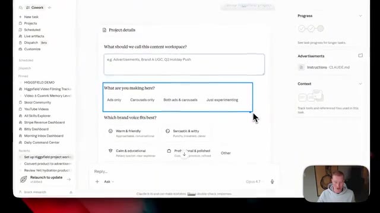
*⏱️ 00:09:33 — Interface de l'application Cowork affichant le début du formulaire de configuration d'un espace de travail Higgsfield, avec la sélection du type de contenu et du ton de la marque.*

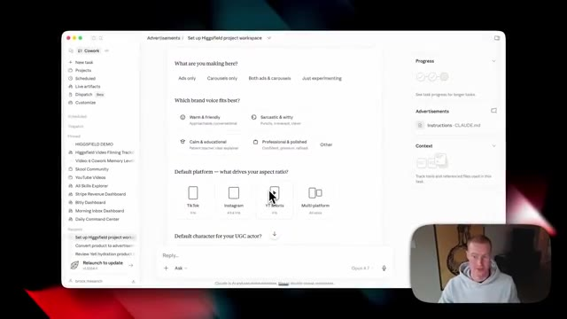
*⏱️ 00:09:38 — Défilement dans l'interface montrant la section des plateformes par défaut (TikTok, Instagram, YT Shorts, Multi-platform) pour le choix du ratio d'aspect.*

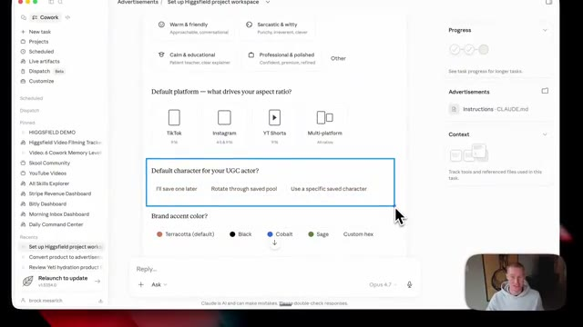
*⏱️ 00:09:43 — Vue du formulaire montrant la configuration du personnage UGC par défaut et le choix des couleurs d'accentuation de la marque.*

---

### ⏱️ `[00:09:48 - 00:10:10]` | Segment #27

**🔊 Audio (Transcription Intégrale Mot pour Mot en Français) :**
> So let me just go through and add all of this. Once we go through that checklist of our different specifications, we will now have a ClaudeMD file generated. So we're going to see that in a couple of different spots. We'll see it down here at the very bottom. So it shows ClaudeMD. And then also inside of our advertisements project, we can now see instructions, which is our ClaudeMD file. And if I open it up, this is basically a step-by-step guide on exactly how this project should function.

**👁️ Analyse Visuelle d'Écran (gemini-3.5-flash-lite) :**
**Interface & Outils** : Application Cowork / Espace de travail Claude AI.

**Contenu textuel & Code** : - Paramètres configurés : Projet (Advertisements), Voix (Professional & polished), Formats vidéo (9:16 principal, 4:5 secondaire, 2k), Couleur d'accentuation (#0A7756), Répertoires de sortie (outputs/ads/, outputs/morning/).
- Fichiers générés : `CLAUDE.md`, `Instructions - CLAUDE.md`.
- Modèle utilisé : Opus 4.7.

**Action / Démonstration** : Démonstration des emplacements où s'affiche le fichier de règles `CLAUDE.md` généré automatiquement après validation des spécifications du projet.

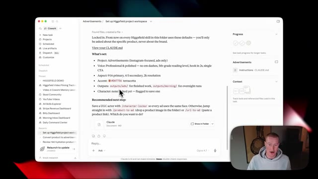
*⏱️ 00:09:53 — Interface de l'application Cowork affichant le résumé des paramètres de configuration validés pour le projet avec un lien vers le fichier CLAUDE.md.*

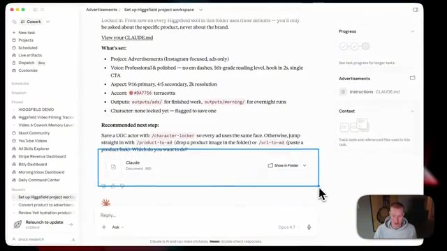
*⏱️ 00:09:59 — Interface Cowork avec un encadré bleu mettant en évidence le fichier document « Claude .MD » généré au bas de la discussion.*

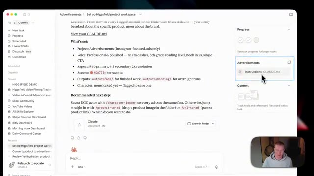
*⏱️ 00:10:05 — Interface Cowork avec un encadré bleu soulignant le fichier « Instructions - CLAUDE.md » figurant dans le panneau latéral droit sous la section Advertisements.*

---

### ⏱️ `[00:10:10 - 00:10:32]` | Segment #28

**🔊 Audio (Transcription Intégrale Mot pour Mot en Français) :**
> And if we want to make any changes to this, we can just go ahead and do so. It's a markdown file. It's very easy to make changes. It even explains the output structure, which is going to come in handy later on in this video when we start using this. All right, you've installed all of the skills. You've set up your working folder for your ads. And we even created a project that you could see right here inside of Cloud Cowork.

**👁️ Analyse Visuelle d'Écran (gemini-3.5-flash-lite) :**
**Interface & Outils** : Application de bureau Cowork / Claude (éditeur Markdown et espace de travail IA).

**Contenu textuel & Code** : Fichier `CLAUDE.md` avec paramètres de projet : règles de ton/voix ("Confident, premium, polished", règles sans mots d'interjection), directives de style et arborescence de la structure de sortie (`Output structure`: `Advertisements/outputs/ads/`, `carousels/`, `morning/`, etc.).

**Action / Démonstration** : Explication de l'arborescence du projet et de la facilité d'édition du fichier de configuration Markdown.

*⏱️ 00:10:16 — Affichage et défilement du fichier Markdown de configuration `CLAUDE.md` montrant les règles de rédaction, la voix du projet et la structure des dossiers de sortie.*

---

### ⏱️ `[00:10:32 - 00:10:50]` | Segment #29

**🔊 Audio (Transcription Intégrale Mot pour Mot en Français) :**
> The question is now, how do we connect this to Higgs field and begin generating images and videos? So I'm going to show you exactly how to do that right now. First of all, what we're going to do is we're going to come over to the left hand sidebar inside of Cowork. We're going to click on customize. this is where we need to configure our connector. So we need to click on connectors right here.

**👁️ Analyse Visuelle d'Écran (gemini-3.5-flash-lite) :**
**Interface & Outils** : Application Cowork (interface web de gestion de projet et d'IA)

**Contenu textuel & Code** : Menu latéral de personnalisation, sections "Personal plugins", "Skills", "Connectors" et options de configuration de l'outil.

**Action / Démonstration** : Navigation dans l'interface de Cowork et clic sur l'onglet de personnalisation dans la barre latérale gauche.

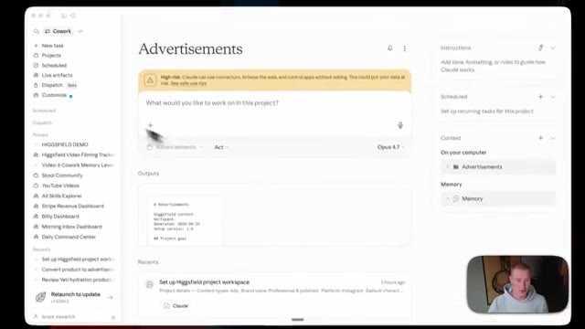
*⏱️ 00:10:41 — Interface de l'application Cowork affichant le tableau de bord de gestion de projets et de tâches.*

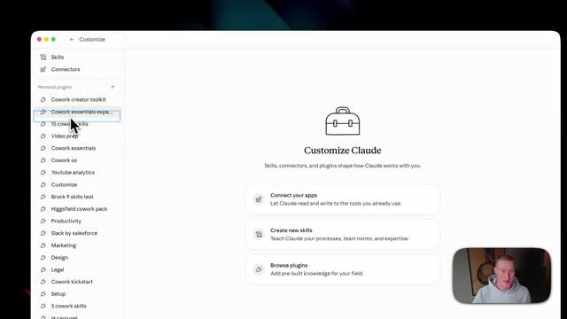
*⏱️ 00:10:46 — Écran de personnalisation de Cowork montrant le menu latéral avec les plugins personnels et les options de configuration.*

---

### ⏱️ `[00:10:51 - 00:11:09]` | Segment #30

**🔊 Audio (Transcription Intégrale Mot pour Mot en Français) :**
> And what we are gonna do is click on this plus button and we are going to add a custom connector. From here, we're just gonna call this Higgs field and then we're gonna paste in this specific URL here. So screenshot this, paste this exact same URL and then we're gonna click on add. And just like that, you can now see that Higgs field is connected.

**👁️ Analyse Visuelle d'Écran (gemini-3.5-flash-lite) :**
**Interface & Outils** : Interface de configuration des connecteurs personnalisés (application Claude / Cowork).

**Contenu textuel & Code** : Formulaire d'ajout de connecteur personnalisé avec nom et URL d'API (https://mcp.higgsfield.ai/mcp).

**Action / Démonstration** : Ajout et configuration d'un connecteur personnalisé nommé Higgsfield en renseignant son URL.

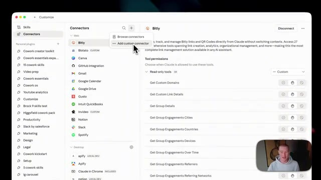
*⏱️ 00:10:55 — Le curseur sélectionne l'option 'Add custom connector' depuis le menu déroulant du bouton plus.*

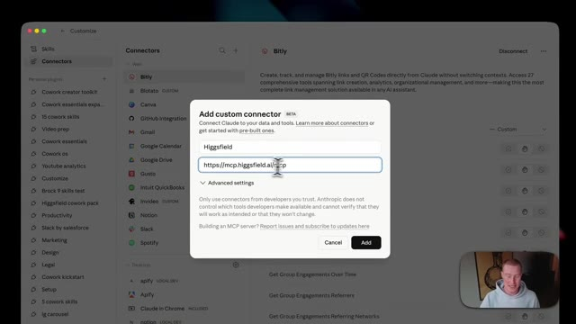
*⏱️ 00:11:00 — Fenêtre modale 'Add custom connector' avec le nom 'Higgsfield' et l'URL mcp.higgsfield.ai/mcp renseignés.*

---

### ⏱️ `[00:11:10 - 00:11:29]` | Segment #31

**🔊 Audio (Transcription Intégrale Mot pour Mot en Français) :**
> Nous avons tous ces différents outils que Claude pourrait fondamentalement exécuter pour nous en ce moment même. Il pourrait donc générer des images, il pourrait générer des vidéos, montrer toutes les générations, toutes ces différentes choses. L'élément clé ici, cependant, vous devez vous assurer d'avoir un compte Higgsfield. Vous pouvez toujours vous inscrire au forfait le moins cher afin de commencer à générer des images et des vidéos. Et si vous atteignez les limites, vous pouvez alors passer à un forfait supérieur payant.

**👁️ Analyse Visuelle d'Écran (gemini-3.5-flash-lite) :**
**Interface & Outils** : Interface logicielle de configuration de connecteurs (plugin Higgsfield).

**Contenu textuel & Code** : Options de permissions d'outils interactifs (« Generate Image », « Generate Video », « Show Generations », « Display Results », « Show Medias ») et outils en lecture seule.

**Action / Démonstration** : Présentation des différents outils et permissions que Claude peut exécuter (génération d'images, de vidéos, etc.).

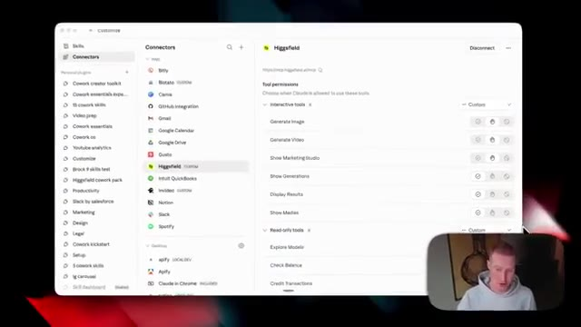
*⏱️ 00:11:14 — Interface de configuration affichant les connecteurs et les permissions d'outils pour Higgsfield, avec la vidéo du présentateur en bas à droite.*

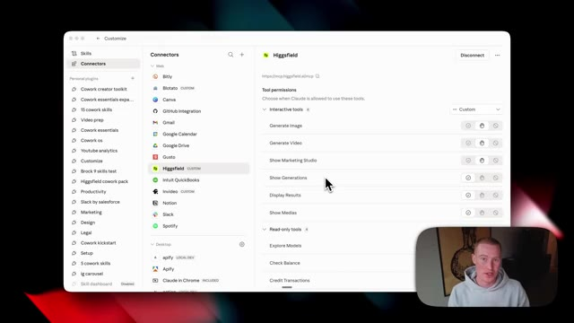
*⏱️ 00:11:19 — Vue similaire avec le curseur pointant sur les options de génération et d'affichage des résultats interactifs.*

---

### ⏱️ `[00:11:29 - 00:12:03]` | Segment #32

**🔊 Audio (Transcription Intégrale Mot pour Mot en Français) :**
> Mais je tiens à dire que c'est la meilleure alternative pour générer des vidéos et des images dans Claude en ce moment. Personnellement, ce que je vais faire pour ces autorisations, c'est de toujours autoriser. De cette façon, je n'ai pas toujours à approuver fondamentalement chaque petite chose que Co-workers essaie de faire pour moi afin de générer des vidéos et des images. Faites cela à vos propres risques, bien sûr, car cela pourrait consommer certains de vos jetons que vous ne voulez pas utiliser. Faites donc simplement ce qui fonctionne le mieux pour vous. Très bien. Disons donc que nous voulons ajouter d'autres connecteurs à Claude que nous ne voyons pas à l'intérieur de cette liste ici. Disons que vous faites défiler tout cela et qu'il y en a un que vous voulez ajouter qui n'est tout simplement pas à l'intérieur d'ici. Je vais vous montrer comment ajouter d'autres

**👁️ Analyse Visuelle d'Écran (gemini-3.5-flash-lite) :**
**Interface & Outils** : Application de bureau Claude (interface de configuration des connecteurs et plugins tiers).

**Contenu textuel & Code** : Liste des connecteurs (Bitly, Canva, GitHub, Google Calendar, Higgsfield, Firecrawl, Notion, Slack, etc.) et options de permissions pour les outils interactifs et en lecture seule.

**Action / Démonstration** : Navigation et configuration des permissions d'outils pour les connecteurs d'intelligence artificielle dans l'application.

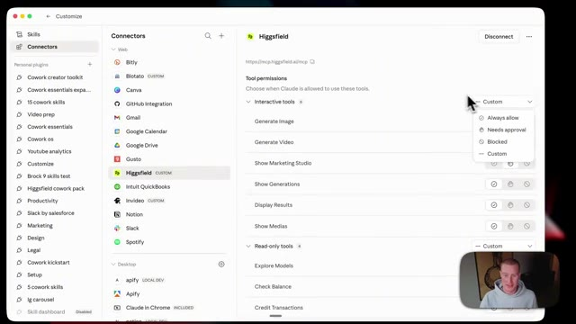
*⏱️ 00:11:38 — Interface de personnalisation montrant les connecteurs de plugins et les permissions d'outils pour Higgsfield avec un menu déroulant pour configurer l'autorisation automatique.*

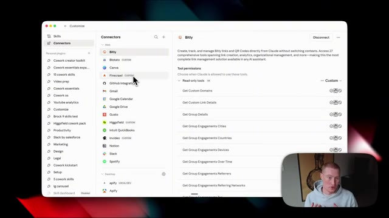
*⏱️ 00:11:55 — Interface de personnalisation montrant la liste des connecteurs disponibles, avec le curseur sélectionnant le plugin Firecrawl dans la barre latérale.*

---

### ⏱️ `[00:12:03 - 00:12:32]` | Segment #33

**🔊 Audio (Transcription Intégrale Mot pour Mot en Français) :**
> applications en ce moment. Et c'est une astuce simple pour les utilisateurs non techniques. Donc, j'utilise personnellement un serveur MCP appelé Zapier MCP, mais vous pourriez utiliser n'importe quel serveur MCP que vous voudriez. Donc, je vais cliquer sur commencer. Et une fois que je suis dans mon compte, je vais voir cette interface. Pour moi, j'ai ce serveur MCP connecté, qui a fondamentalement accès à toutes ces différentes applications et à tous ces outils. Et je pourrais en ajouter autant que je veux. Et il y a 9 000 applications différentes auxquelles Zapier MCP peut se connecter. Donc, afin de configurer un serveur, nous allons cliquer sur nouveau serveur MCP.

**👁️ Analyse Visuelle d'Écran (gemini-3.5-flash-lite) :**
**Interface & Outils** : Navigateur web affichant le site Zapier MCP et son tableau de bord de configuration.

**Contenu textuel & Code** : Page de présentation et interface de gestion des serveurs MCP connectés à des applications tierces (ClickUp, HubSpot, Stripe, Google Drive, Skool, Google Docs).

**Action / Démonstration** : Navigation sur le site Zapier MCP et présentation du tableau de bord de configuration des outils.

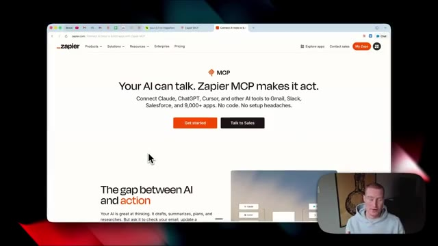
*⏱️ 00:12:10 — Page d'accueil du site web Zapier MCP présentant le slogan 'Your AI can talk. Zapier MCP makes it act.' avec un bouton 'Get started'.*

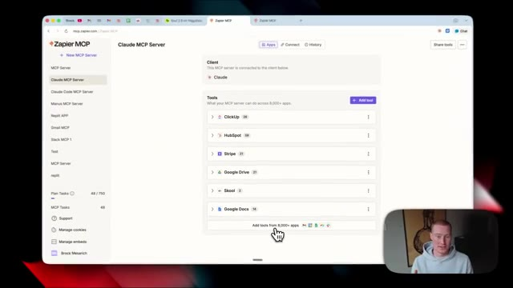
*⏱️ 00:12:25 — Interface du tableau de bord Zapier MCP montrant la configuration du serveur MCP pour Claude et la liste des outils connectés (ClickUp, HubSpot, Stripe, etc.).*

---

### ⏱️ `[00:12:32 - 00:13:10]` | Segment #34

**🔊 Audio (Transcription Intégrale Mot pour Mot en Français) :**
> Nous allons cliquer sur cowork. Et à partir d'ici, nous pouvons simplement ajouter n'importe laquelle de ces applications que nous voulons. De cette façon, nous pourrons avoir accès à ces connexions. Ensuite, une fois que nous avons ajouté nos applications et que nous voulons connecter cela à Claude, nous cliquons simplement sur connecter en haut. Nous cliquons sur ce bouton « ajouter à Claude » et tout ce que nous avons à faire est de cliquer sur connecter Zapier, de cliquer sur autoriser, et cela devrait nous ramener à Claude et cela devrait fonctionner sans problème. Ainsi, toutes les applications que nous ajoutons, nous pouvons désormais y accéder, en extraire des informations et exécuter différentes actions grâce au MCP de Zapier. Très bien, et ensuite, testons cela. Donnons-lui simplement une consigne très simple pour générer une image. Je vais donc simplement venir ici et dire, générer une image d'un homme roux se tenant devant le Austin

**👁️ Analyse Visuelle d'Écran (gemini-3.5-flash-lite) :**
**Interface & Outils** : Navigateur web, interface Zapier MCP, application Cowork.

**Contenu textuel & Code** : Liste des outils connectés (ClickUp, HubSpot, Stripe, etc.) et écran de liaison des comptes.

**Action / Démonstration** : Connexion et autorisation des applications pour les lier à Claude via Zapier MCP.

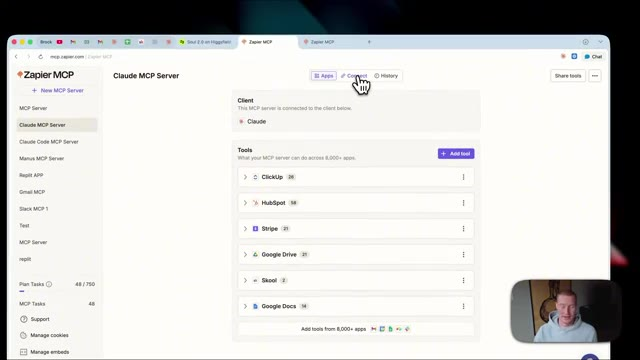
*⏱️ 00:12:42 — Interface Zapier MCP montrant le serveur Claude MCP et la liste des applications connectées (ClickUp, HubSpot, Stripe, Google Drive, Skool, Google Docs).*

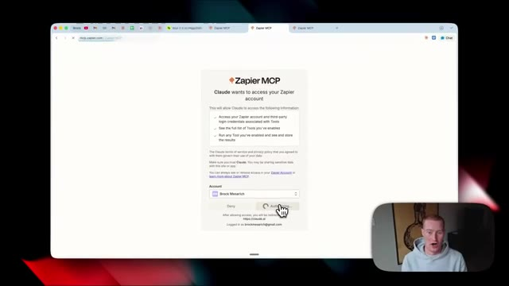
*⏱️ 00:12:51 — Écran d'autorisation de Zapier MCP demandant l'accès de Claude au compte Zapier de l'utilisateur.*

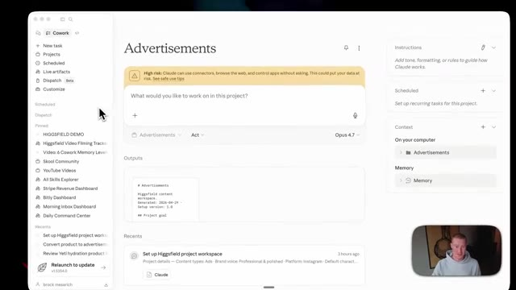
*⏱️ 00:13:00 — Interface de l'application Cowork montrant le panneau latéral avec les différents projets et dossiers.*

---

### ⏱️ `[00:13:10 - 00:13:43]` | Segment #35

**🔊 Audio (Transcription Intégrale Mot pour Mot en Français) :**
> Skyline et je veux que ce soit dans un style GTA 5. Donc on veut essentiellement vérifier que la génération d'images fonctionne. Je vais donc vous montrer exactement comment cela va fonctionner maintenant. Et voilà. On peut voir que Hicksfield est en train de générer cette image. C'est incroyable. Si vous avez déjà utilisé Cowork, c'est là qu'on serait bloqué. Ça dirait essentiellement que je ne peux pas générer d'images et de vidéos. Et ensuite on serait bloqué et on devrait aller utiliser quelque chose comme CloudCode ou un autre outil de génération d'images. Donc c'est plutôt cool. On peut voir qu'il utilise maintenant Nano Banana Pro ici dans un format neuf par six. Et ensuite on peut aussi toujours voir notre fichier Claude MD que nous

**👁️ Analyse Visuelle d'Écran (gemini-3.5-flash-lite) :**
**Interface & Outils** : Application de génération d'images / interface de flux de travail (Cowork)

**Contenu textuel & Code** : Prompt affiché : "Generate an image of a red-headed man standing in front of the Austin skyline, and I want it to be in a GTA V style."

**Action / Démonstration** : Saisie et envoi d'un prompt pour tester la génération d'images par IA.

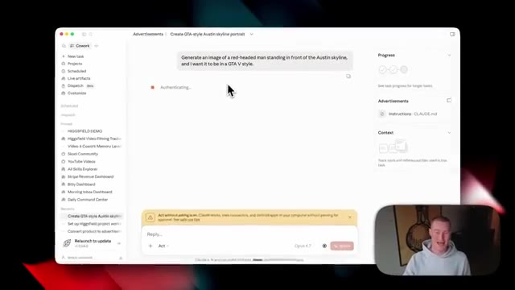
*⏱️ 00:13:18 — Interface d'une application montrant un prompt textuel pour générer une image de style GTA V avec une skyline d'Austin, avec le présentateur en incrustation vidéo en bas à droite.*

---

### ⏱️ `[00:13:43 - 00:14:16]` | Segment #36

**🔊 Audio (Transcription Intégrale Mot pour Mot en Français) :**
> créé ici. Donc, en gros, c'est juste notre ensemble d'instructions que nous avons configuré. Nous pourrions toujours changer cela et, en gros, configurer notre style spécifique que nous aimerions qu'il utilise. Très bien. Et juste comme ça, littéralement à peine 30 secondes plus tard, nous avons ce visuel et il montre Austin. C'est au format GTA 5 et il montre même les différents bâtiments de la skyline d'Austin. Donc, cela fonctionne correctement. L'une des principales raisons pour lesquelles c'est si génial dans Claude, c'est que nous pouvons transformer n'importe quoi en compétence. Donc, disons que nous aimons ce style exact de ce personnage de GTA et la manière exacte dont cela rend. Transformons maintenant cela en compétence. Donc, chaque fois que nous voulons faire quelque chose

**👁️ Analyse Visuelle d'Écran (gemini-3.5-flash-lite) :**
**Interface & Outils** : Cowork / application de bureau basée sur l'IA avec interface de chat et panneau de projet.
[DESC_IMAGE_1]

**Contenu textuel & Code** : Prompt textuel 'GTA V cover art style illustration...' et image générée affichée au centre.
[DESC_IMAGE_1]

**Action / Démonstration** : Navigation dans l'interface de l'application et visualisation d'une illustration générée par l'IA.

---

### ⏱️ `[00:14:16 - 00:14:52]` | Segment #37

**🔊 Audio (Transcription Intégrale Mot pour Mot en Français) :**
> similaire, il pourrait le générer comme ça à chaque fois. Donc je vais littéralement juste dire, hé, est-ce que tu peux aller de l'avant et transformer ceci en une compétence ? Je veux que ce soit la compétence GTA 5 pour générer des images comme ça à chaque fois que je l'utilise. Et chaque fois que tu génères quelque chose de bien, disons que c'est une publicité spécifique ou peut-être une photo de profil de toi-même, qui ressemble à un portrait professionnel de toi-même, tu pourrais alors transformer cela en une compétence. Comme ça, elle pourrait s'exécuter exactement de la même manière à chaque fois. Très bien. Et 30 secondes plus tard, nous avons maintenant cette compétence, tu peux voir à l'intérieur de cette petite chose de contexte. Et si je fais remonter ceci, tu peux voir en gros cette description. Elle montre le modèle de prompt exact, et cetera. Donc chaque fois que je veux générer ceci

**👁️ Analyse Visuelle d'Écran (gemini-3.5-flash-lite) :**
**Interface & Outils** : Application Cowork (interface web ou bureau) avec un panneau de discussion et de gestion de tâches.

**Contenu textuel & Code** : Génération d'une image de style artistique GTA 5, invite textuelle pour transformer le style en une compétence réutilisable, et confirmation de l'installation de la compétence "gta-5".

**Action / Démonstration** : Démonstration de la création d'une compétence personnalisée (skill) dans l'application Cowork pour automatiser la génération d'images dans un style spécifique.

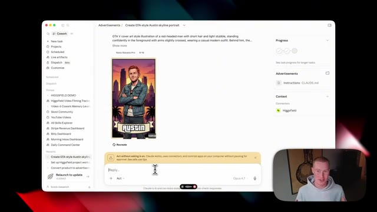
*⏱️ 00:14:25 — Interface Cowork affichant une image générée dans le style GTA V d'un homme roux avec la mention "AUSTIN", avec le présentateur en bas à droite.*

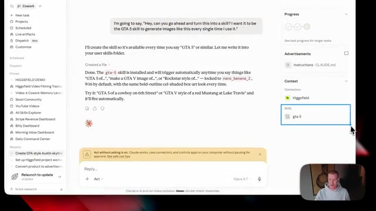
*⏱️ 00:14:43 — Interface Cowork montrant la réponse textuelle de l'IA confirmant la création et l'installation de la compétence "gta-5".*

---

### ⏱️ `[00:14:52 - 00:15:27]` | Segment #38

**🔊 Audio (Transcription Intégrale Mot pour Mot en Français) :**
> exactement le même style, je pourrais le faire simplement en utilisant un seul mot et cela va déclencher cette compétence. Ensuite, je veux vous montrer la compétence d'ajout de produit qui se trouve à l'intérieur de ce plugin. Et c'est une compétence de travail collaboratif qui transforme une image de produit en une publicité vidéo UGC et elle extrait automatiquement les images de produits que vous avez stockées dans un dossier sur votre bureau et les transforme en publicités vidéo. Et cette compétence juste ici montre vraiment la puissance de ce que Claude Co-Work et Hicksfield peuvent réellement faire ensemble. Donc cette compétence va terminer exactement ce même processus ici. Elle va lire les images dans ce dossier. Elle va générer un acteur spécifique à utiliser pour nous et c'est

**👁️ Analyse Visuelle d'Écran (gemini-3.5-flash-lite) :**
**Interface & Outils** : Navigateur web affichant une page de présentation de projet/compétence logicielle.

**Contenu textuel & Code** : Texte affiché : "/product-to-ad - A Cowork skill that turns a product image into a finished UGC video ad."

**Action / Démonstration** : Le présentateur introduit visuellement la compétence "/product-to-ad" à l'écran.

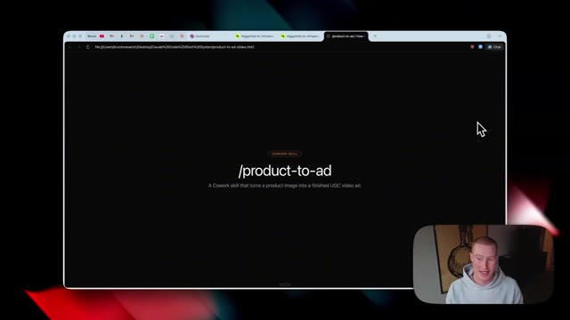
*⏱️ 00:15:01 — Capture montrant une fenêtre de navigateur affichant une page sombre avec le titre "/product-to-ad", et le présentateur en médaillon dans le coin inférieur droit.*

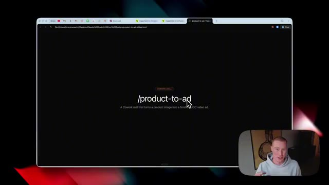
*⏱️ 00:15:18 — Capture quasi identique à l'image 1, montrant la page web de présentation de la compétence de coworking "/product-to-ad".*

---

### ⏱️ `[00:15:27 - 00:16:02]` | Segment #39

**🔊 Audio (Transcription Intégrale Mot pour Mot en Français) :**
> va composer la scène, écrire le script, puis rendre la vidéo pour nous automatiquement. Et par-dessus tout, les vidéos et images générées vont être ajoutées à ce dossier spécifique dans lequel nous travaillons sur notre bureau. Très bien. Je suis donc dans mon projet de publicités ici. Nous sommes dans le dossier de travail spécifique dans lequel nous voulons travailler. Et laissez-moi juste vous montrer ce dossier que j'ai sur mon bureau. C'est donc le dossier de publicités dans lequel nous travaillons. Nous avons quelques éléments différents. Nous avons quatre images de produits différentes de ces lunettes anti-lumière bleue. Et nous allons fondamentalement extraire les images qui se trouvent ici dans le co-work parce qu'il a le contexte de tout ce qui se trouve à l'intérieur de ce dossier.

**👁️ Analyse Visuelle d'Écran (gemini-3.5-flash-lite) :**
**Interface & Outils** : Navigateur web, interface Cowork et Finder macOS.

**Contenu textuel & Code** : Interface logicielle de gestion de projets et dossiers de fichiers locaux.

**Action / Démonstration** : Navigation dans l'application de projet et affichage des fichiers du bureau.

---

### ⏱️ `[00:16:02 - 00:16:40]` | Segment #40

**🔊 Audio (Transcription Intégrale Mot pour Mot en Français) :**
> Et ça va nous générer des publicités en pilote automatique avec cette compétence spécifique. Je vais vous montrer, je vais juste revenir ici et taper barre oblique et dire « produit vers publicité » pour invoquer fondamentalement cette compétence. Et je vais dire, transformez les images à l'intérieur de ce dossier en publicité vidéo. Très bien. L'une des choses les plus cool à propos de cette compétence, c'est qu'elle va vraiment cibler à qui nous parlons et le ton spécifique que nous recherchons avec cette publicité. Donc elle va toujours nous poser cette question. Elle va afficher cette petite boîte de détails du brief publicitaire. Laissez-moi donc aller de l'avant et sélectionner ceci. Alors, à qui s'adresse cette publicité ? Je veux parler au travailleur de la tech de nuit. Quel ton la publicité doit-elle adopter ? Faisons calme et éducatif. Ensuite, nous voulons qu'ils

**👁️ Analyse Visuelle d'Écran (gemini-3.5-flash-lite) :**
**Interface & Outils** : Application Cowork (interface de type bureau avec panneau latéral de gestion de projets et zone de chat centrale).

**Contenu textuel & Code** : Commande `/product-to-ad`, brief publicitaire interactif avec options de ciblage d'audience pour un produit spécifique (lunettes anti-lumière bleue).

**Action / Démonstration** : Saisie d'une commande spécifique dans l'interface Cowork pour automatiser la création de publicités à partir d'images produits, puis configuration du brief.

*⏱️ 00:16:11 — Interface Cowork montrant le titre "Advertisements" et la saisie de la commande `/product-to-ad` dans la boîte de dialogue.*

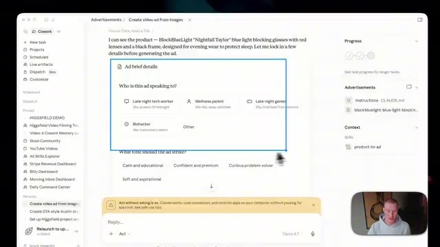
*⏱️ 00:16:21 — Interface Cowork affichant les détails du brief publicitaire avec la sélection de la cible ("Late-night tech worker", "Wellness parent", etc.) suite à la commande précédente.*

---

### ⏱️ `[00:16:40 - 00:17:10]` | Segment #41

**🔊 Audio (Transcription Intégrale Mot pour Mot en Français) :**
> d'utiliser le code lors du paiement et allons-y et continuons avec ça. Et maintenant, il va générer l'annonce avec ces spécifications ainsi que ces images de ceux, le produit qui est dans le dossier. Très bien. Alors voilà. Nous avons ce seul personnage créé, ce que, si vous ne savez pas ce que c'est, je vais expliquer comment en créer un plus tard dans cette vidéo, mais c'est une fonctionnalité à l'intérieur de Higgs Field qui générera des personnages que vous pourrez utiliser dans vos différents projets. De cette façon, vous pouvez générer un personnage ou un créateur UGC une seule fois, et vous pouvez en tirer parti et l'utiliser dans toutes les différentes publicitaires que vous avez. Nous pouvons donc continuer et changer cela si nous le voulons.

**👁️ Analyse Visuelle d'Écran (gemini-3.5-flash-lite) :**
**Interface & Outils** : Application Cowork / Interface de génération de vidéos par IA (style dashboard).

**Contenu textuel & Code** : Brief publicitaire, fichiers de projet (instructions, brief.json, scripts), aperçu du personnage généré.
[DESC_IMAGE_1] Saisie de commandes ou préparation de session publicitaire.
[DESC_IMAGE_2] Affichage du résultat de génération du personnage.
[DESC_IMAGE_3] Visualisation des fichiers contextuels et du rendu final.

**Action / Démonstration** : Génération d'une publicité vidéo à partir d'un brief textuel et d'images de produits.

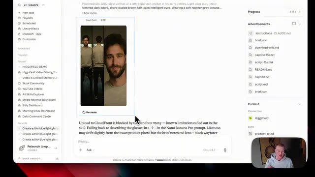
*⏱️ 00:16:55 — Affichage d'un personnage généré par IA dans une interface de génération vidéo publicitaire.*

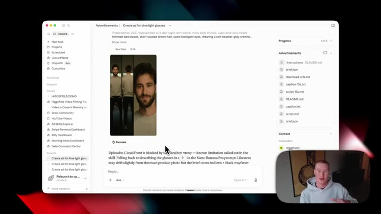
*⏱️ 00:17:02 — Vue similaire montrant le personnage généré et le panneau latéral contenant les fichiers du projet (instructions, scripts, brief).*

---

### ⏱️ `[00:17:10 - 00:17:37]` | Segment #42

**🔊 Audio (Transcription Intégrale Mot pour Mot en Français) :**
> Nous pourrions télécharger ceci. Nous pourrions l'animer directement à l'intérieur de Claude, mais je vais maintenant vous montrer les vidéos qui ont été générées. Voici également la première image qui a été générée. Celle-ci a été générée avec Nano Banana Pro. Donc ce qu'elle va faire, c'est qu'elle va d'abord prendre cette image de départ, puis la transformer en vidéo. Donc voici cette première image de cette image. Et maintenant, je peux vous montrer ces vidéos. Ces lunettes anti-lumière bleue à verres rouges sauvent mes yeux lors du temps d'écran tard le soir. Franchement, ça change la donne. Je veux dire, c'waouh, c'est assez fou si on y réfléchit vraiment.

**👁️ Analyse Visuelle d'Écran (gemini-3.5-flash-lite) :**
**Interface & Outils** : Interface de workflow de projet Cowork, écran d'ordinateur du présentateur.

**Contenu textuel & Code** : Génération d'images par IA avec Nano Banana Pro, texte descriptif de la génération pour des lunettes anti-lumière bleue.

**Action / Démonstration** : Présentation des résultats de génération d'images et de vidéos par IA pour une publicité de lunettes.

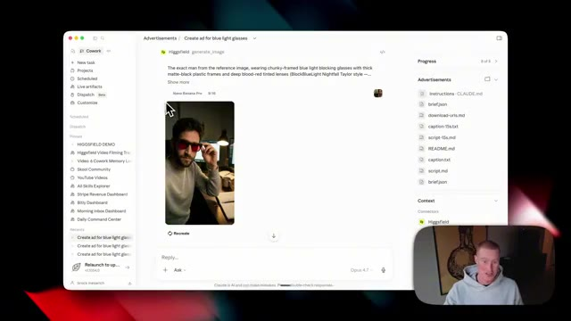
*⏱️ 00:17:17 — Interface d'un outil de type Cowork avec une image générée d'un homme portant des lunettes à verres rouges.*

*⏱️ 00:17:30 — Comparaison côte à côte intitulée 'photo (first frame)' et 'video', montrant une image fixe et un rendu vidéo d'un homme portant des lunettes.*

---

### ⏱️ `[00:17:37 - 00:18:11]` | Segment #43

**🔊 Audio (Transcription Intégrale Mot pour Mot en Français) :**
> Ensuite, nous avons aussi celui-ci. Des lunettes à verres rouges, instantanément plus chaudes, beaucoup moins de bleu agressif la nuit. Donc, je veux dire, comme vous pouvez le voir, les visuels ici sont phénoménaux. Je crois que ça utilise Seed Dance 2.0, qui est le tout dernier modèle vidéo. Et je veux dire, c'est vraiment solide. On peut évidemment changer ce qu'on veut que le personnage dise, mais je pense que c'est un très, très bon point de départ pour être honnête, et ensuite on peut soit télécharger ceci juste ici, on peut ouvrir le lien, ça va nous emmener sur Hicksfield, je pourrais le voir juste ici : "les lunettes bloquantes ont sauvé mes yeux pendant mon temps d'écran tard le soir, franchement ça change la donne". Je veux dire, les gars, c'est spectaculaire, c'est assez dingue, et ensuite je peux aussi recréer

**👁️ Analyse Visuelle d'Écran (gemini-3.5-flash-lite) :**
**Interface & Outils** : Interface de l'outil Cowork (développement/automatisation) et lecteur vidéo cloud.

**Contenu textuel & Code** : Prompt de génération vidéo décrivant un homme mettant des lunettes à verres rouges, structure de fichiers de projet (instructions, scripts, brief), et lecteur de prévisualisation vidéo.
[DESC_ACTION] Le présentateur présente et commente le résultat visuel d'une vidéo générée par intelligence artificielle simulant un utilisateur essayant des lunettes anti-lumière bleue.

**Action / Démonstration** : Explications face caméra et analyse conceptuelle des marchés.

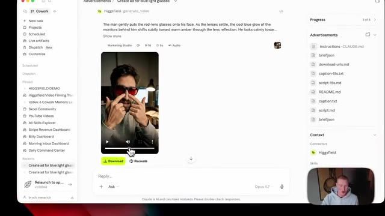
*⏱️ 00:17:46 — Capture d'écran de l'interface de Cowork montrant la génération d'une vidéo publicitaire pour des lunettes à verres rouges, avec un lecteur vidéo au centre et des fichiers de projet sur le panneau de droite.*

*⏱️ 00:18:02 — Capture d'écran en plein écran de la vidéo générée montrant un homme portant des lunettes à verres rouges dans un bureau sombre éclairé par une lampe de bureau.*

---

### ⏱️ `[00:18:11 - 00:18:43]` | Segment #44

**🔊 Audio (Transcription Intégrale Mot pour Mot en Français) :**
> ça aussi, donc si je veux régénérer ceci, c'est aussi simple que de le faire juste ici, et puis voici le troisième également, celui-ci a l'air plutôt cool avec l'éclairage : « si les écrans vous empêchent de dormir, ces lunettes anti-lumière bleue à verres rouges sont ma réinitialisation nocturne. » Je veux dire, vous pouvez voir le potentiel ici. Et encore une fois, nous pourrions télécharger ceci dès maintenant. Et puis une autre chose cool avec cette compétence que je vous ai donnée, c'est qu'elle montre même la légende ici que nous pourrions utiliser automatiquement pour cette, vous savez, création publicitaire. Donc si nous voulons publier ceci sur Instagram, par exemple, nous pourrions simplement copier ce texte. Il dit : « arrêtez de faire confiance aux lunettes anti-lumière bleue transparentes après 21 h. Elles bloquent environ 30 % de la lumière bleue. Ce n'est pas »

**👁️ Analyse Visuelle d'Écran (gemini-3.5-flash-lite) :**
**Interface & Outils** : Cowork (interface de gestion de projet et d'intelligence artificielle), application de bureau macOS.

**Contenu textuel & Code** : Documentation textuelle, fichiers JSON, scripts Markdown (`brief.json`, `Script`, `Caption`, `Readme`, `Download urls`), liens Google Drive et instructions de code.

**Action / Démonstration** : Navigation dans l'interface de l'application Cowork et présentation des différents assets générés (vidéos, scripts, légendes).

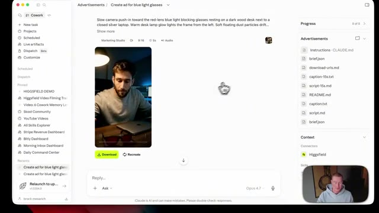
*⏱️ 00:18:19 — Interface Cowork affichant un aperçu vidéo généré par IA montrant un homme avec des lunettes de protection, avec des boutons de téléchargement et de régénération en bas.*

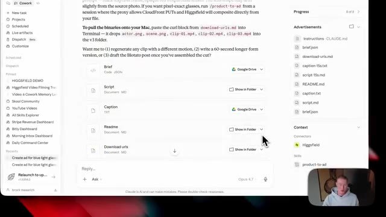
*⏱️ 00:18:27 — Interface Cowork affichant des blocs de documents textuels, JSON et des liens vers des fichiers de script et de téléchargement de vidéos.*

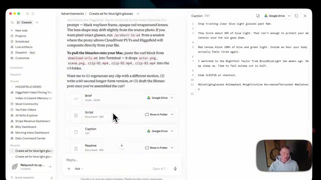
*⏱️ 00:18:35 — Interface Cowork affichant un panneau latéral avec le contenu textuel d'un script de légende publicitaire pour les lunettes anti-lumière bleue.*

---

### ⏱️ `[00:18:43 - 00:19:15]` | Segment #45

**🔊 Audio (Transcription Intégrale Mot pour Mot en Français) :**
> assez pour protéger la mélatonine une fois que le soleil se couche. Mais les gars, c'est toute la puissance d'utiliser Higgs Field, mais aussi d'utiliser la puissance de Claude Cowork et de toutes ces fonctionnalités incroyables en matière de compétences, d'être capable de sauvegarder ceci dans vos dossiers sur votre bureau, toutes ces différentes choses. On a l'impression que Cowork devient vraiment de plus en plus puissant. Quelque chose qui va porter cela au niveau supérieur lorsqu'il s'agit de générer des publicités UGC avec Higgs Field et Claude Cowork ensemble, c'est d'exécuter des tâches planifiées en pilotage automatique. De cette façon, même lorsque vous ne touchez pas à votre ordinateur, vous pouvez générer automatiquement différentes publicités pour vous réveiller et les avoir prêtes à l'emploi

**👁️ Analyse Visuelle d'Écran (gemini-3.5-flash-lite) :**
**Interface & Outils** : Claude Cowork, interface de gestion de projets et de tâches automatisées, Google Drive, éditeur de texte.

**Contenu textuel & Code** : Génération de contenu de campagne (scripts, légendes), gestion des tâches planifiées (Morning briefing, Youtube new video check, Weekly receipt scan, etc.).

**Action / Démonstration** : Navigation dans l'application Claude Cowork pour présenter la gestion des fichiers générés et l'automatisation des tâches planifiées.

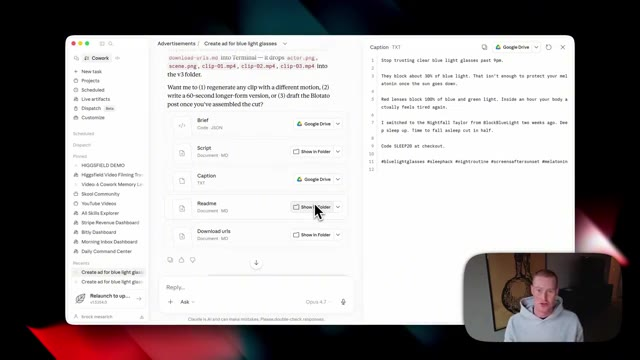
*⏱️ 00:18:51 — Interface de Claude Cowork affichant des blocs de fichiers générés (Brief, Script, Caption, Readme) et un panneau latéral montrant le texte d'une légende sur les lunettes anti-lumière bleue, avec la vidéo du présentateur en incrustation.*

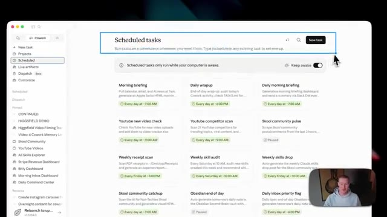
*⏱️ 00:19:07 — Interface de Claude Cowork montrant la section "Scheduled tasks" avec de nombreuses tâches automatisées planifiées (briefings, scans YouTube, audits), et la vidéo du présentateur en bas à droite.*

---

### ⏱️ `[00:19:15 - 00:19:37]` | Segment #46

**🔊 Audio (Transcription Intégrale Mot pour Mot en Français) :**
> et prêt à être publié. C'est aussi simple que de venir ici et de cliquer sur nouvelle tâche. On pourrait lui donner un nom. On pourrait juste l'appeler UGC Daily ou quelque chose comme ça. Lui donner une description. Et on doit sélectionner le dossier dans lequel on veut travailler. Le côté cool avec ça, c'est qu'on pourrait déposer quelques images de produits différentes dans un dossier dans lequel on travaille. Et en gros dire : Je veux que tu récupères toujours à partir d'ici, que tu récupères les nouvelles images de produits.

**👁️ Analyse Visuelle d'Écran (gemini-3.5-flash-lite) :**
**Interface & Outils** : Application de gestion de tâches et de productivité (Cowork).

**Contenu textuel & Code** : Formulaire de création de tâche planifiée avec options de nom, description, dossier de projet et fréquence.

**Action / Démonstration** : Saisie du nom d'une nouvelle tâche planifiée et sélection d'un dossier de travail dans l'interface.

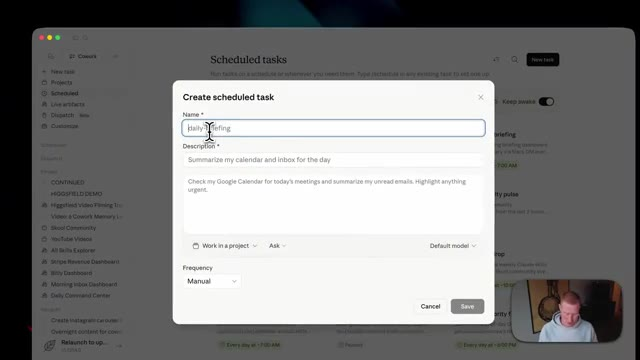
*⏱️ 00:19:21 — Interface de création d'une tâche planifiée montrant les champs pour le nom et la description.*

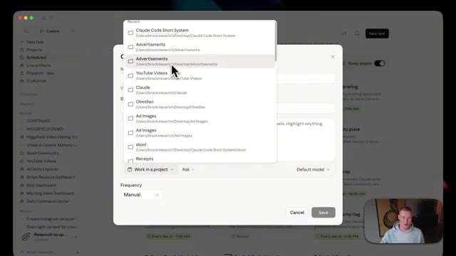
*⏱️ 00:19:26 — Menu déroulant affichant la sélection des dossiers de projets locaux pour la tâche planifiée.*

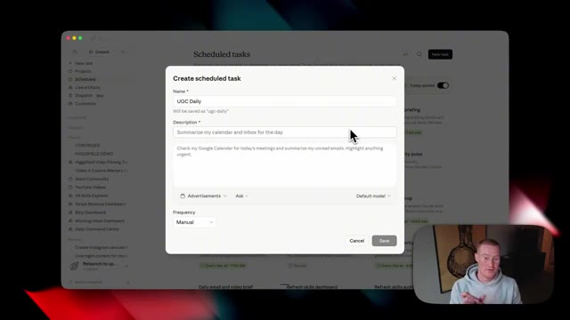
*⏱️ 00:19:32 — Fenêtre de création de tâche planifiée avec le nom "UGC Daily" renseigné et le dossier de projet sélectionné.*

---

### ⏱️ `[00:19:37 - 00:19:59]` | Segment #47

**🔊 Audio (Transcription Intégrale Mot pour Mot en Français) :**
> Et chaque jour, je veux que vous génériez cinq vidéos différentes pour chaque produit. Et c'est l'une des fonctionnalités les plus puissantes ici lorsqu'on combine Cowork et Higgsfield. C'est assez fou quand on s'amuse avec. Très bien, alors ensuite, je veux vous montrer comment vous pouvez générer des personnages personnalisés comme celui-ci. Et ceci en utilisant la fonctionnalité « sole » à l'intérieur de Higgsfield. Tout ce que j'avais à faire, c'était de télécharger quelques images de référence différentes de moi-même et je pouvais fondamentalement me générer dans n'importe quel décor.

**👁️ Analyse Visuelle d'Écran (gemini-3.5-flash-lite) :**
**Interface & Outils** : Cowork et Higgsfield.ai

**Contenu textuel & Code** : Tableaux de bord de gestion de tâches automatisées et interface de génération d'images/vidéos par IA avec prompts et réglages de modèles.

**Action / Démonstration** : Navigation dans l'interface de planification des tâches puis présentation des outils de génération visuelle de Higgsfield.

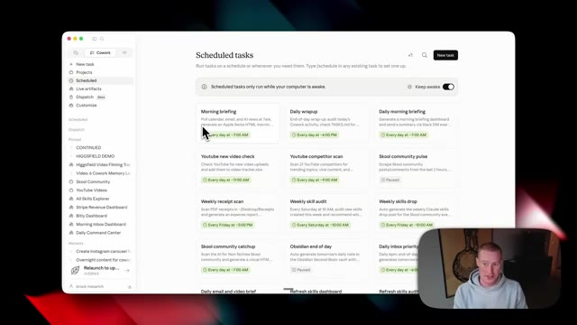
*⏱️ 00:19:43 — Interface de l'application Cowork affichant un tableau de tâches planifiées (Scheduled tasks).*

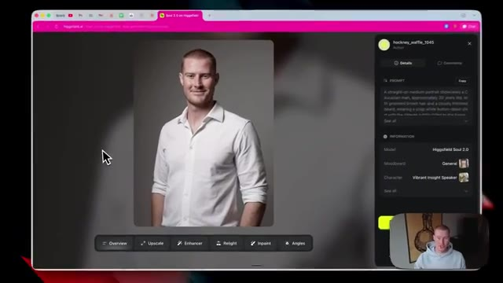
*⏱️ 00:19:48 — Interface de la plateforme Higgsfield.ai montrant un portrait généré et un panneau latéral de détails.*

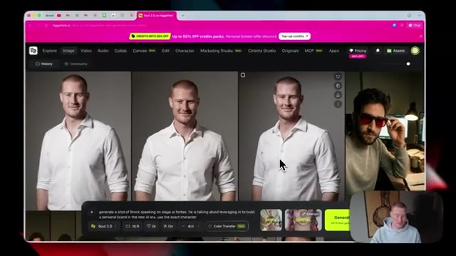
*⏱️ 00:19:54 — Interface de Higgsfield.ai présentant une galerie de portraits générés avec une barre de prompt en bas.*

---

### ⏱️ `[00:20:00 - 00:20:27]` | Segment #48

**🔊 Audio (Transcription Intégrale Mot pour Mot en Français) :**
> Comme vous avez pu le voir, j'ai simplement dit : génère une image de moi sur la scène de Forbes, en train de faire une présentation sur l'IA. Je veux dire, elles sont plutôt réussies. Ça me ressemble vraiment beaucoup, en fait. Et c'est vraiment un très bon portrait ici. Donc non seulement nous pouvons générer des images, mais nous pouvons ensuite générer des vidéos par-dessus. C'est donc génial si vous voulez générer des images ou des vidéos pour Instagram ou même faire des publicités de produits avec votre visage ou votre sosie, ou vous pouvez essentiellement créer votre propre personnage personnalisé à partir de zéro si vous ne voulez pas utiliser votre visage.

**👁️ Analyse Visuelle d'Écran (gemini-3.5-flash-lite) :**
**Interface & Outils** : Navigateur web affichant l'interface de la plateforme de génération d'images Higgsfield.

**Contenu textuel & Code** : Interface utilisateur de génération d'images par IA, vignettes de prévisualisation et panneau de prompt descriptif.
[DESC_IMAGE_1] Démonstration de l'interface de génération d'images et visualisation des résultats obtenus.

**Action / Démonstration** : Explications face caméra et analyse conceptuelle des marchés.

---

### ⏱️ `[00:20:28 - 00:20:47]` | Segment #49

**🔊 Audio (Transcription Intégrale Mot pour Mot en Français) :**
> Première chose que je tiens à mentionner, c'est que nous n'avons pas toujours besoin d'utiliser HiggsField à l'intérieur de Claude Cowork. Nous pourrions aller directement sur HiggsField si nous ne voulons pas gaspiller nos jetons Claude, parce que vous n'allez pas toujours avoir besoin d'utiliser Cowork pour générer ces images. Vous pouvez simplement aller directement sur HiggsField. Donc ce que je vais faire, c'est venir sur HiggsField et les gars, il y a tellement de fonctionnalités sur cette plateforme que je ne peux même pas commencer à les aborder.

**👁️ Analyse Visuelle d'Écran (gemini-3.5-flash-lite) :**
**Interface & Outils** : Claude Cowork et navigateur web affichant le site Higgsfield AI.

**Contenu textuel & Code** : Menus de configuration de projets, invites textuelles et options de génération multimédia (Canvas, Higgsfield MCP, GPT Image 2).

**Action / Démonstration** : Navigation et présentation des interfaces de travail entre Claude Cowork et la plateforme Higgsfield AI.

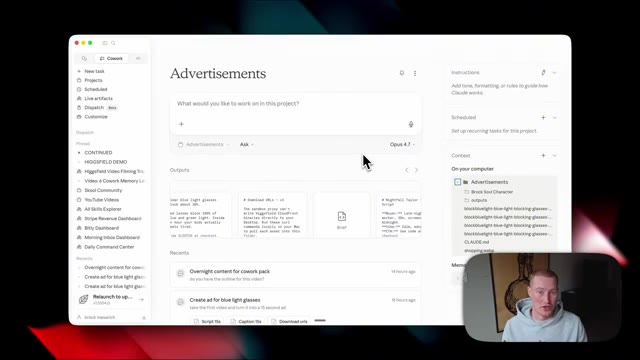
*⏱️ 00:20:32 — Interface de l'application Claude Cowork affichant un projet d'annonces publicitaires, avec des modules de sortie et un panneau contextuel à droite.*

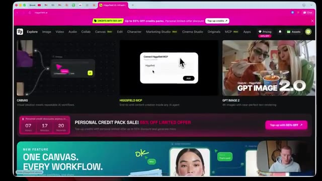
*⏱️ 00:20:42 — Interface Web de Higgsfield AI montrant le tableau de bord principal avec les onglets Explore, Image, Video, Audio et une section de promotion sur les crédits.*

---

### ⏱️ `[00:20:47 - 00:21:07]` | Segment #50

**🔊 Audio (Transcription Intégrale Mot pour Mot en Français) :**
> Mais je vais juste vous montrer comment utiliser la fonctionnalité de personnage afin de générer une ID de vous-même ou, vous savez, d'un personnage spécifique que vous voulez créer. Donc, nous allons venir ici et cliquer sur « personnage » en haut à droite ici. Donc, je vais cliquer dessus, cliquer sur personnage ID soul. Et à partir d'ici, nous allons être amenés sur cette page. J'en ai déjà quelques-uns que j'ai créés, mais laissez-moi vous montrer très rapidement comment les générer.

**👁️ Analyse Visuelle d'Écran (gemini-3.5-flash-lite) :**
**Interface & Outils** : Navigateur web affichant la plateforme de création d'IA Higgsfield AI.

**Contenu textuel & Code** : Menus de navigation, options de création de personnages, bannières publicitaires et options de modélisation par IA.

**Action / Démonstration** : Navigation et clic sur l'onglet de création de personnage dans l'interface utilisateur.

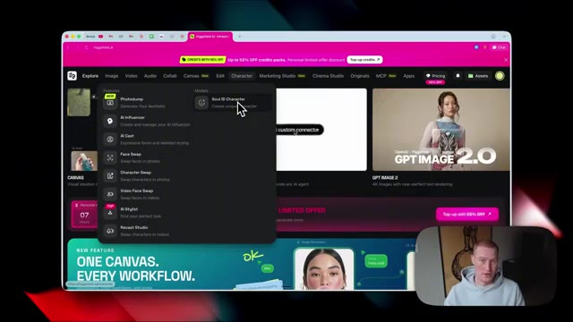
*⏱️ 00:20:52 — L'écran montre l'interface de la plateforme web de génération d'IA avec un menu déroulant ouvert sous l'onglet « Character », affichant différentes options de fonctionnalités comme « Soul ID Character ».*

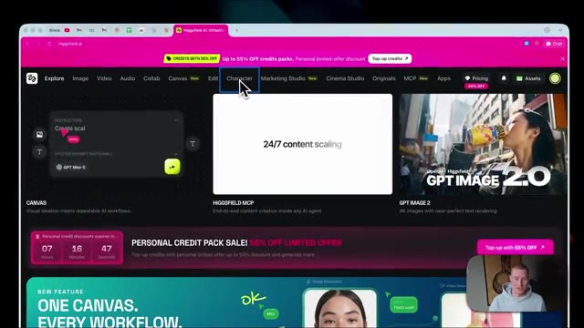
*⏱️ 00:20:57 — L'écran montre la page d'accueil principale de la plateforme web avec le curseur pointant et survolant l'onglet « Character » dans la barre de navigation supérieure.*

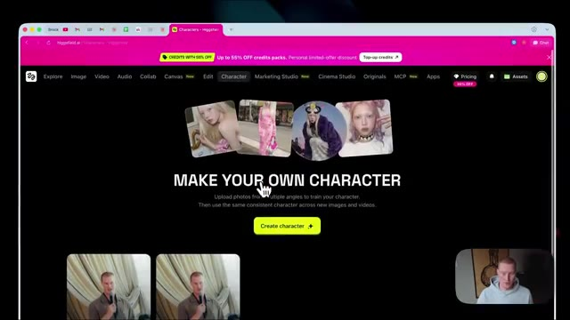
*⏱️ 00:21:02 — L'écran affiche la page dédiée « MAKE YOUR OWN CHARACTER » de la plateforme web, avec un bouton jaune « Create character ».*

---

### ⏱️ `[00:21:07 - 00:21:26]` | Segment #51

**🔊 Audio (Transcription Intégrale Mot pour Mot en Français) :**
> Donc nous pouvons venir ici, cliquer sur générer un personnage. Et nous voulons nous assurer d'ajouter des photos claires de notre visage qui n'ont pas un mauvais éclairage ou surtout qui n'ont pas d'autres personnes sur les images. Donc je vais juste en télécharger quelques-unes. J'ai ce dossier juste ici. J'ai des images de moi-même. Je vais juste cliquer sur ouvrir. Maintenant, ça va toutes les télécharger.

**👁️ Analyse Visuelle d'Écran (gemini-3.5-flash-lite) :**
**Interface & Outils** : Navigateur web avec interface de génération de personnages et explorateur de fichiers système.

**Contenu textuel & Code** : Recommandations pour l'upload de photos (visage clair, une seule personne, éviter les doublons ou photos de groupe) et sélection de fichiers image.

**Action / Démonstration** : Téléchargement et sélection de plusieurs photos de visage pour créer un personnage personnalisé.

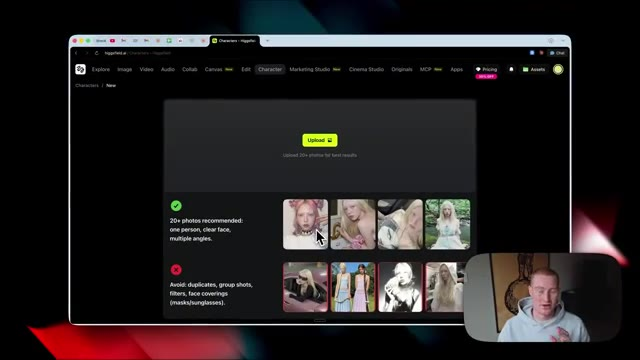
*⏱️ 00:21:12 — Interface web montrant les instructions pour télécharger les photos de personnages avec des exemples de bonnes et mauvaises pratiques.*

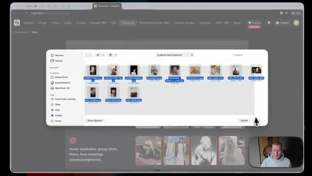
*⏱️ 00:21:21 — Fenêtre de sélection de fichiers du système d'exploitation affichant un dossier contenant plusieurs photos à importer.*

---

### ⏱️ `[00:21:26 - 00:21:47]` | Segment #52

**🔊 Audio (Transcription Intégrale Mot pour Mot en Français) :**
> Et encore une fois, plus vous ajoutez d'images, mieux c'est, avec un bon éclairage et rien qui ne cache votre visage. Donc par exemple, celle-ci juste ici, je devrais probablement la supprimer parce que je porte des lunettes de soleil. Toutes les autres sont plutôt solides et donnent des images dynamiques de moi-même. Ensuite, je vais simplement cliquer sur créer. Et maintenant, ça va lancer le processus. Ça devrait prendre peut-être deux à trois minutes et nous devrions avoir notre personnage généré.

**👁️ Analyse Visuelle d'Écran (gemini-3.5-flash-lite) :**
**Interface & Outils** : Navigateur web affichant une application de création de personnages par IA (Hugging Face ou similaire).

**Contenu textuel & Code** : Galerie d'images téléchargées pour l'entraînement d'un modèle, compteur d'images (12/80 puis 11/80), et indicateur de qualité de résolution.

**Action / Démonstration** : Suppression d'une image inadaptée (portant des lunettes de soleil) de la grille d'entraînement du personnage.

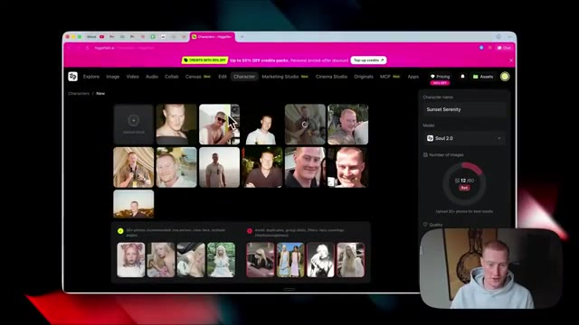
*⏱️ 00:21:31 — Interface web montrant la sélection d'images pour la création d'un personnage d'IA, avec le curseur sur une photo avec des lunettes de soleil.*

*⏱️ 00:21:37 — Interface web mise à jour après la suppression de la photo avec des lunettes de soleil, affichant 11 images sur 80.*

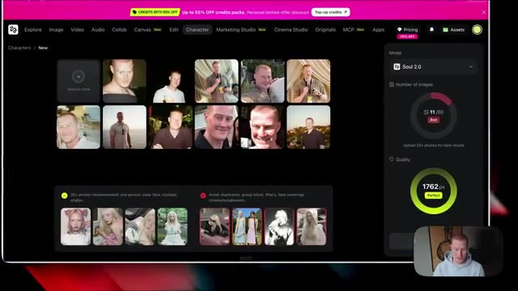
*⏱️ 00:21:42 — Interface web montrant le panneau latéral de qualité avec un indicateur vert indiquant une résolution optimale (1762px).*

---

### ⏱️ `[00:21:47 - 00:22:05]` | Segment #53

**🔊 Audio (Transcription Intégrale Mot pour Mot en Français) :**
> Et ensuite, une fois que notre personnage est généré, nous pouvons simplement cliquer dessus. Et juste ici, nous pouvons fondamentalement commencer à générer des images. J'ai donc donné le prompt : générer une image de Brock filmant une vidéo YouTube dans son bureau avec un super éclairage cinématographique, en train de parler à la caméra tout en montrant une démo sur son ordinateur portable. Et ensuite, je vais sélectionner le format d'image dans lequel je veux générer ces images. Mettons en 16 par 9.

**👁️ Analyse Visuelle d'Écran (gemini-3.5-flash-lite) :**
**Interface & Outils** : Interface web de génération d'images par IA (outil de génération de personnages / studio créatif IA).

**Contenu textuel & Code** : Prompt affiché : "generate an image of Brock filming a youtube video in his office with cool cinematic lighting. Talking to the camera while showing a demo on his laptop". Options sélectionnées : Modèle Soul 2.0, format 16:9, résolution 2K, 4/4 images, personnage référence "BROCK".

**Action / Démonstration** : Démonstration de la saisie d'un prompt détaillé et de la configuration du modèle pour générer des images cohérentes basées sur un personnage créé.

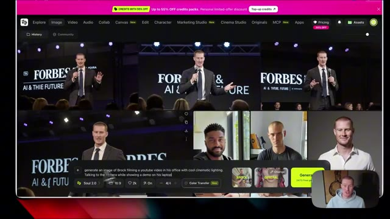
*⏱️ 00:21:52 — Interface de plateforme de génération d'images IA montrant une grille de rendus de personnages et une barre de saisie de prompt paramétrée.*

---

### ⏱️ `[00:22:05 - 00:22:24]` | Segment #54

**🔊 Audio (Transcription Intégrale Mot pour Mot en Français) :**
> Nous pourrions choisir l'amélioration de prompt de qualité. Nous pourrions l'activer. De cette façon, il va prendre ce prompt très basique et l'améliorer. Ensuite, nous pourrions générer autant de ces images que nous le voulons. Allons-y, passons à quatre et cliquons simplement sur générer. Très bien. Et juste comme ça, nous avons effectivement ces images de moi dans un bureau en train de filmer une vidéo avec un éclairage cinématique. Ça a l'air vraiment cool.

**👁️ Analyse Visuelle d'Écran (gemini-3.5-flash-lite) :**
**Interface & Outils** : Navigateur web affichant l'outil de génération d'images par IA Higgsfield AI.

**Contenu textuel & Code** : Panneau de configuration avec le prompt textuel, les options de rapport de format, de qualité et le modèle Higgsfield Soul 2.0.

**Action / Démonstration** : Navigation et configuration des paramètres de génération d'images dans l'interface de l'outil d'IA.

*⏱️ 00:22:10 — Interface du générateur d'images affichant plusieurs résultats de portraits de présentation avec la barre de configuration en bas.*

*⏱️ 00:22:19 — Affichage d'une image générée en haute résolution d'un homme dans un bureau avec des étagères et un panneau latéral de détails.*

---

### ⏱️ `[00:22:24 - 00:22:58]` | Segment #55

**🔊 Audio (Transcription Intégrale Mot pour Mot en Français) :**
> J'aimerais honnêtement que mon installation ressemble à ça. Pour que vous puissiez, espérons-le, commencer à voir à quel point cette seule fonctionnalité de Higgs Field est puissante. Et c'est encore plus puissant lorsque nous combinons cela avec co-work et que nous commençons à exécuter des compétences spécifiques afin de générer différentes publicités, images et vidéos avec tous ces différents personnages que nous créons. Très bien. Une autre des compétences qui se trouve dans ce pack de plugins que je vous ai donné gratuitement, et qui est vraiment insensée lorsque vous l'utilisez avec Higgs Field, c'est la compétence de carrousel IG. Cela va réellement générer des carousels Instagram pour nous en pilotage automatique. Et laissez-moi vous montrer exactement ce que je veux dire. Très bien. Voici donc les carousels que j'ai générés moi-même.

**👁️ Analyse Visuelle d'Écran (gemini-3.5-flash-lite) :**
**Interface & Outils** : Interface Claude Cowork, application de gestion de compétences et d'automatisation.

**Contenu textuel & Code** : Modules et compétences du « Higgsfield cowork pack » : Character locker, Instagram carousels, Overnight content, Product-to-ad, Setup-higgsfield-project, URL-to-ad.

**Action / Démonstration** : Navigation et présentation des différentes compétences et automatisations disponibles dans le pack Higgsfield combiné avec Claude Cowork.

*⏱️ 00:22:41 — Interface de Claude Cowork affichant les configurations et compétences du « Higgsfield cowork pack » avec plusieurs modules (skills).*

*⏱️ 00:22:49 — Vue rapprochée de l'interface Claude Cowork avec un curseur pointant sur l'un des blocs de compétences (« Generate premium 4:5 Instagram carousels »).*

---

### ⏱️ `[00:22:58 - 00:23:24]` | Segment #56

**🔊 Audio (Transcription Intégrale Mot pour Mot en Français) :**
> et elles ont l'air vraiment géniales. Juste ici. Il est écrit : « cinq compétences Cloud Code dont je ne peux pas me passer ». Ça montre la compétence de respiration matinale, le générateur de carrousels Instagram, le générateur de factures, le scanner de reçus. Toutes ces différentes images ont été générées avec cette compétence que je m'apprête à vous montrer, tout comme celle-ci juste ici. C'est un autre carrousel. Et puis celle-ci aussi. Je veux dire, elles sont incroyablement réussies. Quand on y pense, le fait que l'IA génère tout cela, et pour vous montrer comment cela fonctionne en pratique, rendons-nous sur mon Instagram juste ici.

**👁️ Analyse Visuelle d'Écran (gemini-3.5-flash-lite) :**
**Interface & Outils** : Navigateur web affichant l'interface d'Excalidraw avec divers visuels de carrousels Instagram et incrustation vidéo du présentateur en bas à droite.

**Contenu textuel & Code** : Maquettes graphiques de publications Instagram avec des titres textuels en anglais (« Morning Briefing », « IG Carousel Generator », « Invoice Generator », « New Claude Opus 4.7 », « Export anywhere »).

**Action / Démonstration** : Le présentateur navigue et zoome sur différentes sections d'un tableau blanc interactif présentant des exemples de designs et de publications.

*⏱️ 00:23:04 — Vue rapprochée d'une application de type tableau blanc (Excalidraw) affichant trois visuels de publications de carrousel Instagram : « Morning Briefing », « IG Carousel Generator » et « Invoice Generator ».*

*⏱️ 00:23:11 — Vue dézoomée du même tableau blanc montrant une séquence horizontale de plusieurs visuels graphiques liés au sujet de Claude et de l'IA.*

*⏱️ 00:23:18 — Vue d'une autre section du tableau blanc montrant une grille d'images de publications Instagram avec des infographies sur l'export de documents et les différentes versions de Claude.*

---

### ⏱️ `[00:23:25 - 00:23:59]` | Segment #57

**🔊 Audio (Transcription Intégrale Mot pour Mot en Français) :**
> Ce carrousel a 2 500 likes et il a environ 3 000 commentaires juste ici. Donc ça a l'air absolument parfait et ils fonctionnent extrêmement bien. Comme vous pouvez le voir sur ma page Instagram, celui-ci a presque 800 likes. Il a environ 1 900 commentaires. Donc ça fonctionne, et je vais maintenant vous montrer comment vous pouvez générer des carrousels, et vous allez probablement vouloir les personnaliser à votre goût, mais c'est un excellent point de départ pour commencer à créer des carrousels en pilotage automatique en utilisant Claude Cowork et Hicksfield. Très bien, je suis donc de retour dans mon dossier de publicités à l'intérieur de Cowork. Donc ce que je vais faire, c'est que je vais simplement taper slash IG carousel.

**👁️ Analyse Visuelle d'Écran (gemini-3.5-flash-lite) :**
**Interface & Outils** : Navigateur web affichant l'interface de la plateforme Instagram.

**Contenu textuel & Code** : Publications de carrousels Instagram avec du texte marketing, des titres de compétences IA et des statistiques d'engagement (likes, commentaires).
[DESC_IMAGE_3] Navigation et présentation des publications à succès du compte Instagram pour illustrer l'efficacité des outils présentés.

**Action / Démonstration** : Explications face caméra et analyse conceptuelle des marchés.

---

### ⏱️ `[00:23:59 - 00:24:20]` | Segment #58

**🔊 Audio (Transcription Intégrale Mot pour Mot en Français) :**
> Et à partir de là, je vais simplement écrire exactement ce sur quoi je veux créer cela : Génère un carrousel Instagram sur les nouveaux artifacts en direct de Claude qui viennent de sortir. Donc par exemple, ça va être spécifique pour moi dans la création d'actualités sur l'IA et de contenu sur l'IA. Comme vous pouvez le voir sur mon Instagram, c'est adapté à mon style et j'ai personnalisé ça. Cette compétence sera un très bon point de départ pour que vous commenciez à générer des carrousels.

**👁️ Analyse Visuelle d'Écran (gemini-3.5-flash-lite) :**
**Interface & Outils** : Interface web de type assistant IA / Cowork avec panneau latéral de gestion des tâches et des projets.

**Contenu textuel & Code** : Barre de saisie de prompt contenant la commande ou le texte '/ig-carousel' avec un curseur de souris pointant vers la zone de texte.

**Action / Démonstration** : Saisie d'une instruction ou d'un prompt pour générer un carrousel Instagram à l'aide des fonctionnalités de l'IA.

*⏱️ 00:24:04 — Capture d'écran montrant l'interface d'un outil de type assistant IA (style Claude) avec une barre de saisie de prompt active, entourée d'un panneau latéral avec des projets et de sections de configuration, tandis qu'une petite vignette vidéo du présentateur apparaît en bas à droite.*

---

### ⏱️ `[00:24:21 - 00:24:41]` | Segment #59

**🔊 Audio (Transcription Intégrale Mot pour Mot en Français) :**
> Et vous pouvez simplement faire des allers-retours et dire exactement à Claude à quoi vous voulez que ces résultats ressemblent. Pour moi personnellement, je lui ai donné quelques images de référence dont j'ai fait une capture d'écran, je les ai fournies à Claude et j'ai dit : hé, je veux que tu génères des images similaires à celles-ci. Et puis il est vraiment doué pour créer ça. Et si vous voulez vraiment personnaliser cette compétence, vous allez simplement venir ici sur le côté droit où sont affichées les compétences.

**👁️ Analyse Visuelle d'Écran (gemini-3.5-flash-lite) :**
**Interface & Outils** : Cowork / Interface de développement IA.

**Contenu textuel & Code** : Un prompt textuel pour générer un carrousel Instagram sur les artefacts en direct de Claude, avec des panneaux de progression et de contexte.

**Action / Démonstration** : Le présentateur explique comment il interagit avec l'outil et fournit des images de référence.

*⏱️ 00:24:36 — Interface de Cowork montrant un espace de travail avec un prompt actif et le présentateur en médaillon en bas à droite.*

---

### ⏱️ `[00:24:41 - 00:25:02]` | Segment #60

**🔊 Audio (Transcription Intégrale Mot pour Mot en Français) :**
> Vous allez sélectionner cela. Vous pouvez ensuite cliquer sur gérer, et cela vous amènera à toutes vos différentes compétences. Vous allez vouloir cliquer dessus. Et à partir d'ici, vous pouvez simplement cliquer sur modifier avec Claude. Et en gros, vous pouvez juste déballer tout ce que vous avez en tête et lui donner toutes les instructions sur la façon exacte dont vous voulez que cela ressemble. Très bien, et environ deux ou trois minutes plus tard, nous avons maintenant ces visuels qui ont été créés et nous pouvons les visualiser directement à l'intérieur de Claude, ce qui est plutôt cool.

**👁️ Analyse Visuelle d'Écran (gemini-3.5-flash-lite) :**
**Interface & Outils** : Interface web de Claude Cowork / plateforme de gestion de compétences et d'agents IA.

**Contenu textuel & Code** : Documentation de compétences, instructions de génération d'images (Nano Banana Pro) et aperçus de visuels générés.

**Action / Démonstration** : Navigation dans le gestionnaire de compétences et affichage des résultats d'un flux de travail automatisé.

*⏱️ 00:24:46 — Vue de l'interface montrant la liste des compétences (Skills) avec les détails de la configuration de 'ig-carousel'.*

*⏱️ 00:24:52 — Interface de chat avec une invite de commande pour éditer une compétence spécifique en utilisant 'skill-creator'.*

*⏱️ 00:24:57 — Visualisation des résultats générés, incluant plusieurs diaporamas de carrousels Instagram au format 1080x1350.*

---

### ⏱️ `[00:25:02 - 00:25:21]` | Segment #61

**🔊 Audio (Transcription Intégrale Mot pour Mot en Français) :**
> Nous pourrions les ouvrir. Nous pourrions même apporter des modifications à chacun d'entre eux. Nous pourrions les animer, les transformer en vidéos si nous le souhaitons, et nous pourrions les télécharger directement depuis ici. C'est vraiment bien pour ce premier prompt initial que je lui ai donné. Nous pourrions modifier cela, faire différentes itérations, puis dire, enregistre cela comme une compétence. Ainsi, nous pourrions toujours utiliser exactement ce même format. C'est la puissance d'utiliser Claude Cowork et Hicksfield ensemble.

**👁️ Analyse Visuelle d'Écran (gemini-3.5-flash-lite) :**
**Interface & Outils** : Application de génération de contenu visuel (type Higgsfield / Cowork) avec interface de gestion de projets.

**Contenu textuel & Code** : Génération de visuels pour réseaux sociaux au format portrait (carrousel Instagram) avec des prompts textuels et des options d'édition.

**Action / Démonstration** : Navigation et survol des différentes images générées pour les examiner, les animer ou les télécharger directement depuis l'interface.

*⏱️ 00:25:07 — Interface de l'application montrant l'aperçu agrandi d'une image générée avec des options de modification (Animate, Download, Edit, Recreate).*

*⏱️ 00:25:12 — Affichage d'une série de diapositives générées (carrousel Instagram) avec le curseur pointant sur l'une d'elles.*

---

### ⏱️ `[00:25:22 - 00:25:45]` | Segment #62

**🔊 Audio (Transcription Intégrale Mot pour Mot en Français) :**
> De plus, si vous souhaitez aller plus loin dans l'itération et ne pas gaspiller vos jetons Claude, si vous allez directement dans Higgs Field, vous verrez cela ainsi que toutes les autres images que vous avez générées dans votre compte, et vous pourrez apporter des modifications directement ici, que vous vouliez rééclairer, améliorer, changer le texte, et cetera. Très bien, les amis, voilà qui est fait. Nous avons plongé très profondément dans la manière d'utiliser Claude Cowork et Higgs Field ensemble pour générer des images et des vidéos.

**👁️ Analyse Visuelle d'Écran (gemini-3.5-flash-lite) :**
**Interface & Outils** : Navigateur web affichant Higgs Field et l'application Cowork, avec webcam du présentateur en bas à droite.

**Contenu textuel & Code** : Interface utilisateur de génération d'images, panneaux de prompts, options d'édition et flux de travail de projets.

**Action / Démonstration** : Navigation et démonstration visuelle des outils de génération d'images et de gestion de projets au sein de l'interface.

*⏱️ 00:25:27 — Interface du site web Higgs Field affichant une galerie de visuels générés par IA.*

*⏱️ 00:25:33 — Gros plan sur une image spécifique générée dans Higgs Field avec un panneau d'options sur la droite.*

*⏱️ 00:25:39 — Interface de l'application Cowork montrant un espace de travail textuel et des projets récents liés aux publicités.*

---

### ⏱️ `[00:25:45 - 00:26:07]` | Segment #63

**🔊 Audio (Transcription Intégrale Mot pour Mot en Français) :**
> Nous avons même créé des automatisations personnalisées afin de faire tourner cela en pilote automatique. Si vous avez tiré un peu de valeur de cette vidéo, laissez un pouce bleu, abonnez-vous à la chaîne pour plus de contenu. Et si vous voulez aller encore plus en profondeur, rejoignez ma communauté School, il y a un lien dans la description pour le faire, ainsi que si vous voulez les ressources gratuitement pour tous les plugins que j'ai montrés dans cette vidéo, il y a aussi un lien pour les récupérer également. Sans plus attendre les gars, merci infiniment d'être restés jusqu'à la fin et je vous vois dans la prochaine vidéo, salut !

**👁️ Analyse Visuelle d'Écran (gemini-3.5-flash-lite) :**
**Interface & Outils** : YouTube et interface de la communauté Skool.

**Contenu textuel & Code** : Vignettes de vidéos YouTube, titres de tutoriels, publications de membres et tableau de classement d'une communauté.
[DESC_IMAGE_3] Présentation face caméra incitant à rejoindre la communauté via le lien en description.

**Action / Démonstration** : Explications face caméra et analyse conceptuelle des marchés.

---

