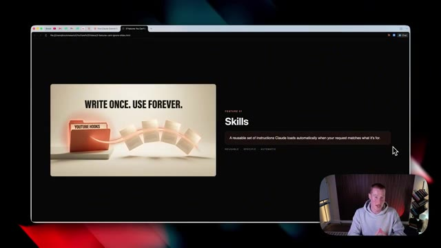
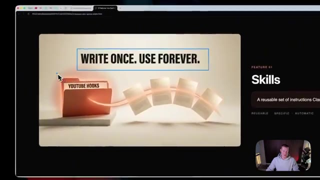

# 🎬 The 3 Claude Cowork Features You Can’t Ignore (master them)

> **Chaîne** : [Brock Mesarich | AI for Non Techies](https://www.youtube.com/@BrockMesarich)  
> **Lien YouTube** : [https://www.youtube.com/watch?v=9pS15oeoi1k](https://www.youtube.com/watch?v=9pS15oeoi1k)  
> **Date de publication** : 20260527  
> **Durée** : 00:22:10  
> **Identifiant vidéo** : `9pS15oeoi1k`  
> **Transcription & Analyse** : `whisper-v3-large-turbo+gemini-3.5-flash-lite`  

---

## 📌 Synthèse Exécutive & Outils

### 💡 Résumé
Dans cette vidéo intitulée **The 3 Claude Cowork Features You Can’t Ignore (master them)**, Alex Carter détaille une approche stratégique et pratique du trading et de l'automatisation par agents IA.

### 🛠️ Outils, Modèles & Logiciels Présentés
- **TradingView & Claude Code** : Analyse technique avancée et automatisation algorithmique.

### 🔑 Points Clés & Enseignements Stratégiques
- Respect rigoureux du ratio risque/rendement et du money management.
- Automatisation méthodique des déclencheurs d'ordres via des agents intelligents.

---

## ⏱️ Chronologie & Transcription Complète Audio & Visuelle (Mot pour Mot)

### ⏱️ `[00:00:00 - 00:00:29]` | Segment #01

**🔊 Audio (Transcription Intégrale Mot pour Mot en Français) :**
> I've been using Claude Cowork every single day to run my business for the last four months, and there are three crucial features you need to master that most people simply ignore. In this video, I'm going to walk you through all three one by one. I'm going to break down what they do, how to set them up, and how I actually use them every single day. By the end of this video, you'll be ahead of 90% of people using Claude. And don't worry, I'm going to break it down so simply that literally anyone can follow along. So without further ado, let's dive in.

**👁️ Analyse Visuelle d'Écran (gemini-3.5-flash-lite) :**
**Interface & Outils** : Présentation ou face-caméra explicatif du trader sans interface logicielle partagée.

**Contenu textuel & Code** : Explications orales des stratégies et mise en contexte méthodologique du marché.

**Action / Démonstration** : Explications face caméra et analyse conceptuelle des marchés.

---

### ⏱️ `[00:00:29 - 00:01:04]` | Segment #02

**🔊 Audio (Transcription Intégrale Mot pour Mot en Français) :**
> All right, so there's a good chance that you're probably under using Claude. So in this video, I'm going to talk about the three features that will take you way further with Claude. And you really need to master them if you want to get the full capabilities of this incredibly powerful platform. So first of all, most people use Claude like a basic chatbot. Basically, they just type in a specific prompt, a question, and Claude will give you a text output. This is a very basic way to be using this. So the first feature that you really need to master is skills. If you don't know what a skill is let me break it down right now so literally anybody can understand it. So a

**👁️ Analyse Visuelle d'Écran (gemini-3.5-flash-lite) :**
**Interface & Outils** : Présentation ou face-caméra explicatif du trader sans interface logicielle partagée.

**Contenu textuel & Code** : Explications orales des stratégies et mise en contexte méthodologique du marché.

**Action / Démonstration** : Explications face caméra et analyse conceptuelle des marchés.

---

### ⏱️ `[00:01:04 - 00:01:37]` | Segment #03

**🔊 Audio (Transcription Intégrale Mot pour Mot en Français) :**
> skill is a reusable set of instructions Claude loads automatically and you can create skills about specific workflows that you do in your business across all these different categories and instead of having to give a really long prompt to Claude every single time you want this to run it automatically knows exactly how to perform this task and this is a perfect graphic to explain basically we just have to write these instructions once and we could use these forever For example, this right here is a YouTube hook skill that I personally run, and it will automatically generate these YouTube hooks in my exact style without me needing to recreate them.

**👁️ Analyse Visuelle d'Écran (gemini-3.5-flash-lite) :**
**Interface & Outils** : Navigateur web (Chrome) affichant une présentation interactive au format HTML.

**Contenu textuel & Code** : Texte affiché à l'écran : "WRITE ONCE. USE FOREVER.", "FEATURE 01: Skills", "A reusable set of instructions Claude loads automatically when your request matches what it's for", étiquettes "REUSABLE", "SPECIFIC", "AUTOMATIC".

**Action / Démonstration** : Explication conceptuelle du fonctionnement des compétences (Skills) de Claude pour automatiser les workflows récurrents.

*⏱️ 00:01:12 — Diapositive de présentation expliquant la fonctionnalité "Skills" de Claude AI, illustrée par le slogan "WRITE ONCE. USE FOREVER." et un dossier virtuel "YOUTUBE HOOKS".*

*⏱️ 00:01:29 — Gros plan sur la même diapositive montrant la définition d'un "Skill" comme un ensemble d'instructions réutilisables exécutées automatiquement par Claude.*

---

### ⏱️ `[00:01:37 - 00:02:13]` | Segment #04

**🔊 Audio (Transcription Intégrale Mot pour Mot en Français) :**
> So to quickly talk about the anatomy of what a skill looks like, this is it in a nutshell. So first of all, we have the name of the skill. We have the specific description, which is basically breaking down exactly how it works. And then the instructions, which is the step-by-step guide on how to perform this task. Now, if I come into Claude, these are all the skills that I personally use every single day, I have about like 200 plus at this point that I use. And if I click on a skill, for example, if I click on this YouTube to X one, you can see a couple of different things. We have the description breaking down exactly what this is. We then have this markdown file, which is basically

**👁️ Analyse Visuelle d'Écran (gemini-3.5-flash-lite) :**
**Interface & Outils** : Présentation ou face-caméra explicatif du trader sans interface logicielle partagée.

**Contenu textuel & Code** : Explications orales des stratégies et mise en contexte méthodologique du marché.

**Action / Démonstration** : Explications face caméra et analyse conceptuelle des marchés.

---

### ⏱️ `[00:02:13 - 00:02:49]` | Segment #05

**🔊 Audio (Transcription Intégrale Mot pour Mot en Français) :**
> the very in-depth instructions on exactly how to run this workflow and as well as show the specific output style. And we could collect as many of these skills as we would like. And I'm going to show you how to create them. You might be asking yourself right now, Brock, how does Claude know which skills to use for my specific workflows? And there's a couple of different ways that it does this. So we ask a specific question or give it a task that we want Claude to perform. It will then search through our directory of the different skills that we have in order to find the best match in order to get that task done. And then from there, we now have a specialist inside of

**👁️ Analyse Visuelle d'Écran (gemini-3.5-flash-lite) :**
**Interface & Outils** : Présentation ou face-caméra explicatif du trader sans interface logicielle partagée.

**Contenu textuel & Code** : Explications orales des stratégies et mise en contexte méthodologique du marché.

**Action / Démonstration** : Explications face caméra et analyse conceptuelle des marchés.

---

### ⏱️ `[00:02:49 - 00:03:09]` | Segment #06

**🔊 Audio (Transcription Intégrale Mot pour Mot en Français) :**
> our Claude co-work that's able to do the specific tasks exactly how we want them done. So each Even if I do have 200 of these different skills inside of my Claude, it's able to pick and choose which ones I should be using for specific tasks. Real quick, if you guys want the 15 Claude Coworks skills that I can't live without, I'm giving them away completely for free for you guys in this video.

**👁️ Analyse Visuelle d'Écran (gemini-3.5-flash-lite) :**
**Interface & Outils** : Présentation ou face-caméra explicatif du trader sans interface logicielle partagée.

**Contenu textuel & Code** : Explications orales des stratégies et mise en contexte méthodologique du marché.

**Action / Démonstration** : Explications face caméra et analyse conceptuelle des marchés.

---

### ⏱️ `[00:03:09 - 00:03:29]` | Segment #07

**🔊 Audio (Transcription Intégrale Mot pour Mot en Français) :**
> So there is a link in the description to grab these. Again, they're completely free. These are 15 hand-picked skills I've created myself that I use across my business every single day. So if you wanna access them, begin downloading them. Once you come to this page, just fill out your email, well, then it will be sent directly there. And you just need to go to Claude, upload the plugin, and you should have access to all of these different skills.

**👁️ Analyse Visuelle d'Écran (gemini-3.5-flash-lite) :**
**Interface & Outils** : Présentation ou face-caméra explicatif du trader sans interface logicielle partagée.

**Contenu textuel & Code** : Explications orales des stratégies et mise en contexte méthodologique du marché.

**Action / Démonstration** : Explications face caméra et analyse conceptuelle des marchés.

---

### ⏱️ `[00:03:29 - 00:03:49]` | Segment #08

**🔊 Audio (Transcription Intégrale Mot pour Mot en Français) :**
> So now that you have that, let's get back to the video. All right, so the first skill that I wanna show you that I use literally every single day is a PDF guide skill that I created myself. Take a look up here. I said, PDF guide, breaking down in depth how Claude skills work, and then giving a breakdown on 10 different skills to run. And this right here is the output after I created this skill.

**👁️ Analyse Visuelle d'Écran (gemini-3.5-flash-lite) :**
**Interface & Outils** : Présentation ou face-caméra explicatif du trader sans interface logicielle partagée.

**Contenu textuel & Code** : Explications orales des stratégies et mise en contexte méthodologique du marché.

**Action / Démonstration** : Explications face caméra et analyse conceptuelle des marchés.

---

### ⏱️ `[00:03:49 - 00:04:10]` | Segment #09

**🔊 Audio (Transcription Intégrale Mot pour Mot en Français) :**
> So here is a rundown. So it shows the reason most people plateau, what a skill actually is. And it's following this design style that I created. And it even generates these like little infographic explainer diagrams directly inside of this PDF. Again, you could see this pretty cool little brain node thing that it generated directly inside of this.

**👁️ Analyse Visuelle d'Écran (gemini-3.5-flash-lite) :**
**Interface & Outils** : Présentation ou face-caméra explicatif du trader sans interface logicielle partagée.

**Contenu textuel & Code** : Explications orales des stratégies et mise en contexte méthodologique du marché.

**Action / Démonstration** : Explications face caméra et analyse conceptuelle des marchés.

---

### ⏱️ `[00:04:10 - 00:04:33]` | Segment #10

**🔊 Audio (Transcription Intégrale Mot pour Mot en Français) :**
> And this is something that I use all the time in order to give this away as a lead magnet on Instagram. I'll say like comment X and I'll send you a resource. and it automatically creates these PDF guides for me that either I can use in order to do research on a particular topic, give away to my team when we create SOPs, or give these as lead magnets in order to give value to my audience.

**👁️ Analyse Visuelle d'Écran (gemini-3.5-flash-lite) :**
**Interface & Outils** : Présentation ou face-caméra explicatif du trader sans interface logicielle partagée.

**Contenu textuel & Code** : Explications orales des stratégies et mise en contexte méthodologique du marché.

**Action / Démonstration** : Explications face caméra et analyse conceptuelle des marchés.

---

### ⏱️ `[00:04:33 - 00:05:06]` | Segment #11

**🔊 Audio (Transcription Intégrale Mot pour Mot en Français) :**
> And this skill always lives in my library, so I could just click on this and make changes to this whenever I want. So basically inside of this skill, we could see what the output looks like. It breaks down how to build a new guide, specific design rules, so that way every time I generate a PDF, it always uses this particular style. So this is a really basic skill. Let me now show you three of the ones that I use every single day. And I think this will be incredibly helpful. You could download these and steal these from me as well as I'm going to show you how to build your own skills from scratch. And then next up, the feature I'm going to show you after this really takes skills

**👁️ Analyse Visuelle d'Écran (gemini-3.5-flash-lite) :**
**Interface & Outils** : Présentation ou face-caméra explicatif du trader sans interface logicielle partagée.

**Contenu textuel & Code** : Explications orales des stratégies et mise en contexte méthodologique du marché.

**Action / Démonstration** : Explications face caméra et analyse conceptuelle des marchés.

---

### ⏱️ `[00:05:06 - 00:05:31]` | Segment #12

**🔊 Audio (Transcription Intégrale Mot pour Mot en Français) :**
> to the next level and turns these into almost an autonomous AI employee that could go and do things on your behalf in the specific way that you want them done. This skill right here is called visualize. And I personally use this whenever I need to understand something because I'm a visual learner. I really like to be able to see a visual breakdown when I'm trying to understand more complex topics. This is one that I use personally every single day in order to explain things to me.

**👁️ Analyse Visuelle d'Écran (gemini-3.5-flash-lite) :**
**Interface & Outils** : Présentation ou face-caméra explicatif du trader sans interface logicielle partagée.

**Contenu textuel & Code** : Explications orales des stratégies et mise en contexte méthodologique du marché.

**Action / Démonstration** : Explications face caméra et analyse conceptuelle des marchés.

---

### ⏱️ `[00:05:31 - 00:05:51]` | Segment #13

**🔊 Audio (Transcription Intégrale Mot pour Mot en Français) :**
> So I basically just said visualize how Claude Cowork works and it automatically generated this HTML dashboard for me. So whenever I say visualize basically anything, it will generate an output that looks almost exactly like this. So I could pull this up in my browser and let me quickly break this down. So it shows the operating system for getting real work done with Claude.

**👁️ Analyse Visuelle d'Écran (gemini-3.5-flash-lite) :**
**Interface & Outils** : Présentation ou face-caméra explicatif du trader sans interface logicielle partagée.

**Contenu textuel & Code** : Explications orales des stratégies et mise en contexte méthodologique du marché.

**Action / Démonstration** : Explications face caméra et analyse conceptuelle des marchés.

---

### ⏱️ `[00:05:51 - 00:06:12]` | Segment #14

**🔊 Audio (Transcription Intégrale Mot pour Mot en Français) :**
> At a glance, it shows four things that make Claude Cowork different from a chat window, skills, connectors, memory, automation. And then it even generated this diagram for me to break down exactly how Claude Cowork requests actually run. So for example, here's my input. It then shows Claude as an orchestrator, picks specific skills, calls the different connectors, reads my memory and decides what to do.

**👁️ Analyse Visuelle d'Écran (gemini-3.5-flash-lite) :**
**Interface & Outils** : Présentation ou face-caméra explicatif du trader sans interface logicielle partagée.

**Contenu textuel & Code** : Explications orales des stratégies et mise en contexte méthodologique du marché.

**Action / Démonstration** : Explications face caméra et analyse conceptuelle des marchés.

---

### ⏱️ `[00:06:12 - 00:06:33]` | Segment #15

**🔊 Audio (Transcription Intégrale Mot pour Mot en Français) :**
> And here's a visual breakdown of exactly how this works. So for me personally, whenever I wanna learn something, specifically when I'm building out my Cloud Co-Works system, I could see TLDR, basically how this is running and all these different systems that go into it. It then breaks down the building blocks of this as well as shows three different workflows that we could run and why it matters.

**👁️ Analyse Visuelle d'Écran (gemini-3.5-flash-lite) :**
**Interface & Outils** : Présentation ou face-caméra explicatif du trader sans interface logicielle partagée.

**Contenu textuel & Code** : Explications orales des stratégies et mise en contexte méthodologique du marché.

**Action / Démonstration** : Explications face caméra et analyse conceptuelle des marchés.

---

### ⏱️ `[00:06:33 - 00:06:54]` | Segment #16

**🔊 Audio (Transcription Intégrale Mot pour Mot en Français) :**
> So you guys could customize this however you like, but this is the specific output style that I really enjoy. So that way I could take a complex topic and condense it into something that's more digestible for me than just a simple text output. All right. So this next skill, again, is one of those ones that becomes extremely powerful when we pair this with the next feature that I'm going to show you later on in this video.

**👁️ Analyse Visuelle d'Écran (gemini-3.5-flash-lite) :**
**Interface & Outils** : Présentation ou face-caméra explicatif du trader sans interface logicielle partagée.

**Contenu textuel & Code** : Explications orales des stratégies et mise en contexte méthodologique du marché.

**Action / Démonstration** : Explications face caméra et analyse conceptuelle des marchés.

---

### ⏱️ `[00:06:54 - 00:07:14]` | Segment #17

**🔊 Audio (Transcription Intégrale Mot pour Mot en Français) :**
> So make sure to stay so you could really see the full power of this. And this is my competitor Intel skill. First, let me give you a quick breakdown on what this is, and then I'm going to show you live in action how this works. So this essentially scans all of my different YouTube competitors and surfaces what's working inside of the AI niche. So for me, I just drop in five to 10 different competitor channels.

**👁️ Analyse Visuelle d'Écran (gemini-3.5-flash-lite) :**
**Interface & Outils** : Présentation ou face-caméra explicatif du trader sans interface logicielle partagée.

**Contenu textuel & Code** : Explications orales des stratégies et mise en contexte méthodologique du marché.

**Action / Démonstration** : Explications face caméra et analyse conceptuelle des marchés.

---

### ⏱️ `[00:07:14 - 00:07:47]` | Segment #18

**🔊 Audio (Transcription Intégrale Mot pour Mot en Français) :**
> It's automatically going to return different themes, viral hits, and specific content gaps that Claude finds in the market in order for me to make videos about. Then it's going to help me plan content backed by real data instead of me just making content that most people might not be interested in. So this is a perfect visual right here. It basically searches through these different channels that I specify. And then it's going to create an intelligence report in the form of a dashboard for me to read over every single day when I run this. Now, if we come back over to Claude Coworks, you can see I ran the skill competitor Intel. It basically ran this skill

**👁️ Analyse Visuelle d'Écran (gemini-3.5-flash-lite) :**
**Interface & Outils** : Présentation ou face-caméra explicatif du trader sans interface logicielle partagée.

**Contenu textuel & Code** : Explications orales des stratégies et mise en contexte méthodologique du marché.

**Action / Démonstration** : Explications face caméra et analyse conceptuelle des marchés.

---

### ⏱️ `[00:07:47 - 00:08:21]` | Segment #19

**🔊 Audio (Transcription Intégrale Mot pour Mot en Français) :**
> and it generates two different things for me. So let's take a look at these now. First, we have this markdown file. So if I open this up, we're going to see a couple of different things. It breaks down the big picture on all the things that I discovered. It then comes up with 10 different content ideas that are ranked by the opportunity based on what other people are making videos about. So then it will, you know, give a natural spin on, you know, my channel, how I could cover this in a different way from these other creators. It then shows what I should avoid. So specific things that tons of people have already made videos about. I don't want to just copy them. And one of the best parts about this is it shows the specific patterns that it's finding when doing all this

**👁️ Analyse Visuelle d'Écran (gemini-3.5-flash-lite) :**
**Interface & Outils** : Présentation ou face-caméra explicatif du trader sans interface logicielle partagée.

**Contenu textuel & Code** : Explications orales des stratégies et mise en contexte méthodologique du marché.

**Action / Démonstration** : Explications face caméra et analyse conceptuelle des marchés.

---

### ⏱️ `[00:08:21 - 00:08:58]` | Segment #20

**🔊 Audio (Transcription Intégrale Mot pour Mot en Français) :**
> research. And then on top of that, probably my favorite part about this skill is it also generates this HTML dashboard for me. So I could see a visual of all these different content ideas and what I should be focusing on. So if I open this up, let's take a look. So first of all, it talks about the big read, shows the 10 different content ideas, shows everything that's trending in the space, shows what to avoid, and then it shows timing recommendations. So I could know which one I should focus on if there's any that are time sensitive. So you could probably begin to see how powerful skills are when we tailor these to our specific use cases. This is something that I would spend literally hours every single day doing myself. And now I have Claude Cowork scraping

**👁️ Analyse Visuelle d'Écran (gemini-3.5-flash-lite) :**
**Interface & Outils** : Présentation ou face-caméra explicatif du trader sans interface logicielle partagée.

**Contenu textuel & Code** : Explications orales des stratégies et mise en contexte méthodologique du marché.

**Action / Démonstration** : Explications face caméra et analyse conceptuelle des marchés.

---

### ⏱️ `[00:08:58 - 00:09:26]` | Segment #21

**🔊 Audio (Transcription Intégrale Mot pour Mot en Français) :**
> this automatically and sends me this daily report. All right. So this next skill is a pretty unique one. So this one is called my wrap up skill. And what this does is this combines everything that Claude Cowork did for me that day, as well as everything that I personally did. And then it will create an HTML report so I could see everything that got moved forward inside of my business for that day. So as you can see in this visual, it's going to break down every single thing that happened and then give me a dashboard breaking down every single thing that went down.

**👁️ Analyse Visuelle d'Écran (gemini-3.5-flash-lite) :**
**Interface & Outils** : Présentation ou face-caméra explicatif du trader sans interface logicielle partagée.

**Contenu textuel & Code** : Explications orales des stratégies et mise en contexte méthodologique du marché.

**Action / Démonstration** : Explications face caméra et analyse conceptuelle des marchés.

---

### ⏱️ `[00:09:26 - 00:09:59]` | Segment #22

**🔊 Audio (Transcription Intégrale Mot pour Mot en Français) :**
> To show you exactly what I mean, here is my end of day report for Tuesday, May 26th, 2026. And it breaks down a couple of different things. So eight different cowork outputs. Personally, I did not do any manual work and it carried forward three tasks that we've been working on. Then it shows every single thing that Claude Cowork did. So it generated this morning's daily briefing. It built today's inbox triage dashboard, ran the competitor Intel skill that I just showed you and basically did a bunch of different things. So now I could see exactly what I did. Think of this as like an end of day summary on what an employee did. And I could run

**👁️ Analyse Visuelle d'Écran (gemini-3.5-flash-lite) :**
**Interface & Outils** : Présentation ou face-caméra explicatif du trader sans interface logicielle partagée.

**Contenu textuel & Code** : Explications orales des stratégies et mise en contexte méthodologique du marché.

**Action / Démonstration** : Explications face caméra et analyse conceptuelle des marchés.

---

### ⏱️ `[00:09:59 - 00:10:24]` | Segment #23

**🔊 Audio (Transcription Intégrale Mot pour Mot en Français) :**
> this whenever I want to be able to see, you know, what I've been working on throughout the day. Then from here, it shows everything that was carried forward, as well as this is probably my favorite part. It shows tomorrow's number one priority. So I could already know what I should be focusing on tomorrow before the day even starts. If you guys don't know where to start when it comes with creating and using skills across your business inside of Cloud Cowork, I curated every single skill that I can't live without that I use every single day.

**👁️ Analyse Visuelle d'Écran (gemini-3.5-flash-lite) :**
**Interface & Outils** : Présentation ou face-caméra explicatif du trader sans interface logicielle partagée.

**Contenu textuel & Code** : Explications orales des stratégies et mise en contexte méthodologique du marché.

**Action / Démonstration** : Explications face caméra et analyse conceptuelle des marchés.

---

### ⏱️ `[00:10:24 - 00:10:45]` | Segment #24

**🔊 Audio (Transcription Intégrale Mot pour Mot en Français) :**
> You could find that in my school community. And if you guys want free skills that you guys can use that Anthropic actually created for us, I'm going to show you how you could do that right now. So first of all, we're going to come inside of the Cloud desktop app and then make sure to click on customize. From here, we're going to look at personal plugins, click on browse plugins. And right here are a bunch of different plugins that Anthropic created for us.

**👁️ Analyse Visuelle d'Écran (gemini-3.5-flash-lite) :**
**Interface & Outils** : Présentation ou face-caméra explicatif du trader sans interface logicielle partagée.

**Contenu textuel & Code** : Explications orales des stratégies et mise en contexte méthodologique du marché.

**Action / Démonstration** : Explications face caméra et analyse conceptuelle des marchés.

---

### ⏱️ `[00:10:45 - 00:11:09]` | Segment #25

**🔊 Audio (Transcription Intégrale Mot pour Mot en Français) :**
> If you don't know what a plugin is, it's basically a bundle of different skills. So as you can see here, we have specific skills for design. We have specific skills for small business owners. We have specific skills for marketing, legal, and finance, all of these different things we could actually download and begin using directly inside of Cloud. So in order to download these, all we do is click on a skill that we wanna download, click on install.

**👁️ Analyse Visuelle d'Écran (gemini-3.5-flash-lite) :**
**Interface & Outils** : Présentation ou face-caméra explicatif du trader sans interface logicielle partagée.

**Contenu textuel & Code** : Explications orales des stratégies et mise en contexte méthodologique du marché.

**Action / Démonstration** : Explications face caméra et analyse conceptuelle des marchés.

---

### ⏱️ `[00:11:09 - 00:11:44]` | Segment #26

**🔊 Audio (Transcription Intégrale Mot pour Mot en Français) :**
> And then now inside of this plugin with all these different marketing skills, I can now see each of these individual ones I could begin using and I could customize these to my liking. And this honestly will give you a really good starting point. If you don't know how to create skills from scratch. Now, let's say you do have a specific workflow that you know, you want to automate with a skill. All you have to do is come over to, you know, Claude Cowork chat right here and just say something like, I want you to create a skill for me that automatically generates invoices for me, for my business. I want you to always use the exact same style. However, I want to change the PO number as well as the invoice number on all of

**👁️ Analyse Visuelle d'Écran (gemini-3.5-flash-lite) :**
**Interface & Outils** : Présentation ou face-caméra explicatif du trader sans interface logicielle partagée.

**Contenu textuel & Code** : Explications orales des stratégies et mise en contexte méthodologique du marché.

**Action / Démonstration** : Explications face caméra et analyse conceptuelle des marchés.

---

### ⏱️ `[00:11:44 - 00:12:19]` | Segment #27

**🔊 Audio (Transcription Intégrale Mot pour Mot en Français) :**
> these different invoices. Do it in a format that looks really clean so I could send it to my clients. So it's as simple as just typing in a prompt like that. Or if you don't even want to type and you want to be lazy just like me, you could use a tool like AquaVoice. That tool that you just saw me talking into my computer and it automatically dictated it is called AquaVoice. There is a link in the description if you guys do want to use this. I have tons of people asking which tool I use in order to do that. So there it is. Go ahead and check it out. So all you have to do is send that and now Claude will begin crafting this skill automatically. All right. So just like that, we now have this new skill for an invoice generator. But if we want to find these skills,

**👁️ Analyse Visuelle d'Écran (gemini-3.5-flash-lite) :**
**Interface & Outils** : Présentation ou face-caméra explicatif du trader sans interface logicielle partagée.

**Contenu textuel & Code** : Explications orales des stratégies et mise en contexte méthodologique du marché.

**Action / Démonstration** : Explications face caméra et analyse conceptuelle des marchés.

---

### ⏱️ `[00:12:19 - 00:12:52]` | Segment #28

**🔊 Audio (Transcription Intégrale Mot pour Mot en Français) :**
> we could always come here, click on customize, click on skills, and then just search up invoice generator or whatever the name of the skill is. And you could see it right there and you could always make changes to it. Moving on to feature number two, this is where things get extremely interesting. So with skills, we were building the foundation for this next step. And this is where we could actually begin using Cloud Cowork like an actual AI employee that could go and do things for us, you know, without us needing to be on our computer. This next feature is called a scheduled task that allows you to run specific workflows every single day or at a specific cadence whenever

**👁️ Analyse Visuelle d'Écran (gemini-3.5-flash-lite) :**
**Interface & Outils** : Présentation ou face-caméra explicatif du trader sans interface logicielle partagée.

**Contenu textuel & Code** : Explications orales des stratégies et mise en contexte méthodologique du marché.

**Action / Démonstration** : Explications face caméra et analyse conceptuelle des marchés.

---

### ⏱️ `[00:12:52 - 00:13:22]` | Segment #29

**🔊 Audio (Transcription Intégrale Mot pour Mot en Français) :**
> vous voulez les exécuter. Ainsi, cela peut être une tâche très simple comme vérifier vos e-mails, ou cela peut être une tâche vraiment complexe intégrant plusieurs compétences différentes enchaînées les unes aux autres afin de faire votre travail à votre place. Très bien, laissez-moi donc vous montrer exactement ce que je veux dire. Si je vais dans mes tâches planifiées à l'intérieur de Claude Cowork, j'en ai tout un tas de différentes qui tournent. Passons donc en revue quelques-unes d'entre elles. J'ai une compétence de briefing matinal qui extrait automatiquement les informations de mon calendrier, de mes e-mails, et trouve des actualités spécifiques sur l'IA pour moi, puis génère un tableau de bord HTML que je peux consulter.

**👁️ Analyse Visuelle d'Écran (gemini-3.5-flash-lite) :**
**Interface & Outils** : Présentation ou face-caméra explicatif du trader sans interface logicielle partagée.

**Contenu textuel & Code** : Explications orales des stratégies et mise en contexte méthodologique du marché.

**Action / Démonstration** : Explications face caméra et analyse conceptuelle des marchés.

---

### ⏱️ `[00:13:22 - 00:13:41]` | Segment #30

**🔊 Audio (Transcription Intégrale Mot pour Mot en Français) :**
> So to give you an example of an output, this is what it looks like. This ran this morning at 7am and runs every single morning at 7 a.m. for that matter. First of all, what it does is it breaks down my calendar. It shows that I have no meetings today, thankfully. And then it breaks down my email inbox. It gives me suggested replies. It shows all of the things that are urgent, specific ones that are worth reviewing.

**👁️ Analyse Visuelle d'Écran (gemini-3.5-flash-lite) :**
**Interface & Outils** : Présentation ou face-caméra explicatif du trader sans interface logicielle partagée.

**Contenu textuel & Code** : Explications orales des stratégies et mise en contexte méthodologique du marché.

**Action / Démonstration** : Explications face caméra et analyse conceptuelle des marchés.

---

### ⏱️ `[00:13:42 - 00:14:02]` | Segment #31

**🔊 Audio (Transcription Intégrale Mot pour Mot en Français) :**
> And then it gives me a sense of what I need to work on for that day without me needing to go across these different applications for me to check. Next up, we have a daily wrap up that runs every single day at 6 p.m. at the end of the day. And this is a skill that we actually created earlier on in this video, if you remember. And so let me pull this up. It's going to create this dashboard for us. It shows all the different cloud cowork outputs.

**👁️ Analyse Visuelle d'Écran (gemini-3.5-flash-lite) :**
**Interface & Outils** : Présentation ou face-caméra explicatif du trader sans interface logicielle partagée.

**Contenu textuel & Code** : Explications orales des stratégies et mise en contexte méthodologique du marché.

**Action / Démonstration** : Explications face caméra et analyse conceptuelle des marchés.

---

### ⏱️ `[00:14:02 - 00:14:22]` | Segment #32

**🔊 Audio (Transcription Intégrale Mot pour Mot en Français) :**
> It shows everything that I did for the day, shows combined progress, shows everything that was carried forward throughout the day. And then it even shows the top priorities for tomorrow. This is where scheduled tasks can become really powerful because we could create specific workflows and tasks for our AI employee to do with skills. And then we could just chain those together with something like scheduled tasks.

**👁️ Analyse Visuelle d'Écran (gemini-3.5-flash-lite) :**
**Interface & Outils** : Présentation ou face-caméra explicatif du trader sans interface logicielle partagée.

**Contenu textuel & Code** : Explications orales des stratégies et mise en contexte méthodologique du marché.

**Action / Démonstration** : Explications face caméra et analyse conceptuelle des marchés.

---

### ⏱️ `[00:14:22 - 00:14:40]` | Segment #33

**🔊 Audio (Transcription Intégrale Mot pour Mot en Français) :**
> Another example is a YouTube competitor scan that runs every single morning at 9 a.m. So I could wake up with this dashboard of an understanding on what's trending in AI space, what things I could potentially make videos about. And then it even shows me my recommended content actions so I could make videos that day and not have to think about what I should be doing.

**👁️ Analyse Visuelle d'Écran (gemini-3.5-flash-lite) :**
**Interface & Outils** : Présentation ou face-caméra explicatif du trader sans interface logicielle partagée.

**Contenu textuel & Code** : Explications orales des stratégies et mise en contexte méthodologique du marché.

**Action / Démonstration** : Explications face caméra et analyse conceptuelle des marchés.

---

### ⏱️ `[00:14:40 - 00:15:00]` | Segment #34

**🔊 Audio (Transcription Intégrale Mot pour Mot en Français) :**
> Now, there's a couple of different ways we can begin creating a scheduled task. You could do it in the normal chat mode or you could come over to scheduled, click on new task, click create with Claude, and then just explain something we want to run. If we have a skill, for example, we want to focus this around, we could just click on forward slash, give it a specific skill.

**👁️ Analyse Visuelle d'Écran (gemini-3.5-flash-lite) :**
**Interface & Outils** : Présentation ou face-caméra explicatif du trader sans interface logicielle partagée.

**Contenu textuel & Code** : Explications orales des stratégies et mise en contexte méthodologique du marché.

**Action / Démonstration** : Explications face caméra et analyse conceptuelle des marchés.

---

### ⏱️ `[00:15:01 - 00:15:21]` | Segment #35

**🔊 Audio (Transcription Intégrale Mot pour Mot en Français) :**
> Let's just call this one IG carousel skill, which automatically creates Instagram carousels for me. Then I could just come here and say, hey, I want you to generate Instagram carousels for me with this skill every single day at 8 a.m. Then we can just send that off and it will begin building this. And once that is created, we can always see it in our scheduled tasks section inside of Cloud Cowork.

**👁️ Analyse Visuelle d'Écran (gemini-3.5-flash-lite) :**
**Interface & Outils** : Présentation ou face-caméra explicatif du trader sans interface logicielle partagée.

**Contenu textuel & Code** : Explications orales des stratégies et mise en contexte méthodologique du marché.

**Action / Démonstration** : Explications face caméra et analyse conceptuelle des marchés.

---

### ⏱️ `[00:15:21 - 00:15:39]` | Segment #36

**🔊 Audio (Transcription Intégrale Mot pour Mot en Français) :**
> Next up, we have feature number three, and this is live artifacts. And this is a fan favorite. This is one that I've really been loving since it released just a couple of weeks ago. So this is basically just a page that pulls live data from your other tools and applications every time you open it, and it lives directly inside of Claude.

**👁️ Analyse Visuelle d'Écran (gemini-3.5-flash-lite) :**
**Interface & Outils** : Présentation ou face-caméra explicatif du trader sans interface logicielle partagée.

**Contenu textuel & Code** : Explications orales des stratégies et mise en contexte méthodologique du marché.

**Action / Démonstration** : Explications face caméra et analyse conceptuelle des marchés.

---

### ⏱️ `[00:15:39 - 00:15:59]` | Segment #37

**🔊 Audio (Transcription Intégrale Mot pour Mot en Français) :**
> Right here is a perfect visual of what this looks like. We have tool number one, we have tool number two, tool number three, tool number four, all directly plugging into this live page that lives inside of Claude. So in order to show you exactly what I mean, let's take a look at this right here. This is my Cloud Cowork operating system that I created and I've shown actually in a previous video.

**👁️ Analyse Visuelle d'Écran (gemini-3.5-flash-lite) :**
**Interface & Outils** : Présentation ou face-caméra explicatif du trader sans interface logicielle partagée.

**Contenu textuel & Code** : Explications orales des stratégies et mise en contexte méthodologique du marché.

**Action / Démonstration** : Explications face caméra et analyse conceptuelle des marchés.

---

### ⏱️ `[00:15:59 - 00:16:20]` | Segment #38

**🔊 Audio (Transcription Intégrale Mot pour Mot en Français) :**
> This basically pulls a bunch of different data from my different apps that I use every single day. So if I come over to this today's plan section, I could see everything that's on my Google calendar. I could see all of my different emails that I need to reply to ones that are urgent ones that are, you know, less urgent, et cetera. I then have this bitly tracking dashboard instead of me having to go to the next page.

**👁️ Analyse Visuelle d'Écran (gemini-3.5-flash-lite) :**
**Interface & Outils** : Présentation ou face-caméra explicatif du trader sans interface logicielle partagée.

**Contenu textuel & Code** : Explications orales des stratégies et mise en contexte méthodologique du marché.

**Action / Démonstration** : Explications face caméra et analyse conceptuelle des marchés.

---

### ⏱️ `[00:16:20 - 00:16:54]` | Segment #39

**🔊 Audio (Transcription Intégrale Mot pour Mot en Français) :**
> go to bit.ly.com and actually searching, you know, through the dashboard and seeing all the different statistics, I can now see this directly inside of Claude. And it always lives right here on the left-hand sidebar. So whenever I want to see, you know, what videos and what links people are clicking on from my YouTube content, I could just automatically pull this up instead of needing to go to that app. And this is a fundamental shift in kind of how we use our different applications on a day-to-day basis. When we can create specific dashboards for every app that we use on a day-to- basis and pull information from there, we don't necessarily need to use those apps anymore. We

**👁️ Analyse Visuelle d'Écran (gemini-3.5-flash-lite) :**
**Interface & Outils** : Présentation ou face-caméra explicatif du trader sans interface logicielle partagée.

**Contenu textuel & Code** : Explications orales des stratégies et mise en contexte méthodologique du marché.

**Action / Démonstration** : Explications face caméra et analyse conceptuelle des marchés.

---

### ⏱️ `[00:16:54 - 00:17:31]` | Segment #40

**🔊 Audio (Transcription Intégrale Mot pour Mot en Français) :**
> could just, you know, use it in order to generate dashboards like this. All right. So before we begin building out our live artifacts, we need to do a couple of different things. We first need to connect Claude to any of the different apps that we use that we want to be pulling live information from. Because if we do not connect Gmail, we do not connect Calendar or Stripe, any of these apps we want to use, we won't be able to pull relevant information. So in order to do this, we're going to come over to the left hand side where it says customize click on customize and from here we're going to click on connectors if you've never connected one and in order to connect our app we just click on add connector click browse connectors and from here there's a huge list a bunch of

**👁️ Analyse Visuelle d'Écran (gemini-3.5-flash-lite) :**
**Interface & Outils** : Présentation ou face-caméra explicatif du trader sans interface logicielle partagée.

**Contenu textuel & Code** : Explications orales des stratégies et mise en contexte méthodologique du marché.

**Action / Démonstration** : Explications face caméra et analyse conceptuelle des marchés.

---

### ⏱️ `[00:17:31 - 00:18:03]` | Segment #41

**🔊 Audio (Transcription Intégrale Mot pour Mot en Français) :**
> different apps that we can use canva microsoft 365 google calendar notion at lesion semrush all these different tools we can now begin connecting to so let's say i want to connect to docusign for example, I just click on this connect button. It's going to pull up this webpage and I need to sign into my DocuSign account real quickly. I then need to click this open Claude app. And then we can now see that our DocuSign is now connected. And we have a list of these connectors that, you know, we have added to Claude. Now let's say there's an app we want to use, but it's not in

**👁️ Analyse Visuelle d'Écran (gemini-3.5-flash-lite) :**
**Interface & Outils** : Présentation ou face-caméra explicatif du trader sans interface logicielle partagée.

**Contenu textuel & Code** : Explications orales des stratégies et mise en contexte méthodologique du marché.

**Action / Démonstration** : Explications face caméra et analyse conceptuelle des marchés.

---

### ⏱️ `[00:18:03 - 00:18:23]` | Segment #42

**🔊 Audio (Transcription Intégrale Mot pour Mot en Français) :**
> this list inside of Claude. So let me show you now exactly how we could begin doing that. I personally use a tool called Zap Your MCP. It's an automation platform that connects to 9,000 plus different apps. So odds are one of the apps you want to use might be, you know, accessible via this little hack here. So we're going to click on get started and this whole process takes maybe about 30 seconds.

**👁️ Analyse Visuelle d'Écran (gemini-3.5-flash-lite) :**
**Interface & Outils** : Présentation ou face-caméra explicatif du trader sans interface logicielle partagée.

**Contenu textuel & Code** : Explications orales des stratégies et mise en contexte méthodologique du marché.

**Action / Démonstration** : Explications face caméra et analyse conceptuelle des marchés.

---

### ⏱️ `[00:18:23 - 00:18:47]` | Segment #43

**🔊 Audio (Transcription Intégrale Mot pour Mot en Français) :**
> Once we are signed into an account, we're going to come over and click on new MCP server. We're then going to select Claude Cowork as our client since this is where we are using it. As you can see, I have a couple of different tools that are added. These are all the apps that I've connected. so that way Claude can work across all of them inside of this MCP server. In order to add a tool, we just click on add tool, search through any of the apps that we use on a day-to-day basis, click on it.

**👁️ Analyse Visuelle d'Écran (gemini-3.5-flash-lite) :**
**Interface & Outils** : Présentation ou face-caméra explicatif du trader sans interface logicielle partagée.

**Contenu textuel & Code** : Explications orales des stratégies et mise en contexte méthodologique du marché.

**Action / Démonstration** : Explications face caméra et analyse conceptuelle des marchés.

---

### ⏱️ `[00:18:47 - 00:19:06]` | Segment #44

**🔊 Audio (Transcription Intégrale Mot pour Mot en Français) :**
> We could select all of these different tools. These are basically actions it can perform for us. So it could find tasks from projects in Asana. It could find a project, find a section in project. All these different things are basically just actions that it can do. Then we would just go sign into our account and then make sure to connect it. And then all of these apps that we have added are right here.

**👁️ Analyse Visuelle d'Écran (gemini-3.5-flash-lite) :**
**Interface & Outils** : Présentation ou face-caméra explicatif du trader sans interface logicielle partagée.

**Contenu textuel & Code** : Explications orales des stratégies et mise en contexte méthodologique du marché.

**Action / Démonstration** : Explications face caméra et analyse conceptuelle des marchés.

---

### ⏱️ `[00:19:06 - 00:19:39]` | Segment #45

**🔊 Audio (Transcription Intégrale Mot pour Mot en Français) :**
> next we're just going to click on connect and this is how we add this to claude we're going to click add to claude click on this connect button click allow and then as you can see on the top right we are now connected to zapier i do want to say this is something that you don't necessarily need unless there is an app you want to connect to that claude doesn't have directly inside of the app but i wanted to show this because i know this is helpful to a lot of you guys now let's move on and begin building a live artifact from scratch so you guys can actually do this so first of all we'll come over to the live artifacts tab. This is where all of these are going to live. I have a couple of

**👁️ Analyse Visuelle d'Écran (gemini-3.5-flash-lite) :**
**Interface & Outils** : Présentation ou face-caméra explicatif du trader sans interface logicielle partagée.

**Contenu textuel & Code** : Explications orales des stratégies et mise en contexte méthodologique du marché.

**Action / Démonstration** : Explications face caméra et analyse conceptuelle des marchés.

---

### ⏱️ `[00:19:39 - 00:20:05]` | Segment #46

**🔊 Audio (Transcription Intégrale Mot pour Mot en Français) :**
> different ones that I have created. I have my profit and loss statement, a morning inbox, co-work operating system, latest emails, dashboard, brand deal operating system, basically a bunch of different live artifacts that are these mini web apps that I've created on my behalf. So we could just click on new artifact, click create with Claude or inside of any chat or task, we could just tell Claude to make us a live artifact. What I'm going to do is just come to a new chat and then give it a brain dump on exactly what it is I want to create.

**👁️ Analyse Visuelle d'Écran (gemini-3.5-flash-lite) :**
**Interface & Outils** : Présentation ou face-caméra explicatif du trader sans interface logicielle partagée.

**Contenu textuel & Code** : Explications orales des stratégies et mise en contexte méthodologique du marché.

**Action / Démonstration** : Explications face caméra et analyse conceptuelle des marchés.

---

### ⏱️ `[00:20:05 - 00:20:40]` | Segment #47

**🔊 Audio (Transcription Intégrale Mot pour Mot en Français) :**
> I found this is the best way to do it myself. All right, so I want you to build a live artifact that pulls my Gmail, my Google Calendar every single morning, and I could get a sense of everything I need to focus on for the day. I want you to break down the urgent emails that need my reply along with suggested replies, and then I want you to break down the stuff that's not as urgent. This is my morning command center. So basically, I want to be able to log on and look at this in the morning and have a sense on what I need to focus on through that day. So now it's going off and actually building this live artifact. It's using these two different integrations that, you know, we asked both Gmail and calendar. So you can see it's actually listing these specific

**👁️ Analyse Visuelle d'Écran (gemini-3.5-flash-lite) :**
**Interface & Outils** : Présentation ou face-caméra explicatif du trader sans interface logicielle partagée.

**Contenu textuel & Code** : Explications orales des stratégies et mise en contexte méthodologique du marché.

**Action / Démonstration** : Explications face caméra et analyse conceptuelle des marchés.

---

### ⏱️ `[00:20:40 - 00:21:16]` | Segment #48

**🔊 Audio (Transcription Intégrale Mot pour Mot en Français) :**
> events inside of my calendar. So let's come back once this live artifact is actually created. All right, just like that, we now have this morning command center on the right hand side. This was created in that one simple prompt. So we could refine this however we would like. This is a really good starting point. So it shows what day it is. Every meeting that I have, which I have zero today, shows the 24 emails that are urgent that I need to reply to, along with a suggested reply. I could even copy that reply and answer directly inside of email. This is great. So this is a good sense of like what you could do with live artifacts. And this is one that probably everybody can use. And to show you exactly where this will live, you could always see on the left

**👁️ Analyse Visuelle d'Écran (gemini-3.5-flash-lite) :**
**Interface & Outils** : Présentation ou face-caméra explicatif du trader sans interface logicielle partagée.

**Contenu textuel & Code** : Explications orales des stratégies et mise en contexte méthodologique du marché.

**Action / Démonstration** : Explications face caméra et analyse conceptuelle des marchés.

---

### ⏱️ `[00:21:16 - 00:21:48]` | Segment #49

**🔊 Audio (Transcription Intégrale Mot pour Mot en Français) :**
> hand sidebar. So you could pin any of these live artifacts that you would like. Mine is this morning command center right here. So if I pull it up, we can now see this command center that automatically populates my emails and if you want to see new emails populate you could just click reload and it will automatically pull from those different applications again so you could always have live up-to-date information right here also if you click on live artifacts you can always just browse every single one that you've created and you can connect them and create them right here all right guys there we have it i hope you enjoyed this video if you want my full claw to co-work course as well as the

**👁️ Analyse Visuelle d'Écran (gemini-3.5-flash-lite) :**
**Interface & Outils** : Présentation ou face-caméra explicatif du trader sans interface logicielle partagée.

**Contenu textuel & Code** : Explications orales des stratégies et mise en contexte méthodologique du marché.

**Action / Démonstration** : Explications face caméra et analyse conceptuelle des marchés.

---

### ⏱️ `[00:21:48 - 00:22:10]` | Segment #50

**🔊 Audio (Transcription Intégrale Mot pour Mot en Français) :**
> 50 plus skills i use every single day make sure to join my school community i also do weekly calls in here with a great community of entrepreneurs and professionals using Claude Cowork every single day. If you want free content, make sure to subscribe to this channel for more videos like this. I cover AI for non-technical people and break it down so simply that anybody can understand it. With that being said, guys, thanks for staying to the end and I'll see you guys in the next video.

**👁️ Analyse Visuelle d'Écran (gemini-3.5-flash-lite) :**
**Interface & Outils** : Présentation ou face-caméra explicatif du trader sans interface logicielle partagée.

**Contenu textuel & Code** : Explications orales des stratégies et mise en contexte méthodologique du marché.

**Action / Démonstration** : Explications face caméra et analyse conceptuelle des marchés.

---

