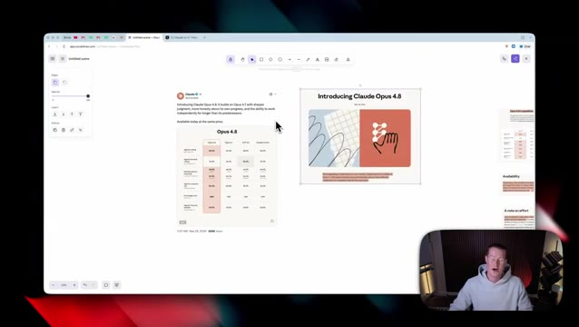

# 🎬 Anthropic Just Dropped Claude Opus 4.8 (Full Breakdown)

> **Chaîne** : [Brock Mesarich | AI for Non Techies](https://www.youtube.com/@BrockMesarich)  
> **Lien YouTube** : [https://www.youtube.com/watch?v=xoog7Kk6Jy0](https://www.youtube.com/watch?v=xoog7Kk6Jy0)  
> **Date de publication** : 20260528  
> **Durée** : 00:08:00  
> **Identifiant vidéo** : `xoog7Kk6Jy0`  
> **Transcription & Analyse** : `whisper-v3-large-turbo+gemini-3.5-flash-lite`  

---

## 📌 Synthèse Exécutive & Outils

### 💡 Résumé
Dans cette vidéo intitulée **Anthropic Just Dropped Claude Opus 4.8 (Full Breakdown)**, Alex Carter détaille une approche stratégique et pratique du trading et de l'automatisation par agents IA.

### 🛠️ Outils, Modèles & Logiciels Présentés
- **TradingView & Claude Code** : Analyse technique avancée et automatisation algorithmique.

### 🔑 Points Clés & Enseignements Stratégiques
- Respect rigoureux du ratio risque/rendement et du money management.
- Automatisation méthodique des déclencheurs d'ordres via des agents intelligents.

---

## ⏱️ Chronologie & Transcription Complète Audio & Visuelle (Mot pour Mot)

### ⏱️ `[00:00:00 - 00:00:35]` | Segment #01

**🔊 Audio (Transcription Intégrale Mot pour Mot en Français) :**
> Anthropic just released Claude Opus 4.8. I dissected the entire article breaking down the new features as well as I've been testing it out myself. So I'm going to make a no BS breakdown on exactly what's different. If you're non-technical, I'm not going to talk benchmarks and complicate this. I'm just going to talk about tangibly what is different, what you can expect from this, and if this is a real game changer that I can almost guarantee many YouTubers out there are going to say, I'm not going to sit here and hype this up. So without further ado, let's dive into a real breakdown on this. First of all, I read this entire article right here by Anthropic,

**👁️ Analyse Visuelle d'Écran (gemini-3.5-flash-lite) :**
**Interface & Outils** : Excalidraw (app.excalidraw.com), navigateur web affichant des captures de l'annonce d'Anthropic et un post X (Twitter).

**Contenu textuel & Code** : Post officiel "Introducing Claude Opus 4.8", tableau comparatif de benchmarks (Opus 4.8 vs Opus 4.7, GPT-4, Gemini) détaillant les performances sur diverses tâches agentiques et de codage.

**Action / Démonstration** : Revue visuelle et dissection de l'article d'annonce et des métriques de performance du modèle Claude Opus 4.8.

*⏱️ 00:00:09 — Tableau blanc Excalidraw regroupant l'annonce officielle d'Anthropic concernant Claude Opus 4.8 et un tableau comparatif de ses performances.*

---

### ⏱️ `[00:00:35 - 00:01:02]` | Segment #02

**🔊 Audio (Transcription Intégrale Mot pour Mot en Français) :**
> and I turned it into bite-sized breakdowns on the main things and the four main takeaways from this. If you guys want to see the full article, there will be a link in the description so you could dissect it yourself, but I wanted to condense this for you here. So first things first, here is a breakdown on the benchmarks. We're not going to talk about this. Basically, all we need to know is yes, this is better than Claude Opus 4.7 as well as GPT 5.5 and Gemini 3.1 Pro on basically everything here.

**👁️ Analyse Visuelle d'Écran (gemini-3.5-flash-lite) :**
**Interface & Outils** : Présentation ou face-caméra explicatif du trader sans interface logicielle partagée.

**Contenu textuel & Code** : Explications orales des stratégies et mise en contexte méthodologique du marché.

**Action / Démonstration** : Explications face caméra et analyse conceptuelle des marchés.

---

### ⏱️ `[00:01:03 - 00:01:27]` | Segment #03

**🔊 Audio (Transcription Intégrale Mot pour Mot en Français) :**
> The only thing that any of these other models are better at than Opus 4.8 is GPT 5.5 for agentic terminal coding. But if you're not using Claude Code, this doesn't necessarily pertain to you. All right, so first of all, let's talk about availability. As of right now, Claude Opus 4.8 is available everywhere today. So we could use this on the desktop app inside of Claude Code, Claude Cowork, all these different places we could use it. And then let's talk about pricing as well.

**👁️ Analyse Visuelle d'Écran (gemini-3.5-flash-lite) :**
**Interface & Outils** : Présentation ou face-caméra explicatif du trader sans interface logicielle partagée.

**Contenu textuel & Code** : Explications orales des stratégies et mise en contexte méthodologique du marché.

**Action / Démonstration** : Explications face caméra et analyse conceptuelle des marchés.

---

### ⏱️ `[00:01:27 - 00:02:03]` | Segment #04

**🔊 Audio (Transcription Intégrale Mot pour Mot en Français) :**
> So pricing for regular usage is unchanged from Opus 4.7, which is great. That is $5 per million input tokens and $25 per million output tokens. So in terms of pricing, we don't need to worry about anything upgraded from the Opus 4.7 model. It's going to be exactly the same as well as developers can now use Cloud Opus 4.8 via the Cloud API. So if you're using Cloud code or you're using it as a developer, that's available right now as well. Next up, this is one of the bigger things inside of this release. There is a new effort mode that's inside of the Claude.ai and

**👁️ Analyse Visuelle d'Écran (gemini-3.5-flash-lite) :**
**Interface & Outils** : Présentation ou face-caméra explicatif du trader sans interface logicielle partagée.

**Contenu textuel & Code** : Explications orales des stratégies et mise en contexte méthodologique du marché.

**Action / Démonstration** : Explications face caméra et analyse conceptuelle des marchés.

---

### ⏱️ `[00:02:03 - 00:02:39]` | Segment #05

**🔊 Audio (Transcription Intégrale Mot pour Mot en Français) :**
> the Claude desktop app, meaning that if you've ever used Claude code, you can select which effort level Claude Opus 4.7 was going to perform tasks for you. So if you're doing something a bit higher, you could put it on max or high mode, and you can now do this directly inside of the normal Claude app. It does say that Opus 4.8 defaults to high effort, which we judge to be the best overall balance of quality and user experience. So again, it's going to automatically default to this. If you have specific tasks that are a bit easier for it to do, you could always toggle it down to a lower mode so you're not spending as much on your tokens. It also looks like if you are using Cloud

**👁️ Analyse Visuelle d'Écran (gemini-3.5-flash-lite) :**
**Interface & Outils** : Présentation ou face-caméra explicatif du trader sans interface logicielle partagée.

**Contenu textuel & Code** : Explications orales des stratégies et mise en contexte méthodologique du marché.

**Action / Démonstration** : Explications face caméra et analyse conceptuelle des marchés.

---

### ⏱️ `[00:02:39 - 00:03:13]` | Segment #06

**🔊 Audio (Transcription Intégrale Mot pour Mot en Français) :**
> Code, users can now choose extra high mode inside of Cloud Code, or you could use the normal max mode that you already could use. Then it also looks like there is increased rate limits inside of Cloud Code to accommodate the higher token usage of higher effort levels. And again, users can just select whatever they want for a particular project. In order to show you this live in action, here is Cloud Cowork. As you can see, I have Opus 4.7 High selected here. And now I can go ahead and click on Opus 4.8. It automatically defaults to the High mode like I just mentioned before.

**👁️ Analyse Visuelle d'Écran (gemini-3.5-flash-lite) :**
**Interface & Outils** : Présentation ou face-caméra explicatif du trader sans interface logicielle partagée.

**Contenu textuel & Code** : Explications orales des stratégies et mise en contexte méthodologique du marché.

**Action / Démonstration** : Explications face caméra et analyse conceptuelle des marchés.

---

### ⏱️ `[00:03:13 - 00:03:46]` | Segment #07

**🔊 Audio (Transcription Intégrale Mot pour Mot en Français) :**
> And if we click on Opus 4.8, we can now see this little effort level and we can just go and pre-select what we want. So we could turn it on low, medium, high, extra, or max, as well as we can, you know, toggle on adaptive thinking. This was already there, but all of these new effort levels that we could see right here is new. So after dissecting this article, one of the main things that I've seen, and one of the things that Anthropicus is saying like is the biggest part of this release is that one of the most prominent improvements inside of Opus 4.8 is its honesty,

**👁️ Analyse Visuelle d'Écran (gemini-3.5-flash-lite) :**
**Interface & Outils** : Présentation ou face-caméra explicatif du trader sans interface logicielle partagée.

**Contenu textuel & Code** : Explications orales des stratégies et mise en contexte méthodologique du marché.

**Action / Démonstration** : Explications face caméra et analyse conceptuelle des marchés.

---

### ⏱️ `[00:03:46 - 00:04:06]` | Segment #08

**🔊 Audio (Transcription Intégrale Mot pour Mot en Français) :**
> Ce qui, pour moi, honnêtement, me paraît être une évidence. Tu veux que l'intelligence artificielle te donne des réponses honnêtes. Et pour moi personnellement, c'est un problème que j'ai rencontré avec Opus 4.7 et n'importe quel modèle d'IA d'ailleurs. La plupart du temps, les informations qu'il me donnait n'étaient tout simplement pas correctes. Et je devais toujours dire : hé, est-ce que tu peux t'assurer que c'est honnête et que ce sont les informations correctes ?

**👁️ Analyse Visuelle d'Écran (gemini-3.5-flash-lite) :**
**Interface & Outils** : Présentation ou face-caméra explicatif du trader sans interface logicielle partagée.

**Contenu textuel & Code** : Explications orales des stratégies et mise en contexte méthodologique du marché.

**Action / Démonstration** : Explications face caméra et analyse conceptuelle des marchés.

---

### ⏱️ `[00:04:07 - 00:04:31]` | Segment #09

**🔊 Audio (Transcription Intégrale Mot pour Mot en Français) :**
> So apparently this is gonna be a bit more honest of a model, which I would hope so. It said that we train all of our models to be honest, for instance, to avoid making claims that they can't support, which again, I've had this countless amount of times using other Opus models before in any Claude model. They did mention that early testers report that Opus 4.8 is more likely to flag uncertainties about its work and less likely to make unsupported claims.

**👁️ Analyse Visuelle d'Écran (gemini-3.5-flash-lite) :**
**Interface & Outils** : Présentation ou face-caméra explicatif du trader sans interface logicielle partagée.

**Contenu textuel & Code** : Explications orales des stratégies et mise en contexte méthodologique du marché.

**Action / Démonstration** : Explications face caméra et analyse conceptuelle des marchés.

---

### ⏱️ `[00:04:31 - 00:04:54]` | Segment #10

**🔊 Audio (Transcription Intégrale Mot pour Mot en Français) :**
> Obviously, we're going to have to see this in practice. And if it actually is more honest, them saying this on paper really doesn't mean much until we test it out. There are a couple of other things that are being released alongside this. So I'm going to talk about that here in a second. But first of all, let's talk about what Anthropic is saying is what's coming next. So in their own words, they're saying users will find Opus 4.8 to be a modest but tangible improvements on its predecessor.

**👁️ Analyse Visuelle d'Écran (gemini-3.5-flash-lite) :**
**Interface & Outils** : Présentation ou face-caméra explicatif du trader sans interface logicielle partagée.

**Contenu textuel & Code** : Explications orales des stratégies et mise en contexte méthodologique du marché.

**Action / Démonstration** : Explications face caméra et analyse conceptuelle des marchés.

---

### ⏱️ `[00:04:54 - 00:05:13]` | Segment #11

**🔊 Audio (Transcription Intégrale Mot pour Mot en Français) :**
> So when they are coming out and saying this is just a modest update, you know, I'm not expecting this to be a huge leap in capabilities. We're probably going to notice a little upgrade, probably just a marginal one. it's not going to be anything game-changing like I said. Hopefully it is more honest. You know, as they said, this is like a big part of their release. They want to make this more honest.

**👁️ Analyse Visuelle d'Écran (gemini-3.5-flash-lite) :**
**Interface & Outils** : Présentation ou face-caméra explicatif du trader sans interface logicielle partagée.

**Contenu textuel & Code** : Explications orales des stratégies et mise en contexte méthodologique du marché.

**Action / Démonstration** : Explications face caméra et analyse conceptuelle des marchés.

---

### ⏱️ `[00:05:14 - 00:05:50]` | Segment #12

**🔊 Audio (Transcription Intégrale Mot pour Mot en Français) :**
> And they did come out and say that there is still a lot more work to be done. We're working on developing and releasing models that provide many of the same capabilities as Opus at a lower cost, and that is what's coming next. And if you've never heard of Claude Mythos, this is the AI model that apparently is too good for them to release to the public. So they've actually given this to some of the Fortune 500 companies to run internal testing to make sure this is actually safe to give to the public. They came out and said that not only that, but we plan to release a new class of models with even higher intelligence than Opus. And this is the new Claude Mythos preview model. Right here

**👁️ Analyse Visuelle d'Écran (gemini-3.5-flash-lite) :**
**Interface & Outils** : Présentation ou face-caméra explicatif du trader sans interface logicielle partagée.

**Contenu textuel & Code** : Explications orales des stratégies et mise en contexte méthodologique du marché.

**Action / Démonstration** : Explications face caméra et analyse conceptuelle des marchés.

---

### ⏱️ `[00:05:50 - 00:06:24]` | Segment #13

**🔊 Audio (Transcription Intégrale Mot pour Mot en Français) :**
> inside of the article, it says that we can expect this inside of Claude in the next coming weeks. It didn't really give an exact date, but just know that this is something that could be coming out in the next two, three, four weeks. All right. So next up we have dynamic workflows. This is a new feature available in research preview, allows Claude to take on even bigger tasks inside of Claude code. So if you don't use Claude code, so let's say you're just an everyday Claude chat in Claude co-work user, this won't necessarily pertain to you, but let me break it down just a little bit here. They are claiming that Claude can now plan the work and run hundreds of parallel

**👁️ Analyse Visuelle d'Écran (gemini-3.5-flash-lite) :**
**Interface & Outils** : Présentation ou face-caméra explicatif du trader sans interface logicielle partagée.

**Contenu textuel & Code** : Explications orales des stratégies et mise en contexte méthodologique du marché.

**Action / Démonstration** : Explications face caméra et analyse conceptuelle des marchés.

---

### ⏱️ `[00:06:24 - 00:07:00]` | Segment #14

**🔊 Audio (Transcription Intégrale Mot pour Mot en Français) :**
> subagents in a single session. And it says that with Opus 4.8, the agents can run for even longer. So again, that only matters if you are using Cloud Code. Next up, one of the other changes that we did mention is the effort control inside of Cloud.ai and Cloud Cowork, which is something I'm personally happy about. And then this is another small one, but the messages API now accepts system entries inside the messages array. And this only matters if you are a developer. All right. So my main takeaways after reading this article is that this is the same price as Opus 4.7. It's automatically going to use the new default high effort mode. And so that is great that this isn't

**👁️ Analyse Visuelle d'Écran (gemini-3.5-flash-lite) :**
**Interface & Outils** : Présentation ou face-caméra explicatif du trader sans interface logicielle partagée.

**Contenu textuel & Code** : Explications orales des stratégies et mise en contexte méthodologique du marché.

**Action / Démonstration** : Explications face caméra et analyse conceptuelle des marchés.

---

### ⏱️ `[00:07:00 - 00:07:22]` | Segment #15

**🔊 Audio (Transcription Intégrale Mot pour Mot en Français) :**
> a more expensive model. Next, a big part of this release is focused on honest responses, which is a no brainer. Obviously they should be focusing on that. Then we have the new effort levels. Again, I'm actually pretty excited for this. It's a very small feature, but I think this will be, you know, pretty practical for a lot of people. And then lastly, my main takeaway from this is that these are all just small marginal improvements.

**👁️ Analyse Visuelle d'Écran (gemini-3.5-flash-lite) :**
**Interface & Outils** : Présentation ou face-caméra explicatif du trader sans interface logicielle partagée.

**Contenu textuel & Code** : Explications orales des stratégies et mise en contexte méthodologique du marché.

**Action / Démonstration** : Explications face caméra et analyse conceptuelle des marchés.

---

### ⏱️ `[00:07:22 - 00:07:41]` | Segment #16

**🔊 Audio (Transcription Intégrale Mot pour Mot en Français) :**
> This is definitely not a game-changing release. Of course, it is a new level up from Claude Opus 4.7, but I think this is kind of laying the groundwork for a bigger model release in the Claude Mythos preview that should be coming out over the coming weeks. So if you guys do wanna test it out, it's available right now in the Claude desktop app, as you can see right here.

**👁️ Analyse Visuelle d'Écran (gemini-3.5-flash-lite) :**
**Interface & Outils** : Présentation ou face-caméra explicatif du trader sans interface logicielle partagée.

**Contenu textuel & Code** : Explications orales des stratégies et mise en contexte méthodologique du marché.

**Action / Démonstration** : Explications face caméra et analyse conceptuelle des marchés.

---

### ⏱️ `[00:07:42 - 00:08:00]` | Segment #17

**🔊 Audio (Transcription Intégrale Mot pour Mot en Français) :**
> We could see it inside of Cowork. We could see it inside of normal Claude chat mode, as well as this is available inside of PodCode as well. And there we have it. That's a quick breakdown. If you guys got some value from this video, leave a like, subscribe to this channel for more AI content for non-technical people. I wanna make this video short and to the point. So hope you have a good day and I'll see you in the next video.

**👁️ Analyse Visuelle d'Écran (gemini-3.5-flash-lite) :**
**Interface & Outils** : Présentation ou face-caméra explicatif du trader sans interface logicielle partagée.

**Contenu textuel & Code** : Explications orales des stratégies et mise en contexte méthodologique du marché.

**Action / Démonstration** : Explications face caméra et analyse conceptuelle des marchés.

---

