# 🎬 5 Claude Connectors with INSANE Use Cases (out of 100+)

> **Chaîne** : [Brock Mesarich | AI for Non Techies](https://www.youtube.com/@BrockMesarich)  
> **Lien YouTube** : [https://www.youtube.com/watch?v=-h2C65Qd9Mg](https://www.youtube.com/watch?v=-h2C65Qd9Mg)  
> **Date de publication** : 20260618  
> **Durée** : 00:30:29  
> **Identifiant vidéo** : `-h2C65Qd9Mg`  
> **Transcription & Analyse** : `whisper-v3-large-turbo+gemini-3.5-flash-lite`  

---

## 📌 Synthèse Exécutive & Outils

### 💡 Résumé
Dans cette vidéo intitulée **5 connecteurs Claude aux cas d'usage INCROYABLES (parmi plus de 100)**, Alex Carter détaille une approche stratégique et pratique du trading et de l'automatisation par agents IA.

### 🛠️ Outils, Modèles & Logiciels Présentés
- **TradingView & Claude Code** : Analyse technique avancée et automatisation algorithmique.

### 🔑 Points Clés & Enseignements Stratégiques
- Respect rigoureux du ratio risque/rendement et du money management.
- Automatisation méthodique des déclencheurs d'ordres via des agents intelligents.

---

## ⏱️ Chronologie & Transcription Complète Audio & Visuelle (Mot pour Mot)

### ⏱️ `[00:00:00 - 00:00:21]` | Segment #01

**🔊 Audio (Transcription Intégrale Mot pour Mot en Français) :**
> Claude Cowork peut être l'un des outils d'IA les plus puissants, en particulier lorsque vous l'équipez des bons connecteurs. Cela permet à Claude de travailler à travers les applications que vous utilisez tous les jours, comme un vrai employé. Dans cette vidéo, je vais vous montrer cinq connecteurs dont je ne peux tout simplement pas me passer, ainsi que des cas d'utilisation concrets que vous pouvez me piquer. Ce sont des cas d'utilisation qui ont fait tourner mon entreprise avec Claude ces cinq derniers mois.

**👁️ Analyse Visuelle d'Écran (gemini-3.5-flash-lite) :**
**Interface & Outils** : Interface de tableau de bord, application de suivi et de gestion de données (YouTube Video Tracker).

**Contenu textuel & Code** : Graphiques de croissance linéaire, métriques de vues/abonnés, listes de vidéos indexées avec métadonnées.

**Action / Démonstration** : Navigation et présentation d'un tableau de bord de suivi de performances vidéo.

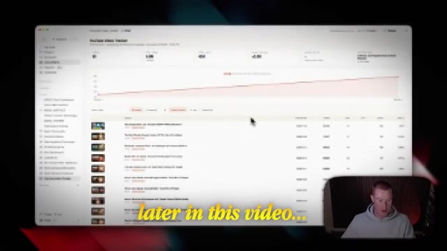
*⏱️ 00:00:16 — Une interface de suivi de vidéos YouTube affichant des graphiques de croissance et des tableaux de données.*

---

### ⏱️ `[00:00:21 - 00:00:43]` | Segment #02

**🔊 Audio (Transcription Intégrale Mot pour Mot en Français) :**
> Alors, soyons bien concentrés et assurez-vous de prendre des notes tout au long de la vidéo. C'est parti. Le premier connecteur dont je ne peux tout simplement plus me passer à l'heure actuelle, c'est Higgsfield. Et très rapidement, si vous ne savez pas ce que c'est, HiggsField est une plateforme de création qui vous permet de générer des images, des vidéos, bref, tout ce que vous pouvez imaginer avec tous les meilleurs modèles de vidéo et d'image sur le marché. En plus de cela, ils ont tout un tas de fonctionnalités personnalisées que nous pouvons utiliser directement à l'intérieur de Claude avec le MCP.

**👁️ Analyse Visuelle d'Écran (gemini-3.5-flash-lite) :**
**Interface & Outils** : Navigateur web affichant la plateforme Higgsfield et des diapositives de présentation.

**Contenu textuel & Code** : Galerie d'images et de vidéos générées par intelligence artificielle, affiches publicitaires et interface utilisateur de Higgsfield.

**Action / Démonstration** : Navigation et présentation des fonctionnalités de génération d'images et de vidéos de la plateforme Higgsfield.

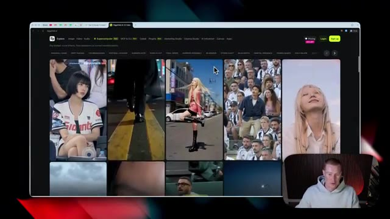
*⏱️ 00:00:32 — Interface web de Higgsfield montrant une galerie de vidéos générées par IA avec des vignettes dynamiques.*

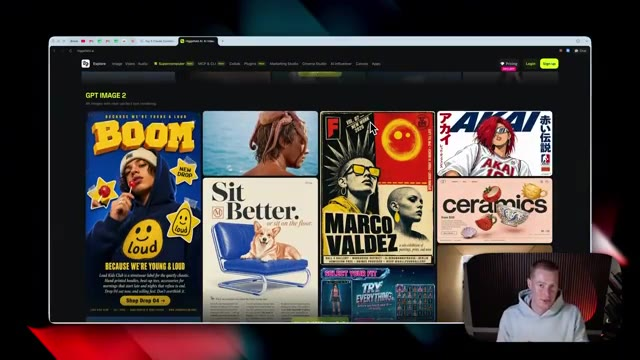
*⏱️ 00:00:38 — Interface web de Higgsfield montrant une section de galerie 'GPT IMAGE 2' avec diverses affiches et images stylisées.*

---

### ⏱️ `[00:00:44 - 00:01:14]` | Segment #03

**🔊 Audio (Transcription Intégrale Mot pour Mot en Français) :**
> Donc laissez-moi vous montrer comment le configurer maintenant. Et les cas d'utilisation que j'ai pour cela sont assez fous. Mais d'abord, parlons de ce que sont ces cas d'utilisation afin que vous puissiez savoir à quoi vous attendre. Donc dans cette section de la vidéo, nous allons passer de flux de travail très basiques à des flux de travail assez complexes en utilisant Claude Cowork et le MCP Hicksfield. Tout d'abord, nous allons passer d'images de base à partir d'une simple invite à la création d'infographies explicatives spécifiques, de photos de produits, d'infographies de fiches produits si nous avons des fiches Amazon que nous essayons de vendre, de publicités vidéo UGC afin que nous puissions créer du contenu en pilotage automatique.

**👁️ Analyse Visuelle d'Écran (gemini-3.5-flash-lite) :**
**Interface & Outils** : Navigateur web affichant l'interface de Higgsfield AI et une application de présentation de produits.

**Contenu textuel & Code** : Menus des cas d'utilisation publicitaires (Basic images, Explainer infographic, Product shots, Listing infographic, UGC video ad) et spécifications techniques d'un produit.

**Action / Démonstration** : Présentation des différents cas d'utilisation publicitaires générés par IA et démonstration visuelle d'un cas spécifique.

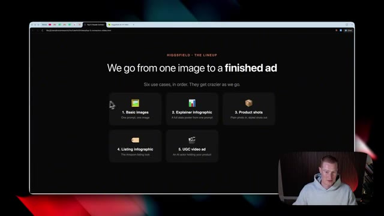
*⏱️ 00:00:51 — Capture montrant l'interface web de Higgsfield avec le titre "We go from one image to a finished ad" listant 6 cas d'utilisation, avec la webcam du présentateur en bas à droite.*

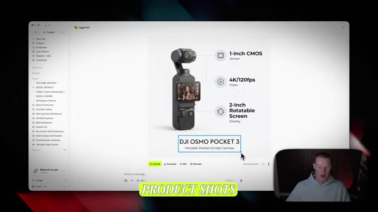
*⏱️ 00:01:06 — Capture montrant une interface de démonstration produit présentant la caméra DJI Osmo Pocket 3 avec des annotations techniques et le texte "PRODUCT SHOTS" en surbrillance.*

---

### ⏱️ `[00:01:14 - 00:01:50]` | Segment #04

**🔊 Audio (Transcription Intégrale Mot pour Mot en Français) :**
> La première chose que nous devons faire est de nous assurer que l'application de bureau Claude est téléchargée. Donc si nous ne l'avons pas déjà, il y a aura un lien dans la description où vous pourrez la télécharger. Et ensuite, une fois que vous l'avez téléchargée, nous voulons nous assurer de l'ouvrir. À partir de là, nous devons aller sur HiggsField et connecter réellement le MCP après avoir créé un compte. Il y aura un lien dans la description pour que vous puissiez voir exactement cette même page afin de télécharger le MCP dans Claude. Ce que nous devons faire, c'est venir juste ici à l'étape numéro deux et simplement copier cette URL. Ensuite, nous allons revenir à Claude, aller sur le côté gauche là où il est écrit personnaliser, puis nous allons sélectionner les connecteurs. À partir de là, cliquez sur ce

**👁️ Analyse Visuelle d'Écran (gemini-3.5-flash-lite) :**
**Interface & Outils** : Application de bureau Claude, navigateur web (Higgsfield AI).

**Contenu textuel & Code** : Interface utilisateur de Claude Desktop (barre latérale avec "New Chat", "Projects", "Artifacts") et page web de configuration MCP.

**Action / Démonstration** : Présentation de l'application Claude et des liens de téléchargement / configuration.

*⏱️ 00:01:23 — Capture d'écran montrant l'application de bureau Claude ouverte sur l'interface principale de chat avec le présentateur en incrustation vidéo en bas à droite.*

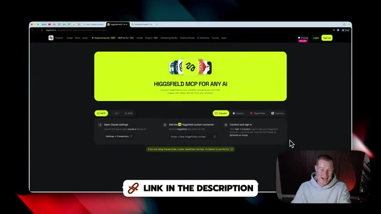
*⏱️ 00:01:32 — Capture d'écran montrant une page web de navigateur (Higgsfield AI) avec un encadré textuel "LINK IN THE DESCRIPTION" et le présentateur en incrustation vidéo.*

---

### ⏱️ `[00:01:50 - 00:02:26]` | Segment #05

**🔊 Audio (Transcription Intégrale Mot pour Mot en Français) :**
> bouton plus et ensuite parcourir les connecteurs et tout ce que nous allons faire c'est chercher Higgsfield. Ensuite j'ai juste besoin de cliquer sur connecter et cela va nous demander de nous connecter à notre compte Higgsfield que nous venons juste de créer. Nous allons cliquer sur quelques boutons et ensuite maintenant cela va nous inviter à ouvrir Claude et puis maintenant vous pouvez voir que nous avons Higgsfield de connecté. Ensuite si vous venez trouver l'application Higgsfield elle-même ici dans votre liste de connecteurs nous pourrions soit faire en sorte que cela nous demande la permission avant d'aller créer des images et de faire des choses spécifiques mais pour ma part je vais juste toujours approuver ceci de sorte que cela n'ait pas toujours à me poser ces questions. C'est bien sûr une préférence personnelle si vous voulez être plus strict sur ce que vous lui autorisez à faire. Maintenant

**👁️ Analyse Visuelle d'Écran (gemini-3.5-flash-lite) :**
**Interface & Outils** : Navigateur web affichant la page de connexion de Higgsfield et l'interface de configuration des connecteurs.

**Contenu textuel & Code** : Options de connexion (Google, Apple, Microsoft, Email) et liste des outils interactifs de Higgsfield (Generate 3D, Generate Audio, Generate Image, etc.).

**Action / Démonstration** : Connexion au compte Higgsfield et sélection du connecteur dans l'interface pour configurer les permissions.

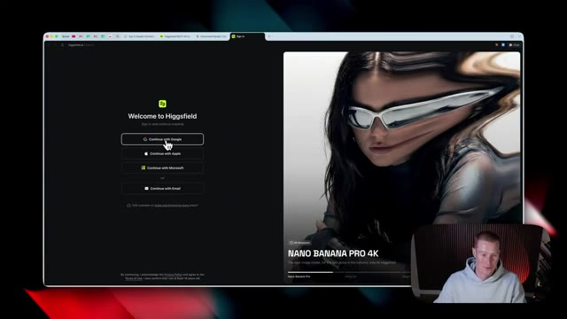
*⏱️ 00:01:59 — Page de connexion de la plateforme Higgsfield avec l'option 'Continue with Google' mise en avant, et la vidéo du présentateur en bas à droite.*

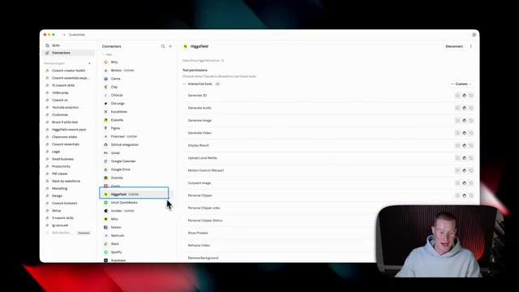
*⏱️ 00:02:08 — Interface de gestion des connecteurs montrant l'application Higgsfield sélectionnée et ses permissions d'outils interactifs.*

---

### ⏱️ `[00:02:26 - 00:02:58]` | Segment #06

**🔊 Audio (Transcription Intégrale Mot pour Mot en Français) :**
> dans Claude, nous devons naviguer rapidement ici pour aller sur co-work. Donc, si vous n'avez jamais utilisé ceci auparavant, nous allons voir que nous sommes en mode chat ici. Venez sur le côté gauche où nous voyons chat et cliquez sur ce petit bouton du milieu. C'est co-work et c'est là que nous allons vivre dans cette vidéo. C'est beaucoup plus puissant que d'utiliser simplement un mode chat normal. Ensuite, si vous n'avez jamais utilisé ceci auparavant, cela fonctionne à l'intérieur de dossiers sur votre ordinateur et permet de créer et de manipuler des fichiers spécifiques. Nous devons donc configurer un espace de travail, qui est fondamentalement juste un dossier dans lequel il peut travailler. Donc ici, je vais juste venir et cliquer sur ce

**👁️ Analyse Visuelle d'Écran (gemini-3.5-flash-lite) :**
**Interface & Outils** : Interface web de Claude (mode Chat et mode Co-work).

**Contenu textuel & Code** : Menus de navigation de l'interface Claude, options de tâches et projets.

**Action / Démonstration** : Navigation depuis le mode chat vers le mode co-work de l'application Claude.

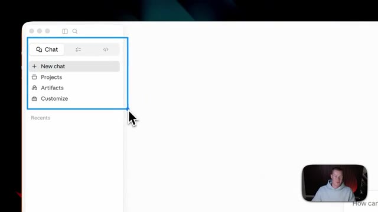
*⏱️ 00:02:34 — Interface de Claude montrant le menu latéral gauche avec le mode chat et les options New chat, Projects, Artifacts et Customize.*

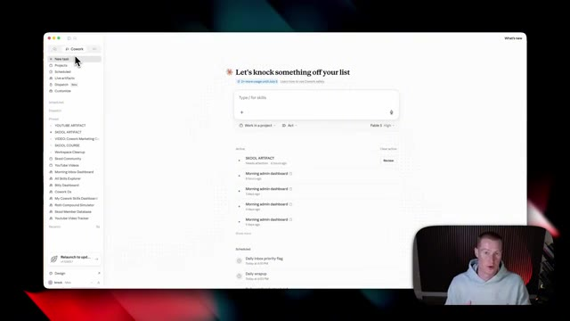
*⏱️ 00:02:42 — Interface de Claude basculée en mode Co-work montrant le tableau de bord principal avec les tâches, projets et options de gestion.*

---

### ⏱️ `[00:02:58 - 00:03:24]` | Segment #07

**🔊 Audio (Transcription Intégrale Mot pour Mot en Français) :**
> menu déroulant. Nous pourrions soit sélectionner un dossier préexistant si vous en avez déjà un. Cependant, pour les besoins de cette vidéo, je vais en créer un nouveau. Cliquez sur ce bouton qui dit choisir un dossier différent puis créer un nouveau dossier. Je vais appeler celui-ci champ de Higgs. Et encore une fois, si vous avez déjà un dossier existant dans lequel vous travaillez, n'hésitez pas a lier celui-là. Mais si vous débutez, allez-y et configurez-en un nouveau. Une fois que je clique sur ouvrir, je vais cliquer sur autoriser. Et nous avons maintenant notre dossier champ de Higgs créé. J'ai fait une recherche sur mon bureau et c'est le dossier.

**👁️ Analyse Visuelle d'Écran (gemini-3.5-flash-lite) :**
**Interface & Outils** : Interface de gestion de projets et système de fichiers du système d'exploitation.

**Contenu textuel & Code** : Noms de dossiers, listes de tâches et projets en cours dans l'application.

**Action / Démonstration** : Navigation dans le menu, sélection d'une option de dossier et création d'un nouveau dossier nommé « champ de Higgs ».

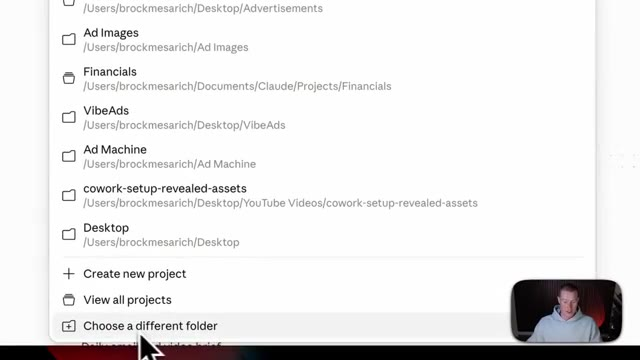
*⏱️ 00:03:05 — Menu déroulant affichant divers dossiers du système de fichiers avec l'option « Choose a different folder » sélectionnée en bas.*

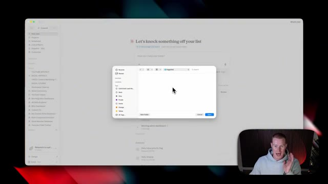
*⏱️ 00:03:11 — Boîte de dialogue du système de fichiers superposée sur l'application principale, permettant de nommer ou sélectionner un dossier.*

*⏱️ 00:03:18 — Interface principale de l'application avec le dossier sélectionné et la liste des tâches ou projets actifs affichés à l'écran.*

---

### ⏱️ `[00:03:24 - 00:03:58]` | Segment #08

**🔊 Audio (Transcription Intégrale Mot pour Mot en Français) :**
> Il n'y a rien à l'intérieur de ceci. Mais lorsque nous commencerons à créer des éléments d'image et de vidéo, ils résideront tous ici. Maintenant, très rapidement, je tiens à mentionner que je vais vous montrer et partager trois compétences spécifiques pour Higgs Field au cours des prochaines minutes. Et si vous souhaitez télécharger ce pack de plugins gratuitement, il y a un lien dans la description pour le faire. De cette façon, vous pourrez copier exactement la façon dont j'utilise Higgs Field que vous allez voir dans cette vidéo. C'est maintenant que nous allons donner un prompt très simple pour créer juste notre première image. Nous voulons commencer par quelque chose de simple et nous allons progresser à partir de là. Je lui ai donc donné le prompt : générer une image de l'Empire State Building avec un drapeau des New York Knicks suspendu à celui-ci. Depuis le Nouveau

**👁️ Analyse Visuelle d'Écran (gemini-3.5-flash-lite) :**
**Interface & Outils** : Navigateur web, page de vente Gumroad.

**Contenu textuel & Code** : Description des trois compétences du plugin Higgsfield : explainer-infographic, product-infographic et product-to-ad.

**Action / Démonstration** : Navigation et présentation des fonctionnalités du plugin à l'écran.

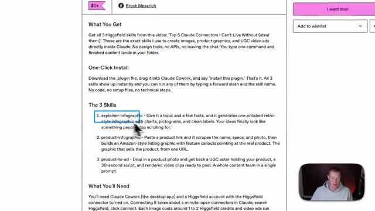
*⏱️ 00:03:33 — Vue rapprochée d'une page Web décrivant les fonctionnalités du plugin Higgsfield, avec un curseur pointant sur les compétences présentées.*

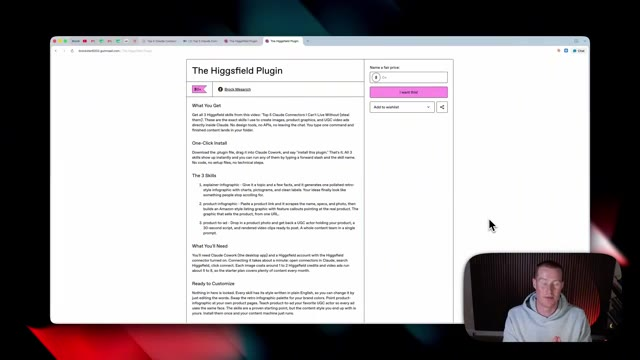
*⏱️ 00:03:41 — Vue complète d'un navigateur affichant la page Gumroad du plugin Higgsfield avec ses détails d'installation et ses fonctionnalités.*

---

### ⏱️ `[00:03:58 - 00:04:25]` | Segment #09

**🔊 Audio (Transcription Intégrale Mot pour Mot en Français) :**
> York Knicks sont sur le point de remporter les finales de la NBA, c'est un prompt et une image opportuns à créer. Je vais donc cliquer sur envoyer. Et le point essentiel à ce sujet, c'est que, de manière native dans Claude, il n'y a aucun moyen de générer réellement des images. Ce n'est pas comme ChatGPT ou Gemini où vous pouvez générer des images directement à l'intérieur de la plateforme, tout comme dans Cowork, il n'y a aucun moyen d'utiliser des API, ce qui est fondamentalement un moyen de déclencher d'autres outils de génération d'images.

**👁️ Analyse Visuelle d'Écran (gemini-3.5-flash-lite) :**
**Interface & Outils** : Présentation ou face-caméra explicatif du trader sans interface logicielle partagée.

**Contenu textuel & Code** : Explications orales des stratégies et mise en contexte méthodologique du marché.

**Action / Démonstration** : Explications face caméra et analyse conceptuelle des marchés.

---

### ⏱️ `[00:04:25 - 00:04:46]` | Segment #10

**🔊 Audio (Transcription Intégrale Mot pour Mot en Français) :**
> C'est pourquoi le MCP du champ de Higgs est incroyablement puissant, car il nous permet simplement de nous connecter à leur application et de l'utiliser directement dans Claude sans avoir à quitter cette interface ici même si nous ne le voulons pas. Et maintenant, ce que nous voyons, c'est ce petit widget du champ de Higgs qui génère cette image. Et juste comme ça, quelques secondes plus tard, nous avons maintenant l'Empire State Building avec ce drapeau des New York Knicks qui y est suspendu.

**👁️ Analyse Visuelle d'Écran (gemini-3.5-flash-lite) :**
**Interface & Outils** : Interface logicielle de type assistant IA / Cowork avec un panneau latéral de configuration et une zone de chat centrale.

**Contenu textuel & Code** : Un prompt de génération d'image (« Photorealistic shot of the Empire State Building... ») et un indicateur de chargement « Generating » sous l'outil Higgsfield.

**Action / Démonstration** : Le présentateur explique et démontre l'intégration du MCP Higgsfield pour générer des images directement au sein de l'application.

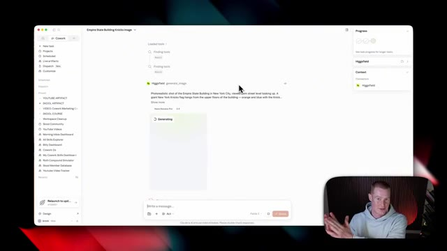
*⏱️ 00:04:30 — Une capture d'écran d'une application de type interface de chat/agent (Cowork) montrant l'utilisation du MCP de Higgsfield pour générer une image, avec le présentateur incrusté en bas à droite.*

---

### ⏱️ `[00:04:46 - 00:05:06]` | Segment #11

**🔊 Audio (Transcription Intégrale Mot pour Mot en Français) :**
> And you could see that it used Nano Banana Pro and three by four aspect ratio. And if I click on this, there's a couple of things that we could do directly inside of Claude. I could click animate and turn this into a video if I'd like, or I could go ahead and make an edit to this image. So if I click on edit, I'm just gonna come here and say, I want you to take this image and show the entirety of the Empire State Building.

**👁️ Analyse Visuelle d'Écran (gemini-3.5-flash-lite) :**
**Interface & Outils** : Interface web de génération d'images et de flux de travail (type Cowork / Claude), avec incrustation vidéo du présentateur.

**Contenu textuel & Code** : Image générée d'un gratte-ciel avec un drapeau, métadonnées de génération (Nano Banana Pro, format 3:4), boutons d'action (Animate, éditer, télécharger).

**Action / Démonstration** : Le présentateur survole et clique sur le bouton 'Animate' pour transformer l'image générée en vidéo directement dans l'interface.

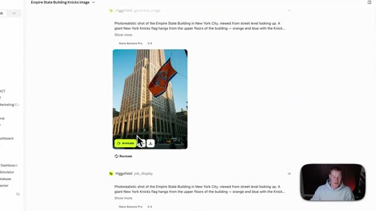
*⏱️ 00:04:51 — Vue rapprochée de l'interface montrant l'image générée du bâtiment Empire State avec un drapeau des New York Knicks, et les boutons d'action 'Animate' et de téléchargement.*

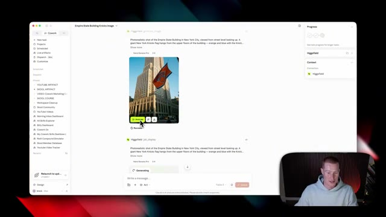
*⏱️ 00:04:56 — Vue d'ensemble de l'interface de l'application montrant l'image générée avec le curseur sur le bouton 'Animate' et la webcam du présentateur en bas à droite.*

---

### ⏱️ `[00:05:06 - 00:05:28]` | Segment #12

**🔊 Audio (Transcription Intégrale Mot pour Mot en Français) :**
> I then want the New York Knicks flag hanging from somewhere on the building. I'm gonna send that off and it's now gonna begin making the changes so you can see how easy it is to actually interact with Higgs field directly inside of Claude, as well as you just saw me speaking into my computer without me having to type and I'm using a tool called AquaVoice that allows you to just hit a key on your keyboard, speak into it, that way you don't need to type.

**👁️ Analyse Visuelle d'Écran (gemini-3.5-flash-lite) :**
**Interface & Outils** : Application Cowork / Claude, interface web de génération d'images Higgsfield.

**Contenu textuel & Code** : Prompt textuel décrivant un plan photoréaliste de l'Empire State Building avec un drapeau des New York Knicks, et image générée correspondante.

**Action / Démonstration** : Interaction avec Higgsfield pour générer une image basée sur un prompt textuel décrivant un bâtiment avec un drapeau sportif.

*⏱️ 00:05:12 — Interface d'une application de productivité (Cowork) affichant une conversation avec Higgsfield et le résultat d'une génération d'image montrant l'Empire State Building avec un drapeau des New York Knicks, avec une incrustation vidéo du présentateur en bas à droite.*

---

### ⏱️ `[00:05:28 - 00:06:04]` | Segment #13

**🔊 Audio (Transcription Intégrale Mot pour Mot en Français) :**
> And if you wanna try it out, there's a link in the description to test it out yourself. There we go, a couple seconds later, we now have this full image of the Empire State Building with the New York Knicks flag. That's pretty good. obviously it's pretty basic, but now you understand how you're able to generate images directly inside of here. Now for this next use case, we're going to go one step higher and show something a little bit more complex. And for this, I created a Claude skill called explainer infographic. So let me show you how this works right now. And this is where it gets really powerful, where we combine specific skills along with Higgs field directly inside of Claude via the MCP. All right, so here we go. Here is this little infographic explainer that we created

**👁️ Analyse Visuelle d'Écran (gemini-3.5-flash-lite) :**
**Interface & Outils** : Interface web de Cowork et Higgsfield, macOS.

**Contenu textuel & Code** : Résultat textuel et visuel de génération d'image basé sur un prompt (« Empire State Building Knicks Image », « Using the reference image, zoom out to show the ENTIRE Empire State Building... »).

**Action / Démonstration** : Démonstration du résultat final de l'image générée par l'IA à l'écran.

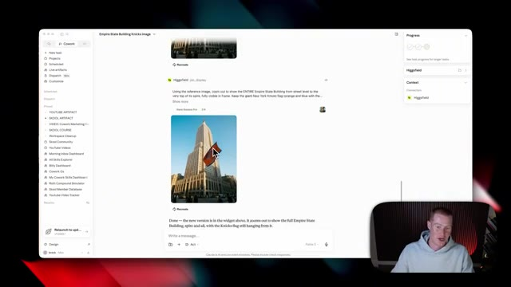
*⏱️ 00:05:37 — Capture d'écran montrant l'interface d'un outil d'intelligence artificielle (Cowork / Higgsfield) affichant le résultat de la génération d'image avec l'Empire State Building et le drapeau des New York Knicks, avec le présentateur en bas à droite.*

---

### ⏱️ `[00:06:04 - 00:06:36]` | Segment #14

**🔊 Audio (Transcription Intégrale Mot pour Mot en Français) :**
> directement avec le champ de Higgs à l'intérieur de Claude. Cela explique exactement comment fonctionne une compétence de Claude, que j'utilise pour créer cette image. Laissez-moi donc décomposer cela rapidement. En gros, nous disons un déclencheur, Claude adore une compétence, et le travail est fait de la même manière à chaque fois. Donc maintenant, lorsque je veux créer une infographie exactement comme celle-ci, tout ce que j'ai à faire, c'est de dire à Claude, hé, crée une infographie pour ceci, et il utilisera toujours ce style. Comme vous pouvez le voir sur la droite, l'infographie sur le café, c'est l'exemple que j'ai donné à Claude lors de la création de cette compétence. Et vous pouvez voir qu'elle est assez similaire et qu'elle suit une mise en page similaire.

**👁️ Analyse Visuelle d'Écran (gemini-3.5-flash-lite) :**
**Interface & Outils** : Interface de type application de bureau ou environnement de travail virtuel avec des panneaux d'affichage d'infographies.

**Contenu textuel & Code** : Infographie explicative intitulée "How a Claude Skill Works" avec des sections sur le fonctionnement, les dossiers de compétences et des exemples visuels de processus.

**Action / Démonstration** : Présentation visuelle détaillée du fonctionnement d'une compétence Claude et illustration graphique associée.

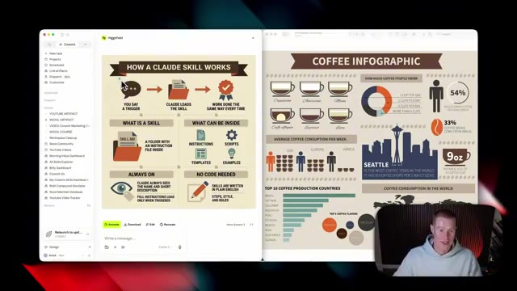
*⏱️ 00:06:12 — Capture d'écran montrant une interface de type interface logicielle ou espace de travail divisé en deux panneaux affichant des infographies explicatives, avec le présentateur incrusté en bas à droite.*

---

### ⏱️ `[00:06:36 - 00:07:06]` | Segment #15

**🔊 Audio (Transcription Intégrale Mot pour Mot en Français) :**
> Maintenant, à tout moment pour n'importe quelles images et vidéos que nous générons, nous pouvons toujours les télécharger. Donc, si nous cliquons sur le bouton de téléchargement et que nous cliquons sur ouvrir le lien, cela nous amènera alors vers ce lien où nous pourrons simplement enregistrer cette image. Ou vous pouvez même dire à Claude de l'enregistrer dans le dossier dans lequel nous travaillons et vous pourrez la récupérer là-bas aussi. Maintenant, ce cas d'utilisation suivant consiste à créer réellement des infographies de produits. Donc, si vous avez un produit spécifique et que vous voulez expliquer comment il fonctionne pour l'utiliser soit pour une publication sur les réseaux sociaux, soit pour une fiche produit Amazon, je vais vous montrer comment nous pouvons recréer quelque chose de presque identique à ceci pour être utilisé comme matériel marketing.

**👁️ Analyse Visuelle d'Écran (gemini-3.5-flash-lite) :**
**Interface & Outils** : Navigateur web, interface de bureau macOS, application Notion.

**Contenu textuel & Code** : Schéma explicatif sur le fonctionnement de Claude Skills, infographie produit d'une gourde avec détails techniques (High Flow Rate Spout, Flip Top Lid, Secure Lid Lock).

**Action / Démonstration** : Manipulation du navigateur pour ouvrir ou enregistrer une image générée.

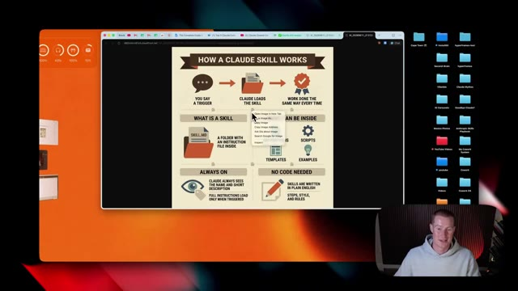
*⏱️ 00:06:43 — Capture d'écran montrant un navigateur affichant une infographie explicative intitulée 'How a Claude Skill Works' avec un menu contextuel ouvert.*

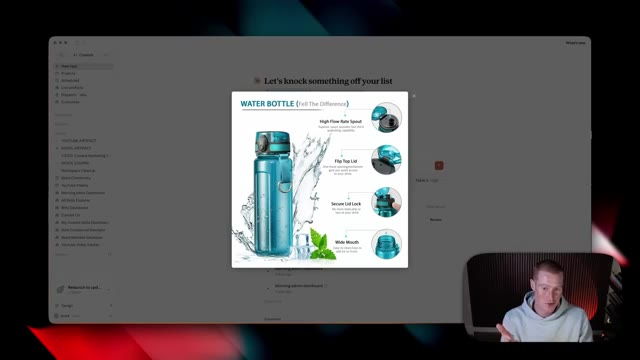
*⏱️ 00:06:51 — Capture d'écran montrant une interface logicielle avec une image contextuelle pop-up représentant une gourde d'eau et ses caractéristiques.*

---

### ⏱️ `[00:07:06 - 00:07:28]` | Segment #16

**🔊 Audio (Transcription Intégrale Mot pour Mot en Français) :**
> Et la seule entrée que nous allons lui donner est une seule image de produit. Maintenant, nous allons utiliser cette compétence d'infographie de produit que j'ai créée directement à l'intérieur de Claude. Et nous allons fournir une image de produit ainsi qu'un lien vers le produit afin qu'il soit capable de parcourir toutes les informations et de comprendre comment le produit fonctionne pour ensuite créer une image expliquant comment il fonctionne. Utilisons donc ceci comme exemple, ce DJI Osmo Pocket 3.

**👁️ Analyse Visuelle d'Écran (gemini-3.5-flash-lite) :**
**Interface & Outils** : Interface web Cowork / Claude, avec un panneau de navigation latéral à gauche et une fenêtre vidéo incrustée du présentateur en bas à droite.

**Contenu textuel & Code** : Commande '/product-infographic' visible dans la barre de saisie de l'application, entourée d'un cadre bleu.

**Action / Démonstration** : Saisie ou sélection de la compétence d'infographie de produit dans l'application pour générer du contenu à partir d'une image.

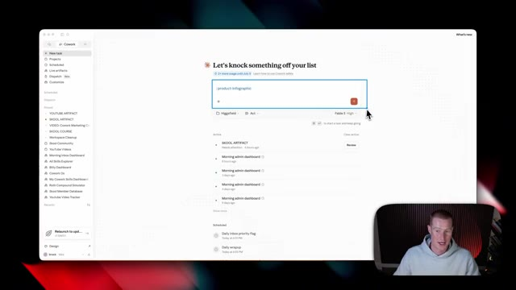
*⏱️ 00:07:11 — Capture d'écran montrant l'interface d'un outil de productivité ou d'IA (Cowork) avec le prompt '/product-infographic' saisi dans la zone de texte centrale.*

---

### ⏱️ `[00:07:28 - 00:07:58]` | Segment #17

**🔊 Audio (Transcription Intégrale Mot pour Mot en Français) :**
> C'est une caméra qui possède des fonctionnalités plutôt sympas. Je l'ai utilisée moi-même. C'est plutôt génial en fait. Donc ce que je vais faire, c'est que je vais tout simplement prendre deux captures d'écran ici avec quelques angles différents de cette caméra. Et évidemment, plus nous fournissons d'images, mieux ce sera. Prenons donc ces trois-là et littéralement tout ce que j'ai à faire, c'est de taper barre oblique product infographic puisque j'ai déjà créé cette compétence, qui est fondamentalement juste un très long prompt expliquant exactement à quoi nous voulons que cela ressemble. Et puis encore une fois, je vais simplement coller le lien du produit. De cette façon, il obtient ces informations pour créer l'infographie.

**👁️ Analyse Visuelle d'Écran (gemini-3.5-flash-lite) :**
**Interface & Outils** : Navigateur web et interface d'outil de productivité ou d'intelligence artificielle (type Cowork / Higgsfield).

**Contenu textuel & Code** : Images de la caméra Osmo Pocket 3 sous différents angles et texte de commande associé ("/product-infographic").

**Action / Démonstration** : Sélection et téléchargement de captures d'écran de la caméra sous différents angles pour les intégrer dans un outil ou un prompt.

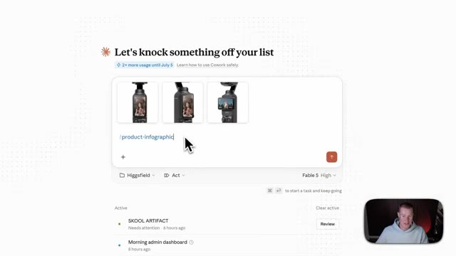
*⏱️ 00:07:43 — Interface de type IA ou assistant textuel montrant trois images de la caméra Osmo Pocket 3 sous différents angles avec une invite de commande et un curseur de souris.*

---

### ⏱️ `[00:07:58 - 00:08:19]` | Segment #18

**🔊 Audio (Transcription Intégrale Mot pour Mot en Français) :**
> Voici notre résultat. Nous avons donc la caméra stabilisée de poche portable DJI Osmo Pocket 3. Elle détaille même les capteurs spécifiques, la résolution vidéo et certaines des principales caractéristiques du produit. Si vous voulez mon avis, je n'aurais jamais pu deviner que cela a été créé avec l'IA. Et je veux que vous imaginiez quelque chose rapidement. Disons que vous avez des centaines d'images de produits différentes dans un dossier sur votre ordinateur.

**👁️ Analyse Visuelle d'Écran (gemini-3.5-flash-lite) :**
**Interface & Outils** : Application web de génération d'images/contenu marketing (Higgsfield / Cowork)

**Contenu textuel & Code** : Image générée d'une caméra DJI Osmo Pocket 3 avec spécifications techniques textuelles et graphiques incrustées (1-Inch CMOS Sensor, 4K/120fps Video, 2-Inch Rotatable Screen Display)

**Action / Démonstration** : Présentation du résultat généré par l'intelligence artificielle illustrant les caractéristiques du produit DJI Osmo Pocket 3

*⏱️ 00:08:04 — Capture d'écran montrant l'interface d'un outil d'IA générative affichant une image de produit marketing générée, présentant la caméra DJI Osmo Pocket 3 avec des légendes techniques (capteur 1 pouce, 4K/120fps, écran rotatif 2 pouces). Le présentateur apparaît dans un petit encadré en bas à droite.*

---

### ⏱️ `[00:08:19 - 00:08:39]` | Segment #19

**🔊 Audio (Transcription Intégrale Mot pour Mot en Français) :**
> Vous pourriez ensuite pointer Co-work vers ce dossier et lui dire de générer des infographies de produits exactement comme celle-ci grâce à la compétence que nous avons créée. Et c'est aussi simple que ça, vous avez une quantité infinie de contenu. Maintenant, ceci utilise spécifiquement Nano Banana Pro, qui est le modèle d'image de Gemini, mais vous pourriez utiliser n'importe quel modèle d'image que vous voulez puisque Higgs Field se connecte à presque tous les modèles d'image imaginables.

**👁️ Analyse Visuelle d'Écran (gemini-3.5-flash-lite) :**
**Interface & Outils** : Application Co-work et interface de génération d'images.

**Contenu textuel & Code** : Infographie de produit e-commerce détaillée pour la DJI Osmo Pocket 3 avec annotations techniques (Capteur CMOS 1 pouce, Vidéo 4K/120fps, écran rotatif 2 pouces).

**Action / Démonstration** : Présentation de la génération automatisée d'infographies de produits par l'assistant IA.

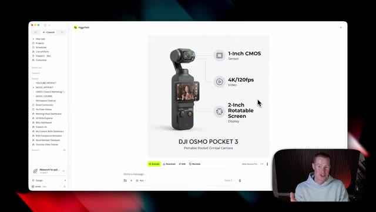
*⏱️ 00:08:24 — Interface Co-work montrant une infographie de produit générée pour une caméra DJI Osmo Pocket 3 avec des spécifications techniques.*

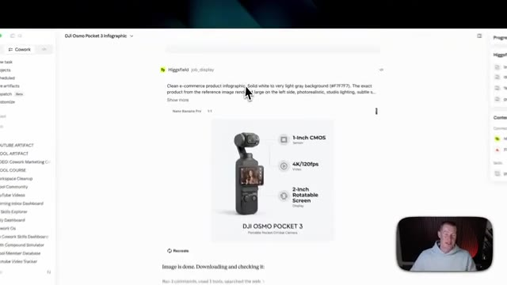
*⏱️ 00:08:29 — Affichage du panneau de génération d'infographie avec les instructions textuelles et le résultat généré via Nano Banana Pro.*

---

### ⏱️ `[00:08:40 - 00:09:03]` | Segment #20

**🔊 Audio (Transcription Intégrale Mot pour Mot en Français) :**
> Maintenant, nous allons passer à l'étape supérieure. Ce que je vais faire, c'est créer un modèle spécifique que nous pourrons utiliser pour des images UGC, mais nous allons transformer ces images en de véritables vidéos que nous pourrons utiliser pour commercialiser un produit spécifique. Très bien, c'est parti. Nous avons maintenant quatre images de ce personnage aux cheveux roux, et nous utilisons le modèle Higgsfield Soul 2, qui est fondamentalement le modèle personnalisé de Higgsfield pour les créateurs de contenu UGC.

**👁️ Analyse Visuelle d'Écran (gemini-3.5-flash-lite) :**
**Interface & Outils** : Application de génération d'images et de flux de travail assistés par IA (Cowork / Higgsfield).

**Contenu textuel & Code** : Prompt textuel : 'create an image of a model who is a red head with freckles, I want you to create 4 images of this character to use for UGC content'.

**Action / Démonstration** : Saisie d'un prompt pour créer un personnage spécifique destiné à la création de contenu marketing UGC.

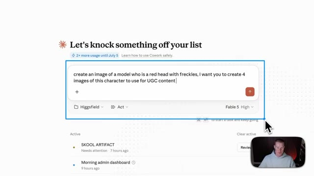
*⏱️ 00:08:45 — Interface d'une application montrant une boîte de saisie de prompt avec une instruction pour créer des images de modèle pour du contenu UGC.*

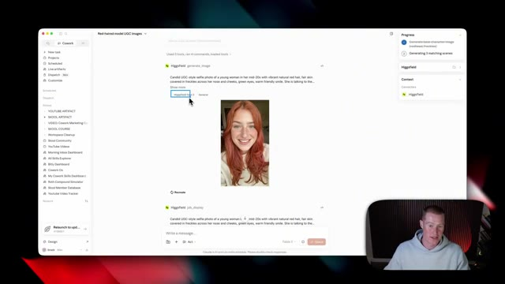
*⏱️ 00:08:57 — Interface affichant le résultat de la génération d'une image UGC représentant une jeune femme rousse souriante.*

---

### ⏱️ `[00:09:03 - 00:09:24]` | Segment #21

**🔊 Audio (Transcription Intégrale Mot pour Mot en Français) :**
> Comme ça, nous pouvons réutiliser ce personnage dans tout notre contenu. Donc voici la première image d'elle. Celle-ci a vraiment l'air très solide. Nous avons plusieurs plans aléatoires différents d'elle afin de constituer un profil pour ce personnage UGC spécifique. Ensuite, nous avons celle-ci. Je veux dire, on dirait une vraie personne pour être tout à fait honnête. Et puis nous avons celle-là aussi, qui a probablement l'air la plus générée par IA à mon avis.

**👁️ Analyse Visuelle d'Écran (gemini-3.5-flash-lite) :**
**Interface & Outils** : Interface web de génération d'IA (Cowork / Higgsfield)

**Contenu textuel & Code** : Génération d'images de modèle UGC avec un prompt textuel décrivant une jeune femme aux cheveux roux et des taches de rousseur.

**Action / Démonstration** : Présentation et visualisation des images de personnages générées par intelligence artificielle pour le contenu UGC.

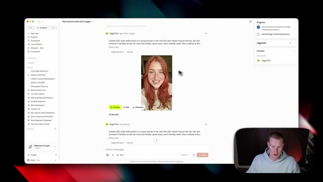
*⏱️ 00:09:08 — Une interface de logiciel affichant la génération d'images par IA d'un personnage UGC avec une femme aux cheveux roux, et la webcam du présentateur en bas à droite.*

---

### ⏱️ `[00:09:24 - 00:09:43]` | Segment #22

**🔊 Audio (Transcription Intégrale Mot pour Mot en Français) :**
> Mais maintenant, nous avons ce personnage spécifique. Et ce que nous pouvons faire maintenant, c'est commencer à créer des vidéos UGC avec ce personnage afin de promouvoir des produits ou de créer du contenu. Très bien, alors jetons un coup d'œil à ce flux de travail pour créer cette vidéo. J'ai donc simplement utilisé le produit pour ajouter de la compétence et j'ai dit d'ajouter Ruby pour ce produit et j'ai téléchargé une photo de parfum.

**👁️ Analyse Visuelle d'Écran (gemini-3.5-flash-lite) :**
**Interface & Outils** : Interface logicielle de type espace de travail collaboratif ou outil de workflow IA (Cowork / application web similaire) avec un panneau latéral de navigation et un flux de discussion.

**Contenu textuel & Code** : Texte descriptif de prompt pour la génération d'image (« Candid UGC-style selfie photo of a young woman... »), boutons d'action (Animate, Edit, Download) et miniature d'une femme aux cheveux roux.

**Action / Démonstration** : Présentation de la création et de la gestion de personnages virtuels pour des vidéos UGC au sein de l'interface.

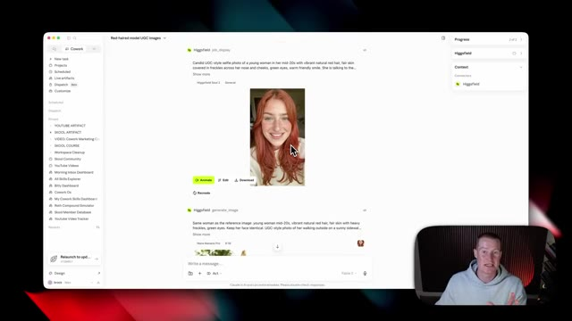
*⏱️ 00:09:29 — Capture d'écran montrant l'interface d'un outil de gestion de projet et de génération d'images, affichant un personnage féminin généré par IA aux cheveux roux (modèle UGC).*

---

### ⏱️ `[00:09:43 - 00:10:04]` | Segment #23

**🔊 Audio (Transcription Intégrale Mot pour Mot en Français) :**
> And then what it did is it generated a couple of different images as a starting point. This right here is the exact perfume bottle that I actually uploaded as the reference image. And so what it did is created a couple of shots to use as reference to then create the videos from that. All right, so let's go over a couple of the videos that it generated now. Oh my goodness, this is incredible.

**👁️ Analyse Visuelle d'Écran (gemini-3.5-flash-lite) :**
**Interface & Outils** : Présentation ou face-caméra explicatif du trader sans interface logicielle partagée.

**Contenu textuel & Code** : Explications orales des stratégies et mise en contexte méthodologique du marché.

**Action / Démonstration** : Explications face caméra et analyse conceptuelle des marchés.

---

### ⏱️ `[00:10:04 - 00:10:23]` | Segment #24

**🔊 Audio (Transcription Intégrale Mot pour Mot en Français) :**
> It's like warm vanilla and a little bit of spice. I'm obsessed. So that's actually pretty good. Let's go on to the next one. I'll just come. Perfume, it's yours. So that one does feel a little bit robotic and AI. And then it generated a couple of others. So let's look at these. Had I ever stopped wearing this.

**👁️ Analyse Visuelle d'Écran (gemini-3.5-flash-lite) :**
**Interface & Outils** : Présentation ou face-caméra explicatif du trader sans interface logicielle partagée.

**Contenu textuel & Code** : Explications orales des stratégies et mise en contexte méthodologique du marché.

**Action / Démonstration** : Explications face caméra et analyse conceptuelle des marchés.

---

### ⏱️ `[00:10:23 - 00:10:58]` | Segment #25

**🔊 Audio (Transcription Intégrale Mot pour Mot en Français) :**
> It's just so mean, you know? every time I wear it someone always asks I mean that one looks completely real to be honest and then this one as well oh that's so good I forget how much I love this scent it's just so warm and cozy perfect for this time of year so you can begin to see how you could start creating UGC characters directly inside of Claude with the Higgsfield connector and this can be pretty powerful if you're using this for marketing for yourself or for a client all right so our next connector and this one is going to really help you if you're a business owner it's called Clay This is a platform that lets you scrape and enrich leads

**👁️ Analyse Visuelle d'Écran (gemini-3.5-flash-lite) :**
**Interface & Outils** : Interface logicielle de Cowork (assistant d'IA), panneau de progression des tâches (génération de personnage, script UGC, clips vidéo) et affichage vidéo intégré.

**Contenu textuel & Code** : Liste des tâches de production vidéo UGC : génération d'image de base, création de scènes, écriture de script de 30 secondes, génération de clips vidéo, et instructions de projet (CLAUDE.md).

**Action / Démonstration** : Présentation d'un flux de travail complet d'intelligence artificielle pour générer automatiquement du contenu marketing vidéo généré par les utilisateurs (UGC).

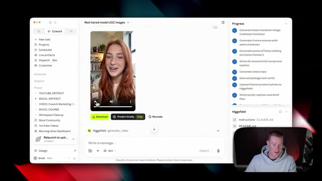
*⏱️ 00:10:32 — Interface de Cowork affichant une vidéo générée par IA montrant un modèle féminin roux tenant un flacon de parfum, avec un panneau de tâches à droite listant les étapes de création de contenu UGC.*

---

### ⏱️ `[00:10:58 - 00:11:16]` | Segment #26

**🔊 Audio (Transcription Intégrale Mot pour Mot en Français) :**
> directement à l'intérieur de Claude via ce connecteur. Et comme vous pouvez le voir juste ici, je l'ai fait fonctionner pour extraire les 10 plus grandes entreprises d'IA dans la région de Dallas-Fort Worth. Et ensuite, il me donne leurs coordonnées avec Clay. Nous avons ensuite cette table de base de données ici avec le nom, le titre du poste, l'emplacement et l'URL LinkedIn de toutes ces différentes entreprises et de leurs employés.

**👁️ Analyse Visuelle d'Écran (gemini-3.5-flash-lite) :**
**Interface & Outils** : Présentation ou face-caméra explicatif du trader sans interface logicielle partagée.

**Contenu textuel & Code** : Explications orales des stratégies et mise en contexte méthodologique du marché.

**Action / Démonstration** : Explications face caméra et analyse conceptuelle des marchés.

---

### ⏱️ `[00:11:16 - 00:11:37]` | Segment #27

**🔊 Audio (Transcription Intégrale Mot pour Mot en Français) :**
> Donc, juste ici, nous avons 20 contacts différents de chez AT&T. Nous en avons 20 de chez Texas Instruments. Et ce que je pourrais faire, c'est aller de l'avant et ouvrir ceci et développer cela. Disons donc que je veux résumer l'historique professionnel de chacun de ces différents employés afin d'avoir un contexte spécifique sur cette personne pour pouvoir lui envoyer un message de prospection personnalisé, comme vous pouvez le voir juste ici dans mon Gmail.

**👁️ Analyse Visuelle d'Écran (gemini-3.5-flash-lite) :**
**Interface & Outils** : Navigateur web avec l'outil de prospection Clay et Gmail.

**Contenu textuel & Code** : Liste de 20 contacts AT&T avec rôles, filtres appliqués et boutons d'enrichissement de données par IA.

**Action / Démonstration** : Navigation et démonstration de l'enrichissement des données de contacts professionnels via Clay.

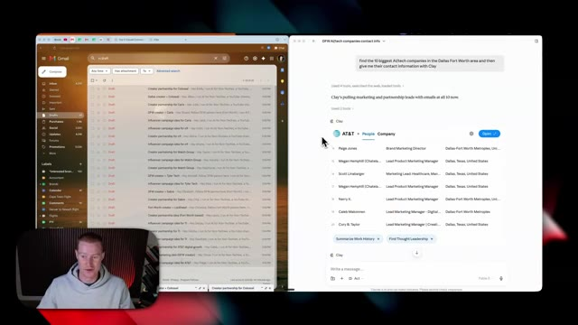
*⏱️ 00:11:21 — Capture montrant l'interface divisée de l'outil Clay à droite avec des contacts AT&T et Gmail à gauche, le présentateur apparaissant dans un encadré en bas à gauche.*

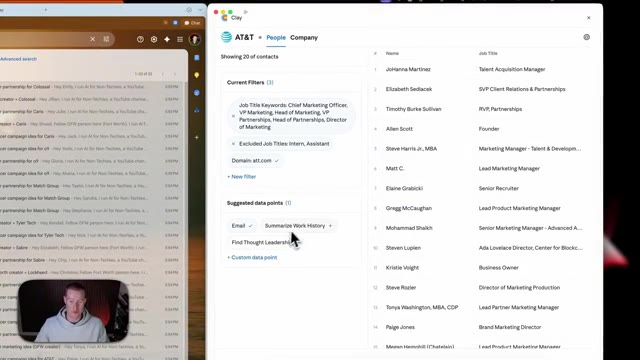
*⏱️ 00:11:26 — Capture montrant les filtres et les points de données suggérés dans l'outil Clay (comme 'Summarize Work History') pour les contacts AT&T.*

---

### ⏱️ `[00:11:37 - 00:11:57]` | Segment #28

**🔊 Audio (Transcription Intégrale Mot pour Mot en Français) :**
> Tout ce que j'ai fait, ça a été de dire à Claude d'ensuite écrire et rédiger ces e-mails pour moi, pour chacun de ces prospects à qui je voulais parler, et de les personnaliser. Et Claude est allé rédiger des e-mails spécifiques, sur mesure, pour chacun de ces prospects que j'avais extraits avec Clay. Et ça, c'est juste effleurer la surface de ce qui est possible avec ça. Donc, on va aller plus en profondeur là-dedans maintenant.

**👁️ Analyse Visuelle d'Écran (gemini-3.5-flash-lite) :**
**Interface & Outils** : Gmail (côté gauche) et Clay.com (côté droit)

**Contenu textuel & Code** : Liste de brouillons d'e-mails personnalisés pour différents prospects, tableau de contacts professionnels avec rôles et liens LinkedIn.

**Action / Démonstration** : Navigation et affichage des e-mails générés automatiquement par l'IA pour chaque prospect extrait.

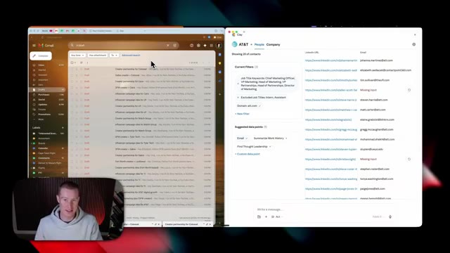
*⏱️ 00:11:42 — Vue partagée montrant Gmail à gauche avec une liste de brouillons d'e-mails et l'outil Clay à droite listant des contacts professionnels.*

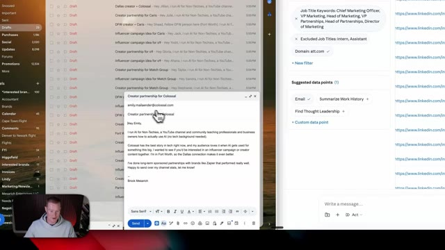
*⏱️ 00:11:47 — Vue de Gmail avec un e-mail de prospection personnalisé ouvert et centré, affichant le contenu rédigé pour une campagne de partenariat.*

*⏱️ 00:11:52 — Vue partagée similaire à la première image, affichant Gmail et l'interface de gestion de prospects Clay côte à côte.*

---

### ⏱️ `[00:11:57 - 00:12:18]` | Segment #29

**🔊 Audio (Transcription Intégrale Mot pour Mot en Français) :**
> And then as you can see right here, we have a email voice skill that I'm going to share with you for free that will scrape your email inbox and develop an email voice for you. That way, whenever you use Claude to generate an email for you, it's going to sound exactly like you based on your previous email. Now, if you stick with me, I'm going to show you how you could set this up. And then I'm going to show you how me and my team are personally using this inside of Claude.

**👁️ Analyse Visuelle d'Écran (gemini-3.5-flash-lite) :**
**Interface & Outils** : Application web de productivité et d'automatisation (interface de type Cowork/Claude avec connecteurs Clay et Gmail).

**Contenu textuel & Code** : Panneau latéral affichant les connecteurs (Clay, Gmail, Web search) et la compétence 'email-voice', ainsi qu'un tableau de contacts géographiques.

**Action / Démonstration** : Navigation et présentation de la compétence 'email-voice' intégrée pour analyser la boîte de réception Gmail.

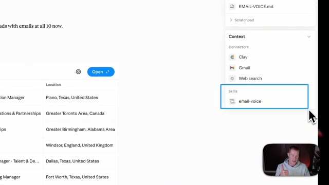
*⏱️ 00:12:02 — Gros plan sur le panneau latéral droit de l'interface montrant les connecteurs (Clay, Gmail, Web search) et la compétence 'email-voice'.*

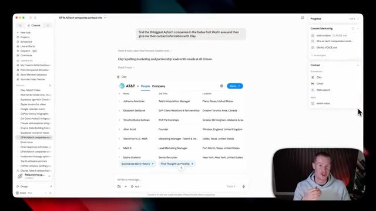
*⏱️ 00:12:08 — Vue d'ensemble de l'interface montrant un tableau de données de contacts professionnels généré via Clay et le panneau latéral de configuration.*

---

### ⏱️ `[00:12:18 - 00:12:42]` | Segment #30

**🔊 Audio (Transcription Intégrale Mot pour Mot en Français) :**
> The first thing we need to do is sign up for a Clay account. They were kind enough to give you guys 2,000 free credits if you sign up for the 14-day free trial via the link in the description, as well as the pinned comment. Next, you could just click on start building for free and make sure to sign up for an account. Then once we are inside of that account, we're going to come back to Claude Cowork, and then we're going to come over to customize and add our specific connector.

**👁️ Analyse Visuelle d'Écran (gemini-3.5-flash-lite) :**
**Interface & Outils** : Présentation ou face-caméra explicatif du trader sans interface logicielle partagée.

**Contenu textuel & Code** : Explications orales des stratégies et mise en contexte méthodologique du marché.

**Action / Démonstration** : Explications face caméra et analyse conceptuelle des marchés.

---

### ⏱️ `[00:12:42 - 00:13:01]` | Segment #31

**🔊 Audio (Transcription Intégrale Mot pour Mot en Français) :**
> And again, if you don't know how to get here, you're just going to click on this little connector button inside of the left-hand side menu. Next, what we're going to do is come over and click on browse connectors. So click this little plus button, then browse connectors. Simply just search up Clay, click this connect button right here. And it's going to bring you back to your Clay account. And you're just going to need to authorize your workspace.

**👁️ Analyse Visuelle d'Écran (gemini-3.5-flash-lite) :**
**Interface & Outils** : Présentation ou face-caméra explicatif du trader sans interface logicielle partagée.

**Contenu textuel & Code** : Explications orales des stratégies et mise en contexte méthodologique du marché.

**Action / Démonstration** : Explications face caméra et analyse conceptuelle des marchés.

---

### ⏱️ `[00:13:02 - 00:13:37]` | Segment #32

**🔊 Audio (Transcription Intégrale Mot pour Mot en Français) :**
> So I'm going to authorize this one right here. And then it should shoot us back to Claude and everything should be set up properly. It's that simple. There we go. We now have Clay as one of our custom connectors. And what I always do is I just click always allow right here for tool permissions. So that way it doesn't need to ask every single time it goes and scrapes or adds lead information, et cetera. So in order to do that, just click this, click on always allow, or you could set custom permission. So it asks you, but I find that to be a bit annoying. All right. So now we're all set and ready to begin using this. So what I'm going to do is I'm just going to come to cowork and say, Hey, I want you to go and scrape the top 10 different AI companies in the San

**👁️ Analyse Visuelle d'Écran (gemini-3.5-flash-lite) :**
**Interface & Outils** : Présentation ou face-caméra explicatif du trader sans interface logicielle partagée.

**Contenu textuel & Code** : Explications orales des stratégies et mise en contexte méthodologique du marché.

**Action / Démonstration** : Explications face caméra et analyse conceptuelle des marchés.

---

### ⏱️ `[00:13:37 - 00:14:12]` | Segment #33

**🔊 Audio (Transcription Intégrale Mot pour Mot en Français) :**
> Francisco area. That would be good to partner with, with our content creators that we manage. I want you then to find the top 10 contacts in their marketing department. That would be perfect to reach out to in order to discuss influencer marketing opportunities with them. So I'm simply just going to send that off and it's now going to begin crafting the top 10 different AI companies and then finding the lead information using Clay. All right so here we go just like that this is the output. So Claude researched the top 10 AI companies based on which ones they think would be best clients and then Clay went and searched the contact information across the top contacts at that

**👁️ Analyse Visuelle d'Écran (gemini-3.5-flash-lite) :**
**Interface & Outils** : Présentation ou face-caméra explicatif du trader sans interface logicielle partagée.

**Contenu textuel & Code** : Explications orales des stratégies et mise en contexte méthodologique du marché.

**Action / Démonstration** : Explications face caméra et analyse conceptuelle des marchés.

---

### ⏱️ `[00:14:12 - 00:14:45]` | Segment #34

**🔊 Audio (Transcription Intégrale Mot pour Mot en Français) :**
> company. So for right here, we have Grammarly. We've got 20 contacts with their name, their job title, their location, and their LinkedIn URL. If I click on this company button, we could actually see a overview of everything about this company. So it shows their URL to their page. It shows where they're located. And one of my favorite parts about this is it shows how many employees they have, shows what type of company they are. So it shows software development here. And it tells me whether or not it's a private or public company, which for me and for my team, since I run an influencer or marketing agency, it's really important to see, okay, is this a charge for a client? For example,

**👁️ Analyse Visuelle d'Écran (gemini-3.5-flash-lite) :**
**Interface & Outils** : Présentation ou face-caméra explicatif du trader sans interface logicielle partagée.

**Contenu textuel & Code** : Explications orales des stratégies et mise en contexte méthodologique du marché.

**Action / Démonstration** : Explications face caméra et analyse conceptuelle des marchés.

---

### ⏱️ `[00:14:45 - 00:15:20]` | Segment #35

**🔊 Audio (Transcription Intégrale Mot pour Mot en Français) :**
> if I want to see what their latest funding is, I can just click this button and it's going to begin sculpting this and pulling more information on this company. And right here, it shows their latest funding round was actually $1 billion, which is very interesting. The fact that Clay is able to pull this. And let's say that I want to see what their tech stack is. I can go ahead, click this, and it's now synthesizing this information as well. So you can begin to see how powerful this clay connector is. If you are a business owner and you want to find clients, you want to enrich these leads and you want to plug it directly into Claude so you could have it create outreach messages for you. So I went ahead and actually clicked on a couple of these

**👁️ Analyse Visuelle d'Écran (gemini-3.5-flash-lite) :**
**Interface & Outils** : Présentation ou face-caméra explicatif du trader sans interface logicielle partagée.

**Contenu textuel & Code** : Explications orales des stratégies et mise en contexte méthodologique du marché.

**Action / Démonstration** : Explications face caméra et analyse conceptuelle des marchés.

---

### ⏱️ `[00:15:20 - 00:15:53]` | Segment #36

**🔊 Audio (Transcription Intégrale Mot pour Mot en Français) :**
> other data points here. So it shows me recent news on this company and then it even shows the revenue model. So it's a freemium product with a subscription per seat pricing model, as well as they do licensing and affiliate. So now I have tons of information on this company, but now on top of just having company information, I have all of these leads directly inside of Claude via Clay, and I can start doing custom outreach to them. So I do want to point this out because if you are a business owner and want to get more customers, not only can you use it in Claude, but you could use all the other features that they have directly inside of the platform as well. Now, another one

**👁️ Analyse Visuelle d'Écran (gemini-3.5-flash-lite) :**
**Interface & Outils** : Présentation ou face-caméra explicatif du trader sans interface logicielle partagée.

**Contenu textuel & Code** : Explications orales des stratégies et mise en contexte méthodologique du marché.

**Action / Démonstration** : Explications face caméra et analyse conceptuelle des marchés.

---

### ⏱️ `[00:15:53 - 00:16:27]` | Segment #37

**🔊 Audio (Transcription Intégrale Mot pour Mot en Français) :**
> of the really cool features inside of Clay is I could come over here and click on this settings button. And when I do this, this is the specific context Clay has on me. And I could go ahead and directly edit this as well. So it was able to understand that my company is AI for non-techies because Claude actually has context on my entire business from the past six months of me using it every single day. And it even shows my ideal customer profile. It was able to scrape on its own. So that can be really powerful because you don't always need to explain to Claude or Clay who your ideal customer is or what your business is. You could just give it a brain dump and then

**👁️ Analyse Visuelle d'Écran (gemini-3.5-flash-lite) :**
**Interface & Outils** : Présentation ou face-caméra explicatif du trader sans interface logicielle partagée.

**Contenu textuel & Code** : Explications orales des stratégies et mise en contexte méthodologique du marché.

**Action / Démonstration** : Explications face caméra et analyse conceptuelle des marchés.

---

### ⏱️ `[00:16:27 - 00:16:59]` | Segment #38

**🔊 Audio (Transcription Intégrale Mot pour Mot en Français) :**
> it will store that information in order to find the best leads for you. So you're not wasting your time. All right, so going back to showing these drafted emails that Clay actually created, since we're actively using Clay and we have these leads sourced for us. Now there is going to be a link in the description to get my free email voice skill. And what this is going to do is it's going to scrape your email inbox via the Gmail connector and craft your specific email voice. So whenever we draft these emails, it's going to sound exactly like you based on your previous messages. All you're going to do is come here, put in $0 because this is free. And then all you need to do is put

**👁️ Analyse Visuelle d'Écran (gemini-3.5-flash-lite) :**
**Interface & Outils** : Présentation ou face-caméra explicatif du trader sans interface logicielle partagée.

**Contenu textuel & Code** : Explications orales des stratégies et mise en contexte méthodologique du marché.

**Action / Démonstration** : Explications face caméra et analyse conceptuelle des marchés.

---

### ⏱️ `[00:16:59 - 00:17:19]` | Segment #39

**🔊 Audio (Transcription Intégrale Mot pour Mot en Français) :**
> in your email address and then this will be sent to your email. Next, we are going to see this right here. So first of all, we have this PDF that we could download, which basically just explains what this email voice skill, but this is helpful for you. And then it shows you step-by-step how to download it and run this. And then the second file here is the email voice skill. We're just going to click on download, drag this onto our desktop.

**👁️ Analyse Visuelle d'Écran (gemini-3.5-flash-lite) :**
**Interface & Outils** : Présentation ou face-caméra explicatif du trader sans interface logicielle partagée.

**Contenu textuel & Code** : Explications orales des stratégies et mise en contexte méthodologique du marché.

**Action / Démonstration** : Explications face caméra et analyse conceptuelle des marchés.

---

### ⏱️ `[00:17:19 - 00:17:42]` | Segment #40

**🔊 Audio (Transcription Intégrale Mot pour Mot en Français) :**
> And then next up, take this email voice skill, drag it into cowork and then say, install this skill. Next, all you have to do is click on this save skill button. And then it's now gonna be stored inside of your CloudSkills. Next, we're just gonna click forward slash email voice and then click send. And this is gonna go through your Gmail and scrape your previous 10 to 20 emails that you sent in order to craft this voice for you.

**👁️ Analyse Visuelle d'Écran (gemini-3.5-flash-lite) :**
**Interface & Outils** : Présentation ou face-caméra explicatif du trader sans interface logicielle partagée.

**Contenu textuel & Code** : Explications orales des stratégies et mise en contexte méthodologique du marché.

**Action / Démonstration** : Explications face caméra et analyse conceptuelle des marchés.

---

### ⏱️ `[00:17:42 - 00:18:03]` | Segment #41

**🔊 Audio (Transcription Intégrale Mot pour Mot en Français) :**
> And real quick, if you don't already have a Gmail connector set up, let me show you exactly how to do this. And Gmail is without a doubt one of the connectors that I simply cannot live without. I use this one every day and probably more than any of the other ones on this list. And this is one that I think if you're an everyday cowork user, is the most important for you to download because it's the most practical because everybody uses email.

**👁️ Analyse Visuelle d'Écran (gemini-3.5-flash-lite) :**
**Interface & Outils** : Présentation ou face-caméra explicatif du trader sans interface logicielle partagée.

**Contenu textuel & Code** : Explications orales des stratégies et mise en contexte méthodologique du marché.

**Action / Démonstration** : Explications face caméra et analyse conceptuelle des marchés.

---

### ⏱️ `[00:18:03 - 00:18:22]` | Segment #42

**🔊 Audio (Transcription Intégrale Mot pour Mot en Français) :**
> And do not worry if you are a Microsoft user and you use Outlook, there is a Microsoft 365 connector as well. So you could connect to Outlook that way. So come over to connectors, just browse on the list here, search up Gmail, and then you can just click connect and then it will be all set. So you could now see it's actually searching my email threads from my Gmail account.

**👁️ Analyse Visuelle d'Écran (gemini-3.5-flash-lite) :**
**Interface & Outils** : Présentation ou face-caméra explicatif du trader sans interface logicielle partagée.

**Contenu textuel & Code** : Explications orales des stratégies et mise en contexte méthodologique du marché.

**Action / Démonstration** : Explications face caméra et analyse conceptuelle des marchés.

---

### ⏱️ `[00:18:22 - 00:18:44]` | Segment #43

**🔊 Audio (Transcription Intégrale Mot pour Mot en Français) :**
> And then it's analyzing those emails right here. And you're gonna be pretty surprised at how closely this is actually gonna sound like you because Fable 5, which is a new model for Aminthropic, is really good at being able to understand this. All right, so while Claude is crafting our email voice skill, let's just come back here and I'm gonna say, I want you to find the top three best contacts to reach out to for each of these companies.

**👁️ Analyse Visuelle d'Écran (gemini-3.5-flash-lite) :**
**Interface & Outils** : Présentation ou face-caméra explicatif du trader sans interface logicielle partagée.

**Contenu textuel & Code** : Explications orales des stratégies et mise en contexte méthodologique du marché.

**Action / Démonstration** : Explications face caméra et analyse conceptuelle des marchés.

---

### ⏱️ `[00:18:44 - 00:19:06]` | Segment #44

**🔊 Audio (Transcription Intégrale Mot pour Mot en Français) :**
> And then I want you to go and draft an email for me in my email voice and have it ready to go in Gmail. All right, and there we go. It went and analyzed 34 of my recent sent emails. And then what it did is crafted this email voice markdown file. So it'll always reference this, how I wanna come off in my emails. Breaks down my tone, my specific greetings, shows my sign-offs in specific words and phrases that I use.

**👁️ Analyse Visuelle d'Écran (gemini-3.5-flash-lite) :**
**Interface & Outils** : Présentation ou face-caméra explicatif du trader sans interface logicielle partagée.

**Contenu textuel & Code** : Explications orales des stratégies et mise en contexte méthodologique du marché.

**Action / Démonstration** : Explications face caméra et analyse conceptuelle des marchés.

---

### ⏱️ `[00:19:06 - 00:19:24]` | Segment #45

**🔊 Audio (Transcription Intégrale Mot pour Mot en Français) :**
> So this skill will be really helpful for you to craft this. All right, and coming back to this, we now have this list of the top three contacts per company. And then if I go over to my email address, you can now see that all of these right here were crafted to each of these contacts. And if I go and click on this, this is very personalized.

**👁️ Analyse Visuelle d'Écran (gemini-3.5-flash-lite) :**
**Interface & Outils** : Présentation ou face-caméra explicatif du trader sans interface logicielle partagée.

**Contenu textuel & Code** : Explications orales des stratégies et mise en contexte méthodologique du marché.

**Action / Démonstration** : Explications face caméra et analyse conceptuelle des marchés.

---

### ⏱️ `[00:19:24 - 00:19:46]` | Segment #46

**🔊 Audio (Transcription Intégrale Mot pour Mot en Français) :**
> It says, hey, Kristen, I'm Brock. I manage a group of AI-focused content creators and Gamma is a tool our audience has already known. Love, very organic. This is the exact style I would send an email in. So you could probably begin to see how powerful this is when we combine the power of Claude and specifically Claude Cowork with Clay in order to scrape emails, scrape company information and basically enrich all of these leads for us.

**👁️ Analyse Visuelle d'Écran (gemini-3.5-flash-lite) :**
**Interface & Outils** : Présentation ou face-caméra explicatif du trader sans interface logicielle partagée.

**Contenu textuel & Code** : Explications orales des stratégies et mise en contexte méthodologique du marché.

**Action / Démonstration** : Explications face caméra et analyse conceptuelle des marchés.

---

### ⏱️ `[00:19:46 - 00:20:18]` | Segment #47

**🔊 Audio (Transcription Intégrale Mot pour Mot en Français) :**
> Again, there will be a link in the description to sign up to get 2000 free credits to try it out yourself. All right, so the next connector that I can't live without this is called Supabase. Now, first of all, let me show you an example of an app that I've built directly inside of Claude while using the Supabase connector. So this is my YouTube video tracker dashboard that is a live artifact that just lives inside of Claude where I could always see live up to date information on my entire YouTube channel. So it shows all of my different videos. It shows the amount of views they get. It shows the amount of likes, the like percentage, et cetera.

**👁️ Analyse Visuelle d'Écran (gemini-3.5-flash-lite) :**
**Interface & Outils** : Présentation ou face-caméra explicatif du trader sans interface logicielle partagée.

**Contenu textuel & Code** : Explications orales des stratégies et mise en contexte méthodologique du marché.

**Action / Démonstration** : Explications face caméra et analyse conceptuelle des marchés.

---

### ⏱️ `[00:20:19 - 00:20:42]` | Segment #48

**🔊 Audio (Transcription Intégrale Mot pour Mot en Français) :**
> So this is just a unified dashboard for me to track my content and you could build something very similar for yourself. And we wouldn't be able to do this if we didn't have a built-in database where we stored all this information. So to show you real quickly what I mean, this is the database that we're storing all this information inside of, and we're doing it with Supabase. Now, if you don't know what this is, this is basically a backend development platform where we could store databases. We could do user authentication for our specific applications.

**👁️ Analyse Visuelle d'Écran (gemini-3.5-flash-lite) :**
**Interface & Outils** : Présentation ou face-caméra explicatif du trader sans interface logicielle partagée.

**Contenu textuel & Code** : Explications orales des stratégies et mise en contexte méthodologique du marché.

**Action / Démonstration** : Explications face caméra et analyse conceptuelle des marchés.

---

### ⏱️ `[00:20:43 - 00:21:03]` | Segment #49

**🔊 Audio (Transcription Intégrale Mot pour Mot en Français) :**
> And there are so many more things we could do with Supabase. And I've been using it to build interactive dashboards like this and store data. Now, in order to show you what I mean, This is a great visual to explain it. We have Supabase right here, which is just a collection of all this data. And it reads this information and Claude generates a live dashboard, which is called a live artifact. And I'm gonna show you how you could do this later on in this video.

**👁️ Analyse Visuelle d'Écran (gemini-3.5-flash-lite) :**
**Interface & Outils** : Présentation ou face-caméra explicatif du trader sans interface logicielle partagée.

**Contenu textuel & Code** : Explications orales des stratégies et mise en contexte méthodologique du marché.

**Action / Démonstration** : Explications face caméra et analyse conceptuelle des marchés.

---

### ⏱️ `[00:21:03 - 00:21:23]` | Segment #50

**🔊 Audio (Transcription Intégrale Mot pour Mot en Français) :**
> And we could leverage Supabase whenever there's something that we always want Claude to remember. We could store it in that database. So that way Claude could always reference it. Now, what we're gonna do is we're gonna come over to customize. We're gonna click on connectors and we're just gonna search up Supabase. and it's gonna bring us to this authorization right here. And we do need to make sure that we have an account.

**👁️ Analyse Visuelle d'Écran (gemini-3.5-flash-lite) :**
**Interface & Outils** : Présentation ou face-caméra explicatif du trader sans interface logicielle partagée.

**Contenu textuel & Code** : Explications orales des stratégies et mise en contexte méthodologique du marché.

**Action / Démonstration** : Explications face caméra et analyse conceptuelle des marchés.

---

### ⏱️ `[00:21:23 - 00:21:45]` | Segment #51

**🔊 Audio (Transcription Intégrale Mot pour Mot en Français) :**
> So go ahead and create one if we haven't already. Then I'm just gonna select Authorize Claude and then click Open Claude. And now we have our Supabase connected. And if I come over and click on the Supabase connector, again, I'm just gonna select Always Allow so that way I don't have to always give it permission when it needs to go and do things. Now, I'm just gonna give you a very simple example so you could see exactly how this works and begins creating this database.

**👁️ Analyse Visuelle d'Écran (gemini-3.5-flash-lite) :**
**Interface & Outils** : Présentation ou face-caméra explicatif du trader sans interface logicielle partagée.

**Contenu textuel & Code** : Explications orales des stratégies et mise en contexte méthodologique du marché.

**Action / Démonstration** : Explications face caméra et analyse conceptuelle des marchés.

---

### ⏱️ `[00:21:45 - 00:22:07]` | Segment #52

**🔊 Audio (Transcription Intégrale Mot pour Mot en Français) :**
> So I'm gonna say, can you build me a database inside of Supabase to store these video ideas. And I'm just listing off a couple of them here. Now, what this is gonna do is create a new project, which is essentially just a database that I already showed you earlier on. So I'm gonna call this YouTube Tracker Project. And now it's gonna go and do this for me inside of Supabase. Whereas before I would have to go and build this database out myself.

**👁️ Analyse Visuelle d'Écran (gemini-3.5-flash-lite) :**
**Interface & Outils** : Présentation ou face-caméra explicatif du trader sans interface logicielle partagée.

**Contenu textuel & Code** : Explications orales des stratégies et mise en contexte méthodologique du marché.

**Action / Démonstration** : Explications face caméra et analyse conceptuelle des marchés.

---

### ⏱️ `[00:22:07 - 00:22:27]` | Segment #53

**🔊 Audio (Transcription Intégrale Mot pour Mot en Français) :**
> And now just like that, in a matter of a couple of seconds, it says it built out this table inside of the YouTube Video Tracker Project. So let me go ahead and check if that is the case. And now we have this new table right here called video ideas, and it's all logged inside this database. And again, that's a very basic use case, but I wanted to show you how this functions.

**👁️ Analyse Visuelle d'Écran (gemini-3.5-flash-lite) :**
**Interface & Outils** : Présentation ou face-caméra explicatif du trader sans interface logicielle partagée.

**Contenu textuel & Code** : Explications orales des stratégies et mise en contexte méthodologique du marché.

**Action / Démonstration** : Explications face caméra et analyse conceptuelle des marchés.

---

### ⏱️ `[00:22:27 - 00:22:46]` | Segment #54

**🔊 Audio (Transcription Intégrale Mot pour Mot en Français) :**
> You can do this with any data or information you want to feed it. So for me personally, with this YouTube video tracker, this is basically a custom software I built inside of Cloud, pulling the real information from Supabase where it stores that information. This is the raw data. And you're probably asking, how am I scraping and grabbing this data? So let's talk about that now.

**👁️ Analyse Visuelle d'Écran (gemini-3.5-flash-lite) :**
**Interface & Outils** : Présentation ou face-caméra explicatif du trader sans interface logicielle partagée.

**Contenu textuel & Code** : Explications orales des stratégies et mise en contexte méthodologique du marché.

**Action / Démonstration** : Explications face caméra et analyse conceptuelle des marchés.

---

### ⏱️ `[00:22:46 - 00:23:04]` | Segment #55

**🔊 Audio (Transcription Intégrale Mot pour Mot en Français) :**
> And for this, we're going to be using a scheduled task. If you don't know what this is, let me break it down. Extremely simple right now. A scheduled task is as simple as it sounds. It's a specific task that Claude runs at a given time or day that you schedule it. So for me personally, I have this one called YouTube Daily Scrape, where every day at 7 a.m. it scrapes my YouTube videos.

**👁️ Analyse Visuelle d'Écran (gemini-3.5-flash-lite) :**
**Interface & Outils** : Présentation ou face-caméra explicatif du trader sans interface logicielle partagée.

**Contenu textuel & Code** : Explications orales des stratégies et mise en contexte méthodologique du marché.

**Action / Démonstration** : Explications face caméra et analyse conceptuelle des marchés.

---

### ⏱️ `[00:23:05 - 00:23:25]` | Segment #56

**🔊 Audio (Transcription Intégrale Mot pour Mot en Français) :**
> And then from there, it's going to use the Supabase MCP and store that data right here. So every day it's going to update the amount of views that I get on my videos, the amount of likes, which videos are performing well. So that way I can always see it in real time right here. And now the other piece of this that really connects this together is the live artifact, which is the dashboard you're looking at.

**👁️ Analyse Visuelle d'Écran (gemini-3.5-flash-lite) :**
**Interface & Outils** : Présentation ou face-caméra explicatif du trader sans interface logicielle partagée.

**Contenu textuel & Code** : Explications orales des stratégies et mise en contexte méthodologique du marché.

**Action / Démonstration** : Explications face caméra et analyse conceptuelle des marchés.

---

### ⏱️ `[00:23:25 - 00:23:43]` | Segment #57

**🔊 Audio (Transcription Intégrale Mot pour Mot en Français) :**
> So if you don't know what a live artifact is, this is basically custom dashboards you can build directly inside of Claude that pulls your data across different applications that you could see in real time and interact with. To give you another idea of a live artifact that I have that I'm actually using Supabase for, here is a school member database tracker.

**👁️ Analyse Visuelle d'Écran (gemini-3.5-flash-lite) :**
**Interface & Outils** : Présentation ou face-caméra explicatif du trader sans interface logicielle partagée.

**Contenu textuel & Code** : Explications orales des stratégies et mise en contexte méthodologique du marché.

**Action / Démonstration** : Explications face caméra et analyse conceptuelle des marchés.

---

### ⏱️ `[00:23:43 - 00:24:02]` | Segment #58

**🔊 Audio (Transcription Intégrale Mot pour Mot en Français) :**
> So this is my educational AI platform. where I could track the amount of users that we have in here. So we could see the name of all of my school users. We have the email of all of them. We could see when they joined, as well as the price that they paid, whether they paid monthly or yearly. And then it even shows the lifetime value of this customer.

**👁️ Analyse Visuelle d'Écran (gemini-3.5-flash-lite) :**
**Interface & Outils** : Présentation ou face-caméra explicatif du trader sans interface logicielle partagée.

**Contenu textuel & Code** : Explications orales des stratégies et mise en contexte méthodologique du marché.

**Action / Démonstration** : Explications face caméra et analyse conceptuelle des marchés.

---

### ⏱️ `[00:24:02 - 00:24:23]` | Segment #59

**🔊 Audio (Transcription Intégrale Mot pour Mot en Français) :**
> And some of this is data that I can't even see directly inside of the school dashboard. So you could begin to see how you could take your data from your business, store it inside of Supabase, and then turn it into an interactive app that lives inside of Claude just like this. Now let's turn the video ideas table that I created inside of Supabase. And let's now turn this into a live artifact so I could show you exactly how this works.

**👁️ Analyse Visuelle d'Écran (gemini-3.5-flash-lite) :**
**Interface & Outils** : Présentation ou face-caméra explicatif du trader sans interface logicielle partagée.

**Contenu textuel & Code** : Explications orales des stratégies et mise en contexte méthodologique du marché.

**Action / Démonstration** : Explications face caméra et analyse conceptuelle des marchés.

---

### ⏱️ `[00:24:23 - 00:24:43]` | Segment #60

**🔊 Audio (Transcription Intégrale Mot pour Mot en Français) :**
> But first of all, I'm just going to come here and then let's say, hey, I want you to add a new video idea that breaks down the key differences between Claude Cowork and Claude Code for normal people. So here we go. I also gave it this title idea. So I'm just going to send that off. And then if this is working properly with the Supabase connector, it should reflect this inside of this database for my video ideas.

**👁️ Analyse Visuelle d'Écran (gemini-3.5-flash-lite) :**
**Interface & Outils** : Présentation ou face-caméra explicatif du trader sans interface logicielle partagée.

**Contenu textuel & Code** : Explications orales des stratégies et mise en contexte méthodologique du marché.

**Action / Démonstration** : Explications face caméra et analyse conceptuelle des marchés.

---

### ⏱️ `[00:24:43 - 00:25:06]` | Segment #61

**🔊 Audio (Transcription Intégrale Mot pour Mot en Français) :**
> And then we can turn this into an artifact. so we could track this and always have a live dashboard inside of Claude. And there we go. Here is our new entry, Claude Cowork versus Claude Code explained for normal people. Status is idea. It also added a keynote about my idea for the video and shows when this was created. So this is working properly. So you can begin to see how you could dump in certain ideas and use this database almost as a second brain kind of.

**👁️ Analyse Visuelle d'Écran (gemini-3.5-flash-lite) :**
**Interface & Outils** : Présentation ou face-caméra explicatif du trader sans interface logicielle partagée.

**Contenu textuel & Code** : Explications orales des stratégies et mise en contexte méthodologique du marché.

**Action / Démonstration** : Explications face caméra et analyse conceptuelle des marchés.

---

### ⏱️ `[00:25:06 - 00:25:29]` | Segment #62

**🔊 Audio (Transcription Intégrale Mot pour Mot en Français) :**
> Now let's come back to Claude. I'm just gonna simply say, this looks great. Can you now turn this into an interactive live artifact so I could track my ideas in real time? All right, so now we have this video ideas tracker, live artifact that's living inside of Claude that I can access at any time. As you can see, it's pinned right here. And one of the best parts about this is not only is it pulling all the video ideas from that table or database inside of Supabase.

**👁️ Analyse Visuelle d'Écran (gemini-3.5-flash-lite) :**
**Interface & Outils** : Présentation ou face-caméra explicatif du trader sans interface logicielle partagée.

**Contenu textuel & Code** : Explications orales des stratégies et mise en contexte méthodologique du marché.

**Action / Démonstration** : Explications face caméra et analyse conceptuelle des marchés.

---

### ⏱️ `[00:25:29 - 00:25:50]` | Segment #63

**🔊 Audio (Transcription Intégrale Mot pour Mot en Français) :**
> So if I come here and I give it this video idea and just click add idea, if we give it a second, we're now gonna see it populate right here, which is great. But even better, if we come back to our Supabase database, we now have this exact entry that we just added in our application. So we can now begin building real apps directly inside of Claude using artifacts and Supabase.

**👁️ Analyse Visuelle d'Écran (gemini-3.5-flash-lite) :**
**Interface & Outils** : Présentation ou face-caméra explicatif du trader sans interface logicielle partagée.

**Contenu textuel & Code** : Explications orales des stratégies et mise en contexte méthodologique du marché.

**Action / Démonstration** : Explications face caméra et analyse conceptuelle des marchés.

---

### ⏱️ `[00:25:50 - 00:26:16]` | Segment #64

**🔊 Audio (Transcription Intégrale Mot pour Mot en Français) :**
> And this is just scratching the surface of what you could do with the Supabase connector. All right, so now moving on to the next connector that I simply cannot live without at this point. And obviously the point of this video is to talk about connectors. Well, what happens when there is no way to connect to a specific app that you wanna use directly inside of Claude? And what I mean by that is you come here, you come to connectors, you browse this list here and you scroll all the way to the bottom and you can't find the app that you wanna use.

**👁️ Analyse Visuelle d'Écran (gemini-3.5-flash-lite) :**
**Interface & Outils** : Présentation ou face-caméra explicatif du trader sans interface logicielle partagée.

**Contenu textuel & Code** : Explications orales des stratégies et mise en contexte méthodologique du marché.

**Action / Démonstration** : Explications face caméra et analyse conceptuelle des marchés.

---

### ⏱️ `[00:26:16 - 00:26:42]` | Segment #65

**🔊 Audio (Transcription Intégrale Mot pour Mot en Français) :**
> Well, that is where Zapier MCP becomes extremely valuable, especially if you're a non-technical person. So this is probably you right here, if you're in the shoes, not being able to find a specific connector you want to add to Claude, can't find your app and you're kind of stuck thinking, is there any way that I could actually use this in here? And thank you to Zapier, you can connect to their MCP server that basically grants you access to 9,000 plus different applications that they integrate with.

**👁️ Analyse Visuelle d'Écran (gemini-3.5-flash-lite) :**
**Interface & Outils** : Présentation ou face-caméra explicatif du trader sans interface logicielle partagée.

**Contenu textuel & Code** : Explications orales des stratégies et mise en contexte méthodologique du marché.

**Action / Démonstration** : Explications face caméra et analyse conceptuelle des marchés.

---

### ⏱️ `[00:26:42 - 00:27:05]` | Segment #66

**🔊 Audio (Transcription Intégrale Mot pour Mot en Français) :**
> If you don't know what Zapier is, it's an automation platform that's been around for years. One of the biggest automation platforms in the entire world. And they have direct integrations for all the tools that you probably wanna use that you run your business through. Now, to show you exactly what I mean, this is my MCP server that I have configured where I've connected to a couple of different applications directly inside of Zapier, some of which I could connect to inside of Claude like Google Calendar or HubSpot or Stripe.

**👁️ Analyse Visuelle d'Écran (gemini-3.5-flash-lite) :**
**Interface & Outils** : Présentation ou face-caméra explicatif du trader sans interface logicielle partagée.

**Contenu textuel & Code** : Explications orales des stratégies et mise en contexte méthodologique du marché.

**Action / Démonstration** : Explications face caméra et analyse conceptuelle des marchés.

---

### ⏱️ `[00:27:05 - 00:27:28]` | Segment #67

**🔊 Audio (Transcription Intégrale Mot pour Mot en Français) :**
> But for example, School is one that does not have any APIs for me to use inside of Claude. And the only way I'm able to do this is if I'm using the Zapier MCP to connect that insane thing with SynthFlow here. What you could do is you could go and add any of these apps that you wanna use. Again, there's 9,000 plus that you could search through and simply add it to this server. And then all you have to do is connect this server to Claude with the Zapier connector.

**👁️ Analyse Visuelle d'Écran (gemini-3.5-flash-lite) :**
**Interface & Outils** : Présentation ou face-caméra explicatif du trader sans interface logicielle partagée.

**Contenu textuel & Code** : Explications orales des stratégies et mise en contexte méthodologique du marché.

**Action / Démonstration** : Explications face caméra et analyse conceptuelle des marchés.

---

### ⏱️ `[00:27:28 - 00:27:51]` | Segment #68

**🔊 Audio (Transcription Intégrale Mot pour Mot en Français) :**
> And now you could begin using all those different apps. And some of you might be asking, Brock, can't I set up my own MCP server? Why do I use something like Zapier? Let me answer this very simply. if you're non-technical. So setting up your own MCP server is possible and it can be powerful, but it's built mainly for developers. And if you're a beginner or a non-techie, like the majority of the people watching this channel, this is gonna be something you don't wanna have to deal with.

**👁️ Analyse Visuelle d'Écran (gemini-3.5-flash-lite) :**
**Interface & Outils** : Présentation ou face-caméra explicatif du trader sans interface logicielle partagée.

**Contenu textuel & Code** : Explications orales des stratégies et mise en contexte méthodologique du marché.

**Action / Démonstration** : Explications face caméra et analyse conceptuelle des marchés.

---

### ⏱️ `[00:27:51 - 00:28:16]` | Segment #69

**🔊 Audio (Transcription Intégrale Mot pour Mot en Français) :**
> Instead, we could just use a Zapier MCP so we don't have to manually set up all this stuff and configure it. So the first thing that we need to do is sign up for a Zapier account. There will be a link in the description as well as the pinned comment. So I'm just gonna click on get started since I already have my account. Once you are signed up, you're gonna come over to the left where it says new MCP server. And then all we're gonna do is click on Claude Cowork as our client, because this is where we're gonna be using it.

**👁️ Analyse Visuelle d'Écran (gemini-3.5-flash-lite) :**
**Interface & Outils** : Présentation ou face-caméra explicatif du trader sans interface logicielle partagée.

**Contenu textuel & Code** : Explications orales des stratégies et mise en contexte méthodologique du marché.

**Action / Démonstration** : Explications face caméra et analyse conceptuelle des marchés.

---

### ⏱️ `[00:28:16 - 00:28:38]` | Segment #70

**🔊 Audio (Transcription Intégrale Mot pour Mot en Français) :**
> And as you can see, I already have these apps configured, but I'm gonna show you how to add your specific apps now. All right, so what I just did is I just connected Beehive, which is an email marketing tool that I use right here. So then I could actually work across this app directly inside of Claude without me having to leave it. And this is only possible with the Zapier MCP because there is no Beehive connector directly inside of Claude.

**👁️ Analyse Visuelle d'Écran (gemini-3.5-flash-lite) :**
**Interface & Outils** : Présentation ou face-caméra explicatif du trader sans interface logicielle partagée.

**Contenu textuel & Code** : Explications orales des stratégies et mise en contexte méthodologique du marché.

**Action / Démonstration** : Explications face caméra et analyse conceptuelle des marchés.

---

### ⏱️ `[00:28:38 - 00:28:56]` | Segment #71

**🔊 Audio (Transcription Intégrale Mot pour Mot en Français) :**
> Now, all I need to do is come over and click on this connect button for this server I've created. I'm gonna click on add to Claude. I'm gonna click connect and then this will now route me back to Claude to confirm. And now if I head back over to connectors and I click on Zapier here, you can now see we have Beehive and all these different actions.

**👁️ Analyse Visuelle d'Écran (gemini-3.5-flash-lite) :**
**Interface & Outils** : Présentation ou face-caméra explicatif du trader sans interface logicielle partagée.

**Contenu textuel & Code** : Explications orales des stratégies et mise en contexte méthodologique du marché.

**Action / Démonstration** : Explications face caméra et analyse conceptuelle des marchés.

---

### ⏱️ `[00:28:57 - 00:29:19]` | Segment #72

**🔊 Audio (Transcription Intégrale Mot pour Mot en Français) :**
> These are all the things that we could do on behalf of Beehive. So we could list posts, view a post, list segment members, et cetera. And again, I'm just going to click here and click on always approve. Now, in order to test this out, I created this fake leads list CSV file here. And what I want to do is just give this off to Claude and then automatically add these leads into my Beehive account directly without having to go inside of Beehive.

**👁️ Analyse Visuelle d'Écran (gemini-3.5-flash-lite) :**
**Interface & Outils** : Présentation ou face-caméra explicatif du trader sans interface logicielle partagée.

**Contenu textuel & Code** : Explications orales des stratégies et mise en contexte méthodologique du marché.

**Action / Démonstration** : Explications face caméra et analyse conceptuelle des marchés.

---

### ⏱️ `[00:29:19 - 00:29:38]` | Segment #73

**🔊 Audio (Transcription Intégrale Mot pour Mot en Français) :**
> So I'm just going to say, hey, I want you to add all these into Beehive via the Zapier MCP. And what it did is it read this CSV file. Now it looks like Zapier is using this Beehive tool to create all these different subscribers. I believe there are 15 different leads that we should be seeing. So once this is done, we should now see them added to our Beehive campaign.

**👁️ Analyse Visuelle d'Écran (gemini-3.5-flash-lite) :**
**Interface & Outils** : Présentation ou face-caméra explicatif du trader sans interface logicielle partagée.

**Contenu textuel & Code** : Explications orales des stratégies et mise en contexte méthodologique du marché.

**Action / Démonstration** : Explications face caméra et analyse conceptuelle des marchés.

---

### ⏱️ `[00:29:38 - 00:29:57]` | Segment #74

**🔊 Audio (Transcription Intégrale Mot pour Mot en Français) :**
> And this is just one example of one of the apps we could use. There are tons that Zapier can connect to. So this can be very helpful for you. This is just one small example of one that I personally use. You don't need to use this unless there maybe is an app you want to connect to that Zapier does allow you to. All right, there we have it. Those are my top five Claude Cowork Connectors that I can't live without.

**👁️ Analyse Visuelle d'Écran (gemini-3.5-flash-lite) :**
**Interface & Outils** : Présentation ou face-caméra explicatif du trader sans interface logicielle partagée.

**Contenu textuel & Code** : Explications orales des stratégies et mise en contexte méthodologique du marché.

**Action / Démonstration** : Explications face caméra et analyse conceptuelle des marchés.

---

### ⏱️ `[00:29:57 - 00:30:28]` | Segment #75

**🔊 Audio (Transcription Intégrale Mot pour Mot en Français) :**
> If you guys want to dive deeper, make sure to join my school community. inside of here i share the 50 clod skills that i use every single day i have a full clod co-worker course and i even share my clod co-work operating system that acts as a template for you to steal from me and begin customizing yourself so if you guys enjoy the youtube content and you guys want to support the channel as well as learn ai for non-techies that is the place to be so make sure to join in the link in the description aside from that make sure to subscribe to the channel for more free content exactly like this if you're a non-techie anyways thanks for saying the end i appreciate you and i'll see you in the next video cheers

**👁️ Analyse Visuelle d'Écran (gemini-3.5-flash-lite) :**
**Interface & Outils** : Présentation ou face-caméra explicatif du trader sans interface logicielle partagée.

**Contenu textuel & Code** : Explications orales des stratégies et mise en contexte méthodologique du marché.

**Action / Démonstration** : Explications face caméra et analyse conceptuelle des marchés.

---

