# 🎬 Anthropic Just Dropped Claude Code Artifacts (endless possibilities)

> **Chaîne** : [Brock Mesarich | AI for Non Techies](https://www.youtube.com/@BrockMesarich)  
> **Lien YouTube** : [https://www.youtube.com/watch?v=uVKr50faO7E](https://www.youtube.com/watch?v=uVKr50faO7E)  
> **Date de publication** : 20260618  
> **Durée** : 00:09:40  
> **Identifiant vidéo** : `uVKr50faO7E`  
> **Transcription & Analyse** : `whisper-v3-large-turbo+gemini-3.5-flash-lite`  

---

## 📌 Synthèse Exécutive & Outils

### 💡 Résumé
La vidéo de la chaîne *Brock Mesarich | AI for Non Techies* explore l'une des dernières innovations majeures d'Anthropic : l'introduction des **Artifacts** directement au sein de l'environnement **Claude Code**. Destinée initialement aux plans Team et Enterprise (en version bêta), cette fonctionnalité révolutionne la manière dont les développeurs, analystes et équipes transforment des sessions de travail complexes, des bases de code et des flux de données brutes en tableaux de bord interactifs, visuels et partageables en temps réel via un lien privé.

Au-delà de la simple génération de texte brut ou de code HTML statique, la démonstration en direct met en lumière la puissance de la centralisation contextuelle. Brock Mesarich illustre comment traduire instantanément des processus techniques ardus — tels que des scripts de scraping de concurrents via des outils comme *Apify* — en interfaces claires et didactiques. Plus percutant encore, l'intégration des **Connecteurs natifs** et des serveurs **MCP (Model Context Protocol)** permet d'interfacer Claude Code avec l'ensemble d'un écosystème de productivité (Gmail, Google Calendar, outils de planification de contenu). 

L'approche méthodologique démontrée transforme Claude en un véritable hub d'automatisation et de pilotage opérationnel. En s'affranchissant des barrières techniques traditionnelles par le biais du *Prompt Engineering* et de passerelles d'automatisation comme *Zapier MCP*, les utilisateurs non-techniques peuvent concevoir des tableaux de bord universels — par exemple, un suivi de disponibilité en temps réel couplé aux flux d'e-mails et de planification — favorisant une collaboration d'équipe fluide et réduisant drastiquement le temps consacré aux rapports de statut.

### 🛠️ Outils, Modèles & Logiciels Présentés
* **Claude Code** : Environnement de développement et d'interaction avancé d'Anthropic intégrant désormais nativement la création et le partage d'Artifacts interactifs.
* **Claude Artifacts** : Fonctionnalité transformant les sessions de travail et de code en pages web dynamiques et visuelles agissant comme des tableaux de bord internes.
* **Apify** : Solution d'extraction de données et de web scraping automatisé exploitée dans les cas d'usage de veille concurrentielle.
* **Zapier MCP** : Protocole de pont (Model Context Protocol) permettant de connecter des applications tierces (comme la plateforme de planification Buffer) à des agents IA lorsque les connecteurs natifs font défaut.
* **Buffer** : Plateforme de planification et de gestion de contenu multi-canal (Instagram, LinkedIn, TikTok) connectée via l'automatisation.
* **Gmail & Google Calendar** : Outils de messagerie et de gestion du temps connectés via les connecteurs natifs de Claude pour synchroniser les données d'agenda et de communication en temps réel.
* **ChatGPT, Gemini, Grok, Make, n8n** : Mentionnés dans l'écosystème global de l'intelligence artificielle et de l'automatisation des flux de travail, bien que non approfondis dans cette démonstration spécifique.

### 🔑 Points Clés & Enseignements Stratégiques
* **Évolution des Artifacts** : Distinguer les Claude Code Artifacts des versions Cowork ou Chat traditionnels, ceux-ci capturant l'intégralité dynamique d'une session de code et de ses connexions en direct.
* **Accessibilité et Tarification** : Fonctionnalité actuellement en version bêta, nécessitant un abonnement de type Team ou Enterprise (impliquant un investissement financier initial, tel que le plan à 150 $ mentionné).
* **Traduction de la Complexité en Clarté Visuelle** : Capacité à transformer des flux de données techniques bruts et des scripts complexes (comme le scraping de contenu) en interfaces utilisateur digestes et structurées.
* **Mise à Jour en Temps Réel** : Les Artifacts partagés se mettent automatiquement à jour de manière synchrone ; toute modification apportée par un opérateur se répercute instantanément pour l'ensemble de l'équipe dotée des droits d'accès.
* **Exploitation du Contexte Global** : Génération de tableaux de bord s'appuyant non seulement sur le code source, mais aussi sur l'historique complet des conversations et les connecteurs d'applications.
* **Intégration par Connecteurs Natifs** : Possibilité d'interfacer directement des outils de communication et de productivité (Gmail, Google Calendar) en quelques clics via l'onglet de configuration.
* **Contournement des Limites via MCP** : Utilisation du protocole *Model Context Protocol* (via Zapier) pour intégrer n'importe quelle application tierce (ex: Buffer) ne disposant pas encore d'un connecteur natif dans Claude.
* **Granularité des Permissions de Sécurité** : Gestion stricte des accès par e-mail au sein du plan d'équipe, garantissant que seuls les collaborateurs autorisés et rattachés à l'organisation peuvent consulter les liens partagés.
* **Tableaux de Bord Opérationnels Universels** : Création d'outils de transparence d'équipe (suivi de disponibilité, charge de travail, flux d'e-mails non lus) pour fluidifier la communication interne et éliminer les points de friction managériaux.
* **Automatisation pour Profils Non-Techniques** : Démocratisation de la création de dashboards interactifs complexes par de simple requêtes en langage naturel (*Prompt Engineering*), sans nécessiter de compétences avancées en développement web.

---

## ⏱️ Chronologie & Transcription Complète Audio & Visuelle (Mot pour Mot)

### ⏱️ `[00:00:00 - 00:00:29]` | Segment #01

**🔊 Audio (Transcription Intégrale Mot pour Mot en Français) :**
> Anthropic just dropped artifacts directly inside of Cloud Code. This is a really interesting feature if you are a Cloud Code user. This is slightly different from Cloud Cowork artifacts and normal Cloud Chat artifacts. So in this video, we're going to break down what this means for you if you're a Cloud user. I'm going to show you it live in action with a couple of different use cases, as well as you're going to see how you can now share artifacts inside of Cloud with your team, with live information across your code base and all the different applications that you use on a day-to-day basis.

**👁️ Analyse Visuelle d'Écran (gemini-3.5-flash-lite) :**
**Interface & Outils** : Présentation ou face-caméra explicatif du trader sans interface logicielle partagée.

**Contenu textuel & Code** : Explications orales des stratégies et mise en contexte méthodologique du marché.

**Action / Démonstration** : Explications face caméra et analyse conceptuelle des marchés.

---

### ⏱️ `[00:00:29 - 00:00:48]` | Segment #02

**🔊 Audio (Transcription Intégrale Mot pour Mot en Français) :**
> All right, so I first of all want to show this in action, just a quick little example. So I came to Claude Code. As you can see, we're in Claude Code, not Cowork. And I said, create an artifact explaining the new Claude Code artifacts compared to the Claude.ai app. And then now we actually have this artifact that lives on the right-hand side of our screen.

**👁️ Analyse Visuelle d'Écran (gemini-3.5-flash-lite) :**
**Interface & Outils** : Interface de Claude Code (CLI / Application de bureau).

**Contenu textuel & Code** : Prompt utilisateur demandant un comparatif entre les nouveaux artefacts Claude Code et l'application claude.ai, avec texte généré et lien de prévisualisation.

**Action / Démonstration** : Démonstration de la génération d'un artefact explicatif via l'interface Claude Code.

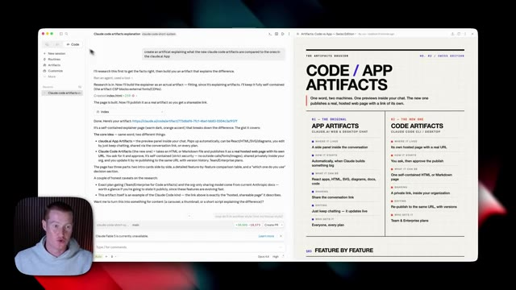
*⏱️ 00:00:34 — Vue d'ensemble de l'interface Claude Code affichant l'historique de discussion et un aperçu d'artefact généré.*

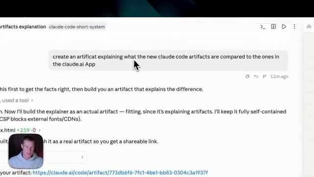
*⏱️ 00:00:39 — Gros plan sur le prompt saisi dans l'interface montrant la commande de création d'artefact.*

*⏱️ 00:00:43 — Affichage identique à l'image 1 montrant l'écran partagé avec l'explication des artefacts Claude Code et app.*

---

### ⏱️ `[00:00:48 - 00:01:08]` | Segment #03

**🔊 Audio (Transcription Intégrale Mot pour Mot en Français) :**
> You can see I have one in this style. And then I have another one in this style. As well as we can now see we have an artifacts tab right here that we did not have prior inside of Claude code in the desktop app. So if I click on this, you can now see I have two artifacts that are living here that I just created a couple of minutes ago. I can click on create new artifact.

**👁️ Analyse Visuelle d'Écran (gemini-3.5-flash-lite) :**
**Interface & Outils** : Présentation ou face-caméra explicatif du trader sans interface logicielle partagée.

**Contenu textuel & Code** : Explications orales des stratégies et mise en contexte méthodologique du marché.

**Action / Démonstration** : Explications face caméra et analyse conceptuelle des marchés.

---

### ⏱️ `[00:01:08 - 00:01:43]` | Segment #04

**🔊 Audio (Transcription Intégrale Mot pour Mot en Français) :**
> And basically inside of this text box here, we can just explain what it is we wanna turn into an artifact and then it will create it. So we'll come back to this, but I first wanna talk about how this works and some of the key differentiating features that makes this really interesting compared to the other Claude artifacts that we had before this. All right, so first of all, here is the tweet announcement from Anthropic. It said, new in Cloud Code artifacts, interactive pages built from your session, like a PR walkthrough or a live project dashboard shared with your team at a private link. And this is one of the key things that really makes this a game changer.

**👁️ Analyse Visuelle d'Écran (gemini-3.5-flash-lite) :**
**Interface & Outils** : Présentation ou face-caméra explicatif du trader sans interface logicielle partagée.

**Contenu textuel & Code** : Explications orales des stratégies et mise en contexte méthodologique du marché.

**Action / Démonstration** : Explications face caméra et analyse conceptuelle des marchés.

---

### ⏱️ `[00:01:43 - 00:02:18]` | Segment #05

**🔊 Audio (Transcription Intégrale Mot pour Mot en Français) :**
> So to say, when it comes to artifacts, I do want to, I do want to preface that this is available in beta only on team and enterprise plans. As of right now, I personally had to pay $150 to get access to this on the team plan so I could show you in this video. So if you could do me a favor and subscribe to this channel for more content like this, it would really help me out. Now, if I pull up the article they gave us on the new Cloud Code artifacts, I'm going to break down some of the key things here that we need to understand. Right here, it says, starting today, Cloud Code can capture work progress as an artifact, which turns Cloud Code's work into live, shareable,

**👁️ Analyse Visuelle d'Écran (gemini-3.5-flash-lite) :**
**Interface & Outils** : Présentation ou face-caméra explicatif du trader sans interface logicielle partagée.

**Contenu textuel & Code** : Explications orales des stratégies et mise en contexte méthodologique du marché.

**Action / Démonstration** : Explications face caméra et analyse conceptuelle des marchés.

---

### ⏱️ `[00:02:18 - 00:02:41]` | Segment #06

**🔊 Audio (Transcription Intégrale Mot pour Mot en Français) :**
> visual pages. If you've never used an artifact before, they're basically interactive dashboards that you could create that you could run inside of your Cloud desktop app or inside of the cloud.ai application that you can access on the web browser. What I have highlighted right here is kind of the key topic for this release. Artifacts can translate the work into a web page anyone can open and explore.

**👁️ Analyse Visuelle d'Écran (gemini-3.5-flash-lite) :**
**Interface & Outils** : Présentation ou face-caméra explicatif du trader sans interface logicielle partagée.

**Contenu textuel & Code** : Explications orales des stratégies et mise en contexte méthodologique du marché.

**Action / Démonstration** : Explications face caméra et analyse conceptuelle des marchés.

---

### ⏱️ `[00:02:42 - 00:03:17]` | Segment #07

**🔊 Audio (Transcription Intégrale Mot pour Mot en Français) :**
> This is really powerful if you are using Cloud code with your team, for example, because what you could do is you could take all the work from your previous applications that you're connected to via your connectors or MCPs. And you could pull all that data into a artifact that you could share with your team so they could see what it is you're working on, not only inside of Claude and your code base, but also inside of the apps that you're using, whether that is Gmail or Slack, Google Calendar, all those different things. We can now pull from our entire workspace to create interactive dashboards for our team to look at. Artifacts make it easier to collaborate

**👁️ Analyse Visuelle d'Écran (gemini-3.5-flash-lite) :**
**Interface & Outils** : Navigateur web affichant le site claude.com avec une incrustation vidéo du présentateur en bas à gauche.

**Contenu textuel & Code** : Texte explicatif sur la capacité de Claude Code à capturer la progression du travail sous forme d'artefacts visuels partageables (tableaux de bord, listes de contrôle, etc.).

**Action / Démonstration** : Le présentateur présente et commente la page web de documentation officielle.

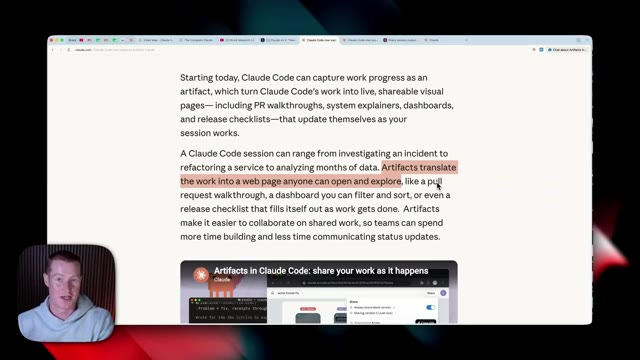
*⏱️ 00:02:51 — Page web officielle de documentation sur Claude Code et ses fonctionnalités d'artefacts.*

---

### ⏱️ `[00:03:17 - 00:03:50]` | Segment #08

**🔊 Audio (Transcription Intégrale Mot pour Mot en Français) :**
> on shared work so teams can spend more time building and less time communicating status updates. Again, just like I said before, Cloud Code builds an artifact using the full context of our session, including our code base connectors and the conversation itself. So let's say we were working on a pretty comprehensive task or we had a huge chat conversation with Cloud Code. We can now share that as an artifact to our team so they could see what we're working on to provide context. And we could have it in a very structured dashboard that looks really clean and simple. All right. So to give you a perfect example,

**👁️ Analyse Visuelle d'Écran (gemini-3.5-flash-lite) :**
**Interface & Outils** : Navigateur web affichant le site de Claude.

**Contenu textuel & Code** : Texte explicatif décrivant comment Claude Code génère des artéfacts basés sur le contexte complet de la session, incluant la base de code, les connecteurs et la conversation.

**Action / Démonstration** : Le présentateur illustre ses propos en montrant la documentation officielle de Claude Code sur le fonctionnement des artéfacts.

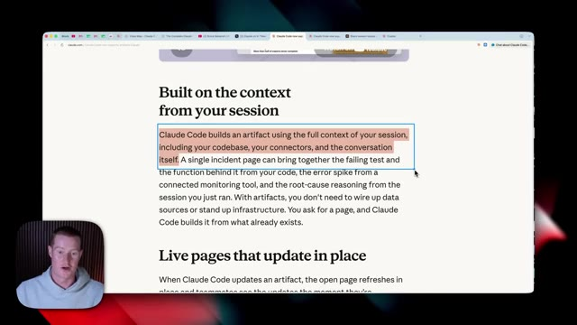
*⏱️ 00:03:25 — Capture d'écran montrant la page web officielle de présentation de Claude Code avec un paragraphe sélectionné en surbrillance.*

---

### ⏱️ `[00:03:50 - 00:04:20]` | Segment #09

**🔊 Audio (Transcription Intégrale Mot pour Mot en Français) :**
> right here, I have this conversation to have with Cloud Code. I said, create an artifact explaining how we are scraping competitors content so I could share it with my team. Then what it did is it pulled through all the different skills and workflows and databases we're pulling in order to scrape content out there. And this is a pretty complex task that I have Cloud Code do. Now on the right hand side, this is the text output. And as you can see, this is kind of a bunch of gibberish right here. It's breaking down the data files and storage.

**👁️ Analyse Visuelle d'Écran (gemini-3.5-flash-lite) :**
**Interface & Outils** : Interface de l'outil de développement et d'IA Claude Code.

**Contenu textuel & Code** : Prompts textuels, rapports techniques générés par l'IA, détails sur les fichiers de stockage de données (YouTube competitors JSON), et artéfacts partageables.

**Action / Démonstration** : Interaction avec l'assistant IA pour générer un document explicatif sur le système de web scraping des concurrents destiné à l'équipe.

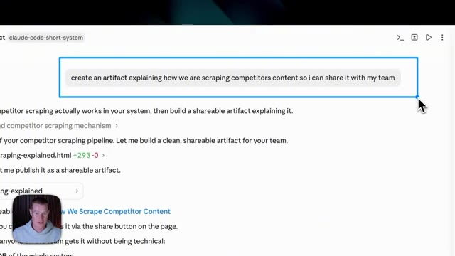
*⏱️ 00:03:58 — Gros plan sur une invite de commande dans Claude Code avec le prompt "create an artifact explaining how we are scraping competitors content so i can share it with my team".*

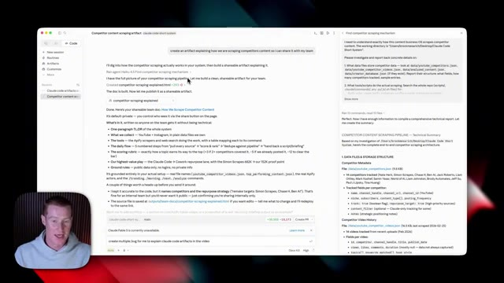
*⏱️ 00:04:05 — Vue d'ensemble de l'interface Claude Code affichant l'artéfact généré et le résumé technique du pipeline de scraping des concurrents.*

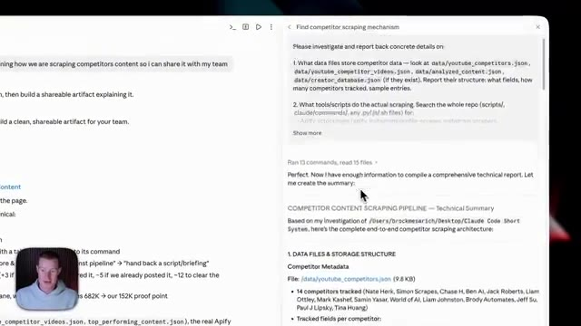
*⏱️ 00:04:13 — Zoom sur le panneau latéral de Claude Code montrant les détails de l'enquête et la structure des fichiers de données JSON.*

---

### ⏱️ `[00:04:20 - 00:04:40]` | Segment #10

**🔊 Audio (Transcription Intégrale Mot pour Mot en Français) :**
> And this is just a bunch of text for us to read through. And this isn't pleasing to the eye. And there's a better way to do this now using artifacts. So what I did is I created that artifact called competitor scraping explained that lives right here. I could open it up. Now on the right hand side, we can see this artifact, which acts as an internal dashboard.

**👁️ Analyse Visuelle d'Écran (gemini-3.5-flash-lite) :**
**Interface & Outils** : Présentation ou face-caméra explicatif du trader sans interface logicielle partagée.

**Contenu textuel & Code** : Explications orales des stratégies et mise en contexte méthodologique du marché.

**Action / Démonstration** : Explications face caméra et analyse conceptuelle des marchés.

---

### ⏱️ `[00:04:40 - 00:05:13]` | Segment #11

**🔊 Audio (Transcription Intégrale Mot pour Mot en Français) :**
> explicitant tout ce jargon en un format beaucoup plus digeste que nous pouvons voir juste ici. Donc il détaille ces outils Appify spécifiques que nous utilisons ici et que mon équipe peut comprendre. Il montre le flux quotidien, le processus étape par étape sur la façon dont il extrait réellement des idées de contenu. Et puis il montre même comment les sujets sont notés afin de déterminer quelles idées nous devrions réellement transformer en contenu. Maintenant, c'est super, et c'est super pour moi et pour un usage interne. Nous aurions tout simplement pu lancer un code HTML normal que nous aurions pu visualiser localement sur notre appareil à l'intérieur de CloudCode.

**👁️ Analyse Visuelle d'Écran (gemini-3.5-flash-lite) :**
**Interface & Outils** : Interface de Claude Code et navigateur web affichant un document explicatif.

**Contenu textuel & Code** : Tableau listant les outils Apify utilisés (Instagram scraper, YouTube channel/search scraper, Tweet scraper) et le détail du processus étape par étape ("The daily flow, step by step").

**Action / Démonstration** : Le présentateur explique le contenu de l'artefact généré qui structure de manière digeste les outils de scraping et leur fonctionnement pour l'équipe.

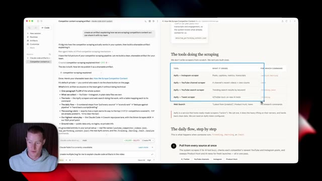
*⏱️ 00:04:48 — Capture d'écran montrant l'interface de Claude Code avec un artefact textuel à droite détaillant les outils de scraping d'Apify et le flux de travail quotidien.*

---

### ⏱️ `[00:05:13 - 00:05:40]` | Segment #12

**🔊 Audio (Transcription Intégrale Mot pour Mot en Français) :**
> Mais ce qui rend cela vraiment intéressant, c'est que nous pouvons cliquer sur partager et nous pouvons maintenant le partager avec n'importe qui sur notre plan d'équipe. Lorsque je leur donne le lien vers ceci, ils peuvent voir des informations en direct, qui sont exactement les mêmes informations que je peux voir. Disons donc que je fais une modification à ce flux de travail ici. Il appliquerait alors automatiquement les modifications que nous avons apportées à cet artéfact, non seulement pour moi, mais aussi pour le membre de mon équipe qui y a accès. Parce que comme vous pouvez le voir, cela montre toujours partager la dernière version.

**👁️ Analyse Visuelle d'Écran (gemini-3.5-flash-lite) :**
**Interface & Outils** : Interface web de documentation et outil de génération/partage de contenu.

**Contenu textuel & Code** : Document intitulé « How We Scrape Competitor Content » avec un menu contextuel de partage (« Share ») et des options d'accès.

**Action / Démonstration** : Interaction avec le bouton de partage pour configurer les permissions d'accès et copier le lien du document.

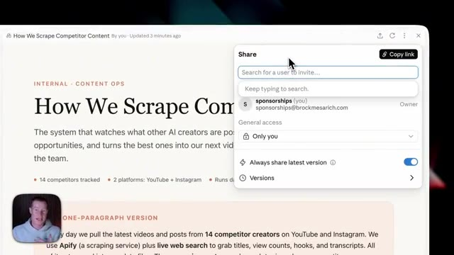
*⏱️ 00:05:20 — Fenêtre de partage ouverte sur la page web montrant les options de partage du document.*

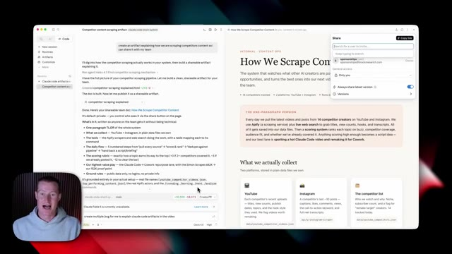
*⏱️ 00:05:27 — Vue partagée de l'écran avec une application de type éditeur de texte/code à gauche et le document web avec le menu de partage à droite.*

---

### ⏱️ `[00:05:40 - 00:06:16]` | Segment #13

**🔊 Audio (Transcription Intégrale Mot pour Mot en Français) :**
> So it's always going to update in real time. So you don't need to constantly go back and forth and make sure it's up to date. And then if I come back and click on artifacts, we should now see this living directly inside of here, how we scrape competitors content. All right, so let's now build an artifact from scratch. You could see exactly how this works. This is going to pull from a couple of different apps that we connect to Claude. So you can see the power when we combine it with the applications we're using in order to pull real live information across our different workspace and not just the code bases that we're working inside of. I'm going to come over to artifacts, click on new artifact, or we could simply just type in what we want to build. So let's do that

**👁️ Analyse Visuelle d'Écran (gemini-3.5-flash-lite) :**
**Interface & Outils** : Interface web de Claude / éditeur de code et prévisualisation d'artefacts.

**Contenu textuel & Code** : Document textuel structuré décrivant un système de scraping de contenu concurrentiel (outils Apify, critères de notation, types de données collectées).

**Action / Démonstration** : Navigation dans l'onglet des artefacts pour consulter et prévisualiser le document généré en temps réel.

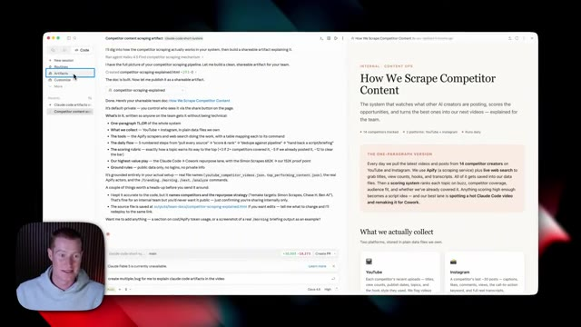
*⏱️ 00:05:49 — Interface de l'outil Claude avec un panneau latéral montrant les artefacts et une vue divisée affichant à la fois le code source markdown/texte et le rendu visuel formaté du document "How We Scrape Competitor Content".*

---

### ⏱️ `[00:06:16 - 00:06:41]` | Segment #14

**🔊 Audio (Transcription Intégrale Mot pour Mot en Français) :**
> now. I want you to build me an artifact that automatically pulls from my Gmail and my Google calendar. So that way my team can see what's on my calendar and my docket for the day. So that way they don't always bother me because they could see how busy I am. I want them to see when free time is for them to actually speak with me. This is going to be a universal dashboard for our entire company. And while it's doing that, we need to make sure to configure the apps that we want to add.

**👁️ Analyse Visuelle d'Écran (gemini-3.5-flash-lite) :**
**Interface & Outils** : Application logicielle de type assistant IA / interface de programmation (Claude ou équivalent).

**Contenu textuel & Code** : Champ de texte "Describe a task or ask a question", sessions récentes répertoriées dans le volet latéral et la zone centrale ("Calendar and email brief artifact").

**Action / Démonstration** : Navigation et présentation de l'interface utilisateur pour la création d'un artefact lié au calendrier et aux emails.

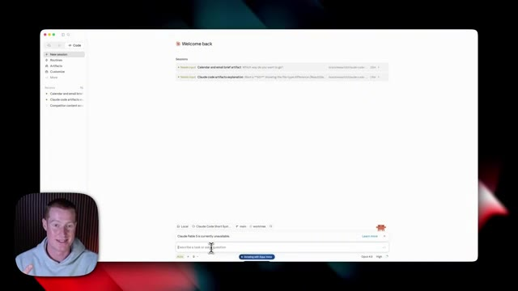
*⏱️ 00:06:22 — Interface d'une application montrant l'écran d'accueil avec une barre de saisie pour interagir avec un assistant textuel ou un outil de développement.*

---

### ⏱️ `[00:06:41 - 00:07:08]` | Segment #15

**🔊 Audio (Transcription Intégrale Mot pour Mot en Français) :**
> So first of all, we're going to come over to customize, click on connectors. I'm simply going to browse the connectors and select Gmail. I'm going to click on connect. And now I have Gmail connected from here. I'm just going to click on always allow for permissions. So it doesn't always ask if, you know, it could go ahead and, you know, create emails for me, read my emails, etc. Then I'm going to do the same thing for Google Calendar. Now let's say there is an app we want to connect to that we do not see in this list right here. I'm going to show you how you could do that right now.

**👁️ Analyse Visuelle d'Écran (gemini-3.5-flash-lite) :**
**Interface & Outils** : Interface web de configuration et d'intégration de connecteurs d'intelligence artificielle.

**Contenu textuel & Code** : Répertoire de connecteurs (Freshservice, Canva, Microsoft 365, Notion, etc.) et paramètres de permissions pour l'intégration de Gmail.

**Action / Démonstration** : Navigation dans le répertoire des connecteurs, recherche et sélection de l'intégration Gmail pour configurer les autorisations d'accès.

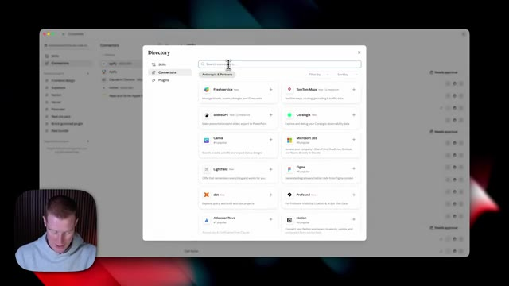
*⏱️ 00:06:48 — Fenêtre contextuelle affichant le répertoire des connecteurs disponibles avec une barre de recherche.*

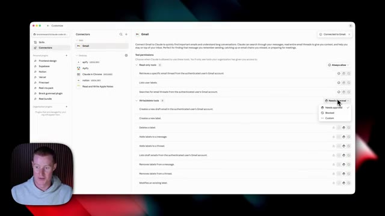
*⏱️ 00:06:55 — Interface de configuration du connecteur Gmail avec la liste des permissions d'outils en lecture et écriture.*

---

### ⏱️ `[00:07:08 - 00:07:42]` | Segment #16

**🔊 Audio (Transcription Intégrale Mot pour Mot en Français) :**
> So I want to connect to something called Buffer, which is basically a scheduling platform where my team and I schedule content for me for Instagram, LinkedIn, TikTok, etc. And I want to be able to pull information from that. So what I could do is since there is no connector here, I could use something called Zapier MCP. And let me show you exactly how that works. So if you don't know what this is, this is basically an automation platform and they have an MCP in order to bridge the gap between all the different apps you use and things like Claude, OpenClaw, Hermes Agent, all those different AI applications. What I'm going to do is sign up for an account. I already have one. And

**👁️ Analyse Visuelle d'Écran (gemini-3.5-flash-lite) :**
**Interface & Outils** : Interface de configuration et de gestion des connecteurs (application de type bureau/web).

**Contenu textuel & Code** : Répertoire de recherche de connecteurs et paramètres de permissions d'accès pour Gmail (lecture, écriture, suppression).

**Action / Démonstration** : Recherche d'un connecteur pour Buffer qui n'aboutit à aucun résultat, puis visualisation des permissions de Gmail.

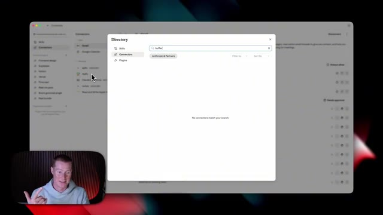
*⏱️ 00:07:17 — Fenêtre modale "Directory" montrant une barre de recherche où "buffer" a été saisi, avec le message "No connectors match your search".*

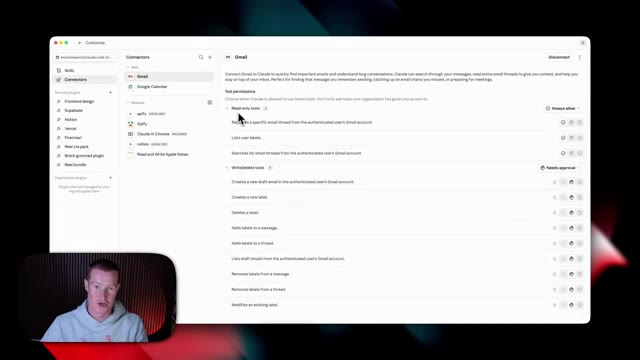
*⏱️ 00:07:25 — Interface de configuration des connecteurs montrant les permissions de l'outil Gmail avec les options "Read-only tools" et "Write/delete tools".*

---

### ⏱️ `[00:07:42 - 00:08:17]` | Segment #17

**🔊 Audio (Transcription Intégrale Mot pour Mot en Français) :**
> ce que je vais faire, c'est cliquer sur nouveau serveur MCP. Et encore une fois, vous n'avez pas besoin de faire ça. C'est uniquement s'il y a une application à laquelle vous voulez vous connecter et que vous ne pouvez pas faire directement à l'intérieur de Claude. Maintenant, j'ai toutes ces applications déjà connectées. Nous avons Buffer déjà ajouté ici. Et pour ajouter une application, nous cliquons simplement sur ajouter une application. Je chercherais Buffer, je sélectionne simplement ceci, je l'active, je sélectionne tous les outils, je clique sur ajouter l'outil. Et ensuite, nous pouvons maintenant accéder aux informations de cette application et faire des choses sur cette application également. Ensuite, je vais simplement sélectionner connecter, cliquer sur ajouter à Claude. Et maintenant, nous avons Zapier de connecté. Je peux donc maintenant utiliser Buffer et jeter un œil à toutes les publications que j'ai.

**👁️ Analyse Visuelle d'Écran (gemini-3.5-flash-lite) :**
**Interface & Outils** : Interface web de gestion des applications et des agents IA (type MCP / intégrations).

**Contenu textuel & Code** : Noms des applications intégrées (Buffer, Beehiiv, Google Calendar, HubSpot, Stripe, ClickUp, Skool, Google Drive, Synthflow AI, Google Docs) avec leurs nombres d'outils respectifs.

**Action / Démonstration** : Navigation et clic sur une application de la liste pour afficher ses configurations et outils disponibles.

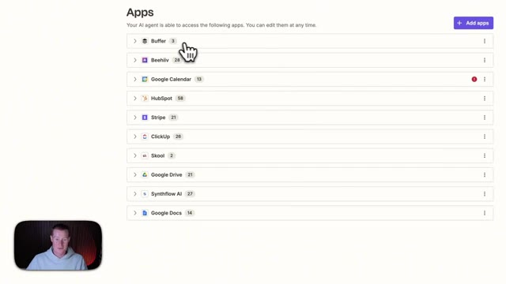
*⏱️ 00:07:50 — Liste des applications connectées à l'agent IA, montrant des services comme Buffer, Beehiiv, Google Calendar, HubSpot, Stripe, ClickUp, Skool, Google Drive, Synthflow AI et Google Docs.*

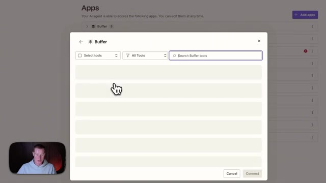
*⏱️ 00:07:59 — Fenêtre modale de configuration des outils de l'application Buffer avec des options de sélection et de recherche.*

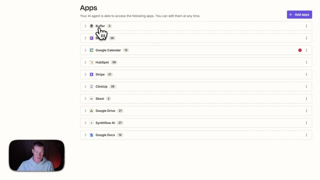
*⏱️ 00:08:08 — Retour à la liste principale des applications connectées à l'agent IA avec le curseur sur Buffer.*

---

### ⏱️ `[00:08:17 - 00:08:36]` | Segment #18

**🔊 Audio (Transcription Intégrale Mot pour Mot en Français) :**
> prévu avec mon équipe. Très bien. Donc c'est plutôt cool. Vous pouvez voir maintenant qu'il a créé ce tableau de bord pour nous. Il montre que je suis disponible en ce moment. Brock est libre. Pas de réunions prévues au programme aujourd'hui. C'est la meilleure fenêtre pour le rattraper. Il montre ensuite combien j'ai d'e-mails non lus. Ainsi mon équipe pouvait voir, d'accord, peut-être que Brock est occupé, même s'il n'a pas de réunion en ce moment.

**👁️ Analyse Visuelle d'Écran (gemini-3.5-flash-lite) :**
**Interface & Outils** : Claude Code, interface Web de tableau de bord de disponibilité

**Contenu textuel & Code** : Texte descriptif de la disponibilité de Brock, options de déploiement et métriques du tableau de bord (0 réunions, 8 heures libres, aucun meeting urgent, +30 e-mails non lus).

**Action / Démonstration** : Présentation du tableau de bord généré montrant la disponibilité en temps réel de Brock.

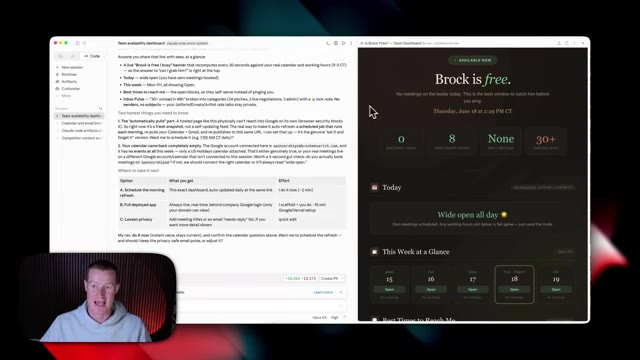
*⏱️ 00:08:22 — Capture d'écran montrant l'interface de Claude Code à gauche et le tableau de bord de disponibilité 'Team availability dashboard' généré à droite, avec le présentateur en médaillon.*

---

### ⏱️ `[00:08:36 - 00:09:12]` | Segment #19

**🔊 Audio (Transcription Intégrale Mot pour Mot en Français) :**
> Obviously it shows my week and day at a glance right here, which is pretty cool. It even shows the best times to reach me, everything that's going on inside of my email inbox. So this is a very random example. I just wanted to show you how we can now share this with our team so they could see what's going on across all the different applications we're using or you could do the same with you know the code bases you're working inside of so your team could see what it is you're working on day to day so if i wanted to share this i just click share i would have to add in the email of somebody in my workspace and mind you they need to be somebody that is on my team's plan and if they're not they won't be able to access this and then i click copy link and can send it to them

**👁️ Analyse Visuelle d'Écran (gemini-3.5-flash-lite) :**
**Interface & Outils** : Interface web de tableau de bord d'équipe, application de productivité, navigateur.

**Contenu textuel & Code** : Planning hebdomadaire, meilleurs moments pour contacter, résumé de la boîte de réception (Inbox Pulse), options de partage.

**Action / Démonstration** : Navigation et présentation des fonctionnalités du tableau de bord d'équipe avec démonstration du partage.

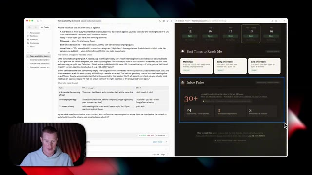
*⏱️ 00:08:45 — Dashboard de disponibilité d'équipe affichant un calendrier de la semaine et des informations sur la boîte mail.*

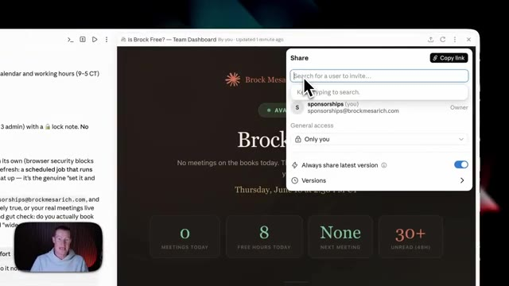
*⏱️ 00:09:03 — Interface de partage du tableau de bord avec une fenêtre contextuelle permettant d'inviter des utilisateurs.*

---

### ⏱️ `[00:09:12 - 00:09:40]` | Segment #20

**🔊 Audio (Transcription Intégrale Mot pour Mot en Français) :**
> directement évidemment je devrais venir ici et accorder l'accès à tout le monde à l'intérieur de l'organisation de Brock Messerich. Donc si je voulais que quelqu'un voie ça, alors j'irais de l'avant et j'accorderais cet accès puis je copierais le lien pour le partager avec eux. Voilà qui est fait. Ce sont les nouveaux artefacts de Claude Code. Si vous voulez les essayer, il y aura un lien dans la description. Si vous voulez plus de contenu comme celui-ci, abonnez-vous à la chaîne. Et si vous voulez aller plus loin avec Claude et savoir comment utiliser l'IA quand on n'est pas un technicien, assurez-vous de rejoindre ma communauté School. Il y a un lien dans la description ci-dessous. J'espère que vous avez apprécié et je vous vois dans la prochaine vidéo. Salut.

**👁️ Analyse Visuelle d'Écran (gemini-3.5-flash-lite) :**
**Interface & Outils** : Navigateur web affichant un outil de tableau de bord et de collaboration en ligne.

**Contenu textuel & Code** : Paramètres de partage et de permissions (général access, owner sponsorships@brockmesarich.com).

**Action / Démonstration** : Configuration des accès et des autorisations de partage pour l'équipe.

*⏱️ 00:09:19 — Capture d'écran montrant le panneau de partage d'un tableau de bord d'équipe avec l'option d'accès général pour l'organisation de Brock Mesarich.*

---

