# 🎬 Anthropic Just Changed How We Work Forever.. (Claude Tag)

> **Chaîne** : [Brock Mesarich | AI for Non Techies](https://www.youtube.com/@BrockMesarich)  
> **Lien YouTube** : [https://www.youtube.com/watch?v=WsD4NkD_swE](https://www.youtube.com/watch?v=WsD4NkD_swE)  
> **Date de publication** : 20260624  
> **Durée** : 00:15:30  
> **Identifiant vidéo** : `WsD4NkD_swE`  
> **Transcription & Analyse** : `whisper-v3-large-turbo+gemini-3.5-flash-lite`  

---

## 📌 Synthèse Exécutive & Outils

### 💡 Résumé
Anthropic redéfinit la collaboration homme-machine en milieu professionnel avec le lancement de **Claude Tag**, une fonctionnalité révolutionnaire permettant d'intégrer Claude directement au cœur de Slack sous une forme multijoueur. En s'appuyant sur l'expérience issue de *Claude Code* (où l'équipe produit réalise déjà 65 % de son travail grâce à cette approche), Anthropic transpose l'assistance IA d'un usage purement individuel et isolé vers un espace de travail partagé et synchrone. Un canal Slack devient ainsi le foyer d'un « second cerveau » collectif, où l'ensemble des collaborateurs peut interagir avec un agent unique, reprendre l'historique des discussions à la volée et capitaliser sur un contexte unifié qui s'enrichit en temps réel.

Au-delà de la simple interaction conversationnelle, la puissance de Claude Tag réside dans son architecture ouverte et connectée aux outils métiers. Grâce aux intégrations natives et aux protocoles comme le **Model Context Protocol (MCP)**, Claude peut interroger dynamiquement des sources de données tierces (CRM, e-mails, outils de support) et exécuter des tâches complexes de manière asynchrone. L'introduction du « mode ambiant » pousse cette logique encore plus loin en dotant l'IA de capacités proactives : l'agent surveille continuellement les flux d'informations, anticipe les besoins des équipes et déclenche des alertes ciblées dans les canaux appropriés sans qu'il soit nécessaire de le solliciter manuellement.

Cette évolution pose les jalons d'un futur où l'intelligence artificielle n'est plus un simple chatbot que l'on consulte, mais un collaborateur autonome capable d'orchestrer des processus transversaux (comme le support client ou la veille concurrentielle) sur plusieurs heures, voire plusieurs jours. Actuellement déployée en version bêta pour les abonnés des forfaits Team et Enterprise, cette approche préfigure une généralisation des agents contextuels à l'ensemble des logiciels de productivité, transformant radicalement les flux de travail opérationnels des entreprises modernes.

### 🛠️ Outils, Modèles & Logiciels Présentés
* **Claude (Anthropic) / Claude Tag** : Modèle d'intelligence artificielle et fonctionnalité collaborative majeure permettant d'invoquer Claude directement dans Slack sous forme d'agent multijoueur et proactif.
* **Claude Code** : Environnement de développement et d'ingénierie d'Anthropic dont l'architecture sert de fondation conceptuelle au fonctionnement de Claude Tag.
* **Slack** : Plateforme de messagerie collaborative d'entreprise servant de canal central et naturel pour le déploiement et l'interaction avec Claude Tag.
* **Zapier (via MCP)** : Passerelle d'automatisation et pont technique connectant l'IA à plus de 9 000 applications tierces (comme Buffer ou Beehiiv) dépourvues de connecteurs natifs.
* **Cursor** : IDE de développement avancé mentionné comme environnement technique alternatif pour l'utilisation de Claude Code.
* **Gmail** : Messagerie électronique intégrée aux cas d'usage présentés pour la surveillance proactive des demandes de support client.
* **HubSpot CRM** : Outil de gestion de la relation client pouvant être connecté à l'écosystème Claude pour l'extraction et l'analyse de données.
* **Airtable** : Base de données relationnelle connectable aux flux de travail automatisés de l'assistant.
* **OpenClaw** : Outil pionnier mentionné pour illustrer l'utilisation pratique de tâches *cron* et d'actions automatisées proactives.
* **Microsoft Teams** : Solution de communication collaborative identifiée parmi les futurs environnements cibles potentiels pour l'extension de la technologie.

### 🔑 Points Clés & Enseignements Stratégiques
* **Transition vers l'IA multijoueur** : Le passage d'un échange cloisonné (un utilisateur face à son chatbot) à un agent unique partagé par canal Slack permet à toute l'équipe de voir le travail en cours et de reprendre une conversation là où un autre l'a laissée.
* **Rendement et adoption interne** : L'utilisation intensive de cette approche par l'équipe produit d'Anthropic (65 % du code généré par la version interne) valide l'efficacité opérationnelle de l'outil dans des conditions réelles de production.
* **Affranchissement des interfaces dédiées** : Les équipes n'ont plus besoin de basculer constamment entre l'application de bureau Claude, les IDE ou les terminaux ; tout se déroule directement dans l'outil de communication quotidien.
* **Connexion multi-applications via les MCP** : La capacité à lier Claude à des écosystèmes variés (CRM, outils d'e-mailing, tableaux de bord) permet d'extraire des données en temps réel sans quitter l'interface de messagerie.
* **Rôle central des ponts d'automatisation** : L'utilisation de connecteurs universels comme le protocole MCP de Zapier permet de combler l'absence d'intégrations natives pour des milliers d'applications logicielles tierces.
* **Accumulation contextuelle persistante** : Au fur et à mesure que Claude suit un canal Slack, il mémorise le contexte global, évitant aux utilisateurs de devoir réexpliquer les tenants et aboutissants d'un projet à chaque nouvelle session.
* **Mode ambiant et proactivité** : Contrairement aux interactions réactives classiques, Claude surveille activement les flux de données et prend l'initiative d'alerter les collaborateurs sur des points critiques ou des opportunités.
* **Automatisation des tâches asynchrones** : L'agent est capable d'exécuter des requêtes en arrière-plan et de planifier des tâches s'étalant sur plusieurs heures ou jours, agissant comme un véritable coéquipier autonome.
* **Coordination inter-équipes automatisée** : En cas d'incident détecté (par exemple via les e-mails de support), Claude peut croiser les informations et initier simultanément des fils de discussion dédiés pour les équipes de support et d'ingénierie.
* **Stratégie de déploiement par paliers** : Le produit est initialement restreint aux abonnements payants (forfaits *Team* et *Enterprise*) avant une ouverture planifiée à un plus large public et à d'autres plateformes.
* **Vision d'un pôle opérationnel centralisé** : La vision à long terme d'Anthropic positionne Claude Tag comme la brique centrale et unifiée d'interaction avec l'ensemble des logiciels de l'entreprise (Gmail, CRM, tickets de support, plateformes de messagerie).

---

## ⏱️ Chronologie & Transcription Complète Audio & Visuelle (Mot pour Mot)

### ⏱️ `[00:00:00 - 00:00:33]` | Segment #01

**🔊 Audio (Transcription Intégrale Mot pour Mot en Français) :**
> Anthropic vient de sortir quelque chose qui s'appelle Claude Tag et c'est fondamentalement une façon d'utiliser Claude directement dans Slack avec toute votre équipe. Pensez-y comme à une manière multijoueur d'interagir avec Claude à l'intérieur de Slack. Anthropic a même pris les devants en affirmant que l'équipe produit l'utilise 65 % du temps lorsqu'elle utilise Claude dans l'ensemble de son département. Donc dans cette vidéo, je vais décortiquer toutes les nouveautés de cette sortie, parler de mes principaux enseignements tirés de leur article de lancement, et je vais également vous le montrer en direct pour que vous puissiez voir comment ça fonctionne. Ensuite, nous parlerons de qui y a accès à partir d'aujourd'hui. Donc sans plus attendre,

**👁️ Analyse Visuelle d'Écran (gemini-3.5-flash-lite) :**
**Interface & Outils** : Application de messagerie d'équipe Slack.

**Contenu textuel & Code** : Messages d'équipe, mentions d'utilisateurs et listes de tâches générées par un agent IA nommé Claude.

**Action / Démonstration** : Navigation et démonstration de l'intégration de Claude au sein d'une interface de messagerie collaborative.

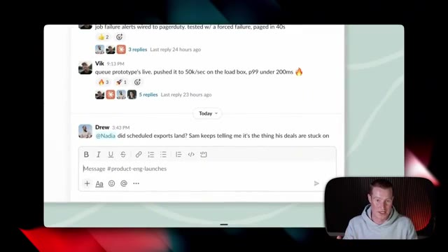
*⏱️ 00:00:17 — Interface de messagerie Slack montrant un canal de discussion d'équipe avec un champ de saisie de message.*

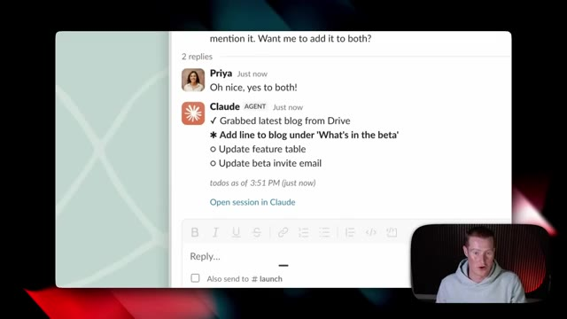
*⏱️ 00:00:25 — Fil de discussion Slack montrant une interaction avec un bot nommé Claude AGENT listant des tâches en cours.*

---

### ⏱️ `[00:00:33 - 00:01:08]` | Segment #02

**🔊 Audio (Transcription Intégrale Mot pour Mot en Français) :**
> Plongeons directement là-dedans. Ils ont effectivement publié cet article ici, comme ils le font chaque fois qu'ils sortent un nouveau produit, mais j'ai pris lesdevants pour vous le résumer de manière accessible afin que vous puissiez voir quels sont nos principaux enseignements à ce sujet. Très bien, alors plongeons directement là-dedans. Anthropic a pris lesdevants et a déclaré : nous voyons le tag de Claude comme le début d'une évolution du code de Claude et cela rend le modèle encore plus proactif et fonctionne mieux avec toute une équipe. L'utilisation des tags avec Claude est désormais l'un des principaux moyens par lesquels nous réalisons les choses chez Anthropic. Aujourd'hui, 65 % du code de notre équipe produit est créé par notre version interne du tag de Claude, ce qui est assez fou, si vous y réfléchissez.

**👁️ Analyse Visuelle d'Écran (gemini-3.5-flash-lite) :**
**Interface & Outils** : Navigateur web affichant un document de synthèse ou un article (Miro/Notion ou outil similaire).

**Contenu textuel & Code** : Texte d'article expliquant l'évolution de Claude Code vers Claude Tag sur Slack et ses cas d'usage chez Anthropic.

**Action / Démonstration** : Le présentateur commente le texte affiché et met en avant les points clés du résumé.

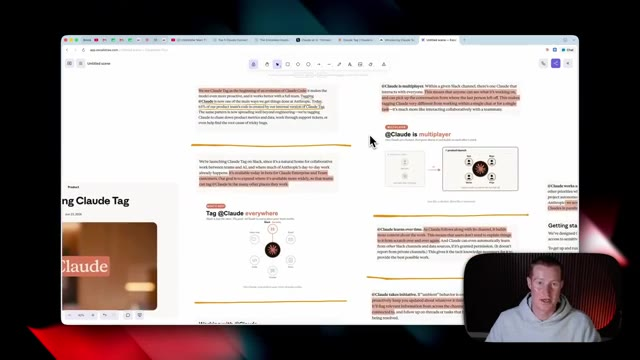
*⏱️ 00:00:42 — Vue d'ensemble d'un article de blog ou de notes affiché à l'écran, avec le présentateur en médaillon en bas à droite.*

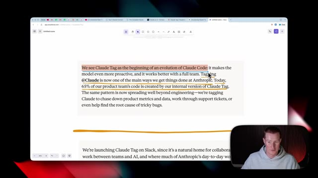
*⏱️ 00:00:51 — Gros plan sur un paragraphe surligné concernant Claude Tag et Claude Code, avec le présentateur en bas à droite.*

---

### ⏱️ `[00:01:08 - 00:01:29]` | Segment #03

**🔊 Audio (Transcription Intégrale Mot pour Mot en Français) :**
> les personnes qui construisent Claude dans Claude Code l'utilisent 65 % du temps maintenant parce qu'ils ont eu ça pendant ces deux derniers mois. Alors pensez à ceci comme à un Claude Code qui est conçu pour toute votre équipe et que vous pouvez déclencher directement dans Slack sans avoir besoin d'aller sur l'application de bureau Claude ou d'avoir besoin d'aller dans un IDE comme Cursor ou même dans le terminal pour utiliser Claude Code.

**👁️ Analyse Visuelle d'Écran (gemini-3.5-flash-lite) :**
**Interface & Outils** : Navigateur web affichant un document texte (application de prise de notes ou éditeur en ligne).

**Contenu textuel & Code** : Texte surligné expliquant que « 65 % of our product team's code is created by our internal version of Claude Tag » et que l'outil est intégré sur Slack.

**Action / Démonstration** : Le présentateur commente le texte affiché à l'écran concernant l'utilisation interne de Claude par les équipes d'Anthropic.

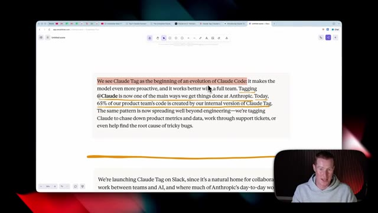
*⏱️ 00:01:13 — Capture d'écran montrant un article de texte avec des passages surlignés concernant Claude Code et Claude Tag, avec le présentateur en médaillon en bas à droite.*

---

### ⏱️ `[00:01:29 - 00:02:03]` | Segment #04

**🔊 Audio (Transcription Intégrale Mot pour Mot en Français) :**
> Ensuite, ils continuent en disant que nous lançons Claude sur Slack, puisque c'est un foyer naturel pour le travail collaboratif entre les équipes et l'IA. Et c'est là que se déroule déjà la majeure partie du travail quotidien d'Anthropic. Actuellement, il est disponible en version bêta pour les clients Enterprise et Team de Claude. Vous devez donc obligatoirement être soit sur le forfait Team, soit sur le forfait Enterprise pour y accéder, ce que j'ai pris soin de payer afin de pouvoir vous le montrer si vous n'êtes pas des utilisateurs Enterprise ou Team. Ensuite, ils ont voulu dire que notre objectif est d'élargir sa disponibilité plus largement afin que les équipes puissent identifier Claude dans les nombreux autres endroits où elles travaillent. Et c'est l'un des points principaux que je veux

**👁️ Analyse Visuelle d'Écran (gemini-3.5-flash-lite) :**
**Interface & Outils** : Navigateur web affichant une page de documentation ou un outil d'édition/partage de texte, avec un encart vidéo du présentateur en bas à droite.

**Contenu textuel & Code** : Texte surligné expliquant le lancement de Claude sur Slack en version bêta pour les clients Enterprise et Team d'Anthropic.

**Action / Démonstration** : Le présentateur commente le texte affiché à l'écran concernant l'intégration de Claude dans Slack.

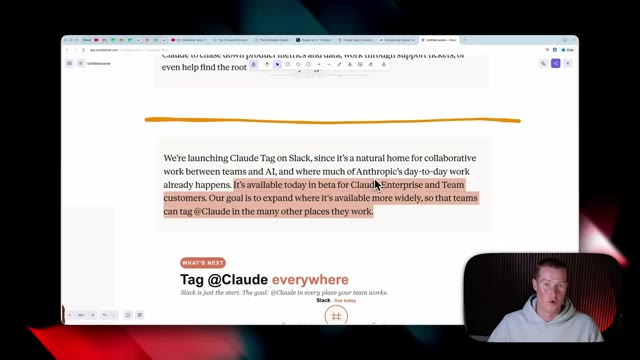
*⏱️ 00:01:38 — Capture d'écran montrant un article ou une documentation textuelle concernant le lancement de Claude sur Slack, avec une mise en surbrillance du texte.*

---

### ⏱️ `[00:02:03 - 00:02:34]` | Segment #05

**🔊 Audio (Transcription Intégrale Mot pour Mot en Français) :**
> marteler à partir de cette sortie. C'est en quelque sorte poser les bases pour que nous puissions utiliser Claude pratiquement partout où nous travaillons, que ce soit sur Slack, Gmail, ou des CRM spécifiques que nous utilisons. Pratiquement tous ces différents endroits où nous interagissons avec notre équipe, ils prévoient de déployer Claude, ou je suppose qu'on pourrait appeler ça la fonctionnalité de balise Claude comme ils l'appellent. Donc encore une fois, à l'heure actuelle, c'est uniquement actif sur Slack, mais imaginez quand vous aurez ça sur, vous savez, Microsoft Teams ou Claude Code, votre logiciel de tickets de support, et même sur Gmail.

**👁️ Analyse Visuelle d'Écran (gemini-3.5-flash-lite) :**
**Interface & Outils** : Navigateur web affichant une application de schématisation ou de présentation (type Miro ou similaire).

**Contenu textuel & Code** : Schéma en étoile illustrant l'intégration centrale de Claude avec différents canaux de travail (Slack, Email, Docs, Tickets, Code, Team chat).

**Action / Démonstration** : Présentation visuelle de l'intégration omniprésente de Claude dans les environnements de travail professionnels.

*⏱️ 00:02:11 — Capture d'écran montrant un schéma explicatif sur l'intégration de l'intelligence artificielle Claude dans différents outils professionnels tels que Slack, le chat d'équipe, les e-mails, les documents, les tickets et le code, avec le titre "Tag @Claude everywhere".*

---

### ⏱️ `[00:02:34 - 00:03:07]` | Segment #06

**🔊 Audio (Transcription Intégrale Mot pour Mot en Français) :**
> Et maintenant, nous utilisons simplement cette balise Claude comme le pôle central où nous sommes capables d'interagir avec toutes ces choses. Ensuite, ils ont dit que si vous avez déjà travaillé avec Claude Code ou co-work auparavant, la balise Claude semblera très familière. Nous devons simplement identifier Claude avec une requête en termes simples, et il décomposera les tâches en étapes puis les traitera tour à tour en utilisant les outils auxquels il a accès. Et encore une fois, c'est un autre point clé ici. Non seulement nous interagissons avec ceci comme un chatbot et posons des questions spécifiques et Claude nous donne un résultat, mais il utilise les outils que

**👁️ Analyse Visuelle d'Écran (gemini-3.5-flash-lite) :**
**Interface & Outils** : Navigateur web, outil de prise de notes ou application de documentation (ex: Excalidraw ou site web d'Anthropic).

**Contenu textuel & Code** : Texte explicatif : "Working with @Claude. If you've worked with Claude Code or Cowork before, Claude Tag will feel familiar. Tag @Claude with a request in simple terms..."

**Action / Démonstration** : Le présentateur commente le texte affiché à l'écran concernant l'utilisation de la balise Claude.

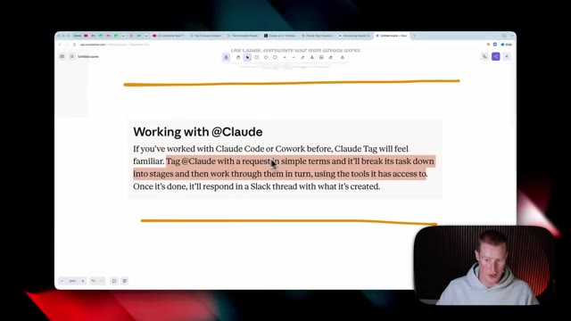
*⏱️ 00:02:42 — Une page web affichant du texte sur le fonctionnement de "@Claude" avec une sélection de texte en surbrillance rouge, et le présentateur visible en incrustation vidéo dans le coin inférieur droit.*

---

### ⏱️ `[00:03:07 - 00:03:39]` | Segment #07

**🔊 Audio (Transcription Intégrale Mot pour Mot en Français) :**
> nous avons déjà préconfiguré Claude pour se connecter à, et il extrait des informations de ces différentes sources. Maintenant, si vous n'êtes pas déjà familiers, nous pourrions connecter Claude à n'importe quelle application que nous utilisons au jour le jour. Donc que ce soit Gmail ou HubSpot, CRM, Airtable, Spotify, toutes ces différentes applications. Nous pouvons donc désormais extraire des données de là-bas directement à l'intérieur de Slack sans avoir à nous rendre dans ces applications en particulier. Et s'il y a une application à laquelle vous voulez vous connecter et que vous ne voyez pas directement à l'intérieur de Claude, vous pouvez toujours utiliser quelque chose comme le MCP Zapier, qui est quelque chose que j'utilise tous les jours, qui est fondamentalement un pont entre

**👁️ Analyse Visuelle d'Écran (gemini-3.5-flash-lite) :**
**Interface & Outils** : Interface utilisateur de Claude avec le répertoire de connecteurs et navigateur web affichant le site de Zapier (zapier.com).

**Contenu textuel & Code** : Listes d'intégrations logicielles tierces (Gmail, HubSpot, Slack, Notion, Google Workspace) et interface de configuration de connecteurs d'IA.

**Action / Démonstration** : Navigation et présentation des différentes options de connexion et d'intégration d'applications tierces avec Claude.

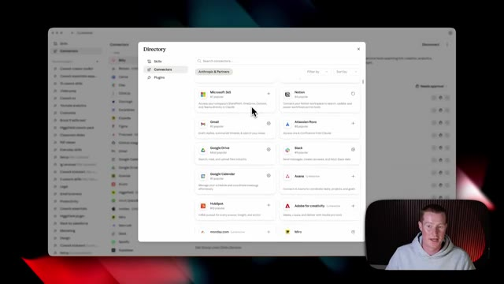
*⏱️ 00:03:15 — Fenêtre contextuelle affichant un répertoire de connecteurs d'applications (Microsoft 365, Notion, Gmail, Google Drive, Slack, HubSpot, etc.) pour l'assistant Claude.*

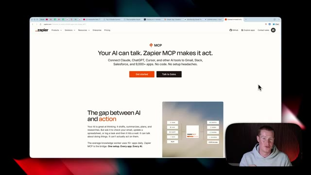
*⏱️ 00:03:31 — Page web de Zapier présentant son MCP (Model Context Protocol) permettant de connecter des IA comme Claude à plus de 9000 applications.*

---

### ⏱️ `[00:03:39 - 00:04:13]` | Segment #08

**🔊 Audio (Transcription Intégrale Mot pour Mot en Français) :**
> votre IA et plus de 9 000 applications différentes avec lesquelles Zapier s'intègre. Vous pouvez simplement créer un serveur MCP ici, même si vous n'êtes pas technique, connecter les différentes applications que vous utilisez comme Buffer ou Beehive qui n'ont pas de connecteurs préexistants à l'intérieur de l'application Claude. Et ensuite, vous cliquez simplement sur connecter, ajouter à Claude, et maintenant Zapier est connecté afin que nous puissions réellement extraire des données de ces différentes applications. Et plus nous connectons Claude à des applications, plus il sera puissant pour aller faire le travail à notre place. Et ensuite, ils continuent en disant qu'une fois que c'est fait, il répondra dans un fil de discussion Slack avec ce qu'il a créé. Très bien, alors passons en quelque sorte au

**👁️ Analyse Visuelle d'Écran (gemini-3.5-flash-lite) :**
**Interface & Outils** : Navigateur web, interface Zapier MCP, plateforme Claude et outil de schéma (Vectornator/Vidalytics).

**Contenu textuel & Code** : Liste des applications intégrées à un serveur MCP (Buffer, Airtable, Google Calendar, Stripe) et schéma d'intégration d'IA multi-plateforme.

**Action / Démonstration** : Présentation des intégrations d'applications via les serveurs MCP et démonstration visuelle de l'écosystème de communication.

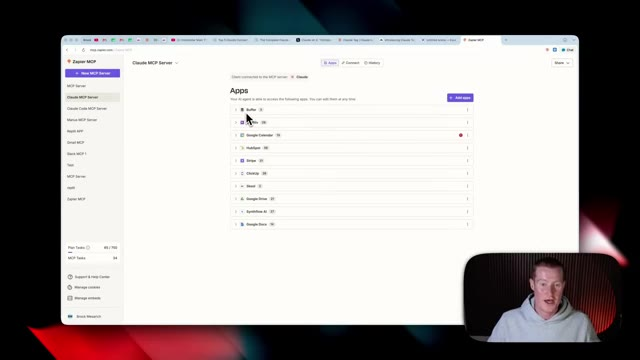
*⏱️ 00:03:48 — Interface Zapier MCP montrant la liste des applications connectées (Buffer, Airtable, Google Calendar, HubSpot, etc.).*

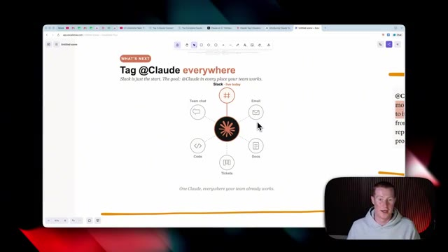
*⏱️ 00:04:05 — Schéma explicatif montrant l'écosystème "Tag @Claude everywhere" avec un agent central relié à différents canaux (chat, email, docs, code, tickets).*

---

### ⏱️ `[00:04:13 - 00:04:48]` | Segment #09

**🔊 Audio (Transcription Intégrale Mot pour Mot en Français) :**
> Le concept global de cette sortie de balise Claude, Claude est maintenant multijoueur. Dans un canal Slack donné, il y a un seul Claude qui interagit avec tout le monde dans ce canal. Cela signifie que n'importe qui peut voir sur quoi il travaille et vous pouvez reprendre la conversation là où la dernière personne l'a laissée. Cela rend Claude très différent du travail au sein d'une seule discussion ou d'une seule tâche. C'est beaucoup plus proche d'une interaction collaborative avec un coéquipier. On a donc l'impression qu'il s'agit plutôt d'un second cerveau que toute votre équipe peut utiliser. L'une des choses cool que j'ai remarquées depuis que je joue avec ça, et je vous le montrerai en direct plus tard dans la vidéo,

**👁️ Analyse Visuelle d'Écran (gemini-3.5-flash-lite) :**
**Interface & Outils** : Navigateur web affichant un outil de type tableau blanc / éditeur de texte en ligne.

**Contenu textuel & Code** : Texte affiché : "@Claude is multiplayer. Within a given Slack channel, there's one Claude that interacts with everyone..."

**Action / Démonstration** : Le présentateur explique le concept de l'intégration multijoueur de Claude dans un canal Slack tout en montrant le texte explicatif à l'écran.

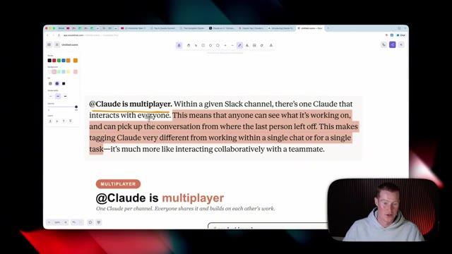
*⏱️ 00:04:22 — Un schéma ou document texte sur une page web montrant le concept "Claude is multiplayer" avec une section de texte mise en surbrillance.*

---

### ⏱️ `[00:04:49 - 00:05:26]` | Segment #10

**🔊 Audio (Transcription Intégrale Mot pour Mot en Français) :**
> c'est que vous pouvez lui demander de résumer tout un fil de discussion que vous avez manqué pendant votre absence. Et il vous donnera un aperçu condensé de tous les points clés que vous avez manqués, des choses qui sont, vous savez, urgentes auxquelles vous devez répondre, ou d'un message spécifique que vous auriez pu rater. Et pour moi, quand j'utilise Slack personnellement, des choses se cachent dans tous ces différents fils de discussion dont je ne savais même pas qu'ils avaient commencé. Et maintenant que tout le monde peut utiliser ce Claude directement dans votre Slack au sein de votre équipe, cela peut être assez puissant. Voici un excellent visuel pour vous expliquer cela un peu plus en détail si vous avez du mal à suivre. Donc Claude est multijoueur et nous obtenons un Claude par canal auquel nous accordons réellement l'accès. Et ensuite, tout le monde le partage

**👁️ Analyse Visuelle d'Écran (gemini-3.5-flash-lite) :**
**Interface & Outils** : Navigateur web affichant une application de notes ou de présentation avec un encart vidéo du présentateur.

**Contenu textuel & Code** : Texte affiché : "@Claude is multiplayer. Within a given Slack channel, there's one Claude that interacts with everyone..." avec des portions surlignées en orange.

**Action / Démonstration** : Le présentateur explique et commente le concept de l'intégration collaborative de Claude dans les outils de communication.

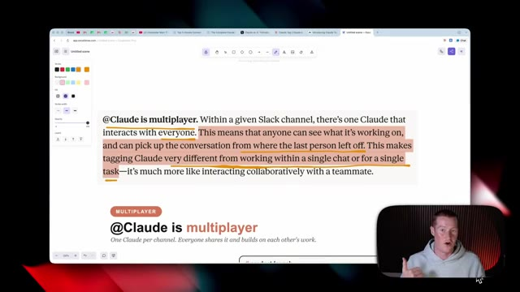
*⏱️ 00:04:58 — Capture d'écran montrant un texte surligné expliquant que Claude est un outil multijoueur fonctionnant dans les canaux Slack, avec le présentateur en médaillon vidéo en bas à droite.*

---

### ⏱️ `[00:05:26 - 00:05:44]` | Segment #11

**🔊 Audio (Transcription Intégrale Mot pour Mot en Français) :**
> qui se trouve à l'intérieur de ce canal. Donc, avant nous avions réellement un Claude directement à l'intérieur de Slack auquel nous pouvions nous connecter, mais c'était fondamentalement juste un échange entre vous et Claude. Au lieu que vous ayez besoin d'aller sur l'application de bureau Claude ou sur Claude.ai, vous êtes capable de discuter directement avec lui juste là, mais cela n'était pas du tout aussi performant que cette nouvelle fonctionnalité de balise Claude.

**👁️ Analyse Visuelle d'Écran (gemini-3.5-flash-lite) :**
**Interface & Outils** : Navigateur web affichant une application de tableau blanc ou de présentation en ligne (type Miro, Whimsical ou similaire).

**Contenu textuel & Code** : Schéma textuel et graphique expliquant la différence entre un chat privé avec Claude ("one task, then it is gone") et un mode collaboratif en équipe dans un canal Slack ("#product-launch" avec Sam, Maya, Devon et Priya).

**Action / Démonstration** : Le présentateur explique visuellement le passage d'une interaction individuelle à un usage collaboratif de Claude au sein d'une équipe.

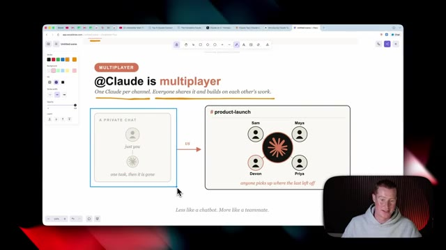
*⏱️ 00:05:30 — Capture d'écran montrant un schéma comparatif illustrant "@Claude is multiplayer", comparant un chat privé ("just you") à un canal partagé avec plusieurs utilisateurs et Claude.*

---

### ⏱️ `[00:05:45 - 00:06:19]` | Segment #12

**🔊 Audio (Transcription Intégrale Mot pour Mot en Français) :**
> Donc maintenant avec Claude tag, nous avons ce canal Slack appelé Product Launch avec tous nos différents membres d'équipe ici. Nous avons Sam, nous avons Sam, nous avons Devin, nous avons Maya, nous avons Priya. Et maintenant, nous avons tous accès à cette espèce de second cerveau ici, qui est Claude tag. Très bien, alors ensuite, il est dit qu'au fur et à mesure que Claude suit ce canal, il accumule plus de contexte sur le travail. Cela signifie que les utilisateurs n'ont pas besoin de tout réexpliquer depuis le début sans arrêt. C'est plutôt génial. J'ai hâte de voir cela en pratique. Et ils ont même fini par mentionner que Claude peut également apprendre automatiquement d'autres canaux Slack

**👁️ Analyse Visuelle d'Écran (gemini-3.5-flash-lite) :**
**Interface & Outils** : Navigateur web affichant un outil de dessin ou de présentation (type Excalidraw ou Miro) avec la webcam du présentateur incrustée en bas à droite.

**Contenu textuel & Code** : Texte et schémas montrant le passage d'un chat privé ("just you, one task, then it is gone") à un canal partagé ("#product-launch") où plusieurs membres de l'équipe interagissent avec Claude.

**Action / Démonstration** : Le présentateur explique visuellement comment Claude fonctionne en mode multijoueur et collaboratif au sein d'une équipe.

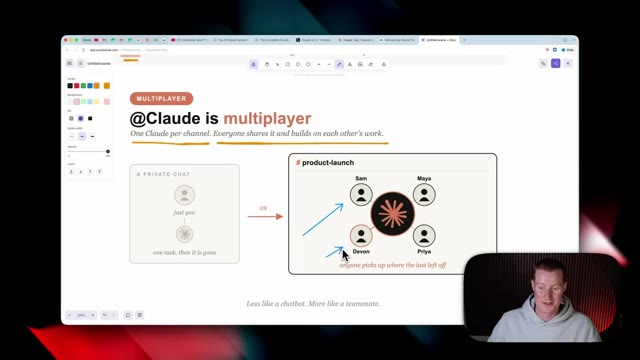
*⏱️ 00:05:53 — Schéma explicatif illustrant le concept de multijoueur pour l'intelligence artificielle "@Claude is multiplayer", comparant un chat privé à un espace collaboratif d'équipe (#product-launch) avec Sam, Maya, Devon et Priya.*

---

### ⏱️ `[00:06:19 - 00:06:41]` | Segment #13

**🔊 Audio (Transcription Intégrale Mot pour Mot en Français) :**
> et des sources de données uniquement si l'autorisation lui a été accordée. Maintenant, cette fonction-ci est probablement la plus cool. Claude est capable de prendre des initiatives et ils appellent ça le mode ambiant. Et le résumé en gros de ça, c'est que Claude vous tiendra proactivement au courant de tout ce qu'il pense que vous pourriez avoir besoin de savoir. Il signalera les informations pertinentes provenant de tous les canaux dans lesquels il se trouve et des outils auxquels il est connecté.

**👁️ Analyse Visuelle d'Écran (gemini-3.5-flash-lite) :**
**Interface & Outils** : Navigateur web avec un outil de prise de notes ou de présentation.

**Contenu textuel & Code** : Texte en anglais décrivant les fonctionnalités du mode ambiant (« @Claude takes initiative. If ambient behavior is enabled... ») et le présentateur visible en incrustation.

**Action / Démonstration** : Le présentateur explique les capacités du mode ambiant et la prise d'initiative proactive de l'assistant.

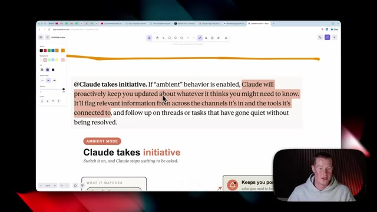
*⏱️ 00:06:24 — Capture d'écran montrant un document ou une présentation avec du texte sur le mode ambiant de Claude, illustrant son initiative proactive.*

---

### ⏱️ `[00:06:41 - 00:07:18]` | Segment #14

**🔊 Audio (Transcription Intégrale Mot pour Mot en Français) :**
> Donc, quand j'entends ça, je pense à quelque chose comme OpenClaw, où c'était en quelque sorte la toute première fois qu'on voyait des tâches cron en pratique et plutôt dans un outil grand public, où il était capable d'aller dire : hé, Brock, tu viens de recevoir un e-mail urgent, ou hé, Brock, je vois que tous tes concurrents font des vidéos sur ce sujet, tu devrais foncer et faire de même. Et comme il prend des initiatives, je n'ai fondamentalement pas besoin d'envoyer un message à Claude pour lui demander de faire quelque chose, il le fait tout simplement de manière automatique lorsqu'il estime que c'est nécessaire. Donc encore une fois, voici en quelque sorte un schéma qui l'explique visuellement : il est capable de surveiller ces différents projets. Alors imaginez que nous ayons Project X, Team Sync et Design Review comme différents canaux Slack, et ce n'est pas tout.

**👁️ Analyse Visuelle d'Écran (gemini-3.5-flash-lite) :**
**Interface & Outils** : Navigateur web affichant une application de schématisation ou un outil de présentation ("being resolved") et le présentateur en médaillon.

**Contenu textuel & Code** : Schéma intitulé "Claude takes initiative" avec les sections "WHAT IT WATCHES" (#project, #team-sync, #design-review) connectées à un noyau central "always watching", et des sorties vers "Keeps you posted", "Flags what matters", "Chases loose ends".

**Action / Démonstration** : Le présentateur commente le fonctionnement des agents autonomes et des notifications proactives basées sur des flux de travail automatisés.

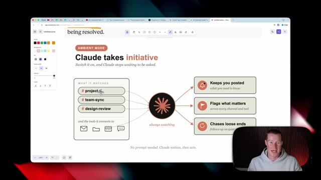
*⏱️ 00:06:51 — Capture d'écran montrant un schéma explicatif sur le mode ambiant de Claude, illustrant comment l'IA prend des initiatives et surveille divers canaux.*

---

### ⏱️ `[00:07:18 - 00:07:53]` | Segment #15

**🔊 Audio (Transcription Intégrale Mot pour Mot en Français) :**
> mais il a aussi les outils auxquels il est connecté via Claude dont j'ai parlé tout à l'heure. Puisque Claude peut toujours surveiller, il vous tiendra au courant de ce que nous devons savoir. Il signalera des choses spécifiques qui comptent et il sera capable d'aller effectivement courir après les détails en suspens pour nous. Maintenant, un exemple parfait de cela en pratique est celui-ci pour le support client. Alors imaginez que nous donnons à Claude l'accès à notre compte Gmail, qui est utilisé pour notre support client. Et disons qu'il y a quelques e-mails que nous recevons où un client dit qu'il ne peut pas se connecter à notre application. Par exemple, Claude sera capable de repérer cela parce qu'il a accès à cet e-mail juste ici. Ensuite, il

**👁️ Analyse Visuelle d'Écran (gemini-3.5-flash-lite) :**
**Interface & Outils** : Navigateur web affichant une application de schéma (Excalidraw).

**Contenu textuel & Code** : Schéma intitulé "Claude takes initiative" avec des flux de données montrant "what it watches" (#project-x, #team-sync, #design-review) vers un cœur "always watching", et des sorties vers "Keeps you posted", "Flags what matters", et "Chases loose ends".

**Action / Démonstration** : Présentation visuelle du concept de veille et d'initiative de Claude par le présentateur en médaillon.

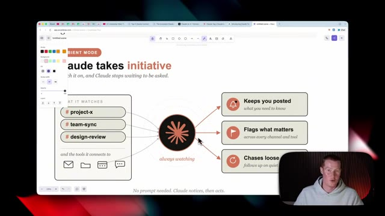
*⏱️ 00:07:27 — Capture d'écran montrant un schéma explicatif sur les fonctionnalités proactives de Claude, illustrant la surveillance continue et les actions automatisées.*

---

### ⏱️ `[00:07:53 - 00:08:26]` | Segment #16

**🔊 Audio (Transcription Intégrale Mot pour Mot en Français) :**
> will be able to go and alert the right people. And what I mean by alerting the right people is it can go and start a thread inside of the customer support Slack channel in order to flag that with the customer support team. But it can also go ahead and flag this with the engineering team as well. So they could go and be proactive and actually try to fix this issue. And Claude's basically the middleman here. So you don't need somebody who's actively searching in your Gmail to then go and spot this and then alert these different channels inside of Slack. This is just one example that I thought of that could be pretty cool in practice, but I'm really interested to see

**👁️ Analyse Visuelle d'Écran (gemini-3.5-flash-lite) :**
**Interface & Outils** : Navigateur web affichant une application de tableau blanc (Mral / logiciel de diagramme) et incrustation vidéo du présentateur.

**Contenu textuel & Code** : Schéma intitulé 'Ambient mode, in action' montrant un e-mail de client signalant un problème de connexion ('Customers can\'t log in'), un agent central et des alertes vers '#customer-support' et '#engineering'.

**Action / Démonstration** : Le présentateur explique comment l'IA détecte automatiquement un problème par e-mail et alerte de manière proactive les bonnes équipes sur Slack.

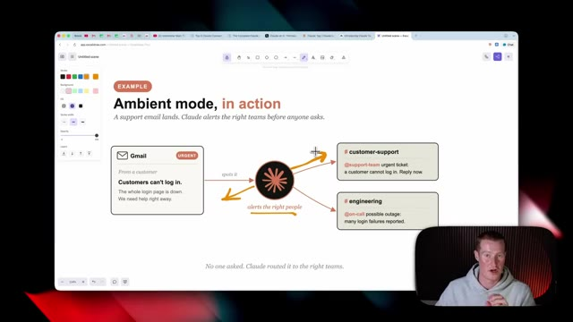
*⏱️ 00:08:01 — Schéma explicatif illustrant le fonctionnement du mode 'Ambient' avec un e-mail Gmail urgent routé automatiquement vers les canaux Slack du support client et de l'ingénierie.*

---

### ⏱️ `[00:08:26 - 00:09:03]` | Segment #17

**🔊 Audio (Transcription Intégrale Mot pour Mot en Français) :**
> other use cases of this. Next, Anthropic said that at Claude works asynchronistically. Set Claude a task and you could focus on your other priorities while it works. Very similar to, you know, if we've ever used Claude Cowork or Claude Code, that is nothing new. And it says it could even schedule tasks for itself, pursuing a project autonomously over hours or days. That sounds obviously pretty promising, but I want to see this in practice because something tells me that that might not be as capable as they're making it sound right now. They went on to say that we now spend much of our time delegating tasks to many Claude's in parallel, which over time, this is going to be more and more

**👁️ Analyse Visuelle d'Écran (gemini-3.5-flash-lite) :**
**Interface & Outils** : Navigateur web / application de prise de notes ou traitement de texte en ligne.

**Contenu textuel & Code** : Texte sur l'intelligence artificielle Claude, mentionnant : "@Claude works asynchronously. Set Claude a task... we now spend much more of our time delegating tasks to many Claudes in parallel."

**Action / Démonstration** : Le présentateur commente le texte affiché à l'écran concernant les capacités asynchrones de l'assistant IA.

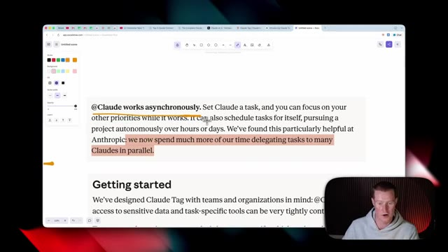
*⏱️ 00:08:36 — Capture d'écran montrant un navigateur web avec un document texte affichant des phrases sur le fonctionnement asynchrone de Claude, avec des passages surlignés.*

---

### ⏱️ `[00:09:03 - 00:09:26]` | Segment #18

**🔊 Audio (Transcription Intégrale Mot pour Mot en Français) :**
> how we work. Instead of us going and doing a thing, it's us delegating that task to our agent, which is now Claude Tag. All right, so let's quickly, all right, so now let's talk about privacy and how this actually works, what context does this have, et cetera, because this is something when I originally heard about this release, I thought this was promising, but then privacy instantly became one of the things that I was concerned about.

**👁️ Analyse Visuelle d'Écran (gemini-3.5-flash-lite) :**
**Interface & Outils** : Navigateur web affichant une application de prise de notes ou un document annoté (ex: interface Excalidraw ou similaire)

**Contenu textuel & Code** : Texte surligné en jaune/orange : "@Claude works asynchronously. Set Claude a task, and you can focus on your other priorities while it works...". Section intitulée "Getting started" visible en bas.

**Action / Démonstration** : Le présentateur commente le texte à l'écran concernant la délégation des tâches à Claude et son fonctionnement asynchrone.

*⏱️ 00:09:09 — Capture d'écran montrant une page web ou un document annoté avec du texte sur le fonctionnement asynchrone de Claude, avec le présentateur en médaillon en bas à droite.*

---

### ⏱️ `[00:09:26 - 00:09:48]` | Segment #19

**🔊 Audio (Transcription Intégrale Mot pour Mot en Français) :**
> So what they're saying is that we've designed CloudTag with teams and organizations in mind. Cloud's access to sensitive data and task-specific tools can be tightly controlled. To get up and running, system administrators specify which tools and information the model should have access to and which channels. Think of this like creating separate clod identities for different uses.

**👁️ Analyse Visuelle d'Écran (gemini-3.5-flash-lite) :**
**Interface & Outils** : Navigateur web affichant un document annoté (outil de dessin/annotation Excalidraw ou similaire) et flux vidéo du présentateur.

**Contenu textuel & Code** : Texte explicatif sur Claude Tag (« We've designed Claude Tag with teams and organizations in mind... ») avec des surlignages orange sur les passages clés.

**Action / Démonstration** : Le présentateur commente le texte affiché à l'écran concernant la gestion des accès et des équipes pour le modèle d'IA.

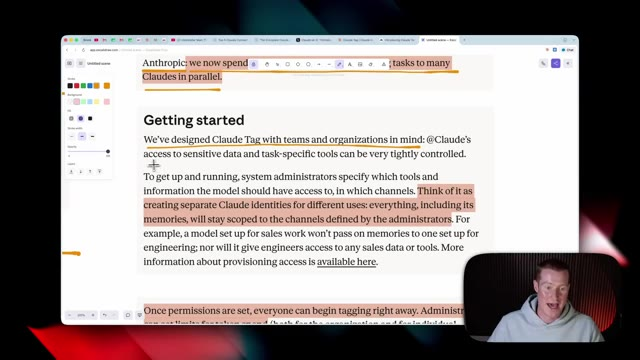
*⏱️ 00:09:32 — Capture d'écran montrant un document textuel sur une interface web avec des passages surlignés en orange, et la vidéo du présentateur en bas à droite.*

---

### ⏱️ `[00:09:48 - 00:10:23]` | Segment #20

**🔊 Audio (Transcription Intégrale Mot pour Mot en Français) :**
> Everything, including its memories, will stay scoped to the channels defined by the administrators. For example, a model set up for sales work won't pass on memories to one set up for engineering. So whatever department or Slack channel we add this clod tag to, it's only going to have information and context within that channel. So that way you don't like cross pollinate between your different organizations inside of your company, which you obviously would not want that to be the case. Once permissions are set, everyone can begin tagging right away and administrators can set limits for token spend. So this is kind of interesting. This is something

**👁️ Analyse Visuelle d'Écran (gemini-3.5-flash-lite) :**
**Interface & Outils** : Navigateur web affichant une page de documentation ou d'article (application de notes/collaboration type Miro ou similaire avec des outils de dessin sur le côté), et incrustation vidéo du présentateur.

**Contenu textuel & Code** : Texte explicatif sur Claude Tag, la gestion des accès par canal, les identités séparées et la gestion des limites de tokens.

**Action / Démonstration** : Le présentateur commente le texte à l'écran tout en surlignant ou en lisant les passages clés concernant la sécurité et l'organisation des données.

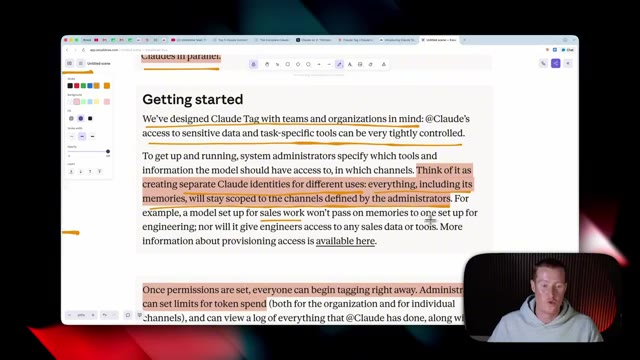
*⏱️ 00:09:57 — Capture d'écran montrant le navigateur avec un article sur Claude Tag, section "Getting started" avec du texte surligné, et la vidéo du présentateur en bas à droite.*

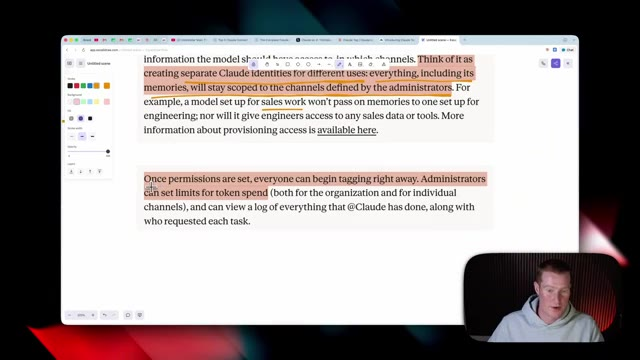
*⏱️ 00:10:14 — Capture d'écran montrant la suite du texte de l'article sur Claude Tag concernant les permissions et les limites de dépenses en tokens, avec la vidéo du présentateur en bas à droite.*

---

### ⏱️ `[00:10:23 - 00:10:56]` | Segment #21

**🔊 Audio (Transcription Intégrale Mot pour Mot en Français) :**
> that obviously over time may become an issue if there are certain people or certain channels that maybe just spam this for some reason. At least we know that we have the ability to control how much not only organizations and channels are able to use this, but also individual users as well. All right, so I dug even deeper into the privacy and I want to break this down here because this is pretty important. So Anthropic says in addition to credentials, admins also define repository access, connectors, which is really big, the tools and API keys that Claude uses to

**👁️ Analyse Visuelle d'Écran (gemini-3.5-flash-lite) :**
**Interface & Outils** : Navigateur web affichant une application de documentation textuelle avec des annotations visuelles.

**Contenu textuel & Code** : Texte explicatif sur la configuration des rôles, la gestion des identités séparées et la limitation des dépenses en tokens pour les organisations et les canaux individuels.
[DESC_ACTION_1] Le présentateur commente les options de contrôle des accès et de limitation d'utilisation des modèles d'IA.

**Action / Démonstration** : Explications face caméra et analyse conceptuelle des marchés.

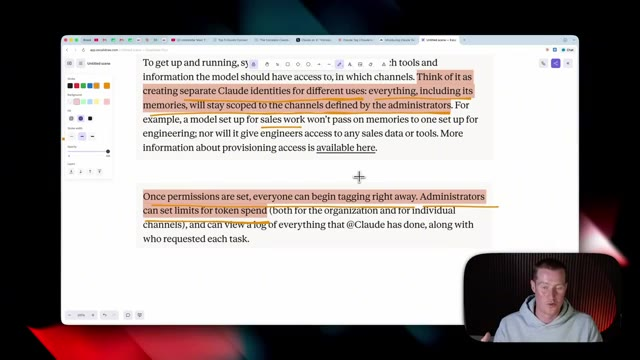
*⏱️ 00:10:31 — Capture d'écran montrant un article de documentation avec du texte surligné concernant la gestion des limites de dépenses en tokens par les administrateurs.*

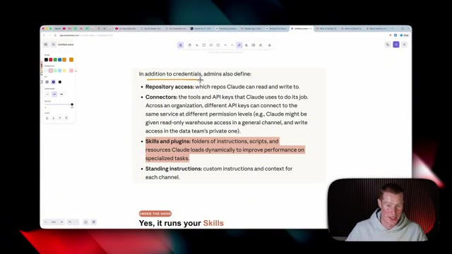
*⏱️ 00:10:47 — Capture d'écran affichant une page de documentation décrivant les définitions des administrateurs telles que l'accès aux dépôts, les connecteurs et les compétences.*

---

### ⏱️ `[00:10:56 - 00:11:22]` | Segment #22

**🔊 Audio (Transcription Intégrale Mot pour Mot en Français) :**
> fasse son travail. Et au sein d'une organisation, différentes clés d'API peuvent se connecter au même service à différents niveaux de permission. Je crois que cela signifie que chaque utilisateur individuel peut configurer ses propres clés d'API pour les applications qu'il utilise. De cette façon, l'administrateur n'a pas nécessairement à payer pour tout cela. Je ne suis pas tout à fait sûr, c'est quelque chose que je ne maîtrise pas totalement, et je ne veux pas dire de bêtises ici. Et les compétences et les plugins, c'est vraiment très important.

**👁️ Analyse Visuelle d'Écran (gemini-3.5-flash-lite) :**
**Interface & Outils** : Navigateur web, outil de prise de notes/schémas (Excalidraw).

**Contenu textuel & Code** : Texte explicatif en anglais titré 'In addition to credentials, admins also define:' listant des éléments comme 'Repository access', 'Connectors', 'Skills and plugins', et 'Standing instructions', avec des sections surlignées en jaune et rose.

**Action / Démonstration** : Le présentateur explique les concepts liés aux clés d'API et aux niveaux de permission pour les outils d'IA au sein d'une organisation.

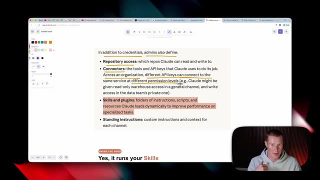
*⏱️ 00:11:02 — Capture d'écran montrant une page de notes explicatives sur l'IA (hébergée sur Excalidraw ou un outil similaire) avec le présentateur en médaillon en bas à droite.*

---

### ⏱️ `[00:11:22 - 00:11:54]` | Segment #23

**🔊 Audio (Transcription Intégrale Mot pour Mot en Français) :**
> So apparently we can run our specific skills that we have in plugins. But then the question becomes, does the admin supply the skills and you could only use those or could each individual use the skills that they've crafted? I'd probably assume that the admin has to configure it and it's not just going to allow all individual users to run their skills, you know, across this Slack channel, but I could be wrong. All right. So let's go ahead and set this up now. First of all, there will be a link to this in the description to access this page here. And again, you do have to be on either the team or the enterprise plan for Claude. So I'm going to click add to Slack.

**👁️ Analyse Visuelle d'Écran (gemini-3.5-flash-lite) :**
**Interface & Outils** : Application de notes / tableau blanc en ligne (type Miro ou Excalidraw) avec le présentateur en incrustation vidéo.

**Contenu textuel & Code** : Texte explicatif sur les rôles des administrateurs, listant 'Repository access', 'Connectors', 'Skills and plugins' (surligné en orange) et 'Standing instructions'.

**Action / Démonstration** : Le présentateur commente le texte affiché à l'écran concernant les compétences (skills) et plugins gérés par les administrateurs.

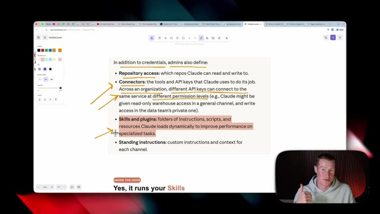
*⏱️ 00:11:30 — Capture d'écran montrant une page de notes textuelles avec des annotations surlignées, avec en bas à droite une incrustation vidéo du présentateur.*

---

### ⏱️ `[00:11:54 - 00:12:12]` | Segment #24

**🔊 Audio (Transcription Intégrale Mot pour Mot en Français) :**
> And from here, we need to configure which workspace we wanted to have access to. So I'm going to click AI accelerator. And then we could also manage the permissions here. So go through and make sure you're only granting access to, you know, certain permissions that you actually wanted to have. I'm just going to go ahead and click allow. It says Claude is installed. So now I need to open up Slack.

**👁️ Analyse Visuelle d'Écran (gemini-3.5-flash-lite) :**
**Interface & Outils** : Navigateur web affichant l'interface de Slack.

**Contenu textuel & Code** : Message d'erreur : « You are not authorized to install Claude on Automatable », avec une incitation à contacter les administrateurs d'applications.

**Action / Démonstration** : Le présentateur montre l'écran de configuration des intégrations d'applications et les restrictions d'accès/permissions dans Slack.

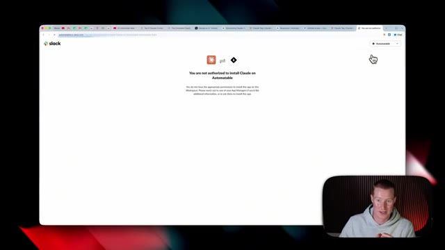
*⏱️ 00:11:58 — Capture d'écran montrant une page d'erreur ou d'avertissement Slack indiquant l'absence d'autorisations pour installer l'application Claude sur un espace de travail.*

---

### ⏱️ `[00:12:12 - 00:12:37]` | Segment #25

**🔊 Audio (Transcription Intégrale Mot pour Mot en Français) :**
> Maintenant, ce que nous devons faire, c'est aller dans l'administration de Slack. Alors, cliquez sur cette petite icône de roue dentée. Ensuite, à partir d'ici, nous allons descendre jusqu'à applications et flux de travail. Donc, juste ici, il semble que j'aie déjà ajouté Claude. Et si je reviens sur Slack, je vais simplement, en gros, dans n'importe quel canal auquel je veux ajouter Claude et je fais juste arobase Claude. Vous pouvez voir qu'il n'est pas dans le canal, mais si je clique sur ceci, que j'envoie cela, le robot Slack va demander si je veux l'ajouter. Alors, cliquons simplement sur ajouter.

**👁️ Analyse Visuelle d'Écran (gemini-3.5-flash-lite) :**
**Interface & Outils** : Slack

**Contenu textuel & Code** : Menu d'administration et paramètres d'un espace de travail Slack Pro.

**Action / Démonstration** : Navigation dans les menus d'administration de Slack pour accéder aux applications et flux de travail.

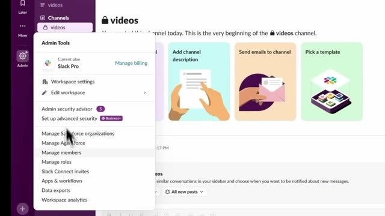
*⏱️ 00:12:19 — Capture d'écran montrant le menu d'administration de Slack avec les options de gestion (Workspace settings, Manage members, Apps & workflows).*

---

### ⏱️ `[00:12:37 - 00:13:12]` | Segment #26

**🔊 Audio (Transcription Intégrale Mot pour Mot en Français) :**
> Et nous allons faire de même pour tous nos différents canaux auxquels nous voulons avoir accès. Maintenant, ici, il me donne un message qui explique en gros comment cela fonctionne. Voici comment je collecte et traite le contexte. Lorsque vous me mentionnez dans un fil de discussion, je lis automatiquement les messages récents de ce fil pour comprendre le contexte de la conversation. Je peux accéder aux fichiers partagés dans la conversation et les analyser. Lorsque vous me mentionnez, je ne traite que les messages des fils de discussion où je suis explicitement mentionné. Vos conversations sont privées et accessibles. Je ne conserve pas vos conversations Slack et je ne m'entraîne pas dessus. C'est donc très intéressant. Très bien. Je viens donc de lui envoyer un message vraiment simple, euh, vous savez, ici. J'ai juste dit : @Claude, comment ça va ?

**👁️ Analyse Visuelle d'Écran (gemini-3.5-flash-lite) :**
**Interface & Outils** : Application Slack

**Contenu textuel & Code** : Message de présentation de l'application Claude dans Slack, détaillant comment elle collecte et traite le contexte (lecture des messages dans les fils de discussion, accès aux fichiers partagés, confidentialité, etc.).

**Action / Démonstration** : Affichage des instructions et explications sur l'utilisation de l'assistant IA Claude au sein d'un canal Slack.

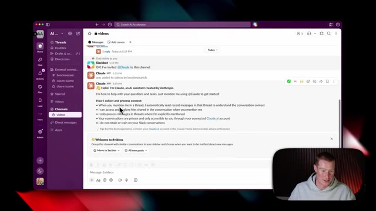
*⏱️ 00:12:46 — Capture d'écran montrant l'application Slack avec un message de bienvenue de l'assistant IA Claude, expliquant son fonctionnement et sa collecte de contexte dans les fils de discussion.*

---

### ⏱️ `[00:13:12 - 00:13:44]` | Segment #27

**🔊 Audio (Transcription Intégrale Mot pour Mot en Français) :**
> Euh, ça a affiché cette petite icône sympa montrant que ça fonctionnait. Et à partir d'ici, ça montre que je dois en fait sélectionner un répertoire dans lequel il peut travailler. Donc, laissez-moi aller de l'avant et sélectionner l'un de mes dépôts. Très bien. J'ai donc demandé à Claude, comment ça va ? Peux-tu récupérer mes derniers e-mails de ce matin auxquels je n'ai pas répondu ? Et pour ce cas d'utilisation, j'avais déjà préconfiguré Gmail dans mon compte Claude. J'ai donc pu récupérer des informations à partir de ce connecteur que j'avais. Et il est donc allé récupérer deux e-mails auxquels je dois répondre. C'est donc plutôt cool d'utiliser ça en pratique. Et bien sûr, c'est à l'intérieur d'un nouveau canal Slack parce que je ne

**👁️ Analyse Visuelle d'Écran (gemini-3.5-flash-lite) :**
**Interface & Outils** : Application de messagerie professionnelle Slack et assistant IA Claude.

**Contenu textuel & Code** : Boîte de dialogue de sélection de dépôt (repository) et conversation textuelle avec l'assistant Claude intégrant la gestion d'e-mails.

**Action / Démonstration** : Sélection d'un répertoire de travail et interaction avec l'assistant IA dans un canal de discussion.

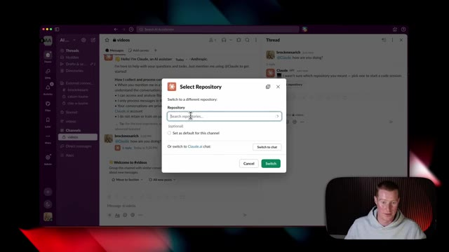
*⏱️ 00:13:20 — Interface Slack affichant une boîte de dialogue contextuelle 'Select Repository' permettant de choisir un dépôt de code pour l'assistant Claude.*

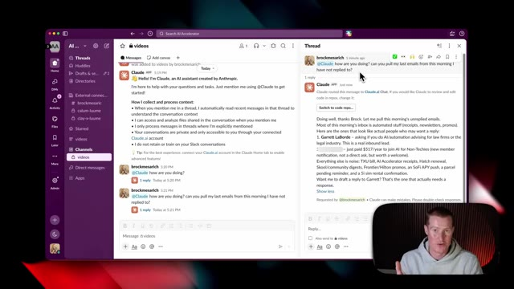
*⏱️ 00:13:28 — Interface Slack avec un fil de discussion (Thread) où Claude répond à une requête concernant des e-mails non lus, avec un encart de prévisualisation vidéo en bas à droite.*

---

### ⏱️ `[00:13:44 - 00:14:18]` | Segment #28

**🔊 Audio (Transcription Intégrale Mot pour Mot en Français) :**
> je veux montrer l'un des canaux Slack au sein de mon entreprise parce qu'il y a des informations privées là-dedans. Mais comme contexte, mais comme le contexte des canaux Slack s'accumule, je vois bien à quel point cela pourrait être assez puissant puisque cela dispose alors de connaissances générales sur toutes ces informations. Très bien. Donc personnellement, je n'ai pas beaucoup de cas d'usage que je pourrais montrer en ce moment encore une fois, parce que je ne veux pas montrer d'informations sensibles sur l'entreprise, mais ce sont quelques exemples qu'Anthropic nous donne. Laissez-moi donc passer en revue quelques-uns de ces exemples. Vous pouvez donc voir ici qu'Elena a utilisé arobase Claude et a essentiellement dit, quels sont les principaux comptes d'entreprise par dépenses au cours des sept et 28 derniers jours ?

**👁️ Analyse Visuelle d'Écran (gemini-3.5-flash-lite) :**
**Interface & Outils** : Slack, navigateur web (Anthropic Claude website).

**Contenu textuel & Code** : Interactions textuelles avec l'assistant Claude dans Slack, instructions d'intégration et exemples de requêtes professionnelles.

**Action / Démonstration** : Navigation et présentation des fonctionnalités de l'assistant Claude intégré dans Slack.

*⏱️ 00:13:53 — Interface Slack montrant une conversation avec l'assistant Claude au sein d'un canal d'entreprise.*

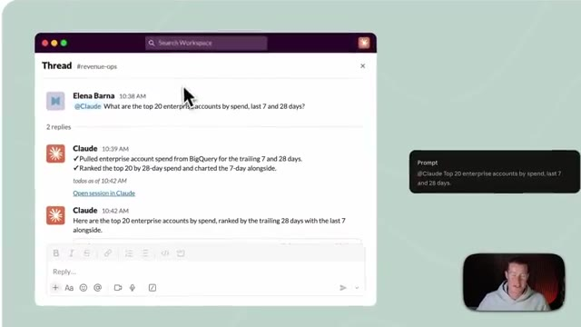
*⏱️ 00:14:09 — Gros plan sur un fil de discussion Slack dans le canal '#revenue-ops' avec des requêtes adressées à @Claude.*

---

### ⏱️ `[00:14:18 - 00:14:39]` | Segment #29

**🔊 Audio (Transcription Intégrale Mot pour Mot en Français) :**
> Claude est ensuite allé récupérer des informations depuis BigQuery, qui est l'application qu'ils utilisent. Et ensuite, il a effectivement fourni une ventilation ici. Comme vous pouvez le voir, cela montre tout cela classé avec, vous savez, le montant des dépenses sur sept et 28 jours. Et en plus de cela, il a même envoyé un PNG qu'il est allé générer. C'est plutôt cool. En détaillant cela avec ce graphique sympa ici.

**👁️ Analyse Visuelle d'Écran (gemini-3.5-flash-lite) :**
**Interface & Outils** : Application de messagerie Slack avec intégration de l'assistant Claude.

**Contenu textuel & Code** : Un message de l'utilisateur demandant à Claude les 20 principaux comptes par dépenses sur 7 et 28 jours, et la réponse de Claude indiquant qu'il a récupéré les données depuis BigQuery.

**Action / Démonstration** : Consultation d'une discussion sur Slack illustrant l'interaction entre un utilisateur et l'assistant IA relié à BigQuery.

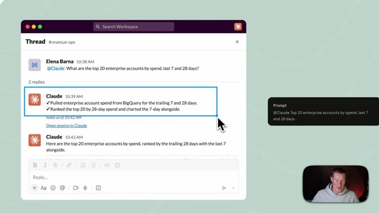
*⏱️ 00:14:23 — Capture d'écran montrant une interface Slack avec une conversation où l'assistant Claude répond à une requête concernant les dépenses des comptes enterprise.*

---

### ⏱️ `[00:14:39 - 00:15:12]` | Segment #30

**🔊 Audio (Transcription Intégrale Mot pour Mot en Français) :**
> ensuite, c'est un cas assez simple, Camilla l'a juste étiqueté et a dit : "Je rencontre Acme à deux heures, qu'est-ce que je dois savoir ?" et le système est allé chercher dans son calendrier en gros pour décomposer tout ce que je devais savoir en termes de préparation pour cette réunion. Nathan a envoyé un message disant : "Surveille ce canal, faites le tri de ce qui arrive et traitez le carnet de commandes, étiquetez-moi seulement quand quelque chose requiert mon intervention." Donc Claude utilise l'agent pour analyser automatiquement... on dirait qu'il y a eu une erreur de paiement ici que Datadog a signalée dans le canal Slack, et ensuite l'agent Claude a automatiquement contacté Nathan parce que cela nécessite son attention. Vous pouvez donc voir à quel point c'est puissant

**👁️ Analyse Visuelle d'Écran (gemini-3.5-flash-lite) :**
**Interface & Outils** : Interface de messagerie collaborative (type Slack) intégrant des agents IA (Claude).

**Contenu textuel & Code** : Messages textuels, prompts utilisateurs (« @Claude I'm meeting Acme at 2... » et « @Claude Watch this channel... »), réponses structurées de l'agent IA contenant des informations commerciales, des points de blocage et des analyses techniques de performance.

**Action / Démonstration** : Démonstration de l'utilisation d'un agent IA intégré dans un outil de messagerie pour automatiser la préparation de réunions et la gestion de alertes de production.

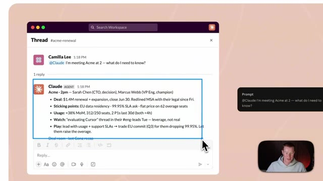
*⏱️ 00:14:47 — Capture d'écran montrant une interface de type Slack avec une requête utilisateur (@Claude) demandant des informations sur une réunion à venir avec Acme, et la réponse détaillée de l'agent IA.*

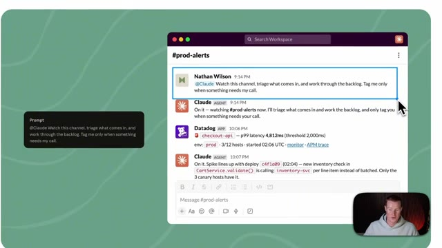
*⏱️ 00:14:55 — Capture d'écran montrant une interface de messagerie où Nathan Wilson donne des instructions à l'agent Claude pour surveiller le canal #prod-alerts, trier les messages et gérer le backlog.*

---

### ⏱️ `[00:15:12 - 00:15:30]` | Segment #31

**🔊 Audio (Transcription Intégrale Mot pour Mot en Français) :**
> c'est à ce moment-là que nous avons ceci qui surveille nos canaux Slack spécifiques et identifie les personnes concernées. Voilà donc. C'est une nouvelle balise Claude qui vient d'être publiée par Anthropic. Si vous avez apprécié cette vidéo, assurez-vous de vous abonner à cette chaîne. Je couvre l'intelligence artificielle pour les non-techniciens. Cela étant dit, je ne veux pas vous prendre plus de temps. J'espère que vous passez une bonne journée et je vous vois dans la prochaine. À la vôtre.

**👁️ Analyse Visuelle d'Écran (gemini-3.5-flash-lite) :**
**Interface & Outils** : Navigateur web affichant une page d'Anthropic avec une interface Slack simulée.

**Contenu textuel & Code** : Interface Slack avec un message de Claude analysant des alertes système et effectuant un diagnostic technique.

**Action / Démonstration** : Présentation visuelle de la nouvelle fonctionnalité de balise Claude par le présentateur.

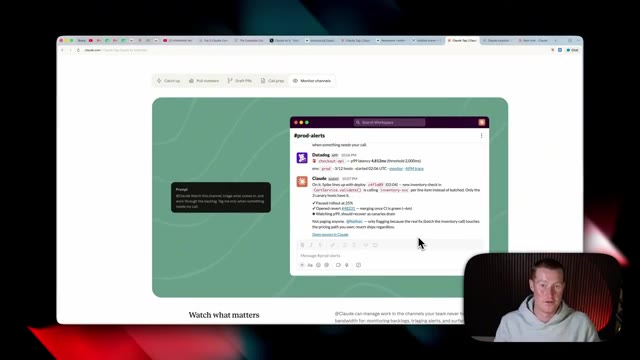
*⏱️ 00:15:16 — Capture d'écran montrant une page web avec une interface Slack intégrée illustrant l'utilisation de la balise Claude pour la surveillance de canaux d'alerte.*

---

