# 🎬 Anthropic Just Dropped Claude Design 2.0 (Endless Capabilities)

> **Chaîne** : [Brock Mesarich | AI for Non Techies](https://www.youtube.com/@BrockMesarich)  
> **Lien YouTube** : [https://www.youtube.com/watch?v=TJ80fChZXW4](https://www.youtube.com/watch?v=TJ80fChZXW4)  
> **Date de publication** : 20260629  
> **Durée** : 00:13:13  
> **Identifiant vidéo** : `TJ80fChZXW4`  
> **Transcription & Analyse** : `whisper-v3-large-turbo+gemini-3.5-flash-lite`  

---

## 📌 Synthèse Exécutive & Outils

### 💡 Résumé

La vidéo de la chaîne *Brock Mesarich | AI for Non Techies* présente la mise à jour majeure **Claude Design 2.0** déployée par Anthropic, une refonte complète de leur plateforme de prototypage visuel et d'interface utilisateur, qui se positionne comme un concurrent direct de Figma. L'analyste y détaille l'ergonomie repensée de l'interface, l'intégration unifiée des limites d'utilisation au sein des abonnements Claude Pro et Max, ainsi que l'introduction de fonctionnalités de modification directe sur le canevas, éliminant la nécessité de passer systématiquement par des prompts textuels complexes et réduisant drastiquement la consommation de jetons (*tokens*).

Au-delà des améliorations graphiques, la démonstration met en lumière la passerelle bidirectionnelle entre **Claude Design** et **Claude Code**, permettant une synchronisation automatisée des systèmes de design (*design sync*) via des composants React préexistants. L'expert démontre un flux de travail complet (*workflow*) allant de la conception visuelle d'une application de suivi nutritionnel (le cas d'usage pratique présenté) jusqu'à son exportation vers un environnement de développement fonctionnel. Grâce à l'utilisation de connecteurs natifs et d'outils de backend comme **Supabase**, la structure frontend initialement conçue est rapidement connectée à une base de données relationnelle, transformant un simple prototype visuel en une application opérationnelle sans nécessiter de compétences avancées en codage.

Cette approche illustre l'accélération de l'automatisation dans le développement d'applications légères et d'outils de productivité par l'intelligence artificielle générative. En connectant des environnements de design visuel à des agents de code autonomes et des bases de données cloud, les créateurs non-techniques peuvent concevoir, itérer et déployer des prototypes fonctionnels avec une fidélité visuelle et une cohérence de marque rigoureuses, tout en optimisant l'allocation de leurs ressources informatiques.

### 🛠️ Outils, Modèles & Logiciels Présentés

* **Claude Design** : La plateforme de prototypage et de conception d'interfaces d'Anthropic, utilisée pour générer des prototypes d'applications web/mobiles, des diapositives, des wireframes et des animations.
* **Claude Code** : L'environnement de développement et d'exécution de code d'Anthropic permettant de transformer les designs visuels en applications fonctionnelles et de synchroniser les systèmes de design.
* **Claude Cowork** : L'espace de travail collaboratif d'Anthropic pour la gestion d'artefacts, de tableaux de bord et de contenus structurés.
* **Supabase** : La plateforme de base de données backend cloud utilisée pour stocker et gérer les informations dynamiques nécessaires au fonctionnement des applications créées.
* **Figma** : L'outil de conception d'interface de référence, mentionné comme standard de comparaison et option d'importation de systèmes de design.
* **GitHub** : La plateforme de gestion de code source et de versioning utilisable pour connecter et importer des systèmes de design.
* **Make** : Mentionné dans le contexte général des écosystèmes d'automatisation de flux de travail No-Code/Low-Code.
* **Zapier** : Cité parmi les outils d'automatisation et de connectivité inter-applications.
* **n8n** : Évoqué dans l'écosystème des outils d'automatisation et de gestion de workflows complexes.
* **ChatGPT** : Modèle et assistant conversationnel d'OpenAI mentionné dans le panorama général des intelligences artificielles.
* **Gemini** : La suite de modèles d'intelligence artificielle de Google citée parmi les concurrents du marché.
* **Grok** : Le modèle conversationnel et d'IA développé par xAI.
* **Lovable** : Un outil de développement orienté vers le code instinctif et la génération d'applications, compatible avec les exportations de Claude Design.
* **Gamma** : Une plateforme de création de documents et de présentations visuelles connectable aux flux de travail de design.
* **Miro** : Un tableau blanc collaboratif en ligne intégré parmi les options de partage et d'exportation de Claude Design.

### 🔑 Points Clés & Enseignements Stratégiques

* **Refonte ergonomique de l'interface** : Claude Design 2.0 propose une organisation visuelle modernisée et intuitive, articulée autour d'une zone de texte centrale et de modèles préconfigurés pour accélérer le démarrage des projets (prototypes, diapositives, documents, wireframes, animations).
* **Unification des quotas d'utilisation** : La facturation et les limites d'utilisation de Claude Design sont désormais mutualisées avec l'ensemble du plan global de l'utilisateur (Claude Pro ou Claude Max), éliminant les restrictions cloisonnées de la première version qui pénalisaient l'expérimentation intensive.
* **Édition directe sur le canevas (*Canvas Editing*)** : L'introduction d'un mode d'édition visuelle permet de manipuler directement le texte, les éléments structurels et les propriétés graphiques (comme les couleurs d'arrière-plan des *divs*) sans passer par le module de chat textuel.
* **Optimisation de la consommation de jetons** : En permettant des ajustements graphiques visuels et ciblés directement sur l'interface, la plateforme réduit drastiquement le recours à des invites textuelles itératives, économisant ainsi de précieux *tokens* sur le modèle.
* **Synchronisation automatisée des systèmes de design (*Design Sync*)** : La fonctionnalité de liaison avec Claude Code permet d'importer et de compiler automatiquement des composants React et des chartes graphiques existantes sans nécessiter d'importation manuelle laborieuse.
* **Préservation de la cohérence visuelle et de marque** : L'utilisation de commandes de synchronisation garantit que les nouveaux prototypes respectent strictement l'identité visuelle, la typographie et la charte graphique développées pour les projets d'entreprise ou les marques personnelles.
* **Passerelle fluide vers le développement fonctionnel** : La fonction de partage « Envoyer vers » permet de transférer instantanément la structure d'une interface visuelle vers des environnements de code comme Claude Code ou des outils de programmation instinctive (Lovable).
* **Intégration transparente des bases de données backend** : L'utilisation de connecteurs natifs pour des solutions cloud telles que Supabase permet d'associer un backend relationnel à un frontend purement visuel en quelques clics, autorisant l'enregistrement et la manipulation de données réelles.
* **Abstraction de la complexité technique** : Le processus de connexion à Supabase via les paramètres de l'application Claude ne requiert aucune programmation backend complexe, permettant aux utilisateurs non-techniques de doter leurs applications d'une persistance des données opérationnelle.
* **Standardisation des flux de travail de prototypage** : La méthode démontrée valide un cycle de production complet : idéation, conception visuelle, synchronisation du design système, exportation vers l'environnement de code et connexion d'une base de données, réduisant le temps de mise sur le marché d'un prototype fonctionnel à quelques minutes.

---

## ⏱️ Chronologie & Transcription Complète Audio & Visuelle (Mot pour Mot)

### ⏱️ `[00:00:00 - 00:00:18]` | Segment #01

**🔊 Audio (Transcription Intégrale Mot pour Mot en Français) :**
> Anthropic just dropped Claude Design 2.0. They did a complete revamp to the platform. So I decided to put it to the test and it does feel like a much more capable platform. And there are four distinct new features that they added that I'm gonna go over in this video. Now, if you don't know what Claude Design is, let me break it down very simply so you can understand the rest of this video.

**👁️ Analyse Visuelle d'Écran (gemini-3.5-flash-lite) :**
**Interface & Outils** : Navigateur web affichant la plateforme Claude Design d'Anthropic.

**Contenu textuel & Code** : Interface utilisateur de Claude Design 2.0 avec options de modèles (Prototype, Slides, Document, Wireframe, Animation) et projets récents.

**Action / Démonstration** : Présentation et navigation dans la nouvelle interface de Claude Design 2.0.

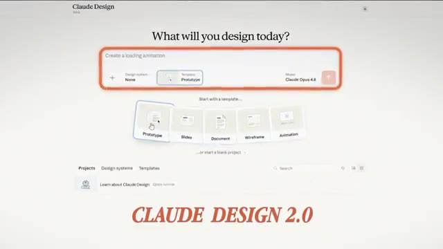
*⏱️ 00:00:05 — Gros plan sur l'interface de l'application Claude Design 2.0 montrant le champ de saisie de prompt et le titre CLAUDE DESIGN 2.0 en bas.*

*⏱️ 00:00:09 — Vue du navigateur web affichant l'interface principale de Claude Design avec le présentateur en médaillon en bas à droite.*

---

### ⏱️ `[00:00:18 - 00:00:45]` | Segment #02

**🔊 Audio (Transcription Intégrale Mot pour Mot en Français) :**
> Claude Design is a product that Anthropic released about two months ago. We could use it to generate things like web app prototypes, slideshows, mobile app prototypes. And it's basically Anthropic's version of Figma that we could use for tons of different use cases. I even used it to generate this entire animated video. I did this in one simple prompt and it took my design style from Claude Code and was able to import that directly into Claude Design and built this for me again in just one simple prompt.

**👁️ Analyse Visuelle d'Écran (gemini-3.5-flash-lite) :**
**Interface & Outils** : Interface web Claude / Claude Design / Navigateur web

**Contenu textuel & Code** : Prompts de génération de prototypes, interface de personnalisation de design, pages de présentation de projets web et mobiles.

**Action / Démonstration** : Démonstration de la création et de la personnalisation de prototypes visuels (applications et présentations) à l'aide de l'outil d'Anthropic.

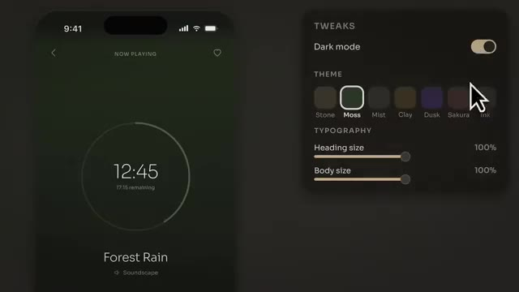
*⏱️ 00:00:25 — Aperçu d'une interface de prototype d'application mobile générée avec des options de personnalisation de design (mode sombre, thèmes, typographie).*

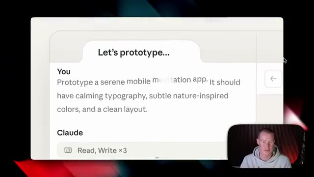
*⏱️ 00:00:31 — Interface de chat avec une invite demandant de prototyper une application mobile de méditation sereine, avec la caméra du présentateur en bas à droite.*

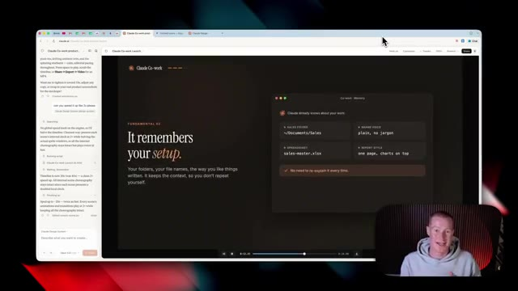
*⏱️ 00:00:38 — Navigateur web affichant une page de présentation de projet générée par l'outil, avec le présentateur visible en incrustation vidéo.*

---

### ⏱️ `[00:00:45 - 00:01:03]` | Segment #03

**🔊 Audio (Transcription Intégrale Mot pour Mot en Français) :**
> Now, the first thing that is different, this one is apparent right when we open it up is we have a completely new design of the platform. I think this looks so much better and it's much easier to use. So right off the bat, we get this text box. We have the ability to select a design system or create one from scratch, which I'm gonna show you later in this video, how to import this from Cloud Code.

**👁️ Analyse Visuelle d'Écran (gemini-3.5-flash-lite) :**
**Interface & Outils** : Navigateur web affichant l'application Claude Design

**Contenu textuel & Code** : Interface utilisateur avec barre de texte pour créer un design, options de template (Prototype, Slides, Document, Wireframe, Animation) et liste des projets récents.

**Action / Démonstration** : Navigation et présentation de la nouvelle interface de la plateforme Claude Design par le présentateur.

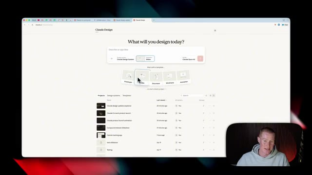
*⏱️ 00:00:49 — Interface principale de Claude Design affichant les options de projets et de templates avec la webcam du présentateur en bas à droite.*

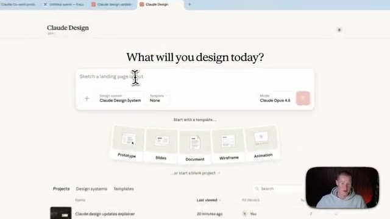
*⏱️ 00:00:54 — Gros plan sur la barre de saisie de Claude Design avec le curseur en train de taper une description de design.*

---

### ⏱️ `[00:01:03 - 00:01:22]` | Segment #04

**🔊 Audio (Transcription Intégrale Mot pour Mot en Français) :**
> Then we have the option to select from a template so we could create a prototype, slide, document, wireframe, or animation. So all we have to do is just click on this. Then it knows that you wanna create a prototype and then we just write in the prototype we wanna create. Our next update, this is one that people are probably gonna be pretty excited for and I personally am as well. And that is usage.

**👁️ Analyse Visuelle d'Écran (gemini-3.5-flash-lite) :**
**Interface & Outils** : Interface web de Claude Design (Claude.ai) et pop-up de gestion d'utilisation.

**Contenu textuel & Code** : Menus de sélection de modèles (Prototype, Slides, Document, Wireframe, Animation), paramètres de design system et statistiques d'utilisation des crédits et des modèles (Sonnet).

**Action / Démonstration** : Sélection d'un modèle de prototype/wireframe dans l'interface de conception de Claude Design puis affichage des limites d'utilisation de l'API/compte.

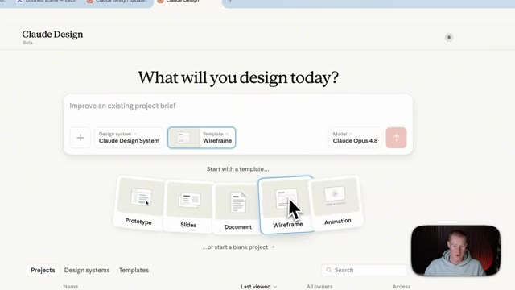
*⏱️ 00:01:08 — Interface de Claude Design montrant les options de modèles (Prototype, Slides, Document, Wireframe, Animation) avec le curseur sur Wireframe.*

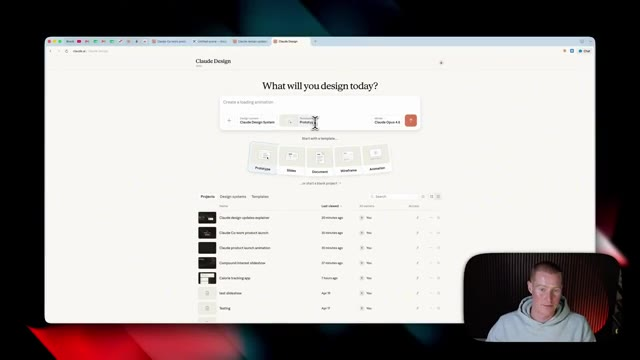
*⏱️ 00:01:13 — Interface de Claude Design montrant le champ de saisie pour créer une animation de chargement avec les projets récents en dessous.*

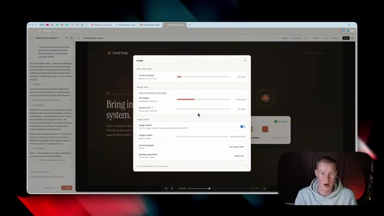
*⏱️ 00:01:17 — Fenêtre contextuelle affichant les limites d'utilisation, les quotas des modèles et les crédits de l'application Claude.*

---

### ⏱️ `[00:01:22 - 00:01:44]` | Segment #05

**🔊 Audio (Transcription Intégrale Mot pour Mot en Français) :**
> Usage is now calculated differently than before. Now, Claude design is taking from your overall Claude plan. So for me, I'm on the Claude max plan. So it now has usage limits across my Claude code, Claude cowork and Claude design. Whereas before we had one specific to Claude design. So we'd have one limit for Claude design and then for the rest of our Claude accounts.

**👁️ Analyse Visuelle d'Écran (gemini-3.5-flash-lite) :**
**Interface & Outils** : Navigateur web affichant l'interface de Claude Design et une modale de gestion des quotas d'utilisation.

**Contenu textuel & Code** : Barres de progression indiquant le pourcentage d'utilisation des différents modèles (All models, Sonnet only), les crédits d'utilisation (Usage credits), le solde actuel et la limite de dépenses mensuelles.

**Action / Démonstration** : Présentation et explication des limites d'utilisation combinées et du suivi des quotas sur la plateforme Claude.

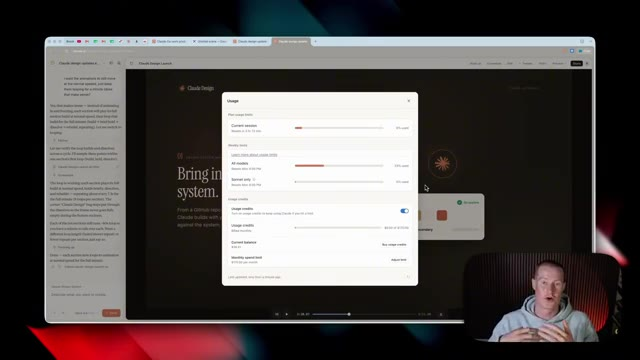
*⏱️ 00:01:28 — Une fenêtre pop-up affichant les limites d'utilisation (Usage) de Claude Design, avec des barres de progression pour la session en cours et les limites hebdomadaires.*

---

### ⏱️ `[00:01:44 - 00:02:04]` | Segment #06

**🔊 Audio (Transcription Intégrale Mot pour Mot en Français) :**
> Et c'était plutôt ennuyeux parce qu'il y avait des limites de conception de Claude assez basses. Je connais beaucoup de gens qui essayaient de tester cela et de faire de vraies choses avec. Nous atteignions ces limites très rapidement. Donc maintenant, si nous avons un forfait Claude Pro ou un forfait Claude Max, cela va alors automatiquement puiser dans ces limites d'utilisation au lieu d'une limite individuelle séparée. Très bien, alors la prochaine nouvelle fonctionnalité, celle-ci est plutôt cool.

**👁️ Analyse Visuelle d'Écran (gemini-3.5-flash-lite) :**
**Interface & Outils** : Navigateur web affichant l'interface de l'application Claude et un panneau de gestion des limites d'utilisation et crédits.

**Contenu textuel & Code** : Barres de progression indiquant l'utilisation de la session en cours, les limites hebdomadaires pour tous les modèles et pour Sonnet uniquement, ainsi que les options de crédits d'utilisation et la limite de dépenses mensuelles.

**Action / Démonstration** : Présentation et explication visuelle des limites d'utilisation et des forfaits de l'outil Claude par le présentateur.

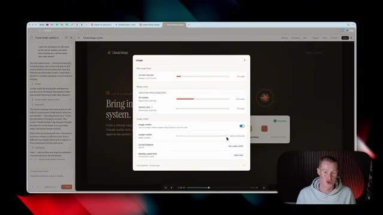
*⏱️ 00:01:49 — Capture d'écran montrant l'interface d'un navigateur avec une fenêtre pop-up affichant les limites d'utilisation (usage limits) et les crédits de Claude, tandis que le présentateur apparaît en bas à droite.*

---

### ⏱️ `[00:02:04 - 00:02:22]` | Segment #07

**🔊 Audio (Transcription Intégrale Mot pour Mot en Français) :**
> Et celui-ci va nous faire économiser beaucoup d'argent en jetons, espérons-le. Et c'est que nous pouvons maintenant modifier directement à l'intérieur de Claude Design. Donc ce que je veux dire par là, c'est que si je clique sur modifier en haut à droite, vous pouvez voir que je suis en train de concevoir cette interface utilisateur pour cette application que je veux créer. Et je vais en fait prendre ceci et le transformer en une véritable application fonctionnelle à l'intérieur de Claude Code plus tard dans cette vidéo.

**👁️ Analyse Visuelle d'Écran (gemini-3.5-flash-lite) :**
**Interface & Outils** : Navigateur web, interface de Claude / application web de suivi calorique.

**Contenu textuel & Code** : Tableau de bord 'Nourish' avec graphiques de macros, barres de progression, et outils d'édition textuelle et visuelle.

**Action / Démonstration** : Le présentateur clique sur le bouton 'Edit' pour modifier directement le design à l'écran.

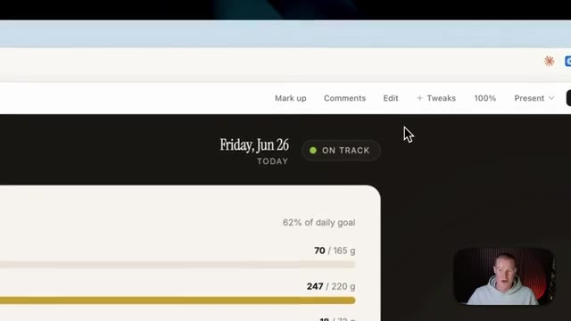
*⏱️ 00:02:08 — Gros plan sur la barre supérieure de l'interface montrant le curseur sur le bouton 'Edit'.*

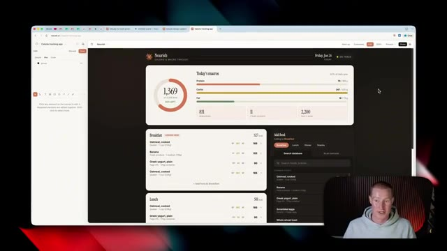
*⏱️ 00:02:18 — Vue d'ensemble de l'application de suivi calorique 'Nourish' dans le navigateur, avec le panneau d'édition latéral ouvert.*

---

### ⏱️ `[00:02:22 - 00:02:41]` | Segment #08

**🔊 Audio (Transcription Intégrale Mot pour Mot en Français) :**
> Et sur le côté gauche, vous pouvez voir que je dois juste sélectionner ce que je veux modifier. Disons donc que je veux modifier le texte. Je cliquerais dessus. Je pourrais effectivement faire glisser du texte où je veux. Disons donc que je veux ajouter du texte ici même. Je pourrais aller de l'avant et le faire. Je pourrais taper ici même. Disons donc simplement Claude Cowork ou quelque chose comme ça. Et nous pourrions aller de l'avant et placer cela directement sur notre zone de travail qui est Claude Design.

**👁️ Analyse Visuelle d'Écran (gemini-3.5-flash-lite) :**
**Interface & Outils** : Navigateur web affichant l'interface de développement/édition de Claude.ai (claude.ai) pour une application de suivi des calories.

**Contenu textuel & Code** : Maquette d'application de suivi des calories nommée "Nourish", affichant des graphiques circulaires et des barres de progression pour les macronutriments (protéines, glucides, lipides), ainsi qu'un panneau d'outils d'édition textuelle.

**Action / Démonstration** : Sélection d'un élément textuel sur le canevas de l'application web pour en modifier le contenu ou l'emplacement.

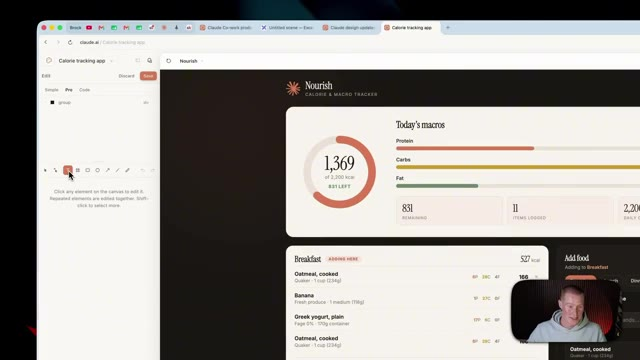
*⏱️ 00:02:27 — Aperçu de l'interface de l'application de suivi des calories "Nourish" sur Claude.ai, montrant le panneau latéral d'édition et la prévisualisation de l'application.*

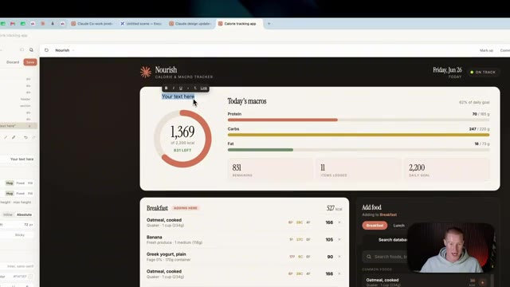
*⏱️ 00:02:32 — Sélection et modification d'un élément textuel ("Your text here") directement sur la maquette de l'application de suivi des calories.*

---

### ⏱️ `[00:02:41 - 00:03:15]` | Segment #09

**🔊 Audio (Transcription Intégrale Mot pour Mot en Français) :**
> Ou si je veux modifier, vous savez, le texte que j'utilise ici, je pour-rais le faire. Changeons simplement ceci pour dire Brock's Daily Macros. Et c'est aussi simple que cela pour effectuer des modifications, au lieu de devoir venir dans le chat juste ici et expliquer ce que nous voulons modifier, car cela va consommer beaucoup de nos jetons. Alors maintenant, pensez à ceci comme à un mélange de Claude Design où nous faisons en quelque sorte de la programmation intuitive sur un design spécifique, mais aussi quelque chose comme Canva où nous pouvons réellement effectuer des modifications directement sur notre canevas. Maintenant, nous pouvons modifier bien plus que du texte également. Donc, si je clique sur modifier et que je viens sélectionner certains éléments

**👁️ Analyse Visuelle d'Écran (gemini-3.5-flash-lite) :**
**Interface & Outils** : Navigateur web avec interface d'édition visuelle de type constructeur d'application / no-code (Bolt.new ou équivalent)

**Contenu textuel & Code** : Tableau de bord affichant le texte "Brock's Daily Macros", des graphiques de calories (1369 kcal), des barres de progression pour les protéines, glucides et lipides, ainsi qu'une liste de repas (Breakfast, Lunch) et un panneau latéral de configuration de style CSS/layout.

**Action / Démonstration** : Modification directe du texte du titre de l'application via l'interface visuelle au lieu d'utiliser le chat textuel.

*⏱️ 00:02:50 — Interface d'une application de suivi des calories et macronutriments (Nourish) avec des graphiques de progression et un panneau d'édition visuel sur le côté gauche.*

---

### ⏱️ `[00:03:15 - 00:03:38]` | Segment #10

**🔊 Audio (Transcription Intégrale Mot pour Mot en Français) :**
> ici, je peux aller de l'avant et changer à quoi cela ressemble. Cliquons sur cette petite div. Je pourrais ensuite changer l'arrière-plan. Disons donc que je veux changer la couleur de ceci pour qu'elle soit rouge, par exemple. C'est aussi simple que d'avoir la possibilité d'aller modifier chacun de ces éléments individuellement au lieu d'avoir besoin d'aller sur le chat et d'essayer de coder au feeling pour, vous savez, faire en sorte que ça ait exactement l'air de ce que je veux. Très rapidement, j'ai pris les devants et j'ai préparé cette ressource gratuite pour vous les gars que vous pouvez récupérer.

**👁️ Analyse Visuelle d'Écran (gemini-3.5-flash-lite) :**
**Interface & Outils** : Navigateur web affichant une application web de type dashboard (Calorie tracking app) avec des outils d'édition visuelle.

**Contenu textuel & Code** : Tableau de bord 'Nourish' affichant les macros quotidiennes (protéines, glucides, lipides), des graphiques circulaires et des listes de repas, avec un panneau d'options de style ouvert sur le côté gauche.

**Action / Démonstration** : Manipulation des options de design de l'interface pour modifier les éléments visuels de l'application.

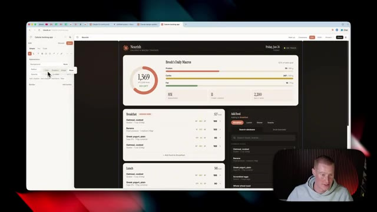
*⏱️ 00:03:20 — Capture d'écran montrant l'interface d'une application de suivi des calories avec un panneau de personnalisation de l'apparence ouvert à gauche.*

---

### ⏱️ `[00:03:38 - 00:03:59]` | Segment #11

**🔊 Audio (Transcription Intégrale Mot pour Mot en Français) :**
> Si vous n'avez jamais utilisé Claude Design auparavant ou si vous voulez d'autres cas d'utilisation que vous pouvez essayer par vous-même, ce guide pratique vous l'expliquera réellement et vous donnera même des invites que vous pourrez copier-coller et mettre dans Claude Design. Et si vous voulez l'obtenir, c'est complètement gratuit. Il y a un lien dans la description pour l'obtenir. En gros, venez simplement ici, mettez 0 $, cliquez sur « Je veux ceci », et vous entrerez votre email et il vous l'enverra.

**👁️ Analyse Visuelle d'Écran (gemini-3.5-flash-lite) :**
**Interface & Outils** : Présentation ou face-caméra explicatif du trader sans interface logicielle partagée.

**Contenu textuel & Code** : Explications orales des stratégies et mise en contexte méthodologique du marché.

**Action / Démonstration** : Explications face caméra et analyse conceptuelle des marchés.

---

### ⏱️ `[00:03:59 - 00:04:18]` | Segment #12

**🔊 Audio (Transcription Intégrale Mot pour Mot en Français) :**
> Maintenant, revenons à la vidéo. Très bien, alors notre prochaine fonctionnalité, et celle-ci va être vraiment utile si vous êtes un utilisateur actuel de Cloud Code. Donc, cela concerne notre système de design. Alors pour vous montrer ce que je veux dire, si je viens ici et que je clique là où il est écrit « système de design », vous pouvez voir que j'ai quelques systèmes de design préconfigurés que j'ai élaborés au préalable, ou nous pouvons en créer un nouveau de toutes pièces.

**👁️ Analyse Visuelle d'Écran (gemini-3.5-flash-lite) :**
**Interface & Outils** : Navigateur web affichant l'interface de Claude Design (Claude.ai).

**Contenu textuel & Code** : Options de design, choix du modèle (Claude Opus 4.8), sélection de templates (Prototype, Slides, Document, Wireframe, Animation) et liste des projets.

**Action / Démonstration** : Le présentateur présente l'interface et survole les options du système de design de Claude.

*⏱️ 00:04:04 — Interface web de Claude Design affichant la page d'accueil avec un champ de saisie, des options de modèles et la liste des projets récents.*

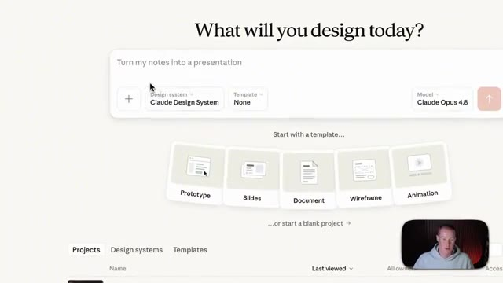
*⏱️ 00:04:08 — Zoom sur l'interface de Claude Design montrant le champ de saisie du prompt, le choix du système de design et le modèle IA (Claude Opus 4.8).*

---

### ⏱️ `[00:04:18 - 00:04:40]` | Segment #13

**🔊 Audio (Transcription Intégrale Mot pour Mot en Français) :**
> So we have two options. First, we could create it here by connecting either Figma, GitHub, or uploading all the different design assets manually. But now we have a new option where we could use Cloud Code, which actually gives us the best fidelity when it comes to the designs if we're using React components. And it will do this for us automatically so we don't manually need to import all the designs we've built.

**👁️ Analyse Visuelle d'Écran (gemini-3.5-flash-lite) :**
**Interface & Outils** : Interface web de Claude / outil de design system.

**Contenu textuel & Code** : Options de création de design system : "Create here" (Connect to Figma or GitHub, or upload slides and assets) et "Create using Claude Code" avec le badge "BEST FIDELITY" pour les composants React.

**Action / Démonstration** : Présentation des deux méthodes disponibles pour configurer et importer un design system dans Claude.

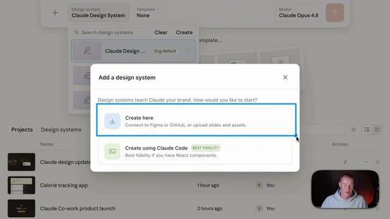
*⏱️ 00:04:24 — Interface montrant une fenêtre modale "Add a design system" avec deux options : "Create here" et "Create using Claude Code (BEST FIDELITY)".*

---

### ⏱️ `[00:04:40 - 00:05:00]` | Segment #14

**🔊 Audio (Transcription Intégrale Mot pour Mot en Français) :**
> Donc pour vous montrer ce que je veux dire, si je clique là-dessus, cela nous montre alors cet ensemble d'instructions pour exécuter cela directement à l'intérieur de Cloud Code. Donc si notre système de design vit déjà à l'intérieur de Cloud Code, nous pourrions ouvrir notre paquet de système de design dans Cloud et simplement exécuter cette commande ici appelée design sync. Maintenant, pour expliquer cela encore plus, nous avons donc la possibilité simplement de cliquer sur le bouton du système de design.

**👁️ Analyse Visuelle d'Écran (gemini-3.5-flash-lite) :**
**Interface & Outils** : Présentation ou face-caméra explicatif du trader sans interface logicielle partagée.

**Contenu textuel & Code** : Explications orales des stratégies et mise en contexte méthodologique du marché.

**Action / Démonstration** : Explications face caméra et analyse conceptuelle des marchés.

---

### ⏱️ `[00:05:00 - 00:05:21]` | Segment #15

**🔊 Audio (Transcription Intégrale Mot pour Mot en Français) :**
> It then reads our kit using Cloud Code with a design sync. It reads and compiles all the different parts and components that we use inside of our designs. So if we have things like a preexisting client project or specific design styles you've crafted for your business, For me personally, I have a specific style I use for my school community as well as for my personal brand content, which you've probably seen on my YouTube channel.

**👁️ Analyse Visuelle d'Écran (gemini-3.5-flash-lite) :**
**Interface & Outils** : Présentation ou face-caméra explicatif du trader sans interface logicielle partagée.

**Contenu textuel & Code** : Explications orales des stratégies et mise en contexte méthodologique du marché.

**Action / Démonstration** : Explications face caméra et analyse conceptuelle des marchés.

---

### ⏱️ `[00:05:21 - 00:05:43]` | Segment #16

**🔊 Audio (Transcription Intégrale Mot pour Mot en Français) :**
> Et maintenant, avec cette commande, il va automatiquement le scraper, puis il va le téléverser directement dans Cloud Design pour que nous n'ayons pas à le faire manuellement. Maintenant, afin de vous montrer ce que je veux dire, à l'intérieur de Cloud Co-Work, j'ai des tonnes d'artefacts et de tableaux de bord différents que j'ai construits dans ce style exact ici, que vous avez probablement vu sur cette chaîne YouTube. Et comme vous pouvez le voir, c'est dans un style Claude très spécifique ici que j'aime personnellement beaucoup dans n'importe quel tableau de bord que je crée.

**👁️ Analyse Visuelle d'Écran (gemini-3.5-flash-lite) :**
**Interface & Outils** : Navigateur web affichant des diaporamas et l'application Cloud Co-Work / Cowork OS.

**Contenu textuel & Code** : Schémas explicatifs de design, tableaux de bord de gestion de contenu, indicateurs de performance et listes de tâches quotidiennes.
[DESC_IMAGE_1] Présentation des fonctionnalités de synchronisation de design et des flux de travail automatisés.
[DESC_IMAGE_2] Navigation dans le tableau de bord personnel Cowork OS pour illustrer l'organisation des artefacts.
[DESC_IMAGE_3] Consultation de la vue du plan de la journée au sein de l'interface de travail.

**Action / Démonstration** : Explications face caméra et analyse conceptuelle des marchés.

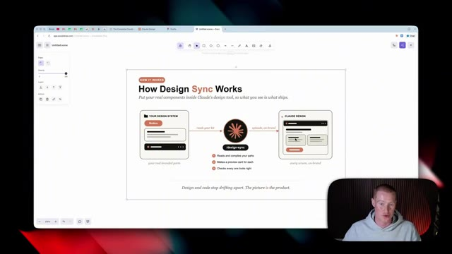
*⏱️ 00:05:27 — Une diapositive explicative montrant le fonctionnement de "Design Sync" pour intégrer les composants de design dans l'outil de Claude.*

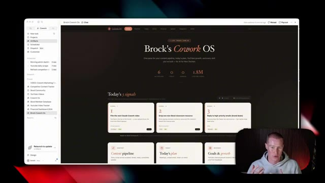
*⏱️ 00:05:32 — L'interface de "Brock's Cowork OS" affichant le tableau de bord principal avec les signaux du jour et les métriques de contenu.*

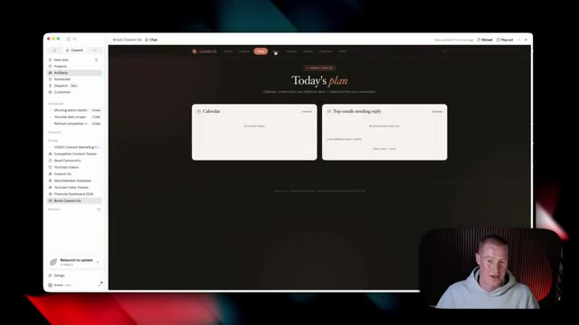
*⏱️ 00:05:38 — L'onglet "Today's plan" de l'application Cowork OS montrant les sections Calendrier et les e-mails prioritaires nécessitant une réponse.*

---

### ⏱️ `[00:05:44 - 00:06:02]` | Segment #17

**🔊 Audio (Transcription Intégrale Mot pour Mot en Français) :**
> J'utilise ceci comme exemple. Je reviens à notre application de suivi des calories pour laquelle je conçois le design. Elle est exactement dans le même style. Et c'est parce que je l'ai importée directement depuis Claude Code. Il y aura donc toujours cette cohérence visuelle, comme vous pouvez le voir ici. Et pour donner un autre exemple, voici une petite vidéo animée rapide que j'ai fait concevoir et créer par Claude.

**👁️ Analyse Visuelle d'Écran (gemini-3.5-flash-lite) :**
**Interface & Outils** : Navigateur web affichant l'interface de Claude et des applications web créées.

**Contenu textuel & Code** : Tableaux de bord de suivi nutritionnel (calories, protéines, glucides, lipides) et graphiques statistiques comparatifs.

**Action / Démonstration** : Le présentateur commente l'application de suivi des calories et montre la cohérence visuelle générée par l'IA.

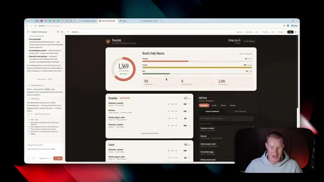
*⏱️ 00:05:48 — Interface d'une application de suivi des calories et macronutriments conçue via Claude Code.*

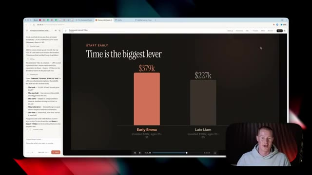
*⏱️ 00:05:57 — Présentation visuelle sur les intérêts composés intitulée 'Time is the biggest lever', montrant une comparaison graphique.*

---

### ⏱️ `[00:06:02 - 00:06:22]` | Segment #18

**🔊 Audio (Transcription Intégrale Mot pour Mot en Français) :**
> Et encore une fois, c'est dans le tout même style que nous avons vu à l'intérieur de Claude. Donc avant de vous montrer certaines des autres fonctionnalités du nouveau design de Claude, je veux d'abord montrer comment nous pourrions prendre un design d'application que nous avons juste ici et l'envoyer automatiquement à Claude Code et transformer cela en une application fonctionnelle que je pourrais réellement utiliser. Parce qu'en ce moment tout cela a l'air super, mais il n'y a pas de base de données construite sur le backend de ceci.

**👁️ Analyse Visuelle d'Écran (gemini-3.5-flash-lite) :**
**Interface & Outils** : Présentation ou face-caméra explicatif du trader sans interface logicielle partagée.

**Contenu textuel & Code** : Explications orales des stratégies et mise en contexte méthodologique du marché.

**Action / Démonstration** : Explications face caméra et analyse conceptuelle des marchés.

---

### ⏱️ `[00:06:22 - 00:06:43]` | Segment #19

**🔊 Audio (Transcription Intégrale Mot pour Mot en Français) :**
> Donc je ne peux pas vraiment utiliser ça en fait. C'est juste une sorte de design sophistiqué que j'ai construit dans Claude Design. Donc pour faire ça, nous pourrions venir ici, cliquer sur partager et nous voulons cliquer sur envoyer vers. Et à partir de là, nous pourrions envoyer ceci vers différentes applications. Donc CloudCode, Canva, Miro. Et si je clique sur ajouter plus, je pourrais même l'envoyer à des outils de codage instinctif comme Lovable ou d'autres outils de design comme Gamma.

**👁️ Analyse Visuelle d'Écran (gemini-3.5-flash-lite) :**
**Interface & Outils** : Présentation ou face-caméra explicatif du trader sans interface logicielle partagée.

**Contenu textuel & Code** : Explications orales des stratégies et mise en contexte méthodologique du marché.

**Action / Démonstration** : Explications face caméra et analyse conceptuelle des marchés.

---

### ⏱️ `[00:06:44 - 00:07:16]` | Segment #20

**🔊 Audio (Transcription Intégrale Mot pour Mot en Français) :**
> Now, I'm going to focus on sending this to CloudCode. So I'm just going to click send. It gives me this fancy little prompt that I could use in order to set this up. So I'm going to come back over to my Cloud Desktop app, click on CloudCode. And I'm simply just going to paste in the prompts that it gave me. All right. So just like that, we now have our app imported directly into Cloud Code. And I could begin making changes here since we have our design finalized. We obviously did that inside of Cloud Design. Now, what I need to do is build out an actual database. So what I'm going to be using is something called Supabase. If you don't know what Supabase is, do not worry if you're non-technical.

**👁️ Analyse Visuelle d'Écran (gemini-3.5-flash-lite) :**
**Interface & Outils** : Application Claude Code, interface web de tableau de bord, caméra de présentation.

**Contenu textuel & Code** : Code source, journaux d'exécution, aperçu d'application de suivi calorique "Nourish", graphiques de macronutriments et barres de progression.

**Action / Démonstration** : Présentation de l'interface développée et du flux de génération par l'intelligence artificielle dans Claude Code.

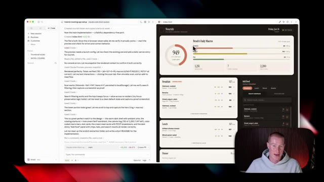
*⏱️ 00:07:00 — Interface de Claude Code affichant le journal de génération de code à gauche et un tableau de bord nutritionnel interactif à droite ("Nourish").*

---

### ⏱️ `[00:07:16 - 00:07:35]` | Segment #21

**🔊 Audio (Transcription Intégrale Mot pour Mot en Français) :**
> You don't really need to know how it works because I'm going to use this via a connector inside of Cloud. And it's going to do all this stuff for me. Supabase is basically a platform that allows us to store all of the backend information necessary to make our app functional. So to give you an example, here is a database I have that tracks all of my different content.

**👁️ Analyse Visuelle d'Écran (gemini-3.5-flash-lite) :**
**Interface & Outils** : Présentation ou face-caméra explicatif du trader sans interface logicielle partagée.

**Contenu textuel & Code** : Explications orales des stratégies et mise en contexte méthodologique du marché.

**Action / Démonstration** : Explications face caméra et analyse conceptuelle des marchés.

---

### ⏱️ `[00:07:35 - 00:08:12]` | Segment #22

**🔊 Audio (Transcription Intégrale Mot pour Mot en Français) :**
> Ça me montre la durée. Ça montre le nombre de j'aime. Ça montre le titre des vidéos. Ça montre l'URL, et cetera. Parce que si je n'ai pas de backend pour mon application, alors le frontend est fondamentalement inutile car il n'est capable de stocker aucune des informations. Eh bien, heureusement, Supabase rend cela incroyablement simple. Laissez-moi donc vous montrer comment configurer ceci. Maintenant, tout d'abord, assurez-vous simplement de créer un compte. Il y aura un lien dans la description ainsi que dans le commentaire épinglé pour créer un compte Supabase. Et ensuite, nous allons revenir à Claude et nous allons venir sur le côté gauche où il est indiqué personnaliser. Et nous devons simplement ajouter le connecteur Supabase. Donc, cliquez sur les connecteurs. J'ai une liste d'applications que j'ai connectées. Nous allons cliquer

**👁️ Analyse Visuelle d'Écran (gemini-3.5-flash-lite) :**
**Interface & Outils** : Navigateur web affichant une interface de base de données backend (Supabase ou similaire) avec le présentateur en incrustation.

**Contenu textuel & Code** : Tableaux de données structurés contenant des identifiants vidéo, des titres, des URLs, des catégories, des dates de publication et des durées.

**Action / Démonstration** : Le présentateur montre l'interface backend qui stocke les informations des vidéos pour l'application.

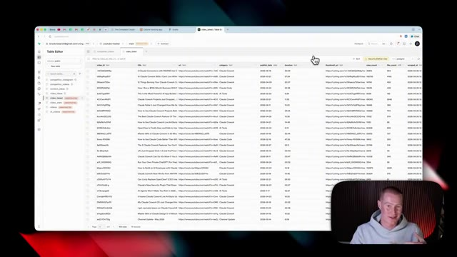
*⏱️ 00:07:44 — Un tableau de base de données avec des colonnes de titres, URL, durée et vues de vidéos.*

---

### ⏱️ `[00:08:12 - 00:08:36]` | Segment #23

**🔊 Audio (Transcription Intégrale Mot pour Mot en Français) :**
> sur parcourir et cherchez simplement Supabase. Ensuite, cliquez sur le bouton plus. Cela va nous amener à notre compte Supabase. Et tout ce que nous avons à faire, c'est d'accorder l'accès à l'organisation de l'espace de travail spécifique auquel nous voulons donner accès. Je vais donc simplement sélectionner mon email ici, cliquer sur autoriser Claude, et cela devrait nous renvoyer vers Claude. Et voilà. Vous pouvez voir que Supabase est maintenant connectée sur le côté droit. Et ensuite, ce que je vais faire, c'est que je vais sélectionner Supabase.

**👁️ Analyse Visuelle d'Écran (gemini-3.5-flash-lite) :**
**Interface & Outils** : Navigateur web, interface Supabase, interface de configuration de Claude.

**Contenu textuel & Code** : Écran de demande d'accès OAuth pour lier Supabase à Claude avec sélection de l'organisation et permissions (Read/Write).

**Action / Démonstration** : Autorisation de l'accès à Supabase et affichage des connecteurs disponibles.

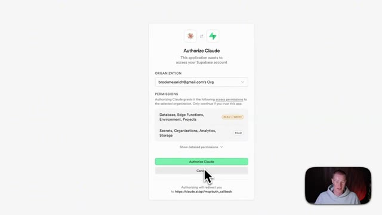
*⏱️ 00:08:24 — Écran d'autorisation Supabase pour l'application Claude.*

*⏱️ 00:08:30 — Interface de configuration des connecteurs et permissions d'outils.*

---

### ⏱️ `[00:08:36 - 00:09:09]` | Segment #24

**🔊 Audio (Transcription Intégrale Mot pour Mot en Français) :**
> Je vais simplement cliquer sur toujours approuver. Comme ça, ça ne demandera pas si c'est autorisé à aller chercher des données dans ces différentes tables de base de données, ainsi qu'à créer des tables de base de données. Et maintenant, nous devrions être prêts. Ensuite, je vais simplement revenir à Claude et lui dire simplement, hé, je veux que tu transformes ceci en une application fonctionnelle, utilise le connecteur Supabase afin de créer une base de données pour moi pour suivre toutes ces informations afin que l'utilisateur puisse ajouter des aliments spécifiques et suivre toutes ces données et faire en sorte que cela se reflète fidèlement sur cette application. D'accord, donc je vais lui donner cette instruction et maintenant ce qu'il va faire, c'est aller créer la base de données backend pour moi, et ensuite je vous montrerai le résultat final.

**👁️ Analyse Visuelle d'Écran (gemini-3.5-flash-lite) :**
**Interface & Outils** : Présentation ou face-caméra explicatif du trader sans interface logicielle partagée.

**Contenu textuel & Code** : Explications orales des stratégies et mise en contexte méthodologique du marché.

**Action / Démonstration** : Explications face caméra et analyse conceptuelle des marchés.

---

### ⏱️ `[00:09:09 - 00:09:30]` | Segment #25

**🔊 Audio (Transcription Intégrale Mot pour Mot en Français) :**
> Très bien, et juste comme ça, il a construit toute cette base de données d'application. Donc pour vous montrer exactement ce que je veux dire, nous avons mon application affichée juste ici. Nous avons ma base de données Supabase configurée juste ici avec toutes les informations à l'intérieur de notre application. Donc pour tester cela, ce que je vais faire, c'est que je vais saisir l'un de mes repas et nous devrions voir cela s'ajouter dans cette base de données au fur et à mesure que nous le faisons.

**👁️ Analyse Visuelle d'Écran (gemini-3.5-flash-lite) :**
**Interface & Outils** : Navigateur web affichant l'application Nourish et la plateforme Supabase.

**Contenu textuel & Code** : Tableaux de bord de calories, macros quotidiennes (protéines, glucides, lipides) et tables de données relationnelles Supabase.

**Action / Démonstration** : Démonstration de l'interface utilisateur de l'application et visualisation de la structure de la base de données backend.

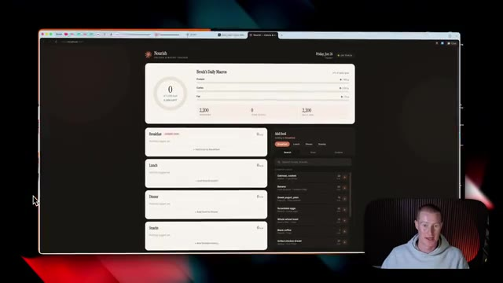
*⏱️ 00:09:14 — Aperçu de l'application web de suivi nutritionnel (Nourish) avec le tableau de bord des calories et macros.*

*⏱️ 00:09:20 — Affichage de l'interface de gestion de la base de données Supabase montrant les tables et les enregistrements alimentaires.*

---

### ⏱️ `[00:09:30 - 00:09:54]` | Segment #26

**🔊 Audio (Transcription Intégrale Mot pour Mot en Français) :**
> Donc, si je me dirige par ici, je vais tout simplement ajouter quelques produits différents ici. Disons donc que j'ai mangé des flocons d'avoine, j'ai pris une banane, du yaourt grec et des œufs brouillés pour le petit-déjeuner ou quelque chose comme ça. Maintenant, comme vous pouvez le voir juste ici là où il est écrit petit-déjeuner, nous pouvons voir chacun de ces éléments alimentaires ajoutés à cette liste. Et si je reviens à mon journal alimentaire et que je rafraîchis ceci, vous pouvez maintenant voir que cela a rempli toutes ces métadonnées dans cette base de données.

**👁️ Analyse Visuelle d'Écran (gemini-3.5-flash-lite) :**
**Interface & Outils** : Application web de suivi nutritionnel et de gestion des repas.

**Contenu textuel & Code** : Liste d'aliments avec leur apport calorique en kilocalories (kcal) et répartition des macronutriments (protéines, glucides, lipides).

**Action / Démonstration** : Sélection et ajout d'aliments pour composer le repas du petit-déjeuner et calcul automatique des calories totales.

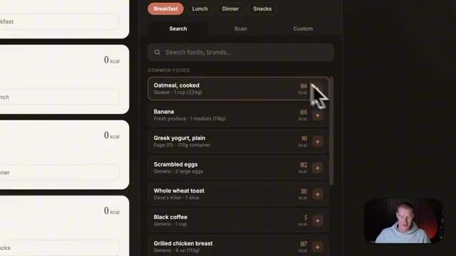
*⏱️ 00:09:36 — Interface de suivi nutritionnel montrant la sélection d'aliments courants (flocons d'avoine, banane, yaourt grec, œufs brouillés).*

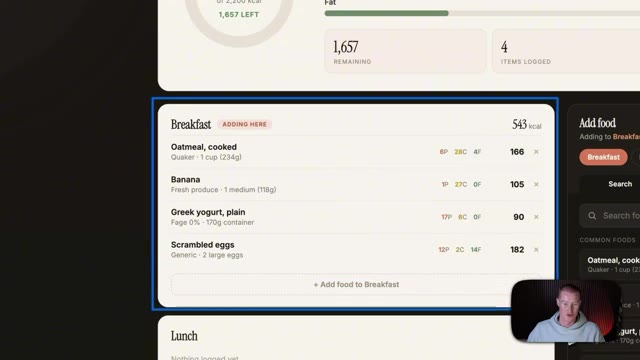
*⏱️ 00:09:42 — Récapitulatif du repas du petit-déjeuner avec le total calorique et les différents aliments ajoutés.*

---

### ⏱️ `[00:09:54 - 00:10:14]` | Segment #27

**🔊 Audio (Transcription Intégrale Mot pour Mot en Français) :**
> So hopefully this gives you a sense of how you could go from Cloud Design into Cloud Code and use something like Supabase to turn this into an actual app that works in real time. Now, the next update that I want to talk about is we could access Claude Design directly inside of the desktop app, whether inside of Claude Cowork or Claude Chat Mode. We'll see it at the bottom left of our screen.

**👁️ Analyse Visuelle d'Écran (gemini-3.5-flash-lite) :**
**Interface & Outils** : Applications web et de bureau (Cloud Design, Cowork)

**Contenu textuel & Code** : Tableaux de bord de suivi nutritionnel, listes de tâches, interface de chat IA et menus de navigation

**Action / Démonstration** : Navigation et présentation des fonctionnalités de conception d'applications et d'accès direct aux outils de design.

*⏱️ 00:09:59 — Interface d'une application de suivi des calories et macronutriments, affichant un tableau de bord détaillé avec des graphiques de progression et un panneau latéral de code/notes.*

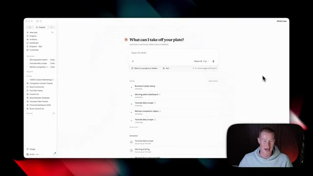
*⏱️ 00:10:04 — Interface d'une application de bureau (Cowork) avec une barre de recherche centrale pour interagir avec l'IA et une liste de tâches actives et planifiées.*

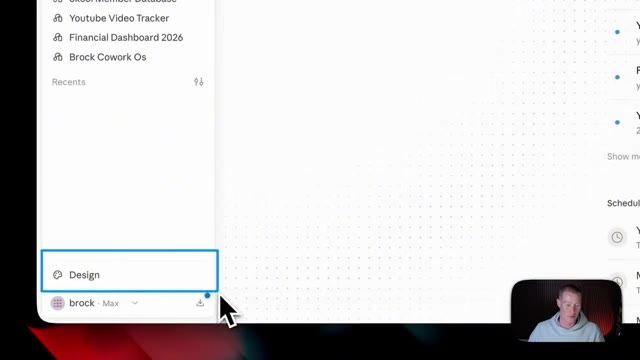
*⏱️ 00:10:09 — Gros plan sur le menu latéral inférieur de l'application de bureau, mettant en surbrillance l'option "Design".*

---

### ⏱️ `[00:10:14 - 00:10:40]` | Segment #28

**🔊 Audio (Transcription Intégrale Mot pour Mot en Français) :**
> Et si je clique dessus, ce que ça va faire, c'est ouvrir cet écran séparé où nous pourrions commencer à utiliser Claude Design au lieu de l'utiliser seulement sur l'application Web. Parce que jusqu'à présent, nous devions aller sur Claude.ai dans le navigateur Web et l'utiliser directement ici. Donc maintenant, nous n'avons pas besoin de quitter l'application de bureau pour utiliser Claude Design, ce que, je le sais pour ma part, je n'utiliserais même pas Claude Design la plupart du temps de nos jours, je suis dans l'application de bureau et je ne penserais même pas à basculer sur le navigateur Web.

**👁️ Analyse Visuelle d'Écran (gemini-3.5-flash-lite) :**
**Interface & Outils** : Présentation ou face-caméra explicatif du trader sans interface logicielle partagée.

**Contenu textuel & Code** : Explications orales des stratégies et mise en contexte méthodologique du marché.

**Action / Démonstration** : Explications face caméra et analyse conceptuelle des marchés.

---

### ⏱️ `[00:10:41 - 00:11:13]` | Segment #29

**🔊 Audio (Transcription Intégrale Mot pour Mot en Français) :**
> Maintenant, la prochaine fonctionnalité dont je veux parler dans la nouvelle mise à jour de Cloud Design, ce sont les connecteurs. Donc je clique sur ma petite icône de compte et je vais sur les connecteurs. Vous pouvez voir que je peux accéder à n'importe lequel des différents connecteurs cloud que j'ai configurés, et j'en ai déjà une tonne d'ajoutés. Si je clique sur parcourir le répertoire, cela va nous amener ici où nous pouvons ajouter n'importe quelle application que nous voulons utiliser. Maintenant, disons qu'il y a une application que vous voulez utiliser avec Claude Design, mais que vous ne la voyez pas dans ce répertoire ici même dans Claude. Eh bien, je vais vous montrer un truc qui vous permettra de vous connecter à plus de 9 000 applications différentes en utilisant quelque chose appelé le MCP Zapier. Si vous ne savez pas

**👁️ Analyse Visuelle d'Écran (gemini-3.5-flash-lite) :**
**Interface & Outils** : Application Cloud Design / interface web de gestion des connecteurs.

**Contenu textuel & Code** : Liste des connecteurs cloud disponibles dans le répertoire (Figma, Notion, Asana, Google Drive, Canva, Microsoft 365, Gmail, Slack, HubSpot, etc.).

**Action / Démonstration** : Navigation dans le répertoire des connecteurs pour montrer les différentes intégrations disponibles.

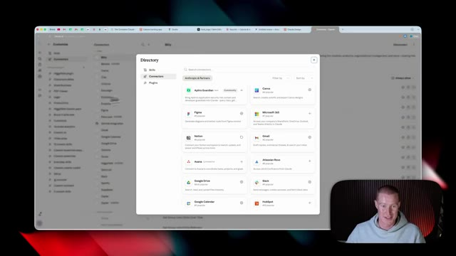
*⏱️ 00:10:57 — Capture d'écran montrant une fenêtre de répertoire affichant divers connecteurs et intégrations disponibles (Figma, Notion, Asana, Google Drive, Canva, Microsoft 365, etc.).*

---

### ⏱️ `[00:11:13 - 00:11:47]` | Segment #30

**🔊 Audio (Transcription Intégrale Mot pour Mot en Français) :**
> what Zapier is, it's an automation platform that connects to 9,000 plus different apps. And an MCP server is like a universal connector that connects your AI to any of the apps that you want to use. So that way you can go and perform actions across those apps. So I'm going to click on get started. there will be a link in the description to sign up if you want to test this out. Next, we're going to click on add new MCP server. Then we're just going to come to Claude, copy in the prompt here. And then I'm going to come to the Claude desktop app and just simply paste in this prompt. And now it's going to pull up this little box here where I'm just going to click connect. Then it's going to bring you back to Zapier to copy another prompt. Then I'm going

**👁️ Analyse Visuelle d'Écran (gemini-3.5-flash-lite) :**
**Interface & Outils** : Navigateur web affichant le site de Zapier.

**Contenu textuel & Code** : Texte explicatif sur Zapier MCP ("Your AI can talk. Zapier MCP makes it act.") et boutons d'action.

**Action / Démonstration** : Le présentateur s'apprête à cliquer sur le bouton "Get started" pour démarrer l'intégration.

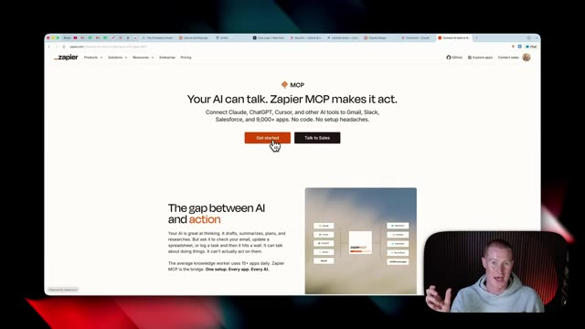
*⏱️ 00:11:21 — Page web de Zapier présentant le service Zapier MCP avec un bouton "Get started" orange sur lequel le curseur de la souris est positionné.*

---

### ⏱️ `[00:11:47 - 00:12:09]` | Segment #31

**🔊 Audio (Transcription Intégrale Mot pour Mot en Français) :**
> de cliquer sur continuer, de cliquer sur autoriser, et ensuite de cliquer sur ouvrir Claude. Et cela devrait être configuré et prêt à fonctionner. Maintenant de retour dans le chat, si je clique sur ce bouton utiliser, cela va ensuite me guider sur la façon de configurer cela exactement comme je veux que ça fonctionne. Donc maintenant nous avons notre compte Zapier connecté. Afin d'ajouter différentes applications, nous allons venir sur notre serveur MCP que nous avons créé, cliquer sur ajouter, et nous pourrions sélectionner n'importe quelle application que nous voulons ajouter à notre serveur.

**👁️ Analyse Visuelle d'Écran (gemini-3.5-flash-lite) :**
**Interface & Outils** : Interface web de Claude avec un encadré de configuration Zapier (bouton "Use").

**Contenu textuel & Code** : Un message textuel demandant de se connecter à Zapier MCP, suivi d'un composant d'interface indiquant "Zapier Connected" avec un bouton d'action "Use".

**Action / Démonstration** : Le curseur de la souris se positionne près du bouton d'action pour configurer ou utiliser le connecteur Zapier MCP.

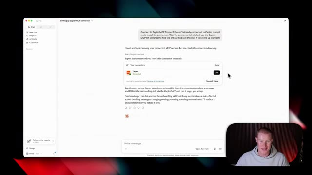
*⏱️ 00:11:52 — Capture d'écran montrant l'interface d'une application de type chat (Claude) avec une boîte de dialogue proposant de connecter Zapier via un connecteur MCP.*

---

### ⏱️ `[00:12:09 - 00:12:28]` | Segment #32

**🔊 Audio (Transcription Intégrale Mot pour Mot en Français) :**
> C'est aussi simple que de cliquer sur ce bouton, de sélectionner tous les outils ici, pour qu'il soit capable d'effectuer ces actions à travers ces applications, et ensuite de cliquer sur ajouter un outil. Et juste comme ça, nous pouvons maintenant demander à Claude Design d'effectuer des actions à travers ces différentes applications avec Zapier. Très bien, alors testons cela et construisons réellement une animation à l'intérieur de Claude Design. Donc ce que je vais faire, c'est simplement sélectionner un modèle ici.

**👁️ Analyse Visuelle d'Écran (gemini-3.5-flash-lite) :**
**Interface & Outils** : Navigateur web affichant l'interface de gestion de serveur MCP (Zapier MCP).

**Contenu textuel & Code** : Liste des applications connectées avec le nombre d'outils associés (Synthflow AI, Sheet, Slack) et options de configuration d'agent IA.

**Action / Démonstration** : Connexion de l'application Slack et sélection des outils pour permettre à l'agent IA d'effectuer des actions à travers les applications.

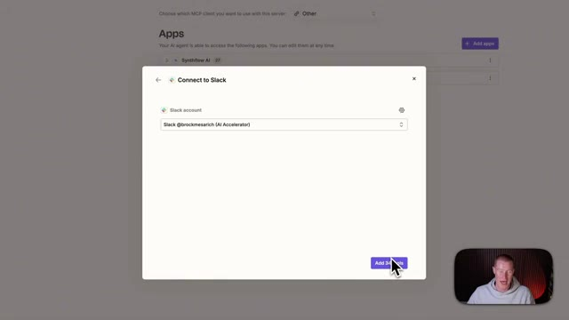
*⏱️ 00:12:14 — Fenêtre contextuelle affichant la connexion à l'application Slack avec le compte 'Slack @brockmesarich (AI Accelerator)' et un bouton d'ajout de 34 outils en bas à droite.*

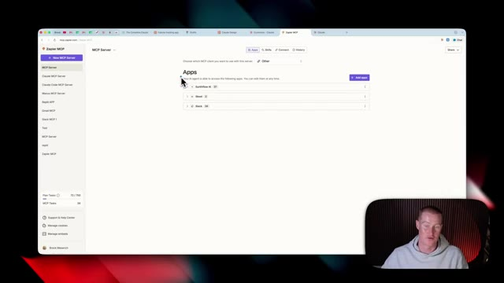
*⏱️ 00:12:19 — Interface complète montrant la configuration des applications connectées, incluant Synthflow AI, Sheet et Slack dans une interface de gestion de serveur MCP.*

---

### ⏱️ `[00:12:28 - 00:12:50]` | Segment #33

**🔊 Audio (Transcription Intégrale Mot pour Mot en Français) :**
> Je vais sélectionner animation. Je vais sélectionner mon design system, qui s'appelle Claw Design System, que j'ai configuré. Et ensuite, je vais simplement venir et dire, je veux que tu génères une vidéo de style lancement de produit avec cette compétence d'animation sur le fonctionnement des intérêts composés. Donc je pourrais envoyer ça et maintenant, ça va générer toute cette vidéo animée pour moi après avoir répondu à quelques-unes de ces différentes questions.

**👁️ Analyse Visuelle d'Écran (gemini-3.5-flash-lite) :**
**Interface & Outils** : Navigateur web affichant l'interface de l'application Claude Design et son panneau de configuration.

**Contenu textuel & Code** : Menu déroulant de sélection des design systems ("Claude Design System", "AI for Non-Techies Design System") et zone de prompt textuel.

**Action / Démonstration** : Sélection d'un design system et d'une compétence d'animation, puis soumission d'une requête textuelle pour générer une vidéo.

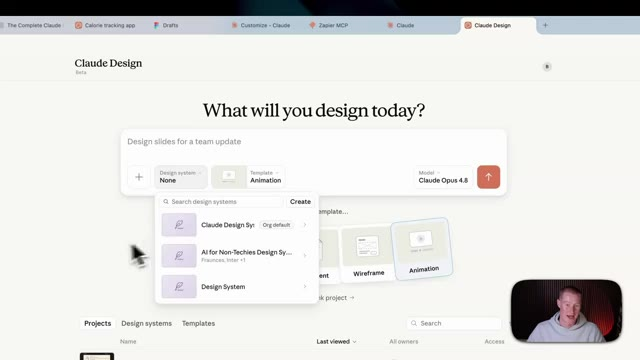
*⏱️ 00:12:34 — Interface web montrant la sélection d'un design system et d'un modèle d'animation sur Claude Design.*

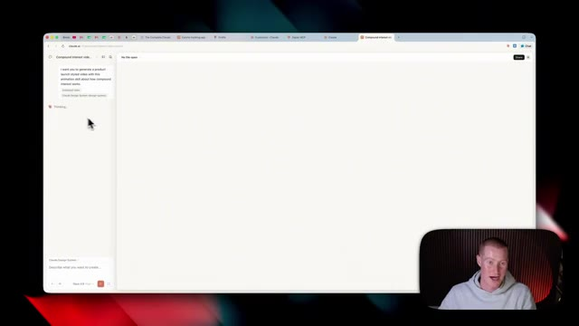
*⏱️ 00:12:44 — Interface de génération montrant un prompt textuel demandant une vidéo de style lancement de produit sur les intérêts composés.*

---

### ⏱️ `[00:12:50 - 00:13:12]` | Segment #34

**🔊 Audio (Transcription Intégrale Mot pour Mot en Français) :**
> Maintenant, quelques minutes plus tard, nous avons cette vidéo animée qu'il a créée dans ce style exact que je vous ai montré plus tôt dans la vidéo. Je veux dire, c'est plutôt cool. Le fait que Claude Design ait été capable de générer tout cela est assez fou. Très bien, les gars, voilà. Ce sont toutes les nouvelles mises à jour de Claude Design. Si vous voulez plus de contenu comme celui-ci, abonnez-vous à cette chaîne. Je couvre l'IA pour les non-techniciens. Ceci étant dit, merci d'être restés jusqu'à la fin et je vous vois dans la prochaine vidéo. Salut.

**👁️ Analyse Visuelle d'Écran (gemini-3.5-flash-lite) :**
**Interface & Outils** : Navigateur web (Claude AI / Interface de génération de vidéo).

**Contenu textuel & Code** : Interface utilisateur affichant une animation graphique sur les intérêts composés ($1,000, $1,080, $1,166, $1,260) et le panneau de chat latéral.

**Action / Démonstration** : Présentation du résultat final d'une vidéo animée générée automatiquement par l'IA.

*⏱️ 00:12:55 — Capture d'écran montrant l'interface du navigateur avec une application web (Claude AI / Claude Design System) affichant une vidéo animée sur les intérêts composés ("Interest earns interest", The Snowball Effect) avec le présentateur incrusté en bas à droite.*

---

