# 🎬 Claude Fable 5 Builds $15,000+ Animated Websites (in minutes)

> **Chaîne** : [Brock Mesarich | AI for Non Techies](https://www.youtube.com/@BrockMesarich)  
> **Lien YouTube** : [https://www.youtube.com/watch?v=OnUjckeLuhQ](https://www.youtube.com/watch?v=OnUjckeLuhQ)  
> **Date de publication** : 20260705  
> **Durée** : 00:13:03  
> **Identifiant vidéo** : `OnUjckeLuhQ`  
> **Transcription & Analyse** : `whisper-v3-large-turbo+gemini-3.5-flash-lite`  

---

## 📌 Synthèse Exécutive & Outils

### 💡 Résumé
Dans cette vidéo intitulée **Claude Fable 5 Builds $15,000+ Animated Websites (in minutes)**, Alex Carter détaille une approche stratégique et pratique du trading et de l'automatisation par agents IA.

### 🛠️ Outils, Modèles & Logiciels Présentés
- **TradingView & Claude Code** : Analyse technique avancée et automatisation algorithmique.

### 🔑 Points Clés & Enseignements Stratégiques
- Respect rigoureux du ratio risque/rendement et du money management.
- Automatisation méthodique des déclencheurs d'ordres via des agents intelligents.

---

## ⏱️ Chronologie & Transcription Complète Audio & Visuelle (Mot pour Mot)

### ⏱️ `[00:00:00 - 00:00:20]` | Segment #01

**🔊 Audio (Transcription Intégrale Mot pour Mot en Français) :**
> Claude Fable 5 is back and it is phenomenal when it comes to generating animated websites like these. So in this video, I'm going to share with you an animated website skill that you could plug directly into Claude. I'm going to show you how to generate stunning visual videos inside of Claude with the Higgsfield MCP and then turn them into stunning websites that you could either build for yourself, your clients, or sell for thousands of dollars.

**👁️ Analyse Visuelle d'Écran (gemini-3.5-flash-lite) :**
**Interface & Outils** : Navigateur web affichant un site web local animé (localhost) et une incrustation vidéo du présentateur.

**Contenu textuel & Code** : Page web interactive présentant la Porsche 911 GT3 avec visuels dynamiques et métriques de performance automobile.
[DESC_IMAGE_2] non retenue en raison de son aspect flou/pixelisé.

**Action / Démonstration** : Navigation et démonstration visuelle d'un site web animé généré par intelligence artificielle.

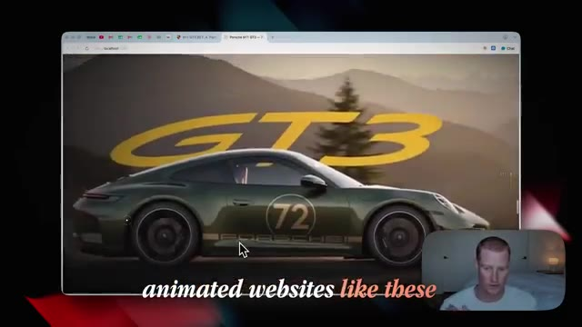
*⏱️ 00:00:05 — Capture montrant un navigateur web affichant un site web animé de présentation de voiture Porsche 911 GT3 vue de profil, avec incrustation vidéo du présentateur en bas à droite.*

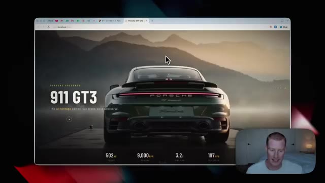
*⏱️ 00:00:15 — Capture montrant le même site web animé de la Porsche 911 GT3 vue de dos avec des spécifications techniques affichées en bas (502 HP, 9,000 RPM, 3.2s, 197 MPH).*

---

### ⏱️ `[00:00:20 - 00:00:39]` | Segment #02

**🔊 Audio (Transcription Intégrale Mot pour Mot en Français) :**
> I've been geeking out about this since Fable 5 came back and I'm absolutely stunned with what it could do. So without further ado, let's dive into this. There are three different things that you're going to need in order to create animated websites like you just saw. And I can guarantee you that it is much simpler than you could probably imagine. The first thing we need is the Claude desktop app. We're going to be using Claude code inside of it.

**👁️ Analyse Visuelle d'Écran (gemini-3.5-flash-lite) :**
**Interface & Outils** : Interface de l'application Claude Code / interface de développement.

**Contenu textuel & Code** : Texte d'accueil ("Welcome back, brock"), liste des sessions, messages d'état ("Needs input: Routine setup-capability...") et zone de saisie en bas avec mention du modèle Fable 5.

**Action / Démonstration** : Navigation et présentation de l'interface de développement de l'outil d'IA par le présentateur.

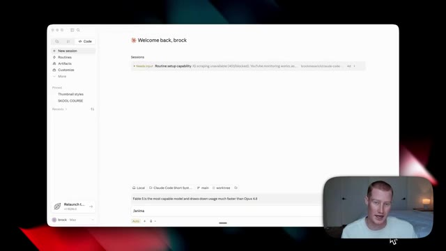
*⏱️ 00:00:30 — Capture d'écran affichant une interface logicielle de type assistant IA / terminal (Claude Code) avec un panneau de sessions et le présentateur en incrustation vidéo.*

---

### ⏱️ `[00:00:39 - 00:00:58]` | Segment #03

**🔊 Audio (Transcription Intégrale Mot pour Mot en Français) :**
> And if you've never used Claude code before, do not worry because I'm going to make it very simple. The second thing you're going to need is this animated website Claude skill that I created. And here's how you can get it for free. There's going to be a link in the description called animated website skill. You're then going to see this page. You're simply going to add in $0 because it's completely free.

**👁️ Analyse Visuelle d'Écran (gemini-3.5-flash-lite) :**
**Interface & Outils** : Navigateur web affichant une page produit Gumroad, avec un encart vidéo du présentateur en bas à droite.

**Contenu textuel & Code** : Page de téléchargement intitulée « Animated Website Skill » avec la mention « /animated-website », une description du produit et un champ de prix libre.

**Action / Démonstration** : Présentation de la ressource gratuite mentionnée dans la description de la vidéo pour installer la compétence Claude.

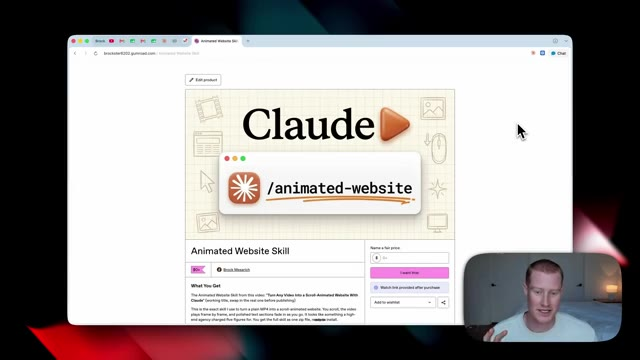
*⏱️ 00:00:44 — Capture d'écran montrant la page Gumroad de la compétence « Animated Website Skill » pour Claude.*

---

### ⏱️ `[00:00:58 - 00:01:16]` | Segment #04

**🔊 Audio (Transcription Intégrale Mot pour Mot en Français) :**
> And if you want to pay me for this, just subscribe to the channel for more videos like this. Then click I want this. And from here, you're just going to type in your email address. Click get and then you will be prompted to this page right here. Just download this skill, save this zip folder to your desktop. And then I'm going to show you how to upload this to CloudCode in just a second.

**👁️ Analyse Visuelle d'Écran (gemini-3.5-flash-lite) :**
**Interface & Outils** : Navigateur web affichant la plateforme de e-commerce Gumroad.

**Contenu textuel & Code** : Formulaire de paiement avec saisie d'email, nom, pays, et page de téléchargement d'un fichier archive ZIP nommé 'animated-website-skill'.

**Action / Démonstration** : Le présentateur montre le processus de commande et de téléchargement de la ressource numérique sur la plateforme Gumroad.

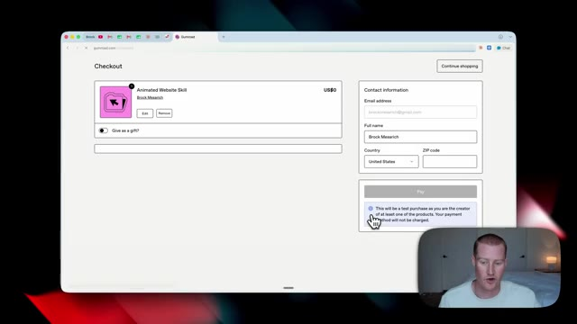
*⏱️ 00:01:02 — Page de paiement (checkout) sur Gumroad pour la ressource 'Animated Website Skill', affichant le champ de saisie des informations de contact et le bouton de validation.*

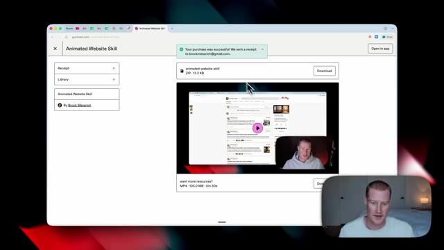
*⏱️ 00:01:07 — Page de confirmation de commande sur Gumroad indiquant que l'achat a réussi, avec le bouton de téléchargement du fichier ZIP (13.3 KB).*

---

### ⏱️ `[00:01:16 - 00:01:39]` | Segment #05

**🔊 Audio (Transcription Intégrale Mot pour Mot en Français) :**
> Now, the third thing we're going to be using is a platform called Higgsfield. If you don't know what it is, it is basically an all-in-one creative AI platform with all the best image and video models at our disposal. And this is how we're going to generate these scroll-stopping animations that we're going to embed into our website. And do not worry, this is going to be very simple because we're going to use the Higgsfield MCP in order to plug this directly into Cloud Code.

**👁️ Analyse Visuelle d'Écran (gemini-3.5-flash-lite) :**
**Interface & Outils** : Navigateur web affichant la plateforme Higgsfield AI (higgsfield.ai).

**Contenu textuel & Code** : Menus de navigation de la plateforme créative (Explore, Image, Video, Supercomputer, MCP & CLI), modules de génération (Nano Banana Pro, Seedance 2.0, Gemini Omni Flash) et instructions de configuration MCP (Model Context Protocol).

**Action / Démonstration** : Navigation et présentation des fonctionnalités de la plateforme de création vidéo et d'IA par le présentateur.

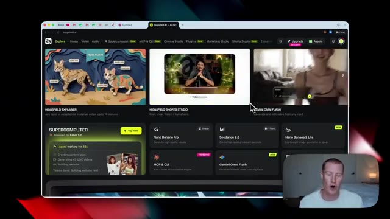
*⏱️ 00:01:22 — Interface principale de la plateforme Higgsfield AI montrant le tableau de bord Explore avec diverses options de génération vidéo et d'image.*

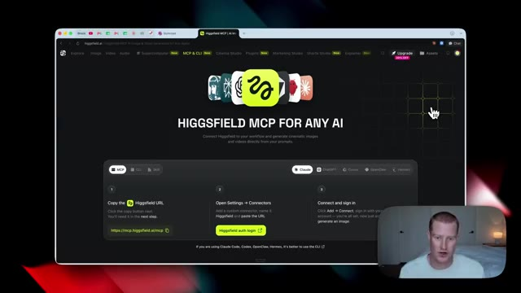
*⏱️ 00:01:34 — Page dédiée à Higgsfield MCP for Any AI montrant les options de connexion avec des outils comme Claude et ChatGPT.*

---

### ⏱️ `[00:01:40 - 00:01:59]` | Segment #06

**🔊 Audio (Transcription Intégrale Mot pour Mot en Français) :**
> De cette façon, nous n'avons pas besoin de quitter l'application Cloud Desktop afin de générer ces visuels époustouflants. Et je vais vous montrer comment configurer cela d'ici peu. Je vais vous montrer comment configurer cela dès maintenant, et cela ne prendra que 30 secondes environ. Tout d'abord, nous avons besoin d'un compte Higgsfield. Il y aura un lien dans la description pour vous inscrire si vous voulez l'essayer. Très bien, passons maintenant à l'étape suivante où nous ajoutons Higgsfield à Claude.

**👁️ Analyse Visuelle d'Écran (gemini-3.5-flash-lite) :**
**Interface & Outils** : Navigateur web affichant le site Higgsfield.ai (section MCP & CLI).

**Contenu textuel & Code** : URL de configuration MCP (`https://mcp.higgsfield.ai/mcp`) et étapes de configuration en 3 étapes pour se connecter à Claude ou d'autres environnements.

**Action / Démonstration** : Présentation de la configuration de l'intégration MCP pour générer des images et vidéos directement depuis les prompts.

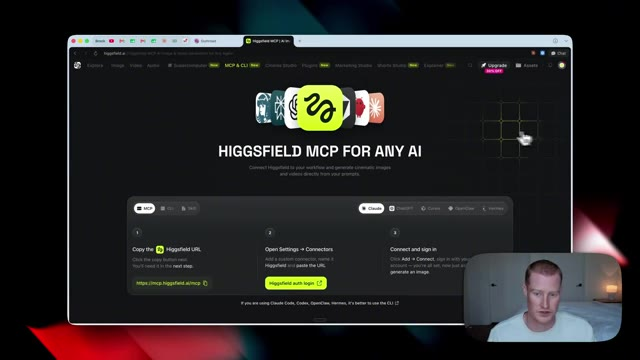
*⏱️ 00:01:44 — Capture d'écran montrant l'interface du site web de Higgsfield AI, avec des instructions pour configurer le connecteur MCP.*

---

### ⏱️ `[00:01:59 - 00:02:18]` | Segment #07

**🔊 Audio (Transcription Intégrale Mot pour Mot en Français) :**
> Et ça va être très simple à faire. Suivons donc cela étape par étape. Allez donc sur le lien dans la description, et nous allons voir cette page Higgsfield MCP. À partir d'ici, nous allons simplement cliquer sur copier juste ici sur ce lien, comme vous pouvez le voir juste ici. Ensuite, ouvrez l'application de bureau Claude. Et nous allons venir ici et sélectionner Claude Code.

**👁️ Analyse Visuelle d'Écran (gemini-3.5-flash-lite) :**
**Interface & Outils** : Navigateur web affichant le site Higgsfield.ai et interface de l'application Claude.

**Contenu textuel & Code** : URL du serveur MCP (https://mcp.higgsfield.ai/mcp) et instructions de connexion.

**Action / Démonstration** : Copie de l'URL du connecteur Higgsfield MCP depuis la page web pour l'intégrer dans l'application Claude.

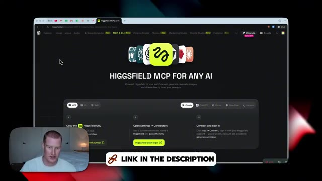
*⏱️ 00:02:03 — Vue d'ensemble de la page web Higgsfield MCP présentant l'interface pour connecter l'IA à des flux de travail de génération d'images et vidéos.*

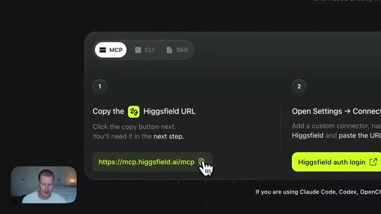
*⏱️ 00:02:08 — Gros plan sur la section de la page web montrant le lien URL Higgsfield MCP et le bouton de copie.*

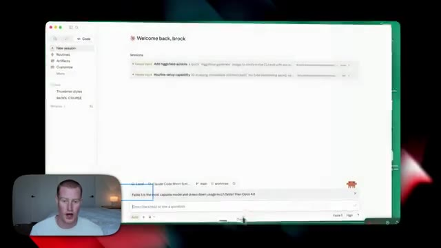
*⏱️ 00:02:13 — Interface de l'application Claude montrant l'écran de bienvenue et la zone de saisie pour interagir avec l'assistant.*

---

### ⏱️ `[00:02:18 - 00:02:36]` | Segment #08

**🔊 Audio (Transcription Intégrale Mot pour Mot en Français) :**
> Une fois que vous avez cliqué là-dessus, descendez ensuite sur personnaliser. Cliquez sur personnaliser. Cliquez sur ce bouton des connecteurs. Et puis à partir d'ici, nous allons ajouter un connecteur. Donc cliquez sur ajouter un connecteur. La chose clé que je veux souligner ici, c'est que vous n'allez pas cliquer sur parcourir les connecteurs comme vous en avez probablement l'habitude. Nous devons ajouter un connecteur personnalisé. Et je vais vous montrer comment faire cela dès maintenant. Donc cliquez là-dessus.

**👁️ Analyse Visuelle d'Écran (gemini-3.5-flash-lite) :**
**Interface & Outils** : Interface de configuration et d'intégration de plugins/connecteurs (similaire à Claude.ai ou plateforme similaire).

**Contenu textuel & Code** : Menu de personnalisation avec les options Skills, Connectors, Personal plugins, et la liste des outils connectés (Bitly, Blotato, Canva, Docusign).

**Action / Démonstration** : Navigation dans les paramètres pour sélectionner l'onglet « Connectors » puis ouverture du menu d'ajout d'un connecteur.

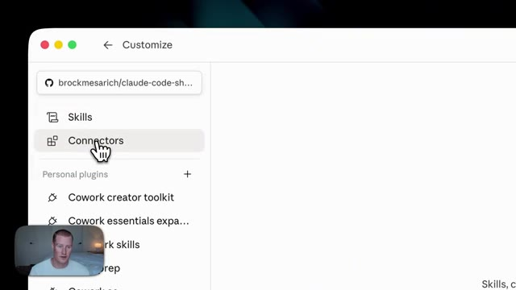
*⏱️ 00:02:22 — Interface de personnalisation montrant le menu latéral avec l'option « Connecters » sur laquelle le curseur clique.*

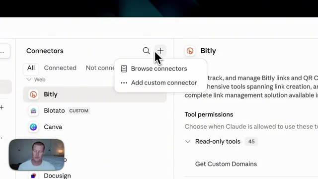
*⏱️ 00:02:27 — Section des connecteurs affichant la liste des outils (Bitly, Blotato, Canva) et un menu contextuel ouvert suite au clic sur le bouton « + » pour ajouter un connecteur.*

---

### ⏱️ `[00:02:36 - 00:02:55]` | Segment #09

**🔊 Audio (Transcription Intégrale Mot pour Mot en Français) :**
> Ensuite, nous allons donner un nom à ceci. Je vais simplement appeler cela Higgsfield, mais donnez-lui le nom que vous voulez. Et puis, je vais simplement coller cette URL MCP qu'il nous a donnée. Et ensuite, je vais cliquer sur ajouter. Maintenant, il va dire que vous n'êtes pas encore connecté à Higgsfield. Alors cliquez sur ce bouton de connexion. Cela va nous ramener à notre compte et nous avons simplement besoin d'autoriser notre compte Higgsfield.

**👁️ Analyse Visuelle d'Écran (gemini-3.5-flash-lite) :**
**Interface & Outils** : Application de bureau avec une fenêtre modale de configuration de connecteur et un navigateur web.

**Contenu textuel & Code** : Formulaire d'ajout de connecteur personnalisé (nom "Higgsfield", champ "Remote MCP server URL", paramètres avancés OAuth).

**Action / Démonstration** : Saisie du nom du connecteur et préparation de l'ajout de l'URL du serveur MCP.

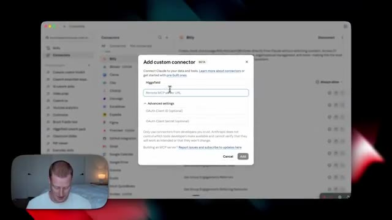
*⏱️ 00:02:41 — Fenêtre modale "Add custom connector" affichée dans l'interface, permettant de saisir un nom (Higgsfield) et une URL MCP distante.*

---

### ⏱️ `[00:02:56 - 00:03:19]` | Segment #10

**🔊 Audio (Transcription Intégrale Mot pour Mot en Français) :**
> Donc je vais cliquer sur autoriser et ensuite ça va me demander d'ouvrir Claude et nous devrions maintenant voir que Higgsfield est connecté juste ici. Et si je fais défiler ma liste de connecteurs, je pourrais cliquer sur Higgsfield MCP. Personnellement, ce que je vais faire, c'est que je vais sélectionner toujours approuver comme ça, Claude n'a pas toujours besoin de me demander s'il peut aller générer des images, parce que si je lui dis de générer une image ou une vidéo, il devrait savoir qu'il peut déjà le faire.

**👁️ Analyse Visuelle d'Écran (gemini-3.5-flash-lite) :**
**Interface & Outils** : Interface web de configuration et d'intégration de Claude / MCP, avec webcam intégrée.

**Contenu textuel & Code** : Liste des connecteurs disponibles (ClickUp, Docusign, Excalidraw, Expedia, Figma, Firecrawl, GitHub, Gmail, Google Calendar, Google Drive, Granola, Gusto, Higgsfield) et outils associés (Create Voice, Dubbing, Generate Image, Generate Video).
[DESC_IMAGE_1] [DESC_IMAGE_2] Demonstration de la connexion effective d'un connecteur tiers (Higgsfield) et navigation dans la liste des connecteurs disponibles.

**Action / Démonstration** : Explications face caméra et analyse conceptuelle des marchés.

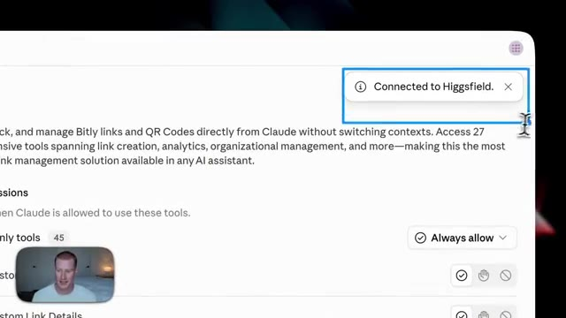
*⏱️ 00:03:01 — Notification contextuelle affichant 'Connected to Higgsfield' en haut à droite avec la webcam du présentateur en bas à gauche.*

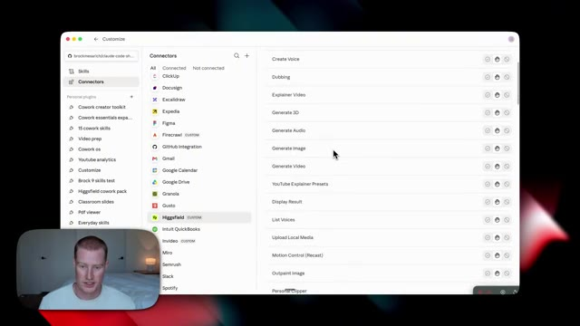
*⏱️ 00:03:07 — Interface de gestion des connecteurs montrant la liste des outils avec Higgsfield sélectionné dans le menu latéral.*

---

### ⏱️ `[00:03:19 - 00:03:39]` | Segment #11

**🔊 Audio (Transcription Intégrale Mot pour Mot en Français) :**
> Et maintenant, comme par magie, nous avons Higgsfield connecté directement à Claude, et nous pouvons commencer à exploiter la puissance de la meilleure plateforme créative qui soit. Maintenant, laissez-moi vous montrer exactement comment télécharger cette compétence de site web animé que j'allais partagée avec vous gratuitement. Et ensuite, nous allons nous lancer dans la génération de ces ressources avec Claude Code et Higgsfield. Très bien, donc ce que nous allons faire maintenant, c'est revenir sur « personnaliser » sur le côté gauche.

**👁️ Analyse Visuelle d'Écran (gemini-3.5-flash-lite) :**
**Interface & Outils** : Application de bureau (interface type tableau de bord / assistant IA)

**Contenu textuel & Code** : Message de bienvenue "Welcome back, brock", liste de sessions récentes avec des statuts "Needs input", et une zone de saisie pour poser une question ou décrire une tâche avec le modèle Fable 5.

**Action / Démonstration** : Navigation ou présentation de l'interface connectant Higgsfield à Claude.

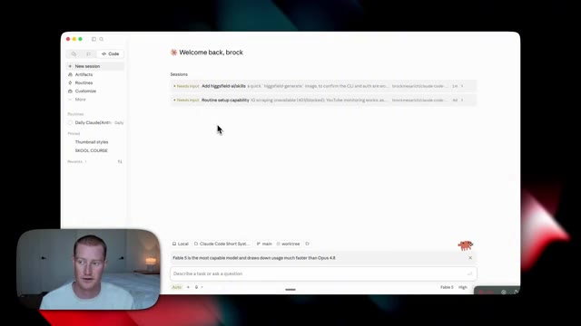
*⏱️ 00:03:24 — Capture d'écran montrant l'interface d'une application logicielle avec un panneau latéral et une zone de chat en bas, ainsi qu'une incrustation vidéo du présentateur en bas à gauche.*

---

### ⏱️ `[00:03:39 - 00:03:57]` | Segment #12

**🔊 Audio (Transcription Intégrale Mot pour Mot en Français) :**
> Au lieu de cliquer sur les connecteurs comme nous venons de le faire, nous allons cliquer sur compétences. Maintenant, nous allons cliquer sur ajouter une compétence et nous allons cliquer sur télécharger une compétence. Ensuite, je vais prendre le fichier zip que j'ai enregistré à partir de ce lien Gumroad. Et encore une fois, si vous ne l'avez pas déjà téléchargé, vous pouvez le récupérer. C'est entièrement gratuit et je l'ai créé pour vous les gars. Ensuite, je vais simplement glisser ceci ici.

**👁️ Analyse Visuelle d'Écran (gemini-3.5-flash-lite) :**
**Interface & Outils** : Interface web de configuration et de gestion des compétences (Skills / Customize).

**Contenu textuel & Code** : Menus de configuration d'IA, options d'importation de compétences (fichiers zip, .md, .skill), et détails de la compétence « visualize ».

**Action / Démonstration** : Clic sur le bouton « Add » pour ouvrir le menu d'ajout de compétence, puis sélection et glisser-déposer d'un fichier ZIP de compétence téléchargé.

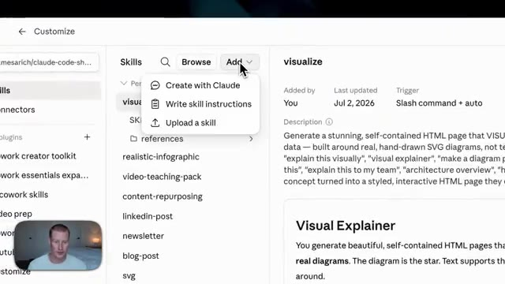
*⏱️ 00:03:43 — L'interface de personnalisation montre le menu déroulant « Add » ouvert, affichant les options « Create with Claude », « Write skill instructions » et « Upload a skill ».*

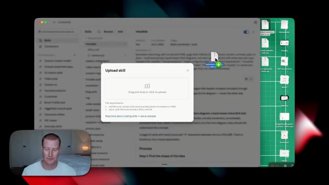
*⏱️ 00:03:48 — Une fenêtre modale « Upload skill » est ouverte avec une zone de glisser-déposer, tandis qu'un fichier ZIP est en train d'être glissé depuis le dossier du bureau vers la fenêtre.*

---

### ⏱️ `[00:03:58 - 00:04:17]` | Segment #13

**🔊 Audio (Transcription Intégrale Mot pour Mot en Français) :**
> L'élément clé, c'est que nous ne voulons pas décompresser ce fichier pendant que nous le téléchargeons, car sinon Claude ne reconnaîtra pas le format. Et maintenant, comme ça, tout en haut de nos compétences Claude, nous en avons une qui s'appelle site web animé. Et si je clique dessus, nous n'avons pas besoin de passer par tous les détails, mais c'est très approfondi, expliquant essentiellement exactement comment créer ce site web animé à partir d'une vidéo.

**👁️ Analyse Visuelle d'Écran (gemini-3.5-flash-lite) :**
**Interface & Outils** : Interface de gestion de compétences (Skills / Customize) sur macOS avec volet de sélection des plugins et aperçu des dossiers.

**Contenu textuel & Code** : Liste des compétences personnelles (« animated-website », « visualize », « SKILL.md », etc.) et description détaillée de la compétence « Visual Explainer » avec les règles de génération de pages HTML et diagrammes SVG.

**Action / Démonstration** : Navigation et sélection des compétences dans le menu latéral pour configurer ou inspecter un module d'intelligence artificielle.

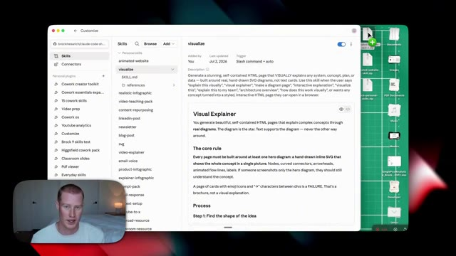
*⏱️ 00:04:02 — Interface de configuration des compétences montrant la gestion des modules et de la compétence 'visualize' avec le panneau de personnalisation.*

---

### ⏱️ `[00:04:17 - 00:04:37]` | Segment #14

**🔊 Audio (Transcription Intégrale Mot pour Mot en Français) :**
> Pour faire court, il va traiter et analyser la vidéo que nous téléchargeons. Il va ensuite extraire et optimiser les images spécifiques de la vidéo pour les transformer en images fixes. Et cela va les convertir dans un format spécifique. De cette façon, lorsque vous faites défiler la page, le site Web affiche chaque image individuelle au lieu d'une vidéo entière. Et à partir de là, il va utiliser le système de design exact que j'ai conçu.

**👁️ Analyse Visuelle d'Écran (gemini-3.5-flash-lite) :**
**Interface & Outils** : Documentation technique, interface de code source bash / script Python.

**Contenu textuel & Code** : Code Python de commande pour extraire les images vidéo (scripts/extract_frames.py) avec des paramètres d'entrée et de sortie.

**Action / Démonstration** : Explication et démonstration de l'étape d'extraction et d'optimisation des images vidéo par le script.

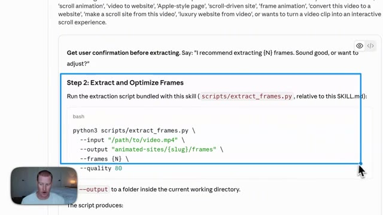
*⏱️ 00:04:22 — Un écran de documentation technique montrant l'étape 2 sur l'extraction et l'optimisation des images avec une commande bash Python, et le présentateur visible en incrustation dans le coin inférieur gauche.*

---

### ⏱️ `[00:04:37 - 00:04:56]` | Segment #15

**🔊 Audio (Transcription Intégrale Mot pour Mot en Français) :**
> De cette façon, ils ont toujours l'air assez similaires. Et encore une fois, vous pouvez personnaliser une compétence si vous le souhaitez. Très bien, alors maintenant de retour dans Cloud Code, je vais vous montrer comment nous pouvons commencer à générer des images et des vidéos en utilisant le MCP Higgsfield afin de créer ce site web animé. Maintenant, tout d'abord, j'aime toujours récupérer une image de référence. Donc ce que je vais générer, c'est un site web pour Porsche.

**👁️ Analyse Visuelle d'Écran (gemini-3.5-flash-lite) :**
**Interface & Outils** : Cloud Code (interface de développement), Navigateur Web (Google Chrome)
[DESC_IMAGE_2] Sessions de développement et barre de prompt Cloud Code ; [DESC_IMAGE_3] Page web officielle de la marque Porsche montrant un intérieur de véhicule et du texte commémoratif.
[DESC_IMAGE_2] Navigation dans l'interface de Cloud Code pour la gestion des sessions et des compétences d'IA ; [DESC_IMAGE_3] Navigation sur le site web de Porsche lors de la démonstration.

**Contenu textuel & Code** : Explications orales des stratégies et mise en contexte méthodologique du marché.

**Action / Démonstration** : Explications face caméra et analyse conceptuelle des marchés.

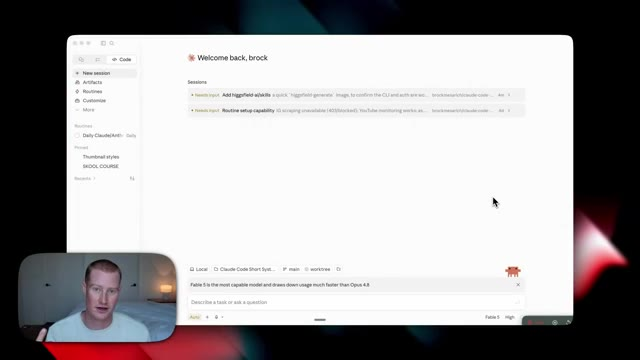
*⏱️ 00:04:47 — L'écran affiche l'interface de Cloud Code avec le tableau de bord des sessions de développement et la barre de saisie de tâches en bas.*

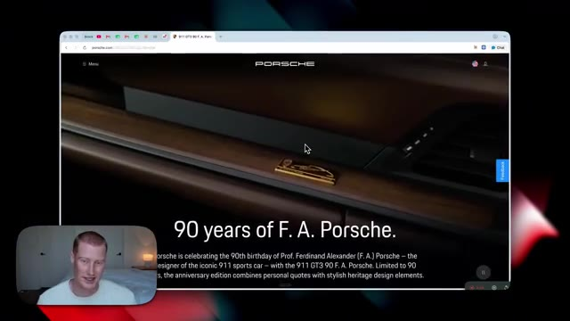
*⏱️ 00:04:51 — Le navigateur affiche la page web officielle de Porsche célébrant les "90 years of F. A. Porsche".*

---

### ⏱️ `[00:04:56 - 00:05:14]` | Segment #16

**🔊 Audio (Transcription Intégrale Mot pour Mot en Français) :**
> Donc je vais aller sur le site Web préexistant de Porsche et je vais simplement récupérer quelques images différentes que je veux utiliser comme références. Donc je veux faire le site Web animé sur ce modèle exact et spécifique. Donc ce que je vais faire, c'est que je vais juste prendre une capture d'écran de ceci et ensuite je vais prendre une capture d'écran de celui-ci également, ainsi que de celui-là.

**👁️ Analyse Visuelle d'Écran (gemini-3.5-flash-lite) :**
**Interface & Outils** : Navigateur Web affichant le site porsche.com

**Contenu textuel & Code** : Page web officielle de Porsche présentant une voiture verte avec le texte "Inspiration and attention to detail" et l'URL du site visible dans la barre d'adresse.

**Action / Démonstration** : Navigation sur le site Web de Porsche pour récupérer des images de référence.

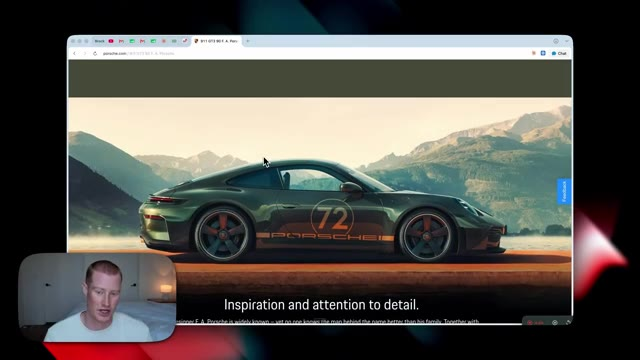
*⏱️ 00:05:00 — Capture d'écran montrant le site Web officiel de Porsche avec un modèle de voiture vert (Porsche 911) devant un paysage montagneux, ainsi qu'une petite incrustation vidéo du présentateur en bas à gauche.*

---

### ⏱️ `[00:05:15 - 00:05:34]` | Segment #17

**🔊 Audio (Transcription Intégrale Mot pour Mot en Français) :**
> Donc c'est vraiment important parce qu'on veut donner les bonnes images de référence à utiliser. Sinon, on devrait les créer à partir de zéro, ce qui peut être un peu pénible. Ensuite, je pense que ce serait sympa de récupérer aussi cette image du logo et de l'icône de Porsche qu'on pourrait également ajouter au site web tout en bas. Maintenant, je vais tout simplement glisser ces images de référence de la voiture.

**👁️ Analyse Visuelle d'Écran (gemini-3.5-flash-lite) :**
**Interface & Outils** : Navigateur web (Google Chrome) affichant des pages web et les résultats de recherche Google.

**Contenu textuel & Code** : Page officielle Porsche présentant un modèle 911 GT3 et résultats de recherche Google affichant différents logos et blasons de la marque Porsche.

**Action / Démonstration** : Navigation sur le web pour trouver et sélectionner des images de référence de véhicules et de logos Porsche.

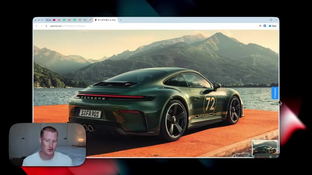
*⏱️ 00:05:19 — Capture d'écran du navigateur web affichant le site officiel de Porsche avec une voiture sportive verte stationnée devant un paysage montagneux, avec la webcam du présentateur en incrustation dans le coin inférieur gauche.*

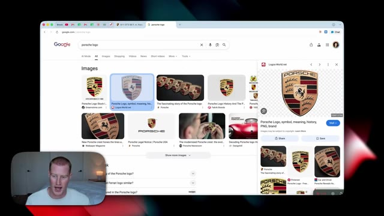
*⏱️ 00:05:24 — Capture d'écran montrant une recherche Google pour "porsche logo" avec les résultats d'images et un panneau latéral affichant le logo officiel de la marque, et la webcam du présentateur dans le coin inférieur gauche.*

---

### ⏱️ `[00:05:34 - 00:05:53]` | Segment #18

**🔊 Audio (Transcription Intégrale Mot pour Mot en Français) :**
> Donc, comme vous pouvez le voir, nous avons maintenant ces trois images téléchargées. Maintenant, une chose importante est que nous voulons nous assurer que Fable 5 est activé, car Fable 5 est évidemment le nouveau modèle pour Amethropic, et il est phénoménal lorsqu'il s'agit de générer des sites web, et il nous aidera également à générer de meilleures images et vidéos avec le MCP Higgsfield.

**👁️ Analyse Visuelle d'Écran (gemini-3.5-flash-lite) :**
**Interface & Outils** : Interface web de l'application d'intelligence artificielle.

**Contenu textuel & Code** : Sélection du modèle "Fable 5", trois images téléchargées dans la zone de texte, message d'avertissement sur la consommation du modèle.

**Action / Démonstration** : Le présentateur montre l'interface de l'application et met en avant la sélection du modèle Fable 5.

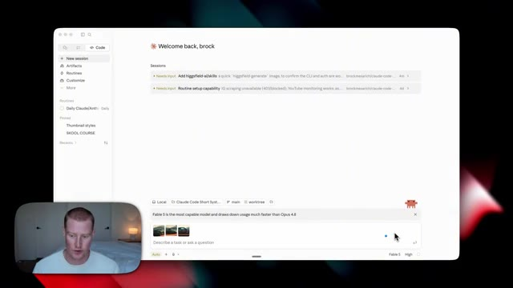
*⏱️ 00:05:39 — Vue d'ensemble de l'interface de l'application montrant la zone de saisie avec trois images téléchargées et la sélection du modèle Fable 5.*

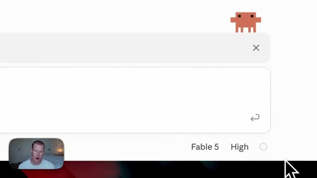
*⏱️ 00:05:43 — Gros plan sur la zone de saisie et les options de configuration avec le bouton Fable 5 activé.*

---

### ⏱️ `[00:05:53 - 00:06:16]` | Segment #19

**🔊 Audio (Transcription Intégrale Mot pour Mot en Français) :**
> Assurez-vous donc d'activer Fable 5. Et pour cet objectif, je vais simplement le laisser en mode élevé, qui est le mode par défaut. Cependant, nous pourrions l'activer en mode ultra, mais ce serait exagéré. Donc, gardons le niveau d'effort sur élevé. Très bien. Et maintenant, passons à la génération de cette vidéo. Voici le prompt que je lui ai donné. C'est assez simple. J'ai dit, prenez ces images de référence, générez une vidéo avec le MCP Higgsfield que nous pouvons utiliser pour un site web animé.

**👁️ Analyse Visuelle d'Écran (gemini-3.5-flash-lite) :**
**Interface & Outils** : Interface web d'assistant IA (Claude / outil de génération Fable 5).

**Contenu textuel & Code** : Paramètres de configuration du niveau d'effort (« Effort High », « Faster / Smarter »), modèle « Fable 5 » et invite textuelle pour générer une vidéo avec Higgsfield MCP.

**Action / Démonstration** : Sélection du niveau d'effort élevé et saisie d'un prompt pour la génération de vidéo à partir d'images de référence.

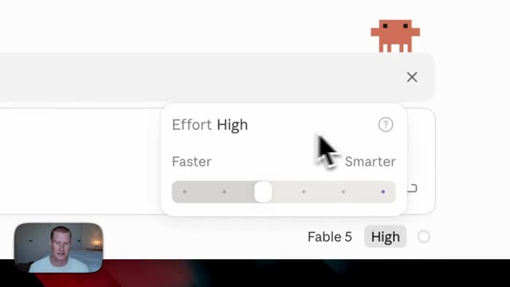
*⏱️ 00:05:59 — Gros plan sur le menu déroulant d'effort (« Effort High ») avec un curseur de configuration et l'option Fable 5 activée en mode élevé.*

*⏱️ 00:06:10 — Interface principale montrant une invite textuelle avec des images de référence et un message d'avertissement concernant l'utilisation du modèle Fable 5.*

---

### ⏱️ `[00:06:16 - 00:06:35]` | Segment #20

**🔊 Audio (Transcription Intégrale Mot pour Mot en Français) :**
> Je veux une vidéo qui fait un panoramique de l'arrière de la voiture vers l'avant lentement tout en montrant le paysage autour. Donc ça devrait être bien. Je vais envoyer ça. Et une chose cool, c'est que Higgsfield prend automatiquement votre prompt et l'améliore parce que, évidemment, l'ingénierie des prompts est vraiment importante lorsqu'il s'agit de générer de bonnes images et vidéos.

**👁️ Analyse Visuelle d'Écran (gemini-3.5-flash-lite) :**
**Interface & Outils** : Interface logicielle de type assistant IA / IDE (Claude Code ou interface similaire).

**Contenu textuel & Code** : Un prompt textuel : « take these reference images and generate a video with the higgsfield MCP that we can use for an animated website. I want a video of that pans from the back of the car to the front slowly while showing the landscape around it » avec trois vignettes d'images de voitures.

**Action / Démonstration** : Saisie et envoi d'un prompt textuel incluant des images de référence pour générer une vidéo via l'outil Higgsfield MCP.

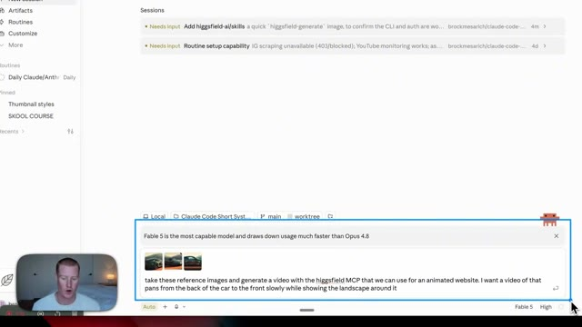
*⏱️ 00:06:21 — Interface de l'application montrant une boîte de saisie avec un prompt textuel destiné au modèle Higgsfield MCP, accompagné de trois images de référence de voitures.*

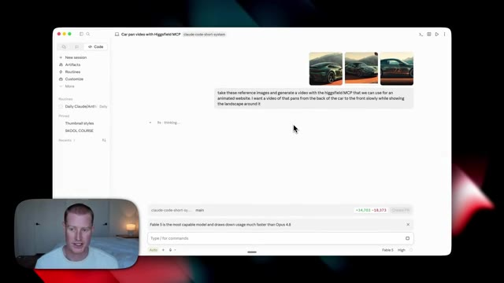
*⏱️ 00:06:30 — Interface de l'application montrant la session en cours avec le prompt utilisateur et le statut de réflexion (« It's thinking... »).*

---

### ⏱️ `[00:06:35 - 00:06:59]` | Segment #21

**🔊 Audio (Transcription Intégrale Mot pour Mot en Français) :**
> So we don't need to worry about that because Higgsfield is going to do that in the background. Now, one thing I do want to mention is we can use Cloud Cowork in order to generate these images and videos as well. And the process is pretty similar. To show you what I mean, I tested this exact workflow before filming this video. And this is what it looks like. You could generate these videos and it automatically will pull up inside of Cloud. But I've noticed I've been able to customize it more and get a little bit better outputs when I'm using Cloud Code.

**👁️ Analyse Visuelle d'Écran (gemini-3.5-flash-lite) :**
**Interface & Outils** : Application de bureau Cloud Cowork, interface utilisateur web.

**Contenu textuel & Code** : Menus de navigation (Projects, Artifacts, Scheduled, Dispatch), barre de saisie de prompt, tâches actives ("Refresh competitor videos", "Morning admin dashboard"), et résultats de génération vidéo avec Higgsfield.

**Action / Démonstration** : Navigation et présentation de l'interface Cloud Cowork pour montrer comment générer des images et des vidéos de manière automatisée.

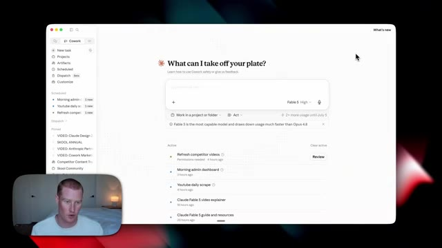
*⏱️ 00:06:41 — Interface principale de l'application Cloud Cowork affichant le tableau de bord avec une barre de recherche et les tâches actives, incluant un aperçu vidéo du présentateur en bas à gauche.*

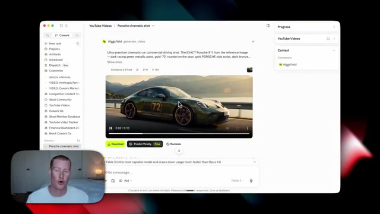
*⏱️ 00:06:53 — Interface de Cloud Cowork montrant un workflow de génération de vidéo par IA avec un aperçu de voiture (Porsche) et des options de téléchargement, avec la webcam du présentateur en bas à gauche.*

---

### ⏱️ `[00:06:59 - 00:07:32]` | Segment #22

**🔊 Audio (Transcription Intégrale Mot pour Mot en Français) :**
> Très bien, alors regardons ceci. C'est le premier résultat que nous avons obtenu de Higgsfield dans Claude Code. Je peux donc venir ici et simplement le visionner directement à l'intérieur de Claude. Et comme nous pouvons le voir, il a utilisé le modèle Seedance 2.0 Fast, que Seedance 2.0, si vous ne le savez pas, est de loin le meilleur modèle vidéo qui soit, à mon sens. Claude et Higgsfield savaient donc que ce serait le meilleur modèle à utiliser pour générer cette vidéo, et cela élimine vraiment les incertitudes que vous devez avoir pour choisir le modèle que vous devriez utiliser. Très bien, alors jetons un coup d'œil à ceci. Je veux dire, c'est plutôt solide jusqu'à présent. Je veux dire, vous pouvez voir que c'est un retournement à 180 degrés.

**👁️ Analyse Visuelle d'Écran (gemini-3.5-flash-lite) :**
**Interface & Outils** : Interface logicielle de Claude Code et interface web de génération vidéo Higgsfield.

**Contenu textuel & Code** : Résultat vidéo généré d'une Porsche, mention du modèle 'Seedance 2.0 Fast', options 'Download', 'Predict Virality', 'Recreate' et invite de commande en bas.

**Action / Démonstration** : Le présentateur visionne et commente le résultat vidéo de Higgsfield directement intégré dans l'interface de Claude Code.

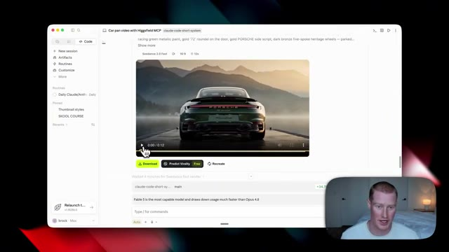
*⏱️ 00:07:07 — Interface de Claude Code affichant un résultat de génération vidéo Higgsfield montrant une voiture Porsche avec des options de lecture, de téléchargement et le modèle Seedance 2.0 Fast utilisé.*

---

### ⏱️ `[00:07:32 - 00:08:09]` | Segment #23

**🔊 Audio (Transcription Intégrale Mot pour Mot en Français) :**
> un panoramique de cette Porsche, qui va avoir l'air vraiment parfaite pour ce site web parce qu'elle va défiler pendant que la voiture est, vous savez, en train de tourner. Donc je peux soit télécharger ceci ici, soit en générer un autre. Alors venons-en simplement ici et générons-en un de plus. Comme ça, nous avons des options. Je veux que tu en génères un autre. Je veux qu'il y ait un léger zoom arrière sur la voiture. Comme ça, elle n'est pas toujours au même niveau verticalement. Et vous pouvez voir à quel point je suis vague avec ces descriptions, parce qu'encore une fois, Fable 5 et Higgs field vont optimiser cette description et prendre mon charabia pour le transformer en une description bien pensée et réelle. Très bien. Donc voici le résultat de celui-ci. Comme vous pouvez le voir, c'est un peu plus

**👁️ Analyse Visuelle d'Écran (gemini-3.5-flash-lite) :**
**Interface & Outils** : Application de génération vidéo et interface de chat textuelle.

**Contenu textuel & Code** : Génération de vidéo par IA, aperçu d'une Porsche verte et instructions textuelles.

**Action / Démonstration** : Visualisation d'une vidéo générée par IA et saisie d'un nouveau prompt pour affiner la génération.

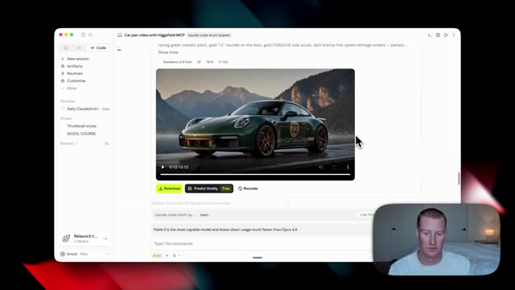
*⏱️ 00:07:41 — Interface d'une application affichant une vidéo générée d'une Porsche verte au bord d'un lac, avec des boutons de téléchargement et d'interaction.*

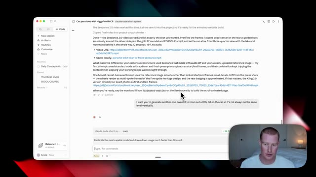
*⏱️ 00:08:00 — Interface de chat textuel affichant les retours et les instructions textuelles pour modifier la génération de la vidéo de la Porsche.*

---

### ⏱️ `[00:08:09 - 00:08:41]` | Segment #24

**🔊 Audio (Transcription Intégrale Mot pour Mot en Français) :**
> dézoomé. Ça se concentre un petit peu plus sur le paysage plutôt que sur un gros plan de la voiture. Je trouve que ça a l'air plutôt cool, mais je pense vraiment que l'autre est meilleur simplement parce qu'il est plus attrayant visuellement quand il s'agit de montrer les détails de la voiture. Mais je veux dire, ça a l'air tellement bien. C'est littéralement, genre, je ne peux même pas dire que c'est fait avec l'IA. Seed Dance 2.0 est vraiment phénoménal. Et donc ce que je vais faire, c'est que je vais retourner à notre original. Je vais simplement cliquer sur ce bouton de télécharger. Je vais cliquer sur ouvrir le lien. Et ce que ça va faire, c'est que ça va nous amener ici où nous pourrions juste sélectionner ce petit bouton et cliquer sur télécharger. Je

**👁️ Analyse Visuelle d'Écran (gemini-3.5-flash-lite) :**
**Interface & Outils** : Interface web de génération vidéo (Seedance 2.0 / interface type chat/code)

**Contenu textuel & Code** : Paramètres vidéo (16:9, 10s), lecteur vidéo affichant un paysage montagneux avec une voiture, et invite textuelle en haut.

**Action / Démonstration** : Visualisation d'une vidéo générée par IA montrant un plan paysager éloigné d'un véhicule.

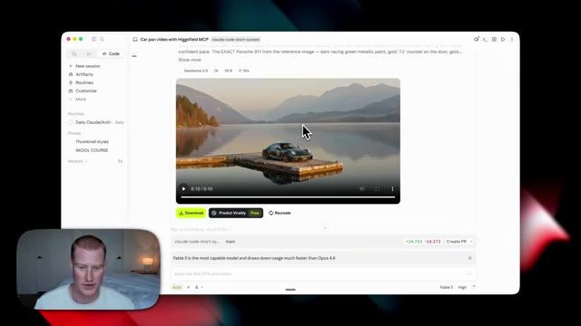
*⏱️ 00:08:17 — Capture d'écran montrant une interface de génération vidéo avec un plan large d'une voiture sur un ponton au bord d'un lac, avec le présentateur en médaillon en bas à gauche.*

---

### ⏱️ `[00:08:41 - 00:09:12]` | Segment #25

**🔊 Audio (Transcription Intégrale Mot pour Mot en Français) :**
> Je pense que ça va vraiment très bien rendre sur un site web animé, les gars. J'ai vraiment hâte de voir à quoi ça va ressembler. Très bien. Alors maintenant, j'ai l'idée de prendre ce logo Porsche et d'en faire une animation où il s'étend en quelque sorte et où tous les différents éléments du logo se séparent et font un zoom arrière, comme vous l'avez probablement déjà vu. Je veux donc l'ajouter au site web. J'ai donc téléchargé ce logo, puis je lui ai donné ce prompt assez complet sur lequel Claude m'a aidé, qui décompose fondamentalement le design de mouvement en 3D. Je vais donc l'envoyer. Ça va être un ajout sympa au reste du site web. J'ai donc hâte de voir à quoi va ressembler le résultat.

**👁️ Analyse Visuelle d'Écran (gemini-3.5-flash-lite) :**
**Interface & Outils** : Interface logicielle de type assistant IA / interface de développement avec un panneau de discussion et un encadré de prompt.

**Contenu textuel & Code** : Un texte décrivant une animation 3D de motion design pour un site web automobile de luxe avec un logo Porsche.

**Action / Démonstration** : Visualisation et révision du prompt textuel décrivant l'animation éclatée du logo Porsche.

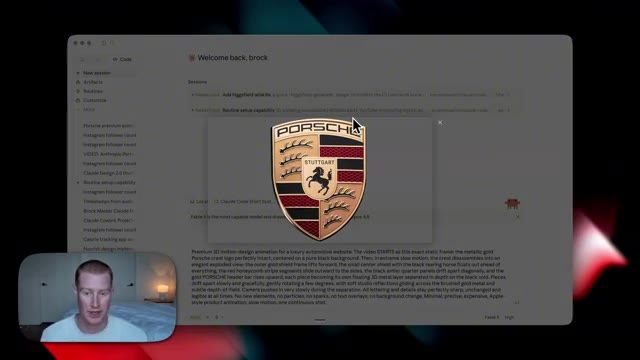
*⏱️ 00:08:49 — Interface d'une application montrant une session avec le logo Porsche affiché en superposition au centre.*

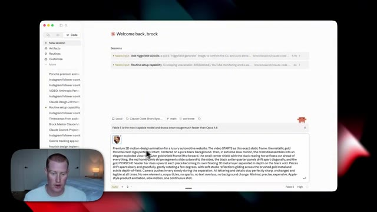
*⏱️ 00:09:04 — Interface de l'application affichant un prompt détaillé pour la génération d'une animation 3D du logo Porsche.*

---

### ⏱️ `[00:09:12 - 00:09:32]` | Segment #26

**🔊 Audio (Transcription Intégrale Mot pour Mot en Français) :**
> Très bien. Alors, voici le résultat de notre logo. Ça a l'air plutôt sympa. Je veux dire, c'est solide. Ça va vraiment rendre super bien sur un site web animé. Maintenant, très rapidement, disons qu'il y a une application que vous voulez connecter à l'intérieur de Claude, ou de Claude Code plus spécifiquement. Et quand vous cliquez sur parcourir les connecteurs, vous ne la voyez pas dans cette liste. Eh bien, je vais vous montrer une astuce qui vous permet de vous connecter à plus de 9000 applications différentes avec quelque chose qui s'appelle le MCP Zapier.

**👁️ Analyse Visuelle d'Écran (gemini-3.5-flash-lite) :**
**Interface & Outils** : Interface web de Claude / Claude Code et navigateur web affichant une vidéo.

**Contenu textuel & Code** : Liste des sessions actives (« Car pan video with Higgsfield MCP », « Add higgsfield-ai/skills ») et répertoire des connecteurs (Canva, Figma, Microsoft 365, Notion, Gmail, Asana, Google Drive).

**Action / Démonstration** : Navigation dans l'interface de l'application Claude pour montrer comment connecter des applications et des outils tiers.

*⏱️ 00:09:22 — Interface principale de Claude montrant le tableau de bord des sessions de travail récentes et le menu latéral de navigation.*

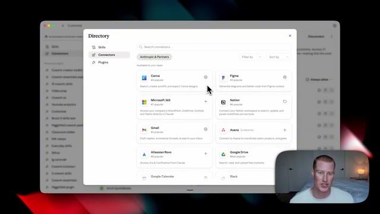
*⏱️ 00:09:27 — Fenêtre de répertoire des connecteurs d'applications intégrées à l'interface de Claude (Canva, Figma, Microsoft 365, Notion, etc.).*

---

### ⏱️ `[00:09:32 - 00:09:52]` | Segment #27

**🔊 Audio (Transcription Intégrale Mot pour Mot en Français) :**
> Maintenant, si vous ne savez pas ce qu'est Zapier, c'est une plateforme d'automatisation qui existe depuis des années. Elle se connecte à plus de 9 000 applications différentes et vous pouvez brancher ce serveur MCP directement à l'intérieur de Claude afin de pouvoir interagir avec toutes ces applications différentes. Maintenant, pour configurer cela, c'est extrêmement simple. Vous allez simplement sélectionner un nouveau serveur MCP. Ensuite, vous allez descendre soit sur Claude, soit sur Claude Code.

**👁️ Analyse Visuelle d'Écran (gemini-3.5-flash-lite) :**
**Interface & Outils** : Navigateur web affichant le site web officiel de Zapier (zapier.com) et encart vidéo du présentateur.

**Contenu textuel & Code** : Texte principal : "Your AI can talk. Zapier MCP makes it act." et "Connect Claude, ChatGPT, Cursor, and other AI tools to Gmail, Slack, Salesforce, and 9,000+ apps."

**Action / Démonstration** : Navigation et présentation de la plateforme Zapier et de sa compatibilité MCP avec des outils d'IA comme Claude.

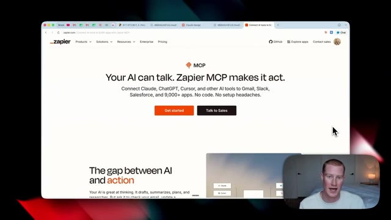
*⏱️ 00:09:37 — Capture d'écran montrant la page web officielle de Zapier présentant son intégration MCP pour l'intelligence artificielle, avec le présentateur visible en incrustation vidéo dans le coin inférieur droit.*

---

### ⏱️ `[00:09:52 - 00:10:11]` | Segment #28

**🔊 Audio (Transcription Intégrale Mot pour Mot en Français) :**
> Je vais simplement aller sur Claude pour ce cas d'usage. Je vais copier ce prompt. Je vais revenir sur Claude et le coller. Claude va ensuite vous guider à travers quelques étapes rapides afin de le configurer. C'est très simple. Et une fois que votre serveur MCP est configuré, vous pouvez maintenant commencer à ajouter différentes applications. Donc par exemple, je pourrais venir ici et rechercher Beehive, qui est une plateforme de marketing par email.

**👁️ Analyse Visuelle d'Écran (gemini-3.5-flash-lite) :**
**Interface & Outils** : Application de bureau Claude et interface web Zapier MCP.

**Contenu textuel & Code** : Un prompt textuel demandant de se connecter à Zapier MCP, ainsi qu'une liste d'applications intégrables (Gmail, Google Sheets, Google Docs, Notion, Slack, etc.).

**Action / Démonstration** : Saisie d'un prompt dans Claude et configuration des outils du serveur MCP sur l'interface Zapier.

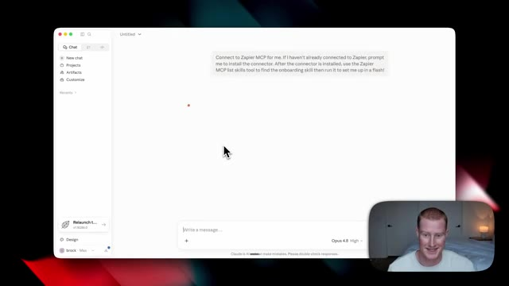
*⏱️ 00:09:57 — Interface de l'application Claude affichant un prompt textuel lié à Zapier MCP au centre, avec la webcam du présentateur en bas à droite.*

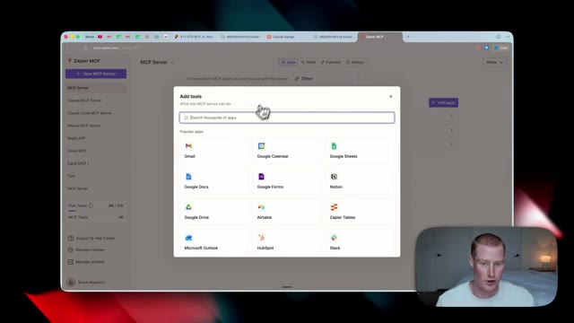
*⏱️ 00:10:06 — Interface Web de Zapier MCP montrant une fenêtre contextuelle pour ajouter des outils et des applications populaires (Gmail, Google Calendar, Notion, etc.).*

---

### ⏱️ `[00:10:11 - 00:10:30]` | Segment #29

**🔊 Audio (Transcription Intégrale Mot pour Mot en Français) :**
> et vous ne pouvez pas vous connecter à Beehive directement à l'intérieur de Claude, mais vous le pouvez avec cette application, votre MCP. Donc je sélectionne juste tous ces différents outils ici, je clique sur connecter, et maintenant nous allons voir que Beehive est connecté à notre serveur MCP. Vous pouvez donc faire cela avec toutes ces différentes applications. Vous pouvez aussi voir que j'ai connecté School parce que je ne peux pas me connecter à School directement à l'intérieur de Claude.

**👁️ Analyse Visuelle d'Écran (gemini-3.5-flash-lite) :**
**Interface & Outils** : Interface web Zapier MCP, navigateur, flux vidéo du présentateur.

**Contenu textuel & Code** : Configuration et sélection d'outils d'automatisation (Beehiiv, Slack, Synthflow AI, Skool) au sein du serveur MCP.

**Action / Démonstration** : Le présentateur sélectionne les outils Beehiiv et confirme la connexion pour lier l'application au serveur MCP.

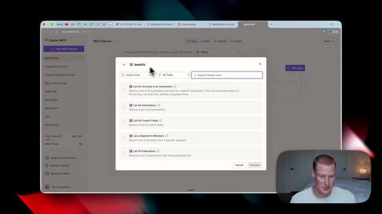
*⏱️ 00:10:16 — Interface de Zapier MCP montrant une fenêtre de recherche d'outils pour l'application Beehiiv avec une liste d'actions disponibles.*

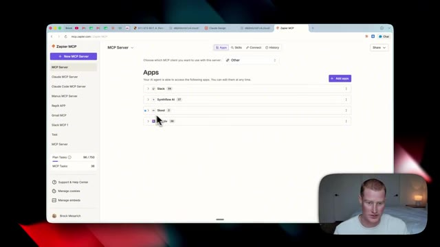
*⏱️ 00:10:25 — Interface de gestion des applications connectées sur Zapier MCP, affichant Beehiiv désormais intégré dans la liste.*

---

### ⏱️ `[00:10:30 - 00:10:52]` | Segment #30

**🔊 Audio (Transcription Intégrale Mot pour Mot en Français) :**
> Et si vous voulez essayer, il y a un lien dans la description. Maintenant, avant de générer ce site web animé, je veux vous montrer ce superbe visuel que j'ai créé avec Higgsfield. J'ai donc pris cette image ici sur le site de Porsche, et ce que j'ai fait, c'est que j'ai pratiquement dit à Higgsfield de l'animer. Nous avons donc maintenant cette vidéo, que nous pourrions également ajouter à notre site web, ce qui, je pense, va être vraiment cool et ajouter une touche sympa.

**👁️ Analyse Visuelle d'Écran (gemini-3.5-flash-lite) :**
**Interface & Outils** : Interface web de Claude Code / assistant IA et outil de génération vidéo Higgsfield.

**Contenu textuel & Code** : Prompts textuels pour l'animation de véhicules et descriptions de scènes 3D/vidéo.

**Action / Démonstration** : Génération d'une animation vidéo à partir d'une image fixe via un outil d'IA.

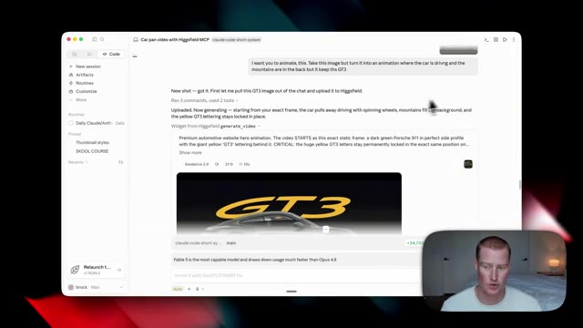
*⏱️ 00:10:35 — Interface d'un assistant de code (Claude Code) affichant un prompt textuel pour animer une image de Porsche GT3 via Higgsfield.*

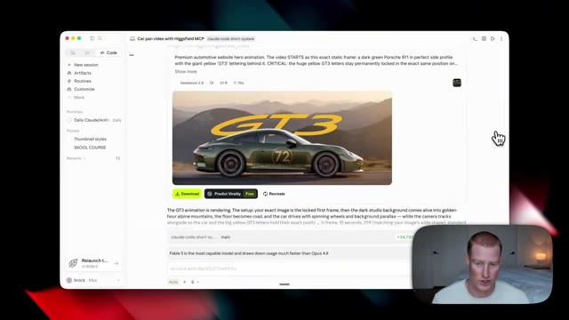
*⏱️ 00:10:47 — Interface de génération vidéo montrant le résultat animé de la Porsche avec un arrière-plan de montagnes et les options de téléchargement.*

---

### ⏱️ `[00:10:52 - 00:11:12]` | Segment #31

**🔊 Audio (Transcription Intégrale Mot pour Mot en Français) :**
> Nous avons donc maintenant trois vidéos que nous allons ajouter à ce site web. Très bien, donc maintenant à l'intérieur de Claude, voici la consigne que je lui donne. Je tape donc simplement barre oblique inverse site web avec ces trois vidéos. La première que je veux en haut, c'est celle-ci. Et ce que j'ai fait, c'est que j'ai copié et collé les noms de fichiers de toutes les vidéos. Donc par exemple, celle-ci juste ici, je l'ai simplement référencée et je lui ai donné le nom de fichier exact.

**👁️ Analyse Visuelle d'Écran (gemini-3.5-flash-lite) :**
**Interface & Outils** : Interface de Claude / Claude Code et environnement de développement

**Contenu textuel & Code** : Prompt utilisateur : « /animated-website with these 3 videos, the first one i want at the top is this one: 180 Shot.mp4, then this one: gt3.mp4, then this one: logo.mp4, this should be a porsche styled website, all text should be easy to read »

**Action / Démonstration** : Saisie d'un prompt pour générer ou modifier un site web animé en intégrant plusieurs fichiers vidéo spécifiques.

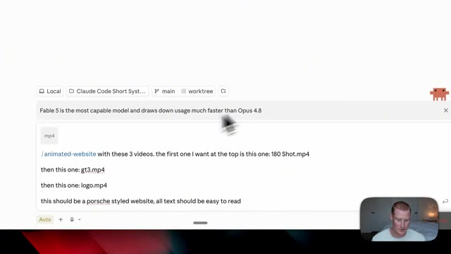
*⏱️ 00:10:57 — Gros plan sur l'interface de l'assistant IA montrant un prompt textuel détaillant l'ajout de trois vidéos pour un site web style Porsche.*

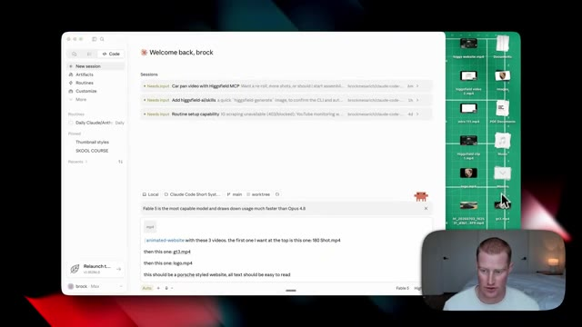
*⏱️ 00:11:07 — Vue d'ensemble de l'interface de l'application Claude avec le panneau latéral, la saisie du prompt et un aperçu des fichiers vidéo.*

---

### ⏱️ `[00:11:12 - 00:11:36]` | Segment #32

**🔊 Audio (Transcription Intégrale Mot pour Mot en Français) :**
> De cette façon, Claude Code peut aller le chercher et ensuite, vous savez, l'intégrer sur notre site web. C'est un prompt très simple que je vais lui donner, mais nous allons faire des itérations à partir de celui-ci, car il y a de fortes chances pour que ce ne soit probablement pas parfait du premier coup. Très bien. Voici donc le résultat, et cela a pris probablement environ 15 bonnes minutes. Et c'est ainsi que l'on sait que Claude 3.5 Sonnet fait vraiment un travail de fond afin de rendre ce site web aussi bon que possible, vous savez.

**👁️ Analyse Visuelle d'Écran (gemini-3.5-flash-lite) :**
**Interface & Outils** : Application de type Claude / interface de développement et navigateur web affichant une page localhost.

**Contenu textuel & Code** : Un prompt d'intégration de vidéos (« with these 3 videos... this should be a porsche styled website ») et le rendu visuel du site web généré affichant des caractéristiques techniques (502 HP, 9,000 RPM, 3.2s, 197 MPH).

**Action / Démonstration** : Le présentateur montre le prompt textuel utilisé pour générer le site, puis passe au rendu final sur le navigateur pour illustrer l'intégration des éléments multimédias.

*⏱️ 00:11:18 — Interface d'une application de type Claude / assistant IA montrant un prompt textuel pour intégrer des vidéos dans un site web, avec la webcam du présentateur en bas à droite.*

*⏱️ 00:11:24 — Aperçu d'un site web hébergé en local affichant une page sur la Porsche 911 GT3 avec un design sombre et des spécifications techniques, et la webcam du présentateur.*

---

### ⏱️ `[00:11:36 - 00:12:06]` | Segment #33

**🔊 Audio (Transcription Intégrale Mot pour Mot en Français) :**
> Alors c'est parti. 911 GT3. Nous, si nous faisons défiler, vous pouvez voir que, vous savez, évidemment, ça fait un panoramique autour de notre voiture. Nous avons ensuite notre deuxième animation ici avec la GT3. Je veux dire, ce sont toutes des informations exactes en ce qui concerne, vous savez, ce qu'est une Porsche GT3 et toutes les différentes caractéristiques et ainsi de suite. Donc je trouve que ça a l'air vraiment solide. Et puis j'ai vraiment aimé l'apparence de ce logo ainsi que l'ajout de cette petite galerie ici. Donc, je veux dire, je trouve ça absolument incroyable pour une invite en un seul essai. Nous lui avons littéralement donné une seule invite et avons utilisé la compétence de site web animé.

**👁️ Analyse Visuelle d'Écran (gemini-3.5-flash-lite) :**
**Interface & Outils** : Navigateur web affichant une page de présentation automobile locale.

**Contenu textuel & Code** : Caractéristiques techniques et visuels d'une Porsche 911 GT3.

**Action / Démonstration** : Navigation et défilement sur une page web de présentation automobile.

---

### ⏱️ `[00:12:06 - 00:12:26]` | Segment #34

**🔊 Audio (Transcription Intégrale Mot pour Mot en Français) :**
> Et selon la vitesse à laquelle vous faites défiler, genre, plus les animations vont être fluides en réalité. Donc si je vais plus vite, évidemment ça va avoir l'air plus fluide. Mais, vous savez, si vous voulez aller lire tout ça, vous savez, ça n'aura pas l'air aussi fluide, mais ça a l'air vraiment incroyable. Maintenant, comme vous pouvez le voir, je consulte ceci en local sur mon ordinateur. Je ne peux donc pas vraiment partager ça en ligne et, vous savez, mes amis ne peuvent pas aller le voir.

**👁️ Analyse Visuelle d'Écran (gemini-3.5-flash-lite) :**
**Interface & Outils** : Navigateur web affichant une page locale (localhost) dédiée à la présentation d'une Porsche 911 GT3.

**Contenu textuel & Code** : Spécifications techniques d'une voiture (502 HP, 9,000 RPM, 3.2s, 197 MPH) et design d'interface web animé.

**Action / Démonstration** : Navigation et défilement sur une page web de présentation interactive.

*⏱️ 00:12:11 — Capture d'écran montrant le logo Porsche animé sur un site web local (localhost) avec la webcam du présentateur en bas à droite.*

*⏱️ 00:12:16 — Capture d'écran affichant une voiture Porsche verte sur une page web de présentation avec des spécifications techniques et du texte descriptif.*

*⏱️ 00:12:21 — Capture d'écran montrant l'arrière d'une Porsche 911 GT3 sur un site web en cours de navigation avec le curseur sur la barre d'adresse.*

---

### ⏱️ `[00:12:26 - 00:12:46]` | Segment #35

**🔊 Audio (Transcription Intégrale Mot pour Mot en Français) :**
> Mais si vous voulez vraiment transformer cela en un site web réel, nous pourrions faire quelque chose comme le MCP Vercel, que nous pouvons brancher directement sur Claude pour relier cela à notre URL, ou nous pourrions même ajouter notre propre domaine personnalisé si nous voulons vraiment faire les choses en grand. Mais les gars, c'est ainsi que vous pouvez créer un site web animé avec Fable5 et le MCP Higgsfield directement à l'intérieur de Claude en seulement quelques minutes.

**👁️ Analyse Visuelle d'Écran (gemini-3.5-flash-lite) :**
**Interface & Outils** : Navigateur web affichant un site hébergé en local (localhost) et webcam du présentateur.

**Contenu textuel & Code** : Page web interactive générée pour une Porsche 911 GT3 avec visuels, spécifications techniques (puissance, régime, vitesse) et détails d'équipements.
[DESC_IMAGE_2] Présentation du site web prototype créé pour illustrer la transformation d'un projet en site web réel.

**Action / Démonstration** : Explications face caméra et analyse conceptuelle des marchés.

*⏱️ 00:12:31 — Capture d'écran montrant un prototype de site web hébergé en local (localhost) dédié à la Porsche 911 GT3, avec en bas à droite une vignette vidéo du présentateur.*

*⏱️ 00:12:41 — Défilement sur le même site web local de la Porsche 911 GT3, affichant les spécifications des équipements du véhicule, avec la webcam du présentateur en incrustation.*

---

### ⏱️ `[00:12:46 - 00:13:03]` | Segment #36

**🔊 Audio (Transcription Intégrale Mot pour Mot en Français) :**
> Je dirais que de bout en bout, si vous commencez à installer ce système et à le tester, vous devriez être capable de faire cela en probablement environ 30 minutes et avec quelques prompts très basiques. Si vous avez trouvé cela utile, laissez un pouce bleu, abonnez-vous à cette chaîne pour plus de contenu, et si vous voulez utiliser Higgsfield, il y a un lien dans la description et dans le premier commentaire épinglé. Merci d'être restés jusqu'à la fin. On se voit dans la prochaine et salut.

**👁️ Analyse Visuelle d'Écran (gemini-3.5-flash-lite) :**
**Interface & Outils** : Présentation ou face-caméra explicatif du trader sans interface logicielle partagée.

**Contenu textuel & Code** : Explications orales des stratégies et mise en contexte méthodologique du marché.

**Action / Démonstration** : Explications face caméra et analyse conceptuelle des marchés.

---

