# 🎬 Master Claude for Marketing in 72 Minutes (FULL COURSE)

> **Chaîne** : [Brock Mesarich | AI for Non Techies](https://www.youtube.com/@BrockMesarich)  
> **Lien YouTube** : [https://www.youtube.com/watch?v=_8TUhqsgyXk](https://www.youtube.com/watch?v=_8TUhqsgyXk)  
> **Date de publication** : 20260706  
> **Durée** : 01:12:16  
> **Identifiant vidéo** : `_8TUhqsgyXk`  
> **Transcription & Analyse** : `whisper-v3-large-turbo+gemini-3.5-flash-lite`  

---

## 📌 Synthèse Exécutive & Outils

### 💡 Résumé
Dans cette vidéo intitulée **Maîtriser Claude pour le marketing en 72 minutes (COURS COMPLET)**, Alex Carter détaille une approche stratégique et pratique du trading et de l'automatisation par agents IA.

### 🛠️ Outils, Modèles & Logiciels Présentés
- **TradingView & Claude Code** : Analyse technique avancée et automatisation algorithmique.

### 🔑 Points Clés & Enseignements Stratégiques
- Respect rigoureux du ratio risque/rendement et du money management.
- Automatisation méthodique des déclencheurs d'ordres via des agents intelligents.

---

## ⏱️ Chronologie & Transcription Complète Audio & Visuelle (Mot pour Mot)

### ⏱️ `[00:00:00 - 00:00:35]` | Segment #01

**🔊 Audio (Transcription Intégrale Mot pour Mot en Français) :**
> Si vous voulez utiliser Claude pour gérer votre marketing, c'est la seule vidéo que vous devez regarder. C'est la vidéo la plus approfondie que vous trouverez partout sur Internet sur la façon d'utiliser réellement Claude pour le marketing. J'utilise Claude Cowork tous les jours pour gérer mon entreprise depuis les cinq derniers mois, et je fais actuellement six chiffres par mois en grande partie grâce à Claude. Donc dans cette vidéo, je vais vous montrer ce qui est réellement possible. Je vais vous montrer comment cloner votre propre voix pour que le contenu donne l'impression que vous l'avez écrit, générer des images et des vidéos qui captent l'attention sans designer, construire un système qui trouve vos clients et écrit les messages de prospection pour vous, et comment profiter de l'une des plus grandes opportunités du marketing par IA.

**👁️ Analyse Visuelle d'Écran (gemini-3.5-flash-lite) :**
**Interface & Outils** : AUCUNE

**Contenu textuel & Code** : AUCUN

**Action / Démonstration** : AUCUNE

---

### ⏱️ `[00:00:35 - 00:01:08]` | Segment #02

**🔊 Audio (Transcription Intégrale Mot pour Mot en Français) :**
> dès maintenant. De plus, je vous donne mes feuilles de route exactes et mes packs de prompts entièrement gratuitement afin que vous puissiez construire en même temps que moi dans cette vidéo. Alors, sans plus tarder, plongeons directement dedans. Très bien, les gars. Donc, tout d'abord, ce sera un cours très approfondi et détaillé sur la façon d'utiliser Claude pour le marketing. Mais même si vous n'êtes pas technique, cette vidéo va simplifier les choses pour que tout le monde puisse comprendre. Et pour commencer, je vais partager ce pack de ressources avec vous tous entièrement gratuitement. Ce sera votre guide étape par étape détaillant avec des visuels ce que nous construisons ainsi que le prompt exact que vous pouvez copier pour

**👁️ Analyse Visuelle d'Écran (gemini-3.5-flash-lite) :**
**Interface & Outils** : Navigateur web affichant une page web de cours en ligne.

**Contenu textuel & Code** : Titre de cours, instructions d'utilisation et diagramme 'Claude is the cockpit' connectant Claude à divers outils marketing et d'IA (Higgsfield, Blololo, Clay, Gmail, Zapier, Semrush).

**Action / Démonstration** : Présentation des ressources et des feuilles de route offertes gratuitement pour suivre la vidéo.

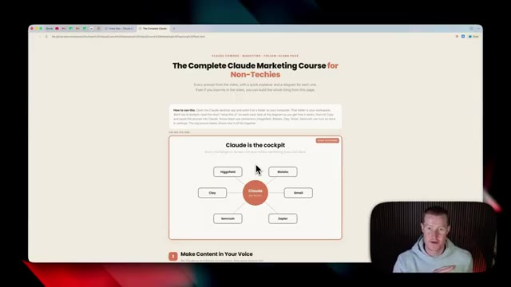
*⏱️ 00:00:51 — Capture d'écran d'une page web montrant le cours 'The Complete Claude Marketing Course for Non-Techies' avec un diagramme schématique centré sur Claude.*

---

### ⏱️ `[00:01:08 - 00:01:26]` | Segment #03

**🔊 Audio (Transcription Intégrale Mot pour Mot en Français) :**
> suivez bien tout au long de cette vidéo. Comme vous pouvez le voir, il y a des tonnes d'étapes différentes ici qui vous montrent comment développer des compétences spécifiques. Je vais vous donner les instructions pour les compétences et tant d'autres choses que nous allons aborder. Donc, tout d'abord, ce que vous devez faire, c'est télécharger cette ressource gratuite et je vais vous montrer comment faire dès maintenant. Très bien, donc pour obtenir cette ressource, il y aura un lien dans la description ainsi que dans le premier commentaire épinglé.

**👁️ Analyse Visuelle d'Écran (gemini-3.5-flash-lite) :**
**Interface & Outils** : Navigateur web affichant une page de documentation/cours en ligne et une interface de vente de cours.

**Contenu textuel & Code** : Schémas de processus de réutilisation de contenu vidéo (1 vidéo vers blog, newsletter, post LinkedIn, carrousel) et prompts d'instructions pour l'IA Claude.

**Action / Démonstration** : Présentation visuelle des étapes et des compétences pratiques à développer pour automatiser la création de contenu marketing avec Claude.

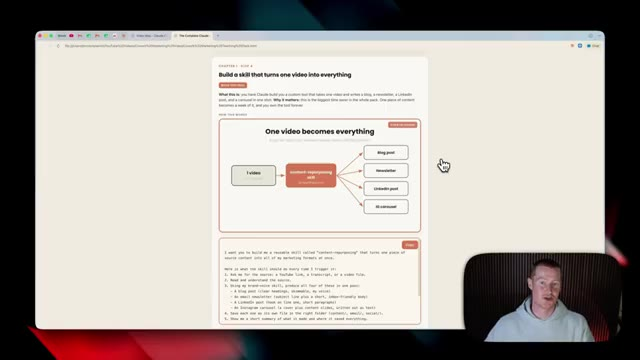
*⏱️ 00:01:12 — Page web montrant un tutoriel intitulé 'Build a skill that turns one video into everything' avec un schéma explicatif et un prompt textuel.*

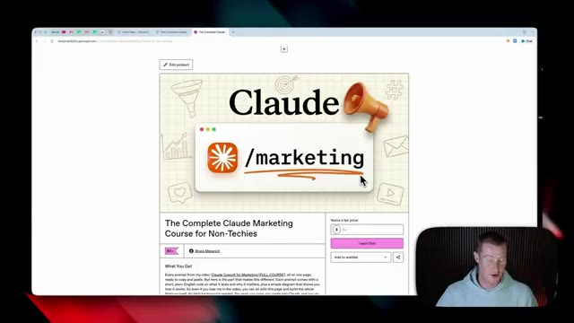
*⏱️ 00:01:22 — Page web de vente ou de cours hébergée sur une plateforme de type Gumroad intitulée 'The Complete Claude Marketing Course for Non-Techies'.*

---

### ⏱️ `[00:01:26 - 00:01:47]` | Segment #04

**🔊 Audio (Transcription Intégrale Mot pour Mot en Français) :**
> Et nous allons venir ici sur Gumroad. Mettez simplement 0 $. Si vous voulez me payer pour ceci, abonnez-vous simplement à la chaîne si vous n'êtes pas déjà abonné. Et ensuite, vous pouvez l'avoir gratuitement. Cliquez simplement sur "Je veux ceci". Et ensuite, nous allons entrer nos coordonnées. Nous allons simplement ajouter notre adresse e-mail. Ainsi que vous pouvez obtenir mes 15 compétences de co-travail et quelques autres produits différents, vous savez, que j'ai ici qui sont également entièrement gratuits.

**👁️ Analyse Visuelle d'Écran (gemini-3.5-flash-lite) :**
**Interface & Outils** : Navigateur web affichant la plateforme de e-commerce Gumroad.

**Contenu textuel & Code** : Prix fixé à 0 $, intitulé de la formation "The Complete Claude Marketing Course for Non-Techies", et suggestions de produits complémentaires.

**Action / Démonstration** : Configuration du prix à zéro et navigation vers la page de commande pour l'obtention gratuite de la ressource.

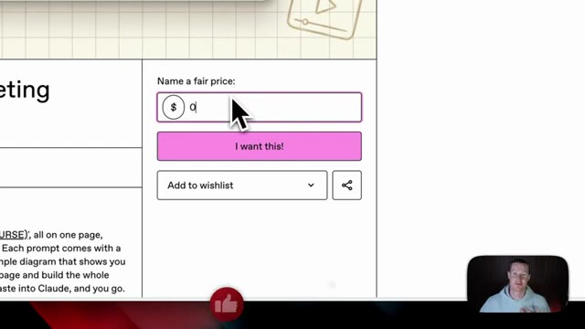
*⏱️ 00:01:32 — Page de paiement Gumroad avec un champ de prix défini à 0 $ et le bouton rose "I want this!".*

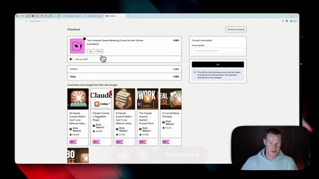
*⏱️ 00:01:37 — Page de validation de commande (Checkout) sur Gumroad pour "The Complete Claude Marketing Course for Non-Techies" au prix de 0 US$.*

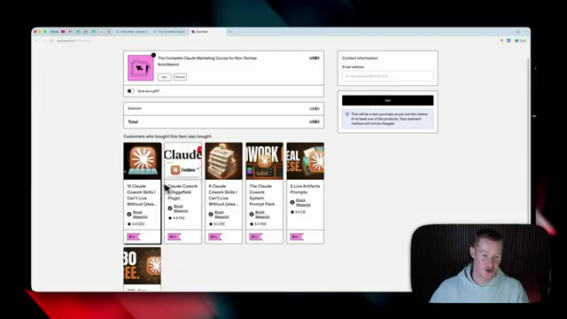
*⏱️ 00:01:42 — Page de paiement Gumroad affichant le récapitulatif de la commande à 0 $ et les produits complémentaires recommandés.*

---

### ⏱️ `[00:01:47 - 00:02:06]` | Segment #05

**🔊 Audio (Transcription Intégrale Mot pour Mot en Français) :**
> Ensuite, vous allez entrer votre adresse e-mail. Cliquez simplement sur obtenir. Et c'est aussi simple que ça, nous avons maintenant ce pack pédagogique. Nous allons cliquer sur télécharger. Il s'agira d'un fichier HTML. Je peux donc simplement cliquer dessus, l'ouvrir. Il devrait s'ouvrir dans votre navigateur et vous verrez alors exactement ce même guide, que nous allons utiliser pour suivre cette vidéo. Tout cela a été préparé pour vous.

**👁️ Analyse Visuelle d'Écran (gemini-3.5-flash-lite) :**
**Interface & Outils** : Navigateur web affichant une page de téléchargement (Gumroad ou similaire) et incrustation vidéo.

**Contenu textuel & Code** : Fichier HTML nommé "Coscorn Marketing Teaching Pack" de 46,3 Ko avec un bouton de téléchargement "Download", et message "Your purchase was successful".

**Action / Démonstration** : Le curseur de la souris survole ou s'apprête à cliquer sur le bouton de téléchargement du pack pédagogique.

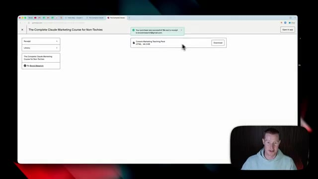
*⏱️ 00:01:52 — Capture d'écran montrant une page web de téléchargement d'un pack pédagogique avec une notification de succès d'achat, et une incrustation vidéo du présentateur en bas à droite.*

---

### ⏱️ `[00:02:06 - 00:02:41]` | Segment #06

**🔊 Audio (Transcription Intégrale Mot pour Mot en Français) :**
> Très bien. Alors maintenant que nous avons effectivement ce téléchargement, parlons de ce que nous allons construire. Donc, tout d'abord, nous allons construire essentiellement tout un moteur marketing complet de travail collaboratif dans Claude, pour l'essentiel. Claude va être au centre de tout cela, avec notre voix spécifique que nous allons façonner à l'intérieur de Claude, et nous allons également connecter cela aux différents outils marketing que nous utilisons. Donc, qu'il s'agisse de Higgsfield, de Clay, de Zapier, de Gmail, en gros tous les différents outils que nous utilisons pour faire tourner notre entreprise, nous pouvons les intégrer directement dans Claude afin de créer du contenu et des supports marketing pour nous. Maintenant, la prochaine étape consiste à nous assurer que nous avons bien téléchargé l'application de bureau Claude. Si vous ne l'avez pas déjà

**👁️ Analyse Visuelle d'Écran (gemini-3.5-flash-lite) :**
**Interface & Outils** : Diapositive de présentation / Schéma conceptuel d'architecture de workflow.

**Contenu textuel & Code** : Titre « Claude is the cockpit » avec sous-titre « Every tool plugs in, so you run your whole marketing from one place » ; diagramme en étoile reliant le nœud central « Claude (you, by voice) » aux applications périphériques : Higgsfield, Blotato, Clay, Gmail, Semrush et Zapier.

**Action / Démonstration** : Présentation et explication du système marketing centralisé autour de Claude.

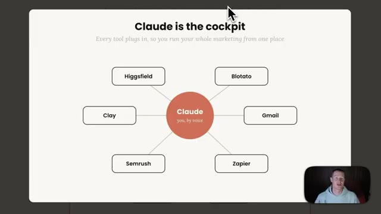
*⏱️ 00:02:15 — Diapositive schématisant l'intégration de Claude comme cockpit central relié à différents outils marketing et d'automatisation.*

---

### ⏱️ `[00:02:41 - 00:03:18]` | Segment #07

**🔊 Audio (Transcription Intégrale Mot pour Mot en Français) :**
> téléchargé, il y aura un lien dans la description et le commentaire épinglé. Alors allez-y et téléchargez ceci. Et ensuite, à partir de là, allons-y et ouvrons-le. Tout d'abord, ce que nous allons voir, c'est que nous sommes en mode chat ici. C'est en gros comme utiliser le Claude normal sur le Web ou ChatGPT. Mais ce sur quoi nous allons nous concentrer dans cette vidéo, c'est que nous voulons activer le mode co-work. Cependant, une grande partie des compétences et des systèmes que nous allons construire, nous pouvons les utiliser à l'intérieur du mode chat, mais nous allons construire un système marketing complet et nous avons besoin du co-work pour faire cela. Cliquez donc sur ce petit bouton du milieu et vous verrez que nous sommes maintenant en mode co-work. Et ce que nous allons voir, c'est cette interface juste ici. Maintenant, laissez-moi parler rapidement de nos prochaines étapes. Maintenant, nous devons configurer notre

**👁️ Analyse Visuelle d'Écran (gemini-3.5-flash-lite) :**
**Interface & Outils** : Application ou interface web de type assistant IA (Claude).

**Contenu textuel & Code** : Menu latéral avec les options New chat, Projects, Artifacts, Customize et historique des discussions.

**Action / Démonstration** : Navigation dans l'interface de l'application pour montrer le mode chat standard similaire à la version web.

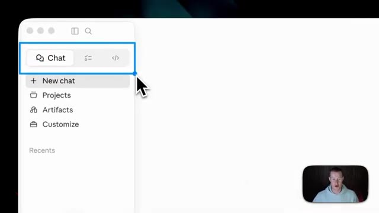
*⏱️ 00:03:00 — Gros plan sur le panneau latéral gauche de l'interface avec l'onglet "Chat" mis en évidence par un contour bleu.*

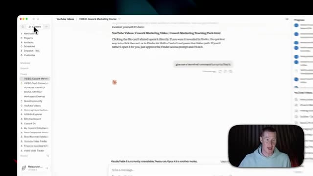
*⏱️ 00:03:09 — Vue de l'interface utilisateur affichant une conversation active avec des blocs de texte et de code, et les options de menu latéral.*

---

### ⏱️ `[00:03:18 - 00:03:54]` | Segment #08

**🔊 Audio (Transcription Intégrale Mot pour Mot en Français) :**
> espace de travail spécifique à l'intérieur de Claude. Et si vous ne savez pas ce qu'est un dossier d'espace de travail, laissez-moi vous expliquer cela dès maintenant si simplement que n'importe qui peut comprendre. Notre espace de travail n'est qu'une collection de dossiers. Et à l'intérieur de ce dossier, nous allons avoir plusieurs éléments différents. Tout d'abord, nous allons avoir notre fichier Claude MD, et si vous ne savez pas ce que c'est, il s'agit essentiellement d'un document expliquant qui nous sommes, notre ton spécifique et la façon dont nous voulons interagir avec Claude. Et ensuite, nous allons avoir un fichier memory MD, qui correspond à des faits spécifiques. Il va se souvenir de vous, de votre entreprise et des conversations précédentes dans le contexte auquel nous avons besoin qu'il ait accès. Ensuite, il va lire cet espace de travail à chaque fois. Et de cette façon, Claude toujours

**👁️ Analyse Visuelle d'Écran (gemini-3.5-flash-lite) :**
**Interface & Outils** : Présentation pédagogique / Modale d'explication de l'interface Claude.

**Contenu textuel & Code** : Diagramme détaillant la structure "YOUR WORKSPACE" avec les fichiers de configuration `CLAUDE.md` (identité et ton de voix) et `MEMORY.md` (faits mémorisés), pointant vers l'effet "Claude knows your brand".

**Action / Démonstration** : Présentation conceptuelle montrant comment Claude lit automatiquement les fichiers du dossier de travail pour adapter ses réponses à la marque de l'utilisateur.

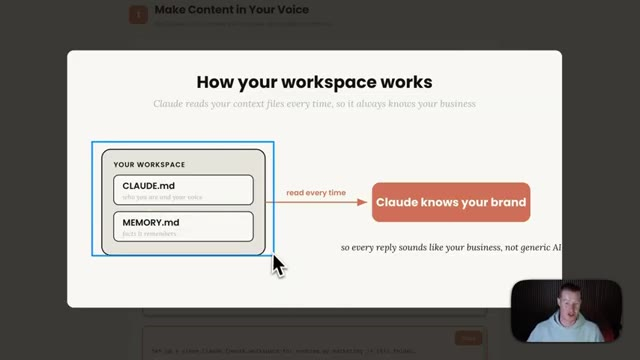
*⏱️ 00:03:27 — Schéma explicatif sur le fonctionnement des espaces de travail Claude ("How your workspace works"), illustrant la lecture systématique des fichiers de contexte.*

---

### ⏱️ `[00:03:54 - 00:04:30]` | Segment #09

**🔊 Audio (Transcription Intégrale Mot pour Mot en Français) :**
> connaît notre marque et est capable de nous aider à créer du contenu à travers tous ces différents canaux marketing. C'est ce que nous allons passer en revue et configurer dans cette vidéo. Maintenant, ce que nous devons faire, c'est venir sélectionner un dossier spécifique dans lequel nous allons travailler directement à l'intérieur de Claude. Si vous n'avez jamais utilisé Co-work auparavant, laissez-moi vous expliquer simplement comment cela fonctionne. Maintenant, si vous ne connaissez pas la différence entre le mode Claude normal et le mode Co-work, parlons-en dès maintenant. Donc Claude.ai normal, c'est essentiellement comme l'application web que nous utiliserons ou le mode de discussion normal à l'intérieur de l'application de bureau Co-work, nous interagissons simplement avec cela comme une conversation, nous échangeons dans les deux sens et il nous donne des réponses textuelles spécifiques et c'est vraiment tout. Eh bien, à l'intérieur de Co-work, nous travaillons à l'intérieur de dossiers sur notre

**👁️ Analyse Visuelle d'Écran (gemini-3.5-flash-lite) :**
**Interface & Outils** : Application Cowork / Claude AI

**Contenu textuel & Code** : Champ de prompt "How can I help you today?", sélection de modèle "Opus 4.0 High", projets dans la barre latérale ("VIDEO: Cowork Market...", "YOUTUBE ARTIFACT", etc.) et tâches récentes ("Youtube daily scrape", "Morning admin dashboard").

**Action / Démonstration** : Navigation dans l'interface Cowork pour préparer la configuration d'un projet et le choix d'un dossier spécifique.

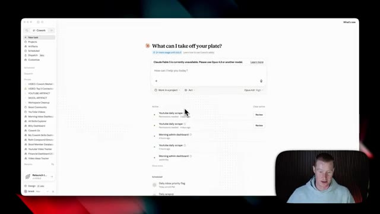
*⏱️ 00:04:03 — Interface de l'application Cowork montrant le modèle Opus 4.0 sélectionné, une zone de saisie de prompt et une liste de tâches exécutées ou planifiées.*

---

### ⏱️ `[00:04:30 - 00:05:02]` | Segment #10

**🔊 Audio (Transcription Intégrale Mot pour Mot en Français) :**
> véritable ordinateur qu'il est capable de lire, modifier et manipuler, donc il fait essentiellement du vrai travail sur votre ordinateur et crée des fichiers, utilise vos fichiers dans vos différents dossiers, etc. Donc, cela étant dit, il est important que nous configurions cela correctement et que nous comprenions comment cela fonctionne. Donc, à l'intérieur de Cowork, nous voulons venir ici et sélectionner un dossier dans lequel travailler sur notre ordinateur. Nous pouvons seulement travailler à l'intérieur des dossiers auxquels nous donnons accès. Alors allons-y et créons-en un. Nous allons descendre et, vous savez, vous pouvez voir que j'en ai déjà certains préexistants sur mon bureau, mais nous allons vouloir en créer un à partir de zéro pour les besoins de cette vidéo, à moins qu'il n'y en ait un particulier

**👁️ Analyse Visuelle d'Écran (gemini-3.5-flash-lite) :**
**Interface & Outils** : Interface de l'application Cowork (assistant IA de bureau) et navigateur de projets.

**Contenu textuel & Code** : Options de configuration d'IA, sélection de projets locaux, modèles de langage (Opus 4.8), et interface de gestion des tâches automatisées.
[DESC_IMAGE_1] (Ignorée car non retenue)
[DESC_IMAGE_2] Sélection et survol d'un menu de projet dans l'interface de l'assistant Cowork.
[DESC_IMAGE_3] Navigation et sélection d'un dossier de projet spécifique ("Cowork Marketing") pour configurer l'espace de travail de l'IA.

**Action / Démonstration** : Explications face caméra et analyse conceptuelle des marchés.

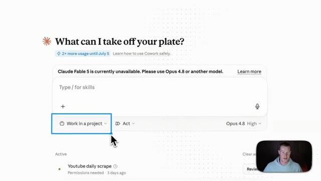
*⏱️ 00:04:46 — Interface de l'outil d'IA Cowork avec le prompt "What can I take off your plate?" et un menu déroulant encadré en bleu sur "Work in a project", avec le présentateur visible en incrustation vidéo en bas à droite.*

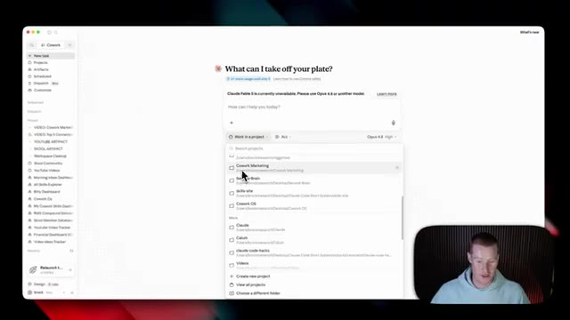
*⏱️ 00:04:54 — Interface complète de l'application Cowork montrant le menu déroulant actif des projets locaux (Cowork Marketing, Second-Brain, etc.) avec le présentateur en incrustation vidéo.*

---

### ⏱️ `[00:05:02 - 00:05:35]` | Segment #11

**🔊 Audio (Transcription Intégrale Mot pour Mot en Français) :**
> celui que vous voulez utiliser puisque vous avez déjà utilisé Cowork auparavant. Donc, choisissez simplement un dossier différent. Et puis, à partir d'ici, je vais juste cliquer sur nouveau dossier. Appelons-le Claude Marketing. Je vais cliquer sur ouvrir et je vais juste cliquer sur toujours autoriser. Comme ça, il apportera toujours des modifications. Et maintenant, nous pouvons voir que Claude Marketing est sélectionné et c'est le dossier dans lequel nous travaillons. Très bien. Donc, nous savons ce qu'est un espace de travail. Nous savons ce qu'est Cowork. Nous comprenons en quelque sorte les principes fondamentaux de tout cela. Maintenant, ce que nous devons faire, c'est configurer le dossier spécifique que nous avons déjà connecté à Claude. Donc, ce que j'ai fait, c'est que j'ai créé ce prompt que n'importe qui peut utiliser afin d'aider

**👁️ Analyse Visuelle d'Écran (gemini-3.5-flash-lite) :**
**Interface & Outils** : Interface Cowork, Explorateur de fichiers macOS, Navigateur web.

**Contenu textuel & Code** : Création de dossiers, nommage de projets, instructions textuelles pour configurer un espace de travail marketing.

**Action / Démonstration** : Saisie du nom d'un nouveau dossier, sélection du dossier et navigation dans un guide de configuration marketing.

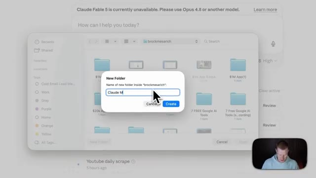
*⏱️ 00:05:11 — Boîte de dialogue macOS pour la création d'un nouveau dossier nommé « Claude M » dans l'interface de Cowork.*

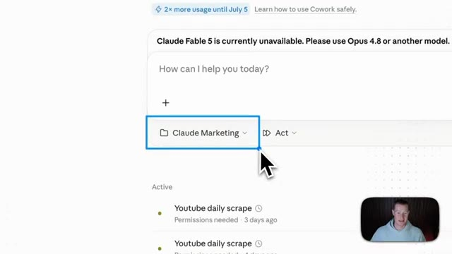
*⏱️ 00:05:19 — Interface de Cowork affichant le dossier sélectionné « Claude Marketing ».*

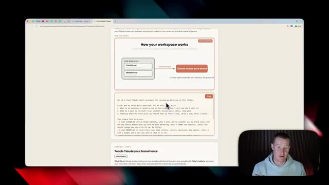
*⏱️ 00:05:27 — Page web de documentation montrant les instructions de configuration d'un espace de travail Claude Cowork pour le marketing.*

---

### ⏱️ `[00:05:35 - 00:06:04]` | Segment #12

**🔊 Audio (Transcription Intégrale Mot pour Mot en Français) :**
> le configurer nous-mêmes. Donc, il va nous poser une série de questions différentes sur notre entreprise et notre marque. Qu'est-ce que je veux lancer ici ? Tout ce qui concerne la voix de ma marque que je devrais savoir. Et il va créer la structure pour cela, ce qui va nous aider à élaborer notre fichier Claude MD ainsi que notre fichier root memory MD. Et encore une fois, cela peut sembler du gibier de potence, mais ne vous inquiétez pas. Ces invites vont vous aider à vous sauver si vous ne savez pas de quoi je parle. Alors cliquez sur copier. Ensuite, nous allons revenir sur cowork et revenir à, vous savez, ce chat dans lequel nous sommes. Nous allons envoyer ceci, cliquez sur envoyer. Très bien. Donc, il va poser une série de questions différentes.

**👁️ Analyse Visuelle d'Écran (gemini-3.5-flash-lite) :**
**Interface & Outils** : Navigateur web (Google Chrome) affichant un document textuel avec un encadré de prompt.

**Contenu textuel & Code** : Un prompt textuel commençant par "Set up a clean Claude Cowork workspace..." demandant à l'IA de poser d'abord trois questions (entreprise/marque, ce qu'on souhaite exécuter, et la voix de la marque) puis de structurer les dossiers et fichiers (CLAUDE.md, MEMORY.md).

**Action / Démonstration** : Le présentateur montre l'interface et le prompt détaillé servant à configurer l'espace de travail marketing de l'IA.

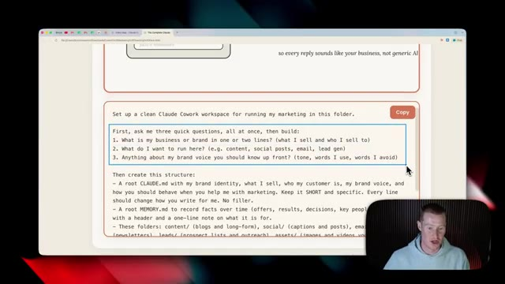
*⏱️ 00:05:42 — Un navigateur web affichant un document avec un prompt configurant un espace de travail Claude Cowork pour le marketing, montrant les questions initiales à poser.*

---

### ⏱️ `[00:06:04 - 00:06:37]` | Segment #13

**🔊 Audio (Transcription Intégrale Mot pour Mot en Français) :**
> Donc quelle est notre entreprise et marque en deux lignes, ce que vous vendez, à qui vous le vendez, que voulez-vous faire tourner dans ce dossier, ainsi que tout ce que je devrais savoir sur la voix de notre marque. Alors laissez-moi remplir ça moi-même. Faites de même. Voici donc ce que je veux faire tourner dans ce dossier. Je veux tout faire, de la création de contenu aux publications sur les réseaux sociaux, aux newsletters par e-mail, jusqu'à la prospection pour générer des leads. Ce sera concrètement tout mon département marketing à l'intérieur de ce dossier. Je vais donc sélectionner tout ça, sélectionnez simplement ce que vous voulez utiliser. Quelque chose sur la voix de notre marque. Personnellement, j'aime ce qui est simple, direct, d'un niveau de lecture CM2, parce que je pense que beaucoup de gens utilisent trop de jargon technique pour mon cas d'usage précis. Alors allez-y, remplissez ces questions et ça va

**👁️ Analyse Visuelle d'Écran (gemini-3.5-flash-lite) :**
**Interface & Outils** : Interface web / application interactive avec menu contextuel à choix multiples (AskUserQuestion).

**Contenu textuel & Code** : Options textuelles visibles : "Content (blogs/long-form)", "Social posts/captions", "Email/newsletters", "Lead gen/outreach", "Something else". Un curseur de souris survole l'option "Social posts/captions". En bas, un message indique : "Claude Fable 5 is currently unavailable. Please use Opus 4.8 or another model."

**Action / Démonstration** : Sélection d'une option dans le questionnaire interactif de l'outil d'IA.

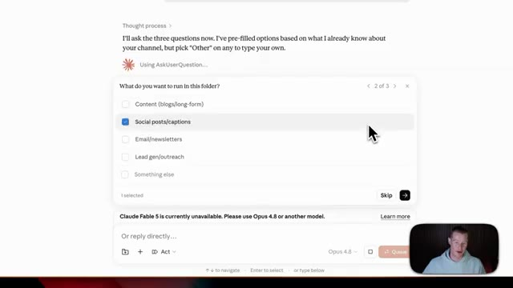
*⏱️ 00:06:12 — Capture d'écran montrant une interface logicielle d'intelligence artificielle avec une fenêtre modale interactive posant des questions contextuelles à l'utilisateur.*

---

### ⏱️ `[00:06:37 - 00:06:57]` | Segment #14

**🔊 Audio (Transcription Intégrale Mot pour Mot en Français) :**
> pour commencer à rédiger notre fichier CloudMD dans notre fichier MemoryMD maintenant. Et maintenant, quelques secondes plus tard, nous avons la structure de notre espace de travail qui a été créée. Donc si nous jetons un œil ici, vous pouvez voir que nous avons notre dossier Cloud Marketing. En dessous de cela, nous avons un CloudMD, un MemoryMD. Nous avons un autre dossier pour le contenu, un autre pour les réseaux sociaux, un autre pour les e-mails, un autre pour les prospects, et un autre pour les ressources.

**👁️ Analyse Visuelle d'Écran (gemini-3.5-flash-lite) :**
**Interface & Outils** : Interface de l'application Cowork / Claude.

**Contenu textuel & Code** : Arborescence de fichiers avec CLAUDE.md, MEMORY.md et des sous-dossiers (content, social, email, leads, assets).

**Action / Démonstration** : Présentation de la structure de l'espace de travail fraîchement créée pour le marketing.

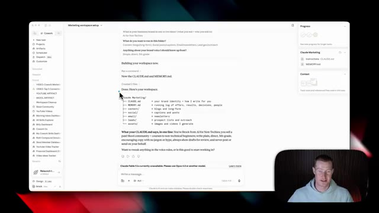
*⏱️ 00:06:42 — Vue d'ensemble de l'interface de l'espace de travail montrant la structure de fichiers générée pour Claude Marketing.*

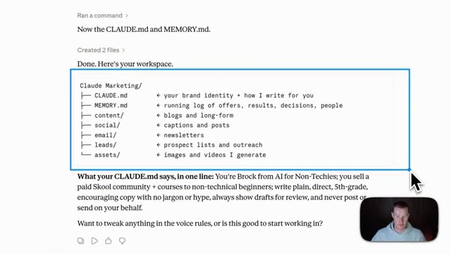
*⏱️ 00:06:47 — Gros plan sur la structure arborescente du dossier Cloud Marketing générée par l'IA.*

---

### ⏱️ `[00:06:57 - 00:07:16]` | Segment #15

**🔊 Audio (Transcription Intégrale Mot pour Mot en Français) :**
> Très bien. Donc c'est là que les choses commencent à paraître un peu magiques si vous n'avez jamais utilisé Cowork auparavant. Alors allez-y, cherchez le dossier que vous avez créé à l'origine. Le mien, je l'ai appelé Claude Marketing et allez-y, ouvrez-le. Nous allons maintenant voir quelques éléments à l'intérieur de ce dossier qui réside constamment sur notre bureau. Nous avons quelques dossiers différents ici et quelques fichiers.

**👁️ Analyse Visuelle d'Écran (gemini-3.5-flash-lite) :**
**Interface & Outils** : macOS Finder

**Contenu textuel & Code** : Explorateur de fichiers affichant le contenu du dossier 'Claude Marketing' avec un sous-dossier 'assets' (0 octets).

**Action / Démonstration** : Navigation dans l'explorateur de fichiers pour ouvrir le dossier de travail.

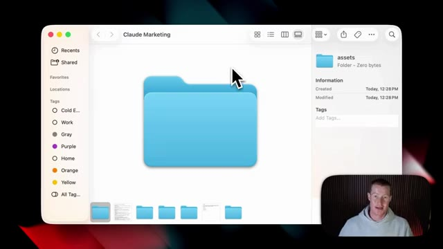
*⏱️ 00:07:02 — Une capture d'écran du Finder sur macOS montrant le dossier nommé 'Claude Marketing' contenant un sous-dossier 'assets' et des fichiers récents, avec une petite fenêtre vidéo du présentateur en bas à droite.*

---

### ⏱️ `[00:07:17 - 00:07:36]` | Segment #16

**🔊 Audio (Transcription Intégrale Mot pour Mot en Français) :**
> Donc tout d'abord, nous en avons un pour les actifs. Nous avons ensuite notre fichier Cloud MD, qui correspond fondamentalement à la façon dont nous voulons que cet espace de travail fonctionne. Comment, vous savez, les détails sur notre entreprise que Cloud peut toujours consulter. Ou nous avons notre fichier Memory MD, qui contient l'historique spécifique de nos conversations précédentes, ainsi que des choses que nous avons mentionnées vouloir retenir. Et nous avons d'autres dossiers. Nous en avons un pour notre contenu. Nous en avons un pour nos e-mails.

**👁️ Analyse Visuelle d'Écran (gemini-3.5-flash-lite) :**
**Interface & Outils** : Système d'exploitation macOS (Finder)

**Contenu textuel & Code** : Fichiers et dossiers d'un espace de travail nommé « Claude Marketing », incluant spécifiquement le fichier de configuration « CLAUDE.md » sélectionné et le fichier « MEMORY.md ».

**Action / Démonstration** : Le présentateur survole le fichier « CLAUDE.md » avec le curseur de la souris pour illustrer la structure du dossier de l'espace de travail.

*⏱️ 00:07:21 — Une capture d'écran du Finder sur macOS montrant le dossier « Claude Marketing » avec plusieurs sous-dossiers et fichiers dont « assets », « CLAUDE.md », « content », « email », « leads », « MEMORY.md » et « social », tandis que le présentateur apparaît en bas à droite.*

---

### ⏱️ `[00:07:36 - 00:07:54]` | Segment #17

**🔊 Audio (Transcription Intégrale Mot pour Mot en Français) :**
> Nous en avons un pour les prospects. Nous en avons un maintenant pour nos réseaux sociaux. Et si j'ouvre chacun de ces dossiers individuels, vous pouvez voir que dans le dossier de contenu, il n'y a rien ici pour l'instant. Mais à mesure que nous générons du contenu ou, par exemple, des e-mails, lorsque nous générons nos e-mails et que nous voulons les enregistrer, ils vont toujours se peupler et résider dans ce dossier ici.

**👁️ Analyse Visuelle d'Écran (gemini-3.5-flash-lite) :**
**Interface & Outils** : Explorateur de fichiers macOS (Finder).

**Contenu textuel & Code** : Un dossier vide nommé "content" avec la barre latérale du Finder affichant les raccourcis et tags (Recents, Shared, Cold E..., Work, Gray, Purple, Home, Orange, Yellow).

**Action / Démonstration** : Le curseur de la souris survole le bouton de retour de la fenêtre du Finder pendant que le présentateur parle de l'organisation des dossiers de contenu.

---

### ⏱️ `[00:07:54 - 00:08:15]` | Segment #18

**🔊 Audio (Transcription Intégrale Mot pour Mot en Français) :**
> Donc, nous avons maintenant configuré avec succès cet espace de travail. Et encore une fois, vous pouvez le personnaliser comme vous le souhaitez. Ceci n'est qu'un exemple général, et le prompt que je vous ai donné devrait vous offrir une très bonne base de travail. Maintenant, lorsque nous revenons à Claude et plus particulièrement à Cowork, nous pouvons désormais voir cela reflété ici. Donc, si nous venons sur le côté droit, nous avons notre dossier marketing Claude ici et nous avons quelques éléments différents.

**👁️ Analyse Visuelle d'Écran (gemini-3.5-flash-lite) :**
**Interface & Outils** : Système de fichiers macOS et interface de l'assistant IA Claude.

**Contenu textuel & Code** : Fichiers et dossiers du projet de marketing : assets, content, leads, social, et fichiers de configuration CLAUDE.md et MEMORY.md.

**Action / Démonstration** : Navigation dans l'arborescence des fichiers du projet et visualisation des instructions configurées pour l'assistant.

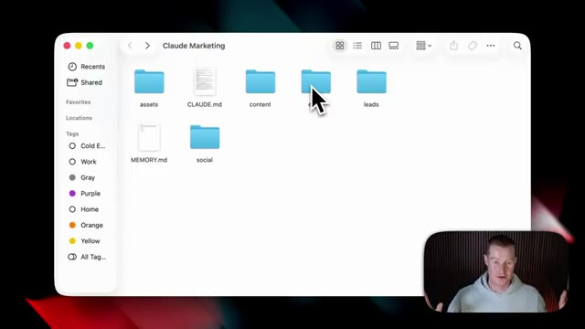
*⏱️ 00:08:00 — Vue d'un dossier sur macOS nommé "Claude Marketing" contenant plusieurs sous-dossiers et fichiers de configuration.*

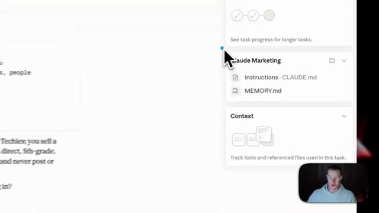
*⏱️ 00:08:10 — Interface montrant les instructions du projet "Claude Marketing" avec les fichiers CLAUDE.md et MEMORY.md.*

---

### ⏱️ `[00:08:15 - 00:08:50]` | Segment #19

**🔊 Audio (Transcription Intégrale Mot pour Mot en Français) :**
> nous avons à la fois nos instructions, qui constituent notre Cloud MD, ainsi que notre memory MD. Et je peux toujours cliquer dessus, l'ouvrir, et soit je peux venir ici et faire des modifications rapides s'il y a une erreur spécifique ou s'il y a quelque chose que nous voulons ajouter. Avec le temps, nous pourrions l'ajouter ici. Ou nous pourrions toujours simplement descendre ici et dire à Claude, hé, tu sais, cela a changé concernant mon entreprise. Peux-tu mettre cela à jour dans le fichier Cloud MD ? La chose essentielle à noter est que nous voulons nous assurer que notre fichier Cloud MD n'a pas trop d'informations ici, car chaque fois que nous envoyons un message à Claude Cowork, il va lire ceci comme point de départ à chaque fois. Et s'il y a beaucoup de paragraphes et de paragraphes et de paragraphes de texte ici, il va devoir tout lire

**👁️ Analyse Visuelle d'Écran (gemini-3.5-flash-lite) :**
**Interface & Outils** : Application Cowork / Claude Workspace sur macOS.

**Contenu textuel & Code** : Fichiers de configuration, CLAUDE.md, MEMORY.md et instructions de dossier pour la gestion de communauté Skool et la création de contenu.

**Action / Démonstration** : Navigation et modification des instructions de dossier de l'espace de travail.

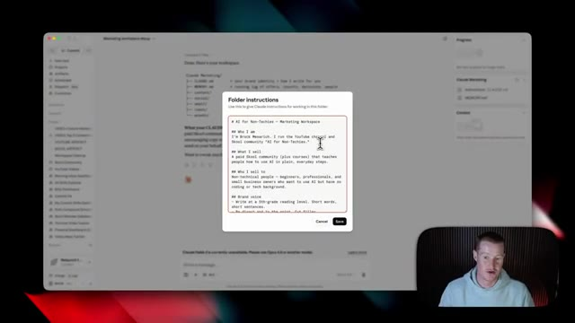
*⏱️ 00:08:24 — Interface Cowork montrant une fenêtre modale d'instructions de dossier avec l'identité de marque et le profil de Brock Mesarich.*

*⏱️ 00:08:41 — Suite des instructions de dossier dans Cowork détaillant l'aide au marketing et les règles de ton et de formatage.*

---

### ⏱️ `[00:08:50 - 00:09:10]` | Segment #20

**🔊 Audio (Transcription Intégrale Mot pour Mot en Français) :**
> à chaque fois. Donc, gardez cela direct et concis. Et encore une fois, le prompt que je vous ai donné devrait le garder direct et concis juste comme ça. Ensuite, j'ai aussi mon fichier memory MD, qui pour l'instant n'a pas vraiment grand-chose dedans. Il montre la mémoire. Il montre les offres, les résultats, les décisions, les personnes clés, dont, vous voyez, ici, nous n'avons pas vraiment grand-chose. Mais avec le temps, nous pourrons dire à Claude de s'en souvenir et il stockera ces informations ici, ce qui est vraiment utile.

**👁️ Analyse Visuelle d'Écran (gemini-3.5-flash-lite) :**
**Interface & Outils** : Interface utilisateur de Claude Cowork / application de gestion d'espace de travail.

**Contenu textuel & Code** : Instructions détaillées pour l'IA (directives de ton, structure du dossier marketing, fichier memory.md avec sections Offres, Résultats, Décisions, Personnes clés).

**Action / Démonstration** : Configuration des instructions de dossier et visualisation de la structure de l'espace de travail marketing.

*⏱️ 00:08:55 — Fenêtre contextuelle affichant les instructions du dossier pour configurer le comportement de l'IA.*

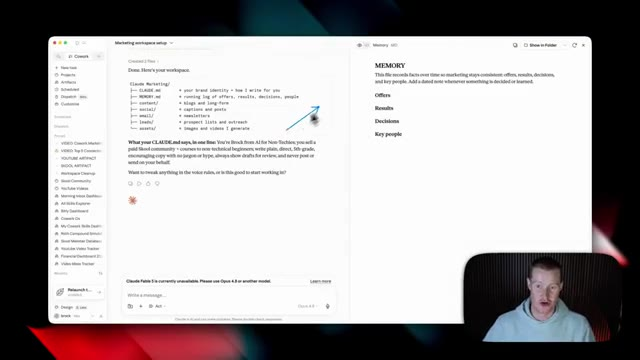
*⏱️ 00:09:00 — Interface de l'application montrant l'espace de travail marketing avec le fichier memory.md ouvert sur la droite.*

---

### ⏱️ `[00:09:10 - 00:09:33]` | Segment #21

**🔊 Audio (Transcription Intégrale Mot pour Mot en Français) :**
> Très rapidement, les gars, si vous appréciez cette vidéo, assurez-vous de vous abonner à cette chaîne pour plus de contenu gratuit. Et je tiens à vous faire savoir que j'ai récemment lancé ma communauté scolaire appelée AI for Non-Techies. À l'intérieur, j'ai environ 800 membres qui sont des professionnels et des entrepreneurs utilisant Claude et l'intelligence artificielle chaque jour. À l'intérieur, je partage des ressources exclusives que je ne partage nulle part ailleurs, y compris mes 50 compétences Claude que j'utilise chaque jour pour diriger mon entreprise.

**👁️ Analyse Visuelle d'Écran (gemini-3.5-flash-lite) :**
**Interface & Outils** : Navigateur web affichant la plateforme Skool (communauté "AI for Non-Techies").

**Contenu textuel & Code** : Interface de la communauté Skool montrant les discussions, les classements de membres et les cours de la section Classroom.

**Action / Démonstration** : Navigation et présentation de la communauté en ligne Skool par le créateur.

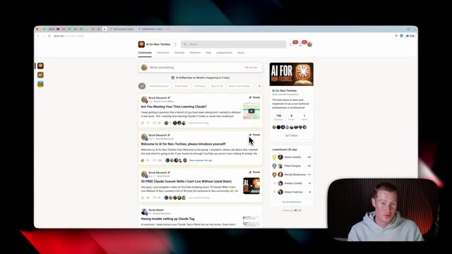
*⏱️ 00:09:16 — Vue d'ensemble de la plateforme communautaire Skool intitulée "AI for Non-Techies", montrant le fil de discussion et le présentateur en médaillon vidéo.*

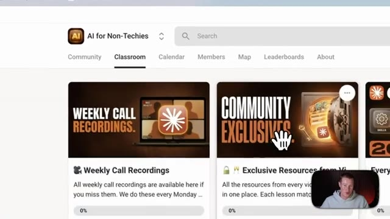
*⏱️ 00:09:27 — Gros plan sur l'onglet "Classroom" de la communauté Skool, affichant les modules de cours avec des vignettes comme "Weekly Call Recordings".*

---

### ⏱️ `[00:09:33 - 00:09:53]` | Segment #22

**🔊 Audio (Transcription Intégrale Mot pour Mot en Français) :**
> En plus de cela, je fais même des appels hebdomadaires avec la communauté. Vous pouvez donc venir me poser des questions chaque semaine et je peux y répondre de manière plus personnalisée. Donc si vous voulez vous inscrire, il y a un lien dans la description et dans le premier commentaire épinglé. Sinon, continuez à profiter du contenu gratuit que je publie sur YouTube. Maintenant, retour à la vidéo. Très bien. Nous avons donc posé les bases de notre dossier marketing Claude Cowork et de tout notre système.

**👁️ Analyse Visuelle d'Écran (gemini-3.5-flash-lite) :**
**Interface & Outils** : Navigateur web affichant la plateforme communautaire Skool et des pages de cours textuelles.

**Contenu textuel & Code** : Interface utilisateur de Skool, titres de sections, publications de la communauté et schémas pédagogiques sur l'intelligence artificielle.

**Action / Démonstration** : Navigation au sein de la plateforme Skool et présentation des ressources de la communauté.

---

### ⏱️ `[00:09:53 - 00:10:28]` | Segment #23

**🔊 Audio (Transcription Intégrale Mot pour Mot en Français) :**
> Maintenant, nous devons passer à autre chose et nous allons commencer à créer des compétences. Parlons donc brièvement de ce qu'est une compétence. Si vous ne savez pas ce que c'est ou si vous n'en avez jamais utilisé auparavant, car cela va être un élément crucial pour comprendre exactement comment nous pourrions utiliser co-work pour le marketing. Et cela va vous faire gagner beaucoup de temps. Et c'est probablement la pièce manquante que vous n'avez pas trouvée si vous avez utilisé l'intelligence artificielle pour vous aider dans le marketing ou dans tout ce qui touche au contenu. D'accord, donc si vous ne savez pas comment fonctionne une compétence, laissez-moi vous l'expliquer très simplement. C'est donc quelque chose que nous déclenchons. Prenons donc l'exemple d'une compétence de billet de blog. Disons que nous donnons à co-work la consigne suivante : hé, écris-moi un billet de blog.

**👁️ Analyse Visuelle d'Écran (gemini-3.5-flash-lite) :**
**Interface & Outils** : Navigateur web affichant un document/guide technique sur Claude ("The Complete Claude").

**Contenu textuel & Code** : Schéma conceptuel du fichier de compétence `blog-post / SKILL.md` avec les champs "When to use it" ("write a blog post"), "What it does", "Every time", "You trigger it" et "You get the result".

**Action / Démonstration** : Présentation didactique du fonctionnement des skills (compétences réutilisables) et de leur logique de déclenchement dans Claude.

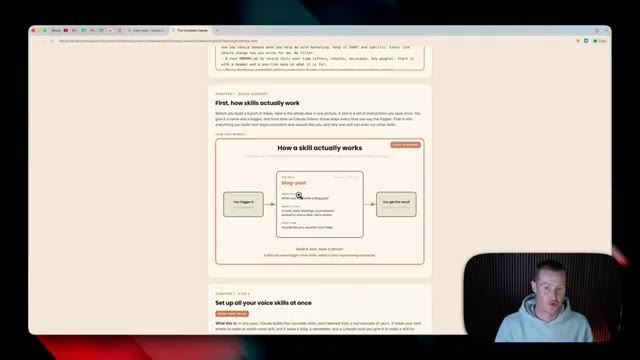
*⏱️ 00:10:02 — Page web affichant un guide explicatif intitulé "First, how skills actually work" avec un schéma interactif sur le fonctionnement des compétences.*

*⏱️ 00:10:19 — Gros plan sur le diagramme "How a skill actually works" détaillant le déclenchement, les instructions du fichier `blog-post / SKILL.md` et le résultat final.*

---

### ⏱️ `[00:10:28 - 00:11:02]` | Segment #24

**🔊 Audio (Transcription Intégrale Mot pour Mot en Français) :**
> à propos de [points de suspension] ou peu importe le cas de figure, cela déclenche alors cette compétence juste ici, qui est la compétence de billet de blog. Et ce que cela implique, ce sont des instructions spécifiques sur la façon d'accomplir une tâche très spécifique. Cela montre donc quand l'utiliser, cela montre ce que ça fait, et à chaque fois, cela veillera à l'enregistrer dans un dossier. Et puis, ce que cela signifie, c'est qu'à chaque fois que nous voulons créer un billet de blog, il sera exactement dans le même style et le même format. Nous n'avons pas besoin de lui donner une très longue consigne. Nous disons simplement : écris un billet de blog, et cela extrait cet ensemble d'instructions juste ici. Et là où ça devient vraiment intéressant, c'est que nous allons

**👁️ Analyse Visuelle d'Écran (gemini-3.5-flash-lite) :**
**Interface & Outils** : Présentation / Diapositive pédagogique (support de cours sur Claude AI).

**Contenu textuel & Code** : Diagramme conceptuel « How a skill actually works » affichant les blocs : « You trigger it ("write a blog post") », « THE SKILL blog-post (blog-post / SKILL.md) » avec les sections « WHEN TO USE IT », « WHAT IT DOES », « EVERY TIME », et « You get the result ».

**Action / Démonstration** : Présentation conceptuelle expliquant comment des instructions spécifiques enregistrées une seule fois permettent à l'IA d'exécuter automatiquement une tâche de rédaction de billet de blog.

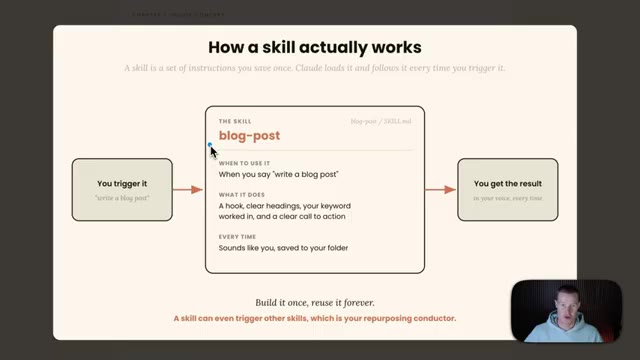
*⏱️ 00:10:36 — Schéma explicatif illustrant le fonctionnement et la structure d'un skill Claude intitulé « blog-post » (SKILL.md) avec son déclencheur, ses instructions d'exécution et son résultat.*

---

### ⏱️ `[00:11:02 - 00:11:37]` | Segment #25

**🔊 Audio (Transcription Intégrale Mot pour Mot en Français) :**
> créer des compétences pour toutes ces différentes choses. Nous allons avoir une compétence de tonalité d'e-mail. Nous allons avoir une compétence d'article de blog, une compétence de newsletter et une compétence de publication LinkedIn. Et ensuite, nous allons transformer cela en un système complet de recyclage de contenu. Pour mon cas d'usage, je vais utiliser comme entrée une seule vidéo YouTube ou une transcription. Cela va ensuite utiliser la compétence de recyclage de contenu que vous pouvez voir juste ici. Et cela va alors créer des articles de blog, des newsletters, des publications LinkedIn et des carrousels Instagram spécifiques à partir de cette seule vidéo, en utilisant toutes ces différentes compétences ici que je vais vous montrer comment créer. Très bien. Donc, pour en revenir aux quatre compétences que nous allons créer maintenant, ce que nous allons faire, c'est que nous allons concrètement créer notre compétence de tonalité d'e-mail

**👁️ Analyse Visuelle d'Écran (gemini-3.5-flash-lite) :**
**Interface & Outils** : Navigateur web affichant un guide ou document interactif sur l'écosystème de compétences Claude AI.

**Contenu textuel & Code** : Diagramme « One video becomes everything » : entrée « 1 video » connectée au bloc central « content-repurposing skill (in your brand voice) », qui distribue vers « Blog post », « Newsletter », « Linkedin post » et « IG carousel ».

**Action / Démonstration** : Présentation théorique et visuelle de l'architecture du système d'automatisation de contenu multi-compétences.

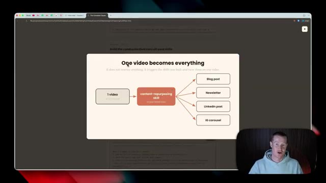
*⏱️ 00:11:11 — Schéma conceptuel du flux de travail montrant la transformation d'une vidéo unique en plusieurs formats de contenu (article de blog, newsletter, post LinkedIn, carrousel Instagram) via une compétence de recyclage de contenu.*

---

### ⏱️ `[00:11:37 - 00:12:04]` | Segment #26

**🔊 Audio (Transcription Intégrale Mot pour Mot en Français) :**
> en demandant à Claude de parcourir nos e-mails envoyés. Il va donc automatiquement extraire nos précédents e-mails issus des fils de discussion spécifiques dans lesquels nous avons échangé. Et ensuite, il va transformer cela en une compétence de ton pour les e-mails. Ensuite, afin de créer la compétence d'article de blog, nous allons soit prendre des articles de blog que nous avons créés nous-mêmes, soit des exemples de ceux que nous voulons recréer avec une rédaction similaire. Et puis, nous allons faire exactement la même chose à la fois pour une compétence de newsletter et pour une compétence de post LinkedIn, afin de créer tout cela, juste ici.

**👁️ Analyse Visuelle d'Écran (gemini-3.5-flash-lite) :**
**Interface & Outils** : Navigateur web affichant une interface de présentation visuelle de compétences IA.

**Contenu textuel & Code** : Schéma montrant la conversion de sources (Your sent emails (Gmail), A blog you wrote, A newsletter you wrote, A LinkedIn post you wrote) en compétences associées (email-voice skill, blog-post skill, newsletter skill, linkedin-post skill).

**Action / Démonstration** : Présentation du processus d'apprentissage et d'extraction de compétences à partir de documents réels.

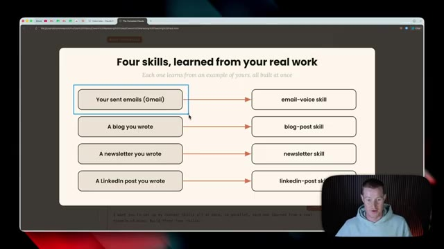
*⏱️ 00:11:44 — Schéma explicatif illustrant comment quatre compétences différentes sont apprises à partir de travaux réels.*

---

### ⏱️ `[00:12:04 - 00:12:22]` | Segment #27

**🔊 Audio (Transcription Intégrale Mot pour Mot en Français) :**
> Et on va faire ça avec un prompt que je vais vous donner tout de suite. Donc encore une fois, tout ce pack de prompts, vous savez, vous pouvez suivre à la fois avec les visuels ainsi qu'avec les prompts exacts que, vous savez, j'utilise pour réellement mettre tout ça en place avec vous. Donc copiez ce prompt. Ensuite, ce qu'on va faire, c'est qu'on va ouvrir Co-work, et puis à l'intérieur de notre dossier marketing Claude ici, je vais tout simplement coller ça là-dedans.

**👁️ Analyse Visuelle d'Écran (gemini-3.5-flash-lite) :**
**Interface & Outils** : Navigateur web (Google Chrome) affichant un document ou un site de formation avec interface utilisateur textuelle et schématique.

**Contenu textuel & Code** : Textes explicatifs, schémas de flux ("Four skills, learned from your real work") et un bloc de code/prompt détaillé en bas de page.

**Action / Démonstration** : Présentation et explication visuelle d'un pack de prompts et de ses différentes étapes de configuration.

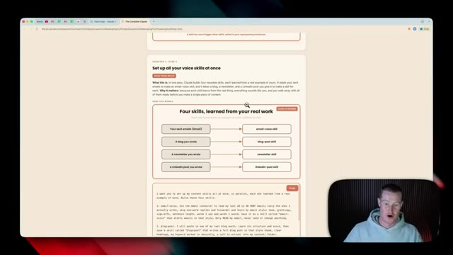
*⏱️ 00:12:08 — Un navigateur web affichant un guide ou un pack de prompts structuré avec des schémas explicatifs et des blocs de texte, tandis que le présentateur apparaît dans une petite fenêtre en bas à droite.*

---

### ⏱️ `[00:12:23 - 00:12:42]` | Segment #28

**🔊 Audio (Transcription Intégrale Mot pour Mot en Français) :**
> Ce que cela va faire, c'est que ça va faire plusieurs choses. Ça va extraire les données de notre Gmail. Ça va en fait lire les 20 à 30 derniers e-mails envoyés précédents. Et ensuite, cela va nous poser quelques questions différentes parce que nous allons devoir fournir quelques entrées. Nous allons devoir nous fournir des exemples d'articles de blog, des exemples de bulletins d'information et des exemples de publications LinkedIn. Mais je vais envoyer ceci très rapidement. Et ensuite, ce que nous devons faire, c'est nous assurer de connecter Gmail.

**👁️ Analyse Visuelle d'Écran (gemini-3.5-flash-lite) :**
**Interface & Outils** : Interface web de l'application Cowork / Claude Assistant avec un panneau latéral de navigation et une zone de texte centrale.

**Contenu textuel & Code** : Prompt détaillé contenant des instructions en quatre points : "1. email-voice. Use the Gmail connector to read my last 20 to 30 sent emails...", "2. blog-post...", "3. newsletter...", "4. linkedin-post...".

**Action / Démonstration** : Présentation du prompt configuré pour automatiser la lecture des e-mails Gmail et apprendre le style rédactionnel de l'utilisateur.

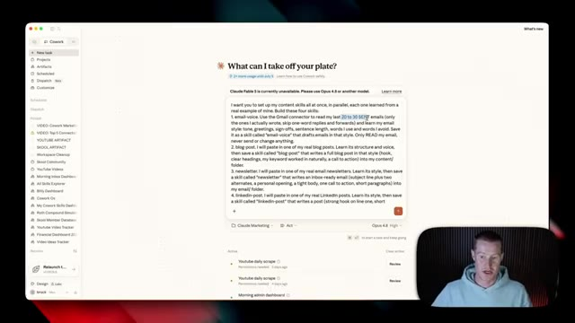
*⏱️ 00:12:28 — Capture d'écran montrant l'interface d'un outil d'IA affichant un prompt détaillé demandant d'extraire et d'analyser les 20 à 30 derniers e-mails envoyés pour configurer des compétences de contenu.*

---

### ⏱️ `[00:12:42 - 00:13:03]` | Segment #29

**🔊 Audio (Transcription Intégrale Mot pour Mot en Français) :**
> Donc, il est capable de tirer des informations de nos précédents Gmail en les lisant. Nous allons donc aller sur « personnaliser » sur le côté gauche de l'écran. Cliquez là-dessus. Nous allons ensuite aller dans « connecteurs ». Si vous ne savez pas ce qu'est un connecteur, c'est fondamentalement la façon dont nous sommes capables de connecter un grand nombre de nos différentes applications que nous utilisons au jour le jour. Donc, par exemple, j'en ai plein ici, dont je vais parler plus en détail un peu plus loin dans cette vidéo.

**👁️ Analyse Visuelle d'Écran (gemini-3.5-flash-lite) :**
**Interface & Outils** : Interface logicielle ou web d'un assistant IA (type Claude / Cowork) avec panneau latéral de personnalisation et connecteurs.

**Contenu textuel & Code** : Menus de configuration des compétences (« Skills »), liste des connecteurs (Bitly, Gmail, Google Calendar, etc.) et permissions d'outils.

**Action / Démonstration** : Navigation dans le menu latéral pour accéder aux paramètres de personnalisation et aux connecteurs tiers.

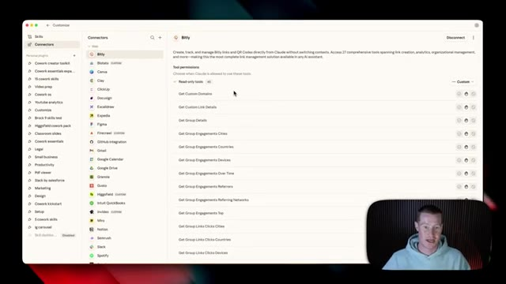
*⏱️ 00:12:58 — Capture d'écran montrant le menu « Connecteurs » et « Personnaliser » de l'interface, affichant la liste des intégrations disponibles comme Bitly, Canva, ClickUp, et Gmail.*

---

### ⏱️ `[00:13:03 - 00:13:21]` | Segment #30

**🔊 Audio (Transcription Intégrale Mot pour Mot en Français) :**
> Je vais plonger plus profondément dans quelques cas spécifiques que nous allons utiliser pour nous aider en ce qui concerne le marketing et le contenu. Mais ce que je vais faire, c'est simplement venir sur ce bouton plus, cliquer sur parcourir les connecteurs, puis simplement rechercher Gmail et ensuite bien veiller à cliquer sur connecter. Cela va ensuite vous rediriger vers Gmail. Cliquez simplement sur oui et autorisez tout ce qu'il demande.

**👁️ Analyse Visuelle d'Écran (gemini-3.5-flash-lite) :**
**Interface & Outils** : Interface de l'application web de gestion des connecteurs et intégrations (similaire à Claude ou un outil d'automatisation IA).

**Contenu textuel & Code** : Liste des connecteurs disponibles (Canva, ClickUp, Docusign, Figma, Gmail, Google Calendar, Google Drive, Notion, Slack, etc.) et fiches détaillées de configuration des outils.

**Action / Démonstration** : Navigation et sélection des connecteurs tiers pour les intégrer dans l'environnement de travail de l'IA.

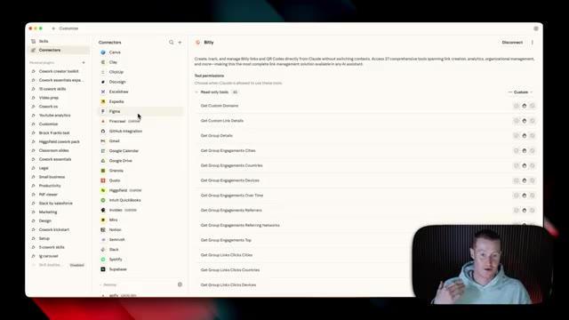
*⏱️ 00:13:08 — Vue d'ensemble de l'interface montrant la liste des connecteurs disponibles avec les différentes applications (Canva, ClickUp, Figma, Gmail, etc.) et le présentateur en bas à droite.*

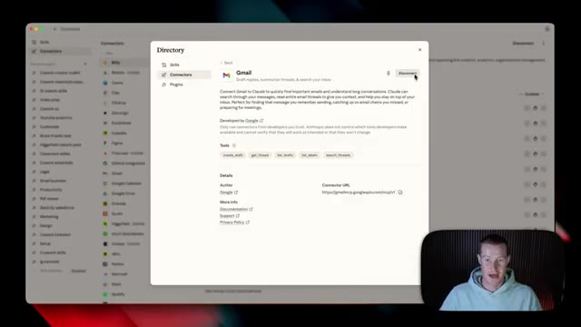
*⏱️ 00:13:17 — Fenêtre contextuelle affichant les détails du connecteur Gmail avec ses fonctionnalités, outils associés (create_draft, get_thread, etc.) et options de configuration.*

---

### ⏱️ `[00:13:21 - 00:13:40]` | Segment #31

**🔊 Audio (Transcription Intégrale Mot pour Mot en Français) :**
> Et ensuite, vous verrez Gmail dans notre liste de connecteurs ici. Maintenant, il me pose une série de questions différentes. Je vais donc aller de l'avant et coller mon article de blog, ma newsletter et mes publications LinkedIn ici afin que nous puissions les utiliser comme référence. Il me pose également quelques questions du genre quel est le mot-clé ou le sujet principal à intégrer naturellement. Pour ma part, je vais sélectionner l'IA pour les débutants.

**👁️ Analyse Visuelle d'Écran (gemini-3.5-flash-lite) :**
**Interface & Outils** : Application logicielle Cowork (interface de type assistant IA / espace de travail)

**Contenu textuel & Code** : Texte de configuration de compétences demandant : 1. Paste your blog post, 2. Paste your newsletter, 3. Paste your LinkedIn post, ainsi qu'une question sur le mot-clé principal pour le blog post.

**Action / Démonstration** : Le présentateur présente les instructions et les questions posées par l'assistant IA pour configurer les compétences à partir d'exemples de contenu.

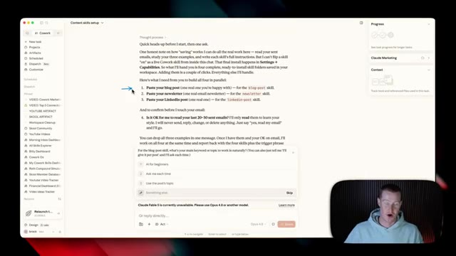
*⏱️ 00:13:26 — Capture d'écran montrant l'interface d'un assistant IA (Cowork) avec des instructions de configuration de compétences de contenu, demandant à l'utilisateur de coller un article de blog, une newsletter et des publications LinkedIn.*

---

### ⏱️ `[00:13:40 - 00:14:05]` | Segment #32

**🔊 Audio (Transcription Intégrale Mot pour Mot en Français) :**
> Et laissez-moi aller de l'avant et trouver des exemples que je veux coller ici. Très bien, alors passons en revue exactement ce que Claude a fait. Donc tout d'abord, il est allé chercher dans mon fil de discussion e-mail. Il a pu faire cela via le connecteur auquel nous venions juste de donner l'accès. Donc assurez-vous d'avoir configuré cela afin de pouvoir faire la même chose. Il a extrait différents exemples. On dirait qu'il a pris les devants et trouvé les e-mails à 35 centimes afin de voir mon style exact de salutation, mes formules de politesse, et fondamentalement tout ce qui concerne ma façon de m'exprimer par e-mail.

**👁️ Analyse Visuelle d'Écran (gemini-3.5-flash-lite) :**
**Interface & Outils** : Interface logicielle de type assistant IA / espace de travail (Cowork) avec panneau latéral et intégration Gmail.

**Contenu textuel & Code** : Texte affichant les étapes de l'assistant IA : "Searches for email threads from the authenticated user's Gmail account" et l'analyse de ~35 e-mails envoyés.

**Action / Démonstration** : Démonstration de l'automatisation où l'IA accède aux e-mails de l'utilisateur via un connecteur et analyse leur style de rédaction.

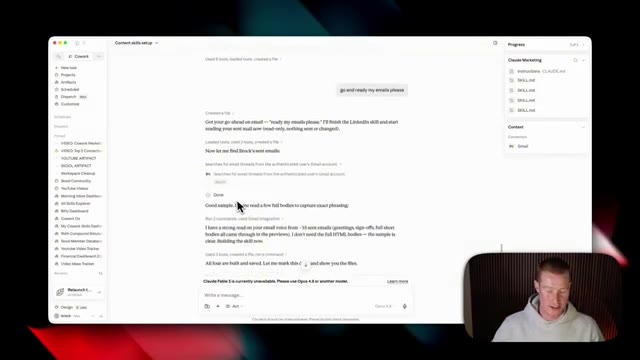
*⏱️ 00:13:47 — Interface de l'application montrant l'historique des actions de l'assistant IA avec le connecteur Gmail et la lecture des e-mails.*

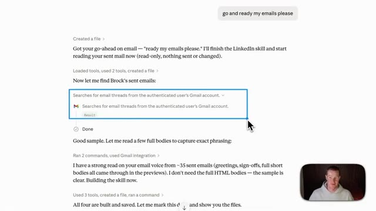
*⏱️ 00:13:53 — Gros plan sur l'action de recherche dans les e-mails par l'assistant IA via l'intégration Gmail.*

*⏱️ 00:13:59 — Vue détaillée du texte généré par l'IA analysant le ton et le style des e-mails envoyés par l'utilisateur.*

---

### ⏱️ `[00:14:05 - 00:14:25]` | Segment #33

**🔊 Audio (Transcription Intégrale Mot pour Mot en Français) :**
> Donc, il a créé la compétence de ton d'e-mail. Il a ensuite créé la compétence de publication de blog, de bulletin d'information et de publication LinkedIn. Ensuite, ce que nous allons voir, ce sont ces fichiers MD de compétences. Donc, ce que je pourrais faire, c'est cliquer sur chacun d'eux individuellement. Il va maintenant l'afficher sur le côté droit directement à l'intérieur de cowork. Et si nous le voulons, nous pouvons aller de l'avant et lire ceci très rapidement. Nous avons nos règles strictes ici, qui disent essentiellement de rédiger uniquement.

**👁️ Analyse Visuelle d'Écran (gemini-3.5-flash-lite) :**
**Interface & Outils** : Application de bureau ou interface web de gestion de tâches et de compétences IA (Cowork / Claude).

**Contenu textuel & Code** : Textes descriptifs des compétences (« email-voice », « blog-post », « newsletter », « linkedin-post ») et fichiers Markdown de compétences (SKILL.md) affichés dans un volet latéral et dans le corps du texte.

**Action / Démonstration** : Le curseur de la souris survole l'interface pour présenter les différents fichiers de compétences créés.

*⏱️ 00:14:10 — Capture d'écran montrant l'interface d'un assistant IA listant plusieurs compétences de contenu générées (« email-voice », « blog-post », « newsletter », « linkedin-post ») avec les fichiers de configuration associés.*

---

### ⏱️ `[00:14:25 - 00:14:45]` | Segment #34

**🔊 Audio (Transcription Intégrale Mot pour Mot en Français) :**
> Ne jamais envoyer, répondre, modifier ou supprimer le moindre e-mail. Il analyse ensuite mes salutations spécifiques que j'utilise, ainsi que les tons que j'emploie. Il analyse ensuite les formules de politesse de fin que j'inclus dans tous mes e-mails. En gros, cela montre étape par étape, comment pourrais-je recréer la voix de Brock lorsqu'il s'agit d'envoyer un e-mail ? Et j'utilise cette compétence chaque jour dans mon entreprise.

**👁️ Analyse Visuelle d'Écran (gemini-3.5-flash-lite) :**
**Interface & Outils** : Application de type workspace/éditeur markdown (Cowork / interface type Notion ou assistant IA).

**Contenu textuel & Code** : Texte détaillé décrivant le profil vocal d'e-mail de Brock (Email Voice), incluant des règles strictes (« Hard rules » : Draft-only, Never send), des styles de salutations (« Hey [First name] », « Hey guys ») et des formules de politesse (« Cheers! », « Thanks! »).

**Action / Démonstration** : Le présentateur explique et détaille le fonctionnement des règles de style et des configurations de compétences textuelles pour l'intelligence artificielle.

*⏱️ 00:14:30 — Capture d'écran montrant une interface de type éditeur de texte et gestionnaire de compétences (skills) avec un panneau latéral et une fenêtre vidéo incrustée du présentateur en bas à droite.*

---

### ⏱️ `[00:14:45 - 00:15:05]` | Segment #35

**🔊 Audio (Transcription Intégrale Mot pour Mot en Français) :**
> Donc je sais que ça va vraiment sonner comme moi. Ensuite, je pourrais parcourir chacun d'eux un par un pour m'assurer que tout cela sonne bien. Et puis, une fois que nous les aimons, ce que je pourrais faire, c'est cliquer sur « enregistrer la compétence ». Et ensuite, cela sera enregistré dans mon espace de travail Claude. Et puis, je vais vous montrer exactement où nous pouvons les trouver. Donc, nous allons venir sur « personnaliser », venir sur « compétences ». Et ensuite, vous pouvez maintenant voir que j'en ai de nouvelles.

**👁️ Analyse Visuelle d'Écran (gemini-3.5-flash-lite) :**
**Interface & Outils** : Interface logicielle de type assistant IA / espace de travail avec volet latéral et prévisualisation de documents.

**Contenu textuel & Code** : Texte décrivant la configuration de compétences (newsletter, publication LinkedIn) et les consignes de voix de marque (Blog Post, Brock's voice).

**Action / Démonstration** : Présentation de la configuration des compétences et explication du processus de sauvegarde des compétences personnalisées.

*⏱️ 00:14:50 — Capture d'écran montrant l'interface d'un outil d'IA avec la configuration de compétences de contenu, affichant des instructions de style de rédaction et des options de sauvegarde.*

---

### ⏱️ `[00:15:05 - 00:15:28]` | Segment #36

**🔊 Audio (Transcription Intégrale Mot pour Mot en Français) :**
> nous avons une publication LinkedIn, une infolettre et un article de blog. Et à tout moment je pouvais afficher ceci, jeter un œil aux instructions spécifiques. Et ensuite, si jamais je veux le modifier, je pouvais simplement venir ici et cliquer sur modifier avec Claude. Et ensuite, je pouvais simplement lui parler et il apportera ces modifications à cette compétence spécifique. Très bien. Donc vous vous demandez probablement, comment est-ce que j'utilise cette compétence ? Comment est-ce que je déclenche ceci ? Il y a plusieurs façons différentes de procéder. Laissez-moi donc vous les présenter dès maintenant.

**👁️ Analyse Visuelle d'Écran (gemini-3.5-flash-lite) :**
**Interface & Outils** : Interface web de Claude / Cowork, application de gestion de contenu.

**Contenu textuel & Code** : Paramètres de structure de contenu, instructions textuelles pour la voix de la marque et liste de tâches en cours.

**Action / Démonstration** : Navigation dans l'interface de personnalisation et affichage des configurations de contenu.

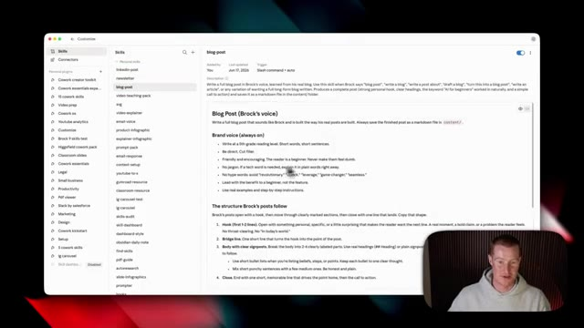
*⏱️ 00:15:11 — Interface de personnalisation montrant les paramètres de voix de marque pour un article de blog.*

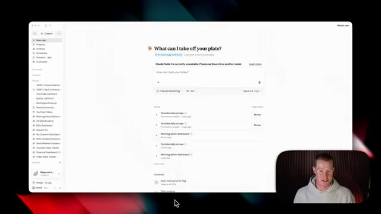
*⏱️ 00:15:22 — Tableau de bord principal avec une interface de discussion et des tâches actives.*

---

### ⏱️ `[00:15:28 - 00:16:00]` | Segment #37

**🔊 Audio (Transcription Intégrale Mot pour Mot en Français) :**
> Tout d'abord, ce que nous pourrions faire si nous voulons être vraiment précis, de cette façon nous ne risquons pas d'avoir d'hallucinations ici. Il suffit de taper une barre oblique. Nous allons voir cette liste de nos compétences apparaître ici. Et ensuite, disons que nous voulons créer une publication LinkedIn. Je vais simplement aller sur publication LinkedIn. Et puis c'est une compétence que je viens de créer. Et maintenant, je peux lui donner un petit prompt rapide expliquant ce que je veux pour cette publication. Et ensuite, cela déclenchera toujours cet ensemble spécifique d'instructions. Alors laissez-moi venir ici et dire, créez pour moi une publication LinkedIn sur le nouveau modèle Claude Fable 5 qui vient de sortir. Et ensuite, parlez de la raison pour laquelle cela soulève un nouveau sujet de

**👁️ Analyse Visuelle d'Écran (gemini-3.5-flash-lite) :**
**Interface & Outils** : Interface web d'assistant IA (type Cowork / Claude) avec sélection de compétences par commande slash.

**Contenu textuel & Code** : Liste des compétences disponibles (blog-post, brand-guidelines, classroom-resource, etc.) et infobulle explicative décrivant la fonction de la compétence sélectionnée.

**Action / Démonstration** : Utilisation d'une commande slash pour sélectionner et appliquer une compétence spécifique d'intelligence artificielle.

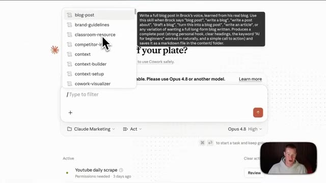
*⏱️ 00:15:36 — Interface d'une application d'IA montrant un menu déroulant de compétences après la saisie d'une barre oblique, avec un aperçu textuel de la compétence « blog-post ».*

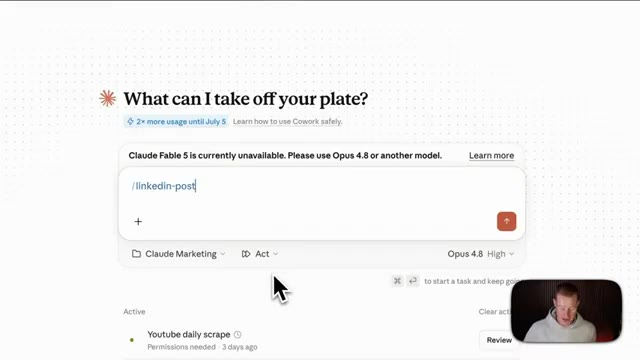
*⏱️ 00:15:44 — Interface de l'application avec la commande « /linkedin-post » saisie dans la barre de texte.*

---

### ⏱️ `[00:16:00 - 00:16:19]` | Segment #38

**🔊 Audio (Transcription Intégrale Mot pour Mot en Français) :**
> conversation sur la raison pour laquelle les modèles d'IA locaux vont prendre de plus en plus d'importance au cours des prochaines années. Rédige cet article en l'adaptant pour des personnes qui ne sont pas des technophiles. Je vais donc simplement donner cette consigne. Évidemment, nous avons fourni un peu de contexte. Et ce que vous venez de voir, c'est moi utilisant une plateforme de dictée vocale où je clique simplement sur un bouton de mon clavier et je parle dans mon ordinateur.

**👁️ Analyse Visuelle d'Écran (gemini-3.5-flash-lite) :**
**Interface & Outils** : Application de bureau Cowork / interface de gestion de tâches et de rédaction assistée par IA.

**Contenu textuel & Code** : Un prompt textuel rédigé dans l'application : "/linkedin post create a LinkedIn post for me about the new Claude Fable 5 model that just released, and then talk about why this brings up a new topic of conversation about why local AI models is going to become a bigger thing over the coming year."

**Action / Démonstration** : Saisie d'un prompt textuel pour générer une publication LinkedIn abordant les modèles d'IA locaux.

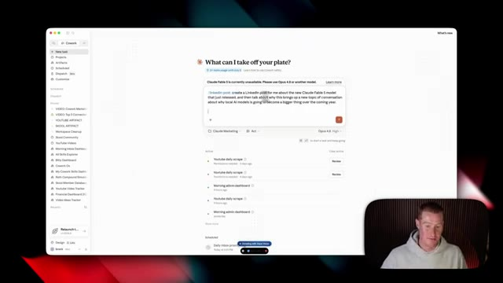
*⏱️ 00:16:05 — Capture d'écran montrant une interface logicielle (Cowork) avec un champ de saisie de texte et une liste de tâches, ainsi qu'une incrustation vidéo du présentateur en bas à droite.*

---

### ⏱️ `[00:16:19 - 00:16:54]` | Segment #39

**🔊 Audio (Transcription Intégrale Mot pour Mot en Français) :**
> Instead of me having to type, it's called AquaVoice. If you want to try it out, there's a link in the description as well as a pinned comment. It's been super helpful for me and saves me a bunch of time when I need to give a really detailed prompt. All right, So here we go. That took maybe 30 seconds to a minute. We now have this markdown files. And if I open it up, here is the article. Anthropic just put their most powerful AI in the hands of regular people. Last week, they released Fable 5, etc. I mean, this is a pretty good LinkedIn post. This is something that, you know, I would actually post. And of course, if there's something that you don't like, you know, with the output, always just come back to Claude and say, hey, I want you to make this change and then save that to the skill so you never make that, you know, mistake again. And

**👁️ Analyse Visuelle d'Écran (gemini-3.5-flash-lite) :**
**Interface & Outils** : Interface web de type Cowork / Assistant IA avec barre latérale et zone de chat.

**Contenu textuel & Code** : Prompt affiché : création d'un post LinkedIn concernant le modèle Claude Faible 5, avec le processus de pensée de l'IA et une recherche web en cours.

**Action / Démonstration** : Visualisation de l'exécution d'un prompt détaillé généré via dictée vocale dans l'application Cowork.

*⏱️ 00:16:28 — Capture d'écran montrant une interface de type agent IA ou espace de travail textuel (Cowork) avec un prompt généré et un processus de réflexion en cours.*

---

### ⏱️ `[00:16:54 - 00:17:13]` | Segment #40

**🔊 Audio (Transcription Intégrale Mot pour Mot en Français) :**
> si nous voulons voir cela dans notre dossier de l'espace de travail réel que nous avons créé un peu plus tôt dans cette vidéo, nous pouvons toujours cliquer sur afficher dans le dossier. Et ensuite, vous pouvez maintenant voir que cela se trouve dans mon dossier social. Donc pour vous montrer exactement ce que je veux dire, si j'ouvre mon dossier Claude Marketing et que je vais dans social, vous pouvez maintenant voir que l'article de blog au format markdown Fable 5 est juste là.

**👁️ Analyse Visuelle d'Écran (gemini-3.5-flash-lite) :**
**Interface & Outils** : Explorateur de fichiers macOS (Finder) et interface de traitement de texte.

**Contenu textuel & Code** : Fichier Markdown nommé "fable-5-local-ai.md" situé dans le dossier "social".

**Action / Démonstration** : Navigation et affichage d'un fichier créé dans le dossier de l'espace de travail.

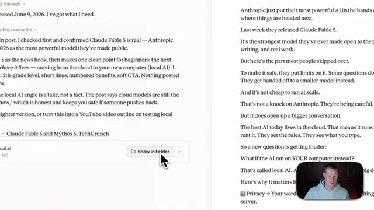
*⏱️ 00:16:59 — Un document texte avec un bouton "Show in Folder" souligné par le curseur.*

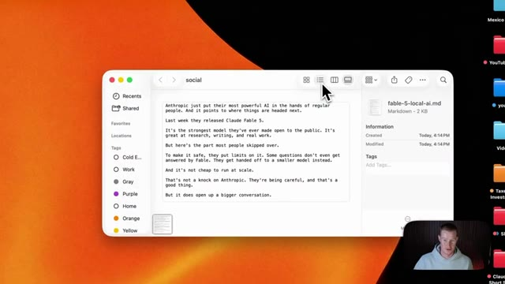
*⏱️ 00:17:04 — Une fenêtre de l'explorateur de fichiers macOS ouverte sur le dossier "social".*

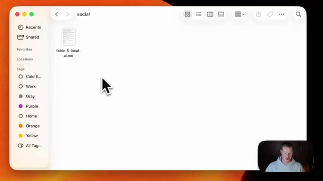
*⏱️ 00:17:09 — Le dossier "social" contenant le fichier Markdown "fable-5-local-ai.md".*

---

### ⏱️ `[00:17:14 - 00:17:33]` | Segment #41

**🔊 Audio (Transcription Intégrale Mot pour Mot en Français) :**
> Très bien, donc maintenant que nous avons construit nos compétences en réseaux sociaux pour ces publications spécifiques sur chacune de ces plateformes, ce que nous allons créer est une compétence un niveau au dessus de cela. Et cela va s'appeler la compétence de réutilisation de contenu. Donc la façon dont ce flux de travail va fonctionner est essentiellement que nous lui donnons un élément de contexte spécifique, qui pour moi dans mon cas d'usage va être une vidéo YouTube.

**👁️ Analyse Visuelle d'Écran (gemini-3.5-flash-lite) :**
**Interface & Outils** : Navigateur web affichant un schéma interactif ou une présentation visuelle.

**Contenu textuel & Code** : Schéma montrant "1 video" connectée à "content-repurposing skill", qui se décline en trois formats : "Blog post", "Newsletter", et "Linkedin post".

**Action / Démonstration** : Le présentateur explique le concept de compétence de réutilisation de contenu basé sur le schéma affiché à l'écran.

*⏱️ 00:17:18 — Schéma explicatif illustrant le concept de réutilisation de contenu à partir d'une vidéo unique transformée en différents formats.*

---

### ⏱️ `[00:17:33 - 00:17:57]` | Segment #42

**🔊 Audio (Transcription Intégrale Mot pour Mot en Français) :**
> Donc, cela va prendre une vidéo YouTube, puis nous allons déclencher la compétence de repurposing de contenu, qui va ensuite distribuer trois publications distinctes sur ces plateformes et selon les styles que nous venons de concevoir. Nous aurons notre compétence de rédaction d'article de blog exécutée dans notre langage d'article de blog. Nous aurons notre newsletter rédigée ainsi que nos publications LinkedIn. Et c'est ainsi que nous pourrions prendre une combinaison de multiples compétences pour des choses très hyper-spécifiques et les transformer en une compétence parente capable de les regrouper.

**👁️ Analyse Visuelle d'Écran (gemini-3.5-flash-lite) :**
**Interface & Outils** : Navigateur web affichant un schéma interactif ou une présentation visuelle.

**Contenu textuel & Code** : Schéma textuel et graphique illustrant un workflow de automatisation de contenu : "1 video" -> "content-repurposing skill" -> "Blog post", "Newsletter", "Linkedin post".

**Action / Démonstration** : Le présentateur explique le fonctionnement du flux de réutilisation de contenu à l'aide d'un schéma visuel.

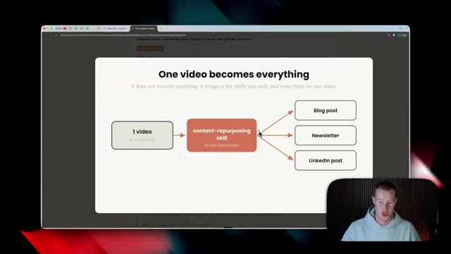
*⏱️ 00:17:39 — Schéma explicatif montrant le concept "One video becomes everything", illustrant la transformation d'une vidéo unique via une compétence de réutilisation de contenu vers un article de blog, une newsletter et un post LinkedIn.*

---

### ⏱️ `[00:17:57 - 00:18:23]` | Segment #43

**🔊 Audio (Transcription Intégrale Mot pour Mot en Français) :**
> Et comme vous le verrez tout au long de cette vidéo, nous allons développer des compétences de plus en plus poussées que nous pourrons ensuite regrouper dans d'autres compétences, vous savez, pour créer des pipelines de redéploiement exactement comme celui-ci. Et encore une fois, à l'intérieur de ce pack de produits, vous pouvez voir tous ces visuels. Ainsi, vous savez toujours exactement ce que nous construisons. Et puis aussi spécifiquement pourquoi c'est important, tout comme c'est indiqué juste ici. Très rapidement, je tiens à mentionner que plus loin dans cette vidéo, je vais vous montrer comment vous pouvez connecter une plateforme qui distribuera automatiquement ces publications sur toutes les différentes plateformes sociales.

**👁️ Analyse Visuelle d'Écran (gemini-3.5-flash-lite) :**
**Interface & Outils** : Navigateur web affichant un guide ou une page de cours en ligne sur les compétences IA.

**Contenu textuel & Code** : Schéma textuel et visuel décrivant un workflow de création de contenu automatisé à partir d'une seule vidéo.

**Action / Démonstration** : Présentation théorique d'un pipeline de redéploiement de contenu par le présentateur.

---

### ⏱️ `[00:18:23 - 00:18:42]` | Segment #44

**🔊 Audio (Transcription Intégrale Mot pour Mot en Français) :**
> Donc vous n'avez jamais besoin de quitter Claude. Vous pouvez générer les publications, vous pouvez générer des images, des vidéos, etc., et ensuite faire en sorte qu'il les planifie automatiquement pour qu'elles soient publiées pour vous. Donc je vais aborder cela plus tard dans la vidéo. Venons-en donc à ce prompt que nous vous donnons à l'intérieur du pack de prompts. Ensuite, nous allons revenir à Claude, et collons simplement le prompt et envoyons-le.

**👁️ Analyse Visuelle d'Écran (gemini-3.5-flash-lite) :**
**Interface & Outils** : Navigateur web affichant un document interactif ou une application de prise de notes/documentation.

**Contenu textuel & Code** : Schéma d'architecture de contenu et prompt textuel expliquant comment transformer une vidéo en plusieurs formats (blog, newsletter, LinkedIn) en une seule étape.

**Action / Démonstration** : Le présentateur explique le concept de réutilisation automatique du contenu vidéo à l'aide de l'intelligence artificielle.

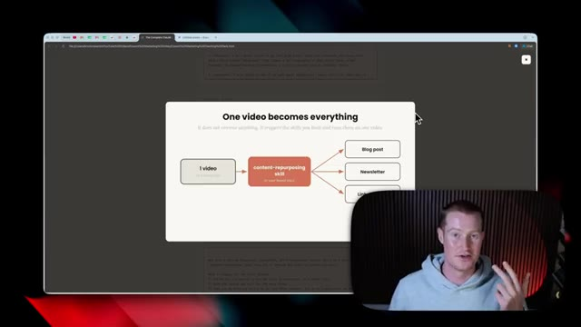
*⏱️ 00:18:28 — Capture montrant un schéma conceptuel intitulé "One video becomes everything" illustrant la transformation d'une vidéo en articles de blog, newsletters et publications LinkedIn, avec le présentateur en incrustation.*

*⏱️ 00:18:37 — Capture montrant le même schéma interactif ainsi qu'un bloc de texte contenant un prompt détaillé pour configurer une compétence de réutilisation de contenu ("content-repurposing skill").*

---

### ⏱️ `[00:18:42 - 00:19:00]` | Segment #45

**🔊 Audio (Transcription Intégrale Mot pour Mot en Français) :**
> D'accord, nous avons donc maintenant notre compétence de réutilisation de contenu créée. Et elle se trouve désormais dans notre dossier de compétences. Donc encore une fois, nous pouvons toujours nous habituer à simplement regarder, vous savez, en cliquant sur ce fichier markdown. C'est toute la beauté de Cowork. Nous pouvons l'ouvrir automatiquement et nous pouvons voir tous ces fichiers sur le côté droit, comme nous le voyons ici. C'est l'orchestrateur de réutilisation de contenu.

**👁️ Analyse Visuelle d'Écran (gemini-3.5-flash-lite) :**
**Interface & Outils** : Interface Cowork, explorateur de fichiers et éditeur de texte.

**Contenu textuel & Code** : Texte markdown indiquant "Saved as content-repurposing in your skills/ folder" et les instructions de l'orchestrateur.

**Action / Démonstration** : Le présentateur explique l'emplacement du fichier markdown de la compétence de réutilisation de contenu.

*⏱️ 00:18:47 — Vue de l'interface de Cowork montrant la confirmation de la création du fichier de compétence de réutilisation de contenu et le dossier de compétences.*

---

### ⏱️ `[00:19:00 - 00:19:20]` | Segment #46

**🔊 Audio (Transcription Intégrale Mot pour Mot en Français) :**
> I love that word because it is so true for what this is doing because it's orchestrating all of these other skills that we're running in order. So we have the blog post, newsletter and LinkedIn post all from this one trigger, which is the content repurposing orchestrator. OK, so to test this out, what I'm going to do is I'm going to take a YouTube video that I posted, paste it in right here.

**👁️ Analyse Visuelle d'Écran (gemini-3.5-flash-lite) :**
**Interface & Outils** : Application de bureau Cowork / interface de configuration de compétences IA.

**Contenu textuel & Code** : Documentation et instructions pour orchestrer la création de contenu (blog post, newsletter, LinkedIn post) à partir d'une source unique.

**Action / Démonstration** : Présentation de la configuration et des déclencheurs textuels ("repurpose this", "turn this video into content") pour automatiser le réagencement de contenu.

*⏱️ 00:19:05 — Capture d'écran montrant l'interface d'un assistant IA de type Cowork avec des instructions textuelles pour le "Content Repurposing (orchestrator)".*

---

### ⏱️ `[00:19:20 - 00:19:40]` | Segment #47

**🔊 Audio (Transcription Intégrale Mot pour Mot en Français) :**
> And then what we should get is we should get all three of these deliverables, a blog post, a newsletter, and a LinkedIn post all ready to go in my specific brand voice that we created. And again, you guys could do the exact same thing with your content that you create. Okay, so I'm going to take this one talking about how Fable 5 got banned by the US government. This is my latest video. Also, if you guys don't already subscribe, subscribe to this channel means a lot.

**👁️ Analyse Visuelle d'Écran (gemini-3.5-flash-lite) :**
**Interface & Outils** : Interface de l'application Claude Cowork et navigateur web affichant YouTube.

**Contenu textuel & Code** : Texte de configuration de compétences d'IA ("Content skills setup"), instructions de traitement automatisé ("Run blog post", "Run newsletter", "Run linkedin post") et liste des vidéos de la chaîne YouTube.

**Action / Démonstration** : Présentation de la configuration des compétences d'automatisation de contenu textuel sur l'interface Claude Cowork.

*⏱️ 00:19:25 — L'interface d'une application de type espace de travail IA (Claude Cowork) affichant du texte descriptif sur la configuration des compétences de contenu, avec une petite fenêtre vidéo du présentateur en bas à droite.*

---

### ⏱️ `[00:19:40 - 00:20:01]` | Segment #48

**🔊 Audio (Transcription Intégrale Mot pour Mot en Français) :**
> On vient en fait juste d'atteindre 118 000 abonnés. Je fais cette chaîne YouTube depuis environ deux ans et demi. Mais ça signifierait énormément pour moi si vous vous abonniez. Bref, je m'égare. Laissez-moi juste prendre cette URL pour la vidéo. Je vais la copier. Je vais revenir sur Claude et je vais taper slash. En fait, tout d'abord, nous devons sauvegarder cette compétence. Donc maintenant, je l'ai sauvegardée et je vais taper slash repurposing de contenu.

**👁️ Analyse Visuelle d'Écran (gemini-3.5-flash-lite) :**
**Interface & Outils** : Navigateur web, interface YouTube, application web Claude (Anthropic).

**Contenu textuel & Code** : Page de profil YouTube, schéma comparatif sur les modèles locaux, interface de chat de l'assistant Claude avec le modèle Opus 4.8.

**Action / Démonstration** : Navigation sur YouTube, sélection d'une URL de vidéo, interaction avec l'interface de l'assistant Claude.

*⏱️ 00:19:56 — Capture d'écran de l'interface de l'assistant Claude affichant du texte, un bloc de code "SKILL.md" et une invite de saisie de message.*

---

### ⏱️ `[00:20:01 - 00:20:21]` | Segment #49

**🔊 Audio (Transcription Intégrale Mot pour Mot en Français) :**
> Et ensuite, je vais simplement coller cette URL YouTube ici. Très bien. Donc, un point essentiel dont je dois parler en ce moment, c'est que nous utilisons un connecteur appelé Firecrawl parce que nous ne sommes pas capables de scraper YouTube, Instagram, X, ou n'importe laquelle de ces autres plateformes de médias sociaux directement avec Claude. Il n'a tout simplement pas la capacité de faire ça. Nous devons donc lui donner cet outil dans notre boîte à outils appelé Firecrawl.

**👁️ Analyse Visuelle d'Écran (gemini-3.5-flash-lite) :**
**Interface & Outils** : Interface Cowork (application web de gestion et d'automatisation).

**Contenu textuel & Code** : Processus d'automatisation affichant les étapes : Finding tools, search-actors, et Scrape a URL avec l'indication 'Using Firecrawl'.

**Action / Démonstration** : Exécution d'un script d'automatisation utilisant Firecrawl pour scraper une URL YouTube.

*⏱️ 00:20:06 — Vue de l'interface de Cowork montrant l'utilisation du connecteur Firecrawl avec l'action 'Scrape a URL'.*

*⏱️ 00:20:11 — Continuation de l'exécution de l'outil Firecrawl pour récupérer le contenu de la page web.*

---

### ⏱️ `[00:20:22 - 00:20:58]` | Segment #50

**🔊 Audio (Transcription Intégrale Mot pour Mot en Français) :**
> Alors, laissez-moi vous parler de ça très rapidement en ce moment. Donc c'est fondamentalement juste une plateforme qui vous permet de scraper l'Internet et d'obtenir des données que l'IA peut utiliser. J'ai personnellement utilisé ceci chaque jour au cours des trois à quatre derniers mois pour m'aider à scraper du contenu d'Instagram, YouTube, etc. Et plus tard dans cette vidéo, je vais vous montrer comment vous pouvez créer un système qui est automatiquement une tâche planifiée qui scrape et extrait le contenu de vos concurrents afin que nous puissions construire un tableau de bord pour suivre ce sur quoi nous devrions faire des vidéos. Maintenant, avant de vous montrer comment configurer ceci, parlons rapidement des tarifs. Donc je suis sur le forfait gratuit où j'obtiens mille crédits par mois. Et encore une fois, j'utilise ceci pour scraper des choses à l'intérieur de Claude pour moi presque chaque jour.

**👁️ Analyse Visuelle d'Écran (gemini-3.5-flash-lite) :**
**Interface & Outils** : Navigateur web, site officiel de Firecrawl.

**Contenu textuel & Code** : Texte promotionnel et interface de test de scraping web (« Power AI agents with clean web data », barre de recherche d'URL).

**Action / Démonstration** : Présentation de l'outil de scraping web Firecrawl utilisé pour alimenter les agents IA.

*⏱️ 00:20:31 — Gros plan sur la page d'accueil de la plateforme Firecrawl avec le slogan 'Power AI agents with clean web data'.*

*⏱️ 00:20:40 — Vue du navigateur web affichant le site Firecrawl, avec une incrustation vidéo du présentateur en bas à droite.*

---

### ⏱️ `[00:20:58 - 00:21:34]` | Segment #51

**🔊 Audio (Transcription Intégrale Mot pour Mot en Français) :**
> Personnellement, je n'ai jamais couru et atteint ma limite. Vous pouvez donc aller assez loin avec cette plateforme pour pas très cher, ou même en utilisant le forfait gratuit. Très bien. Alors, pour vous inscrire, nous allons aller dans les produits. Nous allons cliquer sur cette partie juste ici où il est écrit MCP. Nous allons cliquer sur cette section juste ici où il est indiqué MCP. Et ensuite, tout ce que nous avons à faire, c'est de venir ici et de cliquer sur cette URL hébergée à distance. Ensuite, nous allons revenir sur Claude, puis aller dans personnaliser, puis dans connecteurs. Et au lieu de cliquer sur parcourir les connecteurs, je vais ajouter un connecteur personnalisé. Je vais simplement lui donner le nom fire crawl, ajouter le serveur MCP distant. Je vais le coller. Et ensuite, ce que vous allez voir, c'est que nous devons ajouter

**👁️ Analyse Visuelle d'Écran (gemini-3.5-flash-lite) :**
**Interface & Outils** : Navigateur web affichant la plateforme et la documentation de Firecrawl.

**Contenu textuel & Code** : Documentation technique sur l'installation de Firecrawl, les instructions de configuration d'URL distante et les clés API.

**Action / Démonstration** : Navigation sur le site web de Firecrawl pour explorer les options de produits et consulter la documentation d'installation.

*⏱️ 00:21:07 — Capture d'écran montrant le site web de Firecrawl avec un menu déroulant affichant différentes fonctionnalités et options de produits.*

*⏱️ 00:21:16 — Page de documentation Firecrawl affichant les instructions d'installation et les liens d'intégration pour les API et outils de développement.*

---

### ⏱️ `[00:21:34 - 00:22:08]` | Segment #52

**🔊 Audio (Transcription Intégrale Mot pour Mot en Français) :**
> Notre clé API juste ici. Laissez-moi donc vous montrer comment l'obtenir. Maintenant, afin d'obtenir notre clé API, nous allons revenir à la documentation sur laquelle nous étions juste avant. Et ensuite, nous allons venir sur l'installation et cliquer sur cette URL que nous pouvons voir juste ici. Cela va ensuite nous amener à notre clé API. Vous allez vouloir cliquer sur créer, la copier. Vous ne voulez pas que quiconque voie ceci. Assurez-vous donc de ne la partager avec personne. Ensuite, ce que je vais faire, je vais supprimer les accolades ici et ensuite coller ma clé API. Je vais le faire hors champ et assurez-vous de faire de même. Et voilà. Nous avons maintenant configuré Firecrawl. Nous avons notre connecteur personnalisé ici. Et ensuite, ce que je vais faire, c'est que je vais simplement sélectionner "toujours approuver" donc

**👁️ Analyse Visuelle d'Écran (gemini-3.5-flash-lite) :**
**Interface & Outils** : Navigateur web (documentation Firecrawl) et interface de configuration.

**Contenu textuel & Code** : Documentation de Firecrawl montrant les instructions d'installation et l'URL pour récupérer la clé API.

**Action / Démonstration** : Le présentateur navigue dans la documentation et pointe vers l'URL nécessaire pour obtenir la clé API de l'outil.

*⏱️ 00:21:43 — Vue du navigateur affichant la documentation de Firecrawl avec la section d'installation et le lien vers les clés API.*

---

### ⏱️ `[00:22:08 - 00:22:43]` | Segment #53

**🔊 Audio (Transcription Intégrale Mot pour Mot en Français) :**
> de cette façon, ça ne me demande pas toujours si ça peut aller, tu sais, explorer des sites web spécifiques et récupérer des informations. Maintenant, en revenant à notre compétence de réutilisation de contenu, ça a pris le temps de lire la transcription de cette vidéo réelle sur moi qui parle de l'interdiction de Claude par le gouvernement, fable 5, et maintenant nous avons quelques fichiers markdown prêts à être publiés, alors laissez-moi juste cliquer là-dessus. Donc, le premier résultat ici est l'article de blog, c'est plutôt bien, c'est évidemment dans le style que nous avons créé. Ensuite, nous avons la publication de la newsletter par e-mail ici, qui, encore une fois, est plutôt solide. C'est exactement dans le même style que j'ai élaboré plus tôt. C'est très court et va droit au but, tout comme mon

**👁️ Analyse Visuelle d'Écran (gemini-3.5-flash-lite) :**
**Interface & Outils** : Interface de notes / Cowork app.

**Contenu textuel & Code** : Texte généré automatiquement basé sur la transcription d'une vidéo YouTube (articles de blog, newsletters, posts LinkedIn).

**Action / Démonstration** : Navigation et affichage des documents générés par l'assistant IA.

---

### ⏱️ `[00:22:43 - 00:23:07]` | Segment #54

**🔊 Audio (Transcription Intégrale Mot pour Mot en Français) :**
> des e-mails de référence. Et puis voici ma publication LinkedIn. Encore une fois, c'est très direct et sans, vous savez, un tas de superflu, que nous ne voulions pas ajouter. Maintenant, si je reviens au dossier dans lequel nous travaillons, le dossier Marketing Claude, vous pouvez maintenant voir que certains de ces sous-dossiers commencent à se remplir avec certains fichiers que nous avons ajoutés à l'intérieur de Cowork. Donc par exemple, e-mail, vous pouvez maintenant voir que nous avons effectivement ce fichier markdown d'e-mail exact pour cette publication spécifique.

**👁️ Analyse Visuelle d'Écran (gemini-3.5-flash-lite) :**
**Interface & Outils** : Éditeur de texte / application de notes et explorateur de fichiers macOS.

**Contenu textuel & Code** : Texte complet d'un post LinkedIn sur l'intelligence artificielle et arborescence de dossiers de projet de marketing.

**Action / Démonstration** : Présentation du contenu textuel de la publication puis navigation vers le dossier de travail du projet Marketing Claude.

*⏱️ 00:22:49 — Aperçu du texte d'une publication LinkedIn concernant l'interdiction de Claude Fable 5 par le gouvernement américain.*

*⏱️ 00:22:55 — Affichage du dossier de travail « Claude Marketing » dans l'explorateur de fichiers, montrant divers sous-dossiers et fichiers (assets, email, leads, skills, etc.).*

---

### ⏱️ `[00:23:07 - 00:23:40]` | Segment #55

**🔊 Audio (Transcription Intégrale Mot pour Mot en Français) :**
> Pareil pour l'article de blog. Il est dans le dossier de contenu, ainsi que pour les réseaux sociaux. Il se trouve désormais également à l'intérieur de ce dossier. Très bien. Ensuite, ce sur quoi nous allons nous pencher en profondeur, c'est la manière dont nous pouvons commencer à générer des images et des vidéos directement à l'intérieur de Claude, et plus particulièrement de Claude Cowork. Nous allons utiliser quelque chose appelé le MCP Higgsfield, et si vous ne savez pas ce qu'est Higgsfield, c'est un studio de création tout-en-un. En gros, nous pouvons générer des images et des vidéos avec tous les meilleurs outils d'IA créative, tels que Nano Banana pour les images, Sea Dance 2.0 pour les vidéos, et tous les derniers et

**👁️ Analyse Visuelle d'Écran (gemini-3.5-flash-lite) :**
**Interface & Outils** : Navigateur web affichant la plateforme Higgshold et des documents de conception textuels et visuels.

**Contenu textuel & Code** : Miniatures vidéo, outils de création d'IA (Seedance 2.0, Marketing Studio) et options de style artistique pour jeux vidéo.

**Action / Démonstration** : Navigation sur la plateforme web de génération d'IA et présentation des différentes directions artistiques.

*⏱️ 00:23:15 — Interface du site web d'intelligence artificielle Higgshold, montrant divers outils et options de génération vidéo.*

*⏱️ 00:23:31 — Présentation de quatre styles artistiques différents pour un jeu vidéo avec un chimpanzé dans un décor de jungle.*

---

### ⏱️ `[00:23:40 - 00:24:02]` | Segment #56

**🔊 Audio (Transcription Intégrale Mot pour Mot en Français) :**
> les meilleurs modèles de vidéo. Et le meilleur dans tout ça, c'est que nous pouvons utiliser cela directement à l'intérieur de Claude avec le MCP de Higgsfield que je vais vous montrer comment configurer dès maintenant. Donc, juste pour vous donner un exemple rapide, vous pouvez maintenant voir que vous pouvez discuter à l'intérieur de Claude, et ensuite il générera les images et les vidéos directement à l'intérieur de la plateforme Claude. Donc vous n'avez pas nécessairement besoin de venir sur la plateforme Higgsfield. Vous pouvez faire tout cela directement à l'intérieur de Claude.

**👁️ Analyse Visuelle d'Écran (gemini-3.5-flash-lite) :**
**Interface & Outils** : Navigateur web affichant la plateforme Higgsfield AI.

**Contenu textuel & Code** : Instructions d'installation et de configuration du MCP Higgsfield pour l'intégration avec Claude, et interface d'analyse vidéo.

**Action / Démonstration** : Présentation de la configuration du MCP Higgsfield et démonstration des outils de génération et d'analyse vidéo de la plateforme.

*⏱️ 00:23:45 — Interface web de Higgsfield montrant la configuration du MCP pour Claude, avec le présentateur en médaillon en bas à droite.*

*⏱️ 00:23:51 — Interface web de Higgsfield montrant l'analyseur de vidéo et un exemple d'interaction textuelle, avec le présentateur en médaillon.*

---

### ⏱️ `[00:24:02 - 00:24:38]` | Segment #57

**🔊 Audio (Transcription Intégrale Mot pour Mot en Français) :**
> Et en plus de cela, nous pouvons commencer à développer des compétences et des flux de travail, ce que je vais vous montrer plus tard, ainsi qu'à en partager gratuitement avec vous. De cette façon, nous pouvons toujours générer ces ressources d'images et de vidéos sans avoir à écrire un prompt parfait à chaque fois. Je veux parler rapidement de la raison pour laquelle nous utilisons Higgsfield en premier lieu. Et la principale raison à cela, c'est que Claude Co-Work ne peut pas générer d'images pour nous. Nous ne pouvons pas non plus réellement utiliser d'API. Donc ce que je veux dire par là, c'est que nous ne pouvons pas utiliser Nano Banana Pro via une API comme nous le pouvons à l'intérieur de Claude Code. Donc pour que nous puissions générer des images sans quitter Claude, nous devons utiliser un MCP. Et j'ai trouvé que Higgsfield

**👁️ Analyse Visuelle d'Écran (gemini-3.5-flash-lite) :**
**Interface & Outils** : Navigateur web affichant l'interface de Higgsfield AI (image 1) et un outil de présentation de type canevas/slides (image 2).

**Contenu textuel & Code** : Interface SaaS de génération de vidéo par IA avec interface de chat et aperçu média (image 1), et schéma explicatif sur les capacités textuelles de Claude par rapport à la génération d'images (image 2).

**Action / Démonstration** : Navigation et démonstration d'outils d'intelligence artificielle pour la génération de contenu visuel et vidéo.

*⏱️ 00:24:11 — Capture d'écran montrant l'interface web de Higgsfield AI avec le titre "JUST DESCRIBE IT, HIGGSFIELD BUILDS IT" et un exemple de génération de vidéo marketing à partir d'une URL de produit.*

*⏱️ 00:24:20 — Capture d'écran montrant une présentation explicative intitulée "Claude cannot make the image" illustrant graphiquement que Claude écrit et réfléchit mais ne peut pas rendre directement des pixels ou des images.*

---

### ⏱️ `[00:24:38 - 00:25:12]` | Segment #58

**🔊 Audio (Transcription Intégrale Mot pour Mot en Français) :**
> est de loin le meilleur parce qu'il y a tellement de façons différentes dont nous pourrions l'utiliser. Il y a tous les différents modèles d'image et de vidéo que nous pourrions imaginer et tant d'autres fonctionnalités cool qu'ils proposent réellement. C'est donc pour cela que nous l'utilisons via le MCP Higgsfield. Et pour expliquer très rapidement comment cela fonctionne pour que vous ne soyez pas confus. En gros, Claude reste le cerveau. Il a nos flux de travail spécifiques, nos compétences que nous installons et nos connaissances sur l'ensemble de notre entreprise. Le connecteur MCP est Higgsfield, qui est fondamentalement juste le studio. Et si vous ne savez pas ce que signifie MCP, c'est fondamentalement juste un adaptateur universel qui branche nos outils que nous

**👁️ Analyse Visuelle d'Écran (gemini-3.5-flash-lite) :**
**Interface & Outils** : Navigateur web affichant le site officiel de Higgsfield et une interface de présentation schématique.

**Contenu textuel & Code** : Texte « JUST DESCRIBE IT, HIGGSFIELD BUILDS IT » et schéma « How the Higgsfield MCP works » avec icônes explicatives.

**Action / Démonstration** : Navigation et présentation des fonctionnalités de la plateforme Higgsfield et de son intégration MCP.

*⏱️ 00:24:46 — Capture d'écran du site web de Higgsfield montrant l'interface et un générateur de clips vidéo viraux.*

*⏱️ 00:24:55 — Schéma explicatif illustrant le fonctionnement du MCP Higgsfield, détaillant les rôles de Claude (le cerveau), du MCP (le connecteur) et de Higgsfield (le studio).*

---

### ⏱️ `[00:25:12 - 00:25:42]` | Segment #59

**🔊 Audio (Transcription Intégrale Mot pour Mot en Français) :**
> utilisons directement dans Claude afin que nous puissions réellement les utiliser. Ensuite, Higgsfield va générer les images et les vidéos parce que c'est un studio. Et puis, de retour dans Cowork, nous allons voir tous les actifs que nous sommes en train de générer, ainsi que le dossier d'espace de travail spécifique que nous avons créé. Nous pourrons voir nos actifs vidéo et image enregistrés là également. Très bien, je vais donc maintenant vous montrer comment nous pouvons commencer à installer Higgsfield via le MCP directement dans Claude afin que nous puissions commencer à l'utiliser dès maintenant. Tout d'abord, nous allons venir sur cette page, il y aura un lien dans la description ainsi que dans le premier commentaire épinglé.

**👁️ Analyse Visuelle d'Écran (gemini-3.5-flash-lite) :**
**Interface & Outils** : Navigateur web présentant des schémas explicatifs et des documentations d'intégration logicielle.

**Contenu textuel & Code** : Schémas d'architecture et guides de configuration pour l'intégration de Higgsfield MCP avec des assistants IA.

**Action / Démonstration** : Explication du rôle de chaque composant dans le workflow d'automatisation de génération d'images et de vidéos.

*⏱️ 00:25:20 — Schéma explicatif sur le fonctionnement de Higgsfield MCP avec Claude comme cerveau, le MCP comme connecteur et Higgsfield comme studio de rendu.*

*⏱️ 00:25:35 — Interface web de Higgsfield montrant la configuration et l'intégration de Higgsfield MCP pour différentes IA, incluant Claude.*

---

### ⏱️ `[00:25:43 - 00:26:16]` | Segment #60

**🔊 Audio (Transcription Intégrale Mot pour Mot en Français) :**
> Et ce que nous allons faire, c'est que nous allons cliquer sur cette URL ici. Nous allons la copier. Ensuite, nous allons revenir à Claude. Nous allons venir dans personnaliser ici. Nous devons ajouter notre connecteur. Donc, venez sous compétences, cliquez sur connecteurs, et ensuite nous allons cliquer sur ajouter. Mais chose importante ici, nous n'allons pas cliquer sur parcourir les connecteurs. Nous allons en fait ajouter notre connecteur personnalisé. Et allons-y, cliquons dessus. Donnons simplement un nom à ceci. Je vais appeler le mien Higgs field. Je vais coller cette URL que j'ai récupérée plus tôt et je vais tout simplement cliquer sur ajouter. Donc maintenant, il est dit que vous n'êtes pas encore connecté à Higgs field. Nous cliquons sur ceci

**👁️ Analyse Visuelle d'Écran (gemini-3.5-flash-lite) :**
**Interface & Outils** : Interface utilisateur de Claude / Cowork.

**Contenu textuel & Code** : Menus de configuration des connecteurs et des compétences avec des options d'intégration personnalisées.

**Action / Démonstration** : Navigation vers la section de personnalisation, sélection des connecteurs et ouverture de la fenêtre d'ajout d'un connecteur personnalisé.

*⏱️ 00:25:51 — Vue de l'interface montrant le menu latéral avec l'option 'Customize' sélectionnée.*

*⏱️ 00:25:59 — Affichage de la section 'Connectors' listant divers plugins et outils disponibles.*

*⏱️ 00:26:08 — Fenêtre modale 'Add custom connector' permettant d'ajouter une URL de serveur MCP distant.*

---

### ⏱️ `[00:26:16 - 00:26:52]` | Segment #61

**🔊 Audio (Transcription Intégrale Mot pour Mot en Français) :**
> bouton de connexion. Ça va nous amener sur cette page Web. À partir d'ici, nous allons simplement autoriser notre compte et vous allez avoir besoin d'un compte Higgs field afin de connecter ceci. Je suggère de commencer avec le forfait gratuit et vous pourrez progresser une fois que vous aurez réellement atteint vos limites et vous pourrez souscrire à un forfait payant à ce moment-là. Donc nous avons effectivement notre connecteur personnalisé Higgs field ajouté maintenant. Je vais cliquer dessus. Et ce que je vais faire personnellement, c'est de cliquer sur personnalisé. Et c'est fondamentalement juste notre autorisation. Donc je vais toujours permettre à Higgsfield d'aller générer des images et des vidéos pour moi. Sinon, il va devoir, vous savez, demander à chaque fois s'il est autorisé à aller faire quelque chose. Très bien. Donc maintenant, en revenant à notre pack de requêtes, je vais vous montrer

**👁️ Analyse Visuelle d'Écran (gemini-3.5-flash-lite) :**
**Interface & Outils** : Interface web de configuration et de gestion des connecteurs/skills (Cowork / Higgsfield).

**Contenu textuel & Code** : Liste des outils interactifs et en lecture seule autorisés pour l'intégration Higgsfield (dubbing, generate_video, balance, etc.).

**Action / Démonstration** : Navigation et configuration des permissions d'accès du compte connecté.

*⏱️ 00:26:34 — Interface de gestion des connecteurs avec les permissions des outils pour Higgsfield.*

*⏱️ 00:26:43 — Suite de la liste des permissions des outils du connecteur Higgsfield.*

---

### ⏱️ `[00:26:52 - 00:27:12]` | Segment #62

**🔊 Audio (Transcription Intégrale Mot pour Mot en Français) :**
> comment nous pourrions générer des images et des vidéos avec Higgsfield. Mais tout d'abord, je veux décomposer quelques compétences que je vais partager avec vous tout à fait gratuitement que vous pouvez commencer à utiliser afin de voir toutes les capacités de la façon d'utiliser le MCP Higgsfield dans Claude. Donc tout d'abord, nous avons le module d'extension Higgsfield que, vous savez, je vais vous montrer comment télécharger dans une seconde. Et à l'intérieur de celui-ci, nous avons quelques compétences différentes.

**👁️ Analyse Visuelle d'Écran (gemini-3.5-flash-lite) :**
**Interface & Outils** : Navigateur web affichant un article ou un didacticiel sur Higgsfield et Claude.

**Contenu textuel & Code** : Schéma textuel et visuel indiquant "Make your visuals inside Claude" avec les options Explainer infographics, Product graphics, et UGC video ads.

**Action / Démonstration** : Navigation et présentation visuelle des fonctionnalités de génération d'images et de vidéos via l'outil Higgsfield.

---

### ⏱️ `[00:27:12 - 00:27:32]` | Segment #63

**🔊 Audio (Transcription Intégrale Mot pour Mot en Français) :**
> Nous avons une compétence d'infographie explicative. Nous avons une compétence de graphisme de produit. Nous avons une compétence de publicité vidéo UGC. Je vais vous montrer maintenant comment télécharger ces compétences, puis nous allons commencer à les exécuter dans Claude. Afin de les télécharger directement sous le visuel que vous voyez à l'intérieur du chapitre deux de notre pack de prompts ici. Vous allez voir ce bouton qui dit obtenir le plugin Higgsfield.

**👁️ Analyse Visuelle d'Écran (gemini-3.5-flash-lite) :**
**Interface & Outils** : Navigateur web affichant une plateforme de cours en ligne / documentation.

**Contenu textuel & Code** : Schéma textuel et graphique illustrant les fonctionnalités du plugin Higgsfield combiné à Claude (Explainer infographics, Product graphics, UGC video ads).

**Action / Démonstration** : Présentation visuelle des différentes compétences marketing intégrées à Claude et navigation sur la page du cours.

---

### ⏱️ `[00:27:32 - 00:28:04]` | Segment #64

**🔊 Audio (Transcription Intégrale Mot pour Mot en Français) :**
> Allez-y, cliquez simplement là-dessus. Ça va ensuite télécharger ce fichier zip. Vous n'avez pas besoin d'ouvrir le fichier zip. Nous devons le téléverser compressé dans Claude. Donc, allez-y, enregistrez-le sur votre bureau. À partir de là, je vais simplement cliquer sur personnaliser sur le côté gauche. Et ensuite, juste ici, vous allez voir des plugins personnels. J'en ai actuellement une tonne. Vous n'en aurez probablement aucun si vous ne les avez jamais téléchargés auparavant. Ensuite, cliquez sur plus, cliquez sur créer un plugin et téléverser un plugin. Ensuite, nous allons simplement glisser ce fichier zip que nous venons de télécharger depuis le pack de prompts juste ici. Nous allons cliquer sur téléverser. Pour ma part, je l'ai déjà. Donc, laissez-moi simplement cliquer sur remplacer.

**👁️ Analyse Visuelle d'Écran (gemini-3.5-flash-lite) :**
**Interface & Outils** : Interface web de Claude et navigateur web.

**Contenu textuel & Code** : Menu latéral des plugins personnels et fenêtre modale de téléversement de fichiers zip.

**Action / Démonstration** : Navigation dans les paramètres de personnalisation de Claude et préparation au téléversement d'un plugin compressé.

*⏱️ 00:27:48 — Interface de personnalisation de Claude montrant la liste des plugins personnels dans le volet latéral.*

*⏱️ 00:27:56 — Boîte de dialogue modale d'importation de plugin local ("Upload local plugin") avec une zone de glisser-déposer.*

---

### ⏱️ `[00:28:04 - 00:28:41]` | Segment #65

**🔊 Audio (Transcription Intégrale Mot pour Mot en Français) :**
> Et puis, comme par magie, nous avons maintenant ces quatre compétences différentes. Nous avons notre compétence de voix pour les e-mails, qui n'est pas liée à Higgs Field, mais vous pouvez l'utiliser si vous le souhaitez. Nous avons ensuite notre infographie explicative, notre infographie de produit, et enfin la compétence de produit à publicitaires, qui ne sont fondamentalement que nos flux de travail que nous pourrions exécuter afin de générer ces actifs avec Higgs Field. Très bien. Donc maintenant que notre pack de plugins est réellement téléchargé, allons-y et utilisons l'une de nos compétences et testons Higgs Field directement à l'intérieur de Claude. Venez donc ici là où il est écrit chapitre deux, première compétence, transformer n'importe quel sujet en infographie. Nous allons simplement cliquer sur copier, puis revenir à co-work, simplement coller ceci. Et c'est un très basique

**👁️ Analyse Visuelle d'Écran (gemini-3.5-flash-lite) :**
**Interface & Outils** : Interface web de configuration de plugin / Claude Cowork avec panneau latéral de navigation et encadré vidéo du présentateur.

**Contenu textuel & Code** : Description du plugin Higgsfield listant les différentes compétences : voix pour les e-mails, infographie explicative et infographie de produit.

**Action / Démonstration** : Le présentateur présente et survole les différentes compétences du plugin Higgsfield à l'écran.

*⏱️ 00:28:14 — Capture d'écran montrant l'interface du plugin Higgsfield avec la liste des quatre compétences (skills) disponibles, incluant les infographies explicatives et de produits, ainsi que la vidéo en médaillon du présentateur en bas à droite.*

---

### ⏱️ `[00:28:41 - 00:29:14]` | Segment #66

**🔊 Audio (Transcription Intégrale Mot pour Mot en Français) :**
> exemple, mais nous allons passer progressivement de cas d'usage très simples à des cas plus complexes. Ceci indique une infographie explicative sur l'histoire de la Statue de la Liberté. Je vais donc l'envoyer et nous allons voir exactement comment fonctionne le connecteur MCP Higgs field à l'intérieur de Claude. Pour cette compétence, la première chose qu'il va faire est de demander quelques détails différents. Où dois-je trouver les faits ? Je vais dire fais des recherches pour moi. Ensuite, faisons en sorte que ce résultat soit au format carré. Et puis, passons l'étape de l'endroit où cette publication va être diffusée. Cliquez sur continuer. Et maintenant, il va ouvrir le MCP Higgs field et commencer à générer cette image. Quelques éléments clés ici. Nous pouvons réellement spécifier

**👁️ Analyse Visuelle d'Écran (gemini-3.5-flash-lite) :**
**Interface & Outils** : Interface web d'assistant IA / Cowork

**Contenu textuel & Code** : Prompt affiché : `/explainer-infographic the history of the Statue of Liberty` avec des options de sélection de projet (Claude Marketing) et de modèle (Opus 4.8).

**Action / Démonstration** : Saisie d'un prompt pour générer une infographie explicative et survol du bouton d'envoi avec le curseur de la souris.

*⏱️ 00:28:49 — Interface d'une application d'intelligence artificielle affichant une zone de saisie de prompt avec une commande spécifique.*

---

### ⏱️ `[00:29:14 - 00:29:32]` | Segment #67

**🔊 Audio (Transcription Intégrale Mot pour Mot en Français) :**
> quel modèle d'image nous voulons utiliser, mais nous allons simplement utiliser le modèle nano banana pro, qui sera probablement celui par défaut. Mais c'est un point clé : nous pourrions utiliser n'importe lequel des modèles de vidéo et d'image que Higgsfield autorise. Donc non seulement il est allé parcourir le web à la recherche de faits vérifiés afin de générer cette infographie, mais maintenant vous pouvez voir qu'il utilise l'outil de génération d'images de Higgsfield.

**👁️ Analyse Visuelle d'Écran (gemini-3.5-flash-lite) :**
**Interface & Outils** : Interface web d'assistant IA (Cowork / Claude) avec intégration de l'outil Higgsfield et encadré vidéo du présentateur.

**Contenu textuel & Code** : Texte descriptif de la tâche, intégration Higgsfield (generate_image), prompt de génération d'infographie et sélection du modèle "Nano Banana Pro" 1:1.

**Action / Démonstration** : Navigation dans l'interface de l'assistant et affichage de la génération d'une image via le modèle Higgsfield.

*⏱️ 00:29:18 — Interface d'un outil de type assistant IA (Cowork/Claude) affichant un document en cours de rédaction sur la Statue de la Liberté avec le présentateur en incrustation vidéo en bas à droite.*

*⏱️ 00:29:28 — Gros plan sur l'interface montrant l'utilisation de l'intégration Higgsfield et la génération d'une image avec le modèle "Nano Banana Pro".*

---

### ⏱️ `[00:29:33 - 00:29:52]` | Segment #68

**🔊 Audio (Transcription Intégrale Mot pour Mot en Français) :**
> Et nous obtenons ce petit widget sympa que nous pouvons voir directement à l'intérieur de Claude. Il montre quel modèle d'image il utilise, qui est nano banana pro. Et ensuite le format d'image que nous avons choisi, qui est un par un parce que nous avons choisi carré. Très bien. À peine trente secondes plus tard, nous avons maintenant cette image ici qui décompose la Statue de la Liberté. Elle est dans ce style infographique que j'ai réellement généré.

**👁️ Analyse Visuelle d'Écran (gemini-3.5-flash-lite) :**
**Interface & Outils** : Interface web de génération d'images / application de type Higgsfield / Cowork.

**Contenu textuel & Code** : Widget de configuration du modèle (Nano Banana Pro), format d'image 1:1, invite textuelle descriptive ("Retro flat vector infographic poster...").

**Action / Démonstration** : Démonstration de la génération d'une infographie vectorielle et visualisation du résultat final.

*⏱️ 00:29:37 — Interface montrant la génération d'une image avec le modèle Nano Banana Pro et un widget indiquant le format 1:1, avec la webcam du présentateur en bas à droite.*

*⏱️ 00:29:47 — Affichage complet de l'affiche infographique générée de la Statue de la Liberté au format carré, avec les options d'animation et de téléchargement.*

---

### ⏱️ `[00:29:52 - 00:30:13]` | Segment #69

**🔊 Audio (Transcription Intégrale Mot pour Mot en Français) :**
> Et nous pouvons aller de l'avant et y apporter des modifications si nous le souhaitons. En gros, cela résume la courte histoire de la Statue de la Liberté, explique que c'est un cadeau de la France qui l'a construite, montre les chiffres de sa hauteur, de son poids, mais montre même le temps qu'il a fallu pour la livrer. C'est donc quelque chose que vous pourriez faire pour expliquer des choses très basiques comme celle-ci, ou disons que vous avez un produit que vous voulez expliquer ou un service que vous fournissez.

**👁️ Analyse Visuelle d'Écran (gemini-3.5-flash-lite) :**
**Interface & Outils** : HiggsField, application de gestion et de création de contenu de type espace de travail.

**Contenu textuel & Code** : Infographie illustrée intitulée "The Statue of Liberty: A Short History", incluant des sections sur le don de la France (Bartholdi, Eiffel), des données chiffrées (151 pieds, 305 pieds, 225 tonnes) et des détails sur le voyage.

**Action / Démonstration** : Affichage de l'infographie générée pour présenter son contenu visuel et textuel.

*⏱️ 00:29:57 — Capture d'écran montrant l'interface de HiggsField affichant une infographie détaillée sur l'histoire de la Statue de la Liberté, avec le présentateur en bas à droite.*

---

### ⏱️ `[00:30:13 - 00:30:32]` | Segment #70

**🔊 Audio (Transcription Intégrale Mot pour Mot en Français) :**
> Vous pourriez ensuite utiliser ceci et le publier sur Instagram. Et je vais vous montrer plus tard comment nous pourrions réellement programmer automatiquement des publications pour qu'elles soient publiées sur Instagram avec un outil appelé Blatato. Maintenant, disons que nous n'aimons pas ce style et que nous voulons créer une nouvelle compétence pour un style différent. Donc, par exemple, voici une infographie de la Tour Eiffel. Elle a l'air un peu plus réaliste.

**👁️ Analyse Visuelle d'Écran (gemini-3.5-flash-lite) :**
**Interface & Outils** : Application web de génération/édition graphique (style Higgyfield ou similaire) avec panneau latéral de gestion de tâches.

**Contenu textuel & Code** : Infographie historique intitulée "The Statue of Liberty: A Short History" comprenant illustrations, statistiques et sections thématiques, avec boutons d'action (Animate, Download, Edit, Recreate).

**Action / Démonstration** : Navigation et présentation d'un visuel généré destiné à être publié sur les réseaux sociaux.

*⏱️ 00:30:18 — Interface d'un outil de génération de contenu montrant une infographie sur la Statue de la Liberté, avec une incrustation vidéo du présentateur en bas à droite.*

---

### ⏱️ `[00:30:32 - 00:30:56]` | Segment #71

**🔊 Audio (Transcription Intégrale Mot pour Mot en Français) :**
> Il y a des petits widgets sympas ici, des images de personnes et tout le reste. Ça a l'air vraiment cool. Donc je vais juste lui donner cette image de référence, venir ici et dire simplement : je veux que tu en génères une autre de la Statue de la Liberté dans ce style avec cette image de référence que je t'ai donnée. Je veux ensuite que tu transformes cela en une compétence. Nous avons donc deux compétences différentes pour générer des infographies et quelques styles différents. Et voilà, je vais juste envoyer ça. Et cet outil que j'utilise en ce moment, c'est l'un de mes outils préférés.

**👁️ Analyse Visuelle d'Écran (gemini-3.5-flash-lite) :**
**Interface & Outils** : Interface de type agent conversationnel (Claude / Cowork) avec une zone de saisie de prompt et un panneau latéral de fichiers.

**Contenu textuel & Code** : Affichage d'une image générée de type infographie rétro (Statue de la Liberté) et d'une image miniature de référence (Tour Eiffel).

**Action / Démonstration** : Le présentateur prépare un prompt en important une image de référence pour générer une nouvelle illustration stylisée.

*⏱️ 00:30:38 — Vue d'ensemble de l'interface montrant une infographie générée sur la Statue de la Liberté et la zone de saisie du chat avec une image de référence de la Tour Eiffel.*

*⏱️ 00:30:44 — Gros plan sur la zone de saisie du chat où le présentateur ajoute une image de référence pour générer une nouvelle infographie.*

---

### ⏱️ `[00:30:56 - 00:31:33]` | Segment #72

**🔊 Audio (Transcription Intégrale Mot pour Mot en Français) :**
> Ça s'appelle AquaVoice. En gros, je peux parler à mon ordinateur et ça prend ce que je lui ai dit pour le transformer en texte. Donc littéralement, je tape à peine sur le clavier maintenant. Et si vous voulez essayer, il yi aura un lien dans la description ainsi que dans le commentaire épinglé, ça me fait vraiment gagner tellement de temps, non seulement dans Claude, mais aussi, vous savez, pour envoyer des SMS, des e-mails, enfin tout ça. Boum, et juste comme ça, environ une minute plus tard, nous avons maintenant cette image. Je trouve celle-ci tellement plus propre, elle ressemble beaucoup à cette image de référence de la tour Eiffel qu'on lui a donnée, celle-ci est vraiment super solide. En utilisant Nano Banana Pro, nous pouvons en générer plusieurs en même temps, et tout cela est de vraies informations, vous savez, j'ai vérifié tout ça, tout cela est bien

**👁️ Analyse Visuelle d'Écran (gemini-3.5-flash-lite) :**
**Interface & Outils** : Page web d'AquaVoice, application de bureau Cowrk / interface de chat IA.

**Contenu textuel & Code** : Texte promotionnel d'AquaVoice sur l'Image 1 ; interface de projet Cowrk avec des fichiers Markdown, des prompts de génération d'infographies et un panneau de configuration sur l'Image 2.

**Action / Démonstration** : Présentation du logiciel de dictée vocale AquaVoice puis démonstration de l'interface de travail Cowrk.

*⏱️ 00:31:15 — Interface logicielle de Cowrk (application de bureau) affichant une conversation textuelle avec une IA, un panneau latéral de fichiers et la vidéo incrustée du présentateur en bas à droite.*

---

### ⏱️ `[00:31:33 - 00:32:08]` | Segment #73

**🔊 Audio (Transcription Intégrale Mot pour Mot en Français) :**
> Passons à la caisse. Maintenant, la partie cool là-dedans, c’est que nous avons maintenant cette compétence d’infographie réaliste ici que Claude a créée pour nous afin que nous puissions aller de l’avant et l’enregistrer. Et je sais que c’est un cas d’utilisation assez simple. Cela montre simplement la puissance lorsque nous combinons Claude co-work et la création de compétences ainsi que le MCP Higgsfield pour générer des actifs pour nous. Et nous pourrions personnaliser ce flux de travail comme nous le voulons pour générer des images et des vidéos. Très bien. Donc, juste ici, quand je parle de ça, allons de l’avant et faisons un saut dans le futur pour montrer les résultats que je suis capable de générer afin de donner envie aux gens de découvrir ce que je vais montrer ici, puis partons de là. Très bien. Donc, ce prochain cas d’utilisation, je vais vous le montrer à l’intérieur de Higgsfield, en même temps que la compétence que j’ai donnée

**👁️ Analyse Visuelle d'Écran (gemini-3.5-flash-lite) :**
**Interface & Outils** : Interface de Cowork / Claude, navigateur web.

**Contenu textuel & Code** : Fichiers générés incluant la compétence "realistic-infographic" et les liens de téléchargement Google Drive.

**Action / Démonstration** : Présentation de la compétence créée et enregistrée par l'assistant IA.

*⏱️ 00:31:41 — Gros plan sur l'interface affichant la compétence créée avec un bouton "Saved" et les options de téléchargement.*

*⏱️ 00:31:50 — Vue d'ensemble de l'interface de travail de Cowork avec les panneaux de configuration, les fichiers de sortie et la webcam du présentateur.*

---

### ⏱️ `[00:32:08 - 00:32:40]` | Segment #74

**🔊 Audio (Transcription Intégrale Mot pour Mot en Français) :**
> vous à l'intérieur de ce pack de compétences. C'est ce qu'on appelle une infographie de produit, un peu similaire à la précédente, mais celle-ci sert à générer des infographies que nous pourrions utiliser dans nos fiches produits si nous vendons un produit sur Amazon ou sur n'importe quel site e-commerce. Donc ce que je vais faire, c'est simplement copier à nouveau ce prompt. Je vais le coller et maintenant j'ai juste besoin d'ajouter une URL de produit spécifique. Et le produit avec lequel je vais tester ceci est la caméra Insta360 Pro, avec laquelle je suis en train de filmer en ce moment même. J'adore absolument cet objet. C'est donc une caméra de voyage super sympa que vous pouvez utiliser pour des webcams, pour filmer des vidéos YouTube, et cetera. Et il y a quelques trucs plutôt sympas

**👁️ Analyse Visuelle d'Écran (gemini-3.5-flash-lite) :**
**Interface & Outils** : Navigateur web affichant un document de compétences IA et la page web d'un site de vente en ligne.

**Contenu textuel & Code** : Texte explicatif sur la création d'infographies de produits à partir d'URL et page produit e-commerce avec description et prix d'une caméra.

**Action / Démonstration** : Présentation et explication de la compétence permettant de générer des graphiques de fiches produits e-commerce.

*⏱️ 00:32:16 — Capture d'écran montrant l'interface d'un guide ou tutoriel avec le titre 'Turn a product link into a listing graphic' et le prompt associé.*

*⏱️ 00:32:32 — Capture d'écran montrant la page produit d'un site e-commerce (Best Buy) présentant une webcam Insta360 Link 2 Pro.*

---

### ⏱️ `[00:32:40 - 00:33:12]` | Segment #75

**🔊 Audio (Transcription Intégrale Mot pour Mot en Français) :**
> cas d'utilisation. Donc non seulement il va générer une image, mais il va expliquer ce qu'il fait en explorant cette URL de notre produit. Donc si vous avez des produits, vous pouvez aller de l'avant et faire cela à grande échelle où vous lui donnez, vous savez, cinq liens de produits différents, et il va aller générer les infographies pour vous. Donc vous n'avez pas besoin de faire cela vous-même dans Canva ou quelque chose du genre. Donc je vais revenir ici, coller simplement cette URL ici. Je vais cliquer sur envoyer et maintenant il va aller exécuter cette compétence. Donc ce que nous pouvons voir maintenant, c'est que nous utilisons réellement le connecteur fire crawl que nous avons installé un peu plus tôt dans cette vidéo. C'est ainsi qu'il est capable d'aller scraper et explorer ce site web.

**👁️ Analyse Visuelle d'Écran (gemini-3.5-flash-lite) :**
**Interface & Outils** : Navigateur web affichant un site e-commerce et interface textuelle d'un outil d'automatisation/IA avec médaillon vidéo.

**Contenu textuel & Code** : URL de produit e-commerce, spécifications techniques de la caméra, et journaux d'actions textuels de l'agent IA (intégration Firecrawl).

**Action / Démonstration** : Navigation sur un site de e-commerce et démonstration d'extraction de données de produits par une IA.

*⏱️ 00:32:48 — Capture d'écran montrant le navigateur avec une page de produit Best Buy (caméra Insta360 Link 2 Pro), avec le présentateur en médaillon en bas à droite.*

*⏱️ 00:33:04 — Capture d'écran montrant une interface textuelle avec des journaux d'exécution ("Scrape a URL", "Loaded tools, used Firecrawl integration") et une zone de saisie en bas.*

---

### ⏱️ `[00:33:12 - 00:33:43]` | Segment #76

**🔊 Audio (Transcription Intégrale Mot pour Mot en Français) :**
> Sinon, Claude ne serait pas capable d'aller chercher toutes les données nécessaires afin de transformer ceci en une véritable infographie pour notre produit. Et ici, vous pouvez voir que nous avons le connecteur Firecrawl et Higgs Field d'ajoutés. J'adore absolument Firecrawl. C'est tellement puissant, surtout pour un cas d'usage comme celui-ci. Maintenant, ce que cette compétence va faire, c'est qu'elle va nous poser quelques questions différentes. Elle est donc allée scraper les principales caractéristiques de ce produit, mais nous devons en fait, vous savez, aller finaliser celles que nous voulons ajouter. Je vais donc simplement aller ajouter celles que je pense être les plus importantes. Et ensuite, je peux également aller choisir mon format d'image.

**👁️ Analyse Visuelle d'Écran (gemini-3.5-flash-lite) :**
**Interface & Outils** : Interface de l'application Claude Cowork / Coworking avec panneau contextuel et connecteurs tiers.

**Contenu textuel & Code** : Connecteurs actifs (Firecrawl, Higgsfield), compétences (product-infographic), et détails d'infographie avec spécifications techniques (4K 60fps, 1/2' Sensor, etc.).

**Action / Démonstration** : Navigation dans l'interface pour présenter les connecteurs intégrés et les données récupérées automatiquement pour l'infographie du produit.

*⏱️ 00:33:20 — Gros plan sur le panneau de configuration contextuelle montrant les connecteurs Firecrawl et Higgsfield.*

*⏱️ 00:33:28 — Vue d'ensemble de l'interface de l'application affichant les détails de l'infographie générée à partir des spécifications techniques.*

---

### ⏱️ `[00:33:43 - 00:34:16]` | Segment #77

**🔊 Audio (Transcription Intégrale Mot pour Mot en Français) :**
> Laissez-moi cliquer sur vertical. Comme ça, peut-être qu'on pourra utiliser ça sur les stories Instagram ou un truc du genre. Voici notre résultat. Et les gars, c'est tellement cool. Je veux que vous preniez une seconde pour réaliser qu'on ne peut absolument pas deviner que ça a été généré par IA. Ça utilise l'IA pour générer l'image du produit. Ça utilise l'IA pour le récupérer. Ça va de l'avant et ajoute toutes ces différentes fonctionnalités qui sont uniques à ce produit. C'est quelque chose qu'on peut maintenant utiliser pour une story Instagram ou l'ajouter à une fiche produit Amazon. Je veux que vous prendriez du recul et pensiez à la possibilité de donner à Claude Cowork peut-être genre cinq ou dix produits Amazon différents, d'aller récupérer les informations

**👁️ Analyse Visuelle d'Écran (gemini-3.5-flash-lite) :**
**Interface & Outils** : Application de génération vidéo (Higgsfield) avec le présentateur en médaillon vidéo en bas à droite.

**Contenu textuel & Code** : Image promotionnelle de la webcam Insta360 Link 2 Pro avec ses caractéristiques (4K 30fps, F/1.9, Dual Native ISO, 2-Axis Gimbal, AI Tracking, HDR Video).

**Action / Démonstration** : Le présentateur commente le résultat généré par l'IA et montre l'interface de l'application.

*⏱️ 00:33:51 — Interface logicielle affichant le résultat d'une génération vidéo avec un visuel de la webcam Insta360 Link 2 Pro et des spécifications techniques.*

---

### ⏱️ `[00:34:16 - 00:34:49]` | Segment #78

**🔊 Audio (Transcription Intégrale Mot pour Mot en Français) :**
> à propos de ce produit et en générant ces infographies en mode automatique sans que vous ayez besoin, vous savez, de le faire manuellement parce que nous utilisons une compétence qui fait exactement cela de cette façon à chaque fois. Très bien, donc la prochaine compétence que nous allons utiliser s'appelle la compétence produit vers pub et c'est là que nous pouvons commencer à générer des vidéos à l'intérieur de Claude avec Higgs field. Parcourons donc très rapidement ce que fait cette compétence car elle fait énormément de choses en arrière-plan même si cela n'en a pas l'air. Tout d'abord, nous allons lui fournir l'entrée d'une image ou d'images de produits. Nous pourrions donc, vous savez, fondamentalement donner juste quelques images de référence de ce à quoi ressemble notre produit.

**👁️ Analyse Visuelle d'Écran (gemini-3.5-flash-lite) :**
**Interface & Outils** : Interface logicielle de création de contenu et navigateur web avec infographies et diagrammes de flux.

**Contenu textuel & Code** : Schéma d'automatisation publicitaire (« Picks a UGC actor », « Puts that actor in a scene ») et spécifications techniques d'une webcam.
[DESC_IMAGE_1] Présentation des fonctionnalités du produit et de son infographie générée automatiquement.
[DESC_IMAGE_2] Explication du fonctionnement de l'outil de génération de publicités par IA.
[DESC_IMAGE_3] Visualisation globale du processus de conversion d'une photo produit en vidéo publicitaire.

**Action / Démonstration** : Explications face caméra et analyse conceptuelle des marchés.

*⏱️ 00:34:24 — Interface logicielle affichant un visuel de produit publicitaire pour la webcam Insta360 Link 2 Pro avec ses caractéristiques techniques.*

*⏱️ 00:34:32 — Schéma explicatif titré « What product-to-ad actually does » détaillant les étapes de génération automatique de publicités à partir d'une photo produit.*

*⏱️ 00:34:40 — Vue d'ensemble floue d'un diagramme de workflow de création de contenu publicitaire assisté par intelligence artificielle.*

---

### ⏱️ `[00:34:49 - 00:35:24]` | Segment #79

**🔊 Audio (Transcription Intégrale Mot pour Mot en Français) :**
> À partir de là, il va choisir un acteur UGC spécifique qui correspond à notre acheteur. Et au lieu de choisir réellement cet acteur ici, il va aller de l'avant et le générer automatiquement sur la base de notre public cible que nous essayons de cibler. Donc, si nous essayons de cibler peut-être des personnes de type Génération Z, il va alors créer un acteur de la Génération Z. Si nous essayons de cibler plutôt des personnes d'âge moyen, des femmes d'âge moyen, par exemple, il va alors créer ce public cible. Ensuite, ce qu'il va faire, c'est placer cet acteur dans une scène tenant un produit et ce sera simplement une image de cet acteur tenant cette image. Il va ensuite rédiger un script UGC de 30 secondes ou quelle que soit la durée que nous

**👁️ Analyse Visuelle d'Écran (gemini-3.5-flash-lite) :**
**Interface & Outils** : Interface graphique de présentation sous forme de diagramme ou organigramme, avec une incrustation vidéo du présentateur en bas à droite.

**Contenu textuel & Code** : Texte du diagramme décrivant les étapes du processus publicitaire automatisé : "You give it a product photo", "1. Picks a UGC actor that matches your buyer", "2. Puts that actor in a scene holding your product", "3. Writes a 30-second UGC script".

**Action / Démonstration** : Le curseur de la souris navigue et met en valeur successivement les étapes du processus d'automatisation publicitaire.

*⏱️ 00:34:58 — Schéma montrant les étapes de création publicitaire avec une flèche pointant vers l'étape 1 : sélection d'un acteur UGC correspondant à l'acheteur.*

*⏱️ 00:35:15 — Schéma avec une sélection bleue encadrant l'étape 2 : intégration de l'acteur dans une scène avec le produit.*

---

### ⏱️ `[00:35:24 - 00:36:00]` | Segment #80

**🔊 Audio (Transcription Intégrale Mot pour Mot en Français) :**
> J'aimerais que cette vidéo soit utilisée pour des formats courts. Notre produit fini va être une publicité vidéo UGC enregistrée dans un dossier prête à être publiée, et je vais vous montrer plus tard comment nous pourrions réellement programmer sa publication directement à l'intérieur de Claude sans que nous ayons à quitter. Très bien, alors en revenant à Claude, nous allons simplement utiliser la commande oblique product to add et nous n'allons donner aucune autre consigne ici, nous allons simplement l'envoyer parce que ce qu'elle va faire, c'est qu'elle va nous poser une série de questions différentes afin de trouver notre public cible, c'est-à-dire la personne que nous voulons réellement cibler avec cette publicité. Ensuite, elle va nous faire télécharger les images de notre produit et faire quelques autres choses. Ainsi, elle pourra avoir tout le contexte nécessaire afin d'aller accomplir cette tâche.

**👁️ Analyse Visuelle d'Écran (gemini-3.5-flash-lite) :**
**Interface & Outils** : Interface web de Claude / Cowork, application de marketing automatisé.

**Contenu textuel & Code** : Commandes de l'assistant IA, prompts de transformation de produit en publicité (`/product-to-ad`), gestion de carrousels Instagram et listes de tâches.

**Action / Démonstration** : Saisie d'une commande de création publicitaire et vérification des fichiers de carrousels dans l'interface de l'outil.

*⏱️ 00:35:33 — Interface de l'outil montrant une discussion avec l'IA validant le nombre de slides d'un carrousel Instagram et la planification de sa publication.*

*⏱️ 00:35:42 — Interface de saisie de Claude avec la commande `/product-to-ad` tapée dans la barre de prompt.*

*⏱️ 00:35:51 — Fenêtre de l'application montrant le processus de réflexion (Thought process) de l'IA pour la commande de création d'une publicité produit.*

---

### ⏱️ `[00:36:00 - 00:36:31]` | Segment #81

**🔊 Audio (Transcription Intégrale Mot pour Mot en Français) :**
> du début à la fin sans que nous ayons besoin de donner d'instructions. Très bien. Donc voici ce petit formulaire que nous devons remplir. Donc tout d'abord, je vais simplement insérer quelques images ici et je pourrais en télécharger quelques-unes. Donc laissez-moi faire ça maintenant pour vous montrer ce que je vais faire comme publicité. C'est cette huile d'olive Graza, un produit très simple, mais nous allons commencer à créer, vous savez, des publicités à partir de cette image. Et maintenant, nous pouvons décrire ce qu'est notre produit. Vous savez, j'ai juste ces images, ce qui, vous savez, ira tout à fait bien. Et puis disons que pour notre public cible, visons les créateurs de la génération Z.

**👁️ Analyse Visuelle d'Écran (gemini-3.5-flash-lite) :**
**Interface & Outils** : Application de bureau macOS et interface de l'outil d'IA Higgsfield.

**Contenu textuel & Code** : Formulaire de création publicitaire (Ad details) comprenant le dépôt de photo de produit, le public cible (Gym-bro, Busy mom, Gen-Z, etc.), le ton souhaité (Excited, Calm, Sarcastic, Soft) et l'appel à l'action final.

**Action / Démonstration** : Téléchargement et insertion d'images de produits dans le formulaire de brief publicitaire de l'IA.

*⏱️ 00:36:08 — Formulaire de brief publicitaire de Higgsfield avec des options de ciblage du public et de ton.*

*⏱️ 00:36:16 — Visualisation d'une image de bouteille d'huile d'olive Graza sur macOS.*

*⏱️ 00:36:23 — Formulaire de brief publicitaire de Higgsfield avec l'image téléchargée de la bouteille d'huile Graza.*

---

### ⏱️ `[00:36:31 - 00:37:07]` | Segment #82

**🔊 Audio (Transcription Intégrale Mot pour Mot en Français) :**
> Cela va être plus tendance et adapté à des utilisateurs de TikTok et d'Instagram, par exemple. Ensuite, nous pourrions choisir le ton que nous voulons. Allons-y et choisissons peut-être excité, avec une haute énergie. Et puis les spectateurs à la fin de la vidéo devraient peut-être simplement visiter le site Web. Je vais cliquer sur continuer. On dirait que je dois envoyer ces images séparément. Et maintenant, l'outil va commencer à concevoir cette publicité. Très bien. Donc maintenant, nous avons cet acteur généré et je ne vais pas mentir. Cela correspond bien à l'ambiance d'un personnage de la génération Z. Comme vous pouvez le voir, elle tient notre bouteille Grazo exacte. Cela a l'air complètement réel à mon avis. Une autre chose sympa ici qu'il a fait, c'est que vous pouvez voir qu'il y a cette image sur sa chemise de la bouteille Graza réelle.

**👁️ Analyse Visuelle d'Écran (gemini-3.5-flash-lite) :**
**Interface & Outils** : Interface web de création de publicité (outil Cowork / Claude Marketing).

**Contenu textuel & Code** : Formulaire de configuration de campagne publicitaire avec les options de cible (« Gen Z creator »), de ton (« Excited, High energy ») et d'appel à l'action (« Visit website », « Use code at checkout »).

**Action / Démonstration** : Configuration des paramètres de la publicité vidéo en cours de création.

*⏱️ 00:36:40 — Interface d'un outil de génération de contenu montrant des options de ciblage (Gen Z creator, tonalité excitée et haute énergie) et l'appel à l'action final.*

---

### ⏱️ `[00:37:08 - 00:37:34]` | Segment #83

**🔊 Audio (Transcription Intégrale Mot pour Mot en Français) :**
> C'est plutôt marrant, plutôt cool. Ça peut maintenant être utilisé pour nos vidéos. Faisons donc défiler vers le bas et nous devrions avoir des vidéos générées ici. Alors voici la vidéo. Parfois, elle a l'air un peu bizarre directement dans l'interface de Claude. Cependant, je vais juste la télécharger pour que vous puissiez voir exactement à quoi ça ressemble, car la vidéo est en fait plutôt impeccable. Salut les gars, découvrez cette huile d'olive incroyable que j'ai trouvée. Elle rend chaque repas absolument extraordinaire. Il vous la faut. Je veux dire, c'est plutôt bien. Franchement, vous pouvez voir que la cohérence des personnages est géniale.

**👁️ Analyse Visuelle d'Écran (gemini-3.5-flash-lite) :**
**Interface & Outils** : Interface web de Claude et lecteur vidéo intégré.

**Contenu textuel & Code** : Génération de vidéo UGC publicitaire (produit Graza) affichée dans le chat et texte de description des résultats.

**Action / Démonstration** : Téléchargement et visualisation de la vidéo générée par l'IA.

*⏱️ 00:37:14 — Interface Claude affichant une vidéo générée montrant une femme tenant une bouteille d'huile d'olive Graza, avec un bouton de téléchargement visible sous le lecteur.*

*⏱️ 00:37:27 — Visualisation en plein écran de la vidéo générée montrant la femme souriant et présentant la bouteille d'huile d'olive.*

---

### ⏱️ `[00:37:34 - 00:37:55]` | Segment #84

**🔊 Audio (Transcription Intégrale Mot pour Mot en Français) :**
> Une huile d'olive incroyable. Je trouve que cela rend chaque repas absolument extraordinaire. Vous avez besoin de ça. Ça montre même une petite coupure vers une autre scène, comme si la vidéo était montée. Vous savez, ce n'est pas juste une seule vidéo propre. Il y a une petite coupure pour donner l'impression qu'elle a été découpée comme une vidéo organique normale que vous trouveriez. Donc ce qu'on pourrait faire, c'est cliquer sur télécharger et maintenant je pourrais enregistrer ceci sur mon ordinateur et nous pourrions la regarder.

**👁️ Analyse Visuelle d'Écran (gemini-3.5-flash-lite) :**
**Interface & Outils** : Navigateur web affichant une vidéo verticale.

**Contenu textuel & Code** : Vidéo de promotion ou de test d'un produit alimentaire (huile d'olive).

**Action / Démonstration** : Le présentateur commente le montage et la structure de la vidéo affichée à l'écran.

---

### ⏱️ `[00:37:56 - 00:38:26]` | Segment #85

**🔊 Audio (Transcription Intégrale Mot pour Mot en Français) :**
> Regardez cette huile d'olive incroyable. J'ai constaté qu'elle rend chaque repas absolument extraordinaire. Vous avez besoin de ça. Je veux dire, je pense que c'est vraiment solide. On a fait ça du premier coup en utilisant le produit pour ajouter du savoir-faire, et on pourrait faire ça pour n'importe lequel des différents produits que l'on souhaite commercialiser. Et bien sûr, c'est comme une vidéo de cinq secondes. On pourrait la générer jusqu'à environ 15 secondes ou à peu près. Et si on veut assembler plusieurs d'entre elles, on pourrait le faire aussi. Ensuite, je vais vous montrer un cas d'usage dans Claude qui, pour moi, quand je l'ai découvert, m'a vraiment fait cogiter avec tout un tas d'idées différentes sur la façon dont nous pourrions l'utiliser. Et ça m'a pour ainsi dire époustouflé.

**👁️ Analyse Visuelle d'Écran (gemini-3.5-flash-lite) :**
**Interface & Outils** : Application de type workspace/gestion de projets, interface de génération vidéo, navigateur web (Gmail et Perplexity).

**Contenu textuel & Code** : Génération de contenu vidéo publicitaire (UGC ad) pour de l'huile d'olive Graza, scripts, fichiers associés et interface de chat.

**Action / Démonstration** : Présentation du résultat de la création publicitaire générée par intelligence artificielle.

*⏱️ 00:38:03 — Interface d'une application de gestion montrant le résultat d'une génération de vidéo publicitaire avec le produit Graza Sizzle et une petite webcam du présentateur en bas à droite.*

---

### ⏱️ `[00:38:26 - 00:39:00]` | Segment #86

**🔊 Audio (Transcription Intégrale Mot pour Mot en Français) :**
> Tout d'abord, sur le côté droit, vous pouvez voir que nous utilisons Claude dans ce connecteur appelé Clay pour extraire automatiquement tous les prospects avec lesquels nous voulons entrer en contact. Pour ce cas d'utilisation, j'ai pris les devant et je lui ai dit d'aller extraire les principales entreprises d'IA à San Francisco pour que nous puissions nous associer avec elles, avec mon agence de marketing d'influence. Et ensuite, je lui ai dit de récupérer les 10 meilleurs contacts à contacter pour moi dans toutes ces différentes entreprises. Il a trouvé le nom de ces contacts. Il a trouvé le poste, l'endroit précis où ils se trouvent, il m'a même donné leur URL LinkedIn. Et si j'ouvre ceci, il a également récupéré leurs e-mails spécifiques pour que je puisse les contacter

**👁️ Analyse Visuelle d'Écran (gemini-3.5-flash-lite) :**
**Interface & Outils** : Navigateur web, interface Clay, interface Gmail

**Contenu textuel & Code** : Tableaux de prospects extraits (Perplexity, Replit) avec noms, titres de poste et localisations dans Clay, et liste de brouillons d'e-mails dans Gmail.

**Action / Démonstration** : Présentation de l'automatisation de l'extraction de prospects et de l'intégration avec Clay et Claude.

*⏱️ 00:38:34 — Capture d'écran montrant à gauche une interface Gmail avec des brouillons d'e-mails et à droite l'interface de l'outil Clay avec des données extraites via Claude.*

---

### ⏱️ `[00:39:00 - 00:39:32]` | Segment #87

**🔊 Audio (Transcription Intégrale Mot pour Mot en Français) :**
> . En plus de cela, je pouvais cliquer sur un bouton et résumer l'historique professionnel pour obtenir des données de prospects spécifiques sur toutes ces personnes différentes. Et puis sur le côté gauche, j'avais même Claude qui rédigeait des e-mails dans mon propre style d'e-mail que j'avais créé. Donc maintenant, j'ai plus de 20 ou 30 e-mails différents prêts à être envoyés en pilotage automatique. Mais j'ai pris les devants et j'ai personnalisé tout cela pour chaque prospect individuel que Clay a extrait. Je vais répondre rapidement à une question que vous vous posez probablement en ce moment, vous vous dites probablement : Brock, pourquoi est-ce que j'ai besoin d'utiliser un outil comme Clay alors

**👁️ Analyse Visuelle d'Écran (gemini-3.5-flash-lite) :**
**Interface & Outils** : Clay, Gmail, navigateur web

**Contenu textuel & Code** : Interface CRM Clay avec liste de prospects, carnets d'adresses, et schéma explicatif intitulé "Data Claude can't know".

**Action / Démonstration** : Démonstration de l'automatisation de la prospection commerciale combinant Clay et des e-mails personnalisés.

*⏱️ 00:39:08 — Vue d'écran partagée montrant l'application Clay à droite pour la prospection et Gmail à gauche.*

*⏱️ 00:39:24 — Présentation sur navigateur montrant un schéma explicatif sur les limites des données de Claude par rapport à Clay.*

---

### ⏱️ `[00:39:32 - 00:40:09]` | Segment #88

**🔊 Audio (Transcription Intégrale Mot pour Mot en Français) :**
> Claude peut aller récupérer cette information pour moi, n'est-ce pas ? Et la réponse à cela est que Claude ne peut pas toujours récupérer la bonne information, en particulier lorsqu'il s'agit de trouver des prospects, des e-mails, des profils LinkedIn et un tas d'informations différentes sur des contacts spécifiques avec lesquels nous voulons entrer en contact. Donc, ici même, nous pouvons fondamentalement donner une tâche à Claude et dire qui dirige le RevOps chez Stripe et quel est leur e-mail. Ensuite, Claude va déclencher Clay et ce n'est pas Claude qui va chercher ces données. C'est Clay. Donc, Clay va ensuite ajouter un e-mail professionnel vérifié, un numéro de téléphone direct, les financements et les investisseurs, et même différents signaux de la stack technologique expliquant

**👁️ Analyse Visuelle d'Écran (gemini-3.5-flash-lite) :**
**Interface & Outils** : Présentation visuelle / outil de mind-mapping ou de design (type Excalidraw ou similaire).

**Contenu textuel & Code** : Texte explicatif : « Data Claude can't know », « You ask: Who runs RevOps at Stripe, and what's their email? », et un bloc « Clay adds » listant les données vérifiées (e-mails professionnels, numéros de téléphone, levées de fonds, pile technique).

**Action / Démonstration** : Le présentateur explique les limites des données accessibles par les modèles de langage comme Claude par rapport aux outils de prospection spécialisés comme Clay.

*⏱️ 00:39:42 — Diapositive illustrant les limites de Claude en matière de données spécifiques (« Data Claude can't know »), montrant le contraste entre une question posée (« Who runs RevOps at Stripe, and what's their email? ») et les enrichissements apportés par Clay (« Verified work email », « Direct phone number », etc.).*

*⏱️ 00:39:51 — Vue globale incluant le navigateur web affichant la même diapositive de présentation, avec le présentateur en médaillon dans le coin inférieur droit.*

---

### ⏱️ `[00:40:09 - 00:40:44]` | Segment #89

**🔊 Audio (Transcription Intégrale Mot pour Mot en Français) :**
> quelle pile technologique cette entreprise utilise. Il est capable de trouver des informations assez folles. Et il est capable de faire cela parce que Clay est essentiellement une gigantesque base de données de prospects que nous pouvons connecter directement à Claude pour obtenir l'accès à toutes ces informations. Il extrait des données de 150 sources différentes afin d'obtenir des coordonnées, des données d'entreprise, des e-mails vérifiés, des numéros de téléphone, des financements et des investisseurs, et encore une fois, la pile technologique et différents signaux. À l'intérieur de cette base de données Clay se trouvent des millions de personnes et d'entreprises différentes que nous voulons réellement récupérer. Et ensuite, le produit fini de tout cela se trouve à l'intérieur de Claude. Nous avons ce tableau ici avec le nom, le titre du poste,

**👁️ Analyse Visuelle d'Écran (gemini-3.5-flash-lite) :**
**Interface & Outils** : Présentation visuelle et outil de dessin de schémas (Excalidraw)

**Contenu textuel & Code** : Diagramme schématique montrant le flux de données de 150+ sources vers la base de données Clay, puis interrogée par l'intelligence artificielle Claude.

**Action / Démonstration** : Présentation du concept architectural connectant une base de données de leads (Clay) à un modèle de langage (Claude).

*⏱️ 00:40:18 — Schéma explicatif montrant comment Clay agrège plus de 150 sources de données (contacts, entreprises, emails, téléphones, investisseurs, tech stack) pour alimenter Claude.*

*⏱️ 00:40:26 — Interface de conception d'un schéma explicatif (sur Excalidraw) illustrant l'intégration entre les sources de données, Clay et Claude, avec le présentateur en médaillon en bas à droite.*

---

### ⏱️ `[00:40:44 - 00:41:16]` | Segment #90

**🔊 Audio (Transcription Intégrale Mot pour Mot en Français) :**
> emplacement, fondamentalement toutes les informations que nous devons connaître sur nos prospects spécifiques ici. En plus de cela, si je viens sélectionner l'entreprise juste ici, cela me dira toutes les informations que nous devons connaître à leur sujet. Cela montre l'URL de leur site web, l'endroit où cette entreprise est située. Cela me montre même le nombre exact d'employés qu'ils ont, le type d'entreprise, et s'il s'agit ou non d'une entreprise privée ou cotée en bourse. Maintenant, disons que nous voulons enrichir Perplexity et voir à quoi ressemble leur trafic web, quelles offres d'emploi ils ont, et peut-être montrer leur chiffre d'affaires annuel ainsi que leur dernier financement.

**👁️ Analyse Visuelle d'Écran (gemini-3.5-flash-lite) :**
**Interface & Outils** : Application web Clay (outil d'enrichissement de données et de prospection commerciale).

**Contenu textuel & Code** : Fiche d'entreprise de Perplexity AI affichant son site web (perplexity.ai), sa localisation (San Francisco), le nombre d'employés (1398), et des options de données (Headcount Growth, Recent News, Investors, Tech Stack, Website Traffic).

**Action / Démonstration** : Le présentateur survole et sélectionne les informations clés de l'entreprise Perplexity pour illustrer l'extraction automatisée de données de prospection.

*⏱️ 00:40:52 — Vue d'ensemble de l'interface Clay montrant la fiche de l'entreprise Perplexity avec ses points de données suggérés et un encadré bleu sur l'onglet Company.*

*⏱️ 00:41:00 — Gros plan sur les informations détaillées de Perplexity incluant l'URL du site web, la localisation, le nombre d'employés et le résumé de l'entreprise.*

*⏱️ 00:41:08 — Retour à la vue d'ensemble de l'interface Clay mettant en avant la liste des points de données suggérés comme la croissance des effectifs et le chiffre d'affaires.*

---

### ⏱️ `[00:41:16 - 00:41:35]` | Segment #91

**🔊 Audio (Transcription Intégrale Mot pour Mot en Français) :**
> Tout ce que j'ai à faire, c'est de cliquer sur plus pour tout cela, et maintenant il va aller extraire ces données. Comme vous pouvez le voir ici, il indique que leur dernier tour de table s'élève à 30 millions de dollars. Leur chiffre d'affaires annuel se situe entre 500 millions et 1 milliard de dollars. Il montre leur trafic web, qui est un nombre ahurissant de 165 millions de visiteurs par mois.

**👁️ Analyse Visuelle d'Écran (gemini-3.5-flash-lite) :**
**Interface & Outils** : Interface web d'extraction de données / outil d'intelligence artificielle avec une webcam incrustée du présentateur en bas à droite.

**Contenu textuel & Code** : Dernier tour de chiffre d'affaires de 30 000 000 $, chiffre d'affaires annuel estimé entre 500M$ et 1B$, et trafic web de 165 573 348 visiteurs mensuels.

**Action / Démonstration** : Extraction automatique de données financières et métriques d'entreprise à l'aide d'un outil d'IA.

*⏱️ 00:41:21 — Capture d'écran montrant les données extraites d'une entreprise avec les informations de financement et de chiffre d'affaires.*

---

### ⏱️ `[00:41:35 - 00:42:08]` | Segment #92

**🔊 Audio (Transcription Intégrale Mot pour Mot en Français) :**
> Et cela montre aussi le modèle économique de l'entreprise afin que nous puissions comprendre exactement, vous savez, comment ils fonctionnent au jour le jour et je viens de faire ça pour une seule entreprise, imaginez faire ça pour genre 20 ou 50 entreprises en même temps afin d'obtenir toutes les informations pertinentes et ensuite rédiger des e-mails à ces personnes ou à des personnes spécifiques dans les entreprises, donc vous vous demandez probablement genre Brock, comment Clay obtient-il seulement ces données, est-ce de vraies données, est-ce de bonnes données, et pour répondre à cette question, en gros, Clay se procure des données auprès de 150 bases de données différentes afin d'obtenir toutes les informations pertinentes, il

**👁️ Analyse Visuelle d'Écran (gemini-3.5-flash-lite) :**
**Interface & Outils** : Logiciel de prospection et d'enrichissement de données Clay, affichant le profil de l'entreprise Perplexity AI.

**Contenu textuel & Code** : Données sur Perplexity AI : dernier financement (30 000 000 $), chiffre d'affaires annuel estimé (50M$ - 1B$), trafic web (165 573 346 visiteurs mensuels) et modèle économique (Subscription, Freemium, Advertising, Revenue share, Enterprise, Pay-per-use).

**Action / Démonstration** : Présentation et analyse des informations et du modèle économique d'une entreprise extraites et agrégées automatiquement via l'outil Clay.

*⏱️ 00:41:43 — Capture d'écran montrant l'interface du logiciel Clay avec une fiche d'entreprise détaillée sur Perplexity AI, affichant des données clés telles que le financement, le chiffre d'affaires, le trafic web et le modèle économique.*

---

### ⏱️ `[00:42:08 - 00:42:44]` | Segment #93

**🔊 Audio (Transcription Intégrale Mot pour Mot en Français) :**
> besoins. Ils utilisent quelque chose qui s'appelle l'enrichissement en cascade. Et juste ici, Clay affirme que l'enrichissement en cascade vous permet de faire des recherches séquentielles à travers plusieurs outils jusqu'à ce que vous trouviez une correspondance valide. Cela triple régulièrement la couverture et la qualité des données de nos clients. Donc, au lieu d'aller sur une plateforme de scraping de données unique, cela va parcourir les 150 sources différentes et compiler cela pour nous sans avoir à le faire manuellement. Maintenant, en plus de tout cela, si je clique sur cette petite icône de roue dentée, cela va alors afficher tout le contexte sur mon entreprise que possède Clay. Et c'est vraiment important parce que s'il connaît toutes ces différentes choses sur mon entreprise, il est capable d'aller

**👁️ Analyse Visuelle d'Écran (gemini-3.5-flash-lite) :**
**Interface & Outils** : Navigateur web affichant une application SaaS et le présentateur en médaillon vidéo.

**Contenu textuel & Code** : Texte explicatif : "Waterfall enrichment lets you search sequentially across multiple tools until you find a valid match. This routinely triples our customers' data coverage and quality!"

**Action / Démonstration** : Le curseur de la souris souligne le texte correspondant à l'explication audio de l'enrichissement en cascade.

*⏱️ 00:42:17 — Capture d'écran montrant une page web expliquant le fonctionnement de l'enrichissement en cascade ("How waterfall enrichment works") avec du texte surligné en orange correspondant exactement aux propos tenus dans l'audio.*

---

### ⏱️ `[00:42:44 - 00:43:09]` | Segment #94

**🔊 Audio (Transcription Intégrale Mot pour Mot en Français) :**
> et trouver les prospects parfaits qui correspondent aux personnes que nous cherchons à contacter. Comme vous pouvez le voir, cela affiche la description de l'entreprise. AI for non-techies fondé par Brock Messerich est une plateforme éducative conçue pour aider les individus. Cela montre également mes personas d'acheteurs idéaux. Encore une fois, c'est donc capable d'aller élaborer les personnes exactes que nous devrions contacter. Très bien, alors maintenant je vais vous montrer comment configurer cela directement à l'intérieur de Claude afin que nous puissions commencer à utiliser Clay.

**👁️ Analyse Visuelle d'Écran (gemini-3.5-flash-lite) :**
**Interface & Outils** : Interface de Clay / Workspace de prospection

**Contenu textuel & Code** : Description de l'entreprise 'AI for Non Techies' fondé par Brock Mesarich et profil client idéal (ICP) affichés dans l'interface.

**Action / Démonstration** : Présentation des détails et de la description de l'entreprise pour cibler les prospects.

*⏱️ 00:42:51 — Capture d'écran montrant l'interface du logiciel de prospection Clay avec le contexte d'entreprise pour 'AI for Non Techies'.*

---

### ⏱️ `[00:43:09 - 00:43:42]` | Segment #95

**🔊 Audio (Transcription Intégrale Mot pour Mot en Français) :**
> Ils ont eu la gentillesse de vous offrir 2 000 crédits gratuits si vous rejoignez l'essai gratuit de 14 jours. C'est le cas si vous utilisez le lien dans la description ainsi que dans le premier commentaire épinglé. Assurez-vous donc d'aller créer un compte. Maintenant, une fois que nous avons créé un compte, retournons sur Claude. À partir d'ici, nous allons aller dans personnaliser et nous devons ajouter un connecteur ici. Alors allez-y et cliquez dessus. Ensuite, nous allons simplement cliquer sur parcourir les connecteurs et chercher simplement Clay. Ensuite, cliquez simplement sur plus. Cela devrait nous ramener sur la plateforme Clay. Et ensuite, nous devons simplement sélectionner l'espace de travail que nous voulons utiliser. Je vais donc utiliser mon espace de travail personnel. Ensuite, je vais cliquer

**👁️ Analyse Visuelle d'Écran (gemini-3.5-flash-lite) :**
**Interface & Outils** : Navigateur web affichant le site Clay et interface de configuration logicielle / répertoire de connecteurs.

**Contenu textuel & Code** : Page d'accueil de la plateforme Clay, menus de configuration de compétences et connecteurs, recherche du connecteur Clay.
[DESC_IMAGE_3] Navigation dans les répertoires et sélection/connexion de l'outil Clay.

**Action / Démonstration** : Explications face caméra et analyse conceptuelle des marchés.

*⏱️ 00:43:17 — Capture d'écran montrant la page d'accueil du site web de l'outil Clay ("Build systems to grow revenue").*

*⏱️ 00:43:25 — Interface de paramétrage affichant un menu latéral avec des options de "Skills" et "Connectors" ainsi que divers plugins personnels.*

*⏱️ 00:43:34 — Fenêtre de répertoire montrant la recherche et l'ajout du connecteur "Clay" dans l'application.*

---

### ⏱️ `[00:43:42 - 00:44:15]` | Segment #96

**🔊 Audio (Transcription Intégrale Mot pour Mot en Français) :**
> sur autoriser. Maintenant, cliquez sur opening cloud et tout devrait être prêt. Et comme vous pouvez le voir sur le côté droit, il est indiqué connecté à clay. Ce que je vais faire personnellement, c'est toujours autoriser ces permissions. De cette façon, il n'a pas besoin de me demander avant d'aller faire quelque chose. Et ensuite, revenons à une nouvelle discussion. Maintenant, pour que ce soit facile, retournons au pack de prompts que je vous ai donné. Et descendons simplement jusqu'au chapitre numéro trois, là où il est écrit trouver des clients et les contacter. Et ensuite, copions simplement ce prompt. Ensuite, je vais aller sur cowork, le coller, l'envoyer. Et ce qu'il va faire, c'est nous poser quelques questions différentes sur notre

**👁️ Analyse Visuelle d'Écran (gemini-3.5-flash-lite) :**
**Interface & Outils** : Interface logicielle de configuration de connecteurs (Clay integration).

**Contenu textuel & Code** : Menu déroulant des autorisations pour les outils interactifs (« Always allow », « Needs approval », « Blocked », « Custom »).

**Action / Démonstration** : Sélection de l'option pour autoriser en permanence les permissions des outils interactifs.

*⏱️ 00:43:50 — Capture d'écran montrant l'interface d'application avec le panneau de configuration des permissions pour le connecteur Clay.*

---

### ⏱️ `[00:44:15 - 00:44:48]` | Segment #97

**🔊 Audio (Transcription Intégrale Mot pour Mot en Français) :**
> client idéal spécifique. Et ensuite, une fois qu'il a identifié cela, il va parcourir et construire une liste cible, et ensuite nous l'approuverons. Et il va aller chercher tous ces prospects pour nous. Donc, je vais juste répondre à ces questions moi-même. Donc, les marques qui veulent des contrats de créateurs d'IA, disons des outils SaaS d'IA, l'automatisation sans code, quelle taille d'entreprise et quel stade comptent le plus. Faisons financé, et ensuite faisons uniquement des entreprises basées aux États-Unis. Très bien, alors c'est parti. Quelques minutes plus tard, nous avons maintenant toutes ces différentes entreprises qu'il est allé scraper et qu'il pense être, vous savez, de bons clients potentiels pour nos spécifications. Il montre ensuite ces personnes

**👁️ Analyse Visuelle d'Écran (gemini-3.5-flash-lite) :**
**Interface & Outils** : Interface de Cowork (Loome Agency), connecteur Clay, assistant conversationnel IA (Opus 4.8).

**Contenu textuel & Code** : Prompts structurés de prospection, questions à choix multiples pour le ciblage client, et listes de contacts enrichies avec noms, intitulés de poste et localisation.
[DESC_IMAGE_1] Sélection et validation des critères de ciblage et des étapes d'automatisation de la prospection commerciale.

**Action / Démonstration** : Explications face caméra et analyse conceptuelle des marchés.

*⏱️ 00:44:23 — Interface de l'outil Cowork montrant un prompt de prospection commerciale en trois étapes : définition du client idéal, construction de la liste cible et recherche/enrichissement avec un connecteur Clay.*

*⏱️ 00:44:31 — Gros plan sur une question interactive de l'assistant IA demandant de définir la taille ou le stade de l'entreprise cible (ex: Funded startups Seed-Series B, Bootstrapped/SMB).*

*⏱️ 00:44:40 — Résultat de l'enrichissement des données via l'outil Clay affichant les contacts clés (noms, postes, localisation) pour différentes entreprises comme HeyGen et Higgsfield AI.*

---

### ⏱️ `[00:44:48 - 00:45:24]` | Segment #98

**🔊 Audio (Transcription Intégrale Mot pour Mot en Français) :**
> ainsi que toutes leurs informations de prospects, de la même manière que nous avons les données de l'entreprise ici. Et encore une fois, nous pouvons toujours à tout moment récupérer toutes les informations supplémentaires que nous voulons de chacune de ces différentes entreprises, qu'il s'agisse du chiffre d'affaires annuel, du dernier financement, de leur modèle de revenus, et cetera. Et par-dessus tout cela, Cowork a en fait préparé ce fichier CSV pour nous. Nous pouvons donc voir toutes ces informations ici même, tout comme je peux cliquer sur Google Drive. Cela ouvre cette feuille de calcul que nous pouvons ensuite partager avec notre équipe, par exemple, ou stocker cela où nous voulons. Maintenant, tout cela est formidable. Nous avons une base de données de différents prospects, de différentes informations de contact, mais allons rédiger des e-mails spécifiques pour tous ces différents prospects que nous voulons contacter.

**👁️ Analyse Visuelle d'Écran (gemini-3.5-flash-lite) :**
**Interface & Outils** : Application web Clay (outil d'enrichissement de données et de prospection).

**Contenu textuel & Code** : Fiche d'entreprise de Suno affichant l'aperçu, le chiffre d'affaires annuel estimé (25M$-75M$), le nombre d'employés (422) et divers points de données suggérés.

**Action / Démonstration** : Navigation et extraction de données d'entreprise au sein de l'interface Clay.

*⏱️ 00:44:57 — Capture d'écran montrant l'interface de l'outil Clay avec les données de l'entreprise Suno.*

---

### ⏱️ `[00:45:24 - 00:45:49]` | Segment #99

**🔊 Audio (Transcription Intégrale Mot pour Mot en Français) :**
> Et si vous vous en souvenez, je vous ai partagé une compétence vocale pour les e-mails un peu plus tôt dans cette vidéo. Nous pouvons donc l'utiliser afin de rédiger tous ces e-mails dans la voix de notre marque, puisqu'elle a appris quelle est réellement notre façon de parler à travers tous les e-mails auxquels nous répondons ou que nous envoyons aux gens. Je vais donc simplement venir ici et dire : je veux que tu ailles utiliser la compétence vocale pour les e-mails, que tu trouves les trois principales personnes de chacune de ces différentes entreprises, et que tu me crées un brouillon d'e-mail dans Gmail pour que je puisse l'examiner.

**👁️ Analyse Visuelle d'Écran (gemini-3.5-flash-lite) :**
**Interface & Outils** : Interface web de Claude AI avec un fichier CSV lié (Luume ai tool leads) et une zone de saisie de texte.

**Contenu textuel & Code** : Texte de prompt et commande "/email-voice" dans la barre de saisie, ainsi qu'une pièce jointe Google Drive ("Luume ai tool leads Table CSV").

**Action / Démonstration** : Utilisation d'une commande personnalisée pour rédiger des e-mails en utilisant la voix de la marque.

*⏱️ 00:45:30 — Capture d'écran montrant une interface de type assistant conversationnel (Claude) où l'utilisateur tape la commande "/email-voice" pour appliquer une compétence vocale personnalisée aux e-mails.*

---

### ⏱️ `[00:45:49 - 00:46:11]` | Segment #100

**🔊 Audio (Transcription Intégrale Mot pour Mot en Français) :**
> qui sont adaptées à chacune de ces personnes individuellement. Maintenant, je vais juste l'envoyer et attendons que cela se fasse. Très bien. Donc, sur le côté gauche de mon écran, vous pouvez maintenant voir que nous avons tous ces différents brouillons d'e-mails prêts à partir et prêts à être envoyés dans mon compte Gmail. Si je clique dessus, vous pouvez voir qu'ils sont tous personnalisés pour chacune de ces personnes. Chacun d'eux a même des objets personnalisés ici pour chacune de ces entreprises spécifiques.

**👁️ Analyse Visuelle d'Écran (gemini-3.5-flash-lite) :**
**Interface & Outils** : Gmail et application de gestion de prospects/automatisation (Clay).

**Contenu textuel & Code** : Liste de brouillons d'e-mails et de contacts par entreprise (HeyGen, Runway, Captions, ElevenLabs, etc.) avec le présentateur en médaillon vidéo.

**Action / Démonstration** : Le présentateur montre l'automatisation de la création de brouillons d'e-mails personnalisés prêts à l'envoi.

*⏱️ 00:45:54 — Capture d'écran montrant l'écran partagé avec à gauche Gmail et à droite une liste de prospects générée par un outil d'IA.*

---

### ⏱️ `[00:46:11 - 00:46:44]` | Segment #101

**🔊 Audio (Transcription Intégrale Mot pour Mot en Français) :**
> Et je pourrais continuer, approuver tout cela et les envoyer. Et Claude et Clay ont fait tout ce travail pour nous. Je tiens également à mentionner qu'il existe d'innombrables autres fonctionnalités que vous pourriez utiliser si vous l'utilisez directement dans la plateforme Clay. C'est probablement la plateforme go-to-market la plus complète, une plateforme pour scraper des leads, etc. Et si vous voulez l'essayer, assurez-vous de vous inscrire avec le lien dans la description pour obtenir 2 000 crédits gratuits pour l'essayer vous-même, soit à l'intérieur de la plateforme Clay, soit à l'intérieur de Claude comme je viens de vous le montrer. Très bien, donc dans cette prochaine section, je veux vous montrer quelque que chose que j'utilise en interne, que vous pouvez construire vous-même directement à l'intérieur de Claude pour vraiment aider

**👁️ Analyse Visuelle d'Écran (gemini-3.5-flash-lite) :**
**Interface & Outils** : Navigateur web affichant le site officiel de Clay (clay.com).

**Contenu textuel & Code** : Titre principal "GTM engineers build on Clay" et aperçu d'une interface logicielle avec des tableaux de données, des statistiques de correspondance d'audience pour LinkedIn, Meta et Google Ads.

**Action / Démonstration** : Navigation sur le site web de Clay et visualisation des fonctionnalités de ciblage et d'automatisation publicitaire.

*⏱️ 00:46:19 — Capture d'écran montrant le site web de la plateforme Clay avec une interface de démonstration affichant des données GTM et des options de ciblage publicitaire.*

---

### ⏱️ `[00:46:44 - 00:47:20]` | Segment #102

**🔊 Audio (Transcription Intégrale Mot pour Mot en Français) :**
> vous avec votre marketing. Comme vous pouvez le voir juste ici, j'ai cet artefact en direct, qui est fondamentalement une mini application qui vit directement dans Claude qui extrait tout le contenu de mes différents concurrents sur YouTube, me montre comment ils performants. Il me donne même un score d'atypisme pour que je puisse voir si c'est un bon sujet de vidéo ou non. Il me montre quand elle est publiée et je peux aller de l'avant et sauvegarder n'importe laquelle de celles que je vois comme atypiques pour que je puisse peut-être faire un type de vidéo similaire ou l'utiliser comme inspiration spécifique. Je pourrais ensuite cliquer sur les atypiques et voir tout ce qui performe bien à travers nos différentes chaînes. Et puis j'ai même ce tableau d'idées où non seulement il ajoute l'inspiration

**👁️ Analyse Visuelle d'Écran (gemini-3.5-flash-lite) :**
**Interface & Outils** : Interface web de suivi des concurrents (Competitor Content Tracker) intégrée dans l'application Claude.

**Contenu textuel & Code** : Tableaux de bord de performance YouTube, métriques de vues, scores d'outliers (ex: 9.0x vs médiane), et listes de chaînes suivies.

**Action / Démonstration** : Présentation et navigation dans l'outil de veille concurrentielle basé sur l'IA.

*⏱️ 00:46:53 — Vue d'ensemble de l'interface du "Competitor Content Tracker" affichée dans un artefact Claude.*

*⏱️ 00:47:02 — Gros plan sur les métriques et les performances des vidéos concurrentes avec les scores d'outliers.*

*⏱️ 00:47:11 — Défilement de la liste des vidéos et des analyses de contenu concurrentiel dans l'application.*

---

### ⏱️ `[00:47:20 - 00:47:52]` | Segment #103

**🔊 Audio (Transcription Intégrale Mot pour Mot en Français) :**
> de ces différents concurrents, mais aussi je pouvais venir ici et ajouter, vous savez, différentes idées de vidéos à ce tableau. Maintenant, si vous ne savez pas ce qu'est un artefact en direct à l'intérieur de Claude, laissez-moi vous en parler rapidement dès maintenant car cela peut être extrêmement puissant lorsque nous exploitons cela à l'intérieur de Claude pour nous aider avec le marketing. Un artefact en direct est donc une mini-application qui extrait des données actualisées de toutes nos différentes applications connectées. Vous pouvez voir ici, il s'agit d'un tableau de bord en direct qui interroge nos différentes statistiques. Et pour ce cas d'utilisation, il interroge mes concurrents YouTube qu'il extrait réellement via Firecrawl, mais vous pourriez créer ceux-ci pour n'importe quoi. Vous pourriez connecter vos

**👁️ Analyse Visuelle d'Écran (gemini-3.5-flash-lite) :**
**Interface & Outils** : Navigateur web affichant une interface de présentation et de tableau blanc.

**Contenu textuel & Code** : Schéma explicatif intitulé « A Live Artifact » avec des icônes représentant Gmail, Google Drive, Google Calendar, Slack et Notion connectés à une mini-application centrale.

**Action / Démonstration** : Le présentateur explique le concept des artefacts en direct et leur capacité à interagir avec des applications externes.

*⏱️ 00:47:28 — Capture d'écran montrant une présentation explicative sur les « Live Artifacts » de Claude, illustrant la connexion avec différentes applications.*

---

### ⏱️ `[00:47:52 - 00:48:15]` | Segment #104

**🔊 Audio (Transcription Intégrale Mot pour Mot en Français) :**
> Gmail, votre Slack, votre Notion, Google Calendar, Google Drive, pratiquement toutes les applications que nous avons connectées à l'intérieur de Claude. Nous pouvons maintenant les transformer en un tableau de bord unifié que nous pouvons utiliser dans l'ensemble de notre système d'exploitation de travail partagé. Et donc pour moi, voici exactement comment fonctionne ce suivi YouTube. Ensuite, je vais vous montrer comment vous pourriez en créer un pour vous-même pour n'importe quel cas d'utilisation spécifique pour lequel vous voulez l'utiliser, mais il est important pour nous de comprendre les principes fondamentaux de son fonctionnement.

**👁️ Analyse Visuelle d'Écran (gemini-3.5-flash-lite) :**
**Interface & Outils** : Navigateur web présentant des présentations visuelles de workflows et de schémas d'architecture applicative.

**Contenu textuel & Code** : Diagrammes de flux connectant des applications tierces (Gmail, Slack, Notion, Google Drive, Firecrawl, Supabase) vers des tableaux de bord unifiés.
[DESC_IMAGE_3] Schéma d'architecture technique et explications textuelles sur l'automatisation des flux de données sans code SQL.
[INTERFACE] Navigateur web affichant des diagrammes de workflow et des interfaces de schématisation de processus d'IA.

**Action / Démonstration** : Présentation conceptuelle des fonctionnalités d'intégration de données unifiées au sein de Claude.

*⏱️ 00:47:58 — Schéma explicatif montrant un 'Live Artifact' connectant Gmail, Google Drive, Google Calendar, Slack et Notion à un tableau de bord central.*

*⏱️ 00:48:04 — Schéma de fonctionnement d'un tracker YouTube automatisé combinant Firecrawl et Supabase pour alimenter un tableau de bord en direct.*

---

### ⏱️ `[00:48:15 - 00:48:47]` | Segment #105

**🔊 Audio (Transcription Intégrale Mot pour Mot en Français) :**
> Donc pour mon suivi YouTube que je viens de vous montrer, tous les matins, je fais exécuter par Claude une tâche planifiée, qui est en gros juste une automatisation que je peux demander à Claude d'exécuter à une heure ou un jour précis. Donc pour moi, ça s'exécute tous les matins à 7 heures. Ensuite, nous utilisons le connecteur Firecrawl que nous avons ajouté plus tôt dans cette vidéo, qui permet à Claude d'aller extraire les données de nos concurrents sur YouTube. Nous pouvons utiliser Firecrawl pour extraire ces informations car, sans Firecrawl, Claude ne serait pas capable d'aller récupérer ces vidéos et leurs métadonnées par lui-même.

**👁️ Analyse Visuelle d'Écran (gemini-3.5-flash-lite) :**
**Interface & Outils** : Navigateur web affichant une page Notion ou documentation avec un schéma interactif.

**Contenu textuel & Code** : Diagramme de flux étape par étape : "Every morning" -> "Firecrawl" -> "Supabase" -> "Your live dashboard".

**Action / Démonstration** : Le présentateur explique le processus d'automatisation matinale et le rôle de chaque outil dans le flux de données.

*⏱️ 00:48:23 — Schéma explicatif illustrant le fonctionnement du tracker YouTube automatisé avec Firecrawl et Supabase.*

---

### ⏱️ `[00:48:47 - 00:49:05]` | Segment #106

**🔊 Audio (Transcription Intégrale Mot pour Mot en Français) :**
> À partir de là, nous allons utiliser un outil appelé Supabase, que je vais vous montrer comment connecter à Claude. Et c'est un outil vraiment puissant afin de nous permettre de créer des bases de queconques et de stocker toutes les informations que nous voulons, qu'il s'agisse de stocker différentes idées de contenu ou de suivre le contenu des concurrents et de le stocker, ainsi que quelque chose comme le stockage de toutes vos données que vous possédez.

**👁️ Analyse Visuelle d'Écran (gemini-3.5-flash-lite) :**
**Interface & Outils** : Navigateur web affichant une page de cours ou de tutoriel avec un schéma interactif.

**Contenu textuel & Code** : Schéma en quatre étapes : "Every morning" (tâche planifiée), "Firecrawl" (scraping des vidéos), "Supabase" (stockage des données en base) et "Your live dashboard" (tableau de bord en direct).

**Action / Démonstration** : Présentation visuelle du flux de données montrant l'interaction entre Firecrawl et Supabase pour automatiser le suivi YouTube.

*⏱️ 00:48:51 — Schéma explicatif illustrant le fonctionnement du tracker YouTube avec Firecrawl, Supabase et le tableau de bord.*

---

### ⏱️ `[00:49:05 - 00:49:24]` | Segment #107

**🔊 Audio (Transcription Intégrale Mot pour Mot en Français) :**
> sur tous les produits pour votre site e-commerce. Et pour vous montrer exactement à quoi ressemble Supabase, voici la base de données de cet artefact en direct que j'ai montré plus tôt. L'artefact en direct va ensuite prendre toutes ces données stockées et structurées et les transformer en une application interactive en direct que nous pourrions commencer à utiliser directement à l'intérieur de Claude. Et nous n'avons pas besoin de savoir nécessairement comment utiliser Supabase.

**👁️ Analyse Visuelle d'Écran (gemini-3.5-flash-lite) :**
**Interface & Outils** : Navigateur web affichant l'interface Supabase (Table Editor) et un encart vidéo du présentateur en bas à droite.

**Contenu textuel & Code** : Tableaux de données structurées contenant des colonnes telles que channel_id, video_id, title, format, url, et published_at.

**Action / Démonstration** : Le présentateur présente et commente la structure des données stockées dans la base de données Supabase.

*⏱️ 00:49:10 — Capture d'écran montrant l'interface Supabase avec un éditeur de table affichant une base de données structurée.*

---

### ⏱️ `[00:49:24 - 00:49:48]` | Segment #108

**🔊 Audio (Transcription Intégrale Mot pour Mot en Français) :**
> Nous avons juste besoin de le connecter à Claude et il va toujours ajouter toutes les informations que nous extrayons directement à l'intérieur d'ici de manière formatée. Non seulement j'ai toutes les métadonnées des vidéos de mon concurrent juste ici, mais j'ai aussi toutes mes idées de contenu que j'ajoute à ce tableau de bord également. Donc n'importe quelle donnée que nous voulons suivre et stocker, nous pouvons le faire avec Supabase. Cela fonctionne également si vous créez votre propre SaaS que vous souhaitez vendre, où vous aurez besoin de stocker différents utilisateurs et leurs données.

**👁️ Analyse Visuelle d'Écran (gemini-3.5-flash-lite) :**
**Interface & Outils** : Navigateur web affichant une interface de gestion de base de données (type Supabase ou tableur en ligne) avec une incrustation vidéo du présentateur en bas à droite.

**Contenu textuel & Code** : Un tableau de données avec des colonnes telles que ID, concurrent, chaîne, ID de vidéo, titre, format, lien et date de publication, listant divers contenus sur l'intelligence artificielle et Claude.

**Action / Démonstration** : Le présentateur montre et commente les données structurées des concurrents enregistrées automatiquement dans la base de données.

*⏱️ 00:49:30 — Capture d'écran montrant l'interface d'une base de données relationnelle sous forme de tableur contenant des métadonnées de vidéos YouTube de concurrents.*

---

### ⏱️ `[00:49:48 - 00:50:07]` | Segment #109

**🔊 Audio (Transcription Intégrale Mot pour Mot en Français) :**
> Vous pourriez créer des comptes spécifiques et les stocker directement à l'intérieur de Supabase également. Et Supabase est l'une des plus grandes plateformes lorsqu'il s'agit de stocker des informations et des données d'utilisateurs pour des applications provenant de certains des plus grands logiciels que vous connaissez déjà. Maintenant, afin de configurer cela, nous devons nous assurer d'avoir un compte Supabase. Voici le plan. Vous pourriez commencer sur le plan gratuit pour 0 dollar.

**👁️ Analyse Visuelle d'Écran (gemini-3.5-flash-lite) :**
**Interface & Outils** : Navigateur web affichant le site officiel de Supabase.

**Contenu textuel & Code** : Texte « Build in a weekend, Scale to millions » et présentation des fonctionnalités (Postgres Database, Authentication, Edge Functions).

**Action / Démonstration** : Présentation de la plateforme Supabase pour la gestion des bases de données et de l'authentification.

*⏱️ 00:49:53 — Page d'accueil du site web Supabase montrant la plateforme de développement Postgres.*

---

### ⏱️ `[00:50:08 - 00:50:27]` | Segment #110

**🔊 Audio (Transcription Intégrale Mot pour Mot en Français) :**
> Vous pourriez toujours commencer avec ceci jusqu'à ce que vous atteigniez vos limites, et ensuite vous pourriez toujours passer à la version Pro. Je suis personnellement sur le plan à 25 dollars par mois, et c'est suffisant pour tous les différents cas d'utilisation que j'utilise. Je peux donc presque garantir que ce sera largement suffisant pour vous aussi. Maintenant, ce que vous allez faire une fois que vous aurez un compte Supabase, c'est venir sur le côté gauche là où il est écrit projets juste ici. Ensuite, nous avons juste besoin d'ajouter un nouveau projet.

**👁️ Analyse Visuelle d'Écran (gemini-3.5-flash-lite) :**
**Interface & Outils** : Navigateur web affichant le site officiel de Supabase (supabase.com/pricing).

**Contenu textuel & Code** : Grille tarifaire présentant quatre offres : Free ($0), Pro ($25/mois), Team ($599/mois) et Enterprise (sur mesure), avec le plan Pro encadré et sélectionné.

**Action / Démonstration** : Le présentateur commente les différentes options tarifaires et recommande le plan Pro à 25 dollars par mois pour couvrir les besoins des différents cas d'utilisation.

*⏱️ 00:50:12 — Capture d'écran montrant la page des tarifs (Pricing) de la plateforme Supabase, avec une mise en avant du plan Pro à 25 $ par mois.*

---

### ⏱️ `[00:50:27 - 00:51:01]` | Segment #111

**🔊 Audio (Transcription Intégrale Mot pour Mot en Français) :**
> Et ensuite, revenons à co-work et nous avons juste besoin d'ajouter un connecteur. Donc encore une fois, cliquez sur personnaliser dans la barre latérale gauche. Ensuite, nous allons cliquer sur connecteurs, cliquer sur parcourir les connecteurs, puis simplement chercher Supabase. Cliquez sur le bouton plus. Cela va ensuite nous amener sur la plateforme Supabase et il suffit ensuite de sélectionner l'organisation que vous venez de créer. Cliquez sur autoriser, puis cliquez sur ouvrir Claude. Et cela devrait nous ramener en arrière. Et comme vous pouvez le voir ici, Supabase est maintenant connecté. Ensuite, je vais faire défiler vers le bas et trouver Supabase dans ma liste de connecteurs ici. Personnellement, ce que je vais faire, c'est que je vais cliquer sur toujours approuver, tout comme

**👁️ Analyse Visuelle d'Écran (gemini-3.5-flash-lite) :**
**Interface & Outils** : Interface web de configuration et d'intégration de connecteurs.

**Contenu textuel & Code** : Liste des connecteurs disponibles (Bitly, Canva, Clay, ClickUp, etc.) et permissions d'outils.

**Action / Démonstration** : Navigation dans le menu des connecteurs et ajout d'une connexion Supabase.

*⏱️ 00:50:36 — L'interface de personnalisation montrant le menu déroulant avec l'option « Browse connectors ».*

*⏱️ 00:50:52 — L'interface affichant une notification de confirmation indiquant « Connected to Supabase ».*

---

### ⏱️ `[00:51:01 - 00:51:38]` | Segment #112

**🔊 Audio (Transcription Intégrale Mot pour Mot en Français) :**
> Je l'ai fait pour ces autres connecteurs dans cette vidéo. De cette façon, il n'a pas toujours besoin de me demander s'il peut aller, vous savez, scraper et ajouter des choses à notre base de données. Cela rend les choses tellement plus simples. Et maintenant, ça devrait être bon. Maintenant, si nous revenons au pack de prompts que je vous ai donné plus tôt dans cette vidéo, voici ce diagramme expliquant comment fonctionne mon tracker YouTube, juste pour que vous puissiez vous faire une idée de, vous savez, comment fonctionne ce flux de travail afin de pouvoir le comprendre un peu mieux. Et puis juste ici, c'est ma configuration et la façon dont j'ai construit la mienne. C'est juste un exemple du prompt que j'ai utilisé pour construire la mienne. Vous pouvez donc copier et coller ceci et le mettre dans Claude si vous voulez construire quelque chose exactement comme ce que je viens de construire moi-même. Mais il y a de fortes chances pour que la plupart d'entre vous ne fassent pas de vidéos YouTube.

**👁️ Analyse Visuelle d'Écran (gemini-3.5-flash-lite) :**
**Interface & Outils** : Interface de gestion de connecteurs logiciels / application de bureau (type Claude / Cowork)

**Contenu textuel & Code** : Panneau de configuration affichant une liste de connecteurs (Connectors) dans la barre latérale gauche (GitHub, Google Drive, Supabase, Zapier, etc.) et les permissions de l'outil Supabase dans le panneau principal avec des options de configuration des accès.

**Action / Démonstration** : Navigation et configuration des connecteurs et des permissions d'outils pour l'assistant IA.

*⏱️ 00:51:10 — Capture d'écran montrant l'interface d'un panneau de configuration de connecteurs (type Claude Cowork ou application similaire) avec un menu latéral listant des intégrations comme GitHub, Gmail, Google Drive et Supabase, ainsi qu'une vue incrustée du présentateur en bas à droite.*

---

### ⏱️ `[00:51:38 - 00:52:12]` | Segment #113

**🔊 Audio (Transcription Intégrale Mot pour Mot en Français) :**
> Donc nous voulons faire défiler vers le bas ici jusqu'à là où il est écrit construisez votre propre traqueur. Et ce que cela va faire, c'est que cela va en fait vous poser quelques questions différentes à l'intérieur de Claude afin d'adapter les choses spécifiques que vous voulez extraire et stocker à l'intérieur de cette base de données marketing. Donc comme vous pouvez le voir, il est écrit je veux construire un traqueur pour mon entreprise soutenu par Supabase et je veux le configurer en faisant en sorte que vous m'interviewiez d'abord. Demandez-moi ce que je veux suivre au fil du temps, qui ou quoi devrait extraire les données, et ce que je veux voir dans le tableau de bord. Donc nous pourrions cliquer sur copier, revenir sur Claude, bien s'assurer de sélectionner l'espace de travail dans lequel nous travaillons, donc Claude Marketing, et je suis

**👁️ Analyse Visuelle d'Écran (gemini-3.5-flash-lite) :**
**Interface & Outils** : Navigateur web affichant un guide ou un document de formation.

**Contenu textuel & Code** : Texte du prompt « Build your own tracker » avec des instructions pour configurer un tracker personnalisé avec Claude et Supabase.

**Action / Démonstration** : Défilement de la page pour présenter l'étape de construction d'un traqueur personnalisé.

*⏱️ 00:51:47 — Capture d'écran montrant une page de documentation avec la section « Build your own tracker » et un bloc de code/prompt à copier.*

---

### ⏱️ `[00:52:12 - 00:52:47]` | Segment #114

**🔊 Audio (Transcription Intégrale Mot pour Mot en Français) :**
> je vais simplement coller cette instruction et cela va me poser une série de questions différentes. Maintenant, ce que je vais faire au lieu de créer un suivi de concurrents, c'est de montrer un autre cas d'usage ici. Donc je veux voir mes propres vidéos YouTube afin de pouvoir voir comment elles performent toutes. Donc si vous avez une chaîne existante, que ce soit YouTube, Instagram, etc., vous pouvez faire exactement la même chose, ou même LinkedIn ou quelque chose comme ça. Donc je vais récupérer ma chaîne YouTube et cela demande ce que je veux voir dans un tableau de bord. Donc les vues et l'engagement. En gros, je veux récupérer toutes les données possibles. Et maintenant, cela va aller récupérer cette information en utilisant Firecrawl via le connecteur que nous avons ajouté. Et ensuite, cela va les ajouter dans une base de données à l'intérieur

**👁️ Analyse Visuelle d'Écran (gemini-3.5-flash-lite) :**
**Interface & Outils** : Interface web interactive avec un panneau de questions à choix multiples et un encart vidéo de présentation en bas à droite.

**Contenu textuel & Code** : Options de suivi textuelles : « Competitor YouTube videos », « My own YouTube videos », « My Skool signups / members », « My leads / prospects », « Something else ».

**Action / Démonstration** : Le curseur de la souris survole et sélectionne une option dans l'interface interactive pour configurer le suivi des données.

*⏱️ 00:52:21 — Interface interactive affichant une question à choix multiples (« What do you want to track over time? ») avec des options comme « Competitor YouTube videos », « My own YouTube videos » et une bulle vidéo du présentateur en bas à droite.*

*⏱️ 00:52:38 — Affichage du processus de réflexion et des réponses enregistrées dans l'interface, résumant les choix de suivi et de sources de données avec la bulle vidéo du présentateur en bas à droite.*

---

### ⏱️ `[00:52:47 - 00:53:09]` | Segment #115

**🔊 Audio (Transcription Intégrale Mot pour Mot en Français) :**
> de Supabase et je vais vous montrer le produit fini parce que c'est plutôt magique. Très bien, donc ça a pris un petit peu de temps, mais maintenant nous avons ce traqueur de vidéos YouTube. Il montre mes vidéos. Il montre quand elles sont publiées, le nombre de vues qu'elles ont, il montre même le pourcentage de likes et d'engagement, ce qui est plutôt cool. Et nous pouvons personnaliser ceci comme nous le voulons, ajouter différentes fonctionnalités. Cela a été construit à partir de pratiquement un seul prompt que j'ai donné directement à l'intérieur de Cowork.

**👁️ Analyse Visuelle d'Écran (gemini-3.5-flash-lite) :**
**Interface & Outils** : Application web de tableau de bord / interface de suivi de données (YouTube Video Tracker) avec panneau latéral de navigation.

**Contenu textuel & Code** : Statistiques globales (35 vidéos, 1,9M de vues totales, likes, etc.), graphique d'évolution temporelle des vues et tableau listant les vidéos avec leurs métriques individuelles (date de publication, vues, likes).

**Action / Démonstration** : Présentation et visualisation du produit fini montrant le traqueur de vidéos YouTube fonctionnel.

*⏱️ 00:52:52 — Capture d'écran montrant l'interface complète du tableau de bord "YouTube Video Tracker" avec des métriques de vues, un graphique d'évolution et la liste des vidéos, ainsi que le présentateur en médaillon dans le coin inférieur droit.*

---

### ⏱️ `[00:53:09 - 00:53:42]` | Segment #116

**🔊 Audio (Transcription Intégrale Mot pour Mot en Français) :**
> Et maintenant, si je reviens sur Supabase, vous pouvez voir que j'ai ma table de vidéos les plus récentes qu'il a créée pour moi avec toutes ces métadonnées ici qui ont l'air de charabia directement à l'intérieur de la base de données. Mais ne vous inquiétez pas pour ça, car nous avons tout formaté parfaitement à l'intérieur de notre artefact en direct juste ici. Maintenant, si vous n'avez jamais utilisé d'artefact en direct auparavant, laissez-moi vous montrer exactement où nous pouvons le trouver. Celui-ci se trouve toujours dans la barre latérale de gauche, directement à l'intérieur de Claude. Vous pouvez donc voir que j'ai mon suivi de contenu de concurrents que j'ai ouvert ici, à tout moment je peux ouvrir n'importe lequel de ces différents artefacts que j'ai créés. Donc, par exemple, en voici un qui est mon

**👁️ Analyse Visuelle d'Écran (gemini-3.5-flash-lite) :**
**Interface & Outils** : Supabase Table Editor et application de suivi de contenu sur navigateur web.

**Contenu textuel & Code** : Tableaux de données SQL/PostgreSQL, métadonnées de vidéos, titres de vidéos, URLs et indicateurs de performance.

**Action / Démonstration** : Navigation et présentation des données de la base de données Supabase et de l'interface du tracker de contenu.

*⏱️ 00:53:17 — Interface Supabase affichant un tableau de données brutes avec des métadonnées de vidéos YouTube.*

*⏱️ 00:53:26 — Tableau de bord 'Competitor Content Tracker' présentant un flux de contenu concurrentiel avec des statistiques.*

*⏱️ 00:53:34 — Gros plan sur le menu latéral gauche du tableau de bord mettant en surbrillance l'élément 'Competitor Content Tracker'.*

---

### ⏱️ `[00:53:42 - 00:54:18]` | Segment #117

**🔊 Audio (Transcription Intégrale Mot pour Mot en Français) :**
> système d'exploitation de co-travail que j'ai réellement construit. Et maintenant ce que je veux faire, c'est vous montrer comment je peux aller de l'avant et ajouter des données ici. Et nous allons voir cela se refléter à l'intérieur de Supabase. Disons donc que nous voulons ajouter une nouvelle idée de vidéo intitulée comment utiliser Notebook LM mieux que 99 % des gens. Je peux simplement cliquer sur ajouter une idée. Elle est maintenant ajoutée à mon tableau d'idées. Mais la principale chose que je veux vérifier ici, c'est si cela se reflète maintenant avec précision à l'intérieur de Supabase. Et cela signifie que cela fonctionne correctement. Et si je viens sur le tableau qui s'appelle idées de contenu, vous pouvez voir maintenant que nous avons ce titre de vidéo ici, que j'ai ajouté directement à l'intérieur de notre base de données.

**👁️ Analyse Visuelle d'Écran (gemini-3.5-flash-lite) :**
**Interface & Outils** : Application web "Idea Board" et interface administrateur Supabase (Table Editor).

**Contenu textuel & Code** : Tableaux de bord de gestion d'idées de contenu (clips suivis, concurrents) et tables relationnelles SQL dans Supabase (colonnes : video_id, title, url, category, publish_date).

**Action / Démonstration** : Ajout d'une nouvelle idée de contenu dans l'application de co-travail et visualisation de sa mise à jour dans la base de données Supabase.

*⏱️ 00:53:51 — Interface de l'application "Idea Board" montrant le tableau de bord de suivi de contenu avec des statistiques de clips suivis.*

*⏱️ 00:54:00 — Ajout d'une nouvelle idée de vidéo "How to Use NotebookLM Better Than 99% of People" dans l'application Idea Board.*

*⏱️ 00:54:09 — Interface de la base de données Supabase affichant l'éditeur de table avec les enregistrements de données vidéo synchronisés.*

---

### ⏱️ `[00:54:18 - 00:54:51]` | Segment #118

**🔊 Audio (Transcription Intégrale Mot pour Mot en Français) :**
> Maintenant, voici une autre idée que vous pourriez réellement construire avec un artéfact en direct à des fins marketing. Disons donc que vous voulez suivre des articles de blog spécifiques et les transformer en artéfact en direct. Vous pourriez donc donner à Claude des blogs spécifiques que vous voulez suivre et configurer une tâche planifiée. De cette façon, il les extrait chaque jour. Il va ensuite utiliser le MCP Firecrawl, que nous avons configuré afin d'extraire cette page, de la transformer en Markdown que l'intelligence artificielle peut réellement lire. Ensuite, Supabase stockera ces informations et les mettra à jour en temps réel. Et à partir de là, Claude va ensuite construire un artéfact en direct qui vivra simplement à l'intérieur de Claude et auquel nous pourrons accéder à tout moment. Il y a des tonnes de

**👁️ Analyse Visuelle d'Écran (gemini-3.5-flash-lite) :**
**Interface & Outils** : Navigateur web avec un outil de schéma/diagramme et miniature vidéo du présentateur.

**Contenu textuel & Code** : Schéma explicatif intitulé "From blog posts to a live artifact" détaillant les étapes : Blog posts -> Firecrawl MCP -> Supabase -> Live in Claude.

**Action / Démonstration** : Présentation d'une architecture technique et d'un cas d'usage marketing utilisant des artéfacts en direct.

*⏱️ 00:54:26 — Un schéma de workflow montrant la conversion d'articles de blog en artéfact en direct via Firecrawl MCP et Supabase, affiché dans une interface web avec la vidéo du présentateur en bas à droite.*

*⏱️ 00:54:34 — Un schéma de workflow en plein écran illustrant le processus de scraping d'articles de blog avec Firecrawl MCP, leur stockage dans Supabase et leur affichage en direct dans Claude.*

*⏱️ 00:54:43 — Le même schéma de workflow dans l'interface web, avec un curseur pointant sur l'icône de Supabase pour expliquer le stockage des données.*

---

### ⏱️ `[00:54:51 - 00:55:27]` | Segment #119

**🔊 Audio (Transcription Intégrale Mot pour Mot en Français) :**
> différentes choses que vous pourriez construire à des fins marketing avec une combinaison de ces outils. Ce ne sont là que quelques-unes qui, selon moi, pourraient être utiles. Très bien, nous utilisons donc Claude et nous commençons à voir à quel point il est puissant lorsque nous le connectons aux bonnes applications que nous utilisons au jour le jour, spécifiquement pour le marketing. Eh bien, que se passe-t-il lorsqu'il y a une application à laquelle vous voulez vous connecter et avec laquelle Claude ne s'intègre pas nativement. Et ce que je veux dire par là, c'est que vous venez ici sur personnaliser, vous cliquez sur connecteurs, vous cliquez sur parcourir les connecteurs, et vous ne trouvez pas votre application ici que vous voulez connecter. Par exemple, j'aime utiliser Beehive pour envoyer des e-mails à ma liste de diffusion et je ne vois pas Beehive ici, donc je ne peux pas me y connecter. Eh bien, c'est là que nous

**👁️ Analyse Visuelle d'Écran (gemini-3.5-flash-lite) :**
**Interface & Outils** : Navigateur web, interface de présentation et annuaire de connecteurs d'applications.

**Contenu textuel & Code** : Schéma d'architecture de connexion entre l'IA Claude, Zapier MCP et diverses applications (Gmail, Slack, Notion, Google Drive, Salesforce), ainsi qu'une liste de connecteurs logiciels.

**Action / Démonstration** : Le présentateur illustre les capacités d'intégration et de connexion de l'assistant IA Claude avec de multiples outils tiers via des connecteurs et des serveurs MCP.

*⏱️ 00:55:00 — Une diapositive ou un graphique montrant "Claude connects to everything" avec Zapier MCP reliant Claude à plus de 9 000 applications.*

*⏱️ 00:55:18 — Une interface d'annuaire (Directory) affichant des connecteurs et des intégrations (comme Smartsheet, Todoist, ClickUp, Clay, etc.) pour Claude.*

---

### ⏱️ `[00:55:27 - 00:56:01]` | Segment #120

**🔊 Audio (Transcription Intégrale Mot pour Mot en Français) :**
> pourrait utiliser quelque chose comme le Zapier MCP. Pensez-y comme à un plugin universel qui vous permet de connecter l'IA aux différentes applications que vous utilisez au jour le jour. Zapier est une plateforme d'automatisation qui s'intègre avec plus de 9 000 applications différentes. Il y a donc fort à parier que l'un des outils que vous utilisez pour le marketing sera probablement disponible là-bas. Maintenant, pour vous montrer exactement ce que je veux decir — ce que je veux dire, c'est mon serveur MCP que j'ai configuré où je me suis connecté à quelques applications différentes directement à l'intérieur de Zapier, dont certaines auxquelles je peux me connecter à l'intérieur de Claude comme Google Calendar ou HubSpot ou Stripe. Mais par exemple, School est une application qui ne possède aucune API pour moi

**👁️ Analyse Visuelle d'Écran (gemini-3.5-flash-lite) :**
**Interface & Outils** : Navigateur web affichant une présentation visuelle et l'interface de gestion Zapier MCP.

**Contenu textuel & Code** : Schéma d'architecture d'intégration d'IA et liste des applications configurées dans le serveur MCP.

**Action / Démonstration** : Le présentateur explique et montre l'intégration de Claude avec divers services via Zapier MCP.

*⏱️ 00:55:35 — Schéma explicatif montrant comment l'outil Claude se connecte via Zapier MCP à plus de 9 000 applications.*

*⏱️ 00:55:53 — Interface web de Zapier MCP affichant la liste des applications connectées (Google Calendar, HubSpot, Stripe, Slack, etc.).*

---

### ⏱️ `[00:56:01 - 00:56:34]` | Segment #121

**🔊 Audio (Transcription Intégrale Mot pour Mot en Français) :**
> utiliser à l'intérieur de Claude. Et la seule façon pour moi de faire ça, c'est si j'utilise le MCP de Zapier pour connecter cette chose incroyable avec SynthFlow ici. Ce que vous pourriez faire, c'est d'aller ajouter n'apporte quelle de ces applications que vous voulez utiliser. Encore une fois, il y en a plus de 9 000 que vous pouvez parcourir et simplement l'ajouter à ce serveur. Et ensuite, tout ce que vous avez à faire, c'est de connecter ce serveur à Claude avec le connecteur Zapier. Et maintenant, vous pouvez commencer à utiliser toutes ces différentes applications. Et certains d'entre vous se demandent peut-être : Brock, est-ce que je ne peux pas configurer mon propre serveur MCP ? Pourquoi est-ce que j'utilise quelque chose comme Zapier ? Laissez-moi répondre à cela très simplement si vous n'êtes pas technique. Configurer votre propre serveur MCP, c'est possible et ça peut l'être

**👁️ Analyse Visuelle d'Écran (gemini-3.5-flash-lite) :**
**Interface & Outils** : Navigateur web, interfaces de configuration d'applications et de serveurs MCP.

**Contenu textuel & Code** : Listes d'applications connectables (Asana, Salesforce, Slack, Zapier) et infographie sur la configuration manuelle d'un serveur MCP.

**Action / Démonstration** : Présentation des options d'intégration d'applications tierces via le protocole MCP et comparaison des méthodes de configuration.

*⏱️ 00:56:09 — Interface montrant l'ajout d'applications (Microsoft Outlook, Salesforce, Slack, Asana, etc.) dans un assistant MCP.*

*⏱️ 00:56:17 — Fenêtre de répertoire avec une recherche pour 'zapier' dans une interface d'intégration.*

*⏱️ 00:56:26 — Diapositive explicative titrée 'Setting up your own MCP server' listant les prérequis et difficultés (Node.js, fichier de config, clés API).*

---

### ⏱️ `[00:56:34 - 00:57:08]` | Segment #122

**🔊 Audio (Transcription Intégrale Mot pour Mot en Français) :**
> puissant, mais c'est conçu principalement pour les développeurs. Et si vous êtes débutant ou non-technophile, comme la majorité des personnes qui regardent cette chaîne, c'est quelque chose dont vous ne voulez pas avoir à vous soucier. Au lieu de cela, nous pourrions simplement utiliser un MCP Zapier afin de ne pas avoir à configurer manuellement tout cela et à le paramétrer. La première chose à faire est donc de créer un compte Zapier. Il y aura un lien dans la description ainsi que dans le commentaire épinglé. Je vais donc simplement cliquer sur « Commencer » puisque j'ai déjà mon compte. Une fois que vous êtes inscrit, vous allez vous rendre sur la gauche là où il est écrit « nouveau serveur MCP ». Et ensuite, tout ce que nous allons faire, c'est cliquer sur Claude Cowork comme client, parce que c'est là que nous allons l'utiliser. Et comme vous pouvez le voir, j'ai déjà

**👁️ Analyse Visuelle d'Écran (gemini-3.5-flash-lite) :**
**Interface & Outils** : Navigateur web affichant Excalidraw et le site officiel de Zapier MCP avec une incrustation vidéo du présentateur.

**Contenu textuel & Code** : Schémas conceptuels, titres de présentation « Setting up your own MCP server » et « The gap between AI and action », ainsi qu'une interface de sélection de clients MCP.

**Action / Démonstration** : Présentation des inconvénients d'une installation technique manuelle puis transition vers la solution simplifiée proposée par Zapier MCP.

*⏱️ 00:56:42 — Une diapositive explicative sur Excalidraw montrant les complexités et difficultés de la configuration manuelle d'un serveur MCP pour les débutants.*

*⏱️ 00:56:51 — La page d'accueil officielle de Zapier MCP présentant le service « Your AI can talk. Zapier MCP makes it act » et le lien d'accès en bas de page.*

*⏱️ 00:57:00 — L'interface de configuration de Zapier MCP affichant une fenêtre modale pour sélectionner ou connecter un client MCP (Claude, Cursor, ChatGPT, etc.).*

---

### ⏱️ `[00:57:08 - 00:57:43]` | Segment #123

**🔊 Audio (Transcription Intégrale Mot pour Mot en Français) :**
> configurer ces applications, mais je vais vous montrer comment ajouter vos applications spécifiques maintenant. Très bien. Donc ce que je viens de faire, c'est que je viens de connecter Beehive, qui est un outil de marketing par e-mail que j'utilise juste ici. Ainsi, je peux réellement travailler à travers cette application directement à l'intérieur de Claude sans avoir à le quitter. Et cela n'est possible qu'avec le MCP Zapier car il n'y a pas de connecteur Beehive directement à l'intérieur de Claude. Maintenant, tout ce que j'ai à faire est de venir cliquer sur ce bouton de connexion pour ce serveur que j'ai créé. Je vais cliquer sur "ajouter à Claude". Je vais cliquer sur "connecter". Et ensuite, cela va maintenant me rediriger vers Claude pour confirmer. Et maintenant, si je retourne dans les connecteurs et je

**👁️ Analyse Visuelle d'Écran (gemini-3.5-flash-lite) :**
**Interface & Outils** : Navigateur web, tableau de bord Beehiiv, répertoire de connecteurs d'applications.

**Contenu textuel & Code** : Statistiques d'abonnés (1 694), graphiques de croissance, liste des intégrations et connecteurs disponibles (Canva, Figma, Notion, Slack, Gmail, etc.).

**Action / Démonstration** : Navigation et présentation de l'intégration de Beehiiv et des connecteurs d'applications disponibles.

*⏱️ 00:57:17 — Interface du tableau de bord Beehiiv montrant les statistiques des abonnés et des performances de newsletter.*

*⏱️ 00:57:26 — Fenêtre de répertoire des connecteurs avec une barre de recherche et diverses applications disponibles (Microsoft Dataverse, Canva, Figma, Notion, etc.).*

---

### ⏱️ `[00:57:43 - 00:58:18]` | Segment #124

**🔊 Audio (Transcription Intégrale Mot pour Mot en Français) :**
> cliquez sur Zapier ici, vous pouvez maintenant voir que nous avons Beehive et toutes ces différentes actions. Ce sont toutes les choses que nous pourrions faire au nom de Beehive. Nous pourrions donc lister des articles, voir un article, lister des membres de segments, etc. Et encore une fois, je vais juste cliquer ici et cliquer sur toujours approuver. Maintenant, afin de tester cela, j'ai créé cette fausse liste de prospects au format fichier CSV ici. Et ce que je veux faire, c'est simplement donner ceci à Claude, puis ajouter automatiquement ces prospects dans mon compte Beehive directement sans avoir à aller à l'intérieur de Beehive. Donc je vais juste dire, hé, je veux que tu ajoutes tout cela dans Beehive via le MCP de Zapier. Et ce qu'il a fait, c'est qu'il a lu ce fichier CSV. Maintenant il

**👁️ Analyse Visuelle d'Écran (gemini-3.5-flash-lite) :**
**Interface & Outils** : Application web (interface Zapier / assistant IA).

**Contenu textuel & Code** : Liste des actions Beehive via Zapier (List all posts, list segments, subscribers, etc.) et fichier 'fake_lead_list.csv'.

**Action / Démonstration** : Navigation et présentation des outils de connexion Zapier pour l'automatisation des tâches Beehive.

*⏱️ 00:57:52 — Interface montrant les actions Zapier disponibles avec Beehive, telles que lister les articles et les membres.*

---

### ⏱️ `[00:58:18 - 00:58:46]` | Segment #125

**🔊 Audio (Transcription Intégrale Mot pour Mot en Français) :**
> On dirait que Zapier utilise cet outil Beehiiv pour créer tous ces abonnés différents. Je crois qu'il y a 15 prospects différents que nous devrions voir. Donc, une fois que ce sera fait, nous devrions maintenant les voir ajoutés à notre campagne Beehiiv. Très bien. Donc maintenant que nous avons configuré certaines compétences pour réellement créer du contenu avec Claude, je vais vous montrer comment nous pourrions distribuer et publier ceux-ci sur n'importe lequel des différents canaux sociaux que nous utilisons directement à l'intérieur de Claude, sans avoir besoin d'aller le faire manuellement nous-mêmes. Donc, avec cette compétence de réutilisation sociale que j'ai partagée avec vous les gars, ou que vous avez créée à partir de zéro.

**👁️ Analyse Visuelle d'Écran (gemini-3.5-flash-lite) :**
**Interface & Outils** : Application Cowork / interface de workflow IA avec panneau de chat et encart vidéo du présentateur en bas à droite.

**Contenu textuel & Code** : Journal d'exécution montrant l'utilisation des intégrations Zapier pour créer des abonnés Beehiiv à partir d'un fichier CSV de prospects.

**Action / Démonstration** : Exécution d'un flux automatisé pour importer des prospects et créer des abonnés sur la plateforme Beehiiv via Zapier.

*⏱️ 00:58:25 — Capture d'écran montrant l'interface d'un outil d'automatisation (Cowork / assistant IA) en train d'exécuter des actions d'intégration Zapier pour créer des abonnés Beehiiv.*

---

### ⏱️ `[00:58:47 - 00:59:06]` | Segment #126

**🔊 Audio (Transcription Intégrale Mot pour Mot en Français) :**
> Nous pouvons désormais générer des publications LinkedIn, des publications Instagram, des articles de blog et des newsletters, et les programmer automatiquement directement avec un outil appelé Blatato. Tout ce que nous avons à faire, c'est de donner notre source ici, qui pour moi pourrait simplement être une URL YouTube. L'outil va analyser la vidéo YouTube. Et ensuite, Claude va automatiquement créer ces publications puis les programmer pour moi.

**👁️ Analyse Visuelle d'Écran (gemini-3.5-flash-lite) :**
**Interface & Outils** : Navigateur web affichant une application de repurposing de contenu (Blatato / schéma interactif).

**Contenu textuel & Code** : Schéma explicatif intitulé "One piece of content, every platform" montrant le flux depuis une source vidéo vers '/social-repurposer' pour générer des publications LinkedIn, Instagram, des articles de blog et des newsletters.

**Action / Démonstration** : Présentation visuelle et explication du flux de travail automatisé de redistribution de contenu sur différentes plateformes.

*⏱️ 00:58:52 — Capture d'écran montrant l'interface d'un outil de automatisation de contenu illustrant comment un contenu source unique (vidéo, publication ou idée) est transformé et réparti vers plusieurs plateformes de réseaux sociaux.*

---

### ⏱️ `[00:59:06 - 00:59:27]` | Segment #127

**🔊 Audio (Transcription Intégrale Mot pour Mot en Français) :**
> Maintenant, je vais vous montrer un flux de travail spécifique que j'utilise personnellement. J'utilise donc Higgsfield dans Claude Cowork pour générer un carrousel Instagram. J'utilise ensuite Blatato pour le diffuser sur Instagram, TikTok et LinkedIn. Et pour vous montrer les résultats de ces carrousels Instagram, celui-ci a été créé avec Claude et Higgsfield à partir d'une seule et unique consigne que je lui ai donnée.

**👁️ Analyse Visuelle d'Écran (gemini-3.5-flash-lite) :**
**Interface & Outils** : Interface web de présentation avec schéma de workflow et éditeur visuel.

**Contenu textuel & Code** : Diagramme textuel et visuel intitulé "Make it once, post it everywhere" illustrant l'automatisation de la publication sur les réseaux sociaux.

**Action / Démonstration** : Présentation et explication du flux de travail automatisé pour la création et la diffusion de contenu.

*⏱️ 00:59:11 — Schéma de flux de travail montrant l'utilisation de Claude pour créer un carrousel et de Blotato pour le diffuser sur Instagram, TikTok et LinkedIn.*

*⏱️ 00:59:22 — Aperçu de plusieurs visuels et slides d'un carrousel Instagram généré automatiquement.*

---

### ⏱️ `[00:59:27 - 00:59:59]` | Segment #128

**🔊 Audio (Transcription Intégrale Mot pour Mot en Français) :**
> J'ai personnellement créé une compétence de carrousel Instagram qui utilise un design spécifique et suit cela à chaque fois. Et tout ce que j'ai fait, c'est en gros dire, hé, je veux que tu fasses un carrousel Instagram sur la nouvelle balise Claude qui vient de sortir il y a quelques jours. Et maintenant, pour vous montrer cela en action, si je viens sur mon Instagram, vous pouvez voir que j'ai publié plusieurs de ces différents carrousels Instagram. Nous avons celui-ci ici et ceux-ci obtiennent réellement un assez bon engagement. Celui-ci juste ici a environ 3000 likes et il a environ 700 commentaires. Et puis celui-ci juste ici a 2500 likes et 3000 commentaires. Celui-ci a

**👁️ Analyse Visuelle d'Écran (gemini-3.5-flash-lite) :**
**Interface & Outils** : Navigateur web affichant des outils de design et la plateforme Instagram.

**Contenu textuel & Code** : Exemples de visuels et de carrousels Instagram axés sur des tutoriels et actualités concernant Claude d'Anthropic.

**Action / Démonstration** : Navigation et présentation d'exemples de publications et carrousels Instagram créés pour illustrer l'utilisation de l'IA.

*⏱️ 00:59:35 — Interface d'un carrousel Instagram en cours de conception ou de présentation montrant des diapositives sur le thème de Claude et Slack.*

*⏱️ 00:59:43 — Grille de publications Instagram du compte montrant divers carrousels thématiques liés à l'intelligence artificielle et à Claude.*

*⏱️ 00:59:51 — Publication Instagram ouverte affichant un visuel avec le texte 'Markdown is officially out' et une légende explicative sur le côté.*

---

### ⏱️ `[00:59:59 - 01:00:31]` | Segment #129

**🔊 Audio (Transcription Intégrale Mot pour Mot en Français) :**
> a généré des tonnes de prospects pour mon entreprise parce que je dis fondamentalement aux gens, hé, commentez X et je vous enverrai la ressource. Je demande ensuite à Claude de concevoir la ressource puis de l'envoyer automatiquement avec 90 chat. Et la façon dont je fais cela, c'est que je génère ces images avec Higgsfield et cette compétence de carrousel Instagram que j'ai créée. Et ensuite, j'utilise Blatato pour programmer automatiquement ces publications pour moi. Laissez-moi donc vous montrer exactement comment nous pourrions configurer Blatato et commencer à programmer nos publications. Tout d'abord, il y épinglé dans la description ainsi que le commentaire épinglé afin de s'inscrire avec Blatato. Allez-y donc et connectez-vous. Je vais me connecter à mon compte.

**👁️ Analyse Visuelle d'Écran (gemini-3.5-flash-lite) :**
**Interface & Outils** : Navigateur web affichant Instagram et le site web d'un outil marketing (Allstate) avec incrustation vidéo du présentateur.

**Contenu textuel & Code** : Publications sur les réseaux sociaux (Instagram) et interface de site web promotionnel pour la génération de contenu automatisée.

**Action / Démonstration** : Présentation d'exemples concrets de posts marketing et d'outils d'automatisation utilisés pour générer des prospects.

*⏱️ 01:00:07 — Capture d'écran montrant un post Instagram sur le compte 'aiforntechies' avec le titre '5 Claude Code Skills I can't live without...', ainsi que la vidéo du présentateur en bas à droite.*

*⏱️ 01:00:23 — Capture d'écran affichant une page web de l'outil marketing 'Allstate' avec le slogan 'A week of content. In 60 seconds.', et la vidéo du présentateur en bas à droite.*

---

### ⏱️ `[01:00:31 - 01:01:08]` | Segment #130

**🔊 Audio (Transcription Intégrale Mot pour Mot en Français) :**
> Ensuite, une fois que nous avons un compte, assurez-vous de venir sur le côté gauche, puis venons en bas et sélectionnons cette icône d'engrenage pour aller dans les paramètres. Maintenant, c'est ici que nous devons configurer chacun des canaux sociaux que nous voulons connecter. Nous avons X, nous avons LinkedIn, Facebook, TikTok, Instagram, Threads, Pinterest, Blue Sky, YouTube. Honnêtement, je ne sais pas quelle autre plateforme sociale vous pourriez vouloir connecter, mais elles sont pratiquement toutes là. Maintenant, j'ai déjà configuré LinkedIn et TikTok, et j'avais configuré Instagram, mais je l'ai déconnecté pour pouvoir vous montrer exactement comment vous pouvez le faire dès maintenant. Je vais donc simplement cliqueter sur se connecter à Instagram, et ce processus va être très similaire pour n'importe quelle plateforme que vous voulez connecter.

**👁️ Analyse Visuelle d'Écran (gemini-3.5-flash-lite) :**
**Interface & Outils** : Présentation ou face-caméra explicatif du trader sans interface logicielle partagée.

**Contenu textuel & Code** : Explications orales des stratégies et mise en contexte méthodologique du marché.

**Action / Démonstration** : Explications face caméra et analyse conceptuelle des marchés.

---

### ⏱️ `[01:01:08 - 01:01:26]` | Segment #131

**🔊 Audio (Transcription Intégrale Mot pour Mot en Français) :**
> Il veut accéder aux messages et les gérer, accéder au contenu et le publier, accéder aux analyses et les gérer. Je vais simplement sélectionner autoriser. Et juste comme ça, vous pouvez voir que j'ai Instagram connecté. C'était aussi simple que une ou deux étapes. Et quelques éléments à l'intérieur de la plateforme. J'aime venir dans le calendrier pour pouvoir voir ce que j'ai prévu de publier.

**👁️ Analyse Visuelle d'Écran (gemini-3.5-flash-lite) :**
**Interface & Outils** : Interface web d'un outil de gestion et d'automatisation des réseaux sociaux.

**Contenu textuel & Code** : Fenêtres de permissions OAuth et liste des comptes connectés (Instagram, LinkedIn, TikTok).

**Action / Démonstration** : Validation des autorisations d'accès pour connecter le compte Instagram à la plateforme.

*⏱️ 01:01:12 — Fenêtre contextuelle d'autorisation d'accès pour Instagram demandant la permission de gérer les messages, le contenu et les analyses.*

*⏱️ 01:01:17 — Interface du tableau de bord affichant les comptes de réseaux sociaux connectés, montrant Instagram et d'autres plateformes.*

---

### ⏱️ `[01:01:26 - 01:01:47]` | Segment #132

**🔊 Audio (Transcription Intégrale Mot pour Mot en Français) :**
> Right now I have nothing upcoming. And then I could also see my published posts. And you can see all of my Instagram carousels I've published to Instagram. Now, in order to connect this to Claude, we just have to follow a couple of simple steps. So come back to our settings and we want to come over to API. Here, we want to come to where it says Claude Desktop and Claude Cowork.

**👁️ Analyse Visuelle d'Écran (gemini-3.5-flash-lite) :**
**Interface & Outils** : Navigateur web affichant un tableau de bord de gestion de contenu / réseaux sociaux et encart vidéo du présentateur.

**Contenu textuel & Code** : Liste de publications Instagram avec aperçus d'images, textes descriptifs et métadonnées de publication.

**Action / Démonstration** : Le présentateur navigue et présente ses publications Instagram passées dans l'interface web.

*⏱️ 01:01:32 — Vue d'un tableau de bord affichant une liste de publications Instagram avec vignettes et légendes, et la caméra du présentateur en bas à droite.*

*⏱️ 01:01:37 — Vue similaire du tableau de bord montrant la section « Published » avec les posts Instagram récents, et le présentateur s'exprimant en bas à droite.*

---

### ⏱️ `[01:01:47 - 01:02:23]` | Segment #133

**🔊 Audio (Transcription Intégrale Mot pour Mot en Français) :**
> Si tu veux, Sabrina, la fondatrice, a un guide complet sur la façon d'utiliser ceci à l'intérieur de Claude Cowork. Mais tout ce sur quoi nous devons nous concentrer, c'est cette URL ici. Alors vas-y et copie ceci. Ensuite, nous allons revenir à Claude, et à l'intérieur de nos connecteurs, nous allons cliquer sur ajouter un connecteur. Nous n'allons pas sélectionner parcourir les connecteurs. À la place, nous devons en ajouter un personnalisé. Alors clique sur personnalisé. Je vais simplement appeler ceci Blatato, coller cette URL de serveur MCP que je viens d'obtenir, cliquer sur ajouter. Et maintenant, ça va juste me demander de connecter ceci et ça va l'ouvrir dans mon navigateur. Maintenant à partir d'ici, tout ce que j'ai à faire est de cliquer sur approuver l'accès. Et juste comme ça, ça devrait être prêt. Et tu pourrais voir dans le

**👁️ Analyse Visuelle d'Écran (gemini-3.5-flash-lite) :**
**Interface & Outils** : Interface de Claude Cowork / Claude Desktop et documentation web.

**Contenu textuel & Code** : URL du connecteur MCP (https://mcp.blotato.com/mcp) et paramètres de configuration des connecteurs personnalisés.

**Action / Démonstration** : Copie d'une URL de connecteur et navigation vers les paramètres de Claude Cowork pour ajouter un connecteur personnalisé.

*⏱️ 01:01:56 — Instructions affichées à l'écran pour configurer Claude Desktop / Claude Cowork, avec mise en surbrillance d'une URL spécifique (mcp.blotato.com/mcp).*

*⏱️ 01:02:05 — Interface de gestion des connecteurs montrant l'option 'Add custom connector' sélectionnée dans un menu déroulant.*

*⏱️ 01:02:14 — Fenêtre de l'application montrant la configuration en cours d'un connecteur personnalisé avec un bouton 'Connect'.*

---

### ⏱️ `[01:02:23 - 01:02:55]` | Segment #134

**🔊 Audio (Transcription Intégrale Mot pour Mot en Français) :**
> dans le coin supérieur droit, il est écrit connecté à Blatato. Maintenant je vais cliquer dessus. Je vais juste recliquer sur toujours approuver. Je fais ça avec tous mes connecteurs. Donc maintenant il va pouvoir aller créer des publications pour moi, récupérer mes publications, et cetera. Maintenant, afin de planifier ces publications, nous devrons passer de Claude Cowork à Claude Code, mais ne vous inquiétez pas. Ce processus est incroyablement simple. Donc sélectionnez simplement code ici. Si vous n'avez jamais utilisé ceci auparavant, assurez-vous d'ouvrir le dossier exact dans lequel vous travailliez. Donc je vais juste aller dans Claude Marketing, qui est un dossier que j'utilisais dans Cowork. Et tout ce que je vais faire, c'est coller ces images ici. Donc

**👁️ Analyse Visuelle d'Écran (gemini-3.5-flash-lite) :**
**Interface & Outils** : Interface logicielle de Cowork / application de gestion.

**Contenu textuel & Code** : Menus de configuration, listes de connecteurs et sélection de dossiers récents.
[DESC_IMAGE_1] Navigation et configuration des permissions d'un connecteur.

**Action / Démonstration** : Explications face caméra et analyse conceptuelle des marchés.

---

### ⏱️ `[01:02:55 - 01:03:28]` | Segment #135

**🔊 Audio (Transcription Intégrale Mot pour Mot en Français) :**
> la façon dont Claude y a accès. Et ensuite je vais dire, je veux que tu ailles planifier celles-ci avec le connecteur Blatato. Je veux que tu génères des légendes pour Instagram et LinkedIn. Je veux que tu planifies cela pour que ce soit publié aujourd'hui à 19h, heure du Texas. Je vais donc envoyer cela à Claude Code. Et ne vous inquiétez pas, c'est la seule partie de cette vidéo pour laquelle j'utiliserai Claude Code. Nous allons simplement rencontrer des erreurs de bac à sable dans Claude Cowork qui ne nous permettront pas réellement de télécharger ces images. D'où la nécessité d'utiliser Claude Code pour cela. Maintenant, vous pouvez voir que Claude Code utilise l'outil Blotato que nous avons connecté plus tôt et si nous lui donnons une seconde, il ira et

**👁️ Analyse Visuelle d'Écran (gemini-3.5-flash-lite) :**
**Interface & Outils** : Application logicielle ou interface Web d'un outil d'intelligence artificielle (type interface de chat ou d'automatisation).

**Contenu textuel & Code** : Un panneau de statistiques (« Overview » avec des métriques de session, messages, tokens) et une zone de texte affichant des images miniatures téléchargées avec le texte « Describe a task or ask a question ».

**Action / Démonstration** : Présentation de l'interface et démonstration de l'envoi d'images à l'assistant IA pour la génération de contenu ou la planification.

*⏱️ 01:03:03 — Capture d'écran montrant l'interface d'un assistant IA avec un tableau de bord d'utilisation et une zone de saisie contenant des images miniatures en pièces jointes.*

---

### ⏱️ `[01:03:28 - 01:04:00]` | Segment #136

**🔊 Audio (Transcription Intégrale Mot pour Mot en Français) :**
> programme-les et je vais vous montrer le résultat final très bien alors c'est parti j'ai eu un petit problème avec LinkedIn j'ai dû le reconnecter puisque ça faisait un moment que je ne l'avais pas connecté et maintenant vous pouvez voir que ces deux publications ont été programmées du moins c'est ce que Claude Code dit alors laissez-moi revenir sur Blotato et aller dans mon calendrier à venir et vous pouvez maintenant voir que ces deux publications ont des légendes ainsi que toutes ces carrousels Instagram que j'ai créés c'est plutôt cool Et ça sera en ligne ce soir à 19h. Et un point essentiel que je veux mentionner ici, c'est que nous avons dû utiliser Claude Code puisque nous avions des images que nous avons générées en utilisant, vous savez, Higgsfield directement à l'intérieur de

**👁️ Analyse Visuelle d'Écran (gemini-3.5-flash-lite) :**
**Interface & Outils** : Interface web de planification de contenu (outil de type Buffer/Metricool) et interface de chatbot d'automatisation.

**Contenu textuel & Code** : Publications programmées pour jeudi 25 juin, incluant du texte marketing et des carrousels d'images pour Instagram et LinkedIn.

**Action / Démonstration** : Vérification et validation de la programmation des publications sur les réseaux sociaux.

*⏱️ 01:03:36 — Interface de chatbot affichant le statut de programmation des publications avec les plateformes Instagram et LinkedIn.*

*⏱️ 01:03:44 — Calendrier de publication montrant deux carrousels programmés sur Instagram et LinkedIn avec des visuels thématiques.*

*⏱️ 01:03:52 — Vue détaillée d'un post programmé avec le texte descriptif complet et les visuels en carrousel associés.*

---

### ⏱️ `[01:04:00 - 01:04:36]` | Segment #137

**🔊 Audio (Transcription Intégrale Mot pour Mot en Français) :**
> cowork. Mais si vous vouliez simplement programmer une publication LinkedIn sans photo, vous pourriez le faire directement à l'intérieur de cowork sans aucun problème. Et en disant simplement à potato, hé, va programmer cette publication sur LinkedIn, et il le fera pour vous en quelques secondes. Très bien. Donc cette prochaine section sur la façon dont vous pourriez utiliser Claude pour le marketing est extrêmement importante. C'est peut-être l'une des meilleures opportunités qui vont se présenter en matière d'IA et de l'avenir du fonctionnement du référencement. Si vous ne savez pas ce que signifie le référencement, cela signifie l'optimisation pour les moteurs de recherche. Et cela change complètement avec l'IA dans l'équation. Donc pour vous montrer exactement ce que signifie le référencement, laissez-moi

**👁️ Analyse Visuelle d'Écran (gemini-3.5-flash-lite) :**
**Interface & Outils** : Application Cowork / Interface de gestion de contenu.

**Contenu textuel & Code** : Tableaux de planification de publications, statuts de publication, métadonnées de réseaux sociaux.

**Action / Démonstration** : Présentation de la programmation automatisée de publications sur les réseaux sociaux via Cowork.

*⏱️ 01:04:09 — Interface de l'outil Cowork montrant le statut de programmation de publications sur les réseaux sociaux (Instagram et LinkedIn) avec un tableau de confirmation.*

---

### ⏱️ `[01:04:36 - 01:05:10]` | Segment #138

**🔊 Audio (Transcription Intégrale Mot pour Mot en Français) :**
> montrons-le en action. Donc si nous venons sur Google et que nous tapons quelque chose comme agence de marketing d'influence et que nous faisons une recherche sur Google, les principaux sites qui apparaissent, ils apparaissent parce qu'ils sont optimisés pour le référencement naturel. Ils s'optimisent pour apparaître à l'intérieur du moteur de recherche de Google. Et jusqu'à présent, cela a fonctionné fondamentalement de la même manière au cours des 10, 25 dernières années. Mais maintenant que les gens ne font plus autant de recherches sur Google et qu'ils vont directement vers quelque chose comme ChatGPT ou Claude, si nous sommes capables de comprendre comment nous classer tout en haut du moteur de recherche à l'intérieur de

**👁️ Analyse Visuelle d'Écran (gemini-3.5-flash-lite) :**
**Interface & Outils** : Navigateur web affichant le moteur de recherche Google.

**Contenu textuel & Code** : Résultats de recherche Google pour la requête 'influencer marketing agency', incluant des résultats sponsorisés (Breef, TikTok) et un aperçu IA (AI Overview).

**Action / Démonstration** : Le présentateur effectue une recherche textuelle sur Google pour illustrer le positionnement des sites web.

*⏱️ 01:04:44 — Une capture d'écran montrant une recherche Google avec les mots-clés 'influencer marketing agency' et des résultats sponsorisés affichés.*

*⏱️ 01:04:53 — Une capture d'écran du navigateur élargie montrant la page de résultats de recherche Google complète avec les sections de résultats sponsorisés et organiques.*

---

### ⏱️ `[01:05:10 - 01:05:42]` | Segment #139

**🔊 Audio (Transcription Intégrale Mot pour Mot en Français) :**
> ChatGPT, Claude, Gemini, tous ces grands modèles de langage, nous allons avoir un avantage massif sur nos concurrents. Cela pourrait être l'un des plus grands canaux marketing à l'avenir. Je pense à cela même d'un point de vue YouTube. J'essaie de faire des vidéos YouTube qui se démarquent au sein des grands modèles de langage. Ainsi, ces vidéos peuvent être poussées vers les personnes qui recherchent des problèmes spécifiques. Donc, avant, nous avions genre 10 URL différentes que Google nous envoyait et nous les parcourions et cherchions celle que nous jugions nécessaire afin d'obtenir l'information requise.

**👁️ Analyse Visuelle d'Écran (gemini-3.5-flash-lite) :**
**Interface & Outils** : Navigateur web affichant un outil de prise de notes ou un tableau blanc en ligne, avec une incrustation vidéo du présentateur en bas à droite.

**Contenu textuel & Code** : Texte explicatif sur le SEO et graphiques comparatifs sur l'évolution du référencement vers l'intelligence artificielle.

**Action / Démonstration** : Le présentateur explique les concepts liés au SEO et à l'impact des modèles d'intelligence artificielle sur la recherche en ligne.

---

### ⏱️ `[01:05:42 - 01:06:03]` | Segment #140

**🔊 Audio (Transcription Intégrale Mot pour Mot en Français) :**
> Mais maintenant, nous pouvons simplement demander à l'intelligence artificielle et elle va tout simplement donner un résultat avec un lien vers le site Web ou l'article de blog de quelqu'un, etc. Maintenant, heureusement, il y a cet outil appelé SEMrush, qui vous aide vraiment à optimiser votre référencement naturel lorsqu'il s'agit de vous positionner dans une recherche par IA. C'est un outil que nous allons utiliser et il se connecte directement à Claude via ce protocole MCP que vous pouvez voir ici même.

**👁️ Analyse Visuelle d'Écran (gemini-3.5-flash-lite) :**
**Interface & Outils** : Navigateur web affichant une présentation explicative puis la plateforme Semrush One.

**Contenu textuel & Code** : Texte explicatif sur l'AI SEO, graphiques de comparaison Search Google vs Ask AI, et interface Semrush One (Domain Research, Authority Score : 75).

**Action / Démonstration** : Navigation entre une slide explicative et la page promotionnelle de l'outil Semrush One pour illustrer l'optimisation du référencement à l'ère de l'IA.

*⏱️ 01:05:48 — Présentation du concept SEO (Search Engine Optimization) illustrant le passage de 10 liens traditionnels à 1 seule réponse générée par l'IA.*

*⏱️ 01:05:53 — Page d'accueil du site Semrush One présentant une offre exclusive et des outils de recherche de domaine.*

*⏱️ 01:05:58 — Vue défilée de la page Semrush One montrant les fonctionnalités de recherche moderne et d'optimisation de visibilité.*

---

### ⏱️ `[01:06:03 - 01:06:22]` | Segment #141

**🔊 Audio (Transcription Intégrale Mot pour Mot en Français) :**
> Donc je vais vous montrer exactement comment nous pourrions configurer cela. Laissez-moi vous parler rapidement de la façon dont fonctionne SEMrush pour que vous puissiez bien comprendre avant que je ne montre une démo. Disons donc que nous recherchons quelque chose comme agence de marketing d'influence que je viens de vous montrer. SEMrush va alors extraire toutes ces informations afin de pouvoir montrer combien de recherches ont été faites pour ce mot-clé ce mois-ci.

**👁️ Analyse Visuelle d'Écran (gemini-3.5-flash-lite) :**
**Interface & Outils** : Interface web explicative / outil de présentation type tableau blanc ou infographie interactive.

**Contenu textuel & Code** : Texte 'The real numbers behind any keyword', barre de recherche avec 'influencer marketing agency', statistiques de volume de recherche (6,600 / mo) et niveau de difficulté (Hard 72 / 100).

**Action / Démonstration** : Présentation théorique et démonstration du fonctionnement de SEMrush pour l'analyse de mots-clés.

*⏱️ 01:06:07 — Capture d'écran montrant une interface expliquant le fonctionnement de SEMrush avec une barre de recherche contenant le terme 'influencer marketing agency', des statistiques de recherche mensuelle (6 600) et un score de difficulté (72/100).*

---

### ⏱️ `[01:06:22 - 01:06:41]` | Segment #142

**🔊 Audio (Transcription Intégrale Mot pour Mot en Français) :**
> Cela montre à quel point il est difficile d'être bien classé pour cette catégorie. Et ce que je veux dire par être bien classé, je veux dire à quel point elle est haut placée sur cette liste, soit sur Google, soit à l'intérieur d'un grand modèle de langage. Voici toutes les principales choses que Semrush nous montre, qui deviennent vraiment importantes et constituent des données super puissantes. Donc, cela montre pour quels mots-clés nous devrions essayer d'être classés en fonction de ce qu'est notre entreprise.

**👁️ Analyse Visuelle d'Écran (gemini-3.5-flash-lite) :**
**Interface & Outils** : Présentation ou face-caméra explicatif du trader sans interface logicielle partagée.

**Contenu textuel & Code** : Explications orales des stratégies et mise en contexte méthodologique du marché.

**Action / Démonstration** : Explications face caméra et analyse conceptuelle des marchés.

---

### ⏱️ `[01:06:41 - 01:07:13]` | Segment #143

**🔊 Audio (Transcription Intégrale Mot pour Mot en Français) :**
> Il nous montre comment notre site se positionne actuellement sur ces mots-clés, nous donne le texte exact que nous pourrions utiliser pour améliorer notre référencement SEO. Il montre les questions spécifiques que notre public idéal se pose. Ainsi, nous pourrions être la réponse. Nous pourrions ainsi rédiger un article de blog afin de répondre à ces questions. Ainsi, nous pourrions mieux apparaître dans la recherche par IA. Il montre sur quels mots-clés nos concurrents se positionnent et pas nous. De cette façon, il peut montrer quelles lacunes nous pouvons combler. Et ensuite, il montre également qui sont nos véritables concurrents dans les moteurs de recherche, car, bien souvent, nous ne savons même pas contre qui nous sommes en concurrence pour le référencement IA. Et ce ne sont là que quelques-unes des différentes choses qu'il fait pour nous. Laissez-moi donc vous montrer

**👁️ Analyse Visuelle d'Écran (gemini-3.5-flash-lite) :**
**Interface & Outils** : Application de tableau blanc numérique et navigateur web.

**Contenu textuel & Code** : Texte manuscrit « Semrush shows us: » suivi d'une liste de points sur le positionnement des mots-clés, le texte exact à utiliser, les questions posées par le public, et l'analyse de la concurrence.

**Action / Démonstration** : Le présentateur commente les points affichés à l'écran concernant l'utilisation de Semrush pour optimiser le référencement naturel.

*⏱️ 01:06:49 — Une capture d'écran montrant un tableau blanc virtuel avec des notes textuelles expliquant ce que Semrush permet d'analyser en matière de SEO.*

---

### ⏱️ `[01:07:13 - 01:07:47]` | Segment #144

**🔊 Audio (Transcription Intégrale Mot pour Mot en Français) :**
> this live in action now. Now coming back to our prompt pack, I want to give you a prompt in order for you to test this out for your website. So I'm just going to copy this. I'm going to come back to Claude. I'm simply going to paste this in and I'm going to give it my website to go and crawl. So make sure to do the same for yours if you want to test this out. Again, I'm going to show you how this works first and then I'll show you exactly how to set it up. So that way you can come back to this section once you do get it set up. So I'm just going to click send and now it's running the SEMrush connector here as well as it's even using Firecrawl to help scrape this website which is another addition. And a couple minutes later even created this markdown file

**👁️ Analyse Visuelle d'Écran (gemini-3.5-flash-lite) :**
**Interface & Outils** : Interface web Cowork / Claude sur navigateur web.

**Contenu textuel & Code** : Tâches automatisées, requêtes de scraping web (Firecrawl) et outils d'optimisation SEO (Keyword research).

**Action / Démonstration** : Le présentateur présente l'interface de Cowork et montre l'exécution des tâches d'analyse et de crawling web.

*⏱️ 01:07:22 — Vue d'ensemble de l'interface de Cowork sur Mac avec la question « What can I take off your plate? » et les tâches actives.*

*⏱️ 01:07:39 — Gros plan sur les tâches et outils exécutés avec des actions comme « Keyword research » et « Scrape a URL » utilisant Firecrawl.*

---

### ⏱️ `[01:07:47 - 01:08:22]` | Segment #145

**🔊 Audio (Transcription Intégrale Mot pour Mot en Français) :**
> ce qui est un rapport SEO complet qui me donne des éléments que je peux copier et coller sur mon site web pour les modifier. Alors, passons en revue tout cela très rapidement car c'est vraiment détaillé avec les données qu'il a renvoyées. Tout d'abord, il nous montre les principales opportunités de mots-clés provenant de SEMrush. Il a identifié que mon site web a deux facettes, les créateurs d'IA et les entreprises et startups spécialisées dans l'IA. Pour vous donner un peu de contexte sur mon site web, voici un site web. C'est pour mon agence de marketing d'influence où nous aidons les créateurs d'IA et les marques à se connecter afin de créer un partenariat de marque stratégique. D'après ses conclusions, il indique que nous devrions posséder ce terme de recherche, influenceur IA.

**👁️ Analyse Visuelle d'Écran (gemini-3.5-flash-lite) :**
**Interface & Outils** : Document texte Google Drive / éditeur de notes et navigateur web affichant le site Luume.ai.

**Contenu textuel & Code** : Rapport SEO 'Luume.ai - SEO On-Page Edits' comprenant les sections sur les opportunités de mots-clés Semrush, le volume de recherche mensuel, et la difficulté.

**Action / Démonstration** : Le présentateur fait défiler le document SEO pour présenter les données à copier-coller sur le site web.

*⏱️ 01:07:56 — Vue d'ensemble du rapport SEO complet affiché à l'écran avec le présentateur en incrustation.*

*⏱️ 01:08:05 — Gros plan sur la section du rapport SEO montrant les opportunités de mots-clés issues de Semrush.*

---

### ⏱️ `[01:08:22 - 01:08:42]` | Segment #146

**🔊 Audio (Transcription Intégrale Mot pour Mot en Français) :**
> marketing agency. It shows the amount of search volume per month, which is only 40, shows that there's relatively low difficulty for competition. And then it shows why this is an exact fit. From here, it shows more competitive terms. So influencer marketing agency, influencer agency, and AI marketing agency. It does mention that these are good keywords that we should rank for.

**👁️ Analyse Visuelle d'Écran (gemini-3.5-flash-lite) :**
**Interface & Outils** : Document de stratégie SEO et outil de données de mots-clés Semrush

**Contenu textuel & Code** : Tableaux de données de recherche Semrush avec volumes de recherche mensuels, scores de difficulté, CPC et notes de pertinence pour différentes agences marketing.

**Action / Démonstration** : Le présentateur fait défiler le document et zoome sur les tableaux de mots-clés pour analyser le volume de recherche et la concurrence.

*⏱️ 01:08:27 — Gros plan sur un tableau de données Semrush montrant le volume de recherche et la faible difficulté pour le mot-clé "AI influencer marketing agency".*

*⏱️ 01:08:32 — Vue d'ensemble d'un document partagé à l'écran montrant l'analyse SEO complète avec les opportunités de mots-clés et les cibles secondaires.*

*⏱️ 01:08:37 — Gros plan sur le tableau des termes de catégorie plus compétitifs incluant "influencer marketing agency", "influencer agency" et "AI marketing agency".*

---

### ⏱️ `[01:08:43 - 01:09:19]` | Segment #147

**🔊 Audio (Transcription Intégrale Mot pour Mot en Français) :**
> Mais évidemment, comme vous pouvez voir le volume ici, des tonnes de gens recherchent cela. Donc cela signifie que ce sera plus compétitif et plus difficile de se classer mieux. Ensuite, cela nous donne quelques autres mots-clés différents pour lesquels nous devrions essayer de nous classer avec moins de volume que les autres que je viens de vous montrer. Et c'est tellement d'informations. Je ne veux pas passer en revue tout cela, mais pour vous donner un exemple, cela me montre ma balise de titre et ce en quoi je devrais la changer. Cela analyse le problème clé avec ce que j'ai dans mon titre à l'heure actuelle. Donc, si nous revenons à mon site web, il est écrit : « conçu par des créateurs pour des créateurs ». Et ce que ce rapport me dit juste ici, c'est que nous devons être plus clairs sur ce que nous proposons. En plus de me dire cela, j'ai maintenant ce texte et

**👁️ Analyse Visuelle d'Écran (gemini-3.5-flash-lite) :**
**Interface & Outils** : Google Docs, éditeur de documents, navigateur web affichant un site internet.

**Contenu textuel & Code** : Tableaux de données de mots-clés (volume de recherche, intention d'achat) et tableau d'audit des balises SEO (Title tag, Meta description, H1).

**Action / Démonstration** : Présentation et analyse de l'optimisation pour les moteurs de recherche (SEO) et des mots-clés pertinents pour le site web.

*⏱️ 01:08:52 — Un tableau de mots-clés et de volumes de recherche affiché dans un document Google Docs ou une application de prise de notes.*

*⏱️ 01:09:01 — Un tableau d'audit SEO montrant les éléments (balise title, meta description, H1) et leurs problèmes associés.*

---

### ⏱️ `[01:09:19 - 01:09:54]` | Segment #148

**🔊 Audio (Transcription Intégrale Mot pour Mot en Français) :**
> coller une balise de titre que je pourrais utiliser pour le marketing d'influenceurs par IA pour les créateurs et les marques, car comme vous pouvez le voir, c'est beaucoup plus clair sur ce que nous proposons au lieu de dire "créé par des créateurs pour des créateurs". Je ne vais pas parcourir tout ce document ici, mais c'est le résultat que nous obtenons de Claude et c'est la puissance de lorsque nous combinons cela avec SEMrush. Laissez-moi donc vous montrer comment configurer SEMrush maintenant. Tout d'abord, allez sur le lien dans la description où j'ai mentionné SEMrush 1. Si vous utilisez ce lien, vous pouvez obtenir 14 jours gratuits, alors assurez-vous de créer un compte. Ensuite, une fois que nous avons un compte, revenez sur personnaliser. Nous devons simplement rechercher le connecteur SEMrush, donc

**👁️ Analyse Visuelle d'Écran (gemini-3.5-flash-lite) :**
**Interface & Outils** : Éditeur de documents/notes (Cowork / Google Docs) et navigateur web.

**Contenu textuel & Code** : Texte descriptif SEO pour une agence marketing d'influence par IA ("Luome : AI Influencer Marketing Agency For Creators & Brands") et métriques de mots-clés.

**Action / Démonstration** : Le présentateur explique la structure des balises méta et des optimisations SEO pour le site web.

*⏱️ 01:09:28 — Capture d'écran montrant une interface de type éditeur de texte/documentation avec des balises SEO (Title tag, Meta description, Open-Graph) et une incrustation vidéo du présentateur en bas à droite.*

---

### ⏱️ `[01:09:54 - 01:10:29]` | Segment #149

**🔊 Audio (Transcription Intégrale Mot pour Mot en Français) :**
> Je vais aller naviguer puis rechercher SEMrush. Je clique sur ce bouton plus comme nous l'avons fait pour tous ces autres outils que nous avons connectés. Je clique sur approuver et cela devrait nous renvoyer vers Claude et tout devrait être prêt et configuré. Je vais simplement cliquer sur « toujours autoriser », comme je le fais pour tous ces autres connecteurs, pour qu'il ne me demande pas sans cesse s'il peut exécuter des choses pour moi. Je vais en fait revenir à Claude et lui dire : donne-moi deux à trois concurrents et dis-moi ce qu'ils font bien, tout en identifiant des opportunités pour moi. Ainsi, non seulement SEMrush va analyser mon site web, mais il va également analyser les concurrents qu'il identifie, et il va trouver ce qui fonctionne pour eux afin que je puisse l'appliquer à mon site, mais aussi pour

**👁️ Analyse Visuelle d'Écran (gemini-3.5-flash-lite) :**
**Interface & Outils** : Interface web de Claude et répertoires de connecteurs logiciels.

**Contenu textuel & Code** : Résultats d'analyse SEO, métriques de mots-clés (volume de recherche, difficulté, CPC) et fenêtres d'autorisation d'accès API.

**Action / Démonstration** : Connexion et autorisation de l'intégration SEMrush avec Claude, puis consultation des rapports d'optimisation SEO générés.

*⏱️ 01:10:03 — Fenêtre contextuelle affichant la recherche et la connexion à l'outil SEMrush dans le répertoire de connecteurs.*

*⏱️ 01:10:12 — Interface de Claude affichant une analyse SEO détaillée avec des tableaux de mots-clés issus de SEMrush.*

---

### ⏱️ `[01:10:29 - 01:11:06]` | Segment #150

**🔊 Audio (Transcription Intégrale Mot pour Mot en Français) :**
> d'identifier de nouvelles opportunités qu'ils ne remarqueraient peut-être pas. Très bien, donc je ne vais pas passer en revue toutes ces informations, mais ce qu'il a fait, c'est qu'il a identifié trois concurrents différents ici. Donc Viral Nation, Influencer Marketing Factory, et Higher Influence. Et cela détaille ce qu'ils font bien. Donc par exemple, pour Influencer Marketing Factory, cela montre que les articles de blog comparatifs fonctionnent très bien. Et ensuite, cela a même créé ce fichier Markdown avec toutes les différentes choses qu'ils font ainsi que, vous savez, mes avantages concurrentiels ici dont, vous savez, je pourrais tirer parti. Et en plus d'utiliser SEMrush dans le MCP directement dans Claude, vous pouvez toujours venir dans SEMrush

**👁️ Analyse Visuelle d'Écran (gemini-3.5-flash-lite) :**
**Interface & Outils** : Application de prise de notes/workspace avec intégration IA et tableaux de données SEO.

**Contenu textuel & Code** : Analyse concurrentielle Semrush, trafic organique, volume de mots-clés, faiblesses SEO et plan de contenu stratégique axé sur l'IA.

**Action / Démonstration** : Présentation des résultats d'analyse de concurrents et explication des opportunités de positionnement SEO basées sur l'intelligence artificielle.

*⏱️ 01:10:39 — L'écran montre une liste de trois concurrents (Viral Nation, Influencer Marketing Factory, HireInfluence) extraits via Semrush, avec leurs métriques de trafic et points forts/faibles.*

*⏱️ 01:10:48 — L'écran zoome sur le deuxième concurrent (The Influencer Marketing Factory) et montre les détails de leur stratégie SEO et leurs faiblesses.*

*⏱️ 01:10:57 — L'interface s'élargit pour afficher à droite un tableau de plan de contenu et d'analyse de mots-clés (keyword gap) généré par l'IA.*

---

### ⏱️ `[01:11:06 - 01:11:38]` | Segment #151

**🔊 Audio (Transcription Intégrale Mot pour Mot en Français) :**
> plateforme. Et vous pouvez voir qu'il y a tellement plus de données ici que nous pourrions utiliser si nous sommes vraiment sérieux quant à notre volonté d'améliorer notre référencement IA, ce qui ne fera que devenir de plus en plus important dans le futur. Encore une fois, si vous voulez vous inscrire à ceci, assurez-vous d'utiliser le lien dans la description ci-dessous, ainsi que dans le premier commentaire épinglé, vous obtiendrez un essai gratuit de 14 jours pour utiliser SEMrush. Maintenant, si vous êtes arrivés jusqu'ici dans la vidéo, vous êtes évidemment impatients d'en savoir plus sur l'intelligence artificielle et sur la façon de l'appliquer dans votre vie professionnelle ou votre entreprise. Eh bien, c'est pourquoi j'ai créé ma communauté scolaire appelée AI for non-techies. À l'intérieur, nous avons environ

**👁️ Analyse Visuelle d'Écran (gemini-3.5-flash-lite) :**
**Interface & Outils** : Semrush (Site Audit et page promotionnelle) et plateforme Skool.

**Contenu textuel & Code** : Scores de santé du site (64%), scores de recherche IA (89%), erreurs d'audit et liens vers des offres promotionnelles Semrush One.

**Action / Démonstration** : Navigation et présentation de la plateforme Semrush pour l'analyse SEO et le référencement IA, puis transition vers la communauté Skool.

*⏱️ 01:11:14 — Capture d'écran montrant un tableau de bord d'audit de site web (Semrush Site Audit) avec des métriques de santé du site et de recherche IA.*

*⏱️ 01:11:22 — Page web promotionnelle de Semrush One avec une offre exclusive de 14 jours d'essai.*

---

### ⏱️ `[01:11:38 - 01:12:15]` | Segment #152

**🔊 Audio (Transcription Intégrale Mot pour Mot en Français) :**
> Plus de 800 entrepreneurs et professionnels qui utilisent l'IA et spécifiquement Claude dans l'ensemble de leur entreprise. À l'intérieur, je partage des ressources exclusives avec la communauté que je ne partage nulle part ailleurs, ainsi que mes 50 compétences Claude que vous pouvez me voler parce que j'en ai mentionné quelques-unes dans cette vidéo, mais il y en a bien d'autres que j'utilise au jour le jour, et je fais également des appels hebdomadaires chaque semaine et je les enregistre pour que vous puissiez toujours rester à jour sur ce que je fais et me poser des questions. Donc si vous voulez nous rejoindre, il y a un lien dans la description et dans le premier commentaire épinglé. Mais si vous voulez plus de contenu gratuit comme celui-ci, abonnez-vous à la chaîne. Je vous remercie infiniment d'être restés jusqu'à la fin et j'ai hâte de vous revoir dans

**👁️ Analyse Visuelle d'Écran (gemini-3.5-flash-lite) :**
**Interface & Outils** : Interface web de communauté/cours en ligne (type Skool ou plateforme similaire) et navigateur web.

**Contenu textuel & Code** : Titres de modules de formation et listes de ressources sur l'utilisation de l'intelligence artificielle et de Claude.

**Action / Démonstration** : Présentation visuelle de la plateforme communautaire et des ressources exclusives partagées avec les membres.

---

### ⏱️ `[01:12:15 - 01:12:15]` | Segment #153

**🔊 Audio (Transcription Intégrale Mot pour Mot en Français) :**
> la prochaine vidéo. Santé.

**👁️ Analyse Visuelle d'Écran (gemini-3.5-flash-lite) :**
**Interface & Outils** : Présentation ou face-caméra explicatif du trader sans interface logicielle partagée.

**Contenu textuel & Code** : Explications orales des stratégies et mise en contexte méthodologique du marché.

**Action / Démonstration** : Explications face caméra et analyse conceptuelle des marchés.

---

