# 🎬 Anthropic Just Dropped Claude Cowork Mobile (Full Breakdown)

> **Chaîne** : [Brock Mesarich | AI for Non Techies](https://www.youtube.com/@BrockMesarich)  
> **Lien YouTube** : [https://www.youtube.com/watch?v=kIiHhWVOlCM](https://www.youtube.com/watch?v=kIiHhWVOlCM)  
> **Date de publication** : 20260709  
> **Durée** : 00:10:57  
> **Identifiant vidéo** : `kIiHhWVOlCM`  
> **Transcription & Analyse** : `whisper-v3-large-turbo+gemini-3.5-flash-lite`  

---

## 📌 Synthèse Exécutive & Outils

### 💡 Résumé

La vidéo de la chaîne *Brock Mesarich | AI for Non Techies* décortique le lancement majeur de **Claude Cowork Mobile** par Anthropic, une mise à jour qui redéfinit l'automatisation des flux de travail en affranchissant l'exécution des tâches de la contrainte d'un ordinateur de bureau allumé. Désormais, qu'il s'agisse de requêtes ponctuelles ou de processus planifiés s'exécutant dans le cloud, l'écosystème Claude synchronise instantanément les actions entre l'application mobile, le web et le desktop. Cette transition vers une architecture cloud native permet aux utilisateurs d'orchestrer des tâches complexes en arrière-plan sans interruption matérielle.

Sur le plan pratique, l'analyste démontre l'efficacité de cette mise à jour à travers des cas d'usage concrets : génération de briefings matinaux synthétisant les e-mails, le calendrier et les actualités sectorielles, analyse automatisée de la concurrence sur YouTube, et création de contenus multi-canaux (articles de blog, newsletters, posts LinkedIn) à partir de fichiers vidéo. L'utilisation conjointe des connecteurs natifs d'Anthropic et du protocole **MCP (Model Context Protocol)**, notamment via l'intégration de Zapier, permet de s'affranchir des limitations initiales en connectant l'IA à plus de 9 000 applications tierces, telles que *Beehive* ou *School*.

Cette centralisation multiplateforme modifie profondément l'approche de la productivité et de l'automatisation sans code. En permettant de déclencher des compétences complexes — comme la génération d'infographies via des connecteurs d'image ou la réutilisation de contenu textuel — directement depuis un smartphone, Anthropic positionne Claude non plus comme un simple chatbot conversationnel, mais comme un véritable agent opérationnel autonome capable de piloter des écosystèmes logiciels complets à distance.

### 🛠️ Outils, Modèles & Logiciels Présentés

* **Claude Cowork (Mobile, Web & Desktop)** : L'environnement de travail agentique d'Anthropic permettant d'exécuter des tâches complexes, de manipuler des fichiers et de planifier des processus automatisés synchronisés dans le cloud.
* **Make** : Plateforme d'automatisation avancée mentionnée dans l'écosystème global d'intégration de flux de travail.
* **n8n** : Outil d'automatisation open-source et low-code utilisé pour concevoir des workflows complexes interconnectant différentes API.
* **Zapier (et son serveur MCP)** : Passerelle d'automatisation majeure connectant Claude à plus de 9 000 applications tierces pour pallier l'absence de connecteurs natifs.
* **Grok** : Modèle d'intelligence artificielle conversationnelle et de traitement de données en temps réel.
* **Gemini** : Écosystème d'IA multimodale de Google.
* **ChatGPT** : Modèle conversationnel de référence d'OpenAI.
* **Firecrawl** : Outil de web scraping et d'extraction de données structurées utilisé pour alimenter les analyses de veille concurrentielle.
* **Beehive** : Logiciel de marketing par e-mail et de gestion de newsletters connecté à Claude via MCP.
* **School** : Plateforme de gestion de communautés en ligne intégrée aux workflows automatisés de l'auteur.
* **Higgsfield** : Connecteur d'intelligence artificielle générative utilisé pour la création automatisée d'images et d'infographies.

### 🔑 Points Clés & Enseignements Stratégiques

* **Affranchissement du matériel local** : L'introduction du traitement dans le cloud permet aux tâches programmées et aux agents Cowork de s'exécuter même lorsque l'ordinateur portable de l'utilisateur est totalement fermé.
* **Refonte de l'interface utilisateur** : La fusion des modes et l'apparition de boutons d'accès rapide entre les interfaces d'accueil, de chat et de code simplifient la navigation multiplateforme sur desktop et web.
* **Promotion incitative temporaire** : Anthropic double les quotas d'utilisation de Claude Cowork jusqu'au 5 août, offrant une opportunité idéale pour tester les limites de l'outil sur des charges de travail intensives.
* **Synchronisation universelle des états** : Toutes les conversations, tâches planifiées et résultats (aux formats Markdown ou HTML) initiés sur mobile se retrouvent instantanément sur les versions web et desktop.
* **Gestion des tâches planifiées distantes** : Les routines automatisées (comme les briefings matinaux ou le monitoring concurrentiel) s'exécutent de manière autonome en arrière-plan sans intervention humaine.
* **Agrégation de données multi-sources** : Capacité native des agents à croiser des flux d'informations hétérogènes provenant de Gmail, Google Calendar et de scrapers web pour synthétiser des rapports décisionnels.
* **Extension de l'interopérabilité via le MCP** : L'utilisation du protocole Model Context Protocol (notamment via Zapier) permet de contourner les limites des connecteurs natifs en reliant Claude à des milliers de logiciels SaaS (Beehive, School).
* **Création de compétences modulaires** : Développement de prompts et de workflows réutilisables permettant de standardiser des tâches répétitives, telles que la transformation d'une vidéo en un kit de communication complet (newsletter, post LinkedIn, article).
* **Génération multimédia automatisée** : Intégration de compétences capables de produire des infographies pédagogiques ou des supports visuels complexes à partir de requêtes textuelles simples envoyées depuis un smartphone.
* **Vigilance sur l'ergonomie des dossiers** : Des divergences d'interface peuvent survenir concernant la sélection directe de dossiers locaux dans certaines configurations web, nécessitant une vérification des permissions et des mises à jour de l'application.

---

## ⏱️ Chronologie & Transcription Complète Audio & Visuelle (Mot pour Mot)

### ⏱️ `[00:00:00 - 00:00:35]` | Segment #01

**🔊 Audio (Transcription Intégrale Mot pour Mot en Français) :**
> Anthropic vient de sortir Claude Cowork pour mobile et c'est probablement la demande de fonctionnalité la plus importante que j'ai vue en ce qui concerne Claude Cowork. En plus de cela, ils ont apporté quelques changements majeurs à l'application de bureau ainsi qu'à l'application web. Donc, dans cette vidéo, je vais vous décortiquer tout cela. Je vais tester Cowork Mobile pour que vous puissiez voir s'il est réellement compétent et, à la fin de cette vidéo, vous aurez une idée de ce que vous pouvez faire avec. Donc, sans plus attendre, plongeons-les dedans. Maintenant, tout d'abord, voici le message d'annonce qu'Anthropic a fait sur Twitter il y a tout juste quelques heures, qui dit : Claude Cowork arrive sur mobile et sur web. Confiez une tâche à Claude à votre bureau et récupérez le travail terminé depuis votre téléphone, fermez l'ordinateur portable et Claude continue,

**👁️ Analyse Visuelle d'Écran (gemini-3.5-flash-lite) :**
**Interface & Outils** : Navigateur web affichant X (Twitter) et l'interface de l'application Claude.

**Contenu textuel & Code** : Texte annonçant que Claude Cowork arrive sur mobile et web, avec des exemples de tâches automatisées.
[DESC_IMAGE_3] Navigateur affichant le fil d'actualité X (Twitter) avec un post de Claude annonçant Claude Cowork, accompagné d'une webcam du présentateur.

**Action / Démonstration** : Présentation visuelle de l'annonce officielle d'Anthropic concernant Claude Cowork sur les réseaux sociaux.

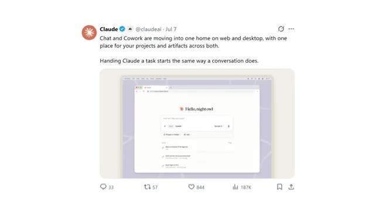
*⏱️ 00:00:09 — Publication officielle de Claude sur X montrant l'interface web de Claude Cowork.*

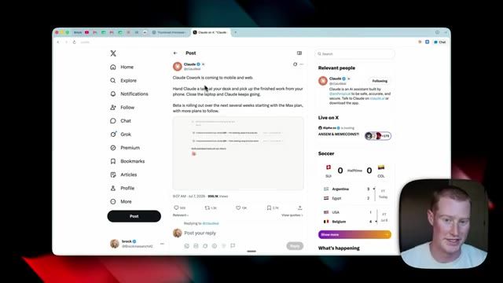
*⏱️ 00:00:27 — Navigateur affichant le fil d'actualité X (Twitter) avec un post de Claude annonçant Claude Cowork, accompagné d'une webcam du présentateur.*

---

### ⏱️ `[00:00:35 - 00:01:10]` | Segment #02

**🔊 Audio (Transcription Intégrale Mot pour Mot en Français) :**
> ce qui est une très grande mise à jour que nous n'avions pas avant. Auparavant, si nous devions utiliser Claude Cowork en mode de répartition, par exemple, notre ordinateur devait rester allumé pour que Claude puisse continuer et exécuter ces tâches. Eh bien, ce n'est plus le cas maintenant. Et oui, selon Anthropic, c'est également le cas pour les tâches programmées. Donc si vous avez des tâches programmées spécifiques qui s'exécutent et pour lesquelles vous deviez auparavant garder votre ordinateur ouvert, ce n'est plus le cas et elles peuvent s'exécuter lorsqu'il est fermé. Maintenant ensuite, si je passe à l'application de bureau Claude, nous allons voir quelques changements clés ici. Vous pouvez maintenant voir sur le côté gauche que nous avons deux modes entre lesquels basculer. Nous avons l'accueil et

**👁️ Analyse Visuelle d'Écran (gemini-3.5-flash-lite) :**
**Interface & Outils** : Navigateur web (X/Twitter) et interface utilisateur de Claude.

**Contenu textuel & Code** : Texte du tweet sur Claude Cowork et liste de tâches hebdomadaires.

**Action / Démonstration** : Navigation et présentation des fonctionnalités de Claude.

---

### ⏱️ `[00:01:10 - 00:01:36]` | Segment #03

**🔊 Audio (Transcription Intégrale Mot pour Mot en Français) :**
> nous avons du code. Avant, nous avions le chat, nous avions co-work au milieu et puis nous avions cloud code, mais maintenant ils ont pratiquement réduit nos options à seulement deux. Et si je clique sur accueil, nous pouvons basculer entre le mode chat ou co-work directement ici, à l'intérieur de la zone de texte. Personnellement, je ne sais pas vraiment quoi en penser. Après avoir un peu expérimenté cela par moi-même, je préférerais avoir un écosystème séparé pour Claude Co-work plutôt qu'ils ne soient regroupés.

**👁️ Analyse Visuelle d'Écran (gemini-3.5-flash-lite) :**
**Interface & Outils** : Interface logicielle de type assistant IA / espace de travail de productivité avec barre latérale et zone de discussion.

**Contenu textuel & Code** : Menus de navigation (Home, Code, New task, Projects, Artifacts, Scheduled, Dispatch, Customize) et options de mode (Chat, Cowork).

**Action / Démonstration** : Navigation et présentation des options de l'interface utilisateur pour basculer entre les modes de travail.

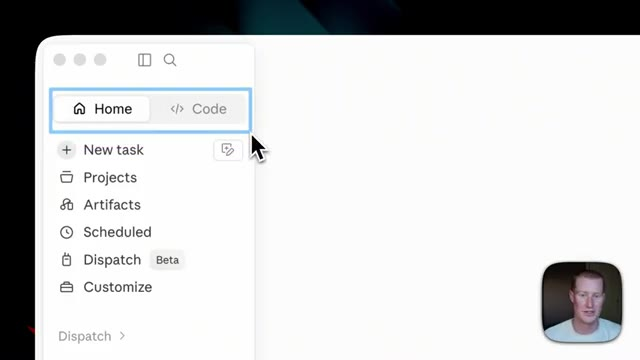
*⏱️ 00:01:17 — Gros plan sur le menu latéral gauche montrant les boutons 'Home' et 'Code' encadrés en bleu.*

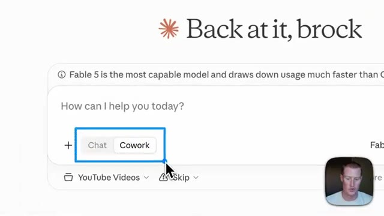
*⏱️ 00:01:23 — Gros plan sur l'interface principale montrant les options de bascule 'Chat' et 'Cowork' dans la zone de texte.*

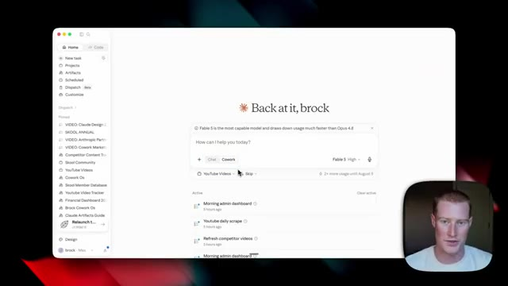
*⏱️ 00:01:30 — Vue d'ensemble de l'interface de l'application montrant le tableau de bord avec le message d'accueil et les options de mode.*

---

### ⏱️ `[00:01:36 - 00:02:02]` | Segment #04

**🔊 Audio (Transcription Intégrale Mot pour Mot en Français) :**
> Donc, si je clique sur chat, vous pouvez voir que c'est fondamentalement juste comme le Claude normal auquel nous sommes habitués. Si je clique sur co-work, nous pouvons ouvrir différents projets dans les différents dossiers dans lesquels nous travaillons. Et ensuite, nous pouvons voir toutes nos tâches actives que nous faisons faire à co-work, en plus de nos tâches planifiées qui s'exécutent. La prochaine chose que je tiens à souligner, c'est que nous obtenons une utilisation deux fois plus importante jusqu'au 5 août à l'intérieur de Cowork. C'est quelque chose qu'Anthropic vient de sortir. Donc, si vous voulez tester cela, vous allez pouvoir le pousser un peu plus dans ses limites.

**👁️ Analyse Visuelle d'Écran (gemini-3.5-flash-lite) :**
**Interface & Outils** : Interface logicielle de bureau (type assistant IA / espace de travail personnalisé).

**Contenu textuel & Code** : Menus de chat, options de co-work, listes de tâches et mentions de modèles (Fable 5, Opus 4.8).

**Action / Démonstration** : Navigation dans l'interface pour montrer les fonctionnalités de chat et de gestion des projets.

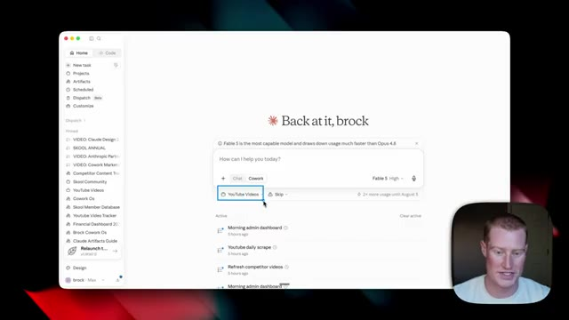
*⏱️ 00:01:43 — Vue d'ensemble de l'interface de l'application avec le panneau de commande central, la liste des projets dans la barre latérale et le présentateur en médaillon.*

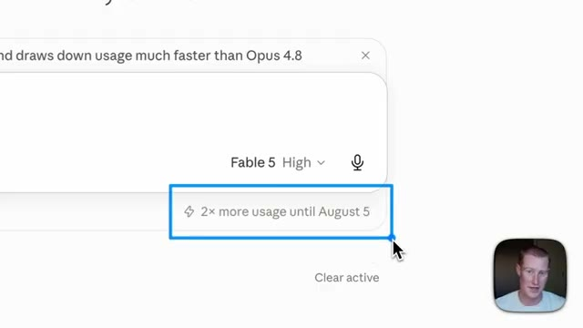
*⏱️ 00:01:56 — Gros plan sur une infobulle de l'interface indiquant les détails d'utilisation du modèle Fable 5.*

---

### ⏱️ `[00:02:02 - 00:02:26]` | Segment #05

**🔊 Audio (Transcription Intégrale Mot pour Mot en Français) :**
> Maintenant, si je viens ici et que je cherche Claude.ai, nous pouvons désormais accéder à Cowork directement dans l'application web. Nous n'avons donc plus besoin de l'utiliser dans l'application de bureau de Claude, ce que nous devions faire avant. Donc, tout comme pour l'application de bureau, nous allons voir une nouvelle interface utilisateur ici. Nous avons le bouton d'accueil ainsi que le bouton de code Cloud. Nous allons cliquer sur accueil. Et ensuite, juste ici, nous avons la possibilité de basculer entre le mode chat et le mode cowork. Laissez-moi donc activer le mode cowork.

**👁️ Analyse Visuelle d'Écran (gemini-3.5-flash-lite) :**
**Interface & Outils** : Application web Claude.ai dans un navigateur, avec une incrustation vidéo du présentateur en bas à droite.

**Contenu textuel & Code** : Page d'accueil de Claude.ai avec le message « Good evening, brock » et la boîte de dialogue « How can I help you today? ».

**Action / Démonstration** : Navigation et présentation de l'interface web de Claude.ai pour montrer l'accès direct aux fonctionnalités.

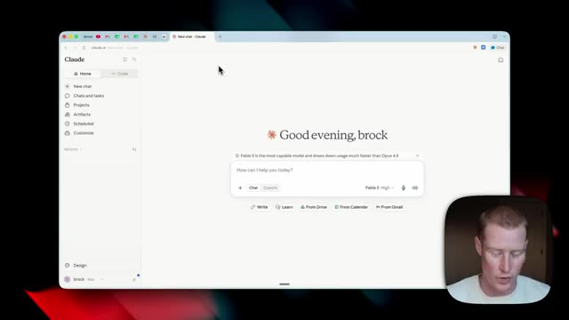
*⏱️ 00:02:08 — Interface web de Claude.ai affichant l'accueil avec un encadré de saisie et les options de discussion.*

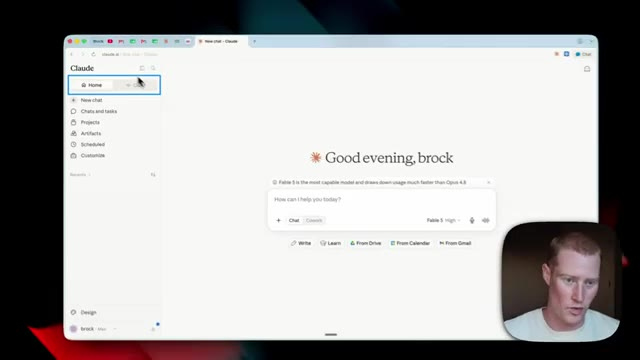
*⏱️ 00:02:20 — Interface web de Claude.ai avec un curseur pointant sur les onglets supérieurs de navigation (Home / Code).*

---

### ⏱️ `[00:02:26 - 00:03:03]` | Segment #06

**🔊 Audio (Transcription Intégrale Mot pour Mot en Français) :**
> Et cela va ressembler de très près à l'application de bureau en ce qui concerne l'interface de Cowork. Il y a deux ou trois choses que vous devez savoir. Donc, tout d'abord, nous sélectionnons le projet ou le dossier spécifique dans lequel nous voulons travailler. Et vous savez quoi ? J'ai dû y regarder à deux fois parce que pendant que je filme cette vidéo, je suis venu ici et j'essaie de sélectionner un dossier spécifique dans lequel travailler sur mon ordinateur, ce qui est l'une des raisons principales pour lesquelles nous utilisons Claude Cowork, car il peut manipuler et générer des fichiers à l'intérieur de nos dossiers sur notre ordinateur. Mais quand je viens ici, il n'y a aucun moyen pour moi de sélectionner un dossier, ce qui me laisse plutôt perplexe. Donc si je reviens à la publication d'annonce de Claude qu'ils ont postée sur Twitter, et que je zoome ici, vous pouvez voir que

**👁️ Analyse Visuelle d'Écran (gemini-3.5-flash-lite) :**
**Interface & Outils** : Interface Web de Claude.ai (Anthropic)

**Contenu textuel & Code** : Menu de sélection de projets affichant "Bolt.new Prompt Optimizer", "Short Form Repurpose", "How to use Claude" et le bouton "Create new project". Mode Cowork et modèle Fable 5 activés.

**Action / Démonstration** : Sélection d'un projet spécifique ou d'un dossier dans l'interface de Claude pour démarrer une tâche de travail.

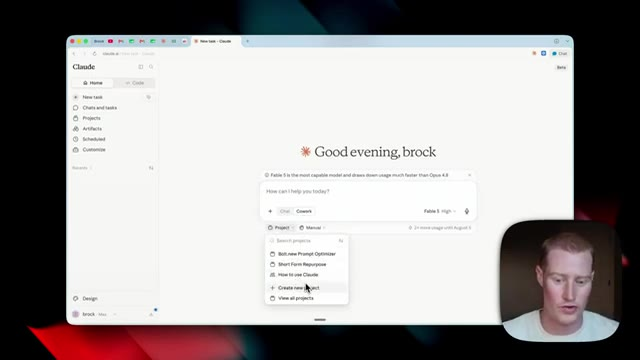
*⏱️ 00:02:35 — Interface principale de Claude.ai montrant le menu déroulant des projets avec le curseur sur la sélection des dossiers.*

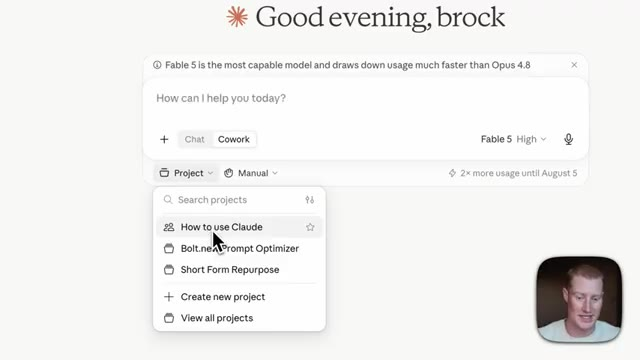
*⏱️ 00:02:45 — Gros plan sur le menu de sélection de projets de Claude.ai avec les options de projets et le mode Cowork actif.*

---

### ⏱️ `[00:03:03 - 00:03:26]` | Segment #07

**🔊 Audio (Transcription Intégrale Mot pour Mot en Français) :**
> Ils utilisent la plateforme Claude.ai directement dans le navigateur, tout comme je le fais exactement ici. Mais cela montre que vous pouvez sélectionner un projet ou un dossier, alors que je ne vois pas cela dans cette interface à l'intérieur de mon compte. Donc je ne sais pas s'il s'agit d'un problème que je suis le seul à rencontrer, ou si d'autres personnes vont y être confrontées. Alors laissez peut-être un commentaire si vous constatez aussi la même chose, parce que cela perd un peu de son intérêt d'utiliser Cloud Cowork si nous ne pouvons pas travailler à l'intérieur des dossiers.

**👁️ Analyse Visuelle d'Écran (gemini-3.5-flash-lite) :**
**Interface & Outils** : Navigateur web, interface utilisateur de Claude.ai

**Contenu textuel & Code** : Menu de sélection de projets ou dossiers, options de chat, sélecteur de modèle (Sonnet / Fable 5).

**Action / Démonstration** : Navigation et démonstration de l'interface de Claude.ai pour illustrer l'accès aux projets et dossiers.

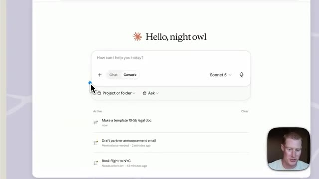
*⏱️ 00:03:09 — Interface de Claude.ai montrant le champ de texte principal avec des options de sélection de projets ou dossiers et les tâches actives.*

*⏱️ 00:03:15 — Interface complète du navigateur affichant Claude.ai avec le menu déroulant de sélection de projets ouvert.*

---

### ⏱️ `[00:03:26 - 00:03:59]` | Segment #08

**🔊 Audio (Transcription Intégrale Mot pour Mot en Français) :**
> Mais je n'ai peut-être tout simplement pas encore réussi à comprendre cela. Alors je pourrais avoir complètement tort. Passons maintenant à la meilleure partie où je vais vous montrer comment utiliser ceci sur l'application mobile, et je vais la configurer dès maintenant. Très bien. Donc, sur mon téléphone, ce que je vais faire, c'est simplement cliquer sur l'application mobile Claude juste ici. Donc, si j'ouvre ça, voici ce que nous allons voir. Nous avons évidemment le mode discussion. Et si je vais dans le panneau latéral gauche, nous pouvons maintenant voir que nous avons un mode co-work juste en dessous de dispatch. Je vais donc le sélectionner dès maintenant. Pour ma part, j'ai quelques tâches différentes que j'ai testées avant cette vidéo, mais voici ce que nous allons voir. Nous allons voir toutes ces tâches que nous avons

**👁️ Analyse Visuelle d'Écran (gemini-3.5-flash-lite) :**
**Interface & Outils** : Interface web et application mobile de Claude (Anthropic)

**Contenu textuel & Code** : Tableau de bord Claude AI, interface de chat, liste des discussions récentes (Flight change with miles issue, Sonnet 4.6 vs Sonnet 5, etc.)

**Action / Démonstration** : Présentation de l'application mobile Claude et de son interface utilisateur par le créateur.

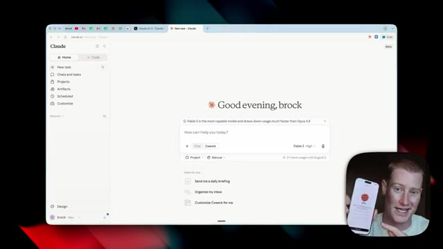
*⏱️ 00:03:35 — Interface web de Claude sur écran d'ordinateur avec, en incrustation en bas à droite, le présentateur montrant l'application mobile.*

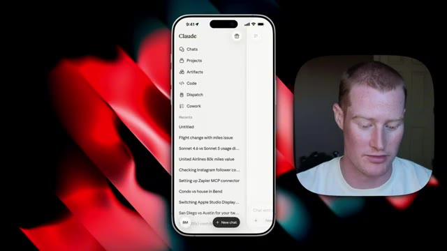
*⏱️ 00:03:43 — Gros plan sur l'interface de l'application mobile Claude affichant le menu latéral avec la liste des chats récents.*

---

### ⏱️ `[00:03:59 - 00:04:37]` | Segment #09

**🔊 Audio (Transcription Intégrale Mot pour Mot en Français) :**
> s'est exécuté, non seulement sur notre application mobile, mais aussi sur l'application web. Deux ou trois choses différentes. Je vais vous faire un petit tour rapide de la façon dont cela fonctionne. Donc si je vais en haut à droite, vous pouvez voir cette petite icône d'horloge. C'est l'ensemble de nos exécutions de tâches planifiées pour les tâches planifiées que nous avons configurées. Donc pour moi personnellement, j'en ai lancé quelques-unes juste ici. J'ai mon analyse quotidienne des concurrents YouTube, qui est en train de s'exécuter à l'instant même où l'on parle. Et ensuite, j'ai lancé ma compétence de briefing matinal juste ici. Et à l'intérieur de cette tâche, je peux aller cliquer sur cet HTML qui affiche mon briefing matinal, détaillant en gros mes priorités principales, montrant tout ce qui est à mon programme aujourd'hui. Et cela montre mon e-mail

**👁️ Analyse Visuelle d'Écran (gemini-3.5-flash-lite) :**
**Interface & Outils** : Application mobile Cowork (interface utilisateur de gestion de tâches) et vue incrustée du présentateur.

**Contenu textuel & Code** : Liste de tâches comprenant des éléments tels que « Morning brief scheduled task », « VIDEO REPURPOSING », « YouTube competitor analysis task », « EXPLAINER INFOGRAPHIC », « INVOICE EXAMPLE », etc., avec un bouton « + New task ».

**Action / Démonstration** : Le présentateur montre l'application mobile et présente les différentes fonctionnalités et tâches de l'interface Cowork.

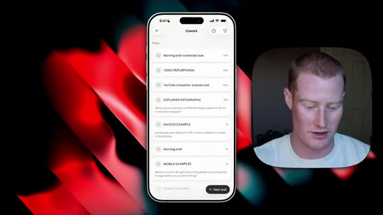
*⏱️ 00:04:09 — Capture d'écran montrant une maquette de smartphone affichant l'interface de l'application « Cowork » avec une liste de tâches, aux côtés d'une incrustation vidéo du présentateur.*

---

### ⏱️ `[00:04:37 - 00:05:08]` | Segment #10

**🔊 Audio (Transcription Intégrale Mot pour Mot en Français) :**
> boîte de réception ainsi que les principales actualités sur l'IA que je dois examiner pour la journée. Maintenant, tout cela est formidable. C'est une compétence que j'ai qui s'exécute à l'intérieur de Cloud Cowork. À l'origine, j'avais fait créer cela sur l'application de bureau, mais maintenant je peux voir cela directement sur mon téléphone, ce qui est vraiment formidable. Maintenant, en revenant à l'application de bureau, je veux vous montrer quelque chose très rapidement. Donc, toutes ces tâches ou conversations que nous exécutions depuis mon appareil mobile, nous pouvons les voir également à l'intérieur de l'application Web. Nous avons donc ma tâche planifiée de briefing matinal, ma tâche de réutilisation de vidéos, l'analyse des concurrents sur YouTube.

**👁️ Analyse Visuelle d'Écran (gemini-3.5-flash-lite) :**
**Interface & Outils** : Interface mobile et tableau de bord web de Claude Cowork.

**Contenu textuel & Code** : Résumé matinal avec statistiques de réunion, emails en attente, revenus récurrents et priorités de la journée, ainsi que la boîte de dialogue de l'assistant IA Claude.

**Action / Démonstration** : Présentation de la fonctionnalité de résumé quotidien et de l'interface de travail automatisée dans l'application Claude Cowork.

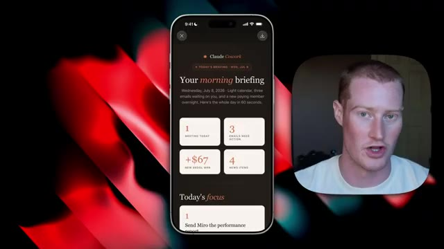
*⏱️ 00:04:44 — Aperçu sur un écran de smartphone affichant un résumé matinal personnalisé nommé "Your morning briefing" issu de l'outil Claude Cowork.*

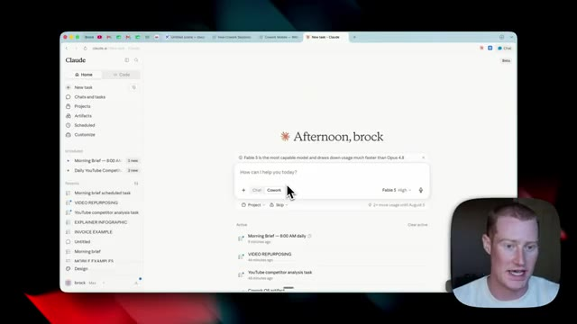
*⏱️ 00:04:52 — Interface web du tableau de bord Claude affichant un espace de travail personnalisé "Afternoon, brock" avec des options de tâches planifiées.*

---

### ⏱️ `[00:05:08 - 00:05:43]` | Segment #11

**🔊 Audio (Transcription Intégrale Mot pour Mot en Français) :**
> Donc par exemple, je pourrais cliquer sur ce briefing matinal, cliquer sur ce HTML, et c'est exactement le même résultat que je viens évidemment de vous montrer sur mon téléphone. Donc maintenant, que nous travaillions sur notre ordinateur ou depuis notre téléphone, nous pouvons toujours accéder à cette information. Maintenant, personnellement, j'ai quelques tâches planifiées que j'exécute à l'intérieur de Cloud Cowork sur la version mobile et la version web. Donc si je viens ici là où il est écrit planifié et que je clique simplement dessus, vous pouvez maintenant voir que j'ai mon briefing matinal ainsi que mon analyse quotidienne des concurrents sur YouTube, qui s'exécute désormais dans le cloud. Donc si mon ordinateur est fermé et que je suis en déplacement et que je veux le voir sur mon téléphone, je peux toujours le voir là. Maintenant, pour ces deux tâches planifiées que personnellement

**👁️ Analyse Visuelle d'Écran (gemini-3.5-flash-lite) :**
**Interface & Outils** : Navigateur web, interface utilisateur de Claude AI

**Contenu textuel & Code** : Tableaux de bord de productivité, résumés matinaux au format HTML, listes de tâches automatisées (Morning Brief, Daily YouTube Competitor Analysis, Inbox triage, etc.)

**Action / Démonstration** : Le présentateur clique sur un briefing matinal pour afficher le rendu HTML et démontrer la compatibilité multi-plateforme.

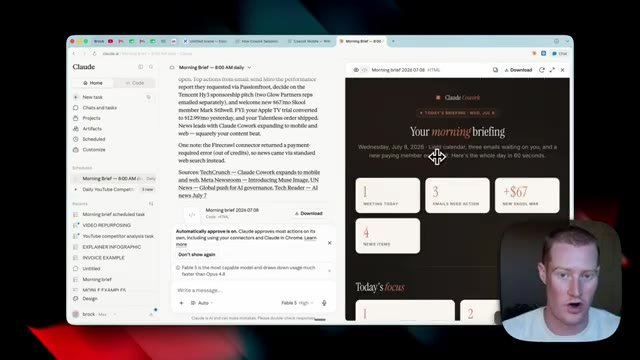
*⏱️ 00:05:17 — Interface de l'application Claude affichant un briefing matinal au format HTML dans une fenêtre divisée, avec la webcam du présentateur en bas à droite.*

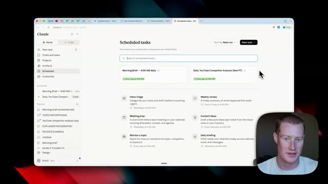
*⏱️ 00:05:34 — Page des tâches planifiées (Scheduled tasks) sur l'interface de Claude, montrant les différentes automatisations configurées.*

---

### ⏱️ `[00:05:43 - 00:06:19]` | Segment #12

**🔊 Audio (Transcription Intégrale Mot pour Mot en Français) :**
> qui s'exécute, il extrait des données de plusieurs de mes applications différentes. Il les extrait donc de Gmail, il utilise Firecrawl, il parcourt mon Google Calendar afin de récupérer ces informations pour mon point matinal et mon analyse quotidienne de la concurrence sur YouTube. Et une chose importante ici, c'est que l'application mobile, l'application web et l'application de bureau partagent toutes des connecteurs que nous relions à nos comptes. Alors, par exemple, j'en ai plusieurs de connectés différents. Et pour ajouter un connecteur, vous avez juste à cliquer sur « ajouter des connecteurs », à cliquer sur « parcourir les connecteurs », et il y a une quantité incalculable de connecteurs qu'Anthropic vous propose juste ici. Maintenant, s'il y a une application que vous voulez utiliser et que vous ne trouvez pas ici, vous pouvez toujours utiliser quelque chose comme le MCP Zapier afin de

**👁️ Analyse Visuelle d'Écran (gemini-3.5-flash-lite) :**
**Interface & Outils** : Interface web de Claude AI, panneau des tâches programmées et gestionnaire de connecteurs.

**Contenu textuel & Code** : Liste des tâches automatisées quotidiennes (Morning Brief, Daily YouTube Competitor Analysis) et liste des connecteurs connectés/disponibles (Gmail, Google Calendar, Firecrawl).

**Action / Démonstration** : Navigation dans les interfaces de configuration des tâches programmées et des intégrations d'applications tierces dans Claude.

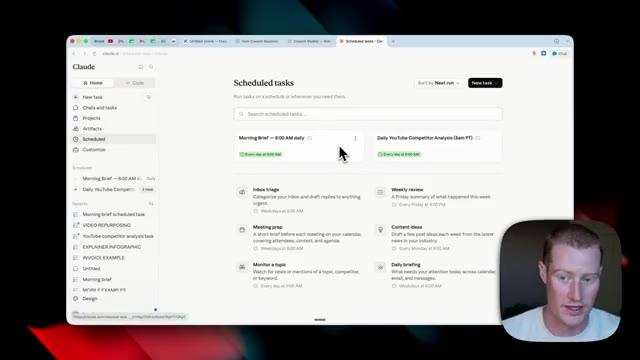
*⏱️ 00:05:52 — Vue d'ensemble de l'interface de Claude montrant l'onglet des tâches programmées (Scheduled tasks).*

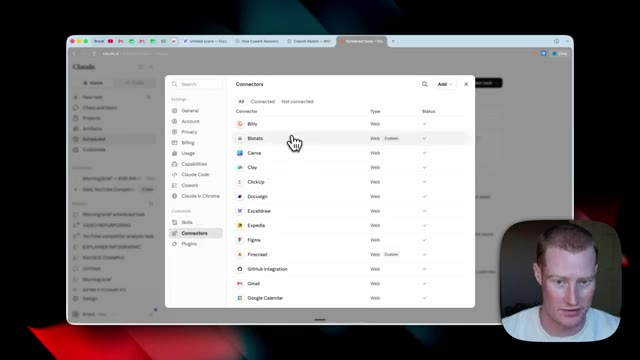
*⏱️ 00:06:01 — Fenêtre des connecteurs (Connectors) listant les intégrations disponibles comme Bitly, Canva, Firecrawl, Gmail et Google Calendar.*

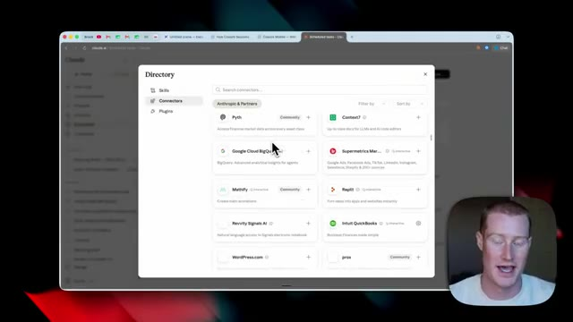
*⏱️ 00:06:10 — Fenêtre du répertoire de connecteurs (Directory) affichant des outils tiers comme Pyth, Google Cloud BigQuery et Supermetrics.*

---

### ⏱️ `[00:06:19 - 00:06:39]` | Segment #13

**🔊 Audio (Transcription Intégrale Mot pour Mot en Français) :**
> connectez-vous à plus de 9 000 applications différentes. Donc, si vous ne savez pas ce qu'est Zapier, Zapier est une plateforme d'automatisation qui vous permet d'effectuer des actions à travers 9 000 applications différentes, et ils ont un serveur MCP auquel vous pouvez brancher Claude directement. Donc, pour un grand nombre de ces différentes tâches que je fais personnellement à l'intérieur de Claude, il n'y a pas de connecteur naturel à l'intérieur de Claude. Je dois donc utiliser un MCP Zapier.

**👁️ Analyse Visuelle d'Écran (gemini-3.5-flash-lite) :**
**Interface & Outils** : Navigateur web affichant la page d'accueil de Zapier MCP.

**Contenu textuel & Code** : Texte explicatif sur la connexion de Claude, ChatGPT et Cursor à plus de 9 000 applications, ainsi que les boutons d'appel à l'action « Get started » et « Talk to Sales ».

**Action / Démonstration** : Présentation de la page web officielle de Zapier MCP par le présentateur.

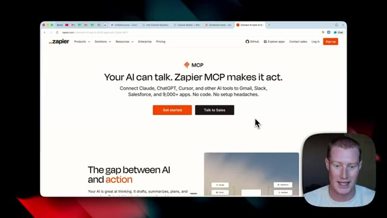
*⏱️ 00:06:24 — Capture d'écran montrant le site web de Zapier présentant son serveur MCP avec le slogan 'Your AI can talk. Zapier MCP makes it act.' et une incrustation vidéo du présentateur en bas à droite.*

---

### ⏱️ `[00:06:39 - 00:07:12]` | Segment #14

**🔊 Audio (Transcription Intégrale Mot pour Mot en Français) :**
> Maintenant, par exemple, voici un serveur MCP sur lequel j'ai branché Claude et je l'ai connecté à Beehive ainsi qu'à School. Ce sont deux plateformes que je ne peux pas connecter à l'intérieur de Claude. Donc maintenant, je peux accéder à Beehive, qui est mon logiciel de marketing par e-mail, directement à l'intérieur de Claude, mais pas seulement sur l'application de bureau maintenant, je peux aussi y accéder depuis mon téléphone. Donc si vous voulez essayer cela, il y a un lien dans la description pour le tester vous-même. Maintenant, pour vous donner un autre exemple d'une tâche que j'ai exécutée depuis mon téléphone, c'est celle-ci. J'ai dit, crée une infographie explicative sur le fonctionnement de la physique quantique à un niveau de CM1. Et j'ai en fait une compétence spécifique que

**👁️ Analyse Visuelle d'Écran (gemini-3.5-flash-lite) :**
**Interface & Outils** : Navigateur Web affichant l'interface de gestion Zapier MCP.

**Contenu textuel & Code** : Liste des applications connectées au serveur MCP : Beehiiv, Slack, Synthflow AI et Skool.

**Action / Démonstration** : Présentation de la configuration des connexions entre l'assistant IA et les différentes applications via un serveur MCP.

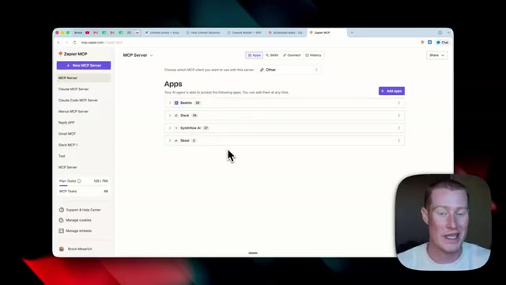
*⏱️ 00:06:47 — Capture d'écran montrant l'interface Web de Zapier MCP avec la liste des applications connectées dont Beehiiv et Skool.*

---

### ⏱️ `[00:07:12 - 00:07:33]` | Segment #15

**🔊 Audio (Transcription Intégrale Mot pour Mot en Français) :**
> vous pouvez voir juste ici que j'ai construit à l'intérieur de Claude il y a quelques semaines un outil qui crée des infographies explicatives exactement comme celle-ci. Et il a utilisé mon connecteur Higgs field afin de générer cette image automatiquement. Je pourrais aller de l'avant et télécharger ceci. Je pourrais y apporter des modifications, etc. Donc maintenant j'ai lancé ce flux de travail depuis mon téléphone que je peux réellement visualiser soit sur l'application de bureau, soit sur l'application Web, comme vous pouvez le voir ici.

**👁️ Analyse Visuelle d'Écran (gemini-3.5-flash-lite) :**
**Interface & Outils** : Interface web de Claude.ai et panneau de configuration des connecteurs / skills.

**Contenu textuel & Code** : Configuration du contexte avec le connecteur Higgsfield et le skill 'explainer-infographic', ainsi qu'une infographie sur la physique quantique générée.

**Action / Démonstration** : Le présentateur montre l'outil de création d'infographies intégré dans Claude et l'image générée via le connecteur Higgsfield.

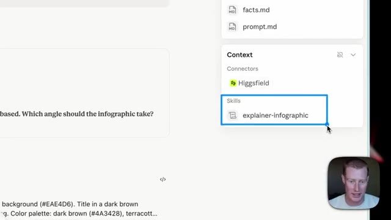
*⏱️ 00:07:18 — Gros plan sur une interface montrant les connecteurs, dont Higgs field et le skill 'explainer-infographic'.*

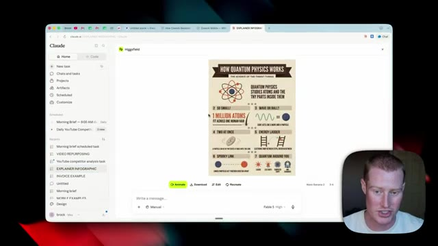
*⏱️ 00:07:23 — Interface complète de Claude affichant une infographie générée automatiquement intitulée 'How Quantum Physics Works' avec le connecteur Higgsfield.*

---

### ⏱️ `[00:07:33 - 00:07:58]` | Segment #16

**🔊 Audio (Transcription Intégrale Mot pour Mot en Français) :**
> Un autre exemple de cela est que j'ai exécuté cette compétence de réutilisation de contenu où j'ai ajouté l'une de mes vidéos précédentes. À partir de là, cela crée un article de blog, une newsletter et une publication LinkedIn, le tout dans mes voix spécifiques, car ici même j'ai des compétences pour chacun d'entre eux individuellement. Maintenant, ce que cela a fait, c'est que cela a créé ces fichiers Markdown que je peux copier et coller et ils sont prêts à être publiés, ainsi que cela a généré ce HTML décrivant tout ce dont j'ai parlé dans la vidéo.

**👁️ Analyse Visuelle d'Écran (gemini-3.5-flash-lite) :**
**Interface & Outils** : Navigateur web affichant l'interface de Claude.ai avec une vue de chat, un volet latéral et des fichiers générés.

**Contenu textuel & Code** : Texte affichant les résultats de la tâche de réutilisation de contenu (« All done. Here's the recap »), listant un article de blog, une newsletter et une publication LinkedIn.

**Action / Démonstration** : Présentation de l'interface de l'outil IA montrant comment transformer une vidéo YouTube en plusieurs formats de contenu écrits.

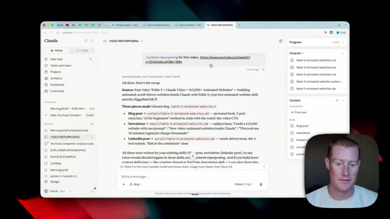
*⏱️ 00:07:39 — Capture d'écran de l'interface de Claude montrant un récapitulatif de tâches de réutilisation de contenu vidéo avec la génération d'un article de blog, d'une newsletter et d'une publication LinkedIn.*

---

### ⏱️ `[00:07:58 - 00:08:24]` | Segment #17

**🔊 Audio (Transcription Intégrale Mot pour Mot en Français) :**
> Donc c'est ce que j'ai créé depuis mon téléphone que je peux maintenant visualiser sur mon ordinateur. Très bien. Parlons donc rapidement de la façon dont cela fonctionne pour que vous puissiez le comprendre à un niveau fondamental. Et ensuite, je vais parler de certains des très grands bémols de cette nouvelle fonctionnalité mobile Cloud Cowork, parce que ce n'outre-passe pas tout le rose et le merveilleux et je ne vais pas rester assis ici à mentir comme si c'était le cas. Donc la première chose que nous devons comprendre, c'est que cela s'exécute maintenant dans le cloud, et vous vous dites probablement : que signifie même le cloud ? Laissez-moi donc décomposer les choses très simplement pour que n'importe qui puisse comprendre.

**👁️ Analyse Visuelle d'Écran (gemini-3.5-flash-lite) :**
**Interface & Outils** : Navigateur web affichant l'application Excalidraw.

**Contenu textuel & Code** : Texte manuscrit "Runs in the "Cloud" :" avec des diagrammes illustrant les comptes et sessions distantes.

**Action / Démonstration** : Le présentateur explique le fonctionnement fondamental du service à l'aide du schéma visuel.

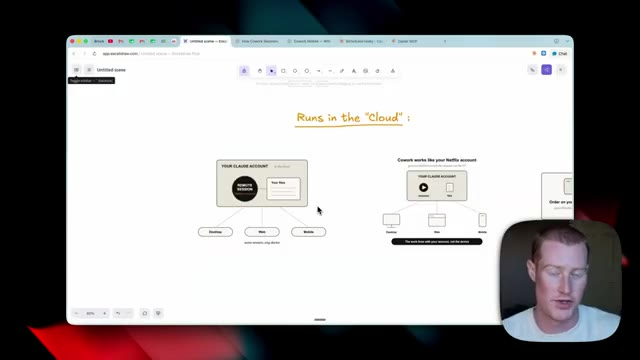
*⏱️ 00:08:05 — Schéma explicatif sur Excalidraw montrant le fonctionnement du "Cloud" et la synchronisation multi-appareils (Desktop, Web, Mobile) avec le présentateur incrusté en bas à droite.*

---

### ⏱️ `[00:08:24 - 00:08:43]` | Segment #18

**🔊 Audio (Transcription Intégrale Mot pour Mot en Français) :**
> Donc, ceci juste ici est notre compte cloud qui fonctionne dans le cloud sur le serveur. Maintenant, nous avons notre session distante et nous avons nos fichiers à l'intérieur de cette session distante. Nous pouvons désormais y accéder depuis l'application de bureau, l'application web et l'application mobile comme je vous l'ai montré jusqu'à présent dans cette vidéo. Maintenant, si cela n'a toujours pas de sens pour vous, pensez à co-work comme à votre compte Netflix.

**👁️ Analyse Visuelle d'Écran (gemini-3.5-flash-lite) :**
**Interface & Outils** : Navigateur web affichant l'application Excalidraw.

**Contenu textuel & Code** : Schéma textuel et graphique illustrant "YOUR CLAUDE ACCOUNT in the cloud", "REMOTE SESSION", "Your files", et les trois points d'accès "Desktop", "Web", "Mobile" avec la mention "same session, any device".

**Action / Démonstration** : Le présentateur explique le fonctionnement du compte cloud et de la session distante accessible depuis différents types d'appareils.

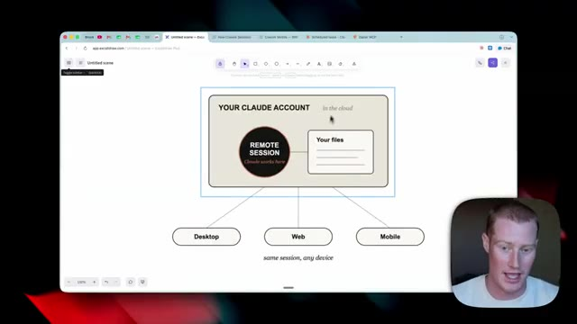
*⏱️ 00:08:29 — Schéma explicatif sur Excalidraw montrant l'architecture d'un compte Claude dans le cloud avec une session distante, des fichiers, et un accès multi-plateforme (Desktop, Web, Mobile).*

---

### ⏱️ `[00:08:43 - 00:09:02]` | Segment #19

**🔊 Audio (Transcription Intégrale Mot pour Mot en Français) :**
> Et à l'intérieur de cela, nous avons nos sessions et nous avons nos fichiers que nous pouvons consulter depuis chacune de ces différentes plateformes. Tout comme vous pouvez regarder un film sur Netflix sur votre télévision et continuer à le regarder exactement là où vous vous étiez arrêté sur votre téléphone ou votre tablette. Maintenant, plongeons un peu plus profondément là-dedans afin que vous puissiez comprendre cela pleinement. Donc, à l'intérieur de notre cloud Anthropic, nous avons quelques éléments différents.

**👁️ Analyse Visuelle d'Écran (gemini-3.5-flash-lite) :**
**Interface & Outils** : Navigateur web affichant Excalidraw et une page web explicative personnalisée sur Claude Cowork.

**Contenu textuel & Code** : Schémas conceptuels et graphiques explicatifs sur la synchronisation multiplateforme des sessions et fichiers Claude (Desktop, Web, Mobile).
[DESC_IMAGE_2] Le présentateur explique le fonctionnement et la synchronisation des sessions sur différentes plateformes.

**Action / Démonstration** : Explications face caméra et analyse conceptuelle des marchés.

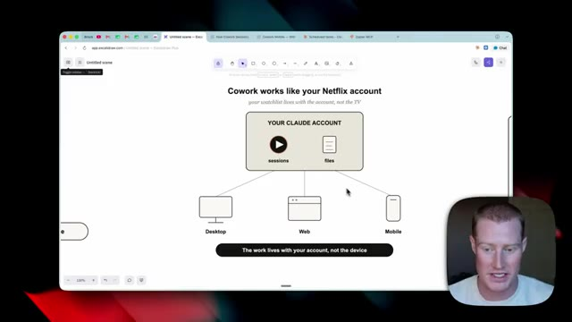
*⏱️ 00:08:48 — Schéma explicatif sur Excalidraw montrant le fonctionnement de Cowork comparé à un compte Netflix, reliant le compte Claude (sessions et fichiers) aux appareils Desktop, Web et Mobile.*

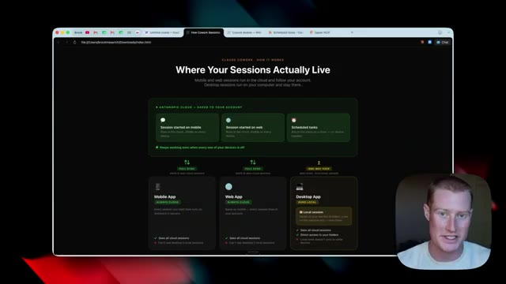
*⏱️ 00:08:58 — Page Web expliquant l'emplacement des sessions de Cowork, détaillant la synchronisation entre l'application mobile, l'application web et l'application desktop.*

---

### ⏱️ `[00:09:03 - 00:09:21]` | Segment #20

**🔊 Audio (Transcription Intégrale Mot pour Mot en Français) :**
> D'abord, nous avons notre session que nous avons commencée sur mobile. Nous avons notre session que nous avons commencée sur le web et nous avons nos tâches planifiées qui s'exécutent maintenant dans le cloud. Donc, si nous utilisons l'application mobile, tout cela se synchronise directement avec ce serveur. Mais une chose vraiment importante, c'est que ceci ne peut pas voir la session locale de la version de bureau. Et c'est la même chose pour l'application web.

**👁️ Analyse Visuelle d'Écran (gemini-3.5-flash-lite) :**
**Interface & Outils** : Navigateur web affichant un diagramme explicatif (type interface utilisateur ou présentation conceptuelle).

**Contenu textuel & Code** : Schéma illustrant l'écosystème cloud d'Anthropic : sessions mobiles, web et tâches planifiées avec indicateurs de synchronisation ("Full Sync", "Always Cloud").

**Action / Démonstration** : Le présentateur explique le fonctionnement de la synchronisation entre l'application mobile et les sessions dans le cloud en pointant les éléments du schéma.

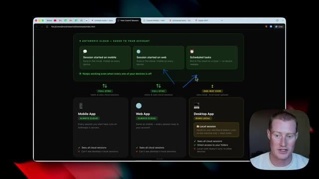
*⏱️ 00:09:07 — Interface web schématisant l'architecture de synchronisation cloud pour des sessions (mobile, web, tâches planifiées).*

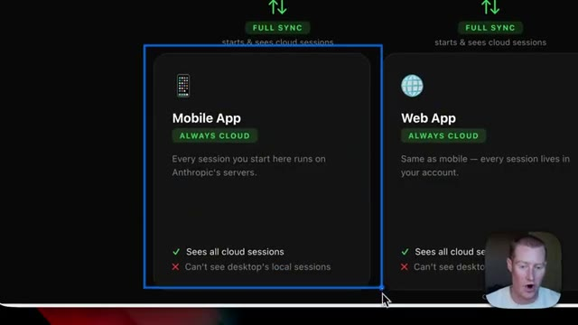
*⏱️ 00:09:12 — Gros plan sur le bloc de l'application mobile ("Mobile App") dans le schéma d'architecture cloud.*

---

### ⏱️ `[00:09:21 - 00:09:45]` | Segment #21

**🔊 Audio (Transcription Intégrale Mot pour Mot en Français) :**
> Toutes ces informations d'Anthropic Claude se synchronisent désormais sur l'application Web. Nous pouvons donc voir ces informations. Maintenant, l'une des principales choses que nous devons vraiment comprendre ici, là où tout n'est pas rose, c'est que pour l'application de bureau, nous n'obtenons qu'une vue unidirectionnelle. Laissez-moi donc vous expliquer ce que cela signifie. Notre application de bureau s'exécute localement. Nous pouvons donc travailler dans des dossiers et créer des fichiers sur notre véritable ordinateur, mais cela ne signifie pas que cela se synchronise à la fois avec l'application mobile et l'application Web.

**👁️ Analyse Visuelle d'Écran (gemini-3.5-flash-lite) :**
**Interface & Outils** : Navigateur web affichant un tableau récapitulatif des fonctionnalités de synchronisation d'Anthropic Cloud.

**Contenu textuel & Code** : Schémas et texte expliquant la synchronisation complète (Full Sync) pour le mobile et le web, et la vue à sens unique (One-Way View) pour l'application de bureau.

**Action / Démonstration** : Le présentateur explique les différences de synchronisation et les limites de l'application de bureau par rapport au cloud.

*⏱️ 00:09:27 — Interface web détaillant le mode de synchronisation entre l'application mobile, l'application web et l'application de bureau d'Anthropic Cloud.*

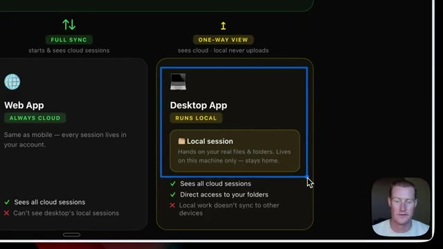
*⏱️ 00:09:39 — Gros plan sur la section de l'application de bureau indiquant 'Runs Local' et les limitations de synchronisation locale.*

---

### ⏱️ `[00:09:45 - 00:10:22]` | Segment #22

**🔊 Audio (Transcription Intégrale Mot pour Mot en Français) :**
> Donc, si vous avez quelque chose sur lequel vous avez travaillé dans l'application de bureau CoWork, vous ne pourrez pas le voir dans l'application mobile ou web. Mais ce que nous pouvons voir, c'est toutes nos sessions basées dans le cloud. Donc, si vous lancez une session depuis votre téléphone, vous pouvez voir et travailler à l'intérieur de cette session sur votre application de bureau. Par exemple, si je viens sur l'application de bureau et que je travaille dans CoWork, vous pourriez voir que je peux travailler à l'intérieur de ce dossier de vidéos YouTube sur mon ordinateur. Mais tout ce que je fais dans cette session, dans ce dossier, je ne pourrais pas y accéder sur mobile ou sur le web. Mais cela étant dit, tout ce que je lance sur le web ou sur l'application mobile, je peux le voir dans l'application de bureau. Donc, par exemple,

**👁️ Analyse Visuelle d'Écran (gemini-3.5-flash-lite) :**
**Interface & Outils** : Interface de l'application CoWork (version desktop et web).

**Contenu textuel & Code** : Menus de l'application, barres de recherche de tâches et options de sessions basées dans le cloud.

**Action / Démonstration** : Navigation et explication des différences de synchronisation entre l'application de bureau et l'application web/mobile de CoWork.

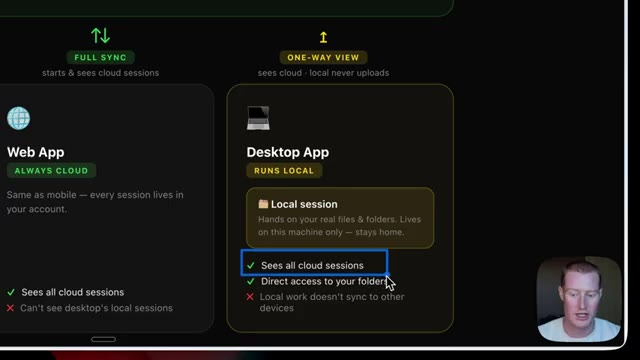
*⏱️ 00:09:54 — Comparatif visuel des applications Web et Desktop montrant les fonctionnalités de synchronisation cloud.*

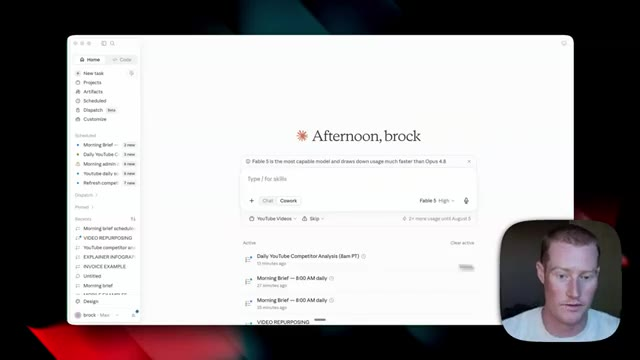
*⏱️ 00:10:04 — Interface principale de l'application CoWork affichant un tableau de bord et une barre de saisie.*

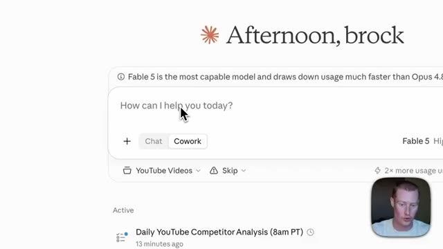
*⏱️ 00:10:13 — Gros plan sur la barre de saisie de l'application CoWork avec le sélecteur 'Cowork' activé.*

---

### ⏱️ `[00:10:22 - 00:10:54]` | Segment #23

**🔊 Audio (Transcription Intégrale Mot pour Mot en Français) :**
> cette analyse quotidienne de la concurrence sur YouTube, les tâches planifiées qui ont été exécutées, je pouvais afficher cela. Et c'est quelque chose que j'ai lancé depuis l'application mobile que je consulte dans l'application de bureau. J'espère donc que vous comprenez exactement ce que je veux dire quand je dis que l'application de bureau Claude a seulement une vue unidirectionnelle. Il y a donc pas mal de fonctionnalités limitées que nous avons à l'heure actuelle. Très bien les gars, voilà. Nous avons Cloud Cowork pour mobile, nous avons Cowork sur l'application web, ainsi que nous avons des tâches planifiées qui s'exécutent désormais dans le cloud. Je vais continuer à tester cela au cours des prochains jours et je vais faire quelques publications à ce sujet dans ma communauté School, alors assurez-vous de rejoindre si vous voulez plus d'informations. Abonnez-vous à cette chaîne pour plus de contenu de ce genre.

**👁️ Analyse Visuelle d'Écran (gemini-3.5-flash-lite) :**
**Interface & Outils** : Navigateur web affichant une page explicative et interface d'application mobile.

**Contenu textuel & Code** : Schéma comparatif des applications Mobile, Web et Desktop avec leurs modes de synchronisation cloud, et texte de notification sur l'application mobile concernant une préparation QBR.

**Action / Démonstration** : Le présentateur explique le fonctionnement de la synchronisation entre l'application mobile et l'application de bureau pour les sessions Cowork.

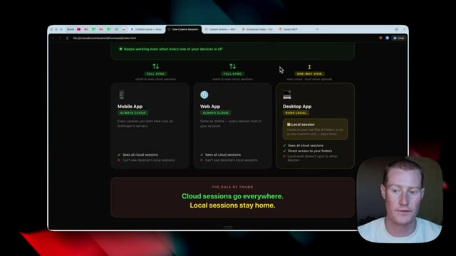
*⏱️ 00:10:30 — Capture d'écran d'un navigateur web montrant un diagramme explicatif sur les sessions Cowork (Mobile App, Web App, Desktop App) et leur synchronisation cloud.*

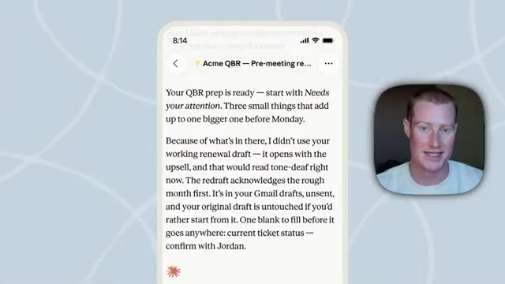
*⏱️ 00:10:46 — Capture d'écran d'une application mobile affichant un message de préparation QBR ("Acme QBR - Pre-meeting re...").*

---

### ⏱️ `[00:10:54 - 00:10:56]` | Segment #24

**🔊 Audio (Transcription Intégrale Mot pour Mot en Français) :**
> Merci d'avoir regardé jusqu'à la fin et je vous vois dans la prochaine vidéo. Salut.

**👁️ Analyse Visuelle d'Écran (gemini-3.5-flash-lite) :**
**Interface & Outils** : Interface utilisateur de l'application (Claude ou assistant IA) et vue webcam.

**Contenu textuel & Code** : Tableau de bord d'assistant virtuel, invite de texte 'How can I help you today?', options de modèle (Fable 5) et tâches planifiées.

**Action / Démonstration** : Navigation et présentation de l'interface de l'outil d'intelligence artificielle en fin de vidéo.

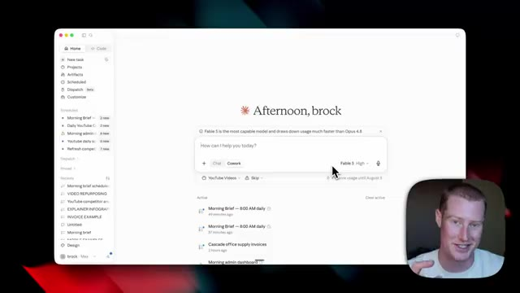
*⏱️ 00:10:55 — Interface d'une application logicielle affichant le tableau de bord avec le message d'accueil 'Afternoon, brock' et une webcam du présentateur en bas à droite.*

---

