# 🎬 NEW ChatGPT Work is the Claude Cowork Killer? (Full Breakdown)

> **Chaîne** : [Brock Mesarich | AI for Non Techies](https://www.youtube.com/@BrockMesarich)  
> **Lien YouTube** : [https://www.youtube.com/watch?v=qotnt0fzT5Y](https://www.youtube.com/watch?v=qotnt0fzT5Y)  
> **Date de publication** : 20260710  
> **Durée** : 00:09:24  
> **Identifiant vidéo** : `qotnt0fzT5Y`  
> **Transcription & Analyse** : `whisper-v3-large-turbo+gemini-3.5-flash-lite`  

---

## 📌 Synthèse Exécutive & Outils

### 💡 Résumé
Dans cette vidéo, Brock Mesarich analyse en détail le lancement de **ChatGPT Work** par OpenAI, positionné comme l'alternative directe et le concurrent direct de *Claude Cowork*. Conçu comme une version de l'outil *Codex* adaptée aux utilisateurs non techniques, cet environnement s'intègre au nouveau modèle de langage **GPT 5.6** et se déploie à travers les applications web, de bureau et mobiles. L'analyste démontre comment cet outil agentique permet d'automatiser des flux de travail complexes, de gérer des dossiers locaux et d'interagir nativement avec des applications tierces grâce à une synchronisation multiplateforme fluide.

La démonstration met en lumière la parité fonctionnelle entre les écosystèmes d'OpenAI et d'Anthropic, notamment en prouvant la portabilité des compétences (*skills*). Brock Mesarich illustre concrètement la migration d'un fichier Markdown de compétence conçu sur *Claude Cowork* vers *ChatGPT Work*, permettant d'obtenir des résultats similaires tout en exploitant des fonctionnalités natives supérieures, telles que la génération d'images intégrée. L'analyse aborde également la connexion d'applications et l'optimisation des architectures d'agents via l'intégration de protocoles avancés comme le **Zapier MCP**.

Enfin, cette revue stratégique s'adresse directement aux créateurs et professionnels cherchant à industrialiser leurs processus opérationnels sans compétences en programmation. L'analyste démystifie la transition entre les plateformes en montrant que les investissements réalisés dans la construction d'automatisations textuelles ou d'agents ne sont pas perdus, ouvrant ainsi la voie à une flexibilité accrue dans le choix des écosystèmes d'intelligence artificielle générative et agentique.

---

### 🛠️ Outils, Modèles & Logiciels Présentés
* **ChatGPT Work** : Environnement agentique d'OpenAI orienté vers la productivité non technique, permettant l'exécution de tâches locales et connectées à l'instar de *Codex*.
* **Claude Cowork** : Solution d'Anthropic équivalente, conçue pour exécuter des tâches bureautiques et manipuler des fichiers à partir de instructions en langage naturel.
* **GPT 5.6 (variantes Teralight et Sol Ultra)** : Dernier modèle de langage grand format d'OpenAI propulsant les capacités de raisonnement et d'exécution de *ChatGPT Work*.
* **Codex** : Plateforme d'IA agentique d'OpenAI historiquement orientée vers les développeurs, dont dérive l'ergonomie de *ChatGPT Work*.
* **Claude Code** : Outil d'Anthropic destiné aux ingénieurs pour automatiser le développement et la gestion de projets directement dans l'environnement local.
* **Make** : Plateforme d'automatisation de flux de travail sans code mentionnée dans l'écosystème d'intégration.
* **n8n** : Outil d'automatisation de workflows open-source et flexible pour connecter différentes applications et API.
* **Zapier (et Zapier MCP)** : Passerelle d'intégration connectant plus de 9 000 applications via le protocole MCP (*Model Context Protocol*).
* **Grok** : Modèle de langage conversationnel développé par xAI.
* **Gemini** : Suite de modèles d'intelligence artificielle développée par Google.
* **Higgsfield** : Outil tiers de génération d'images par IA, rendu optionnel grâce aux capacités natives de ChatGPT.

---

### 🔑 Points Clés & Enseignements Stratégiques
* **Positionnement stratégique** : *ChatGPT Work* transpose la puissance d'exécution locale de *Codex* vers le grand public et les non-développeurs, rivalisant directement avec l'offre de productivité d'Anthropic.
* **Hiérarchie des modèles** : Le choix entre les variantes *GPT 5.6 Teralight* (priorité à la vitesse d'exécution) et *GPT 5.6 Sol Ultra* (priorité à la performance et au raisonnement) permet d'optimiser l'allocation des ressources selon la complexité des tâches.
* **Continuité multiplateforme** : La synchronisation en temps réel entre l'application web, l'application de bureau et l'application mobile garantit la continuité des flux de travail en tout lieu.
* **Portabilité des compétences (*Skills*)** : Les fichiers Markdown (`.md`) contenant des instructions structurées peuvent être exportés de *Claude Cowork* et importés directement dans *ChatGPT Work* sans perte de logique métier.
* **Génération multimédia native** : Contrairement à l'écosystème concurrent qui nécessite des connecteurs externes (comme Higgsfield), ChatGPT intègre un outil natif de génération d'images, simplifiant les pipelines de production visuelle.
* **Restructuration de la terminologie** : Les concepts familiers d'artefacts et de connecteurs de Claude sont respectivement rebaptisés « sites » (pour l'affichage interactif de données comme le HTML) et « plugins » dans l'interface d'OpenAI.
* **Automatisation contextuelle** : L'outil est capable d'agréger des sources multiples (Google Calendar, Gmail, données météorologiques locales) pour générer des synthèses opérationnelles sur mesure, telles qu'un briefing matinal en HTML.
* **Interopérabilité avancée via MCP** : L'utilisation du *Zapier MCP* permet de contourner les limites des connecteurs natifs en s'interfaçant dynamiquement avec plus de 9 000 applications tierces.
* **Activation du mode développeur** : La configuration des serveurs MCP nécessite l'activation explicite du mode développeur dans l'interface de gestion pour autoriser l'injection d'URL de serveurs distants.
* **Sécurisation des investissements en prompt engineering** : Le format standardisé des compétences (fichiers Markdown) protège les utilisateurs contre l'obsolescence technologique lors des migrations d'une plateforme d'IA à une autre.

---

## ⏱️ Chronologie & Transcription Complète Audio & Visuelle (Mot pour Mot)

### ⏱️ `[00:00:00 - 00:00:18]` | Segment #01

**🔊 Audio (Transcription Intégrale Mot pour Mot en Français) :**
> OpenAI vient de lancer ChatGPT Work, et c'est leur version de Claude Cowork. C'est fondamentalement l'application Codex, mais pour les personnes non techniques. Et nous pouvons y accéder à plusieurs endroits différents. Nous pouvons l'utiliser dans l'application web ChatGPT, ainsi que dans l'application de bureau et l'application mobile. Donc dans cette vidéo, je vais passer en revue tout ce qui est nouveau avec cette sortie.

**👁️ Analyse Visuelle d'Écran (gemini-3.5-flash-lite) :**
**Interface & Outils** : Présentation vidéo standard sans interface technique.

**Contenu textuel & Code** : Texte explicatif et visuels de transition de la vidéo.
[DESC_IMAGE_1] Introduction du sujet par le présentateur.

**Action / Démonstration** : Explications face caméra et analyse conceptuelle des marchés.

---

### ⏱️ `[00:00:18 - 00:00:38]` | Segment #02

**🔊 Audio (Transcription Intégrale Mot pour Mot en Français) :**
> Je vais même le comparer à Claude Cowork, parce que certaines personnes vont appeler ça le tueur de Claude Cowork. Donc nous allons le mettre à l'épreuve. Donc si vous êtes un utilisateur de Cowork ou un utilisateur de ChatGPT, cette vidéo va être extrêmement pertinente pour vous. Donc sans plus tarder, plongeons-y directement. Maintenant, je tiens à mentionner rapidement qu'ils ont également lancé le modèle GPT 5.6, qui est leur plus récent grand modèle de langage.

**👁️ Analyse Visuelle d'Écran (gemini-3.5-flash-lite) :**
**Interface & Outils** : Navigateur web affichant un fil d'actualité Twitter / X.

**Contenu textuel & Code** : Publication officielle d'OpenAI concernant ChatGPT Work et GPT-5.6.

**Action / Démonstration** : Présentation et lecture d'une annonce officielle d'OpenAI.

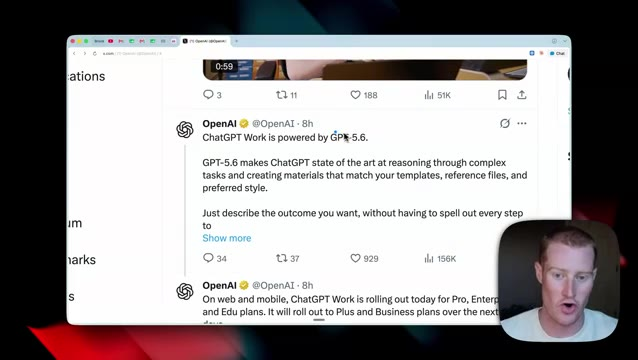
*⏱️ 00:00:33 — Capture d'écran d'un tweet officiel d'OpenAI annonçant 'ChatGPT Work is powered by GPT-5.6' avec la vidéo du présentateur en incrustation.*

---

### ⏱️ `[00:00:38 - 00:00:57]` | Segment #03

**🔊 Audio (Transcription Intégrale Mot pour Mot en Français) :**
> Et c'est ce qui fait réellement fonctionner le travail de ChatGPT. Donc, en plus de cette nouvelle façon d'interagir avec ChatGPT, nous avons également un nouveau modèle plus puissant. Maintenant, parlons de l'endroit où nous pouvons l'utiliser. Donc, comme vous pouvez le voir juste ici, je suis sur ChatGPT.com, qui est leur application web. Et c'est l'interface que nous allons voir dès le départ. Et tout en haut, vous pouvez voir qu'il est écrit chat.

**👁️ Analyse Visuelle d'Écran (gemini-3.5-flash-lite) :**
**Interface & Outils** : Navigateur web affichant la plateforme X (Twitter).

**Contenu textuel & Code** : Publication officielle d'OpenAI détaillant les capacités de GPT-5.6 et son déploiement sur les versions Pro, Enterprise et Edu.

**Action / Démonstration** : Le présentateur commente le message officiel affiché à l'écran concernant le nouveau modèle d'OpenAI.

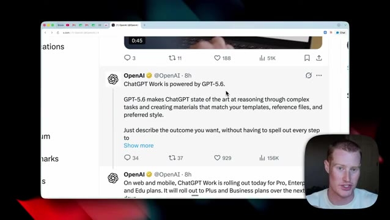
*⏱️ 00:00:43 — Capture d'écran montrant un tweet d'OpenAI sur X (Twitter) annonçant que "ChatGPT Work is powered by GPT-5.6".*

---

### ⏱️ `[00:00:57 - 00:01:23]` | Segment #04

**🔊 Audio (Transcription Intégrale Mot pour Mot en Français) :**
> Et il y a maintenant ce bouton de travail juste ici. Si je clique sur travail, nous allons voir quelques éléments différents. Nous avons donc notre boîte de texte normale ici, et ensuite cela nous permet de travailler à l'intérieur de projets spécifiques. Et ensuite, nous pouvons voir tous nos connecteurs juste ici. Donc, n'importe laquelle des applications auxquelles nous voulons nous connecter. Ensuite, nous avons le modèle 5.6 qui est sélectionné. Nous pouvons basculer entre le 5.6 Teralight, qui est leur modèle le plus rapide, jusqu'au 5.6 Sol Ultra, qui est leur modèle le plus performant.

**👁️ Analyse Visuelle d'Écran (gemini-3.5-flash-lite) :**
**Interface & Outils** : Navigateur web affichant l'interface de ChatGPT Pro avec l'onglet Work actif.

**Contenu textuel & Code** : Options de projets, plugins intégrés (Google Calendar, Figma, Expedia, Canva) et menus contextuels de configuration.
[DESC_IMAGE_3] Manipulation des menus déroulants pour configurer les paramètres de travail et les plugins de l'assistant IA.

**Action / Démonstration** : Explications face caméra et analyse conceptuelle des marchés.

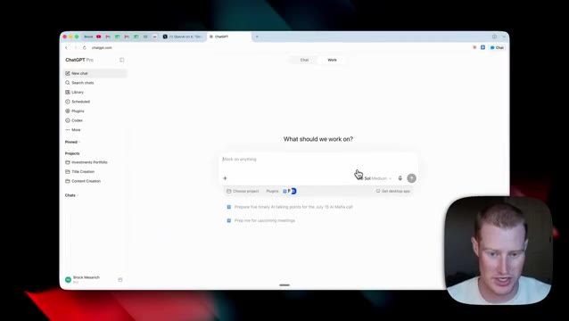
*⏱️ 00:01:04 — Interface principale de l'onglet Work de ChatGPT avec la boîte de texte centrale et la caméra du présentateur en bas à droite.*

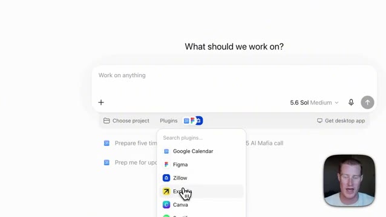
*⏱️ 00:01:10 — Gros plan sur le menu déroulant des plugins dans l'interface de travail montrant des options telles que Google Calendar, Figma et Expedia.*

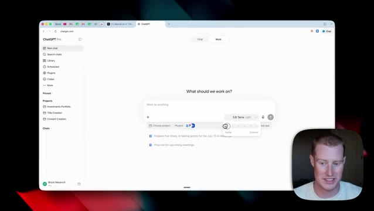
*⏱️ 00:01:16 — Affichage du panneau de sélection de vitesse ou de modèle sous la boîte de texte dans l'interface ChatGPT.*

---

### ⏱️ `[00:01:23 - 00:01:59]` | Segment #05

**🔊 Audio (Transcription Intégrale Mot pour Mot en Français) :**
> Le prochain endroit où nous pourrions utiliser ceci est l'application mobile ChatGPT, comme vous pouvez le voir juste ici à l'écran. Et donc la façon dont nous pouvons y accéder, c'est lorsque nous ouvrons une nouvelle discussion, nous allons voir ChatGPT tout en haut. Nous allons cliquer dessus et nous allons cliquer sur travail. Cela nous amène maintenant à ChatGPT travail et nous pouvons commencer à effectuer différentes tâches ici. Cela nous donne même quelques tâches de test différentes que nous pouvons exécuter. Et ensuite, nous pouvons également sélectionner quel modèle nous voulons utiliser. Maintenant, je tiens à mentionner que tout ce que nous faisons sur l'application ChatGPT sur notre ordinateur, nous pouvons le faire sur notre application mobile également. Vous pouvez donc voir que j'ai généré cette image avec cette compétence que j'ai téléchargée sur mon ordinateur et je peux accéder à cette discussion directement sur mon téléphone. Donc, elles se synchronisent entre nos différents

**👁️ Analyse Visuelle d'Écran (gemini-3.5-flash-lite) :**
**Interface & Outils** : Application mobile ChatGPT (iOS/Android)

**Contenu textuel & Code** : Écran de nouvelle discussion avec le clavier virtuel ouvert, les options de suggestion et la barre de saisie 'Ask ChatGPT'.

**Action / Démonstration** : Le présentateur montre comment accéder à l'application mobile ChatGPT pour démarrer une nouvelle discussion.

*⏱️ 00:01:32 — Capture d'écran montrant l'interface de l'application mobile ChatGPT sur un smartphone, avec le présentateur incrusté à droite.*

---

### ⏱️ `[00:01:59 - 00:02:24]` | Segment #06

**🔊 Audio (Transcription Intégrale Mot pour Mot en Français) :**
> appareils. Et c'est en fait une fonctionnalité qu'Anthropic vient de lancer dans Claude Cowork littéralement hier. Ils ont ajouté Claude Cowork pour mobile, ce qui vous permet essentiellement de synchroniser n'importe quelle tâche de Cowork de votre téléphone vers votre ordinateur également. Maintenant, le prochain endroit où nous pourrions utiliser ceci est à l'intérieur de l'application de bureau ChatGPT. Et la raison pour laquelle je montre ceci ici et non moi à l'intérieur de cette application est que pour une raison quelconque, je n'ai pas accès à cela en ce moment sur mon bureau. Mais comme vous pouvez le voir sur la gauche, nous avons le mode de travail ChatGPT activé.

**👁️ Analyse Visuelle d'Écran (gemini-3.5-flash-lite) :**
**Interface & Outils** : Interface logicielle de bureau ChatGPT Work et vue incrustée du présentateur.

**Contenu textuel & Code** : Menus de projets, tâches de lancement de campagne et options de collaboration automatisées.

**Action / Démonstration** : Navigation dans l'interface de l'application de travail et synchronisation des tâches entre appareils.

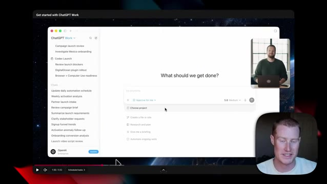
*⏱️ 00:02:12 — L'interface de ChatGPT Work sur ordinateur montrant les listes de tâches et un espace de travail interactif.*

---

### ⏱️ `[00:02:25 - 00:02:44]` | Segment #07

**🔊 Audio (Transcription Intégrale Mot pour Mot en Français) :**
> Et ensuite, nous pouvons également sélectionner différents dossiers sur notre ordinateur pour travailler à l'intérieur, tout comme vous pouvez le faire dans Claude Cowork. Maintenant, pour montrer cela en direct, je suis venu ici et je lui ai donné la tâche : donne-moi un briefing matinal en HTML. Ce qu'il a fait, c'est qu'il a foncé. Il a regardé dans mon Google Calendar, mon Gmail, il a même regardé la météo de Denver et différentes priorités de créateur pour moi.

**👁️ Analyse Visuelle d'Écran (gemini-3.5-flash-lite) :**
**Interface & Outils** : Interface web de ChatGPT Pro sur macOS avec le Dock visible en bas.

**Contenu textuel & Code** : Invite de tâche « Give me a morning brief html » et aperçu du fichier HTML généré pour Brock.

**Action / Démonstration** : Sélection d'un projet/dossier et démonstration de la génération d'un briefing matinal personnalisé.

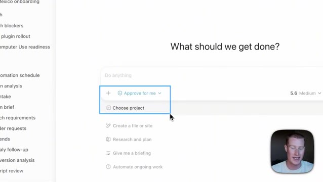
*⏱️ 00:02:30 — Interface de ChatGPT avec une invite montrant les options de sélection de projets et de dossiers.*

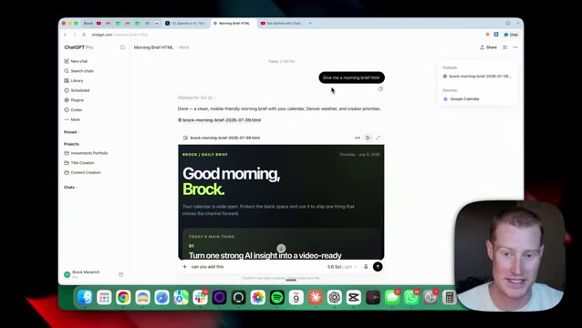
*⏱️ 00:02:35 — Interface de ChatGPT affichant le résultat de la tâche demandée avec le briefing matinal au format HTML et un aperçu visuel.*

---

### ⏱️ `[00:02:44 - 00:03:03]` | Segment #08

**🔊 Audio (Transcription Intégrale Mot pour Mot en Français) :**
> Et ensuite, il m'a donné ce code HTML ici que je pouvais afficher tout comme je pouvais le faire à l'intérieur de Claude Cowork. Mais à l'intérieur de ChatGPT Work, ceci n'est pas appelé un artefact comme nous avons l'habitude de le voir à l'intérieur de Claude. C'est appelé un site. C'est ainsi que ChatGPT appelle cela. Donc en gros, ça montre simplement bonjour, Brock. Ça montre mes principales priorités pour aujourd'hui. Ça montre tout ce qui est sur mon calendrier.

**👁️ Analyse Visuelle d'Écran (gemini-3.5-flash-lite) :**
**Interface & Outils** : Navigateur web affichant l'interface de ChatGPT Pro et macOS Dock.

**Contenu textuel & Code** : Interface utilisateur avec un volet de conversation à gauche affichant un prompt ("Give me a morning brief html"), et un rendu HTML interactif à droite affichant un dashboard personnalisé ("Good morning, Brock").

**Action / Démonstration** : Présentation de la fonctionnalité de prévisualisation de code HTML directement intégrée dans l'interface de ChatGPT.

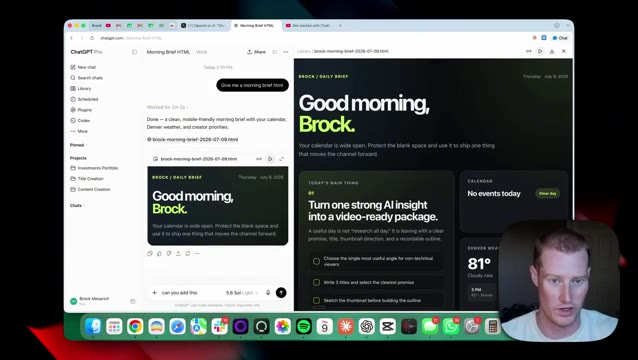
*⏱️ 00:02:49 — Capture d'écran montrant l'interface de ChatGPT Pro avec un panneau latéral de discussion et un aperçu HTML en plein écran sur le côté droit.*

---

### ⏱️ `[00:03:04 - 00:03:24]` | Segment #09

**🔊 Audio (Transcription Intégrale Mot pour Mot en Français) :**
> Et ensuite, cela me donne même un filtre de décision juste ici. Ensuite, je veux parler des similitudes entre le travail sur ChatGPT et le co-travail sur Claude que nous avons tellement l'habitude d'utiliser. Ainsi que nous allons parler de Codex et de Claude code et de la façon dont cela se compare et se positionne par rapport à ceux-ci également. Et ensuite, nous allons parler de la question de savoir si cela remplace ou non votre besoin d'utiliser le co-travail sur Claude si vous avez déjà mis en place un système qui fonctionne pour vous là-bas.

**👁️ Analyse Visuelle d'Écran (gemini-3.5-flash-lite) :**
**Interface & Outils** : Navigateur web affichant l'application Excalidraw avec une webcam du présentateur.

**Contenu textuel & Code** : Schéma textuel et visuel comparant les fonctionnalités de Claude Cowork (Skills, Live Artifacts, Scheduled Tasks) et ChatGPT Work (Skills, Sites, Scheduled Tasks).

**Action / Démonstration** : Le présentateur explique les similitudes entre le travail sur ChatGPT et Claude Cowork.

---

### ⏱️ `[00:03:24 - 00:03:44]` | Segment #10

**🔊 Audio (Transcription Intégrale Mot pour Mot en Français) :**
> Ensuite, je vais vous montrer quelques autres cas d'usage que vous pouvez tester pour comprendre les capacités de ceci. Tout d'abord, nous avons Cloud Cowork, qui possède des compétences, des artefacts en direct et des tâches planifiées. Eh bien, ChatGPT Work est fondamentalement la même chose. Nous avons des compétences, nous avons des sites, ce qui est exactement la même chose que les artefacts en direct, et ensuite nous avons aussi des tâches planifiées que nous pourrions exécuter à l'intérieur de ChatGPT Work.

**👁️ Analyse Visuelle d'Écran (gemini-3.5-flash-lite) :**
**Interface & Outils** : Navigateur web affichant un outil de schéma/diagramme (Excalidraw).

**Contenu textuel & Code** : Texte « Same primitives. Different names. » comparant les fonctionnalités de Claude Cowork (Skills, Live Artifacts, Scheduled Tasks) et ChatGPT Work (Skills, Sites, Scheduled Tasks).

**Action / Démonstration** : Le présentateur explique et compare les fonctionnalités équivalentes entre les deux agents IA.

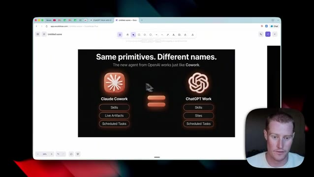
*⏱️ 00:03:29 — Un schéma comparatif affiché dans le navigateur montrant les similitudes entre 'Claude Cowork' et 'ChatGPT Work', avec le présentateur incrusté en bas à droite.*

---

### ⏱️ `[00:03:44 - 00:04:04]` | Segment #11

**🔊 Audio (Transcription Intégrale Mot pour Mot en Français) :**
> Et si vous ne savez pas ce qu'est Claude Cowork, Claude Cowork est la version non technique de Claude Code. Donc, au lieu d'utiliser Claude pour des tâches de programmation, nous pourrions faire en sorte que Cowork travaille à l'intérieur des dossiers et des fichiers sur notre ordinateur. Il peut donc vraiment faire le travail que nous pouvons faire sur notre ordinateur à notre place. Maintenant, ChatGPT Cowork est exactement la même chose. C'est fondamentalement juste Codex pour les non-techniciens.

**👁️ Analyse Visuelle d'Écran (gemini-3.5-flash-lite) :**
**Interface & Outils** : Navigateur web affichant un tableau blanc Excalidraw, avec un encart vidéo du présentateur en bas à droite.

**Contenu textuel & Code** : Texte explicatif « Cowork is Claude Code for non-techies » et schémas conceptuels comparant les environnements techniques et non techniques.

**Action / Démonstration** : Le présentateur explique les concepts et navigue visuellement à travers les schémas explicatifs des outils d'IA.

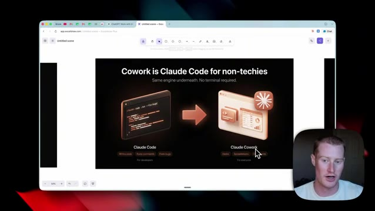
*⏱️ 00:03:49 — Diapositive Excalidraw expliquant que Claude Cowork est l'équivalent de Claude Code pour les non-techniciens, avec une comparaison visuelle entre terminal et interface graphique.*

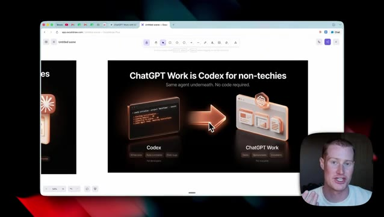
*⏱️ 00:03:59 — Diapositive Excalidraw montrant une comparaison similaire avec ChatGPT Work et Codex, illustrant le passage d'un outil de développeur à une interface grand public.*

---

### ⏱️ `[00:04:04 - 00:04:30]` | Segment #12

**🔊 Audio (Transcription Intégrale Mot pour Mot en Français) :**
> Et si vous ne savez pas ce qu'est Codex, Codex est la plateforme d'IA agentique d'OpenAI, très similaire à Claude Code. C'est vraiment puissant. Vous pouvez créer des agents spécifiques, des sous-agents, exécuter des tâches planifiées, etc. Mais c'est davantage orienté vers les développeurs. Et donc maintenant, à l'intérieur de ChatGPT Work, nous obtenons en quelque sorte la même puissance de feu que Codex. Maintenant, si vous êtes un utilisateur de Cloud, vous vous demandez probablement : Brock, est-ce que j'ai gaspillé ces six derniers mois à construire à l'intérieur de Cloud Cowork puisque ChatGPT Work est maintenant sorti ?

**👁️ Analyse Visuelle d'Écran (gemini-3.5-flash-lite) :**
**Interface & Outils** : Interface web d'application et Excalidraw, avec incrustation vidéo du présentateur.

**Contenu textuel & Code** : Fenêtre de partage de lien de tableau de bord d'entreprise et schéma conceptuel d'interopérabilité des compétences d'IA ("One file. Both products").

**Action / Démonstration** : Le présentateur explique les fonctionnalités de partage d'agents et de tableaux de bord basés sur l'IA.

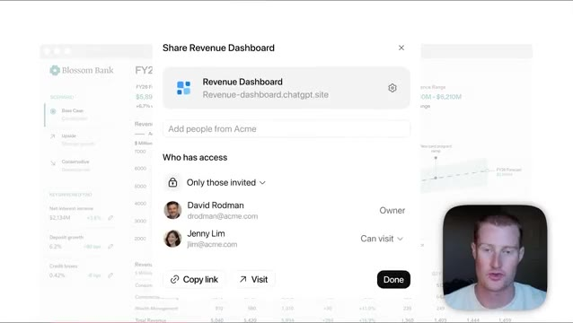
*⏱️ 00:04:11 — Interface de partage d'un tableau de bord de revenus (Revenue Dashboard) de Blossom Bank avec la webcam du présentateur en bas à droite.*

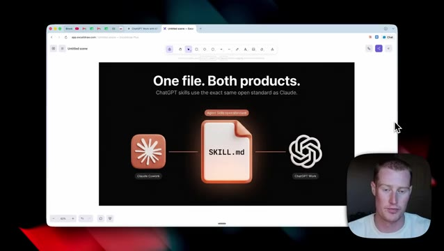
*⏱️ 00:04:24 — Schéma explicatif sur Excalidraw illustrant le standard ouvert des compétences d'agents entre Claude Cowork et ChatGPT Work autour du fichier "SKILL.md".*

---

### ⏱️ `[00:04:30 - 00:04:50]` | Segment #13

**🔊 Audio (Transcription Intégrale Mot pour Mot en Français) :**
> Et pour répondre à cette question très simplement, si jamais vous vouliez passer de Cowork à Work, c'est très simple à faire parce qu'ils fonctionnent fondamentalement de la même manière. Donc par exemple, à l'intérieur de Claude Cowork, nous construisons des compétences spécifiques, qui sont différentes automatisations que nos agents peuvent exécuter parce qu'ils constituent simplement un ensemble clair d'instructions permettant à un agent d'accomplir une tâche spécifique.

**👁️ Analyse Visuelle d'Écran (gemini-3.5-flash-lite) :**
**Interface & Outils** : Navigateur web affichant une application de tableau blanc ou de présentation (Excalidraw).

**Contenu textuel & Code** : Schéma avec le texte "One file. Both products. ChatGPT skills use the exact same open standard as Claude." illustrant un fichier central "SKILL.md" relié d'un côté à l'icône de Claude Cowork et de l'autre à celle de ChatGPT Work.

**Action / Démonstration** : Le présentateur explique la compatibilité et la portabilité des compétences d'IA créées entre différents environnements de travail.

*⏱️ 00:04:35 — Capture d'écran montrant un schéma explicatif sur l'interopérabilité des compétences entre Claude Cowork et ChatGPT Work via un fichier de configuration standardisé "SKILL.md".*

---

### ⏱️ `[00:04:50 - 00:05:10]` | Segment #14

**🔊 Audio (Transcription Intégrale Mot pour Mot en Français) :**
> Et si vous êtes comme moi, vous avez probablement accumulé 10, 20, 50 compétences différentes que vous utilisez quotidiennement dans Claude. Maintenant, le bon côté des choses, c'est que comme il s'agit de fichiers MD de compétences, nous pouvons les intégrer directement dans le travail de ChatShabiti afin de pouvoir migrer si nous le souhaitons. Maintenant, afin de vous montrer ce que je veux dire, voici une compétence Claude que j'ai créée appelée Explainer Infographic.

**👁️ Analyse Visuelle d'Écran (gemini-3.5-flash-lite) :**
**Interface & Outils** : Navigateur web affichant un schéma Excalidraw et interface de gestion des compétences (Skills) dans l'application.

**Contenu textuel & Code** : Schéma 'One file. Both products.' illustrant un fichier SKILL.md partagé entre Claude Cowork et ChatGPT Work, et texte descriptif d'une compétence de génération d'infographies.

**Action / Démonstration** : Présentation de la compatibilité des fichiers de compétences Markdown entre différentes plateformes d'IA et affichage des détails d'une compétence.

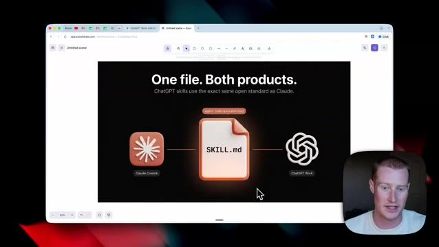
*⏱️ 00:04:55 — Capture montrant un schéma explicatif sur l'interopérabilité des compétences entre Claude Cowork et ChatGPT Work via un fichier SKILL.md.*

*⏱️ 00:05:05 — Interface montrant les paramètres d'une compétence nommée 'explainer-infographic' avec ses instructions et descriptions détaillées.*

---

### ⏱️ `[00:05:11 - 00:05:30]` | Segment #15

**🔊 Audio (Transcription Intégrale Mot pour Mot en Français) :**
> Il s'agit donc d'un ensemble d'instructions pour générer des images explicatives. Et j'ai conçu cela ces derniers mois dans Claude Cowork. Maintenant, je vais vous montrer à quel point je peux simplement prendre ceci de Claude et le télécharger dans ChatGPT Work et obtenir exactement le même résultat puisque c'est le même ensemble d'instructions pour cette tâche spécifique. Je vais donc simplement venir ici, cliquer sur Télécharger la compétence.

**👁️ Analyse Visuelle d'Écran (gemini-3.5-flash-lite) :**
**Interface & Outils** : Interface de l'application Claude Cowork (fenêtre principale et encart vidéo du présentateur en bas à droite).

**Contenu textuel & Code** : Description de la compétence "explainer-infographic" incluant les étapes de génération, les exigences techniques (Higgsfield MCP connecté) et le prompt détaillé.

**Action / Démonstration** : Le présentateur montre et explique les instructions de configuration qu'il a conçues dans Claude Cowork.

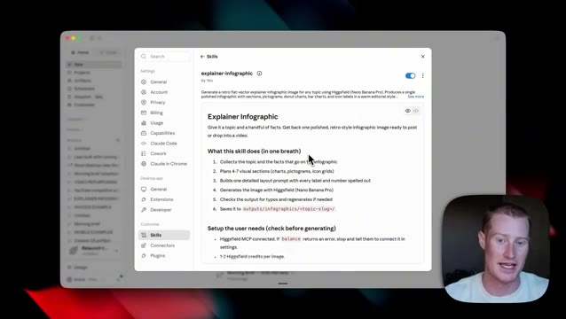
*⏱️ 00:05:16 — Capture d'écran montrant l'interface de configuration des compétences (Skills) de Claude Cowork avec les instructions pour générer des infographies.*

---

### ⏱️ `[00:05:30 - 00:05:51]` | Segment #16

**🔊 Audio (Transcription Intégrale Mot pour Mot en Français) :**
> Je vais l'enregistrer sur mon bureau. Et ensuite d'ici, je vais simplement ouvrir ChatGPT Work. Et afin d'accéder à vos compétences à l'intérieur de ChatGPT, nous allons venir sur le côté gauche là où il y est indiqué plugins. Et puis ici, nous allons cliquer sur compétences. Vous pouvez voir que j'en ai déjà quelques-unes d'ajoutées, mais je vais simplement cliquer sur ajouter, cliquer sur importer depuis votre ordinateur. Et ensuite, je vais glisser ce fichier Markdown de compétence que nous venons de télécharger depuis Claude.

**👁️ Analyse Visuelle d'Écran (gemini-3.5-flash-lite) :**
**Interface & Outils** : Interface web de ChatGPT Pro et navigateur internet.

**Contenu textuel & Code** : Menus "Plugins" et "Skills" avec des options d'installation d'outils et de téléchargement de compétences au format .zip ou SKILL.md.

**Action / Démonstration** : Navigation dans les paramètres de ChatGPT pour accéder aux extensions et compétences.

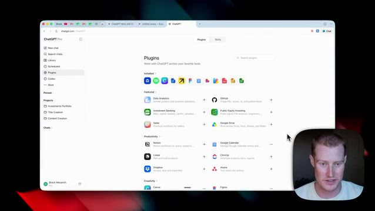
*⏱️ 00:05:36 — Interface de ChatGPT montrant le menu des plugins dans la barre latérale gauche.*

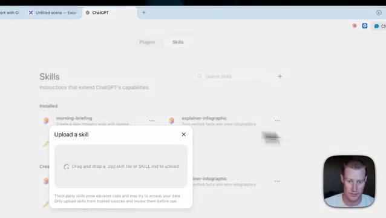
*⏱️ 00:05:46 — Interface de ChatGPT sur l'onglet Skills avec une fenêtre modale d'importation de fichier.*

---

### ⏱️ `[00:05:51 - 00:06:12]` | Segment #17

**🔊 Audio (Transcription Intégrale Mot pour Mot en Français) :**
> Maintenant, juste comme ça, nous avons la compétence d'infographie explicative téléchargée. Et si je clique dessus, c'est exactement le même ensemble d'instructions que nous avons vu plus tôt dans Claude. Maintenant, afin de l'exécuter, je pourrais simplement cliquer sur at, puis taper explainer infographic. Et puis disons simplement que je veux que vous génériez une infographie expliquant comment fonctionne ChatGPT. Et donc maintenant, ça va s'exécuter et générer cette image pour moi.

**👁️ Analyse Visuelle d'Écran (gemini-3.5-flash-lite) :**
**Interface & Outils** : Interface de gestion de compétences / application d'intelligence artificielle.

**Contenu textuel & Code** : Le fichier SKILL.md de la compétence « explainer-infographic » par Brock Mesarich, détaillant les étapes (Step 1: brief the user, Step 2: Lock the facts).

**Action / Démonstration** : Le présentateur survole le texte avec le curseur de la souris pour présenter les instructions de la compétence.

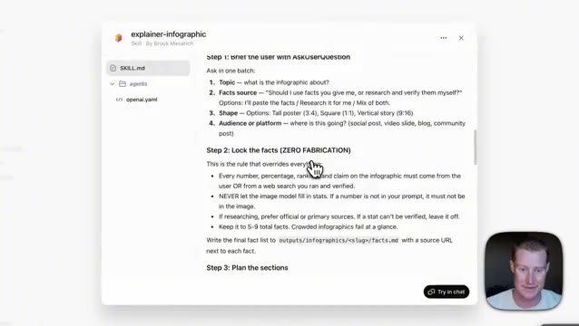
*⏱️ 00:05:56 — Une capture d'écran montrant l'interface d'une compétence d'infographie explicative avec le code et les instructions, et une webcam du présentateur en bas à droite.*

---

### ⏱️ `[00:06:12 - 00:06:31]` | Segment #18

**🔊 Audio (Transcription Intégrale Mot pour Mot en Français) :**
> Et le meilleur, c'est que comme j'utilise ChatGPT au lieu de Claude, ChatGPT dispose d'un outil natif de génération d'images. Il est donc capable de générer l'image sans avoir à utiliser quelque chose comme Higgsfield, par exemple. Parce qu'avant, nous aurions dû ajouter un connecteur spécifique qui nous permet de générer des images. Mais ChatGPT intègre cette fonctionnalité. Et voilà. Voici le résultat.

**👁️ Analyse Visuelle d'Écran (gemini-3.5-flash-lite) :**
**Interface & Outils** : Navigateur web, Interface ChatGPT

**Contenu textuel & Code** : Interface utilisateur de ChatGPT avec des invites de discussion ("explainer-infographic"), des options de formatage et de recherche de sources.

**Action / Démonstration** : Navigation et présentation de l'interface de ChatGPT pour la génération de contenu et d'images.

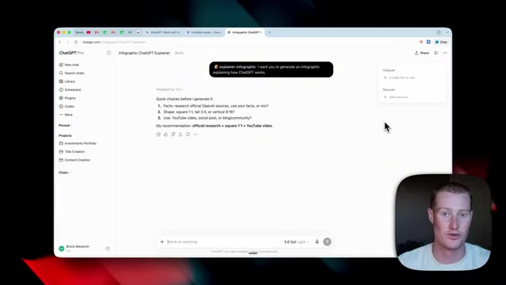
*⏱️ 00:06:26 — Interface du navigateur affichant l'application ChatGPT avec une conversation en cours sur la création d'une infographie expliquant le fonctionnement de ChatGPT.*

---

### ⏱️ `[00:06:31 - 00:06:51]` | Segment #19

**🔊 Audio (Transcription Intégrale Mot pour Mot en Français) :**
> C'est exactement à quoi cela ressemblerait à l'intérieur de Claude parce que cela utilise la même compétence. Maintenant, tout comme Claude, nous pouvons travailler à l'intérieur des différentes applications que nous utilisons. Donc, que nous utilisions des choses comme Gmail, Google Agenda, Slack, et cetera, nous pouvons extraire des informations de là ainsi que d'envoyer des e-mails et des choses de ce genre. Donc, au lieu que ceux-ci soient appelés des connecteurs, ils sont appelés des plugins. Laissez-moi donc vous montrer comment en ajouter un très rapidement.

**👁️ Analyse Visuelle d'Écran (gemini-3.5-flash-lite) :**
**Interface & Outils** : Navigateur Web affichant l'interface de ChatGPT.

**Contenu textuel & Code** : Invite de saisie « Work on anything », suggestions de tâches (« Prepare a 60-second update... », etc.) et options de projets et plugins en bas de la boîte de texte.

**Action / Démonstration** : Le présentateur présente l'interface de travail de ChatGPT et ses fonctionnalités d'intégration.

*⏱️ 00:06:36 — Capture d'écran montrant l'interface Web de ChatGPT avec un champ de saisie central et des suggestions de tâches.*

---

### ⏱️ `[00:06:51 - 00:07:09]` | Segment #20

**🔊 Audio (Transcription Intégrale Mot pour Mot en Français) :**
> Donc, vous allez cliquer sur ce petit bouton des plugins, cliquez sur connecter des plugins. Je vais cliquer sur parcourir tous les plugins. Et à partir de là, nous pourrions sélectionner n'importe lequel des différents que nous utilisons. Maintenant, disons qu'il y a une application à laquelle vous voulez vous connecter en particulier que vous ne trouvez pas ici même. Je vais donc vous montrer une astuce sur la façon dont vous pouvez faire cela. Nous allons donc utiliser quelque chose appelé le Zapier MCP. Et si vous voulez l'essayer, il y a un lien dans la description ci-dessous.

**👁️ Analyse Visuelle d'Écran (gemini-3.5-flash-lite) :**
**Interface & Outils** : Navigateur web, interface de gestion des plugins.

**Contenu textuel & Code** : Liste des plugins et outils disponibles (GitHub, Google Drive, Notion, Sales, Data Analytics).

**Action / Démonstration** : Navigation et présentation des différents plugins disponibles pour connexion.

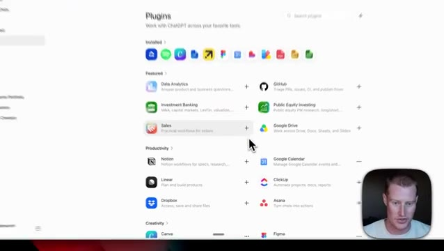
*⏱️ 00:06:55 — Gros plan sur l'interface du store de plugins avec la liste des applications disponibles (Data Analytics, GitHub, Sales, Google Drive, Notion, etc.).*

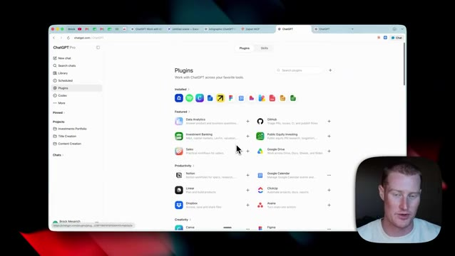
*⏱️ 00:07:00 — Vue d'ensemble du navigateur affichant l'interface de gestion des plugins avec le curseur pointant sur les différentes intégrations possibles.*

---

### ⏱️ `[00:07:09 - 00:07:29]` | Segment #21

**🔊 Audio (Transcription Intégrale Mot pour Mot en Français) :**
> Si vous ne savez pas ce que c'est, c'est une plateforme qui vous permet de vous connecter à plus de 9 000 applications différentes. Et si vous ne l'utilisez pas, honnêtement, je pense que vous passez à côté d'une partie de la puissance de l'utilisation de Claude et maintenant du travail avec ChatGPT. Donc, afin de configurer un serveur MCP et de vous connecter à n'importe laquelle de ces 9 000 applications différentes, il y a quelques petites choses que nous devons faire. Ensuite, nous allons aller dans les extensions, et sous extensions, cliquez sur ce bouton plus.

**👁️ Analyse Visuelle d'Écran (gemini-3.5-flash-lite) :**
**Interface & Outils** : Navigateur web affichant l'application Zapier MCP et incrustation vidéo du présentateur en bas à droite.

**Contenu textuel & Code** : Page « New MCP server » avec des instructions en trois étapes, une barre de recherche d'agents IA et des icônes pour Claude, Claude Code, ChatGPT, Cursor et OpenClaw.

**Action / Démonstration** : Présentation de la plateforme Zapier MCP permettant de connecter des agents IA à plus de 9 000 applications.

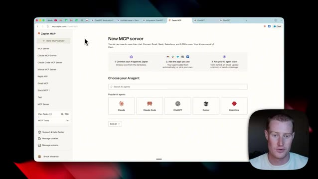
*⏱️ 00:07:14 — Capture d'écran montrant l'interface web de Zapier MCP avec la page de configuration pour créer un nouveau serveur MCP et connecter des agents IA comme Claude ou ChatGPT.*

---

### ⏱️ `[00:07:29 - 00:07:48]` | Segment #22

**🔊 Audio (Transcription Intégrale Mot pour Mot en Français) :**
> À partir d'ici, nous allons simplement ajouter le nom Zapier. Et ensuite, ce que je vais faire, c'est que je vais venir sur Zapier MCP, cliquer sur nouveau serveur MCP, cliquer sur ChatShubit, cliquer sur ce bouton pour activer le mode développeur. Donc je vais simplement faire défiler vers le bas, m'assurer que ceci est activé ainsi que ce bouton juste ici, et ensuite simplement copier cette URL. Nous allons juste la coller, cliquer sur comprendre, puis cliquer sur créer.

**👁️ Analyse Visuelle d'Écran (gemini-3.5-flash-lite) :**
**Interface & Outils** : Navigateur web affichant l'interface Zapier MCP et le panneau de configuration ChatGPT.

**Contenu textuel & Code** : URL de connexion MCP de Zapier ("https://mcp.zapier.com/api/v1/connect") et instructions en quatre étapes pour connecter l'agent IA.

**Action / Démonstration** : Le présentateur sélectionne un agent IA et configure les étapes de connexion de l'application Zapier MCP vers ChatGPT.

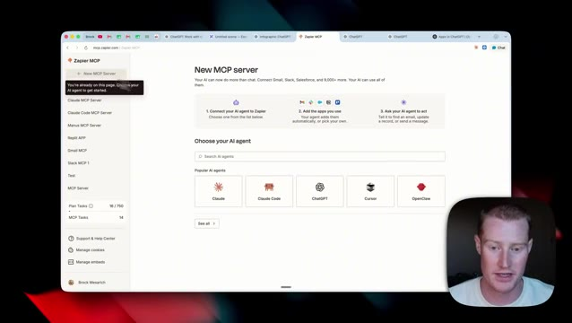
*⏱️ 00:07:34 — Le présentateur navigue sur l'interface de Zapier MCP montrant l'écran de création d'un nouveau serveur MCP avec les différents agents IA disponibles.*

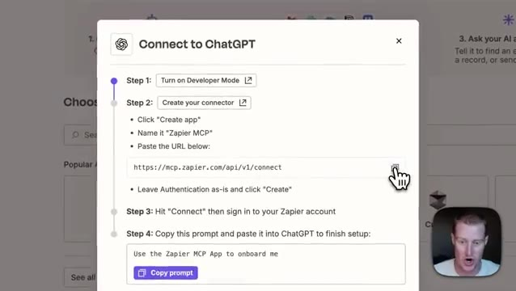
*⏱️ 00:07:43 — Une fenêtre modale de configuration "Connect to ChatGPT" détaille les étapes d'intégration, incluant l'activation du mode développeur, la création d'une application et la copie de l'URL de connexion.*

---

### ⏱️ `[00:07:48 - 00:08:07]` | Segment #23

**🔊 Audio (Transcription Intégrale Mot pour Mot en Français) :**
> Ensuite, à partir d'ici, nous devons simplement nous connecter à notre compte Zapier et ensuite nous devrions l'avoir installé. Ensuite, à l'intérieur de ce serveur MCP, nous pourrions simplement ajouter n'importe laquelle des applications que nous voulons. Par exemple, j'utilise Beehive parce que c'est une application que j'utilise pour gérer mon marketing par e-mail et je ne peux pas me connecter à celle-ci directement à l'intérieur de ChatGPT. Je pourrais donc venir cliquer sur ajouter des applications et ajouter n'importe laquelle de celles-ci. Nous pourrions les voir ajoutées en quelques secondes.

**👁️ Analyse Visuelle d'Écran (gemini-3.5-flash-lite) :**
**Interface & Outils** : Navigateur Web affichant l'interface Zapier MCP et la webcam du présentateur en bas à droite.

**Contenu textuel & Code** : Liste des applications configurées (Beehiiv, Slack, Synthflow AI, Skool) dans le serveur MCP.

**Action / Démonstration** : Présentation de la configuration des applications connectées au serveur MCP via Zapier.

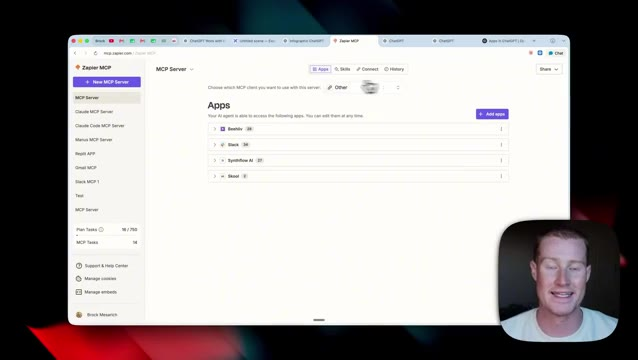
*⏱️ 00:07:53 — Capture d'écran montrant l'interface Web de Zapier MCP avec la liste des applications connectées au serveur MCP.*

---

### ⏱️ `[00:08:07 - 00:08:28]` | Segment #24

**🔊 Audio (Transcription Intégrale Mot pour Mot en Français) :**
> Maintenant, ensuite, nous pourrions exécuter des tâches planifiées directement à l'intérieur de ChatGPT Work. Nous pourrions donc exécuter des choses comme des résumés d'e-mails quotidiens, un moniteur d'e-mails, un scanner de tendances de contenu IA, et fondamentalement n'importe laquelle de ces différentes automatisations que nous avons à l'intérieur de Cloud, nous pourrions les migrer directement vers ChatGPT. Maintenant, parlons probablement de l'éléphant dans la pièce. Est-il nécessaire pour vous de passer à ChatGPT Work au lieu d'utiliser Cloud Cowork ?

**👁️ Analyse Visuelle d'Écran (gemini-3.5-flash-lite) :**
**Interface & Outils** : Interface web de ChatGPT et outil de schéma Excalidraw.

**Contenu textuel & Code** : Liste de tâches planifiées (Daily brief, Email monitor, AI content trend scan, Cerebral thriller watchlist) et schéma comparatif de concepts d'agents IA.

**Action / Démonstration** : Présentation des tâches planifiées intégrées dans ChatGPT et comparaison des fonctionnalités d'agents similaires.

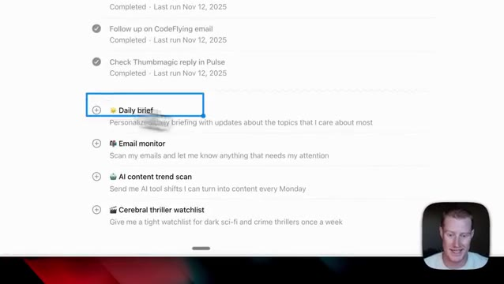
*⏱️ 00:08:12 — Gros plan sur l'interface de ChatGPT montrant des tâches planifiées telles que 'Daily brief' et 'Email monitor'.*

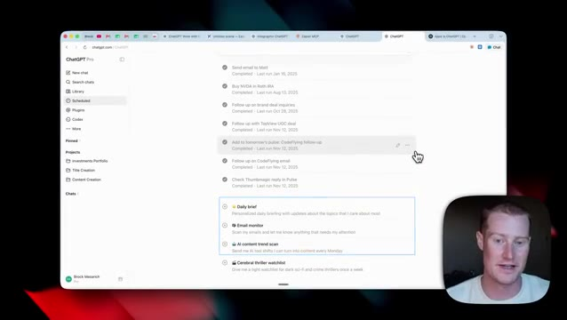
*⏱️ 00:08:18 — Vue plus large de l'interface du navigateur affichant l'onglet 'Scheduled' de ChatGPT avec plusieurs tâches passées et à venir.*

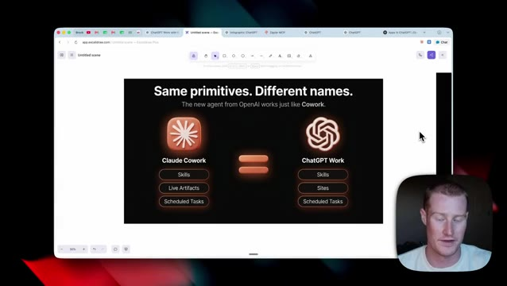
*⏱️ 00:08:23 — Schéma explicatif sur Excalidraw comparant 'Claude Cowork' et 'ChatGPT Work' avec leurs fonctionnalités respectives (Skills, Live Artifacts, Scheduled Tasks).*

---

### ⏱️ `[00:08:28 - 00:08:51]` | Segment #25

**🔊 Audio (Transcription Intégrale Mot pour Mot en Français) :**
> Et la réponse est non. Puisque ces deux outils fonctionnent fondamentalement de la même manière, vous pouvez travailler dans des dossiers spécifiques sur votre ordinateur avec différentes compétences et tâches planifiées, et cetera. Vous pouvez choisir la plateforme que vous souhaitez utiliser. Donc, par exemple, si un nouveau modèle sort d'OpenAI que vous voulez vraiment tester parce qu'il est plus performant que le dernier modèle d'Anthropic, vous pouvez basculer sur l'application ChatGPT Work et le tester par rapport à Cowork.

**👁️ Analyse Visuelle d'Écran (gemini-3.5-flash-lite) :**
**Interface & Outils** : Navigateur web affichant une application de dessin/schéma (Excalidraw) avec incrustation vidéo du présentateur en bas à droite.

**Contenu textuel & Code** : Schéma textuel : "Same primitives. Different names. The new agent from OpenAI works just like Cowork." Comparaison entre l'icône et les options de Claude Cowork et ChatGPT Work.

**Action / Démonstration** : Le présentateur explique la similitude fonctionnelle entre les deux outils d'IA en comparant leurs structures de dossiers et de fonctionnalités.

*⏱️ 00:08:34 — Une infographie comparative sur un navigateur web montrant l'équivalence entre Claude Cowork et ChatGPT Work avec leurs fonctionnalités respectives (Skills, Live Artifacts, Scheduled Tasks, Sites).*

---

### ⏱️ `[00:08:51 - 00:09:09]` | Segment #26

**🔊 Audio (Transcription Intégrale Mot pour Mot en Français) :**
> Donc, alors que nous continuons à développer nos systèmes d'exploitation dans l'une ou l'autre de ces différentes applications, ils ne sont pas nécessairement bloqués sur cette plateforme en particulier. Et voilà. C'est du travail de Chachapiti. J'espère que cette vidéo répond à certaines questions. Pour ma part, je suis un utilisateur intensif de co-work. Alors oui, c'est cool de tester cela avec les tout derniers modèles d'Anthropic pour voir à quel point c'est performant.

**👁️ Analyse Visuelle d'Écran (gemini-3.5-flash-lite) :**
**Interface & Outils** : Navigateur web, Excalidraw, interface utilisateur de ChatGPT et éditeur de texte/notes.

**Contenu textuel & Code** : Texte comparatif d'agents IA (Claude Cowork vs ChatGPT Work), arborescence de projets et listes de tâches.

**Action / Démonstration** : Présentation comparative des fonctionnalités d'agents conversationnels et de leurs environnements de travail respectifs.

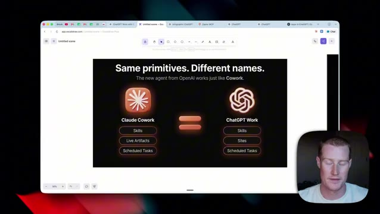
*⏱️ 00:08:55 — Une infographie comparative sur Excalidraw intitulée 'Same primitives. Different names.' montrant la correspondance entre Claude Cowork et ChatGPT Work.*

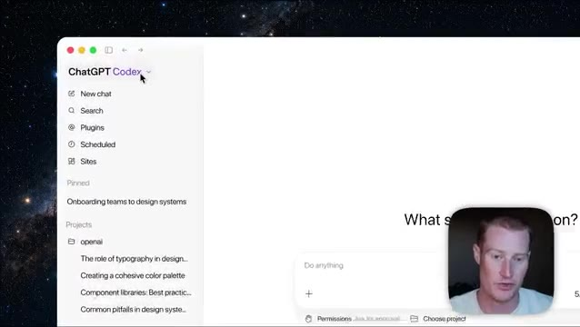
*⏱️ 00:09:00 — Une capture d'écran de l'interface de ChatGPT Codex avec un menu latéral affichant les projets et des options comme New chat, Search, Plugins et Sites.*

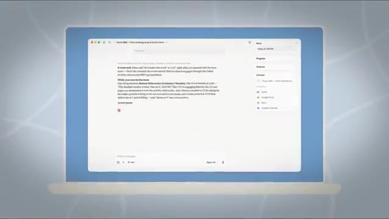
*⏱️ 00:09:05 — Une interface logicielle affichant un document de type traitement de texte ou notes avec un panneau latéral de configuration pour des tâches et des intégrations connectées.*

---

### ⏱️ `[00:09:09 - 00:09:24]` | Segment #27

**🔊 Audio (Transcription Intégrale Mot pour Mot en Français) :**
> Mais personnellement, je vais probablement continuer à utiliser l'écosystème Cloud puisque j'aime tout simplement la façon dont il fonctionne. Mais ne vous inquiétez pas. Si vous voulez vraiment migrer, c'est très facile, comme je l'ai mentionné dans cette vidéo. Quoi qu'il en soit, faites-moi part de vos réflexions dans les commentaires. Allez-vous changer ? Abonnez-vous à cette chaîne pour plus de contenu de ce genre, et je vous vois dans la prochaine vidéo.

**👁️ Analyse Visuelle d'Écran (gemini-3.5-flash-lite) :**
**Interface & Outils** : Interface web de génération de présentations et application mobile.

**Contenu textuel & Code** : Un graphique de projections de ventes (Sales Projections) avec des métriques de croissance et un fichier PowerPoint généré.

**Action / Démonstration** : Présentation d'un outil d'intelligence artificielle permettant de générer et modifier des présentations professionnelles à partir de prompts textuels.

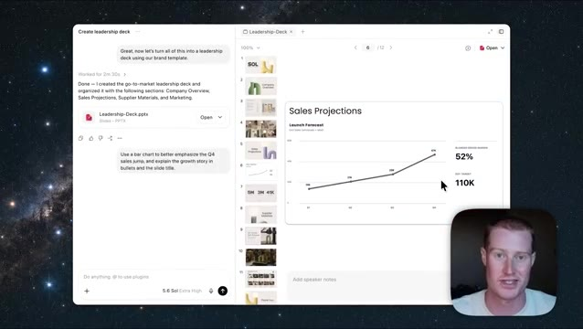
*⏱️ 00:09:13 — Interface logicielle affichant un assistant de création de présentations avec un graphique de projections de ventes et le présentateur en médaillon.*

---

