# 🎬 The SIMPLE Claude Cowork Setup That Runs my Life (Steal It)

> **Chaîne** : [Brock Mesarich | AI for Non Techies](https://www.youtube.com/@BrockMesarich)  
> **Lien YouTube** : [https://www.youtube.com/watch?v=V1SWuUosVMI](https://www.youtube.com/watch?v=V1SWuUosVMI)  
> **Date de publication** : 20260717  
> **Durée** : 00:20:18  
> **Identifiant vidéo** : `V1SWuUosVMI`  
> **Transcription & Analyse** : `whisper-v3-large-turbo+gemini-3.5-flash-lite`  

---

## 📌 Synthèse Exécutive & Outils

### 💡 Résumé
Dans cette vidéo, Brock Mesarich (pour la chaîne *Brock Mesarich | AI for Non Techies*) lève le voile sur l'utilisation quotidienne et intensive de **Claude Cowork**, un outil d'intelligence artificielle présenté comme le compromis idéal pour les utilisateurs non techniques souhaitant automatiser leur flux de travail professionnel. Contrairement au chat textuel classique, Claude Cowork interagit directement avec l'environnement local de l'ordinateur, manipulant des dossiers, structurant des fichiers et s'interfaçant avec des applications tierces (comme QuickBooks ou Gmail) pour exécuter des tâches administratives et organisationnelles complexes.

La vidéo structure l'apprentissage de l'outil autour de quatre niveaux fondamentaux, en commençant par la mise en place d'un dossier de travail dédié et d'un fichier de contexte global (`CLAUDE.md`). L'animateur démontre la puissance de l'agent à travers des cas d'usage concrets, tels que l'organisation automatique de répertoires informatiques chaotiques ou la création de compétences réutilisables (*skills*) générant des tableaux de bord interactifs en HTML ou des guides pédagogiques au format PDF. 

L'approche méthodologique met l'accent sur l'ingénierie de prompt et la personnalisation itérative. En s'appuyant sur un kit de ressources gratuit fourni aux spectateurs, l'auteur guide pas à pas l'automatisation des tâches répétitives, transformant l'intelligence artificielle en un véritable système d'exploitation personnel et professionnel capable d'exécuter des actions tangibles sur le bureau de l'utilisateur.

### 🛠️ Outils, Modèles & Logiciels Présentés
* **Claude Cowork** : Application de bureau d'Anthropic permettant à l'IA d'interagir directement avec les dossiers locaux et d'exécuter des tâches fichiers.
* **Claude Code** : Version de l'outil d'Anthropic spécifiquement orientée vers les développeurs et les utilisateurs hautement techniques.
* **Claude Chat** : Interface textuelle classique de Claude, idéale pour la réflexion mais limitée aux restitutions textuelles.
* **Make** : Plateforme d'automatisation de flux de travail no-code (mentionnée dans le contexte global de la chaîne).
* **n8n** : Outil d'automatisation de processus et d'intégration de workflows open-source et auto-hébergeable.
* **Zapier** : Solution d'automatisation cloud connectant différentes applications web entre elles.
* **Grok** : Modèle d'intelligence artificielle conversationnelle développé par xAI.
* **Gemini** : Suite de modèles d'intelligence artificielle multimodal développée par Google.
* **ChatGPT** : Assistant conversationnel et agent conversationnel basé sur les grands modèles de langage d'OpenAI.
* **QuickBooks** : Logiciel de comptabilité et de gestion financière utilisé pour le suivi des factures impayées.
* **Gmail** : Service de messagerie électronique exploité pour le cross-referencing des échanges et le publipostage automatisé.

### 🔑 Points Clés & Enseignements Stratégiques
* **Définition de Claude Cowork comme "Juste Milieu"** : L'outil combine la flexibilité des modèles conversationnels et la puissance d'exécution locale, offrant aux profils non techniques la possibilité d'automatiser des processus sans coder.
* **Séparation stricte des modes (Chat vs Cowork)** : L'interface de bureau permet de basculer instantanément entre un mode textuel pur et un mode d'action directe au sein de répertoires ciblés.
* **Principe de restriction du périmètre d'action** : Claude Cowork ne peut modifier que les dossiers explicitement sélectionnés et autorisés par l'utilisateur, garantissant un contrôle total sur la sécurité des données locales.
* **Le socle organisationnel (Niveau 1 : Fondation)** : Repose sur l'association d'un dossier de travail (*Workspace Folder*) et d'un fichier de contexte global (`CLAUDE.md`) chargé à chaque début de conversation.
* **Rôle du fichier `CLAUDE.md`** : Ce document centralise le profil de l'utilisateur, ses règles de style rédactionnel, sa structure de dossiers et ses préférences opérationnelles pour éviter les répétitions de contexte.
* **Intégration d'un questionnaire d'onboarding** : L'utilisation d'un prompt initial structuré permet à Claude d'interviewer l'utilisateur pour générer automatiquement et sur mesure son fichier de configuration `CLAUDE.md`.
* **Capacités de manipulation de fichiers bruts** : Démonstration de la capacité de l'IA à analyser un dossier hautement désorganisé (contenant des centaines de fichiers hétérogènes) et à créer de manière autonome une arborescence de sous-dossiers thématiques propres.
* **Création de workflows réutilisables (*Skills*)** : Configuration de processus itératifs standardisés que l'agent peut exécuter à la demande en respectant des consignes strictes et un style prédéfini.
* **Génération de tableaux de bord interactifs** : Capacité pour l'agent de synthétiser des concepts complexes et de les restituer sous forme de tableaux de bord visuels dynamiques écrits en HTML exécutés localement.
* **Production de supports pédagogiques structurés** : Automatisation de la recherche documentaire et de la mise en page de guides infographiques au format PDF destinés à la formation ou au marketing.
* **Interopérabilité applicative potentielle** : Utilisation croisée de données issues de logiciels de comptabilité (QuickBooks) et de messageries (Gmail) pour automatiser des actions de recouvrement ou de suivi client.
* **Stratégie de diffusion de ressources (*Lead Magnet*)** : Utilisation d'un package de prompts documentés au format HTML offert en échange d'abonnements pour faciliter l'adoption de l'automatisation par un public non technique.

---

## ⏱️ Chronologie & Transcription Complète Audio & Visuelle (Mot pour Mot)

### ⏱️ `[00:00:00 - 00:00:18]` | Segment #01

**🔊 Audio (Transcription Intégrale Mot pour Mot en Français) :**
> I've been using Claude Cowork every single day for the last six months to run my business. And there are four different levels you need to understand in order to get the most out of this extremely powerful tool. So in this video, I'm going to go over each of those levels individually. On top of that, I'm going to show you exactly how I'm using Claude Cowork every single day inside of my business.

**👁️ Analyse Visuelle d'Écran (gemini-3.5-flash-lite) :**
**Interface & Outils** : Présentation ou face-caméra explicatif du trader sans interface logicielle partagée.

**Contenu textuel & Code** : Explications orales des stratégies et mise en contexte méthodologique du marché.

**Action / Démonstration** : Explications face caméra et analyse conceptuelle des marchés.

---

### ⏱️ `[00:00:18 - 00:00:52]` | Segment #02

**🔊 Audio (Transcription Intégrale Mot pour Mot en Français) :**
> And I'm even going to give you the exact prompts you can use in order to set it up alongside me. Anthropic reached out to partner with me on this video. And if you take a look at my YouTube channel, every single video I make is about Claude Cowork. And since I use this tool every single day, I figured why not make a video with them. And the best part about Claude Cowork is it's made specifically for non-technical users in order to get the most out of Claude. So without further ado, let's dive right into the video. Now, a perfect example of something that Cowork can do is it can take a folder of 50 different receipts, for example, and automatically pull the information

**👁️ Analyse Visuelle d'Écran (gemini-3.5-flash-lite) :**
**Interface & Outils** : Présentation ou face-caméra explicatif du trader sans interface logicielle partagée.

**Contenu textuel & Code** : Explications orales des stratégies et mise en contexte méthodologique du marché.

**Action / Démonstration** : Explications face caméra et analyse conceptuelle des marchés.

---

### ⏱️ `[00:00:52 - 00:01:13]` | Segment #03

**🔊 Audio (Transcription Intégrale Mot pour Mot en Français) :**
> from it and add it to a spreadsheet that it saves to our computer. And another use case is having it go and pull different unpaid invoices from your QuickBooks app, then it can cross-reference the Gmail threads that I have with each of these individual clients. And from there, it could go in draft emails in my Gmail to each of these different people that I need to collect invoices from.

**👁️ Analyse Visuelle d'Écran (gemini-3.5-flash-lite) :**
**Interface & Outils** : Présentation ou face-caméra explicatif du trader sans interface logicielle partagée.

**Contenu textuel & Code** : Explications orales des stratégies et mise en contexte méthodologique du marché.

**Action / Démonstration** : Explications face caméra et analyse conceptuelle des marchés.

---

### ⏱️ `[00:01:14 - 00:01:49]` | Segment #04

**🔊 Audio (Transcription Intégrale Mot pour Mot en Français) :**
> All right, so first of all, we need to talk about what even is Claude Cowork and how does this differentiate from things like Claude Chat as well as Claude Code, which you probably hear everybody talking about. And personally, I think co-work is the perfect middle ground for 90% of people who want to use AI in their business or their professional life, but don't have any technical background. So first of all, I do think that Claude Chat is really good for certain tasks like thinking, but usually we're just going to get a text output from using Claude Chat. Well, inside of Claude Co-work, it can actually do work for us. And what do I mean by that? Claude Co-work is

**👁️ Analyse Visuelle d'Écran (gemini-3.5-flash-lite) :**
**Interface & Outils** : Présentation ou face-caméra explicatif du trader sans interface logicielle partagée.

**Contenu textuel & Code** : Explications orales des stratégies et mise en contexte méthodologique du marché.

**Action / Démonstration** : Explications face caméra et analyse conceptuelle des marchés.

---

### ⏱️ `[00:01:49 - 00:02:17]` | Segment #05

**🔊 Audio (Transcription Intégrale Mot pour Mot en Français) :**
> working inside of folders on our computer and is able to reference those as well as generate files and store them on our desktop. So not only can it work inside of folders on your computer, but it can use the specific applications that you use for your business or your professional life. Later on in this video, I'm going to share the exact ones that I use that you could build alongside me. Now, before we get started, I want to share with you a free resource that I crafted for you guys that's really going to help you out and set up everything that I talk about in this video.

**👁️ Analyse Visuelle d'Écran (gemini-3.5-flash-lite) :**
**Interface & Outils** : Présentation ou face-caméra explicatif du trader sans interface logicielle partagée.

**Contenu textuel & Code** : Explications orales des stratégies et mise en contexte méthodologique du marché.

**Action / Démonstration** : Explications face caméra et analyse conceptuelle des marchés.

---

### ⏱️ `[00:02:17 - 00:02:38]` | Segment #06

**🔊 Audio (Transcription Intégrale Mot pour Mot en Français) :**
> So not only am I going to walk through how to set up Claude and explain all this for you, but you also have the exact prompts you can use to follow along and build alongside me. I built this out because I don't want you guys to get confused. So follow along with the video, but also this prompt pack and copy and paste these prompts into Claude. Now, in order to get this resource for free, there's going to be a link in the description.

**👁️ Analyse Visuelle d'Écran (gemini-3.5-flash-lite) :**
**Interface & Outils** : Présentation ou face-caméra explicatif du trader sans interface logicielle partagée.

**Contenu textuel & Code** : Explications orales des stratégies et mise en contexte méthodologique du marché.

**Action / Démonstration** : Explications face caméra et analyse conceptuelle des marchés.

---

### ⏱️ `[00:02:39 - 00:02:59]` | Segment #07

**🔊 Audio (Transcription Intégrale Mot pour Mot en Français) :**
> You're going to see this signup page. Just put in $0 right here. If you guys want to hypothetically pay me for this, just subscribe to the channel. and I want to give this to you for free in exchange for that. So you're just going to type in $0, click I want this, and this is going to take you to this page. Just paste in your email. And just like that, you're going to download this HTML right here.

**👁️ Analyse Visuelle d'Écran (gemini-3.5-flash-lite) :**
**Interface & Outils** : Présentation ou face-caméra explicatif du trader sans interface logicielle partagée.

**Contenu textuel & Code** : Explications orales des stratégies et mise en contexte méthodologique du marché.

**Action / Démonstration** : Explications face caméra et analyse conceptuelle des marchés.

---

### ⏱️ `[00:02:59 - 00:03:22]` | Segment #08

**🔊 Audio (Transcription Intégrale Mot pour Mot en Français) :**
> And then we could open it up and begin going through this. All right, so the first thing we need to do if we've never used Cloud Cowork before is download the desktop app. There will be a link in the description to do so. So you will see this page. You'll just click download for either macOS or Windows, whichever platform you're using. Then once we open up the desktop app, we are going to see this exact interface, which actually just changed a couple of days ago.

**👁️ Analyse Visuelle d'Écran (gemini-3.5-flash-lite) :**
**Interface & Outils** : Présentation ou face-caméra explicatif du trader sans interface logicielle partagée.

**Contenu textuel & Code** : Explications orales des stratégies et mise en contexte méthodologique du marché.

**Action / Démonstration** : Explications face caméra et analyse conceptuelle des marchés.

---

### ⏱️ `[00:03:22 - 00:03:44]` | Segment #09

**🔊 Audio (Transcription Intégrale Mot pour Mot en Français) :**
> So let me give you a quick tour. First, we have on the top left hand side of our screen, we have a home button as well as we have a code button. The code button is for Cloud Code, which is basically what Cloud Cowork is, but it's more tailored towards developers and technical users. So we're going to select home and right inside of this chat box, you can now see we have the ability to toggle between chat mode and cowork mode.

**👁️ Analyse Visuelle d'Écran (gemini-3.5-flash-lite) :**
**Interface & Outils** : Présentation ou face-caméra explicatif du trader sans interface logicielle partagée.

**Contenu textuel & Code** : Explications orales des stratégies et mise en contexte méthodologique du marché.

**Action / Démonstration** : Explications face caméra et analyse conceptuelle des marchés.

---

### ⏱️ `[00:03:44 - 00:04:04]` | Segment #10

**🔊 Audio (Transcription Intégrale Mot pour Mot en Français) :**
> So make sure to toggle on co-work mode. All right, so the first level to Claude Cowork that we need to understand is the foundation. And the foundation consists of two different things. So first of all, we have our workspace folder, which I'm going to show you how to set up. And then we have a Claude MD file. Basically, the workspace folder is where Claude Cowork is going to work inside of.

**👁️ Analyse Visuelle d'Écran (gemini-3.5-flash-lite) :**
**Interface & Outils** : Présentation ou face-caméra explicatif du trader sans interface logicielle partagée.

**Contenu textuel & Code** : Explications orales des stratégies et mise en contexte méthodologique du marché.

**Action / Démonstration** : Explications face caméra et analyse conceptuelle des marchés.

---

### ⏱️ `[00:04:04 - 00:04:24]` | Segment #11

**🔊 Audio (Transcription Intégrale Mot pour Mot en Français) :**
> So whether that's inside of a folder that has all of your receipts and you want to organize them, for example, or you have an entire operating system that you want it to manage. This is how Claude is able to go and work on our actual computer. Next, the Claude MD in simple terms is basically a document that Claude loads in order to understand who you are and how you want it to interact.

**👁️ Analyse Visuelle d'Écran (gemini-3.5-flash-lite) :**
**Interface & Outils** : Présentation ou face-caméra explicatif du trader sans interface logicielle partagée.

**Contenu textuel & Code** : Explications orales des stratégies et mise en contexte méthodologique du marché.

**Action / Démonstration** : Explications face caméra et analyse conceptuelle des marchés.

---

### ⏱️ `[00:04:24 - 00:04:45]` | Segment #12

**🔊 Audio (Transcription Intégrale Mot pour Mot en Français) :**
> And this is loaded every single conversation. So that way it has all the necessary context and needs. So you don't always have to sit and re-explain yourself every single time you talk with it. Now, I'm going to show you exactly how to build out both our workspace folder as well as our Claude MD right now. And it's going to be very simple. So first of all, when we're inside of Claude Cowork, you can see that it shows project or folder right here.

**👁️ Analyse Visuelle d'Écran (gemini-3.5-flash-lite) :**
**Interface & Outils** : Présentation ou face-caméra explicatif du trader sans interface logicielle partagée.

**Contenu textuel & Code** : Explications orales des stratégies et mise en contexte méthodologique du marché.

**Action / Démonstration** : Explications face caméra et analyse conceptuelle des marchés.

---

### ⏱️ `[00:04:45 - 00:05:05]` | Segment #13

**🔊 Audio (Transcription Intégrale Mot pour Mot en Français) :**
> And this is where we want to either create or select a folder we want it to work inside of. And just to be clear, if we do not pre-select this folder, it's not going to be able to work inside of it. So don't worry, it's not going to go and make all these changes to your computer that you don't want it to. It can only work inside of the folder you grant access to. So if I click on this, you can see I have a couple of folders myself.

**👁️ Analyse Visuelle d'Écran (gemini-3.5-flash-lite) :**
**Interface & Outils** : Présentation ou face-caméra explicatif du trader sans interface logicielle partagée.

**Contenu textuel & Code** : Explications orales des stratégies et mise en contexte méthodologique du marché.

**Action / Démonstration** : Explications face caméra et analyse conceptuelle des marchés.

---

### ⏱️ `[00:05:05 - 00:05:30]` | Segment #14

**🔊 Audio (Transcription Intégrale Mot pour Mot en Français) :**
> So you could go and select one that you already have. For example, I have one for taxes here with all of my tax documents. I have one for Claude for marketing, but let's go and choose a different folder right here in order to create one from scratch. So from here, we can just select a new folder. Let's just call this Claude Cowork Test since I already have one called Claude Cowork. This folder is empty right now, but as we begin using Cowork, it's going to populate with all the different documents and files that it creates for us.

**👁️ Analyse Visuelle d'Écran (gemini-3.5-flash-lite) :**
**Interface & Outils** : Présentation ou face-caméra explicatif du trader sans interface logicielle partagée.

**Contenu textuel & Code** : Explications orales des stratégies et mise en contexte méthodologique du marché.

**Action / Démonstration** : Explications face caméra et analyse conceptuelle des marchés.

---

### ⏱️ `[00:05:30 - 00:05:52]` | Segment #15

**🔊 Audio (Transcription Intégrale Mot pour Mot en Français) :**
> So I'm going to click open and then I'm going to click always allow. So it's not always asking me to make changes. And now we can work directly inside of this folder. Now that we have our folder set up, let's go and craft our Claude MD file so we can understand who we are, how we want it to operate, et cetera. So let's come back to the prompt pack that I shared with you and then come over to right here where it says teach Claude who you are.

**👁️ Analyse Visuelle d'Écran (gemini-3.5-flash-lite) :**
**Interface & Outils** : Présentation ou face-caméra explicatif du trader sans interface logicielle partagée.

**Contenu textuel & Code** : Explications orales des stratégies et mise en contexte méthodologique du marché.

**Action / Démonstration** : Explications face caméra et analyse conceptuelle des marchés.

---

### ⏱️ `[00:05:52 - 00:06:12]` | Segment #16

**🔊 Audio (Transcription Intégrale Mot pour Mot en Français) :**
> Copy this prompt right here. We're then gonna simply paste this into Claude, make sure that we have our folder selected that we wanna work inside of. And now what it's gonna do is it's gonna interview us and go through seven different questions to populate the MD file with all the necessary information. So it knows who we are, how we want it to operate and all that good stuff. As you can see, it popped up this questionnaire box.

**👁️ Analyse Visuelle d'Écran (gemini-3.5-flash-lite) :**
**Interface & Outils** : Présentation ou face-caméra explicatif du trader sans interface logicielle partagée.

**Contenu textuel & Code** : Explications orales des stratégies et mise en contexte méthodologique du marché.

**Action / Démonstration** : Explications face caméra et analyse conceptuelle des marchés.

---

### ⏱️ `[00:06:12 - 00:06:35]` | Segment #17

**🔊 Audio (Transcription Intégrale Mot pour Mot en Français) :**
> I'm gonna go through all seven of these. You do the same thing and then we'll reconvene once we go through that. And just like that, I answered these seven questions and it created this MD file. I could always click on this, open it up and here it breaks down who I am, who I serve, voice and writing rules and basically how I wanna work with it as well as my folder structure. And this is something we can change over time as we work with it more and more, and it could get a sense of what it is we do.

**👁️ Analyse Visuelle d'Écran (gemini-3.5-flash-lite) :**
**Interface & Outils** : Présentation ou face-caméra explicatif du trader sans interface logicielle partagée.

**Contenu textuel & Code** : Explications orales des stratégies et mise en contexte méthodologique du marché.

**Action / Démonstration** : Explications face caméra et analyse conceptuelle des marchés.

---

### ⏱️ `[00:06:36 - 00:06:54]` | Segment #18

**🔊 Audio (Transcription Intégrale Mot pour Mot en Français) :**
> At any time, we could click on this and make changes directly, or we could just come to Claude and say, hey, I want you to change the Claude MD file with this new information. Now that you understand how the foundation of Claude Cowork works, let's go and test it out so you could see the power of it. So what I want you to do is select a random messy folder on your computer if you already have one.

**👁️ Analyse Visuelle d'Écran (gemini-3.5-flash-lite) :**
**Interface & Outils** : Présentation ou face-caméra explicatif du trader sans interface logicielle partagée.

**Contenu textuel & Code** : Explications orales des stratégies et mise en contexte méthodologique du marché.

**Action / Démonstration** : Explications face caméra et analyse conceptuelle des marchés.

---

### ⏱️ `[00:06:54 - 00:07:15]` | Segment #19

**🔊 Audio (Transcription Intégrale Mot pour Mot en Français) :**
> For me, I have this YouTube video on, which is super messy. And to be completely honest, I think calling it messy is an understatement. This is what it looks like. These are all things that Claude over the past couple of months have generated for me and I really need to clean this up. So let's go ahead and test the power of Claude Cowork in order to organize this folder for us without us needing to manually add in different subfolders and whatnot.

**👁️ Analyse Visuelle d'Écran (gemini-3.5-flash-lite) :**
**Interface & Outils** : Présentation ou face-caméra explicatif du trader sans interface logicielle partagée.

**Contenu textuel & Code** : Explications orales des stratégies et mise en contexte méthodologique du marché.

**Action / Démonstration** : Explications face caméra et analyse conceptuelle des marchés.

---

### ⏱️ `[00:07:15 - 00:07:35]` | Segment #20

**🔊 Audio (Transcription Intégrale Mot pour Mot en Français) :**
> Now coming back to our prompt pack, let's come here to chapter one, step two, that says clean up a messy folder. So simply copy this. Let's bring this back over to Claude inside of the YouTube video folder that I just showed you. I'm going to paste this in and now it's going to go and organize this for me. Also, guys, I wanted to create this prompt pack to make it really simple and easy for you guys to follow along with this video.

**👁️ Analyse Visuelle d'Écran (gemini-3.5-flash-lite) :**
**Interface & Outils** : Présentation ou face-caméra explicatif du trader sans interface logicielle partagée.

**Contenu textuel & Code** : Explications orales des stratégies et mise en contexte méthodologique du marché.

**Action / Démonstration** : Explications face caméra et analyse conceptuelle des marchés.

---

### ⏱️ `[00:07:35 - 00:07:53]` | Segment #21

**🔊 Audio (Transcription Intégrale Mot pour Mot en Français) :**
> So not only do you get to see how I'm using Cloud Cowork, but you could set it up yourself with step by step guides. So if you're enjoying this, make sure to subscribe to the channel for more easy digestible content for non techies, which is who I'm really trying to make my videos for. All right. And just like that, like a minute later, we now have all of these sub folders that makes it really easy for me to see everything.

**👁️ Analyse Visuelle d'Écran (gemini-3.5-flash-lite) :**
**Interface & Outils** : Présentation ou face-caméra explicatif du trader sans interface logicielle partagée.

**Contenu textuel & Code** : Explications orales des stratégies et mise en contexte méthodologique du marché.

**Action / Démonstration** : Explications face caméra et analyse conceptuelle des marchés.

---

### ⏱️ `[00:07:53 - 00:08:15]` | Segment #22

**🔊 Audio (Transcription Intégrale Mot pour Mot en Français) :**
> So I could see my demo receipts. I could see my specific outputs, plugins and skills. I could see everything for my school community, my PDF guides. This is so much more organized than before. And you could do this with any of the different folders. This is just an example. So you could see how it's actually manipulating folders and files on your computer. Now, moving on to the next level of Cloud Cowork, there are two specific parts to this level that I'm going to go over right now.

**👁️ Analyse Visuelle d'Écran (gemini-3.5-flash-lite) :**
**Interface & Outils** : Présentation ou face-caméra explicatif du trader sans interface logicielle partagée.

**Contenu textuel & Code** : Explications orales des stratégies et mise en contexte méthodologique du marché.

**Action / Démonstration** : Explications face caméra et analyse conceptuelle des marchés.

---

### ⏱️ `[00:08:16 - 00:08:34]` | Segment #23

**🔊 Audio (Transcription Intégrale Mot pour Mot en Français) :**
> So first, we have skills. So if you don't know what a skill is, a skill is basically a reusable workflow that you can build inside of Cloud for specific tasks. And this is just a set of instructions for different workflows that you are running. Now, in order to give you an example, let me show you a few skills that I personally run that will probably be applicable to you as well.

**👁️ Analyse Visuelle d'Écran (gemini-3.5-flash-lite) :**
**Interface & Outils** : Présentation ou face-caméra explicatif du trader sans interface logicielle partagée.

**Contenu textuel & Code** : Explications orales des stratégies et mise en contexte méthodologique du marché.

**Action / Démonstration** : Explications face caméra et analyse conceptuelle des marchés.

---

### ⏱️ `[00:08:34 - 00:09:04]` | Segment #24

**🔊 Audio (Transcription Intégrale Mot pour Mot en Français) :**
> Now, here's another skill that I run almost every single day. This is my visualize skill. So as you can see here, I just came to Cloud Cowork and I said, visualize how Cloud Cowork works. And what it does is it breaks down complex concepts and visualizes it for me. It explains very simply how it works. you could see that these are interactive and it lives in this HTML dashboard that it creates and lives directly inside of Claude. So I mean, this is pretty cool. This is something that I use if I'm trying to learn something myself to really digest information and really understand something.

**👁️ Analyse Visuelle d'Écran (gemini-3.5-flash-lite) :**
**Interface & Outils** : Présentation ou face-caméra explicatif du trader sans interface logicielle partagée.

**Contenu textuel & Code** : Explications orales des stratégies et mise en contexte méthodologique du marché.

**Action / Démonstration** : Explications face caméra et analyse conceptuelle des marchés.

---

### ⏱️ `[00:09:04 - 00:09:37]` | Segment #25

**🔊 Audio (Transcription Intégrale Mot pour Mot en Français) :**
> So you could use this whether you are a student trying to understand something in like biology, for example, or if you are a researcher trying to figure out something for a project. So this is a PDF guide skill that I created where it can go and research any topic and create a cool PDF explainer infographic just like this. So for example, I created this one about how quantum physics works and it gives me these cool little graphics along with breaking down in a really digestible format exactly how this works. So this is something that I personally use to explain things to myself. I use it as resource lead magnets for my school community as well as my

**👁️ Analyse Visuelle d'Écran (gemini-3.5-flash-lite) :**
**Interface & Outils** : Présentation ou face-caméra explicatif du trader sans interface logicielle partagée.

**Contenu textuel & Code** : Explications orales des stratégies et mise en contexte méthodologique du marché.

**Action / Démonstration** : Explications face caméra et analyse conceptuelle des marchés.

---

### ⏱️ `[00:09:37 - 00:10:13]` | Segment #26

**🔊 Audio (Transcription Intégrale Mot pour Mot en Français) :**
> Instagram and I crafted it in this specific style. So whenever I run this skill, it's going to look exactly like this. And remember how we set up that folder earlier on in this video called Cloud Cowork. Well, inside that folder, this PDF guide now lives. So any of these different assets that we generate inside of Cowork will be added to our folder on our computer. Now, if you want either of those skills that I just showed you, if you come to the prompt pack, you can see right here we have the My Visuals and Guide Skills. Click Download this plugin. It's going to create the zip file. You're going to want to store this on your computer. From here, we're going to open up Cloud Cowork and come over to the left where it shows Customize. And I'm going to show you real

**👁️ Analyse Visuelle d'Écran (gemini-3.5-flash-lite) :**
**Interface & Outils** : Présentation ou face-caméra explicatif du trader sans interface logicielle partagée.

**Contenu textuel & Code** : Explications orales des stratégies et mise en contexte méthodologique du marché.

**Action / Démonstration** : Explications face caméra et analyse conceptuelle des marchés.

---

### ⏱️ `[00:10:13 - 00:10:47]` | Segment #27

**🔊 Audio (Transcription Intégrale Mot pour Mot en Français) :**
> quickly how you could upload these skills and run them instantly inside of your cloud. Inside of this little dashboard, we're going to want to click on plugins. So click on plugin, click add, click upload plugin. And from here, just drag in that zip file that we just downloaded. So I'm simply going to drag this in, click on upload. And then just like that, it shows that the plugin is installed and ready to use. As well as here are 15 more skills that I run every single day inside of my business that you could download for free and begin running yourself. All right. So the second part of this level inside of Cloud Cowork is connectors. We can connect the different

**👁️ Analyse Visuelle d'Écran (gemini-3.5-flash-lite) :**
**Interface & Outils** : Présentation ou face-caméra explicatif du trader sans interface logicielle partagée.

**Contenu textuel & Code** : Explications orales des stratégies et mise en contexte méthodologique du marché.

**Action / Démonstration** : Explications face caméra et analyse conceptuelle des marchés.

---

### ⏱️ `[00:10:47 - 00:11:23]` | Segment #28

**🔊 Audio (Transcription Intégrale Mot pour Mot en Français) :**
> applications that we use every single day in order to do certain things through them. So we could pull from our Google Calendar. We can post messages to our Slack. We can upload video files to our Google Drive, etc. There's so many different things we could do with Cloud when we connect it with the right applications. Now, here is a perfect example of a connector in action inside of Cloud Cowork. So I basically said create an invoice for this company for $25,000, then for another for $12,000. And what it did is it pulled up my QuickBooks connector since I previously connected it and it generated these invoices ready to go for me to send to my clients. So I

**👁️ Analyse Visuelle d'Écran (gemini-3.5-flash-lite) :**
**Interface & Outils** : Présentation ou face-caméra explicatif du trader sans interface logicielle partagée.

**Contenu textuel & Code** : Explications orales des stratégies et mise en contexte méthodologique du marché.

**Action / Démonstration** : Explications face caméra et analyse conceptuelle des marchés.

---

### ⏱️ `[00:11:23 - 00:11:58]` | Segment #29

**🔊 Audio (Transcription Intégrale Mot pour Mot en Français) :**
> could click preview PDF. It's going to pull up the PDF of the actual invoice. I could send this from Claude to my QuickBooks account. So it's automatically going to send this to my client. Now, let me show you exactly how to begin adding our specific applications that we want to connect Claude to. So what we are going to do is we're going to come over to the left-hand side where it shows customize right here. So we're going to click on this and then right underneath skills right here, we have a button called connectors. So if I click on connectors, you could see I have a couple of them already added to my account because I've personally added them. And in order to add it, we're going to come over here to where it says add, click on this and we could click

**👁️ Analyse Visuelle d'Écran (gemini-3.5-flash-lite) :**
**Interface & Outils** : Présentation ou face-caméra explicatif du trader sans interface logicielle partagée.

**Contenu textuel & Code** : Explications orales des stratégies et mise en contexte méthodologique du marché.

**Action / Démonstration** : Explications face caméra et analyse conceptuelle des marchés.

---

### ⏱️ `[00:11:58 - 00:12:34]` | Segment #30

**🔊 Audio (Transcription Intégrale Mot pour Mot en Français) :**
> browse connectors. And these are all of the prebuilt connectors that Anthropic added to Cloud Cowork. Now, in order to set up your first connector, let's go ahead and add Gmail as well as our Google Calendar. And then I'm going to show you a skill you could run that works across these different applications. So first of all, I'm just going to come here and search up Gmail. From here, I'm just going to click add and it's going to have me log into my Gmail account. All I have to do is click on continue right here. They should send us back to Claude. Now, if I click this open Claude button, you can now see on the top right that it says that we have connected to Gmail. So go ahead and do the exact same thing for Google Calendar or for any of the different

**👁️ Analyse Visuelle d'Écran (gemini-3.5-flash-lite) :**
**Interface & Outils** : Présentation ou face-caméra explicatif du trader sans interface logicielle partagée.

**Contenu textuel & Code** : Explications orales des stratégies et mise en contexte méthodologique du marché.

**Action / Démonstration** : Explications face caméra et analyse conceptuelle des marchés.

---

### ⏱️ `[00:12:34 - 00:12:52]` | Segment #31

**🔊 Audio (Transcription Intégrale Mot pour Mot en Français) :**
> applications que vous souhaitez utiliser. Et voilà. Je viens de faire exactement la même chose pour Google Agenda. Maintenant, pour en revenir à notre pack de prompts, si vous allez au chapitre deux, étape deux, nous allons vouloir copier ce prompt et il va puiser à la fois dans notre Google Agenda et notre Gmail afin de nous donner un récapitulatif de ce qui se passe sur ces différentes applications. Je vais donc cliquer sur copier ici.

**👁️ Analyse Visuelle d'Écran (gemini-3.5-flash-lite) :**
**Interface & Outils** : Navigateur web affichant un guide ou un document de formation (pack de prompts).

**Contenu textuel & Code** : Texte et diagramme illustrant la connexion des outils (Email, Calendar, Docs & notes, Messages) avec Claude, ainsi qu'un prompt intitulé « Pull your day together from your apps ».

**Action / Démonstration** : Présentation visuelle des étapes du pack de prompts et des connexions d'applications pour le tutoriel.

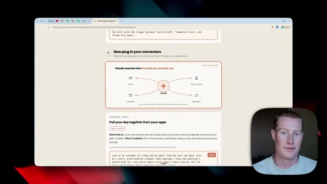
*⏱️ 00:12:39 — Capture d'écran montrant une page web avec des instructions pour connecter des applications et un pack de prompts, avec le présentateur incrusté en bas à droite.*

---

### ⏱️ `[00:12:53 - 00:13:15]` | Segment #32

**🔊 Audio (Transcription Intégrale Mot pour Mot en Français) :**
> Ensuite, je vais simplement coller ceci dans Claude et nous allons voir Cowork aller récupérer des informations à la fois dans notre Gmail et notre Google Agenda en temps réel. Non seulement il peut y récupérer des informations, mais nous pourrions aussi lui faire rédiger des e-mails pour nous avec notre propre voix, ce que je vais vous montrer comment faire dans une seconde. Et maintenant, tout simplement comme ça, vous pouvez voir qu'il m'a donné les quelques éléments les plus urgents auxquels je dois répondre, ainsi que les e-mails qui sont en attente de ma réponse.

**👁️ Analyse Visuelle d'Écran (gemini-3.5-flash-lite) :**
**Interface & Outils** : Interface logicielle de Claude (style Cowork / Artifacts).

**Contenu textuel & Code** : Un prompt textuel demandant un résumé du calendrier et des e-mails des deux derniers jours, avec l'assistant affichant "Working on it...".

**Action / Démonstration** : Collage et exécution d'un prompt dans l'interface de l'assistant IA pour interagir avec des outils de productivité (Gmail et Google Agenda).

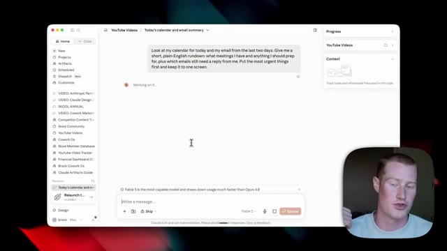
*⏱️ 00:12:58 — Capture d'écran montrant l'interface de l'application Claude avec un prompt entré pour analyser le calendrier et les e-mails.*

---

### ⏱️ `[00:13:15 - 00:13:35]` | Segment #33

**🔊 Audio (Transcription Intégrale Mot pour Mot en Français) :**
> Et cela me montre même les choses qui sont sur mon calendrier pour demain depuis Google Calendar. Maintenant, pour en revenir au pack de prompts, je vais vous montrer comment nous pourrions développer une compétence qui puise dans notre compte Gmail pour analyser tous les e-mails envoyés que nous avons envoyés. Et ensuite, cela façonne une voix d'e-mail spécifique. Ainsi, chaque fois que nous demandons à Claude de rédiger un e-mail, il sonne exactement comme vous.

**👁️ Analyse Visuelle d'Écran (gemini-3.5-flash-lite) :**
**Interface & Outils** : Navigateur web, interface de documentation de prompts, client de messagerie Gmail et panneau d'assistant IA.

**Contenu textuel & Code** : Texte explicatif sur la création d'une compétence IA (« Build a skill that writes in your voice ») et historique d'actions d'un agent IA.

**Action / Démonstration** : Navigation dans la documentation du pack de prompts et démonstration d'une automatisation de rédaction d'e-mail par l'IA.

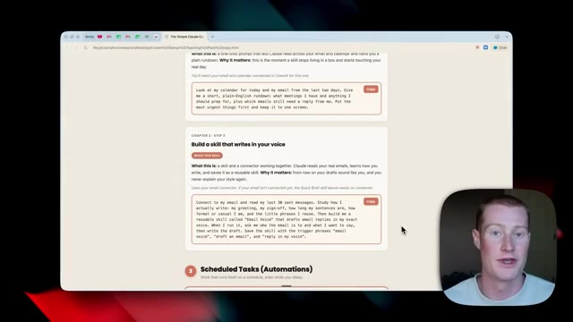
*⏱️ 00:13:20 — Interface web affichant un pack de prompts avec des exemples sur la création de compétences d'écriture personnalisées.*

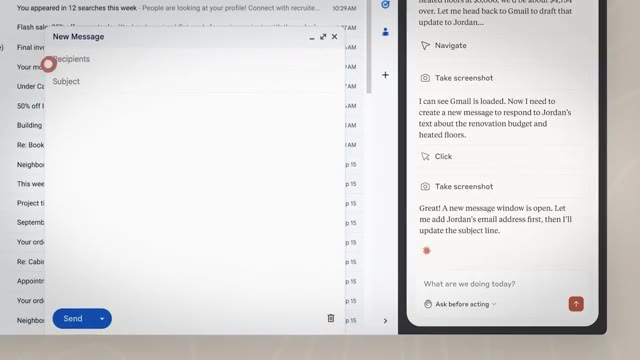
*⏱️ 00:13:25 — Interface séparée en deux montrant Gmail d'un côté et un assistant IA interactif préparant la rédaction d'un message.*

---

### ⏱️ `[00:13:35 - 00:13:53]` | Segment #34

**🔊 Audio (Transcription Intégrale Mot pour Mot en Français) :**
> Ensuite, nous pourrions faire en sorte que Gmail aille envoyer ces e-mails pour nous, en notre nom. Venons donc à cette étape-ci. Je vais cliquer sur "copier", puis je vais simplement coller ce prompt. Et ce que ça va faire, c'est que ça va lire les 30 derniers messages électroniques différents que j'ai envoyés afin de façonner cette voix d'e-mail. Très bien. Voilà. Ça a pris environ deux minutes.

**👁️ Analyse Visuelle d'Écran (gemini-3.5-flash-lite) :**
**Interface & Outils** : Navigateur web affichant une interface de documentation ou de guide de prompts textuels (type page web locale ou Notion).

**Contenu textuel & Code** : Textes explicatifs et blocs de prompts (« Build a skill that writes in your voice ») avec des boutons de copie pour interagir avec des outils d'IA.

**Action / Démonstration** : Le présentateur survole ou sélectionne un bloc de texte avec le curseur de la souris afin de copier le prompt présenté à l'écran.

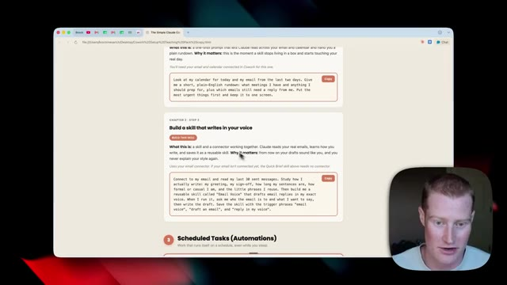
*⏱️ 00:13:39 — Capture d'écran montrant un navigateur web affichant une page de tutoriel avec des blocs de code ou de prompts textuels, et le présentateur visible en incrustation dans le coin inférieur droit.*

---

### ⏱️ `[00:13:53 - 00:14:12]` | Segment #35

**🔊 Audio (Transcription Intégrale Mot pour Mot en Français) :**
> Et ce qu'il a fait, c'est qu'il a créé cette compétence ici. Si je clique dessus et que je l'ouvre, nous pouvons la voir sur le côté droit de notre écran. Elle montre donc la description. Elle montre le flux de travail spécifique. Elle montre ensuite les différentes salutations et formules de politesse que j'utilise personnellement, ainsi que la longueur de mes e-mails. Elle aborde le ton, les phrases que j'utilise réellement, et les choses spécifiques que je ne fais jamais.

**👁️ Analyse Visuelle d'Écran (gemini-3.5-flash-lite) :**
**Interface & Outils** : Interface de gestion de compétences / application d'IA (style interface Claude/Anthropic)

**Contenu textuel & Code** : Documentation au format Markdown intitulée 'email-voice/SKILL.md' détaillant le profil vocal de Brock, le flux de travail avec les étapes 'Ask', 'Write' et 'Show', et les instructions de génération d'e-mails.

**Action / Démonstration** : Présentation détaillée de la structure d'une compétence personnalisée pour la rédaction d'e-mails imitant le style de l'auteur.

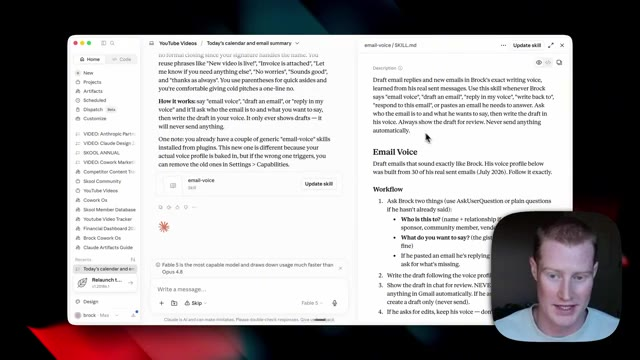
*⏱️ 00:13:58 — Vue de l'interface montrant les détails de la compétence 'email-voice' avec sa description, son flux de travail et ses consignes de rédaction, avec une incrustation vidéo du présentateur en bas à droite.*

---

### ⏱️ `[00:14:12 - 00:14:32]` | Segment #36

**🔊 Audio (Transcription Intégrale Mot pour Mot en Français) :**
> Il me donne même alors quelques exemples de brouillons dans ma voix. Donc maintenant, tout ce que vous avez à faire, c'est de cliquer sur ajouter une compétence. Et chaque fois que vous dites à Claude de générer un e-mail pour vous, ça va sonner exactement comme si vous l'aviez écrit. Maintenant, je veux parler rapidement de l'un de mes connecteurs préférés à l'intérieur de Claude, qui a honnêtement été un changement radical pour moi personnellement. Et je pense que ce sera vraiment utile pour vous. et c'est le connecteur MCP Zapier.

**👁️ Analyse Visuelle d'Écran (gemini-3.5-flash-lite) :**
**Interface & Outils** : Application de bureau (interface de type interface de gestion de compétences/IA).

**Contenu textuel & Code** : Documentation de configuration de compétence "email-voice" avec des exemples de style et des listes d'actions de connecteurs Zapier.

**Action / Démonstration** : Navigation dans l'application pour configurer les compétences d'écriture d'e-mails et gestion des connecteurs.

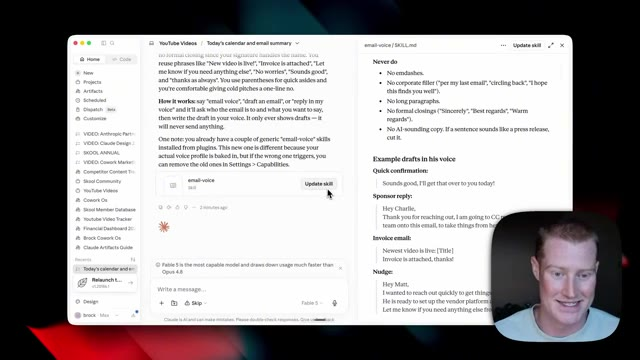
*⏱️ 00:14:17 — Interface d'une application montrant un document de configuration avec des exemples de brouillons d'e-mails et un bouton "Update skill".*

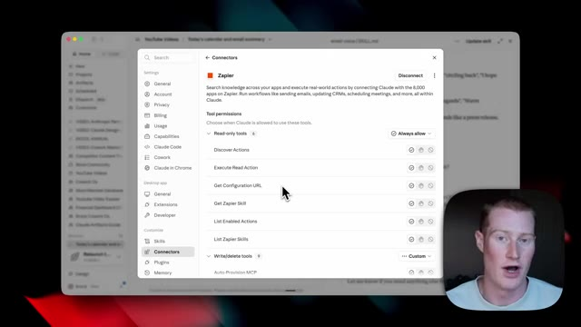
*⏱️ 00:14:22 — Fenêtre de paramètres affichant les connecteurs et les permissions d'outils, notamment pour Zapier.*

---

### ⏱️ `[00:14:33 - 00:14:53]` | Segment #37

**🔊 Audio (Transcription Intégrale Mot pour Mot en Français) :**
> Donc, si vous ne savez pas ce qu'est Zapier, c'est une plateforme d'automatisation qui se connecte à plus de 9 000 applications différentes, et ils ont développé un serveur MCP qui permet à Claude de travailler très facilement avec toutes ces applications différentes. Donc oui, Claude possède des tonnes d'applications auxquelles il se connecte, mais s'il y a jamais une application à laquelle vous ne pouvez pas vous connecter de manière native dans Claude, il y a de fortes chances pour que le MCP de Zapier vous permette de le faire.

**👁️ Analyse Visuelle d'Écran (gemini-3.5-flash-lite) :**
**Interface & Outils** : Navigateur web affichant le site officiel de Zapier (zapier.com) avec une section dédiée au protocole MCP pour l'IA.

**Contenu textuel & Code** : Texte promotionnel « Your AI can talk. Zapier MCP makes it act » et logos des applications prises en charge (Gmail, Slack, Salesforce).

**Action / Démonstration** : Présentation de la page d'accueil de Zapier et explication de son serveur MCP pour connecter Claude aux différentes applications.

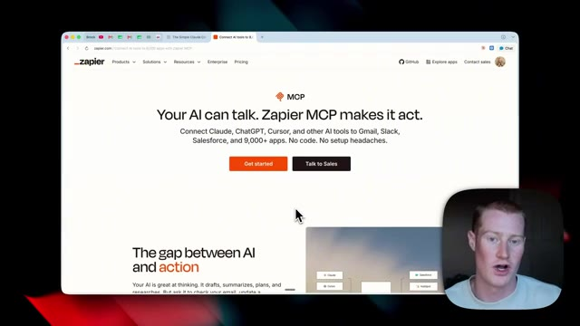
*⏱️ 00:14:43 — Page web de Zapier présentant le serveur MCP permettant de connecter des intelligences artificielles comme Claude à plus de 9 000 applications.*

---

### ⏱️ `[00:14:53 - 00:15:11]` | Segment #38

**🔊 Audio (Transcription Intégrale Mot pour Mot en Français) :**
> Par exemple, j'ai développé ce serveur MCP qui intègre Beehive ici même, car actuellement, à l'intérieur de Claude, il n'y a pas de connecteur natif pour Beehive. Mais maintenant, avec le MCP de Zapier, je peux accéder à cette application afin d'afficher des statistiques pour ma newsletter par email ou de rédiger des newsletters pour moi, et ainsi de suite. Et c'est la même chose pour School. Il n'y a pas de connecteur.

**👁️ Analyse Visuelle d'Écran (gemini-3.5-flash-lite) :**
**Interface & Outils** : Navigateur web affichant l'interface de Zapier MCP et une vignette vidéo du présentateur en bas à droite.

**Contenu textuel & Code** : Liste des applications intégrées via le serveur MCP de Zapier (Beehiiv, Slack, Synthflow AI, Skool).

**Action / Démonstration** : Présentation de la configuration des applications connectées au serveur MCP de Zapier pour l'intégration avec Claude.

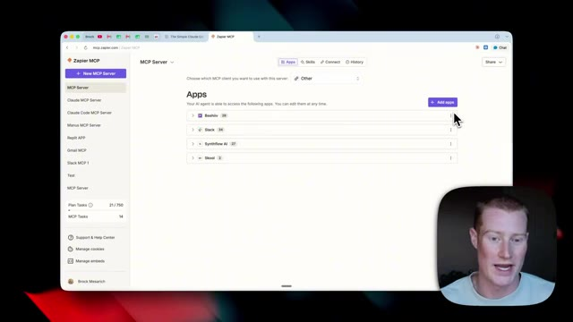
*⏱️ 00:14:57 — Capture d'écran montrant l'interface Web de Zapier MCP avec la liste des applications connectées, incluant Beehiiv.*

---

### ⏱️ `[00:15:12 - 00:15:35]` | Segment #39

**🔊 Audio (Transcription Intégrale Mot pour Mot en Français) :**
> Je peux donc me connecter à ceci en utilisant le MCP Zapier. Et c'est juste un que j'utilise. Il y a tellement de connecteurs différents que nous pouvons utiliser à l'intérieur de Claude. Vous pouvez simplement faire défiler l'écran et essayer de trouver ceux que vous utilisez activement. Très bien, le niveau suivant de Claude Cowork est donc l'automatisation. Et nous sommes capables de créer des automatisations en utilisant quelque chose appelé des tâches planifiées. Ce sont des tâches spécifiques que Claude exécute selon un calendrier afin de faire notre travail à notre place.

**👁️ Analyse Visuelle d'Écran (gemini-3.5-flash-lite) :**
**Interface & Outils** : Interface utilisateur de Claude affichant le répertoire des connecteurs (Directory).

**Contenu textuel & Code** : Liste des connecteurs disponibles incluant Supabase, Asana, Helix GenoSphere, Realize MCP et ZoomPulse.

**Action / Démonstration** : Exploration visuelle du répertoire des connecteurs pour montrer la variété des intégrations possibles.

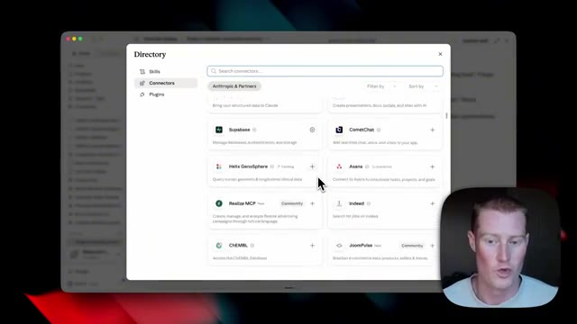
*⏱️ 00:15:17 — Capture montrant l'annuaire des connecteurs (Directory) avec différents plugins et intégrations disponibles (Supabase, Asana, etc.).*

---

### ⏱️ `[00:15:35 - 00:15:56]` | Segment #40

**🔊 Audio (Transcription Intégrale Mot pour Mot en Français) :**
> Et ces tâches planifiées peuvent en fait inclure des compétences spécifiques que nous construisons afin de pouvoir exécuter ces flux de travail à la perfection. Maintenant, laissez-moi vous montrer rapidement quelques-unes des tâches planifiées que j'exécute personnellement chaque jour avant de vous montrer comment vous pouvez créer les vôtres ainsi qu'une invite afin de configurer votre première tâche planifiée. Donc ici, sur le côté gauche de Cowork, vous pouvez maintenant voir que j'ai quatre tâches planifiées différentes qui sont en cours d'exécution.

**👁️ Analyse Visuelle d'Écran (gemini-3.5-flash-lite) :**
**Interface & Outils** : Claude Cowork application

**Contenu textuel & Code** : Planification de tâches hebdomadaires, interface de chat d'intelligence artificielle avec champ de saisie 'How can I help you today?'.

**Action / Démonstration** : Présentation des interfaces de gestion des tâches automatisées et de l'assistant IA.

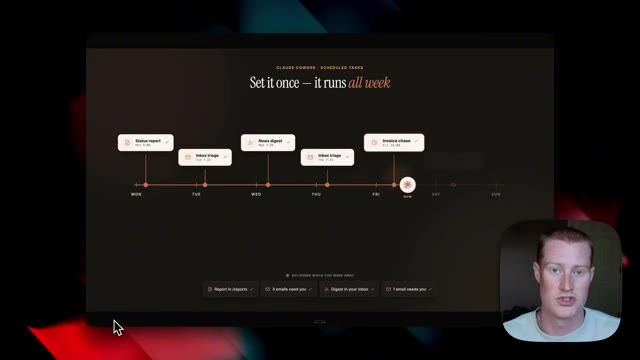
*⏱️ 00:15:40 — Interface sombre montrant un calendrier de tâches planifiées sur une semaine avec le texte 'Set it once - it runs all week'.*

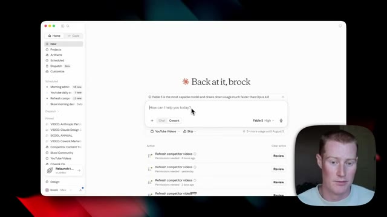
*⏱️ 00:15:46 — Interface claire de l'application Claude Cowork affichant un tableau de bord personnel avec barre de recherche et listes de tâches.*

---

### ⏱️ `[00:15:56 - 00:16:28]` | Segment #41

**🔊 Audio (Transcription Intégrale Mot pour Mot en Français) :**
> Le premier est mon tableau de bord administratif du matin. Cette tâche s'est exécutée aujourd'hui à 8 ou 9 heures du matin. Elle s'est exécutée hier. Elle s'est exécutée avant-hier. Nous pouvons voir toutes ces différentes exécutions qui ont eu lieu. Je peux cliquer dessus et cela crée ce tableau de bord HTML pour moi, qui détaille tout ce qui se passe dans ma boîte de réception Gmail, tout sur mon agenda Google, et des choses spécifiques pour me tenir à jour dans le domaine de l'IA. Ensuite, celui-ci est plutôt de niche et c'est quelque chose que j'utilise pour ma communauté School. Donc ce que cela fait, c'est que cela va chercher dans ma communauté School payante et me montre tout ce qui nécessite mon attention.

**👁️ Analyse Visuelle d'Écran (gemini-3.5-flash-lite) :**
**Interface & Outils** : Interface logicielle de tableau de bord / assistant (type application de bureau ou interface web de gestion de tâches automatisées).

**Contenu textuel & Code** : Liste des exécutions quotidiennes horodatées (ex: aujourd'hui à 8h09, hier à 8h02, etc.) et résumé textuel d'un tableau de bord matinal (priorités, calendrier, e-mails).

**Action / Démonstration** : Navigation dans l'historique des exécutions de tâches et visualisation du contenu généré pour le tableau de bord administratif.

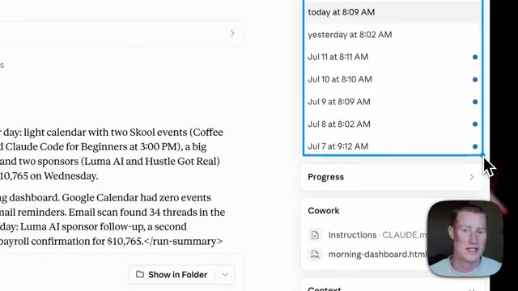
*⏱️ 00:16:04 — Gros plan sur l'historique des exécutions du tableau de bord montrant les dates et heures passées (aujourd'hui, hier, et les jours précédents).*

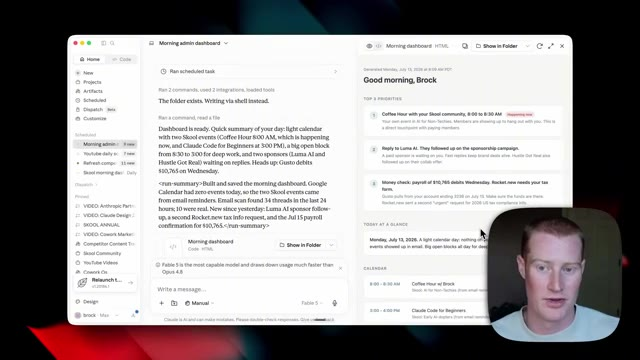
*⏱️ 00:16:12 — Vue globale de l'interface du tableau de bord administratif montrant les journaux d'exécution à gauche et le rendu HTML du tableau de bord de la journée à droite, avec la webcam du présentateur en bas à droite.*

---

### ⏱️ `[00:16:28 - 00:16:47]` | Segment #42

**🔊 Audio (Transcription Intégrale Mot pour Mot en Français) :**
> Comme ça, je ne rate pas les publications spécifiques que les membres de la communauté font. Ça montre un résumé des différentes questions que les gens posent. Et ça montre même des lacunes de contenu spécifiques en idées de vidéos basées sur les questions que les gens posent au sein de ma communauté School. Donc, ça extrait automatiquement tout cela chaque jour à 7 heures du matin.

**👁️ Analyse Visuelle d'Écran (gemini-3.5-flash-lite) :**
**Interface & Outils** : Application de tableau de bord / interface web Skool Community et interface de discussion textuelle.

**Contenu textuel & Code** : Résumé textuel généré automatiquement montrant les questions posées par les membres de la communauté et les lacunes de contenu identifiées.

**Action / Démonstration** : Présentation et explication du tableau de bord résumant l'activité de la communauté et les questions des membres.

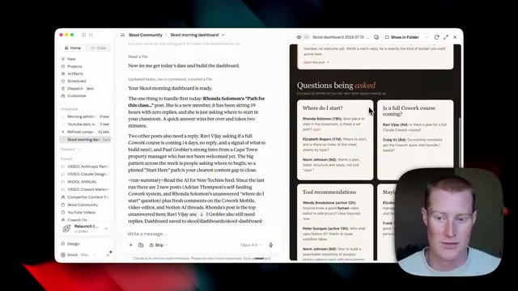
*⏱️ 00:16:33 — Capture d'écran montrant une interface de tableau de bord communautaire (Skool Community) et un assistant textuel avec des résumés de publications et de questions.*

---

### ⏱️ `[00:16:47 - 00:17:10]` | Segment #43

**🔊 Audio (Transcription Intégrale Mot pour Mot en Français) :**
> Donc je pourrais me réveiller et voir de quoi ai-je besoin de m'occuper au sein de ma communauté aujourd'hui. Maintenant, si je reviens à notre pack de scripts, vous pouvez voir que nous pouvons nous réveiller avec un briefing matinal. Donc nous allons simplement copier ce script ici, revenir à Cloud Cowork, le coller tout simplement et cela va configurer la tâche planifiée pour nous. Donc chaque matin à 7 heures, il va rechercher les actualités les plus importantes dans notre domaine particulier, puis proposer les cinq articles qui comptent le plus pour nous.

**👁️ Analyse Visuelle d'Écran (gemini-3.5-flash-lite) :**
**Interface & Outils** : Navigateur web affichant une page de documentation ou de tutoriel (Cowork OS / scripts Claude).

**Contenu textuel & Code** : Un script de briefing matinal automatisé avec des explications textuelles et un bouton de copie (« Copy »).

**Action / Démonstration** : Le présentateur consulte et présente le script de briefing matinal sur la page web avant de le copier.

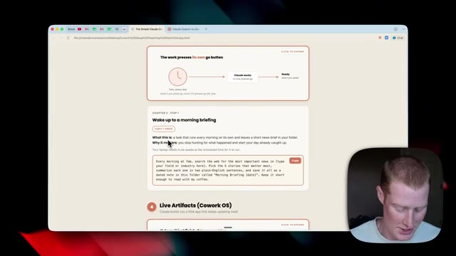
*⏱️ 00:16:53 — Un navigateur web affichant un guide ou un pack de scripts avec une section intitulée 'Wake up to a morning briefing', tandis que le présentateur apparaît en incrustation vidéo dans le coin inférieur droit.*

---

### ⏱️ `[00:17:11 - 00:17:31]` | Segment #44

**🔊 Audio (Transcription Intégrale Mot pour Mot en Français) :**
> Ensuite, vous allez voir qu'il est en train de créer la tâche planifiée. Tout ce que j'ai à faire, c'est de cliquer sur planifier et maintenant elle a été créée et nous pouvons toujours voir nos tâches planifiées juste ici sur le côté gauche. Et nous pouvons créer celles-ci pour n'importe lequel des différents flux de travail que nous exécutons au jour le jour. Et en plus de cela qui s'exécute tous les jours à 7 heures du matin, si je veux l'exécuter dès maintenant, je peux simplement cliquer sur cette tâche planifiée puis cliquer sur exécuter maintenant et cela l'exécutera pour moi.

**👁️ Analyse Visuelle d'Écran (gemini-3.5-flash-lite) :**
**Interface & Outils** : Interface logicielle de type assistant IA / Claude.

**Contenu textuel & Code** : Texte de confirmation de la création d'une tâche planifiée ("Created scheduled task: Morning briefing ai news") configurée à 7h00 tous les jours, avec des instructions sur son exécution.

**Action / Démonstration** : Visualisation de la confirmation de la planification de la tâche dans l'interface.

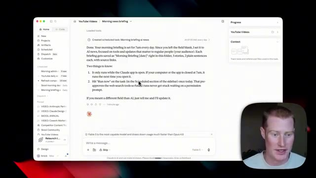
*⏱️ 00:17:16 — Interface d'une application d'intelligence artificielle affichant un résumé de tâche planifiée pour un briefing d'actualités matinales avec le présentateur en médaillon.*

---

### ⏱️ `[00:17:31 - 00:17:57]` | Segment #45

**🔊 Audio (Transcription Intégrale Mot pour Mot en Français) :**
> Maintenant, ce niveau final de Cloud Co-Work est quelque chose que j'aime appeler notre système d'exploitation. Et nous sommes capables de construire ce système d'exploitation avec quelque chose appelé Live Artifacts. Si vous ne savez pas ce qu'est un Live Artifact, c'est fondamentalement comme une mini application que vous pouvez construire directement à l'intérieur de Cloud qui extrait des données de vos différentes applications que vous pouvez consulter à tout moment. Donc au lieu que nous ayons besoin d'aller dans notre Gmail ou Google Drive ou différentes applications que nous utilisons, nous pouvons simplement regarder ce tableau de bord que nous avons créé à l'intérieur de Claude.

**👁️ Analyse Visuelle d'Écran (gemini-3.5-flash-lite) :**
**Interface & Outils** : Navigateur web, interface Claude Code / Artéfacts, tableau de bord UI/UX.

**Contenu textuel & Code** : Métriques d'utilisation (8.4M sessions, 76.6% apply rate), artéfacts dynamiques, liens vers Gmail, Calendar et Drive.

**Action / Démonstration** : Navigation et démonstration des fonctionnalités de Live Artifacts et de partage de tableaux de bord interactifs.

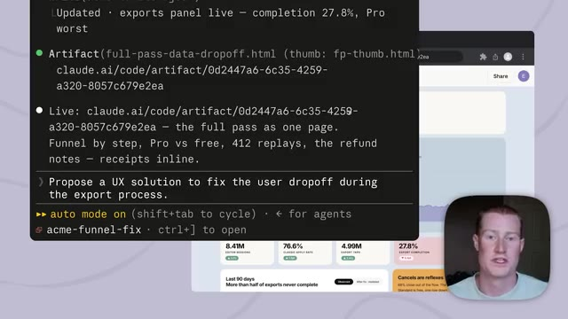
*⏱️ 00:17:38 — Interface montrant un terminal de commande superposé à un tableau de bord analytique.*

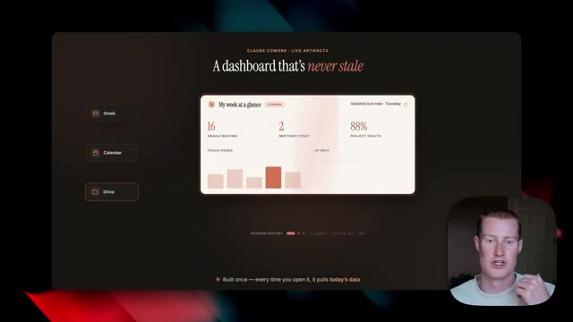
*⏱️ 00:17:51 — Présentation d'un tableau de bord de type "Cloud Co-Work" avec des indicateurs de productivité ("My week at a glance").*

---

### ⏱️ `[00:17:57 - 00:18:19]` | Segment #46

**🔊 Audio (Transcription Intégrale Mot pour Mot en Français) :**
> Et cela peut être vraiment puissant lorsque vous le construisez pour vos cas d'usage spécifiques. Maintenant, voici un exemple d'artefact en direct que j'ai personnellement et que j'utilise tous les jours. Celui-ci se trouve directement à l'intérieur de Claude. Comme vous pouvez le voir, il est épinglé juste ici, appelé Suivi de contenu des concurrents. Et ce que cela fait, c'est que cela trouve toutes les vidéos sur l'IA les plus populaires sur YouTube, basées sur mes concurrents spécifiques, et cela trouve différentes idées de contenu pour moi.

**👁️ Analyse Visuelle d'Écran (gemini-3.5-flash-lite) :**
**Interface & Outils** : Interface utilisateur de l'application Claude, tableau de bord de suivi de contenu « Competitor Content Tracker ».

**Contenu textuel & Code** : Métriques de contenu (78 clips trackés, 8 canaux, 23 cette semaine), liste de vidéos et articles concurrents avec scores d'audience et tags de créateurs.

**Action / Démonstration** : Navigation et présentation d'un artefact interactif en direct utilisé pour le suivi et l'analyse de la concurrence.

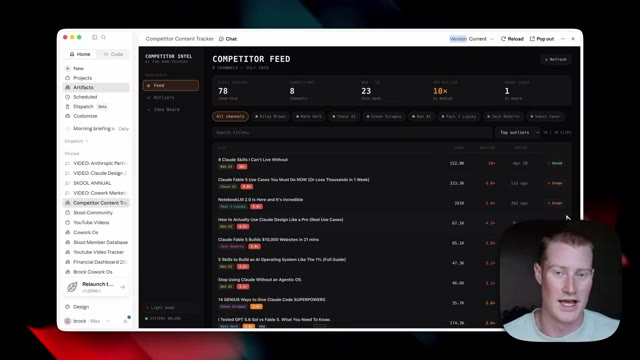
*⏱️ 00:18:03 — Vue d'ensemble d'une interface de tableau de bord nommée « Competitor Content Tracker » ouverte dans Claude, affichant des flux de veille concurrentielle.*

*⏱️ 00:18:13 — Retour à la vue d'ensemble du tableau de bord « Competitor Content Tracker » avec le panneau latéral gauche et les statistiques principales.*

---

### ⏱️ `[00:18:19 - 00:18:37]` | Segment #47

**🔊 Audio (Transcription Intégrale Mot pour Mot en Français) :**
> Il montre ensuite le nombre de vues en direct, le score d'anomalie, la date de publication. Et je pourrais même aller ajouter chacune de ces différentes vidéos comme source d'inspiration sur laquelle je peux m'appuyer. Voici donc le fil d'actualité. Je pourrais parcourir les vidéos de chacun de ces différents créateurs individuels. Et ensuite, j'ai même ce tableau d'idées, auquel je viens d'ajouter du contenu. Et je pourrais cliquer dessus et visionner leurs vidéos.

**👁️ Analyse Visuelle d'Écran (gemini-3.5-flash-lite) :**
**Interface & Outils** : Application web ou outil de suivi de contenu sur mesure (interface de type tableau de bord avec sidebar de navigation et tableau de données).

**Contenu textuel & Code** : Statistiques globales (78 vidéos, 8 canaux, 23 cette semaine, 10x vs médiane, 2 in board) et liste de vidéos avec titres, chaînes, nombre de vues, score d'anomalie (ex: 18x, 8x, 5.9x), date de publication et boutons d'action 'Saved'.

**Action / Démonstration** : Le présentateur présente l'outil de suivi et montre comment parcourir le fil d'actualité pour identifier les vidéos performantes et les ajouter comme sources d'inspiration.

*⏱️ 00:18:23 — Interface logicielle 'Competitor Content Tracker' affichant un tableau de flux de contenu concurrentiel avec métriques de vues, scores d'anomalie et options de sauvegarde.*

---

### ⏱️ `[00:18:37 - 00:18:59]` | Segment #48

**🔊 Audio (Transcription Intégrale Mot pour Mot en Français) :**
> En plus de cela, je pourrais même y ajouter mes propres idées de vidéos. Vous pouvez donc commencer à voir qu'il s'agit d'une sorte de mini application web personnalisée que j'ai construite et que je peux utiliser directement à l'intérieur de Claude. Nous pourrions faire cela pour d'innombrables cas d'utilisation différents dans le cadre de notre entreprise ou de notre vie professionnelle. Et pour construire l'un de ces artefacts en direct, c'est extrêmement facile à faire. Alors ce que nous allons faire, c'est simplement venir ici, copier ce prompt au bas de notre pack de prompts.

**👁️ Analyse Visuelle d'Écran (gemini-3.5-flash-lite) :**
**Interface & Outils** : Interface web personnalisée / Claude / Navigateur web.

**Contenu textuel & Code** : Un tableau de bord interactif affichant des métriques et des idées de contenu vidéo ("Competitor Intel", "Idea Board", "Add Idea").

**Action / Démonstration** : Présentation d'une mini application web interactive construite et utilisée directement au sein de l'interface.

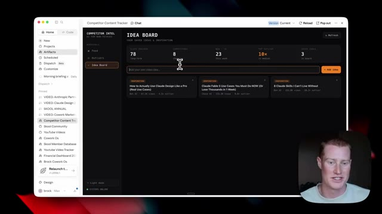
*⏱️ 00:18:43 — L'image #1 montre une application web personnalisée nommée "Competitor Content Tracker" affichée dans une interface sombre avec un tableau de bord d'idées ("Idea Board").*

---

### ⏱️ `[00:18:59 - 00:19:20]` | Segment #49

**🔊 Audio (Transcription Intégrale Mot pour Mot en Français) :**
> Ensuite, nous allons simplement aller dans notre projet et coller ceci, et assurez-vous d'utiliser Coork pour cela. Donc ce prompt ici dit : construis-moi un tableau de bord en direct que je peux ouvrir chaque matin, appelle-le mon tableau de bord Coork OS, extrait des données de mon e-mail et de mon calendrier et affiche les réunions d'aujourd'hui, tout ce pour quoi je dois me préparer et les e-mails auxquels je dois encore répondre. Donc ce qu'il va faire, c'est qu'il va construire ce tableau de bord pour nous, que nous pourrons ensuite personnaliser.

**👁️ Analyse Visuelle d'Écran (gemini-3.5-flash-lite) :**
**Interface & Outils** : Interface logicielle de gestion de projet / IA avec champ de saisie de prompt, menu latéral et vignette vidéo du présentateur.

**Contenu textuel & Code** : Texte du prompt : "Build me a live dashboard I can open every morning, call it my Cowork OS Dashboard. Pull from my email and my calendar..." avec sélection du modèle "Fables 5 High".

**Action / Démonstration** : Saisie et collage du prompt dans l'interface pour demander à l'IA de concevoir un tableau de bord personnalisé.

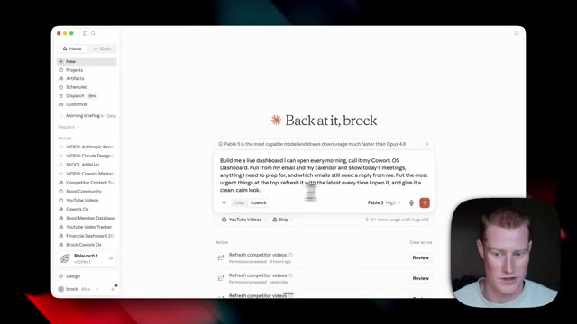
*⏱️ 00:19:04 — Interface complète d'un outil de projet avec la saisie d'un prompt pour créer un tableau de bord et la webcam du présentateur en bas à droite.*

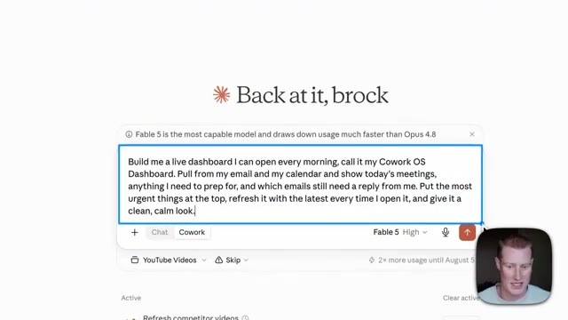
*⏱️ 00:19:10 — Gros plan sur la boîte de texte contenant le prompt détaillé pour générer le tableau de bord "Cowork OS".*

---

### ⏱️ `[00:19:21 - 00:19:43]` | Segment #50

**🔊 Audio (Transcription Intégrale Mot pour Mot en Français) :**
> Nous pourrions également y ajouter un suivi de liste de tâches spécifique. Mais c'est juste un exemple que je voulais montrer puisque tout le monde peut utiliser ce tableau de bord de système d'exploitation de co-travail spécifique. Et gardez à l'esprit que cela peut se connecter à n'importe laquelle des différentes applications que nous avons connectées à l'intérieur de Cloud. Donc, si vous avez un cas d'utilisation vraiment spécifique, vous pourriez intégrer ces informations dans un tableau de bord comme celui-ci très simplement en écrivant une simple consigne.

**👁️ Analyse Visuelle d'Écran (gemini-3.5-flash-lite) :**
**Interface & Outils** : Interface logicielle de bureau (Cowork OS / outil de type Claude).

**Contenu textuel & Code** : Invite textuelle : "Build me a live dashboard I can open every morning, call it my Cowork OS Dashboard..." avec un indicateur de chargement "Working on it...".

**Action / Démonstration** : Affichage et présentation de l'interface du tableau de bord Cowork OS par le créateur.

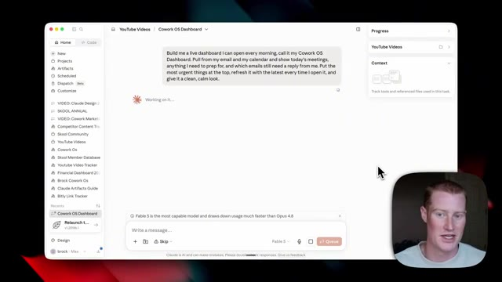
*⏱️ 00:19:26 — Interface d'une application de bureau montrant un tableau de bord Cowork OS en cours de génération avec une invite textuelle.*

---

### ⏱️ `[00:19:43 - 00:20:04]` | Segment #51

**🔊 Audio (Transcription Intégrale Mot pour Mot en Français) :**
> Et maintenant, en un instant, nous avons ce tableau de bord en direct que nous pouvons consulter à tout moment. C'est assez basique. Nous pourrions y apporter autant de modifications que nous le souhaiterions. C'est simplement le tout premier exemple de résultat que nous avons obtenu. Et afin de visualiser tous les artefacts que nous avons, si nous venons sur la gauche, en cliquant sur artefacts, nous pouvons alors le visualiser et nous avons ici une plus grande vue de notre tableau de bord. Très bien, les amis, voilà qui est fait. Cela s'appelle Cowork et c'est ainsi que je l'utilise personnellement chaque jour au sein de mon entreprise.

**👁️ Analyse Visuelle d'Écran (gemini-3.5-flash-lite) :**
**Interface & Outils** : Interface Claude Desktop / Application Web Cowork OS Dashboard

**Contenu textuel & Code** : Tableau de bord interactif affichant le titre "Cowork OS Dashboard", des compteurs de statut (0 réunions aujourd'hui, 1 élément de préparation, 20 e-mails en attente) et des notifications d'e-mails classées par ordre d'urgence.

**Action / Démonstration** : Présentation du tableau de bord généré par l'IA, expliquant qu'il s'agit d'un exemple basique et modifiable.

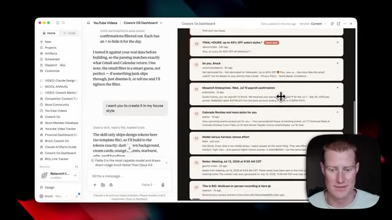
*⏱️ 00:19:48 — Image #1 montre l'interface de l'application Claude affichant le chat et l'aperçu du tableau de bord "Cowork OS" avec des blocs d'e-mails et de notifications.*

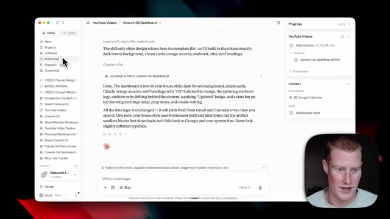
*⏱️ 00:19:53 — Image #2 montre l'interface de Claude avec les instructions et la sortie du fichier HTML "cowork-os-dashboard" dans le panneau latéral.*

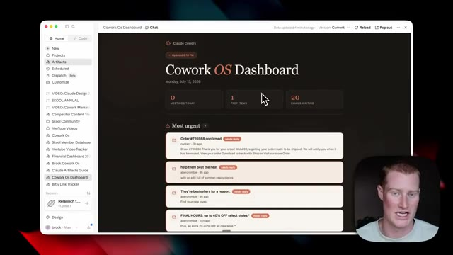
*⏱️ 00:19:59 — Image #3 montre le tableau de bord "Cowork OS" en direct avec un design épuré, des compteurs (réunions, éléments de préparation, e-mails en attente) et des alertes urgentes.*

---

### ⏱️ `[00:20:04 - 00:20:18]` | Segment #52

**🔊 Audio (Transcription Intégrale Mot pour Mot en Français) :**
> Je tiens à remercier Anthropic d's'être associé à moi pour cette vidéo, car j'utilise ce produit littéralement tous les jours et je fais des vidéos à son sujet depuis les six derniers mois. Si vous voulez plus de contenu comme celui-ci, abonnez-vous à la chaîne pour en voir plus. Cela étant dit, je vous retrouve dans la prochaine vidéo. Salut.

**👁️ Analyse Visuelle d'Écran (gemini-3.5-flash-lite) :**
**Interface & Outils** : Navigateur web affichant une chaîne YouTube.

**Contenu textuel & Code** : Miniatures de vidéos sur l'intelligence artificielle, titres de vidéos (Cowork Killer, Claude Mobile, etc.).

**Action / Démonstration** : Navigation sur la page YouTube de la chaîne.

---

