# 🎬 AI News: Claude 2.0 Dropped, Grok Bot Voice & Claude Code Projects (+ more)

> **Chaîne** : [Brock Mesarich | AI for Non Techies](https://www.youtube.com/@BrockMesarich)  
> **Lien YouTube** : [https://www.youtube.com/watch?v=lNWYmzseNhQ](https://www.youtube.com/watch?v=lNWYmzseNhQ)  
> **Date de publication** : 20260919  
> **Durée** : 00:25:10  
> **Identifiant vidéo** : `lNWYmzseNhQ`  
> **Transcription & Analyse** : `whisper-v3-large-turbo+gemini-3.5-flash-lite`  

---

## 📌 Synthèse Exécutive & Outils

### 💡 Résumé
Cette revue stratégique hebdomadaire présentée par Brock Mesarich pour la chaîne *AI for Non Techies* décortique les dernières avancées majeures de l'écosystème de l'intelligence artificielle générative et de l'automatisation des flux de travail. L'analyse se concentre particulièrement sur la restructuration profonde de l'interface d'Anthropic, qui fusionne ses modes de discussion et de collaboration tout en introduisant des outils natifs de production documentaire et visuelle. L'objectif pour les opérateurs et les créateurs de contenu est de réduire drastiquement la fatigue décisionnelle et de rationaliser la création d'actifs directement dans un écosystème unifié.

La vidéo met également en lumière l'évolution des infrastructures d'accès aux modèles génératifs, notamment avec le passage à l'open source et l'ouverture de l'API de Higgsfield. À travers une analogie claire — celle d'un modèle d'achat en gros de type « Costco » —, l'analyse démontre comment les professionnels peuvent optimiser leurs coûts opérationnels en s'affranchissant des abonnements cloisonnés pour adopter un modèle de tarification à l'usage mutualisé. Cette approche permet de centraliser la génération d'images et de vidéos sous une seule clé API tout en bénéficiant de tarifs préférentiels négociés à grande échelle.

Enfin, l'intervention met en perspective l'importance de l'automatisation et de l'interopérabilité des données, illustrée par la transformation directe de fichiers structurés (CSV) en livrables professionnels (documents textuels interactifs et présentations visuelles dynamiques). Ces démonstrations concrètes confirment la transition d'une IA purement conversationnelle vers une IA exécutive et générative orientée résultats, capable d'accélérer les processus métier sans nécessiter de compétences techniques avancées en programmation.

### 🛠️ Outils, Modèles & Logiciels Présentés
* **Claude (Anthropic)** : Assistant conversationnel et agent de productivité de pointe intégrant désormais le chat, le mode collaboratif (*Cowork*) et des outils de création d'artefacts.
* **Claude Docs** : Outil natif d'édition de documents textuels interactifs comparables à Notion, alimenté directement par l'IA à partir de données brutes.
* **Claude Slides** : Module de génération et d'édition de présentations visuelles intégrant des systèmes de design personnalisés.
* **Claude Code** : Environnement de développement et d'assistance au code d'Anthropic accessible depuis l'interface unifiée.
* **Higgsfield API** : Plateforme open source agissant comme un agrégateur de modèles d'images et de vidéos proposant une tarification à l'usage mutualisée et économique.
* **Canva** : Plateforme de design graphique externe compatible avec l'exportation et le partage des artefacts générés par Claude.
* **Gamma** : Outil de présentation assisté par IA pris en charge pour l'exportation des flux de travail documentaires.
* **Miro** : Tableau blanc collaboratif en ligne intégré parmi les options de partage et d'exportation des livrables Claude.
* **ChatGPT** : Modèle conversationnel de référence mentionné dans l'écosystème global de l'IA générative.
* **Grok Bot** : Assistant conversationnel doté de fonctionnalités vocales avancées.
* **Gemini** : Suite de modèles multimodaux développée par Google.
* **Make** et **n8n** : Solutions d'automatisation de processus et de workflows sans code.
* **Zapier** : Pionnier de l'automatisation connectant des milliers d'applications logicielles.

### 🔑 Points Clés & Enseignements Stratégiques
* **Fusion des interfaces conversationnelles et collaboratives** : Anthropic rationalise l'expérience utilisateur en combinant Claude Chat et *Cowork*, éliminant ainsi la nécessité de basculer manuellement entre les modes d'interaction.
* **Atténuation de la fatigue décisionnelle** : La convergence des outils permet au modèle de déterminer de manière autonome si une requête relève du simple échange textuel ou d'une tâche d'exécution complexe.
* **Transformation automatisée des données structurées** : Capacité native à injecter des fichiers CSV volumineux pour générer instantanément des documents interactifs et des tableaux de bord structurés.
* **Modularité des artefacts de type Notion** : Les documents générés par Claude intègrent des listes de contrôle modifiables, des tableaux dynamiques et un système d'onglets multiples pour une gestion fine de l'information.
* **Application de systèmes de design personnalisés** : *Claude Slides* permet d'importer des chartes graphiques préconfigurées (*Claude Design*) pour assurer la cohérence visuelle des présentations générées.
* **Édition granulaire post-génération** : Les présentations et documents créés par l'IA conservent une flexibilité totale d'édition manuelle (modification des textes, des couleurs, intégration d'éléments visuels et gestion des notes de conférencier).
* **Interopérabilité et options d'exportation multi-plateformes** : Possibilité d'exporter les livrables sous forme de pages Web HTML, de fichiers PDF, de formats PowerPoint ou de les transférer vers des outils tiers (Canva, Gamma, Miro).
* **Modèle économique de type grossiste (API Higgsfield)** : L'utilisation d'une infrastructure d'agrégation permet de s'affranchir des abonnements multiples et coûteux au profit d'une tarification au volume.
* **Centralisation des clés d'accès technologiques** : Une unique clé API Higgsfield suffit pour piloter et exploiter une multitude de modèles concurrents de génération d'images et de vidéos.
* **Optimisation des coûts opérationnels** : L'achat groupé de ressources de calcul par les plateformes intermédiaires permet aux utilisateurs finaux de bénéficier de réductions significatives sur l'inférence des modèles de pointe.
* **Accessibilité des technologies de pointe pour les non-techniciens** : Les flux de démonstration prouvent qu'il est possible d'exploiter des architectures complexes et des API via des interfaces intuitives sans compétences en programmation.

---

## ⏱️ Chronologie & Transcription Complète Audio & Visuelle (Mot pour Mot)

### ⏱️ `[00:00:00 - 00:00:24]` | Segment #01

**🔊 Audio (Transcription Intégrale Mot pour Mot en Français) :**
> Nous avons une autre semaine énorme en matière de mises à jour de l'IA. Anthropic combine enfin Claude Chat et Cowork. Ils viennent également de publier deux nouveaux produits appelés Claude Docs et Slides, et ils ont annoncé une nouvelle mise à jour de Claude Projects qui gère plusieurs tâches à la fois. Higgsfield vient de passer en open source et vous permet de générer des images et des vidéos avec leur toute nouvelle API, et cela va faire économiser beaucoup d'argent à certaines personnes.

**👁️ Analyse Visuelle d'Écran (gemini-3.5-flash-lite) :**
**Interface & Outils** : Interface web de Claude et publications sur les réseaux sociaux (X/Twitter).

**Contenu textuel & Code** : Texte d'annonce officiel concernant la fusion des outils et la gestion des tâches multiples.

**Action / Démonstration** : Présentation des nouvelles fonctionnalités d'Anthropic et de l'interface multitâche de Claude.

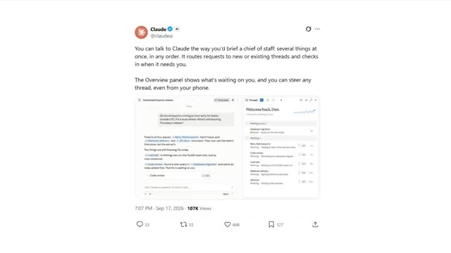
*⏱️ 00:00:12 — Capture d'écran montrant l'interface utilisateur de Claude avec le panneau Overview gérant plusieurs tâches simultanées.*

---

### ⏱️ `[00:00:24 - 00:00:50]` | Segment #02

**🔊 Audio (Transcription Intégrale Mot pour Mot en Français) :**
> En plus de ça, nous avons quelques autres mises à jour que nous allons aborder dans cette vidéo. Si vous découvrez cette série, je décortique les principales actualités sur l'intelligence artificielle chaque semaine afin que vous puissiez rester informés sans vous sentir submergés. Donc, sans plus attendre, plongeons-nous directement dedans. Très bien, nous avons donc de nouvelles mises à jour de la part de Claude. Nous avons une toute nouvelle interface. Claude Cowork et Claude Chat Mode sont désormais fusionnés. Il y a de nouveaux produits appelés Claude Docs et Claude Slides qui se trouvent maintenant à l'intérieur de l'interface. Je vais donc décortiquer tout cela dès maintenant et vous montrer exactement comment cela fonctionne.

**👁️ Analyse Visuelle d'Écran (gemini-3.5-flash-lite) :**
**Interface & Outils** : Application logicielle ou interface web de présentation (Slides).

**Contenu textuel & Code** : Champ de saisie de texte avec les mentions "What should this deck be about?", "Slides", "Talvik Design System" et "Opus 5 High Auto".

**Action / Démonstration** : Présentation de l'interface utilisateur d'un outil de création assistée par IA.

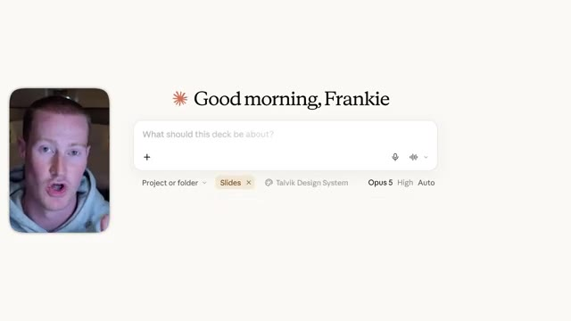
*⏱️ 00:00:44 — Interface logicielle affichant un message de bienvenue "Good morning, Frankie" avec une barre de recherche textuelle et le présentateur visible dans un encadré à gauche.*

---

### ⏱️ `[00:00:51 - 00:01:11]` | Segment #03

**🔊 Audio (Transcription Intégrale Mot pour Mot en Français) :**
> Anthropic a publié cette vidéo de lancement de Claude qui est tout à fait dans leur style. Et ce qu'elle montre, c'est une fusion entre l'interface de chat et l'interface de travail collaboratif. Une chose que je tiens à souligner, c'est qu'en ce moment, dans mon compte, je ne vois pas ce nouveau changement. Donc si vous vous souvenez, il y a peut-être un ou deux mois, ils ont fusionné l'onglet de chat et l'onglet de travail collaboratif en cette simple icône de bulle de chat.

**👁️ Analyse Visuelle d'Écran (gemini-3.5-flash-lite) :**
**Interface & Outils** : Interface web de Claude.ai (Anthropic) et navigateur web sur macOS.

**Contenu textuel & Code** : URL "claude.ai/new-task", menu latéral avec "Projects", "Artifacts", "Scheduled", "Customize", et liste des tâches actives ("Cascade office supply invoice", "DOC: YouTube Video Tracker").

**Action / Démonstration** : Navigation et présentation de l'interface de Claude.ai pour illustrer la nouvelle fonctionnalité de travail collaboratif.

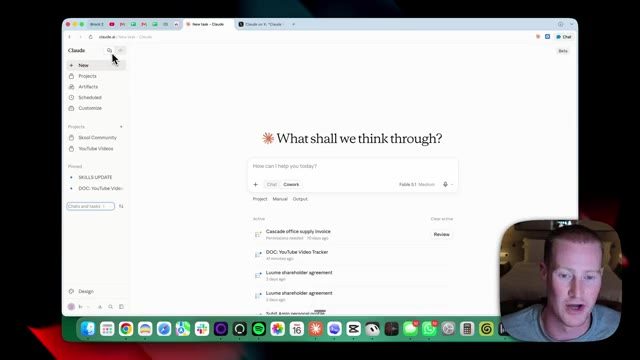
*⏱️ 00:01:01 — Interface de la plateforme Claude.ai montrant le tableau de bord avec une barre de recherche, des options de projets, et des tâches actives en cours.*

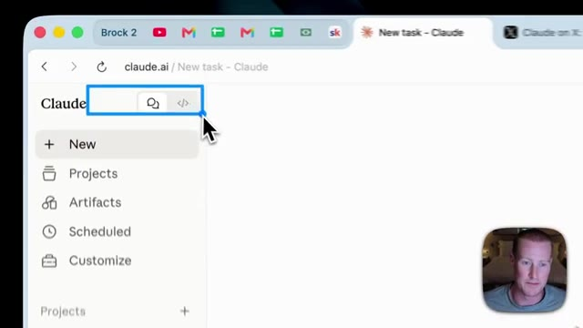
*⏱️ 00:01:06 — Gros plan sur l'interface de Claude.ai avec un encadré bleu sur la barre de navigation supérieure gauche mettant en avant les options de discussion et de code.*

---

### ⏱️ `[00:01:11 - 00:01:30]` | Segment #04

**🔊 Audio (Transcription Intégrale Mot pour Mot en Français) :**
> Nous avons donc maintenant Claude chat ainsi que co-work, et puis nous avons Claude code si je viens juste ici. Mais je vois encore dans cette interface le bouton de bascule pour le chat et le co-work. Mais je crois qu'au cours des deux prochaines semaines, cela ne fera plus qu'une seule option et nous n'aurons plus besoin de basculer entre les deux, car Claude devrait être capable de comprendre ce que nous essayons de faire et de l'orienter soit vers le chat, soit vers le co-work.

**👁️ Analyse Visuelle d'Écran (gemini-3.5-flash-lite) :**
**Interface & Outils** : Interface web de Claude.

**Contenu textuel & Code** : Zone de saisie avec le texte 'How can I help you today?', options 'Chat' et 'Cowork', et la mention 'Fable 5.1 Medium'.

**Action / Démonstration** : Le curseur de la souris survole le bouton de bascule entre les modes Chat et Cowork.

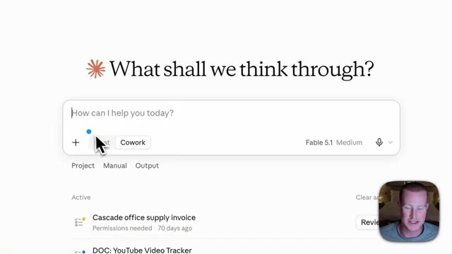
*⏱️ 00:01:16 — Capture d'écran montrant l'interface de l'assistant Claude avec le champ de texte et les boutons de bascule entre 'Chat' et 'Cowork'.*

---

### ⏱️ `[00:01:30 - 00:01:49]` | Segment #05

**🔊 Audio (Transcription Intégrale Mot pour Mot en Français) :**
> Et je sais que cela résout beaucoup des problèmes que vous avez probablement eus parce que pour moi, je rencontre parfois le problème de savoir si je dois utiliser le mode chat de Claude ou Claude co-work. Et cela devrait hypothétiquement résoudre la fatigue décisionnelle que je ressens au jour le jour lors de l'utilisation de Claude. Maintenant, la prochaine chose que je veux souligner est la nouvelle section de sortie.

**👁️ Analyse Visuelle d'Écran (gemini-3.5-flash-lite) :**
**Interface & Outils** : Interface web d'assistant IA (Claude/Fable)

**Contenu textuel & Code** : Barre de prompt avec les options "Chat" et "Cowork", ainsi qu'une liste de projets actifs en bas ("Cascade office supply invoice", "DOC: YouTube Video Tracker").

**Action / Démonstration** : Le curseur de la souris survole les options de l'interface pour illustrer le choix entre les différents modes de travail.

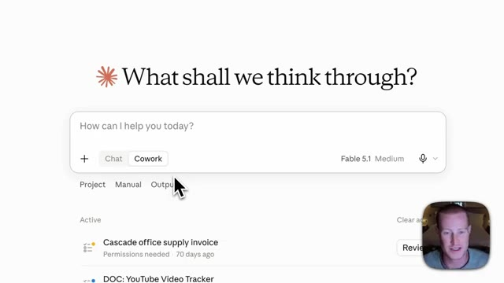
*⏱️ 00:01:35 — Capture d'écran montrant l'interface d'une application IA avec le titre "What shall we think through?" et une barre de saisie proposant les modes Chat et Cowork.*

---

### ⏱️ `[00:01:49 - 00:02:09]` | Segment #06

**🔊 Audio (Transcription Intégrale Mot pour Mot en Français) :**
> Donc c'est ici que nous pourrions utiliser les documents Claude, les présentations Claude et le design Claude directement à l'intérieur de cette interface. Je tiens à souligner que nous allons voir exactement la même chose à l'intérieur de l'application de bureau Cloud. Donc si j'active Cowork, vous pouvez maintenant voir que nous avons la possibilité de sélectionner un projet spécifique. Nous pouvons ensuite changer les approbations pour manuel, automatique, ou ignorer toutes les approbations.

**👁️ Analyse Visuelle d'Écran (gemini-3.5-flash-lite) :**
**Interface & Outils** : Interface web de Claude.ai

**Contenu textuel & Code** : Menu de sélection d'artefacts (Docs, Slides, Design) et liste de projets disponibles.

**Action / Démonstration** : Navigation et présentation des fonctionnalités d'artefacts et de gestion de projets dans l'interface de Claude.ai.

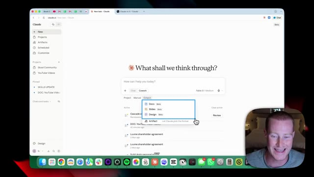
*⏱️ 00:01:54 — Interface de Claude.ai montrant un menu déroulant avec les options Docs, Slides et Design dans la section Artifacts.*

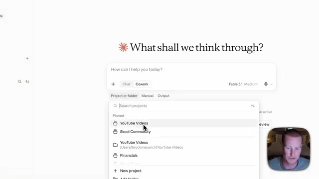
*⏱️ 00:02:04 — Interface de Claude.ai montrant une barre de recherche de projets avec des options épinglées comme YouTube Videos et Skool Community.*

---

### ⏱️ `[00:02:09 - 00:02:27]` | Segment #07

**🔊 Audio (Transcription Intégrale Mot pour Mot en Français) :**
> Et ensuite, nous avons aussi cette section de sortie juste ici, que je vais décortiquer dès maintenant. Maintenant, disons que je veux créer un document à partir d'un fichier CSV. Je vais simplement sélectionner Docs. Comme vous pouvez le voir, c'est activé maintenant. Et je vais simplement prendre un gros fichier CSV de client de démonstration. Et je vais simplement dire, hé, je veux que tu transformes ceci en un document que je peux modifier.

**👁️ Analyse Visuelle d'Écran (gemini-3.5-flash-lite) :**
**Interface & Outils** : Interface web d'un outil d'intelligence artificielle conversationnelle (type Cowork / Fable) avec une webcam du présentateur en bas à droite.

**Contenu textuel & Code** : Menus d'options de sortie (Docs Beta, Slides Beta, Design Beta, Artifact) et interface de chat avec import de fichier CSV.
[DESC_IMAGE_2] Le présentateur démontre la sélection de l'option de sortie "Docs" et l'utilisation d'un fichier CSV pour générer un document.

**Action / Démonstration** : Explications face caméra et analyse conceptuelle des marchés.

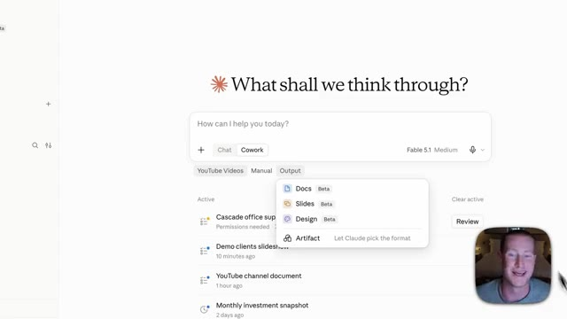
*⏱️ 00:02:13 — Interface d'une application d'IA montrant un menu déroulant d'options de sortie avec "Docs", "Slides", "Design", et "Artifact".*

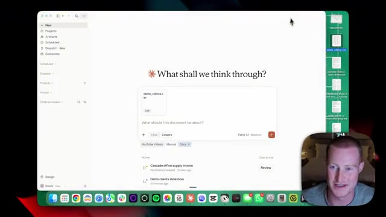
*⏱️ 00:02:22 — Interface d'application montrant l'importation d'un fichier CSV nommé "demo_clients.csv" avec le filtre "Docs" sélectionné.*

---

### ⏱️ `[00:02:27 - 00:02:47]` | Segment #08

**🔊 Audio (Transcription Intégrale Mot pour Mot en Français) :**
> Et ensuite, ce qu'il va faire, c'est afficher cet artefact sur le côté droit de mon écran. Et ceci est en train de fonctionner et de le construire en action. Et je pouvais le voir le construire à partir de zéro. Donc ça ressemble fondamentalement à un document Notion. Nous avons un titre ici en haut. Nous avons une date ainsi qu'à Brock Messerich. Il y a un résumé de tout ce qui est inclus dans ce fichier CSV.

**👁️ Analyse Visuelle d'Écran (gemini-3.5-flash-lite) :**
**Interface & Outils** : Interface web de Claude AI (panneau de chat et panneau d'artefacts / documents)

**Contenu textuel & Code** : Document intitulé "Demo Client List" avec une date, un créateur (@brock mesarich), un résumé rapide et des sections éditables basées sur un fichier CSV de 50 lignes.

**Action / Démonstration** : Le système génère et affiche un artefact textuel interactif en temps réel sur le côté droit de l'écran suite à une demande utilisateur.

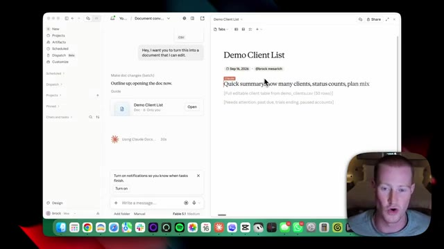
*⏱️ 00:02:32 — Capture d'écran montrant l'interface divisée de Claude AI, avec la conversation de chat à gauche et un artefact interactif sous forme de document Notion à droite, tandis que le présentateur apparaît en bas à droite.*

---

### ⏱️ `[00:02:48 - 00:03:18]` | Segment #09

**🔊 Audio (Transcription Intégrale Mot pour Mot en Français) :**
> Il montre même un petit tableau rapide ici, laissons-le faire son travail et ensuite je vous montrerai le résultat final complet. Très bien, nous avons donc maintenant ce document ici que nous pouvons aller modifier nous-mêmes manuellement, c'est donc très similaire à un fichier Excel mélangé à un document Notion. J'aime vraiment beaucoup l'apparence de ceci et c'est techniquement un artefact de Claude ici que nous pourrions aller partager, je vais vous montrer exactement comment faire cela plus tard dans cette vidéo. Parcourons cela très rapidement pour voir à quoi ça ressemble, nous avons donc tous nos différents clients ici, cela montre le statut de ces clients en fonction du fichier CSV que j'ai téléchargé.

**👁️ Analyse Visuelle d'Écran (gemini-3.5-flash-lite) :**
**Interface & Outils** : Présentation ou face-caméra explicatif du trader sans interface logicielle partagée.

**Contenu textuel & Code** : Explications orales des stratégies et mise en contexte méthodologique du marché.

**Action / Démonstration** : Explications face caméra et analyse conceptuelle des marchés.

---

### ⏱️ `[00:03:18 - 00:03:37]` | Segment #10

**🔊 Audio (Transcription Intégrale Mot pour Mot en Français) :**
> Et ensuite il a toutes ces informations, il a un nom, une entreprise, un e-mail. Et encore une fois, je pourrais venir ici et changer le statut de tout cela. Donc si je veux changer le statut à en retard, je peux aller de l'avant et faire ce changement juste ici. Une autre chose que nous pourrions faire, c'est que je pourrais simplement cliquer sur ce bouton de liste de contrôle et transformer ceci en une liste de contrôle. Très similaire à Notion, mais c'est désormais intégré directement dans Claude.

**👁️ Analyse Visuelle d'Écran (gemini-3.5-flash-lite) :**
**Interface & Outils** : Interface de type Notion/Claude Documents et outil de gestion de données client.

**Contenu textuel & Code** : Tableau de données clients avec colonnes (Plan, Monthly $, Status, Signed up, Last contact, Account manager) et un résumé textuel des abonnements (50 clients, 36 actifs, $20,764/mois).

**Action / Démonstration** : Modification interactive du statut d'un client dans le tableau via un menu déroulant (passage de « Active » à « Past Due »).

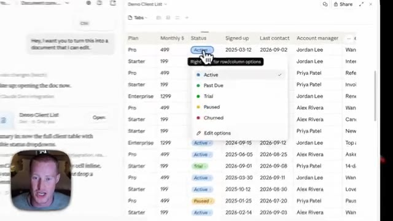
*⏱️ 00:03:23 — Image #1 montre l'interface d'un tableau interactif (« Demo Client List ») avec un menu déroulant ouvert permettant de modifier le statut d'un client (Active, Past Due, Trial, Paused, Churned).*

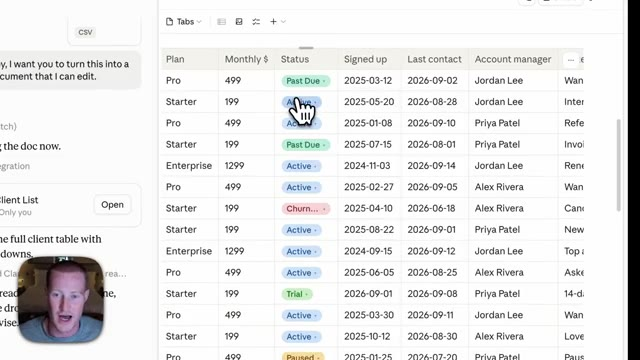
*⏱️ 00:03:28 — Image #2 montre le même tableau de gestion des clients où le premier statut de la liste a été modifié en « Past Due » (en retard).*

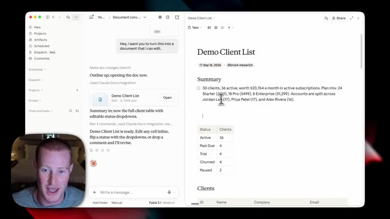
*⏱️ 00:03:33 — Image #3 montre une vue plus large du document contenant un résumé statistique des abonnements clients et des tableaux récapitulatifs par statut, à côté d'une interface de chat type assistant IA.*

---

### ⏱️ `[00:03:37 - 00:04:12]` | Segment #11

**🔊 Audio (Transcription Intégrale Mot pour Mot en Français) :**
> Je pourrais aussi créer plusieurs onglets différents de ce document. Disons donc que je veux en créer un nouveau et je vais l'appeler "clients passés". Je pourrais ensuite simplement venir ici et faire les modifications moi-même, ou je pourrais simplement demander à Claude de le faire lui-même. Maintenant que nous avons testé les résultats et que je vous ai montré les documents, laissez-moi vous montrer exactement comment fonctionnent les diapositives. C'est très, très simple. Et nous pouvons même personnaliser le système de design spécifique que nous avons configuré dans Claude Design si vous avez déjà utilisé cette plate-forme. Donc ce que je vais faire, c'est que je vais télécharger exactement ce même fichier CSV. Je vais simplement revenir sur Claude, sélectionner les diapositives, choisir un style de design, et je vais cliquer sur Bramble ici, ce qui

**👁️ Analyse Visuelle d'Écran (gemini-3.5-flash-lite) :**
**Interface & Outils** : Application web collaborative (type Fable / interface de type document interactif avec IA).

**Contenu textuel & Code** : Fenêtre de chat à gauche avec historique des commandes et document collaboratif à droite affichant le titre 'Past'.

**Action / Démonstration** : Modification du document en direct et manipulation de l'interface pour créer un nouvel onglet ou document.

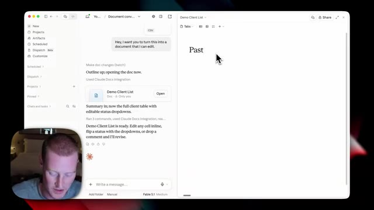
*⏱️ 00:03:46 — Interface divisée montrant l'application de chat à gauche et le document éditable à droite avec le texte 'Past'.*

---

### ⏱️ `[00:04:12 - 00:04:37]` | Segment #12

**🔊 Audio (Transcription Intégrale Mot pour Mot en Français) :**
> est un que j'ai préconfiguré. Et je vais simplement dire, hé, je veux que tu transformes ce fichier CSV, ces clients de démonstration en un diaporama qui pourrait visualiser toutes ces données et informations pour moi. Très bien. Alors voici le résultat final. Nous avons maintenant ce diaporama qu'il a généré en utilisant ce style de design que j'ai élaboré précédemment dans Claude Design. Vous pouvez donc importer n'importe quel système de design que vous avez créé précédemment et commencer à l'utiliser directement ici, à l'intérieur de cette interface.

**👁️ Analyse Visuelle d'Écran (gemini-3.5-flash-lite) :**
**Interface & Outils** : Interface web de génération de présentations par IA (Fable / Bramble).

**Contenu textuel & Code** : Fichier source CSV 'demo_clients.csv' et diaporama de présentation généré automatiquement avec des graphiques de données clients.

**Action / Démonstration** : Importation d'un fichier CSV et génération automatique d'un diaporama visuel par l'intelligence artificielle.

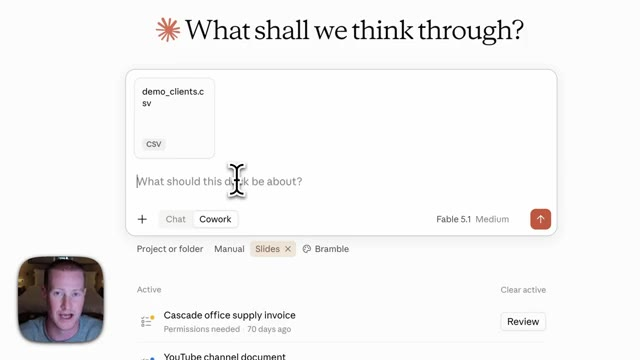
*⏱️ 00:04:18 — Interface d'une application d'IA montrant un fichier CSV 'demo_clients.csv' et une invite de commande vide avec le curseur.*

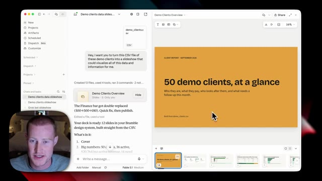
*⏱️ 00:04:25 — Interface divisée montrant à gauche le chat de l'assistant IA et à droite le résultat final sous forme de diaporama généré (diapositive '50 demo clients, at a glance').*

---

### ⏱️ `[00:04:37 - 00:05:14]` | Segment #13

**🔊 Audio (Transcription Intégrale Mot pour Mot en Français) :**
> Alors, laissez-moi passer rapidement sur ceci. C'est donc évidemment en train de prendre ces données de fichier CSV et de les transformer en diaporama. Je pense que c'est plutôt solide. Évidemment, ça n'a pas l'air de la chose la plus magnifique que j'aie jamais vue de toute ma vie. Ça a clairement l'air d'avoir été généré par IA, mais je trouve que c'est plutôt cool. Le fait qu'on puisse non seulement utiliser ceci, mais je pense que c'est plutôt cool. Non seulement nous pouvons générer ceci à l'intérieur de Claude sans quitter l'écosystème de Claude, mais nous pourrions même venir ici et modifier cela très simplement comme si nous utilisions quelque chose comme Google Docs. Disons donc que je veux changer la couleur de ce texte ici. C'est aussi simple que de venir et de changer littéralement sa couleur. Je pourrais modifier n'importe quel texte. Je peux ajouter des choses. Je

**👁️ Analyse Visuelle d'Écran (gemini-3.5-flash-lite) :**
**Interface & Outils** : Application de génération de présentations / outil d'intelligence artificielle avec affichage d'une diapositive et incrustation vidéo de l'orateur en bas à gauche.

**Contenu textuel & Code** : Graphique à barres montrant "More than half the clients are in Texas" (Texas : 27, Arizona : 5, Colorado : 4, etc.) et un encadré mettant en avant "54% of clients are in Texas".

**Action / Démonstration** : Le présentateur commente le rendu visuel de la diapositive générée automatiquement à partir de données CSV.

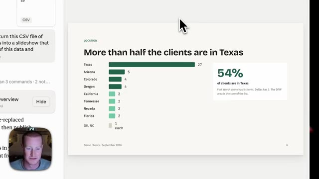
*⏱️ 00:04:47 — Une diapositive générée automatiquement à partir d'un fichier CSV montrant un graphique à barres horizontales sur la répartition des clients par État américain.*

---

### ⏱️ `[00:05:14 - 00:05:46]` | Segment #14

**🔊 Audio (Transcription Intégrale Mot pour Mot en Français) :**
> pourrait supprimer des éléments. Je peux également ajouter une image à cela. Disons donc que je veux faire glisser cette image. Je peux tout à fait le faire. Maintenant, une fois que nous avons perfectionné ceci pour qu'il ait exactement l'apparence que nous souhaitons, je peux aller ici et présenter ceci. Donc, évidemment, cela va simplement l'afficher en mode présentation. Je pourrais ensuite lire les notes du conférencier. Donc, si je le veux, je peux ajouter différentes notes de présentation si je fais réellement une vraie présentation. Et puis, disons que je veux partager ceci avec un membre de l'équipe ou le partager avec un autre ordinateur ou quelque chose comme ça. Ce que je peux faire, c'est de venir là où il est écrit partager. Je peux soit copier le lien vers l'artefact réel, soit cliquer sur exporter.

**👁️ Analyse Visuelle d'Écran (gemini-3.5-flash-lite) :**
**Interface & Outils** : Logiciel de présentation et d'édition de documents (type Notion ou Google Slides / Canva).

**Contenu textuel & Code** : Tableaux de données clients, listes de comptes d'entreprise, suivis de facturation et notes de présentation.

**Action / Démonstration** : Navigation et présentation de tableaux de données générés à partir de fichiers CSV pour automatiser la création de présentations.

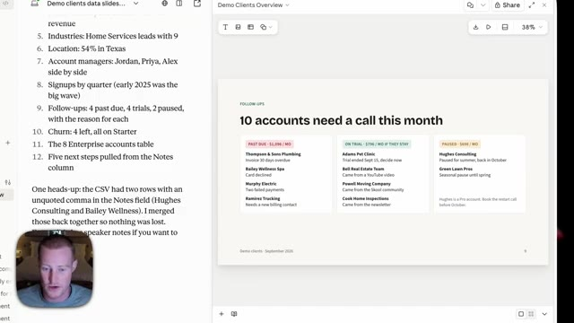
*⏱️ 00:05:38 — Image #3 affiche un écran divisé avec un panneau textuel à gauche et la diapositive de suivi des comptes à droite.*

---

### ⏱️ `[00:05:46 - 00:06:21]` | Segment #15

**🔊 Audio (Transcription Intégrale Mot pour Mot en Français) :**
> Et il y a plusieurs façons différentes d'exporter ceci. Je pourrais l'envoyer vers ces différentes applications ici, Canva, Gamma, Miro, ou d'autres plateformes d'IA différentes. Ou je pourrais télécharger ceci sous forme de page Web HTML, de PDF ou de PowerPoint si je veux l'éditer là-bas. Donc, cliquons simplement sur télécharger en PDF. Je vais l'enregistrer sur mon bureau. Et voilà. Nous avons maintenant ce diaporama téléchargé sous forme de PDF qui est très facile et accessible pour nous d'accès. Ensuite, nous avons une grosse mise à jour. Higgsfield vient de passer sa plateforme en open source. Ils ont désormais une API accessible au public que nous pouvons utiliser. Et c'est beaucoup moins cher que de payer pour l'abonnement que nous devions utiliser auparavant.

**👁️ Analyse Visuelle d'Écran (gemini-3.5-flash-lite) :**
**Interface & Outils** : Application de génération de présentations assistée par IA, interface d'export et de gestion de fichiers.

**Contenu textuel & Code** : Options d'exportation vers HTML, PDF, PowerPoint, Canva, Gamma, et Miro.

**Action / Démonstration** : Présentation des différentes options d'exportation et de partage de la présentation générée.

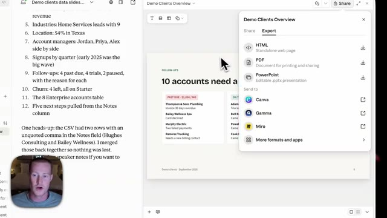
*⏱️ 00:05:55 — Fenêtre contextuelle d'exportation affichant les options d'export et d'envoi vers Canva, Gamma, Miro, HTML, PDF et PowerPoint.*

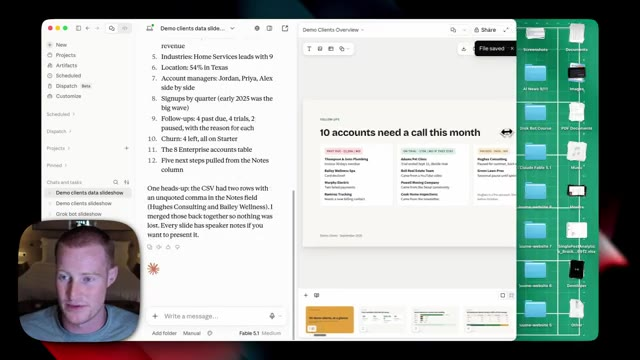
*⏱️ 00:06:04 — Interface multi-panneaux avec éditeur de présentation, panneau de texte et gestionnaire de fichiers.*

---

### ⏱️ `[00:06:21 - 00:06:55]` | Segment #16

**🔊 Audio (Transcription Intégrale Mot pour Mot en Français) :**
> à l'intérieur de la plateforme Higgsfield. Maintenant, je veux parler rapidement d'une analogie qui devrait vous aider à comprendre exactement comment cela fonctionne, parce que je pense que cela pourrait être un peu déroutant, mais cela devrait vraiment vous aider à l'expliquer même si vous ne savez pas ce qu'est une API. Je veux que vous pensiez à ce nouveau produit comme au Costco de Higgsfield. Et qu'est-ce que je veux dire exactement par là ? Laissez-moi donc vous l'expliquer dès maintenant. Nous avons accès à l'utilisation de ces différents modèles d'images et de vidéos que Higgsfield possède de manière native au sein de leur plateforme, mais nous les obtenons à un coût très bas. Donc, au lieu de devoir payer pour ces abonnements ici même, nous pouvons payer au fur et à mesure avec les modèles spécifiques d'images et de vidéos.

**👁️ Analyse Visuelle d'Écran (gemini-3.5-flash-lite) :**
**Interface & Outils** : Navigateur web affichant une infographie explicative et lecteur vidéo intégrant une webcam du présentateur.

**Contenu textuel & Code** : Texte « COSTCO FOR AI MODELS? », « HIGGSFIELD API », « KLING », « SEEDANCE », « WAN », et la bannière « THE ONLY SEEDANCE 2.5 WITH U.S. CAPACITY + CONSISTENT ».

**Action / Démonstration** : Présentation visuelle d'une analogie commerciale pour expliquer le fonctionnement de la plateforme Higgsfield et démonstration des capacités vidéo.

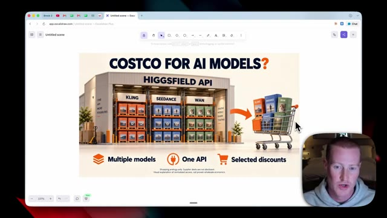
*⏱️ 00:06:30 — Une infographie illustrant une analogie avec Costco pour expliquer l'API Higgsfield, montrant des modèles d'IA stockés dans un entrepôt.*

*⏱️ 00:06:46 — Une vidéo générée par IA montrant une femme mangeant un donut dans une voiture, avec une bannière textuelle en bas.*

---

### ⏱️ `[00:06:55 - 00:07:28]` | Segment #17

**🔊 Audio (Transcription Intégrale Mot pour Mot en Français) :**
> que nous voulons utiliser au lieu d'être bloqués dans un abonnement. Et vous pensez probablement, Brock, est-ce que je ne peux pas aller directement sur Kling, Seedance, et tous ces autres modèles d'images et de vidéos ? Et la réponse est oui, vous pourriez utiliser leur API, mais c'est une façon de l'utiliser encore moins cher parce que Higgs Field agit essentiellement comme ce grossiste pour ces modèles d'images et de vidéos. J'imagine qu'ils parviennent à obtenir ces prix plus bas parce qu'ils achètent en gros, parce qu'ils ont tellement d'utilisateurs sur la plateforme. Nous pouvons désormais profiter de ces tarifs réduits qu'ils obtiennent au lieu d'aller directement chez les fournisseurs de modèles d'images et de vidéos. Et une autre partie incroyable à propos de ceci

**👁️ Analyse Visuelle d'Écran (gemini-3.5-flash-lite) :**
**Interface & Outils** : Navigateur web affichant l'application Excalidraw et une webcam incrustée du présentateur.

**Contenu textuel & Code** : Texte 'COSTCO FOR AI MODELS?', 'HIGGSFIELD API', 'KLING', 'SEEDANCE', 'WAN', 'Multiple models', 'One API', 'Selected discounts'.

**Action / Démonstration** : Le présentateur explique visuellement le concept d'une API centralisée pour accéder à plusieurs modèles d'IA comme un supermarché de gros.

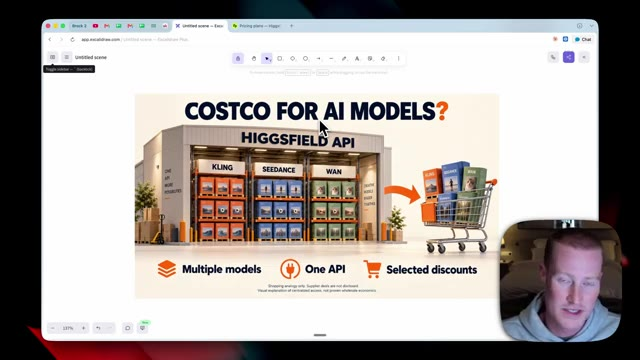
*⏱️ 00:07:03 — Une illustration schématique sur Excalidraw représentant un entrepôt intitulé 'Costco for AI Models' avec des étagères pour Kling, Seedance et Wan, et le présentateur dans un encadré vidéo en bas à droite.*

---

### ⏱️ `[00:07:28 - 00:07:53]` | Segment #18

**🔊 Audio (Transcription Intégrale Mot pour Mot en Français) :**
> c'est que nous pourrions accéder à tout cela en un seul endroit. Ainsi, au lieu d'avoir à nous rendre chez chacun de ces fournisseurs de modèles individuels, nous pouvons désormais aller directement sur l'API Higgsfield. Et tout ce dont nous avons besoin, c'est d'une seule clé API que nous pouvons générer avec Higgsfield pour obtenir un accès à tous ces modèles. C'est un peu comme si nous avions notre propre carte Costco pour aller chercher des fournitures et des produits d'épicerie moins chers au lieu d'aller acheter tous ces différents produits dans d'autres épiceries qui sont beaucoup plus chers.

**👁️ Analyse Visuelle d'Écran (gemini-3.5-flash-lite) :**
**Interface & Outils** : Navigateur web affichant une application de dessin/schéma (Excalidraw).

**Contenu textuel & Code** : Schéma explicatif comparant la complexité de multiples fournisseurs d'API par rapport à une solution centralisée unique ("One key, multiple models").

**Action / Démonstration** : Le présentateur explique la centralisation des accès API aux différents modèles d'intelligence artificielle.

---

### ⏱️ `[00:07:53 - 00:08:12]` | Segment #19

**🔊 Audio (Transcription Intégrale Mot pour Mot en Français) :**
> Avec cette seule carte d'accès ici, nous obtenons maintenant des réductions sur tous ces différents modèles. Très bien, maintenant que vous savez exactement comment fonctionne l'API HiggsField, je vais vous montrer comment configurer cela vous-même et commencer à économiser de l'argent. Il y aura donc un lien dans la description vers cette page ici, qui est l'API HiggsField. Et tout ce que je vais faire, c'est venir ici et cliquer sur créer une clé API.

**👁️ Analyse Visuelle d'Écran (gemini-3.5-flash-lite) :**
**Interface & Outils** : Navigateur web affichant le site officiel de Higgsfield API et la webcam du présentateur en bas à droite.

**Contenu textuel & Code** : Présentation de la plateforme Higgsfield API avec des offres promotionnelles (15% de réduction, jusqu'à 50% sur les modèles préférés, 15$ de solde offert) et un bouton "Create API key".

**Action / Démonstration** : Navigation sur la page web de Higgsfield API pour montrer comment créer une clé et accéder aux réductions.

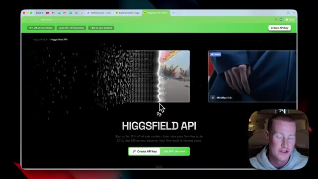
*⏱️ 00:07:58 — Page web de Higgsfield API affichant les options de réduction et le bouton pour créer une clé API.*

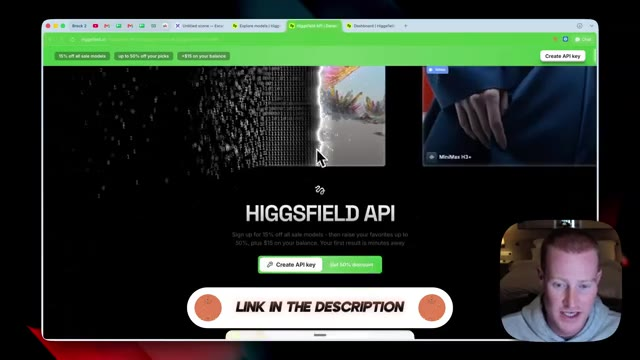
*⏱️ 00:08:07 — Page web de Higgsfield API avec l'apparition d'un encart incitant à cliquer sur le lien en description.*

---

### ⏱️ `[00:08:12 - 00:08:31]` | Segment #20

**🔊 Audio (Transcription Intégrale Mot pour Mot en Français) :**
> Ça va ensuite nous amener sur cette page juste ici. Et c'est là qu'on peut sélectionner tous les modèles qu'on veut utiliser. Par exemple, on pourrait utiliser Seedance 2.5 avec une réduction de 15 %. On pourrait utiliser Cling 3.0 avec une réduction de 15 %. Et certains modèles bénéficient de réductions plus importantes que d'autres. Donc, allez jeter un œil pour voir quel modèle obtient la plus grosse réduction et lequel vous aimeriez utiliser.

**👁️ Analyse Visuelle d'Écran (gemini-3.5-flash-lite) :**
**Interface & Outils** : Navigateur web affichant la plateforme de console Higgsfield API.

**Contenu textuel & Code** : Liste de modèles d'intelligence artificielle (Seedance 2.5, Kling 3.0, Minimax H3, Wan 3.0 Prime) avec des badges de réduction de 15%.

**Action / Démonstration** : Navigation et présentation des différents modèles d'IA disponibles sur la plateforme.

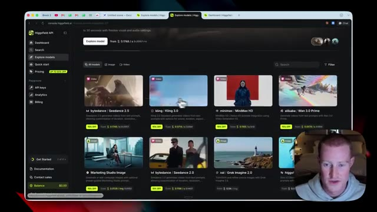
*⏱️ 00:08:17 — Interface web montrant les différents modèles d'IA disponibles sur Higgsfield API avec les réductions affichées.*

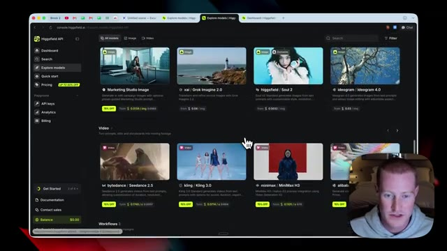
*⏱️ 00:08:27 — Défilement de la page montrant les sections d'images et de vidéos des modèles d'IA.*

---

### ⏱️ `[00:08:32 - 00:08:51]` | Segment #21

**🔊 Audio (Transcription Intégrale Mot pour Mot en Français) :**
> Ensuite, ce que je vais faire, c'est aller sur le tableau de bord. Donc juste ici, nous pouvons sélectionner trois modèles et économiser jusqu'à 50 %. Je vais donc simplement cliquer ici et choisir mes modèles. Maintenant, nous avons C-Dance 2.5, C-Dance 2.0, Cling 3.0, Cling 2.6. Nous avons le 1 3.0 Prime. Nous avons studio marketing image. Nous avons des tonnes de modèles différents que nous pouvons sélectionner pour la vidéo et l'image.

**👁️ Analyse Visuelle d'Écran (gemini-3.5-flash-lite) :**
**Interface & Outils** : Interface web de la plateforme Higgsfield AI (tableau de bord et page de tarification des API).

**Contenu textuel & Code** : Liste des modèles d'IA disponibles (Seedance 2.5, Seedance 2.0, Kling 3.0, Kling 2.6, etc.), résolutions, durées et prix remisés.

**Action / Démonstration** : Navigation sur le tableau de bord et clic sur l'option de sélection de modèles pour l'API.

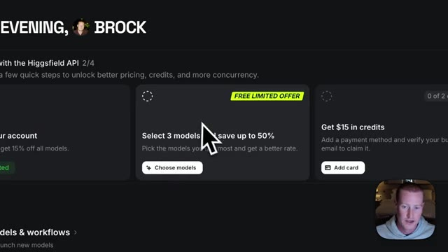
*⏱️ 00:08:36 — Le tableau de bord de la plateforme Higgsfield AI montrant une option pour sélectionner 3 modèles et économiser jusqu'à 50 %.*

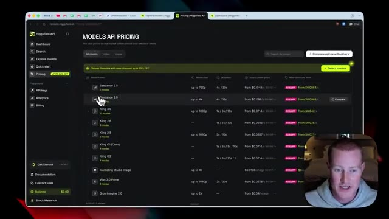
*⏱️ 00:08:41 — La page des tarifs des modèles de l'API Higgsfield affichant une liste de différents modèles d'IA avec leurs prix et réductions.*

---

### ⏱️ `[00:08:51 - 00:09:09]` | Segment #22

**🔊 Audio (Transcription Intégrale Mot pour Mot en Français) :**
> Donc nous pourrions basculer entre ceux-ci parce que nous pourrions seulement vouloir utiliser des modèles d'image et d'autres personnes pourraient vouloir utiliser des modèles de vidéo, par exemple. Et si je clique sur ceci là où il est écrit comparer le prix avec d'autres, nous pourrions voir à quel point c'est moins cher comparé à d'autres plateformes comme celle-ci. Donc comparé à FAL AI, c'est une réduction de 15% sur tous ces différents modèles juste ici.

**👁️ Analyse Visuelle d'Écran (gemini-3.5-flash-lite) :**
**Interface & Outils** : Navigateur web affichant le site console.higgsfield.ai

**Contenu textuel & Code** : Tableau des prix des modèles d'intelligence artificielle vidéo (Seedance, Kling, Wan, etc.) avec colonnes Modèle, Résolution, Durée, Prix actuel et Prix avec réduction maximale.

**Action / Démonstration** : Le présentateur survole ou clique sur le filtre de modèles vidéo et montre les options de tarification.

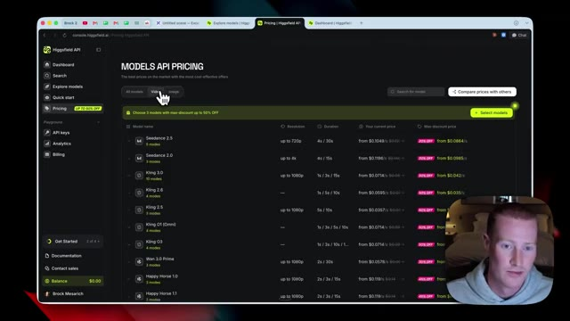
*⏱️ 00:08:55 — Capture d'écran montrant l'interface web de Higgsfield API (Models API Pricing) avec le curseur sur le filtre vidéo, et la vidéo du présentateur en bas à droite.*

---

### ⏱️ `[00:09:09 - 00:09:29]` | Segment #23

**🔊 Audio (Transcription Intégrale Mot pour Mot en Français) :**
> Et cela va nous faire économiser beaucoup d'argent si nous générons des images et des vidéos à grande échelle à l'intérieur de l'API de Higgs field. Ensuite, ce que nous devons faire, c'est réclamer les modèles que nous voulons utiliser. Personnellement, je veux utiliser Seedance 2.5 parce que je pense que c'est le meilleur modèle vidéo sur le marché. Je vais également réclamer CDN 2.0 parce que vous obtenez une résolution allant jusqu'à 4K.

**👁️ Analyse Visuelle d'Écran (gemini-3.5-flash-lite) :**
**Interface & Outils** : Navigateur web affichant la plateforme Higgsfield API avec une vue en incrustation (webcam) du présentateur en bas à droite.

**Contenu textuel & Code** : Tableau comparatif des prix des différents modèles (Kling 3.0 Pro, Kling 3.0 Standard, Seedance 2.5, etc.) avec indication des coûts par seconde et des pourcentages d'économie.

**Action / Démonstration** : Le curseur de la souris survole les tarifs de Higgsfield pour illustrer les économies réalisées sur la génération de vidéos et d'images à grande échelle.

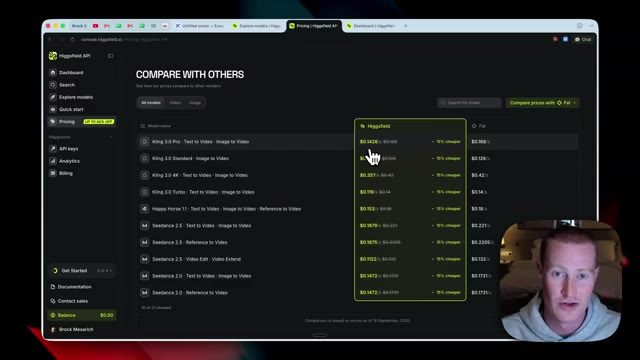
*⏱️ 00:09:14 — Capture d'écran montrant l'interface web de la console Higgsfield API, sur la page de tarification comparant les différents modèles d'intelligence artificielle.*

---

### ⏱️ `[00:09:30 - 00:09:48]` | Segment #24

**🔊 Audio (Transcription Intégrale Mot pour Mot en Français) :**
> Et ensuite pour les modèles d'images, je vais sélectionner marketing studio image juste ici. Donc maintenant que j'ai les trois réclamés, je vais cliquer sur réclamer les modèles sélectionnés, cliquer sur confirmer et réclamer. Et voilà. Ensuite, je vais simplement ajouter ma carte ici pour obtenir 15 dollars de crédits, car puisque nous payons pour cela au fur et à mesure, nous devons avoir une carte enregistrée qu'il peut facturer.

**👁️ Analyse Visuelle d'Écran (gemini-3.5-flash-lite) :**
**Interface & Outils** : Présentation ou face-caméra explicatif du trader sans interface logicielle partagée.

**Contenu textuel & Code** : Explications orales des stratégies et mise en contexte méthodologique du marché.

**Action / Démonstration** : Explications face caméra et analyse conceptuelle des marchés.

---

### ⏱️ `[00:09:49 - 00:10:08]` | Segment #25

**🔊 Audio (Transcription Intégrale Mot pour Mot en Français) :**
> Mais il y a quelques façons de faire cela. Nous pourrions renouveler automatiquement un solde spécifique, ou nous pourrions définir un montant fixe. Et une fois qu'il atteint ce montant, cela ne nous permettra plus de générer d'autres images et vidéos, mais ainsi nous ne continuons pas à payer et à accumuler une grosse facture. Puisque j'ai ajouté ma carte, mon solde a été automatiquement rechargé avec 15 crédits gratuits. Laissez-moi donc vous montrer exactement comment l'ajouter à votre agent IA.

**👁️ Analyse Visuelle d'Écran (gemini-3.5-flash-lite) :**
**Interface & Outils** : Navigateur web affichant le tableau de bord de la plateforme Higgsfield API (console.higgsfield.ai).

**Contenu textuel & Code** : Interface utilisateur avec des sections de configuration de compte, de gestion des crédits, de solde et de méthodes de paiement.

**Action / Démonstration** : Navigation et explication des options de recharge, du solde et des paramètres de facturation de la plateforme d'API.

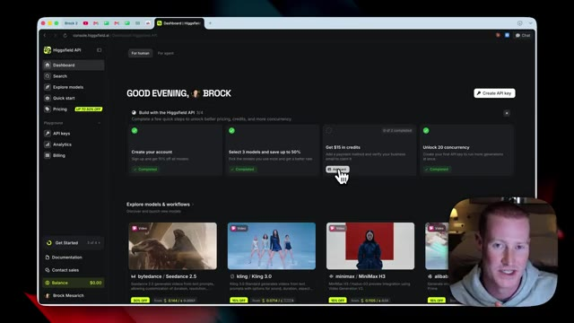
*⏱️ 00:09:53 — Le tableau de bord principal de Higgsfield API montrant les différentes options d'intégration et les modèles d'IA disponibles.*

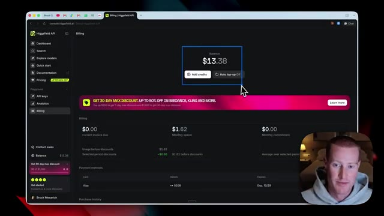
*⏱️ 00:10:03 — La page de facturation (Billing) de Higgsfield API affichant le solde actuel ($13.38) et l'option de recharge automatique (Auto top-up).*

---

### ⏱️ `[00:10:08 - 00:10:27]` | Segment #26

**🔊 Audio (Transcription Intégrale Mot pour Mot en Français) :**
> And I'm gonna do this with Codex right now. We need to first create an API key. So what I'm gonna do is click on create API key. So I'm just gonna give this a name, click on create key. And then what I'm gonna do is I'm going to copy this prompt that it gives us right here. And then I'm just going to bring this over to Codex. I'm going to select a specific project.

**👁️ Analyse Visuelle d'Écran (gemini-3.5-flash-lite) :**
**Interface & Outils** : Présentation ou face-caméra explicatif du trader sans interface logicielle partagée.

**Contenu textuel & Code** : Explications orales des stratégies et mise en contexte méthodologique du marché.

**Action / Démonstration** : Explications face caméra et analyse conceptuelle des marchés.

---

### ⏱️ `[00:10:27 - 00:10:45]` | Segment #27

**🔊 Audio (Transcription Intégrale Mot pour Mot en Français) :**
> I'm just going to paste this in. Now it's going to basically set this up for me. It's going to ask me a few things after it runs this. I'm going to have to paste in my API key into a separate ENV file, but I'm going to show you exactly how to do that. So what I did was basically just tell Codex to open the ENV file for me and it opened it up right here. So what I'm going to do is click on open in.

**👁️ Analyse Visuelle d'Écran (gemini-3.5-flash-lite) :**
**Interface & Outils** : Application Codex (interface de type IDE / assistant IA) et éditeur de code.

**Contenu textuel & Code** : Instructions textuelles d'intégration d'API, documentation SDK Higgsfield, et configuration d'un fichier de variables d'environnement (`.env.local` avec `HF_CREDENTIALS=`).

**Action / Démonstration** : Configuration d'un projet de développement et manipulation de fichiers d'environnement pour l'authentification API.

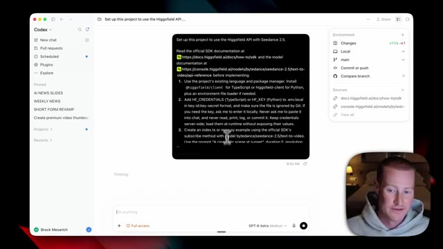
*⏱️ 00:10:31 — Interface Codex affichant des instructions pour configurer le projet avec l'API Higgsfield et Seedance 2.5, avec la webcam du présentateur en bas à droite.*

*⏱️ 00:10:40 — Interface Codex divisée en deux panneaux avec l'éditeur de code ouvert sur un fichier `.env.local` et le présentateur visible en bas à droite.*

---

### ⏱️ `[00:10:45 - 00:11:05]` | Segment #28

**🔊 Audio (Transcription Intégrale Mot pour Mot en Français) :**
> Je vais sélectionner l'application par défaut. Je vais donc cliquer sur ouvrir avec. Je vais simplement utiliser Cursor pour cela. Et ensuite, tout ce que vous avez à faire, c'est de copier votre clé API que Higgsfield vous a donnée, que vous avez générée, et de la coller simplement ici. Je ne vais pas le faire parce que je ne veux pas exposer ma clé API. Mais une fois que vous l'aurez ajoutée, enregistrez simplement ce fichier, revenez sur Codex et dites que c'est fait.

**👁️ Analyse Visuelle d'Écran (gemini-3.5-flash-lite) :**
**Interface & Outils** : Présentation ou face-caméra explicatif du trader sans interface logicielle partagée.

**Contenu textuel & Code** : Explications orales des stratégies et mise en contexte méthodologique du marché.

**Action / Démonstration** : Explications face caméra et analyse conceptuelle des marchés.

---

### ⏱️ `[00:11:05 - 00:11:25]` | Segment #29

**🔊 Audio (Transcription Intégrale Mot pour Mot en Français) :**
> All right. So now what our Codex agent is doing is it's running the CDANCE 2.5 model via the API. So it's actually going and generating this video. So let's give it a second. We should get an output here shortly. And then what I'm going to show you is the exact cost breakdown of how much it costs to generate a five second video from this example. And here we go. Here is a CDANCE 2.5 model video output.

**👁️ Analyse Visuelle d'Écran (gemini-3.5-flash-lite) :**
**Interface & Outils** : Interface de Codex avec un panneau latéral de configuration et une fenêtre de chat/terminal central.

**Contenu textuel & Code** : Texte indiquant "Working for 30s", "I'll run the Seedance 2.5 example now and verify that it completes with a video URL.", et des sources liées à Higgsfield AI et des outils d'intelligence artificielle.

**Action / Démonstration** : L'agent Codex exécute la commande liée à l'API Seedance 2.5 pour générer une vidéo.

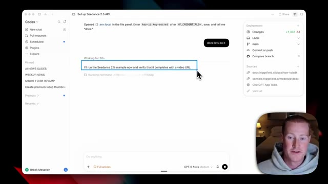
*⏱️ 00:11:10 — Interface de l'agent Codex montrant l'exécution d'une commande pour le modèle Seedance 2.5 API, avec le présentateur en médaillon.*

---

### ⏱️ `[00:11:25 - 00:11:44]` | Segment #30

**🔊 Audio (Transcription Intégrale Mot pour Mot en Français) :**
> C'est une vidéo de cinq secondes en 720p au format 16 par 9. Jetons donc un œil à ceci. D'accord, c'est du solide. C'est évidemment C-DANCE 2.5 qui génère ça et ça utilise l'API de Higgsfield pour y parvenir. Ce que j'ai fait, c'est juste demander : combien est-ce que ça a coûté ?

**👁️ Analyse Visuelle d'Écran (gemini-3.5-flash-lite) :**
**Interface & Outils** : Interface logicielle de type Codex / assistant IA, avec vignette vidéo intégrée et retour webcam du présentateur en bas à droite.

**Contenu textuel & Code** : Texte indiquant que Higgsfield est connecté, description de la vidéo générée (5 secondes, 720p, 16:9), et message de l'utilisateur demandant « how much did this cost? ».

**Action / Démonstration** : Le présentateur commente la vidéo générée et la question posée relative au coût de génération via l'API.

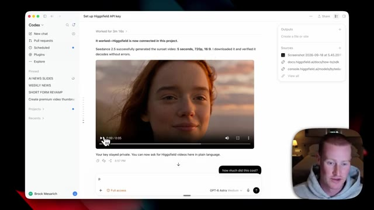
*⏱️ 00:11:30 — Capture d'écran montrant une interface de chatbot affichant une vidéo générée par IA d'un coucher de soleil avec un visage de femme, ainsi qu'une question posée sur le coût.*

---

### ⏱️ `[00:11:44 - 00:12:06]` | Segment #31

**🔊 Audio (Transcription Intégrale Mot pour Mot en Français) :**
> On dirait que Codex a dit que c'était environ 2,31 dollars avant le moindre prix réduit. Mais pour vérifier le prix réel, je dois aller sur la console Higgsfield. Donc il m'y a orienté. Maintenant, à l'intérieur d'ici, si je clique sur analytique, c'est là qu'on pourrait essentiellement voir nos dépenses mensuelles et combien nous dépensons pour toutes ces générations de vidéos. Donc au total, j'ai généré deux vidéos jusqu'à présent et j'ai dépensé un total de 3,24 dollars.

**👁️ Analyse Visuelle d'Écran (gemini-3.5-flash-lite) :**
**Interface & Outils** : Application de chat type Codex et console web Higgsfield API.

**Contenu textuel & Code** : Estimations de coûts d'API, données d'utilisation, graphiques de dépenses mensuelles et statistiques de requêtes (Seedance 2.5).

**Action / Démonstration** : Navigation de l'assistant vers la console Higgsfield puis clic sur l'onglet analytique pour consulter les dépenses réelles.

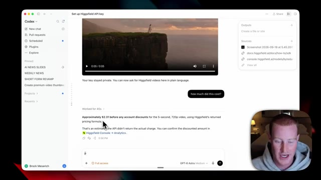
*⏱️ 00:11:49 — Capture d'écran montrant l'interface d'une application de type chat/assistant affichant une estimation de coût (environ 2,31 dollars pour une vidéo de 5 secondes) avec un lien vers la console Higgsfield.*

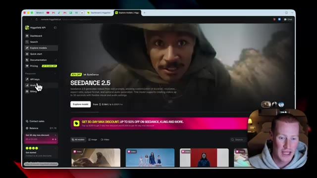
*⏱️ 00:11:55 — Capture d'écran de l'interface web de la console Higgsfield (Seedance 2.5) avec le curseur de la souris positionné sur l'onglet "Analytics" dans le menu de gauche.*

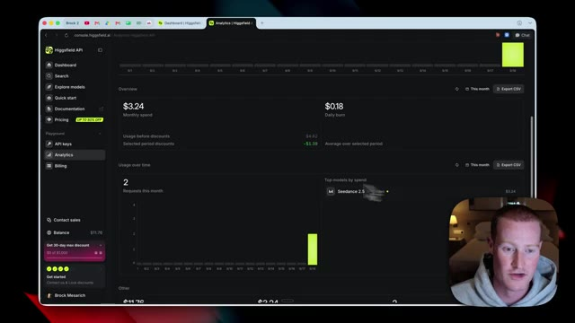
*⏱️ 00:12:00 — Capture d'écran de la page "Analytics" de la console Higgsfield affichant les métriques d'utilisation, les dépenses mensuelles (3,24 $) et un graphique d'activité.*

---

### ⏱️ `[00:12:06 - 00:12:25]` | Segment #32

**🔊 Audio (Transcription Intégrale Mot pour Mot en Français) :**
> Donc je crois que c'était environ la moitié de cela. C'était donc environ 1,60 $ par vidéo que j'ai générée avec Seedance 2.5. Et c'est pour une vidéo de cinq secondes. Je pense donc que ce prix pourrait quand même s'accumuler, mais nous obtenons un prix réduit en utilisant l'API Higgsfield. Et c'est une bonne solution pour les personnes qui veulent générer des vidéos à l'intérieur de leurs propres applications.

**👁️ Analyse Visuelle d'Écran (gemini-3.5-flash-lite) :**
**Interface & Outils** : Navigateur web affichant le tableau de bord de la console Higgsfield API (Analytics) avec le présentateur en incrustation vidéo en bas à droite.

**Contenu textuel & Code** : Dépenses mensuelles affichées à 3,24 $, dépenses journalières à 0,18 $, et le modèle "Seedance 2.5 (text2video)" indiqué dans les modèles les plus utilisés.

**Action / Démonstration** : Présentation des coûts d'utilisation de l'API Higgsfield et du modèle de génération vidéo Seedance 2.5.

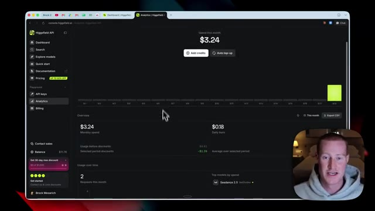
*⏱️ 00:12:11 — Capture d'écran montrant le tableau de bord des analyses (Analytics) de l'API Higgsfield avec les métriques de dépenses et d'utilisation.*

---

### ⏱️ `[00:12:25 - 00:12:48]` | Segment #33

**🔊 Audio (Transcription Intégrale Mot pour Mot en Français) :**
> Et ils ne veulent pas forcément avoir à payer pour un abonnement Higgsfield parce qu'ils paient déjà des tonnes d'abonnements récurrents chaque mois. GrokBot vient de lancer un tout nouveau mode vocal au sein de la plateforme. Vous pouvez désormais parler avec chacun de vos agents IA individuels au sein de GrokBot. Et je suis extrêmement enthousiaste à l'idée de cette sortie. La fonction vocale est donc déployée sur ordinateur et sur mobile au cours des prochains jours.

**👁️ Analyse Visuelle d'Écran (gemini-3.5-flash-lite) :**
**Interface & Outils** : Interface mobile de démonstration et application GrokBot.

**Contenu textuel & Code** : Forme d'onde audio interactive et interface de chat vocal sur mobile.
[DESC_IMAGE_3] Illustration de l'interface du mode vocal de GrokBot sur mobile avec un graphique d'onde audio et le présentateur en médaillon.

**Action / Démonstration** : Explications face caméra et analyse conceptuelle des marchés.

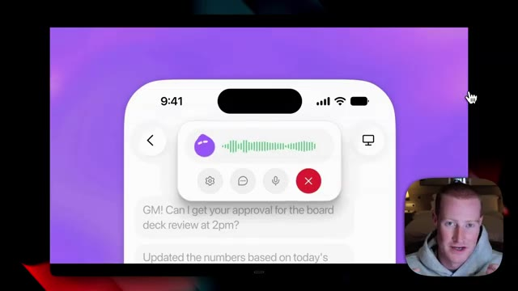
*⏱️ 00:12:42 — Maquette d'une interface mobile sur fond violet présentant le nouveau mode vocal avec une forme d'onde audio active et des boutons de contrôle.*

---

### ⏱️ `[00:12:48 - 00:13:07]` | Segment #34

**🔊 Audio (Transcription Intégrale Mot pour Mot en Français) :**
> Je dois dire que j'ai essayé de mettre à jour mon application GrokBot sur mon téléphone à plusieurs reprises maintenant, mais je n'ai toujours pas accès à cela, ce qui est probablement la chose qui m'enthousiasme le plus. Je suis très impatient d'ouvrir un GrokBot sur mon téléphone, de parler littéralement avec mon agent IA et de le voir aller orchestrer différentes tâches à travers les différents agents IA que j'ai configurés dans GrokBot.

**👁️ Analyse Visuelle d'Écran (gemini-3.5-flash-lite) :**
**Interface & Outils** : Navigateur web affichant la plateforme X (Twitter)

**Contenu textuel & Code** : Publication officielle du compte Grok Bot avec l'annonce du déploiement de la fonctionnalité vocale

**Action / Démonstration** : Le présentateur commente l'annonce du déploiement de la fonctionnalité vocale de Grok Bot tout en montrant son téléphone.

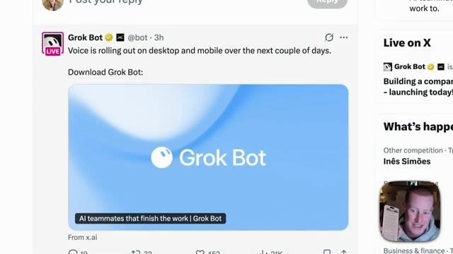
*⏱️ 00:12:53 — Capture d'écran montrant un message sur la plateforme X publié par Grok Bot annonçant le déploiement de la voix sur ordinateur et mobile, avec en médaillon le présentateur montrant son téléphone.*

---

### ⏱️ `[00:13:08 - 00:13:36]` | Segment #35

**🔊 Audio (Transcription Intégrale Mot pour Mot en Français) :**
> Maintenant, si vous voulez tester cela et que vous n'avez pas déjà téléchargé GrokBot, il y aura un lien dans la description pour vous inscrire et télécharger ceci pour l'application de bureau, mais vous pourriez aussi télécharger ceci sur votre téléphone également. Maintenant, laissez-moi plonger directement dans GrokBot. Et comme vous pouvez le voir, j'ai un tas d'agents IA différents configurés. Ce que je vais faire, c'est venir à mon agent d'orchestration principal. Et ce que fait cet agent, c'est qu'il se coordonne avec tous mes autres agents IA. Et c'est celui avec lequel je passe le plus de temps à parler, et il est capable d'aller déléguer différentes tâches aux autres.

**👁️ Analyse Visuelle d'Écran (gemini-3.5-flash-lite) :**
**Interface & Outils** : Navigateur web affichant le site officiel de Grok Bot et application de bureau Grok Bot.

**Contenu textuel & Code** : Présentation du logiciel Grok Bot, boutons de téléchargement pour macOS, et liste des agents IA disponibles (Semrush Agent, Content Agent, Main Agent).

**Action / Démonstration** : Présentation visuelle de la plateforme Grok Bot et de son application de bureau pour illustrer les instructions de téléchargement.

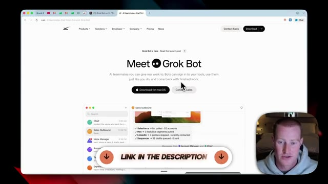
*⏱️ 00:13:15 — Page web officielle de présentation de Grok Bot avec les boutons de téléchargement et un aperçu de l'interface.*

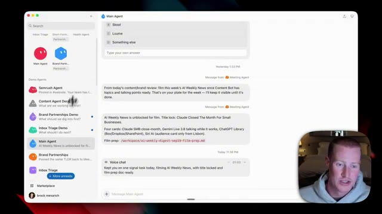
*⏱️ 00:13:22 — Interface de l'application de bureau Grok Bot affichant les différents agents IA et une discussion en cours.*

---

### ⏱️ `[00:13:36 - 00:14:13]` | Segment #36

**🔊 Audio (Transcription Intégrale Mot pour Mot en Français) :**
> Si vous découvrez GrokBot, voici en gros comment cela fonctionne. Vous pouvez donc vous retrouver en haut, en train de coordonner avec vos différents agents IA exécutifs. Et ensuite, ces agents IA se coordonnent avec les opérateurs, ou comme j'aime les appeler, les spécialistes. Ce sont des spécialistes dans une tâche donnée. Et j'ai environ huit à dix agents différents qui travaillent pour moi tout au long de la journée. Très bien. Donc, à l'intérieur de GrokBot, nous allons maintenant voir en bas à droite de notre écran, cette nouvelle icône de microphone. Tout ce que j'ai à faire pour déclencher cela, c'est de cliquer sur ce bouton ici. Je vais me mettre en sourdine et expliquer très simplement comment cela fonctionne. Tout d'abord, nous avons notre agent principal ici présent avec qui nous parlons. Nous pouvons parler à chacun d'entre eux

**👁️ Analyse Visuelle d'Écran (gemini-3.5-flash-lite) :**
**Interface & Outils** : Excalidraw (pour le schéma hiérarchique) et application de gestion d'agents IA (fenêtre de chat/interface de collaboration).

**Contenu textuel & Code** : Représentation schématique d'une structure managériale avec des agents IA (niveau exécutif et niveau opérateur) et des échanges textuels entre agents et utilisateur.

**Action / Démonstration** : Explication visuelle de l'architecture et du fonctionnement des agents IA hiérarchiques.

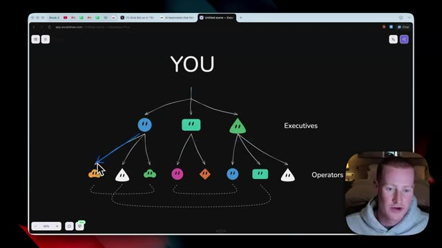
*⏱️ 00:13:45 — Schéma conceptuel sur Excalidraw montrant la hiérarchie organisationnelle entre l'utilisateur ("YOU"), les agents IA exécutifs et les opérateurs/spécialistes.*

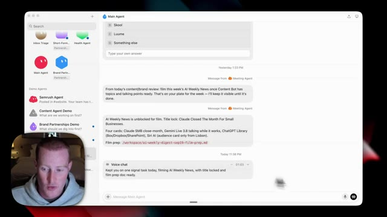
*⏱️ 00:13:55 — Interface d'une application d'agents IA ("Main Agent") affichant des flux de conversation, des tâches assignées et des historiques de discussion.*

---

### ⏱️ `[00:14:13 - 00:14:46]` | Segment #37

**🔊 Audio (Transcription Intégrale Mot pour Mot en Français) :**
> agents individually. So for example, I have my brand partnership demo agent right here. I could always go into this specific agent and have a conversation with this one instead of my main AI agent. So each of these we can conversate with. Then we can click on settings and there's a couple of different things we could change. We can change obviously the voice of these AI agents, which I've only played around with a couple, as well as it shows this cool little icon for the different AI agents that you have with that voice. This is cool because you could obviously have specific voices to each of these individual agents to differentiate between them so they don't all

**👁️ Analyse Visuelle d'Écran (gemini-3.5-flash-lite) :**
**Interface & Outils** : Application de bureau d'assistant IA avec interface de chat et panneau de paramètres vocaux.

**Contenu textuel & Code** : Liste des agents IA (Semrush Agent, Content Agent Demo, Brand Partnerships Demo, etc.) et options de sélection de voix (Castor sélectionné).

**Action / Démonstration** : Navigation et sélection d'un agent spécifique dans la liste, puis ouverture des paramètres pour choisir la voix de l'assistant.

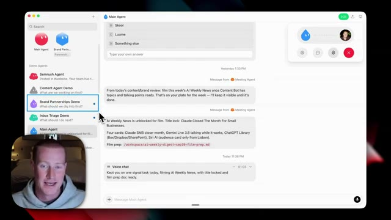
*⏱️ 00:14:21 — Interface d'une application d'IA montrant la liste des agents individuels dans le panneau latéral gauche, avec le présentateur en médaillon en bas à gauche.*

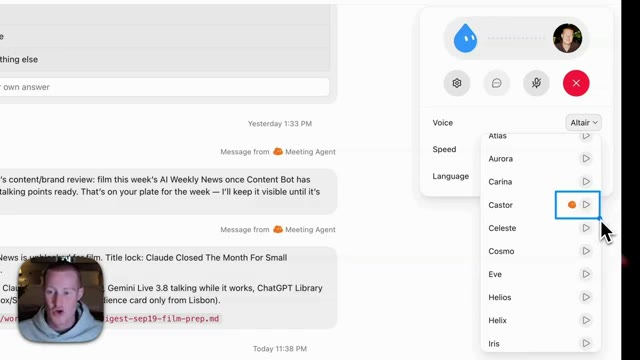
*⏱️ 00:14:38 — Gros plan sur le menu de configuration vocale de l'assistant IA, affichant une liste de voix disponibles (Atlas, Aurora, Carina, Castor, etc.).*

---

### ⏱️ `[00:14:46 - 00:15:06]` | Segment #38

**🔊 Audio (Transcription Intégrale Mot pour Mot en Français) :**
> qui se ressemblent, ce que je trouve plutôt cool aussi, et je pense que c'est vraiment génial. Nous pouvons également modifier la vitesse de notre agent vocal. Nous pouvons donc l'augmenter jusqu'à 1,5 fois, ce que j'ai trouvé très utile depuis que j'ai fait des tests, car il me semble qu'ils sont très lents pour communiquer. J'aime que mes agents vocaux parlent très vite et aillent droit au but.

**👁️ Analyse Visuelle d'Écran (gemini-3.5-flash-lite) :**
**Interface & Outils** : Interface web de l'agent conversationnel / application de réunion.

**Contenu textuel & Code** : Paramètres vocaux avec les options de vitesse affichées : 0.75x, 1x, 1.25x et 1.5x.

**Action / Démonstration** : Le curseur clique pour modifier la vitesse de l'agent vocal.

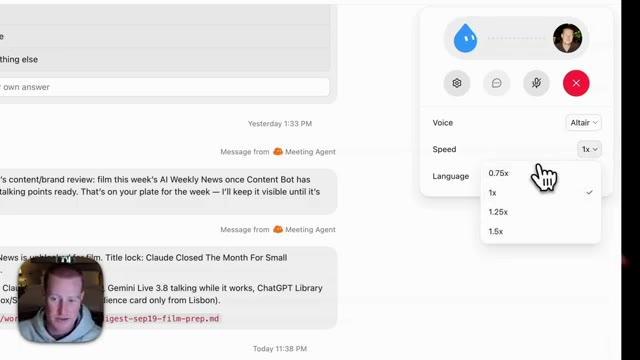
*⏱️ 00:14:51 — Interface de configuration de l'agent vocal montrant le menu déroulant pour modifier la vitesse de lecture.*

---

### ⏱️ `[00:15:06 - 00:15:26]` | Segment #39

**🔊 Audio (Transcription Intégrale Mot pour Mot en Français) :**
> Et quand ça prend une éternité pour dire quelque chose, c'est juste très ennuyeux. Donc j'accélère le mien à 1,25 ou 1,5 fois. Et ensuite, nous pouvons aussi sélectionner la langue. Nous avons donc quelques langues différentes ici. Nous en avons environ 12 à 15, peut-être 20 langues différentes. Ou nous pouvons simplement sélectionner la détection automatique. Et ensuite, cela va automatiquement détecter quelle langue vous parlez.

**👁️ Analyse Visuelle d'Écran (gemini-3.5-flash-lite) :**
**Interface & Outils** : Interface logicielle de type agent de réunion avec panneau de configuration vocale.

**Contenu textuel & Code** : Options de vitesse de lecture (0.75x à 1.5x), voix (« Altair ») et réglages de langue.

**Action / Démonstration** : Le curseur survole l'option de vitesse 1.25x pour l'ajuster.

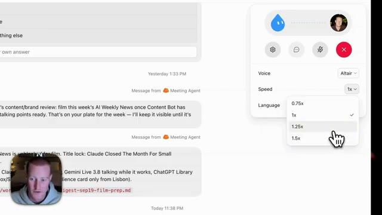
*⏱️ 00:15:11 — Capture d'écran montrant le menu des paramètres vocaux et de vitesse de lecture avec une liste déroulante affichant les vitesses (0.75x, 1x, 1.25x, 1.5x) et une option de sélection de la langue.*

---

### ⏱️ `[00:15:26 - 00:15:44]` | Segment #40

**🔊 Audio (Transcription Intégrale Mot pour Mot en Français) :**
> Donc il pourrait alors vous parler dans cette langue en retour. Maintenant, ce que je vais faire, c'est que je vais désactiver le mode muet et je vais parler avec cet agent. Hé, qu'est-ce qui se passe ? Quel est ton nom ? Je suis ton agent principal, celui qui te garde concentré sur ce qui fait vraiment avancer YouTube AI for non-techies, school et loomy. Qu'est-ce qui te préoccupe en ce moment ?

**👁️ Analyse Visuelle d'Écran (gemini-3.5-flash-lite) :**
**Interface & Outils** : Application de bureau d'agent conversationnel (interface similaire à un tableau de bord IA avec menu latéral et panneau contextuel vocal).

**Contenu textuel & Code** : Panneau de configuration vocale avec les options 'Unmute', 'Voice' (réglé sur Altair), 'Speed' (1x) et 'Language' (Auto-detect), ainsi que des messages de chat textuel et vocal dans l'historique de l'agent principal.

**Action / Démonstration** : Le curseur de la souris clique sur le bouton pour désactiver le mode muet (unmute) afin de démarrer la conversation vocale avec l'agent d'intelligence artificielle.

*⏱️ 00:15:30 — Interface d'une application d'intelligence artificielle montrant un panneau de chat vocal et la liste des agents, avec le présentateur en médaillon en bas à gauche.*

---

### ⏱️ `[00:15:45 - 00:16:03]` | Segment #41

**🔊 Audio (Transcription Intégrale Mot pour Mot en Français) :**
> Donc, comme vous pouvez le voir, c'est très, très lent et agaçant. Je vais donc augmenter la vitesse à 1,5x et partir de là. Oui, alors mon principal problème, c'est que j'ai juste beaucoup d'e-mails auxquels je dois répondre demain. C'est exactement le genre de chose que je délègue plutôt que de fouiller moi-même. Très bien, c'est donc mon agent principal. Laissez-moi passer à un autre agent maintenant et tester celui-là aussi.

**👁️ Analyse Visuelle d'Écran (gemini-3.5-flash-lite) :**
**Interface & Outils** : Application logicielle d'agent IA (interface de type messagerie/chat avec panneau de configuration vocal).

**Contenu textuel & Code** : Paramètres vocaux affichés avec les options de vitesse (0.75x, 1x, 1.25x, 1.5x) et historique de chat de l'agent.

**Action / Démonstration** : Le curseur sélectionne le réglage de vitesse à 1,5x dans le menu contextuel.

*⏱️ 00:15:49 — Interface d'un agent IA avec un menu déroulant pour régler la vitesse de lecture vocale sur 1,5x.*

---

### ⏱️ `[00:16:03 - 00:16:22]` | Segment #42

**🔊 Audio (Transcription Intégrale Mot pour Mot en Français) :**
> Salut, comment ça va ? Salut, ça bouge. Le contrat de Rivermark est toujours en attente de signature pour cinq audits en IA d'une valeur de 21 000. Les trois projets de Rightfold ne sont pas signés à 24, et Stackmere est bloqué à 14,8 depuis un moment maintenant. Tu veux que je relance l'un d'eux aujourd'hui, ou tu es concentré ailleurs ? Ouais, je pense que si tu pouvais relancer le premier, ce serait super.

**👁️ Analyse Visuelle d'Écran (gemini-3.5-flash-lite) :**
**Interface & Outils** : Application logicielle de type agent conversationnel / gestionnaire d'e-mails avec panneau de paramètres vocaux.

**Contenu textuel & Code** : Historique de discussion textuelle listant des prospects et contrats (Rivermark, Harborline, Northline Labs, Siltwork), ainsi qu'un menu déroulant de vitesse de lecture vocale réglé sur 1.5x.

**Action / Démonstration** : Interaction avec l'interface pour configurer les paramètres de l'agent vocal tout en visualisant le résumé des e-mails et contrats en attente.

*⏱️ 00:16:08 — Interface d'un agent de messagerie intelligent (Email Agent Demo) avec panneau latéral de configuration vocale et vignette vidéo du présentateur en bas à gauche.*

---

### ⏱️ `[00:16:23 - 00:16:46]` | Segment #43

**🔊 Audio (Transcription Intégrale Mot pour Mot en Français) :**
> Je réponds à la rédaction d'un rappel pour Rivermark concernant ces cinq audits. Tu peux me dire quand ce rappel est envoyé ? Je te préviens dès qu'il est envoyé. Tu veux mettre autre chose en attente pendant que ça se prépare ? Ouais, je veux voir si tu as la capacité d'utiliser l'ordinateur. C'est possible ? Ouais, je peux accéder à ton ordinateur, ton navigateur, tes fichiers, tes e-mails, tout ça. C'est comme ça que je récupère ta boîte de réception et que je rédige ces réponses en ce moment même. Qu'est-ce que tu as besoin de faire ?

**👁️ Analyse Visuelle d'Écran (gemini-3.5-flash-lite) :**
**Interface & Outils** : Application logicielle de type agent IA pour la gestion des e-mails, avec interface de chat et panneau de configuration vocale.

**Contenu textuel & Code** : Liste des messages et des tâches en cours (Rivermark, Harborline, Northline Labs, Siltwork), historique des discussions et confirmation de l'envoi d'un e-mail.

**Action / Démonstration** : Démonstration de l'utilisation d'un agent IA pour interagir avec une boîte de réception et rédiger des e-mails.

*⏱️ 00:16:29 — Capture d'écran montrant l'interface d'un agent de messagerie (Email Agent Demo) avec une fenêtre de discussion et un encart vidéo du présentateur en bas à gauche.*

---

### ⏱️ `[00:16:46 - 00:17:21]` | Segment #44

**🔊 Audio (Transcription Intégrale Mot pour Mot en Français) :**
> Oui, je veux que tu affiches l'écran d'utilisation réelle de l'ordinateur et que tu essaies de te connecter à mon Instagram. Je peux ouvrir le navigateur et aller sur Instagram, mais je ne saisirai pas ton identifiant. Parfait. Faisons cela. Merci. C'est tout.

**👁️ Analyse Visuelle d'Écran (gemini-3.5-flash-lite) :**
**Interface & Outils** : Interface utilisateur d'un agent IA de gestion d'e-mails et de tâches automatisées.

**Contenu textuel & Code** : Historique de discussion, commandes de l'agent vocal et aperçu en direct de l'écran du navigateur.
[DESC_IMAGE_3_BIS] (Redondant avec l'image 3)

**Action / Démonstration** : L'agent IA ouvre un navigateur et navigue vers la page d'accueil d'Instagram pour se connecter selon la demande de l'utilisateur.

*⏱️ 00:16:55 — Interface d'un agent IA d'e-mail avec une fenêtre de chat principale et un aperçu d'écran à droite.*

*⏱️ 00:17:12 — L'interface d'e-mail montre à présent l'écran de l'agent affichant la page de connexion d'Instagram dans un navigateur.*

---

### ⏱️ `[00:17:21 - 00:17:40]` | Segment #45

**🔊 Audio (Transcription Intégrale Mot pour Mot en Français) :**
> Bon, alors c'est plutôt cool. Évidemment, je me suis assis ici et je lui ai dit d'aller utiliser l'utilisation de l'ordinateur pour aller se connecter à mon Instagram ou au moins essayer de se connecter. Et il est allé utiliser l'ordinateur pour ouvrir Instagram. C'est plutôt cool. Non seulement il peut faire ça, mais il peut aussi signaler et fondamentalement déléguer différentes tâches à mes autres agents IA spécialisés.

**👁️ Analyse Visuelle d'Écran (gemini-3.5-flash-lite) :**
**Interface & Outils** : Application logicielle de type agent d'IA, interface de chat et aperçu de navigateur web.

**Contenu textuel & Code** : Historique de discussion avec des prompts textuels et des réponses de l'agent, ainsi qu'une vue de l'écran de l'agent montrant la page de connexion Instagram.

**Action / Démonstration** : Démonstration de l'utilisation d'un agent capable d'interagir avec l'ordinateur pour ouvrir une page web spécifique.

*⏱️ 00:17:26 — Capture d'écran montrant l'interface d'un agent IA avec un volet latéral listant différentes démos et un panneau principal affichant des interactions textuelles et un aperçu vidéo en médaillon d'une fenêtre de navigateur ouverte sur la page de connexion d'Instagram.*

---

### ⏱️ `[00:17:40 - 00:18:15]` | Segment #46

**🔊 Audio (Transcription Intégrale Mot pour Mot en Français) :**
> So I think that this is pretty cool actually. Now, if you've never used GrokBot before, it's pretty cool how we can connect the different applications that we use. So for example, I'm having a go and pull from my email inbox and I'm able to use voice mode in order to go and pull that information. so it is almost like we have our own Jarvis that can work across the different applications that we use. We're able to do this with the plugins inside of our GrokBot. So for example, I have 24 different applications configured which I can go through and scroll through all of these. I have X, I've got Granola, I have Gmail, Clay, ClickUp, all these different platforms that I've connected to

**👁️ Analyse Visuelle d'Écran (gemini-3.5-flash-lite) :**
**Interface & Outils** : Application de bureau d'agents IA (Agent interface / Marketplace).

**Contenu textuel & Code** : Liste des connecteurs d'applications (Gmail, Google Calendar, ClickUp, Granola, Higgsfield-CLI) avec les statuts "Connected" ou "Authenticate".

**Action / Démonstration** : Navigation dans l'interface de l'application et démonstration de la connexion entre différents outils via des agents IA.

*⏱️ 00:17:49 — Interface d'un agent IA de gestion d'e-mails montrant des interactions textuelles et vocales, avec la vidéo du présentateur en incrustation.*

*⏱️ 00:18:07 — Fenêtre de gestion des intégrations (Marketplace) affichant des connecteurs pour Gmail, Google Calendar, ClickUp et Granola.*

---

### ⏱️ `[00:18:15 - 00:18:35]` | Segment #47

**🔊 Audio (Transcription Intégrale Mot pour Mot en Français) :**
> mais disons qu'il y a une application à laquelle je veux me connecter et que je ne vois pas ici. Eh bien, vous pouvez le faire avec le MCP Zapier. Personnellement, j'ai ce serveur MCP Zapier configuré et, par exemple, j'utilise Drip pour mes campagnes de marketing par e-mail et il n'y a pas de plugin à l'intérieur de GrokBot. Il n'y a donc aucun moyen pour moi de connecter Drip à l'intérieur de GrokBot à moins d'utiliser quelque chose comme le MCP Zapier.

**👁️ Analyse Visuelle d'Écran (gemini-3.5-flash-lite) :**
**Interface & Outils** : Application de bureau de gestion d'agents IA et interface web Zapier Central / MCP Server.

**Contenu textuel & Code** : Liste des connecteurs/intégrations d'applications tierces (Gmail, SEMrush, Drip, Google Calendar, etc.) accessibles par l'agent IA.
[DESC_IMAGE_1] Navigation dans le marketplace des connecteurs pour l'agent IA.
[DESC_IMAGE_2] Démonstration des actions et déclencheurs disponibles pour l'application Drip via le serveur MCP Zapier.

**Action / Démonstration** : Explications face caméra et analyse conceptuelle des marchés.

*⏱️ 00:18:20 — Interface d'une application de gestion d'agents IA montrant une liste de connecteurs disponibles sur le marketplace (Google Calendar, ClickUp, Supabase, Zapier, etc.).*

*⏱️ 00:18:25 — Interface Zapier affichant les applications connectées pour un agent IA, avec un focus sur le service Drip et ses différentes actions disponibles (créer un abonné, gérer les campagnes).*

---

### ⏱️ `[00:18:36 - 00:18:55]` | Segment #48

**🔊 Audio (Transcription Intégrale Mot pour Mot en Français) :**
> Donc maintenant, ce que je peux faire, c'est venir ici et activer mon mode vocal, et je vais simplement lui demander d'aller chercher des informations sur Drip, puisqu'il utilise Zapier pour combler cet écart. Hé, tu peux me rendre service et récupérer mes dernières données de campagne provenant de Drip via le MCP Zapier ? Récupération de vos dernières données de campagne Drip via le MCP Zapier en cours.

**👁️ Analyse Visuelle d'Écran (gemini-3.5-flash-lite) :**
**Interface & Outils** : Application de bureau de gestion d'agents IA, interface de chat et panneau de configuration vocale.

**Contenu textuel & Code** : Historique des messages de l'agent, instructions sur la préparation de films, notes vocales et liste des agents disponibles (Inbox Triage, Content Agent, Health Agent, etc.).

**Action / Démonstration** : Le curseur clique sur le bouton de commande vocale dans le panneau contextuel supérieur droit de l'agent pour activer le mode vocal.

*⏱️ 00:18:40 — Interface d'un agent IA (« Main Agent ») avec un panneau de discussion, une liste de différents agents sur le côté gauche, et une incrustation vidéo du présentateur en bas à droite.*

---

### ⏱️ `[00:18:57 - 00:19:27]` | Segment #49

**🔊 Audio (Transcription Intégrale Mot pour Mot en Français) :**
> C'est en cours. J'aurai les chiffres dès qu'ils seront rentrés. Il y a quelque chose de précis que vous espérez y voir ou juste une vue d'ensemble ? Non, j'aimerais juste voir les principaux détails et les principales statistiques. C'est noté pour les principaux détails et stats. C'est exactement pour cela que le sondage est configuré. Ça devrait arriver d'ici peu. Maintenant, je tiens à dire que cela va probablement prendre un peu de temps pour extraire cette information car il doit effectuer plusieurs appels d'outils en arrière-plan, comme vous pouvez le voir en bas où il est écrit « connexion à Zapier » avec notre petite icône d'agent qui danse.

**👁️ Analyse Visuelle d'Écran (gemini-3.5-flash-lite) :**
**Interface & Outils** : Application de bureau de type agent conversationnel (Main Agent).

**Contenu textuel & Code** : Historique de discussion textuelle listant des tâches liées au contenu hebdomadaire, options de configuration vocale (voix Altair, vitesse 1.25x, détection automatique de la langue).

**Action / Démonstration** : Interaction avec l'interface de l'agent vocal et paramétrage des options audio.

*⏱️ 00:19:05 — Interface d'un agent conversationnel IA avec un panneau de paramètres vocaux ouvert à droite et une webcam du présentateur en bas à droite.*

---

### ⏱️ `[00:19:27 - 00:19:50]` | Segment #50

**🔊 Audio (Transcription Intégrale Mot pour Mot en Français) :**
> Mec, j'aime vraiment beaucoup GrokBot. C'est tellement simple à utiliser. J'adore l'interface. Et honnêtement, je me vois l'utiliser de plus en plus chaque jour au lieu d'utiliser Claude, parce que Claude était mon outil principal, mais j'utilise pas mal GrokBot maintenant. 260917 Claude 2.0. Objet, Claude vient d'ajouter des documents et des diapositives. Envoyé hier à 15h30 heure de Lisbonne aux abonnés d'avant le 9 septembre.

**👁️ Analyse Visuelle d'Écran (gemini-3.5-flash-lite) :**
**Interface & Outils** : Application logicielle de bureau (interface de chat d'agents IA avec barre latérale de sélection).

**Contenu textuel & Code** : Historique de discussion textuelle et vocale avec des agents IA (Main Agent, Meeting Agent), incluant des messages résumant des tâches de préparation de contenu et des liens vers des documents de travail.

**Action / Démonstration** : Navigation et présentation visuelle de l'interface utilisateur de l'application d'agents IA par le créateur.

*⏱️ 00:19:33 — Capture d'écran montrant l'interface d'un assistant virtuel (GrokBot / application d'agents IA) sur macOS, avec le présentateur en médaillon vidéo en bas à droite.*

---

### ⏱️ `[00:19:51 - 00:20:10]` | Segment #51

**🔊 Audio (Transcription Intégrale Mot pour Mot en Français) :**
> À peu près 14 831 abonnés actifs. Parfait. Pourrais-tu juste- Une petite information, les taux d'ouverture et de clic ne passent pas par l'API Zapier Drip. Parfait. Peux-tu en fait juste coller cette information dans le chat et ne pas me faire un cours magistral ici ? Dernier envoi Drip, YT-260917Claud2.0.

**👁️ Analyse Visuelle d'Écran (gemini-3.5-flash-lite) :**
**Interface & Outils** : Application de bureau de type agent conversationnel (interface similaire à un tableau de bord IA avec menu latéral de sélection d'agents).

**Contenu textuel & Code** : Historique de messages texte et vocaux avec des agents IA (« Meeting Agent »), liens vers des documents de préparation (« /workspace/ai-weekly-digest-sep19-film-prep.md ») et paramètres de synthèse vocale (vitesse, langue).

**Action / Démonstration** : Navigation et interaction avec l'interface de l'agent virtuel, un curseur simulant un clic sur les options vocales.

*⏱️ 00:19:55 — Interface d'une application d'intelligence artificielle (« Main Agent ») affichant des flux de discussion, avec un panneau de configuration vocale ouvert sur le côté droit et la webcam du présentateur incrustée en bas à droite.*

---

### ⏱️ `[00:20:10 - 00:20:30]` | Segment #52

**🔊 Audio (Transcription Intégrale Mot pour Mot en Français) :**
> Sujet, Claude vient d'ajouter un point. Très bien, donc il n'est pas très doué pour écouter les instructions parce que j'avais dit que je voulais qu'il arrête de parler, mais je voulais simplement envoyer un aperçu textuel. Mais il a effectivement extrait ces informations de Drip via le MCP Zapier. C'est donc plutôt cool. Le fait que nous puissions le faire fonctionner sur différentes applications et nous donner ces aperçus, et également aller y exécuter des actions.

**👁️ Analyse Visuelle d'Écran (gemini-3.5-flash-lite) :**
**Interface & Outils** : Application de bureau d'agents IA avec barre latérale gauche pour la sélection des agents et panneau de discussion principal à droite.

**Contenu textuel & Code** : Messages de chat vocal et un bloc de données textuelles affichant les informations d'une campagne Drip récente (campagne, sujet, date d'envoi, statut, audience, abonnés actifs).

**Action / Démonstration** : Présentation des résultats de l'extraction de données de Drip par l'agent IA à l'écran.

*⏱️ 00:20:15 — Interface d'une application d'agents IA montrant une conversation de chat vocal et un résumé des données de campagne Drip extraites via Zapier.*

---

### ⏱️ `[00:20:30 - 00:20:48]` | Segment #53

**🔊 Audio (Transcription Intégrale Mot pour Mot en Français) :**
> Ensuite, nous avons une mise à jour de Meta Muse. Si vous ne savez pas ce qu'est Muse, il s'agit du nouvel assistant IA personnel de Meta qui est très similaire à GrokBot. Vous pouvez désormais utiliser Muse sur Mac et celui-ci peut également fonctionner à travers tout votre ordinateur. Il peut donc organiser votre dossier de téléchargements, retrouver un fichier que vous avez perdu de vue et résumer vos messages et vos notes.

**👁️ Analyse Visuelle d'Écran (gemini-3.5-flash-lite) :**
**Interface & Outils** : Navigateur web affichant la plateforme X (anciennement Twitter).

**Contenu textuel & Code** : Texte du post officiel de Meta Muse présentant les fonctionnalités : « Muse is now available on Mac. Your personal agent can get things done for you directly on your computer... - Organize your downloads folder - Find a file you've lost track of - Summarize your messages and notes » et l'URL ai.meta.com/muse/download/.

**Action / Démonstration** : Le présentateur commente l'actualité de l'intelligence artificielle en naviguant sur la page X de Meta Muse et en survolant le texte du tweet avec le curseur.

*⏱️ 00:20:34 — Capture d'écran du navigateur affichant un post sur X (Twitter) du compte officiel @Muse, annonçant sa disponibilité sur Mac avec le lien de téléchargement ai.meta.com/muse/download/, et incluant une bulle vidéo de l'animateur en bas à droite.*

*⏱️ 00:20:39 — Gros plan sur le même post de @Muse sur X, montrant les détails des fonctionnalités de l'assistant personnel sur Mac et le lien URL.*

---

### ⏱️ `[00:20:48 - 00:21:07]` | Segment #54

**🔊 Audio (Transcription Intégrale Mot pour Mot en Français) :**
> Il a donc maintenant accès à différents dossiers et fichiers sur votre ordinateur, tout comme GrokBot, tout comme CloudCode, Cowork, et tous ces autres agents IA. Si vous voulez essayer Muse, il y a aura un lien dans la description pour le faire, et j'ai également expliqué en détail comment l'utiliser dans l'épisode sur l'actualité de l'IA de la semaine dernière si vous voulez y jeter un œil aussi. Ensuite, nous allons parler brièvement de celui-ci.

**👁️ Analyse Visuelle d'Écran (gemini-3.5-flash-lite) :**
**Interface & Outils** : Navigateur web affichant un post de l'outil d'intelligence artificielle Muse.

**Contenu textuel & Code** : Texte de présentation de l'application Muse sur Mac avec les fonctionnalités clés : organiser le dossier téléchargements, retrouver des fichiers égarés, résumer des messages et notes, ainsi que le lien de téléchargement.

**Action / Démonstration** : Présentation visuelle et explication des capacités d'accès aux dossiers locaux par l'agent IA Muse.

*⏱️ 00:20:52 — Capture d'écran montrant une publication officielle de Muse sur les réseaux sociaux détaillant les fonctionnalités de l'agent IA sur Mac.*

---

### ⏱️ `[00:21:07 - 00:21:27]` | Segment #55

**🔊 Audio (Transcription Intégrale Mot pour Mot en Français) :**
> OpenAI vient de lancer ChatGPT Law, avec lequel vous pouvez désormais exploiter la puissance de ChatGPT Astra 6 pour des cas d'usage juridiques spécifiques. Pour l'instant, c'est uniquement disponible pour certains cabinets d'avocats. Donc si vous n'êtes pas un cabinet d'avocats, cela ne vous concerne probablement pas, mais il est intéressant de voir que ChatGPT s'implique désormais dans des tâches juridiques spécifiques.

**👁️ Analyse Visuelle d'Écran (gemini-3.5-flash-lite) :**
**Interface & Outils** : Présentation vidéo sur fond blanc et noir.

**Contenu textuel & Code** : Textes promotionnels et logos de cabinets d'avocats (Latham & Watkins, Ropes & Gray, Skadden, Sullivan & Cromwell).
[DESC_IMAGE_3] Le présentateur commente le lancement d'outils d'IA pour des cabinets juridiques spécifiques.

**Action / Démonstration** : Explications face caméra et analyse conceptuelle des marchés.

---

### ⏱️ `[00:21:27 - 00:21:46]` | Segment #56

**🔊 Audio (Transcription Intégrale Mot pour Mot en Français) :**
> Et si vous jetez un œil à cette démo juste ici, vous pouvez réellement voir ce modèle, GPT-6 Astra Law Ultra, qui est la première fois que nous voyons un modèle spécifique à une tâche. C'est donc une sortie de produit intéressante, non seulement si vous êtes dans le domaine juridique, mais aussi pour les secteurs adjacents comme ChatGPT Finance. Je peux imaginer qu'ils vont lancer un modèle similaire.

**👁️ Analyse Visuelle d'Écran (gemini-3.5-flash-lite) :**
**Interface & Outils** : Interface de type chat ou assistant IA avec un champ de saisie de prompt et un menu déroulant de sélection de modèle.

**Contenu textuel & Code** : Le texte du prompt visible est : « Draft S-1 shell mapping for Innovation, Inc. using the linked VDR an ». Le modèle sélectionné est « GPT-6 Astra Law Ultra ». Des icônes de plugins (fichiers, outils bureautiques) sont également affichées sous le champ de saisie.

**Action / Démonstration** : Le curseur de la souris survole le sélecteur de modèle pour mettre en avant le modèle spécifique GPT-6 Astra Law Ultra.

*⏱️ 00:21:32 — Capture d'écran montrant une interface de type assistant IA avec un prompt juridique et la sélection du modèle GPT-6 Astra Law Ultra.*

---

### ⏱️ `[00:21:46 - 00:22:07]` | Segment #57

**🔊 Audio (Transcription Intégrale Mot pour Mot en Français) :**
> Par exemple, ChatGPT 6 Astra Finance. Je suppose qu'ils travaillent probablement sur un modèle similaire qui est spécifique à ce secteur et à cette industrie. Encore une fois, cela ne s'applique pas nécessairement à vous si vous ne travaillez pas au sein d'un cabinet d'avocats, mais je pense que c'est juste un lancement de produit intéressant et peut-être une sorte de feuille de route directe sur la direction que prend OpenAI avec ces modèles spécialisés basés sur des tâches et des industries données.

**👁️ Analyse Visuelle d'Écran (gemini-3.5-flash-lite) :**
**Interface & Outils** : Interface web de type assistant conversationnel spécialisé (GPT-6 Astra Law Ultra) et visionneuse de documents juridiques/financiers.

**Contenu textuel & Code** : Texte de prompt juridique, documents S-1 de la SEC, rapports de cartographie d'offres publiques, métadonnées d'entreprise.

**Action / Démonstration** : Rédaction automatisée et cartographie de documents de régulation financière et boursière (S-1) via un assistant IA spécialisé.

*⏱️ 00:21:51 — Interface de requête montrant un prompt pour un document S-1 avec le modèle GPT-6 Astra Law Ultra.*

*⏱️ 00:21:57 — Aperçu d'un document Word de cartographie S-1 pour l'entreprise Innovation, Inc.*

*⏱️ 00:22:02 — Interface divisée affichant le brouillon généré d'un formulaire S-1 de la SEC pour l'entreprise Innovatlon, Inc.*

---

### ⏱️ `[00:22:07 - 00:22:28]` | Segment #58

**🔊 Audio (Transcription Intégrale Mot pour Mot en Français) :**
> Si vous voulez en savoir plus, je mettrai le lien de l'article ci-dessous dans la description. Vous pourrez donc aller y jeter un œil. C'est assez détaillé, mais oui, plutôt intéressant. Maintenant, pour notre prochaine mise à jour, Anthropic a publié une toute nouvelle façon d'utiliser les projets Claude à l'intérieur de Claude Code. Laissez-moi donc vous expliquer très simplement comment cela fonctionne. Comme vous le voyez dans l'interface à l'intérieur de Claude Code, vous avez désormais un bouton de projets.

**👁️ Analyse Visuelle d'Écran (gemini-3.5-flash-lite) :**
**Interface & Outils** : Navigateur web affichant une page d'article ou de présentation sur l'IA (AI Weekly, Claude Projects 2.0).

**Contenu textuel & Code** : Texte « Claude coordinates several tasks at once », interface de démonstration vidéo montrant des blocs de texte interactifs (tâches gérées par Claude), et le flux vidéo du présentateur.

**Action / Démonstration** : Le présentateur commente l'actualité d'Anthropic concernant les nouveaux projets de Claude tandis que la page web associée est affichée à l'écran.

*⏱️ 00:22:17 — Capture d'écran montrant le navigateur affichant le site web AI Weekly avec le titre « Claude coordinates several tasks at once », une vidéo intégrée et le présentateur en bas à droite.*

---

### ⏱️ `[00:22:28 - 00:22:48]` | Segment #59

**🔊 Audio (Transcription Intégrale Mot pour Mot en Français) :**
> Et à l'intérieur de ce projet, ce que nous pourrions faire, c'est avoir plusieurs instances différentes de code Cloud en cours d'exécution. Nous pourrions donc lui donner une tâche spécifique et il ira l'acheminer vers un sous-agent différent. De cette façon, nous pourrions exécuter plusieurs tâches en parallèle en même temps à l'intérieur d'un même projet donné. Ensuite, ce que cela fait, c'est que cela les sépare en différents fils de discussion. Ainsi, plusieurs instances peuvent fonctionner en même temps.

**👁️ Analyse Visuelle d'Écran (gemini-3.5-flash-lite) :**
**Interface & Outils** : Interface logicielle de gestion de projet et de code (type interface agentique).

**Contenu textuel & Code** : Liste de tâches textuelles comme "Find what to simplify in acme/storefront", "sandbox the webhook handler against stripe test mode".

**Action / Démonstration** : Démonstration de l'attribution de tâches multiples à un assistant IA pour exécuter des actions en parallèle.

*⏱️ 00:22:33 — Interface d'un outil d'assistant de code avec plusieurs fils de discussion et des tâches en cours.*

---

### ⏱️ `[00:22:48 - 00:23:06]` | Segment #60

**🔊 Audio (Transcription Intégrale Mot pour Mot en Français) :**
> Par exemple, vous pourriez envoyer une tâche ici même, et elle va aller créer de multiples conversations différentes afin d'accomplir cela. C'est à cela que ça va ressembler à l'intérieur de l'interface. Vous pouvez voir qu'il y a trois fils de discussion différents prêts à être prévisualisés en même temps. Et cela provient d'une seule discussion donnée. Donc en gros, vous pourriez envoyer cette tâche à Claude, et il va travailler sur ceux-ci simultanément.

**👁️ Analyse Visuelle d'Écran (gemini-3.5-flash-lite) :**
**Interface & Outils** : Interface web de gestion de tâches et de code (type outil de revue de code ou plateforme de développement IA).

**Contenu textuel & Code** : Tableau de bord avec le message « Welcome back, Casey. » et trois éléments en attente de révision (« PR #9 open: Outline CTA », « Harden checkout », « Fix 4s cold start regression »).

**Action / Démonstration** : Présentation de l'interface montrant les différents fils de discussion prêts pour la révision.

*⏱️ 00:22:57 — Interface de gestion de projets montrant un tableau de bord utilisateur avec trois fils de discussion (« Ready for review 3 ») et la webcam du présentateur en bas à droite.*

---

### ⏱️ `[00:23:07 - 00:23:32]` | Segment #61

**🔊 Audio (Transcription Intégrale Mot pour Mot en Français) :**
> Il y a quelques réserves qu'Anthropic a émises. Passons donc en revue cela dès maintenant. En ce moment, les projets à l'intérieur de Claude Code débutent avec un accès bêta restreint au cloud. Personnellement, je n'ai même pas accès à cela dans mon compte, donc je ne suis pas capable de vous le démontrer. Anthropic a déclaré : à compter d'aujourd'hui, les projets mis à jour sont disponibles en version bêta pour une sélection d'abonnés de Claude Pro et Mac qui utilisent des sessions Claude dans Claude Code et qui n'ont aucun projet existant sur le web ou sur le bureau, ce qui est assez intéressant selon moi.

**👁️ Analyse Visuelle d'Écran (gemini-3.5-flash-lite) :**
**Interface & Outils** : Navigateur web affichant une page d'information textuelle sur Claude Projects.

**Contenu textuel & Code** : Texte décrivant la disponibilité bêta des projets mis à jour pour certains abonnés Claude Pro et Max utilisant des sessions cloud dans Claude Code, ainsi que trois sections numérotées (Select Pro + Max, Cloud sessions, More usage).

**Action / Démonstration** : Le présentateur commente l'annonce d'Anthropic concernant l'accès bêta limité aux projets dans le cloud pour Claude Code.

*⏱️ 00:23:13 — Capture d'écran montrant une page web d'actualités sur l'intelligence artificielle avec le titre « Projects starts with a limited cloud beta » et le présentateur en médaillon dans le coin inférieur droit.*

---

### ⏱️ `[00:23:32 - 00:23:53]` | Segment #62

**🔊 Audio (Transcription Intégrale Mot pour Mot en Français) :**
> Je ne comprends pas totalement cela parce que la plupart des gens ont probablement déjà des projets existants sur le web ou, par exemple, à l'intérieur de l'application de bureau, que j'ai personnellement en cours. Maintenant, voici un exemple de ce à quoi cette interface va ressembler. Donc, à l'intérieur de ce projet, nous avons la possibilité de discuter avec celui-ci en une seule conversation. Et juste ici, cela montre « démarrer un fil » qui indique ce que les clients disent à propos des rapports programmés.

**👁️ Analyse Visuelle d'Écran (gemini-3.5-flash-lite) :**
**Interface & Outils** : Navigateur web affichant une page d'annonce et l'interface de l'application Claude.

**Contenu textuel & Code** : Texte d'information sur les projets Claude et liste des fichiers de la bibliothèque de projets (Claims review sheet, Customer quotes board, Launch checklist, etc.).

**Action / Démonstration** : Navigation et présentation de l'interface des projets Claude et de leur bibliothèque d'artefacts.

*⏱️ 00:23:43 — Interface de l'application Claude affichant un projet en cours avec une bibliothèque d'artefacts et de fichiers.*

---

### ⏱️ `[00:23:53 - 00:24:16]` | Segment #63

**🔊 Audio (Transcription Intégrale Mot pour Mot en Français) :**
> Et ensuite, il a ouvert ce fil de discussion spécifique ici appelé "retours sur le lancement". Ensuite, sur le côté droit de l'écran, nous allons voir plusieurs choses. Nous voyons la bibliothèque avec tous les différents fichiers d'artefacts. Vous pouviez voir tous les fichiers de documents. Nous pourrions également ajouter des fichiers spécifiques. Sans avoir accès à cela, je n'ai qu'une perspective limitée là-dessus, mais je dirai que l'on a vraiment l'impression que Claude essaie de rendre l'utilisation de Claude beaucoup plus facile dans une seule interface de chat simple.

**👁️ Analyse Visuelle d'Écran (gemini-3.5-flash-lite) :**
**Interface & Outils** : Navigateur web affichant l'interface de l'assistant IA Claude avec un panneau de discussion à gauche et le panneau « Library » des artefacts à droite.

**Contenu textuel & Code** : Liste de fichiers d'artefacts nommés 'Claims review sheet', 'Customer quotes board', 'Launch checklist', 'Launch feedback digest', 'Launch metrics dashboard', 'Webinar demo script', 'Customer stories.docx'.

**Action / Démonstration** : Le curseur de la souris survole l'onglet 'Library' pour afficher les fichiers d'artefacts générés par l'IA.

*⏱️ 00:23:59 — Capture d'écran montrant l'interface d'une application semblable à Claude (Anthropic) avec un panneau latéral affichant une bibliothèque d'artefacts et de fichiers.*

---

### ⏱️ `[00:24:16 - 00:24:35]` | Segment #64

**🔊 Audio (Transcription Intégrale Mot pour Mot en Français) :**
> Si vous pensez à des plateformes comme GrokBot ou MetaMuse, vous pouvez fondamentalement parler avec un agent IA individuel et avoir une conversation persistante au fil du temps sans avoir à vous rendre dans différents fils de discussion ou instances de code Claude que vous avez ouverts. Je pense donc que c'est une sortie plutôt intéressante. Je suis très impatient de tester cela moi-même.

**👁️ Analyse Visuelle d'Écran (gemini-3.5-flash-lite) :**
**Interface & Outils** : Navigateur web, interface de Claude (Anthropic), interface de X (Twitter).

**Contenu textuel & Code** : Panneau latéral affichant une bibliothèque de fichiers et d'artefacts persistants liés à un projet ("Scheduled Exports launch"), ainsi qu'un tweet explicatif sur le fonctionnement de la mémoire partagée et des projets Claude.

**Action / Démonstration** : Présentation visuelle de l'interface des projets et de la gestion centralisée des fichiers persistants pour illustrer la conversation continue avec l'IA.

*⏱️ 00:24:21 — Capture d'écran montrant l'interface d'un navigateur web avec une application de type assistant IA (Claude Projects/Library) à gauche et un post sur X (Twitter) à droite, ainsi qu'une petite fenêtre vidéo du présentateur dans le coin inférieur droit.*

---

### ⏱️ `[00:24:35 - 00:24:55]` | Segment #65

**🔊 Audio (Transcription Intégrale Mot pour Mot en Français) :**
> And if you guys want to do more research on this, I'm going to link this article that Anthropic released right here. So you can do your own due diligence and see exactly what you think about this. I do want to preface and say this article is pretty vague. It doesn't really give us too much information. So I guess we'll have to wait and see once we get access to test this out to fully understand the capabilities and how this functions.

**👁️ Analyse Visuelle d'Écran (gemini-3.5-flash-lite) :**
**Interface & Outils** : Présentation ou face-caméra explicatif du trader sans interface logicielle partagée.

**Contenu textuel & Code** : Explications orales des stratégies et mise en contexte méthodologique du marché.

**Action / Démonstration** : Explications face caméra et analyse conceptuelle des marchés.

---

### ⏱️ `[00:24:55 - 00:25:09]` | Segment #66

**🔊 Audio (Transcription Intégrale Mot pour Mot en Français) :**
> Et voilà. C'est le point sur l'IA de la semaine de cette semaine. Je fais ça chaque vendredi, en décortiquant les principales sorties pour vous permettre de rester à jour en tant que personne non technique. Donc, si vous voulez d'autres épisodes comme celui-ci, assurez-vous de vous abonner pour en voir plus. Merci d'être resté jusqu'à la fin et je vous vois dans la prochaine vidéo. Santé.

**👁️ Analyse Visuelle d'Écran (gemini-3.5-flash-lite) :**
**Interface & Outils** : YouTube (Interface de la chaîne de l'auteur)

**Contenu textuel & Code** : Miniatures de vidéos YouTube et titres de publications sur l'actualité de l'IA (ChatGPT, Grok Bot, Blender, etc.)

**Action / Démonstration** : Présentation de la chaîne YouTube et incitation à s'abonner pour suivre les points hebdomadaires du vendredi.

---

