# 🎬 Anthropic Just Dropped Claude Opus 5.5 (CHEAPER & BETTER)

> **Chaîne** : [Brock Mesarich | AI for Non Techies](https://www.youtube.com/@BrockMesarich)  
> **Lien YouTube** : [https://www.youtube.com/watch?v=fc7l-dut1GM](https://www.youtube.com/watch?v=fc7l-dut1GM)  
> **Date de publication** : 20260922  
> **Durée** : 00:07:50  
> **Identifiant vidéo** : `fc7l-dut1GM`  
> **Transcription & Analyse** : `whisper-v3-large-turbo+gemini-3.5-flash-lite`  

---

## 📌 Synthèse Exécutive & Outils

### 💡 Résumé
Dans cette analyse présentée par Brock Mesarich pour la chaîne *AI for Non Techies*, l'accent est mis sur le lancement stratégique et technique de **Claude Opus 5.5** par Anthropic. Contrairement au battage médiatique habituel entourant les nouvelles versions de modèles, cette mise à jour introduit des gains économiques et ergonomiques majeurs pour les utilisateurs intensifs et les concepteurs de flux automatisés. Le modèle se positionne comme une alternative extrêmement compétitive face aux standards du marché — tels que Claude Fable 5.1 et le récent GPT-6 Astra — en abaissant drastiquement les barrières de coût opérationnel sans compromettre les performances analytiques.

Sur le plan quantitatif, les réductions tarifaires de l'API atteignent 40 % sur les jetons d'entrée et de sortie, tandis que des cas d'usage industriels (comme la migration de code ou le traitement de tableurs) démontrent des gains d'efficacité temporelle allant jusqu'à 51 %. L'analyse détaille également l'impact de ces évolutions sur la productivité quotidienne : une structure de communication entièrement repensée, priorisant l'information essentielle et éliminant le jargon technique superflu, permet d'optimiser l'interprétation des données complexes et des rapports analytiques automatisés.

Enfin, la vidéo aborde l'amélioration de l'expérience utilisateur globale, incluant des limites d'utilisation revues à la hausse pour les comptes professionnels et une réactivité accrue dans l'exécution de tâches multimodales. Cette dynamique redéfinit la rentabilité de l'intégration de l'intelligence artificielle dans des architectures de flux de travail complexes, rendant l'automatisation avancée accessible à plus grande échelle.

### 🛠️ Outils, Modèles & Logiciels Présentés
* **Claude Opus 5.5** : Nouveau modèle phare d'Anthropic offrant une réduction des coûts d'API de 40 %, une vitesse d'exécution accrue et une lisibilité textuelle optimisée.
* **Claude Fable 5.1** : Modèle de référence précédent d'Anthropic, utilisé comme étalon comparatif pour évaluer les performances de vitesse et de coût de la version 5.5.
* **ChatGPT-6 Astra** : Modèle concurrent de pointe, leader sur certains segments spécifiques comme les flux de travail professionnels et la recherche scientifique agentique.
* **GrokBot** : Assistant conversationnel cité pour illustrer les problématiques de complexité de lecture et de jargon technique dans les réponses d'IA traditionnelles.
* **Make** : Plateforme d'automatisation de flux de travail no-code/low-code mentionnée dans l'écosystème d'intégration d'IA.
* **Zapier** : Outil d'automatisation et de connectivité inter-applications standard du marché.
* **n8n** : Solution d'automatisation de workflows axée sur la flexibilité et l'auto-hébergement pour les architectures techniques.
* **ChatGPT & Gemini** : Modèles et écosystèmes conversationnels concurrents servant de repères comparatifs dans le paysage de l'intelligence artificielle générative.

### 🔑 Points Clés & Enseignements Stratégiques
* **Optimisation drastique des coûts d'API** : Le coût des jetons d'entrée est réduit de 5 $ à 4 $ par rapport à Opus 5, et les jetons de sortie chutent de 25 $ à 20 $, garantissant une meilleure rentabilité pour le déploiement à grande échelle.
* **Rapport performance/prix supérieur** : Claude Opus 5.5 surpasse ou égale les capacités du modèle Fable 5.1 tout en réduisant les coûts opérationnels globaux de plus de 50 % sur des tâches complexes.
* **Accélération des processus de migration de code** : Les tests en conditions réelles démontrent une réduction spectaculaire du temps de migration de code, passant de 12 heures (Fable 5.1) à seulement 9 heures et demie.
* **Efficacité accrue sur les tâches bureautiques** : Le traitement de présentations et de feuilles de calcul s'exécute en 63 minutes au lieu de 93, s'accompagnant d'une réduction directe des coûts de calcul de l'ordre de 50 %.
* **Refonte ergonomique de la communication** : L'algorithme priorise l'affichage des informations critiques dès le début des réponses, éliminant les blocs de texte denses et le jargon aléatoire pour une lisibilité instantanée.
* **Clarté visuelle et structuration des données** : L'utilisation de mises en forme ciblées (texte en gras, puces structurées, tableaux synthétiques) facilite l'interprétation immédiate des rapports analytiques et des historiques de communication.
* **Amélioration des benchmarks de programmation** : Le score atteint 66,4 sur les tests d'agent de codage (*Agenta Coding*), surpassant nettement les versions précédentes et validant la fiabilité du modèle pour le développement.
* **Cas d'usage multimodaux avancés** : Le modèle démontre des capacités accrues dans la génération de diagrammes interactifs, de croquis schématiques et de représentations visuelles dynamiques pour l'apprentissage.
* **Assouplissement des quotas d'utilisation** : Les utilisateurs professionnels bénéficient d'une augmentation de cinq heures des limites d'utilisation, ainsi que de mécanismes de réinitialisation plus flexibles pour la gestion des sessions.
* **Arbitrage stratégique entre coût et complexité** : L'enseignement majeur réside dans le fait que l'avantage concurrentiel d'un modèle ne repose plus uniquement sur ses capacités brutes, mais sur sa capacité à exécuter des tâches complexes à un coût marginal minimal.

---

## ⏱️ Chronologie & Transcription Complète Audio & Visuelle (Mot pour Mot)

### ⏱️ `[00:00:00 - 00:00:35]` | Segment #01

**🔊 Audio (Transcription Intégrale Mot pour Mot en Français) :**
> Et c'est reparti, Anthropic fait son retour. Ils viennent de sortir leur nouveau modèle appelé Claude Opus 5.5. Et je ne vais pas mentir, d'habitude, lorsqu'un modèle sort, je suis plutôt sceptique parce que tout le monde dit que ça va tout changer et je pense généralement que ce n'est que du battage médiatique, mais il y a quelques mises à jour très pratiques dans ce nouveau modèle qui m'enthousiasment vraiment. Donc dans cette vidéo, je vais vous expliquer tout cela très simplement pour que vous puissiez comprendre ce qui est nouveau, et je vais aller droit au but. Plongeons donc directement dans le vif du sujet. Très bien. Alors, première chose, nous avons des coûts réduits de 40 % avec ce modèle par rapport au précédent modèle Opus 5. Comme vous pouvez le voir ici, Anthropic a déclaré : nous introduisons

**👁️ Analyse Visuelle d'Écran (gemini-3.5-flash-lite) :**
**Interface & Outils** : Navigateur web affichant un article ou un site d'actualité sur l'IA (AI Weekly) avec la webcam du présentateur en incrustation (PiP).

**Contenu textuel & Code** : Titres et texte de présentation de la sortie de Claude Opus 5.5, mentionnant des coûts de fonctionnement réduits de 40% et des capacités de codage renforcées.

**Action / Démonstration** : Le présentateur commente la sortie du nouveau modèle d'intelligence artificielle d'Anthropic en montrant sa page de présentation à l'écran.

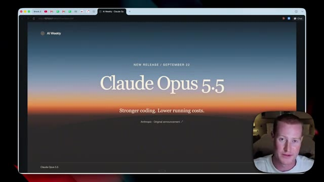
*⏱️ 00:00:09 — Page web présentant le nouveau modèle d'intelligence artificielle Claude Opus 5.5 d'Anthropic avec le slogan "Stronger coding. Lower running costs."*

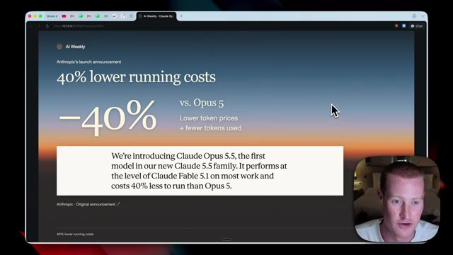
*⏱️ 00:00:26 — Page web affichant les détails de l'annonce d'Anthropic, notamment une réduction de 40% des coûts de fonctionnement par rapport à Opus 5.*

---

### ⏱️ `[00:00:35 - 00:00:58]` | Segment #02

**🔊 Audio (Transcription Intégrale Mot pour Mot en Français) :**
> Claude Opus 5,5, le premier modèle de notre nouvelle famille Claude 5,5. Il atteint le niveau de Claude Fable 5,1 sur la plupart des tâches et coûte 40 % de moins à faire tourner qu'Opus 5, alors qu'Opus 5 est évidemment beaucoup moins cher que les modèles Claude Fable. On nous promet donc que ce sera un modèle vraiment très économique à utiliser, avec à peu près la même intelligence que Fable 5,1. Passons maintenant rapidement en revue les tarifs de l'API.

**👁️ Analyse Visuelle d'Écran (gemini-3.5-flash-lite) :**
**Interface & Outils** : Présentation ou face-caméra explicatif du trader sans interface logicielle partagée.

**Contenu textuel & Code** : Explications orales des stratégies et mise en contexte méthodologique du marché.

**Action / Démonstration** : Explications face caméra et analyse conceptuelle des marchés.

---

### ⏱️ `[00:00:58 - 00:01:16]` | Segment #03

**🔊 Audio (Transcription Intégrale Mot pour Mot en Français) :**
> Maintenant, décomposons rapidement la tarification de l'API. Tout d'abord, les jetons d'entrée sont passés de 5 $ pour Opus 5 et c'est maintenant descendu à 4 $ et c'est maintenant descendu à 4 $. Les jetons de sortie pour Opus 5 étaient de 25 $ et maintenant c'est 20 $ de même que nous obtenons également une diminution des entrées en cache.

**👁️ Analyse Visuelle d'Écran (gemini-3.5-flash-lite) :**
**Interface & Outils** : Navigateur web affichant une page de présentation de tarifs API.

**Contenu textuel & Code** : Tarifs par million de jetons : Input ($5 -> $4), Output ($25 -> $20), Cached input ($0.50 -> $0.20), et un tableau comparatif entre Claude Opus 5.5 et Claude Opus 5.

**Action / Démonstration** : Le présentateur commente les variations et réductions de prix des différentes catégories de jetons de l'API.

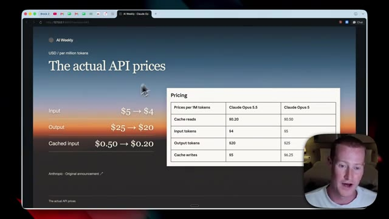
*⏱️ 00:01:02 — Capture d'écran montrant une page web intitulée 'AI Weekly - The actual API prices' avec des graphiques de tarification pour les jetons d'entrée, de sortie et en cache, ainsi qu'une petite fenêtre vidéo du présentateur en bas à droite.*

---

### ⏱️ `[00:01:16 - 00:01:36]` | Segment #04

**🔊 Audio (Transcription Intégrale Mot pour Mot en Français) :**
> En plus d'être moins cher à faire tourner, Opus 5.5 demande moins de puissance de calcul pour être servi que l'Opus 5. Et voici le graphique que nous avons l'habitude de voir chaque fois qu'un nouveau modèle sort. C'est donc plutôt impressionnant ici. Opus 5.5 sur Agenta Coding est à 66,4, et cela comparé à Fable 5.1, qui est à 55,8.

**👁️ Analyse Visuelle d'Écran (gemini-3.5-flash-lite) :**
**Interface & Outils** : Navigateur web affichant un article ou un rapport de performances avec un tableau comparatif.

**Contenu textuel & Code** : Tableau de benchmarks affichant des scores pour l'Agentic coding (66.4% pour Opus 5.5), Knowledge work, Business workflows et Computer use, avec la webcam du présentateur en bas à droite.

**Action / Démonstration** : Le présentateur commente le tableau comparatif des performances et des coûts des différents modèles d'intelligence artificielle.

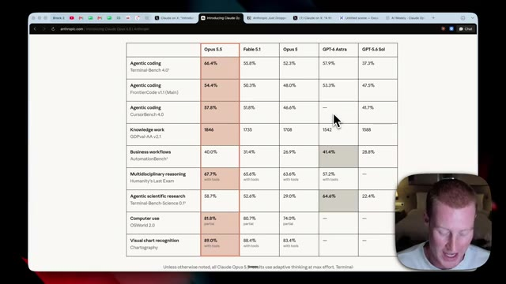
*⏱️ 00:01:26 — Capture montrant un tableau comparatif des performances des modèles d'IA (Opus 5.5, Fable 5.1, Opus 5, GPT-6 Astra, GPT-5.6 Sol) sur différents benchmarks.*

---

### ⏱️ `[00:01:36 - 00:01:56]` | Segment #05

**🔊 Audio (Transcription Intégrale Mot pour Mot en Français) :**
> Donc il surpasse Fable 5.1 sur la plupart de ces benchmarks ici, ou je suppose sur absolument tous, ce qui est en fait assez fou quand on y pense, vu son coût modique. Et ce benchmark juste ici, l'utilisation de l'ordinateur pour moi est le principal que je regarde avec ces nouvelles sorties de modèles, car évidemment la programmation est déjà très bonne en matière de modèles, même s'il y a une augmentation notable ici.

**👁️ Analyse Visuelle d'Écran (gemini-3.5-flash-lite) :**
**Interface & Outils** : Navigateur web affichant un tableau de benchmarks d'intelligence artificielle sur le site d'Anthropic.

**Contenu textuel & Code** : Tableau comparatif contenant diverses métriques telles que l'agentic coding, knowledge work, computer use (OSWorld 2.0 à 81.8% pour Opus 5.5) et visual chart recognition.

**Action / Démonstration** : Le présentateur commente et compare les résultats des différents modèles sur les benchmarks affichés à l'écran.

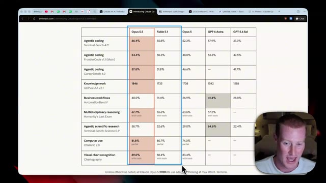
*⏱️ 00:01:41 — Un tableau comparatif de benchmarks affichant les performances de différents modèles d'IA, notamment Opus 5.5, Fable 5.1 et GPT-6 Astra, avec le présentateur en médaillon dans le coin inférieur droit.*

---

### ⏱️ `[00:01:56 - 00:02:18]` | Segment #06

**🔊 Audio (Transcription Intégrale Mot pour Mot en Français) :**
> Mais l'utilisation de l'ordinateur est la chose essentielle que je pense que l'intelligence artificielle essaie encore de percer. Et quand elle y parviendra, ça va changer la donne. J'attends donc simplement que ce chiffre devienne de plus en plus élevé. C'est donc juste une légère augmentation de 1 % par rapport à Fable 5.1, ce que j'aimerais voir plus haut. Mais bien sûr, c'est agréable que ce soit mieux pour moins cher. Et puis, bien sûr, nous avons évidemment le nouveau gros chien du quartier, et c'est ChatGPT-6 Astra.

**👁️ Analyse Visuelle d'Écran (gemini-3.5-flash-lite) :**
**Interface & Outils** : Navigateur web affichant un tableau comparatif de modèles (Anthropic, OpenAI, etc.).

**Contenu textuel & Code** : Tableau de benchmarks comprenant des catégories comme 'Agentic coding', 'Knowledge work', 'Computer use' (OSWorld 2.0 avec des scores de 81.8% pour Opus 5.5, 80.7% pour Fable 5.1, 74.0% pour Opus 5) et 'Visual chart recognition'.

**Action / Démonstration** : Le présentateur commente les scores des différents modèles affichés dans le tableau et souligne l'importance des performances en matière d'utilisation de l'ordinateur.

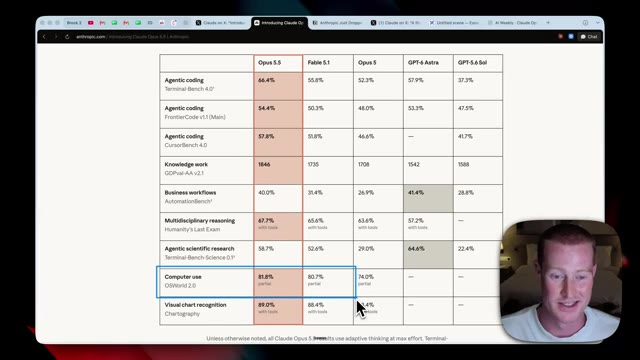
*⏱️ 00:02:02 — Un tableau comparatif des performances de différents modèles d'intelligence artificielle sur diverses tâches, avec en bas à droite le présentateur à l'écran.*

---

### ⏱️ `[00:02:18 - 00:02:42]` | Segment #07

**🔊 Audio (Transcription Intégrale Mot pour Mot en Français) :**
> Et Opus 5.5 se compare très bien à GPT-6 Astra, car il est également meilleur pour la majorité de ces tâches. Il semble que les seuls domaines où Astra soit meilleur soient les flux de travail professionnels et la recherche scientifique agentique. Maintenant, c'est très intéressant. Anthropic a testé cela par rapport à Fable 5.1, et il a été capable d'effectuer une migration de code en neuf heures et demie, alors que Fable 5.1 prenait auparavant 12 heures.

**👁️ Analyse Visuelle d'Écran (gemini-3.5-flash-lite) :**
**Interface & Outils** : Navigateur web affichant des graphiques de performances et des articles de blog techniques.

**Contenu textuel & Code** : Tableau de benchmarks avec des pourcentages et des scores chiffrés pour les modèles Opus 5.5 et GPT-6 Astra, ainsi que des métriques de temps de migration de code (9,5 heures pour Opus 5.5 contre 12 heures pour Fable 5.1).

**Action / Démonstration** : Le présentateur commente les performances comparatives entre Opus 5.5 et GPT-6 Astra, en soulignant les domaines où chaque modèle excelle.

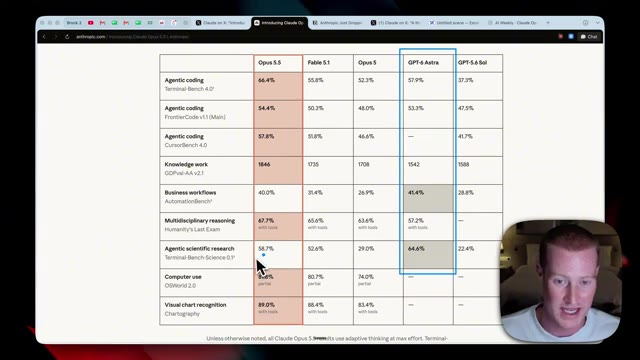
*⏱️ 00:02:24 — Un tableau comparatif montrant les performances de différents modèles d'IA (Opus 5.5, Fable 5.1, Opus 5, GPT-6 Astra, GPT-5.6 Sol) sur divers critères (Agentic coding, Knowledge work, Business workflows, etc.).*

*⏱️ 00:02:36 — Une page web intitulée "AI Weekly" présentant les résultats d'un test de migration de code d'HAProxy de C vers Rust en 9,5 heures avec Opus 5.5.*

---

### ⏱️ `[00:02:42 - 00:03:02]` | Segment #08

**🔊 Audio (Transcription Intégrale Mot pour Mot en Français) :**
> Donc c'est nettement plus rapide que Fable 5.1 également. Et probablement que la partie la plus folle là-dedans, c'est que c'était 51 % moins cher que Fable 5.1. Et une grande chose concernant ces nouvelles versions de modèles, pour être complètement honnête, ce n'est pas nécessairement, à mon avis, uniquement une question de nouvelles capacités que cela débloque. Plutôt, à quel point pouvez-vous exécuter des tâches spécifiques à bas coût par rapport à d'autres modèles ?

**👁️ Analyse Visuelle d'Écran (gemini-3.5-flash-lite) :**
**Interface & Outils** : Navigateur web affichant une page d'article ou de rapport d'évaluation technique.

**Contenu textuel & Code** : Métriques de performance comparatives : 12 hours (Fable 5.1), 9.5 hours (Opus 5.5) et 51% (Reported cost reduction), ainsi qu'un texte explicatif sur la migration de code HAProxy de C vers Rust.

**Action / Démonstration** : Le présentateur commente les résultats de performance et la réduction de coût affichés à l'écran.

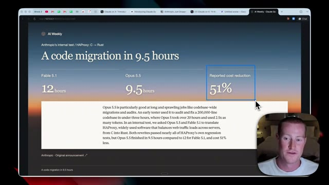
*⏱️ 00:02:47 — Capture d'écran montrant un article web intitulé "A code migration in 9.5 hours" avec des comparaisons chiffrées entre Fable 5.1 (12 heures), Opus 5.5 (9.5 heures) et une réduction de coût de 51 %.*

---

### ⏱️ `[00:03:02 - 00:03:23]` | Segment #09

**🔊 Audio (Transcription Intégrale Mot pour Mot en Français) :**
> Parce que oui, quelque chose comme Fable 5.1 ou GPT-6 Astra peut faire des choses assez incroyables et époustouflantes. Mais si ça doit vous coûter les yeux de la tête, la plupart des gens ne peuvent pas forcément se permettre de faire tourner ça tout le temps pour toutes les tâches qu'ils effectuent. Donc s'ils pouvaient obtenir un modèle presque aussi performant pour beaucoup moins cher, et dans ce cas, 51 % moins cher, je pense que c'est une véritable amélioration.

**👁️ Analyse Visuelle d'Écran (gemini-3.5-flash-lite) :**
**Interface & Outils** : Navigateur web affichant une page d'actualités technologiques (AI Weekly) et la webcam du présentateur en bas à droite.

**Contenu textuel & Code** : Texte et métriques comparatives : Fable 5.1 (12 heures), Opus 5.5 (9.5 heures), et réduction des coûts de 51%, ainsi qu'un paragraphe explicatif sur la migration de code d'HAProxy de C vers Rust.

**Action / Démonstration** : Présentation d'un rapport ou d'un test interne illustrant les performances et les coûts comparés de différents modèles d'intelligence artificielle.

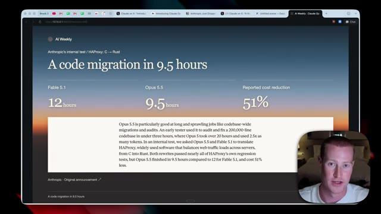
*⏱️ 00:03:07 — Capture d'écran montrant un article de blog intitulé "A code migration in 9.5 hours" avec des comparaisons de performances entre Fable 5.1 et Opus 5.5.*

---

### ⏱️ `[00:03:23 - 00:03:44]` | Segment #10

**🔊 Audio (Transcription Intégrale Mot pour Mot en Français) :**
> Again, here is another use case tested, Opus 5 and Opus 5.1. So Opus 5 took 93 minutes, 5.5 took 63 minutes, and then the reported cost reduction here was 50% for a spreadsheet and a presentation test. Now, this is the thing that I am personally most excited about, and I think will probably make the biggest change for us as average consumers of these AI models.

**👁️ Analyse Visuelle d'Écran (gemini-3.5-flash-lite) :**
**Interface & Outils** : Navigateur web affichant une page d'article ou de rapport de test d'intelligence artificielle, avec une incrustation vidéo du présentateur en bas à droite.

**Contenu textuel & Code** : Métriques de performance comparées : Opus 5 (93 minutes), Opus 5.5 (63 minutes) et réduction des coûts (50%), ainsi qu'un texte décrivant un test de fusion d'entreprise.

**Action / Démonstration** : Le présentateur commente les résultats chiffrés des tests comparatifs entre les versions d'Opus affichés à l'écran.

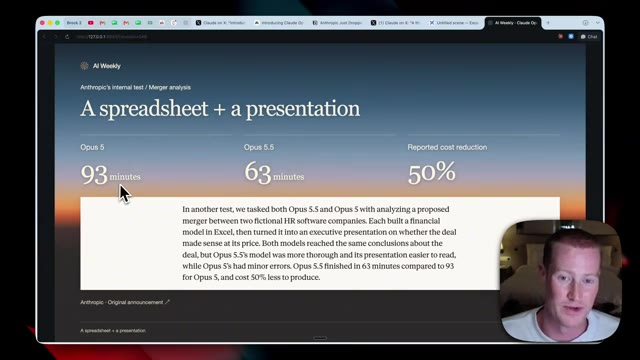
*⏱️ 00:03:29 — Capture d'écran d'un article montrant les résultats comparatifs entre Opus 5 et Opus 5.5 pour un test de tableur et de présentation, avec les durées et la réduction des coûts.*

---

### ⏱️ `[00:03:44 - 00:04:07]` | Segment #11

**🔊 Audio (Transcription Intégrale Mot pour Mot en Français) :**
> Et c'est la communication. Anthropic a déclaré que nous avons apporté des améliorations majeures à la façon dont Opus 5.5 écrit et communique, l'un des domaines de commentaires les plus courants que nous avons entendus concernant Opus 5. Ses messages sont beaucoup plus faciles à comprendre en un coup d'œil. Si vous utilisez des modèles d'IA tous les jours comme moi, vous en avez probablement assez d'essayer de déchiffrer ce que votre IA essaie réellement de vous dire.

**👁️ Analyse Visuelle d'Écran (gemini-3.5-flash-lite) :**
**Interface & Outils** : Navigateur web affichant la page officielle d'Anthropic.

**Contenu textuel & Code** : Texte officiel sur les améliorations d'écriture et de communication du modèle Claude Opus 5.5, avec une phrase mise en surbrillance.

**Action / Démonstration** : Le présentateur commente le texte affiché à l'écran concernant les performances de communication du modèle.

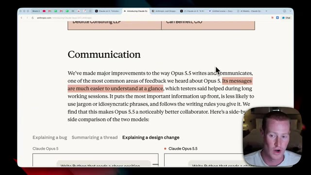
*⏱️ 00:03:50 — Capture d'écran montrant le site web d'Anthropic avec un paragraphe sur la communication et les améliorations du modèle Opus 5.5, avec une webcam du présentateur en bas à droite.*

---

### ⏱️ `[00:04:08 - 00:04:42]` | Segment #12

**🔊 Audio (Transcription Intégrale Mot pour Mot en Français) :**
> J'ai eu ce problème avec GrokBot de façon vraiment terrible ces derniers jours et ça m'a vraiment tapé sur les nerfs. Donc si Opus 5.5 communique mieux et vous donne de meilleurs résultats que vous pouvez lire d'un coup d'œil et comprendre totalement ce qu'il essaie de dire, c'est quelque chose qui m'enthousiasme beaucoup. Maintenant, il est dit qu'ils ont placé les informations les plus importantes en premier. Il est moins susceptible d'utiliser du jargon ou des expressions aléatoires et il suit les règles d'écriture que vous lui donnez. Donc encore une fois, tout cela est un plus à mes yeux. Et si je fais défiler cette page vers le bas dans cet article, ils me donnent même des exemples de résultats spécifiques comparant Claude Opus 5 avec la version 5.5. Et on peut vraiment voir une différence

**👁️ Analyse Visuelle d'Écran (gemini-3.5-flash-lite) :**
**Interface & Outils** : Navigateur web affichant la documentation officielle d'Anthropic.

**Contenu textuel & Code** : Texte de la documentation soulignant que les messages sont plus faciles à comprendre au premier coup d'œil, ainsi qu'un comparatif de code Python et de prompts pour des échecs.

**Action / Démonstration** : Le présentateur commente les améliorations de communication et de lisibilité des nouveaux modèles d'IA par rapport aux versions précédentes.

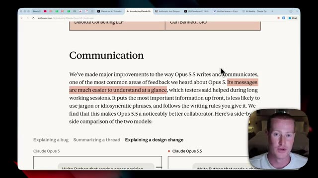
*⏱️ 00:04:16 — Vue d'un navigateur web montrant la page de présentation d'Anthropic sur la communication et l'amélioration de la clarté des messages d'Opus 5.5.*

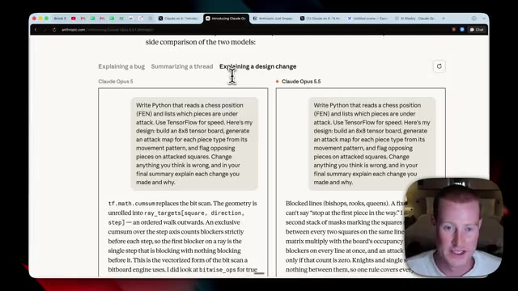
*⏱️ 00:04:34 — Comparaison côte à côte entre Claude Opus 5 et Claude Opus 5.5 montrant l'explication d'un changement de design sur un script Python lié aux échecs.*

---

### ⏱️ `[00:04:42 - 00:05:01]` | Segment #13

**🔊 Audio (Transcription Intégrale Mot pour Mot en Français) :**
> et à quel point c'est beaucoup plus facile à lire. Sur la gauche, Opus 5.5, on dirait que vous essayez de lire du code, d'essayer de comprendre ce qu'il essaie de vous dire. Alors que sur la droite, nous avons ce texte en gras ici pour identifier instantanément ce que vous lisez. Je pense que cela a l'air tellement plus facile au premier coup d'œil de comprendre ce que cela essaie de dire.

**👁️ Analyse Visuelle d'Écran (gemini-3.5-flash-lite) :**
**Interface & Outils** : Navigateur web affichant une page de comparaison entre Claude Opus 5 (à gauche) et Claude Opus 5.5 (à droite).

**Contenu textuel & Code** : Textes comparatifs et blocs de code expliquant un problème de facturation (billing refactor, extra drop, commit, python/code snippets).

**Action / Démonstration** : Le présentateur compare visuellement la lisibilité et le formatage entre les deux versions affichées.

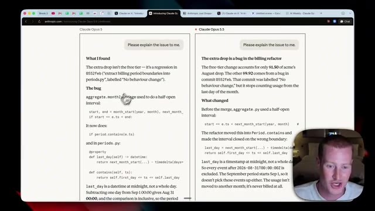
*⏱️ 00:04:47 — Comparaison côte à côte de deux interfaces de texte montrant des extraits de code et des explications de bugs avec un présentateur en incrustation.*

---

### ⏱️ `[00:05:02 - 00:05:20]` | Segment #14

**🔊 Audio (Transcription Intégrale Mot pour Mot en Français) :**
> Donc, ceci explique un bug. Je pourrais ensuite cliquer sur résumer un fil de discussion, ce qui sera probablement plus pratique pour les utilisateurs de tous les jours. Et encore une fois, il s'agit de résumer un fil Slack. C'est donc le prompt qu'ils lui ont donné lors de ce test initial. Et puis il utilise des tirets cadratifs, un énorme bloc de texte. Je ne sais pas nécessairement exactement ce qu'il essaie de dire au premier coup d'œil.

**👁️ Analyse Visuelle d'Écran (gemini-3.5-flash-lite) :**
**Interface & Outils** : Navigateur web affichant une page d'évaluation d'Anthropic avec une incrustation vidéo du présentateur en bas à droite.

**Contenu textuel & Code** : Prompt de test : "Summarize this Slack thread for my manager in three bullet points:" suivi de messages Slack textuels entre Dana Osei et Marcus Webb.

**Action / Démonstration** : Le curseur de la souris survole l'interface de comparaison pour illustrer les capacités de résumé de texte de l'IA.

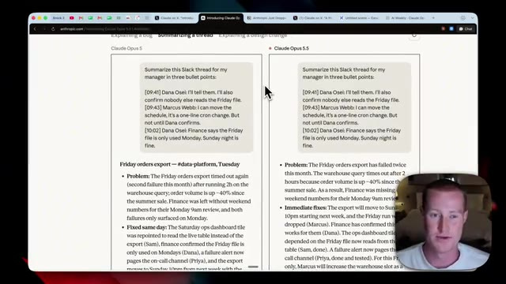
*⏱️ 00:05:06 — Comparaison côte à côte de deux versions de Claude Opus affichant un test de résumé de fil de discussion Slack.*

---

### ⏱️ `[00:05:20 - 00:05:39]` | Segment #15

**🔊 Audio (Transcription Intégrale Mot pour Mot en Français) :**
> Alors que le résultat d'Opus 5.5 est beaucoup plus simple. Il décompose le problème. Il montre les correctifs immédiats. Il montre les correctifs à long terme. Et je pense que cela a l'air tellement plus propre. Et puis c'est la même chose pour l'explication d'un changement de conception. Évidemment, vous savez, cela contient un peu de code ici. Cela a juste l'air difficile à lire. Alors que c'est beaucoup plus simple et plus facile à lire.

**👁️ Analyse Visuelle d'Écran (gemini-3.5-flash-lite) :**
**Interface & Outils** : Présentation ou face-caméra explicatif du trader sans interface logicielle partagée.

**Contenu textuel & Code** : Explications orales des stratégies et mise en contexte méthodologique du marché.

**Action / Démonstration** : Explications face caméra et analyse conceptuelle des marchés.

---

### ⏱️ `[00:05:39 - 00:06:00]` | Segment #16

**🔊 Audio (Transcription Intégrale Mot pour Mot en Français) :**
> Maintenant, je suis allé tester cela moi-même. Donc, j'ai basically dit à Claude Fable 5.1 et Opus 5.5 d'aller extraire mes vidéos YouTube et de me donner une analyse détaillée basée sur toutes les données que j'ai. Et voici le résultat ici. Je vous laisse une seconde pour deviner lequel est lequel. Donc, sur le côté gauche, nous avons Fable 5.1. Et sur le côté droit, le résultat est Opus 5.5.

**👁️ Analyse Visuelle d'Écran (gemini-3.5-flash-lite) :**
**Interface & Outils** : Navigateur web affichant l'application Excalidraw.

**Contenu textuel & Code** : Texte d'analyse détaillée des performances YouTube incluant des métriques de vues, un classement des top 10 vidéos, des tendances et des recommandations.

**Action / Démonstration** : Comparaison visuelle entre différents formats de rapports générés par l'IA.

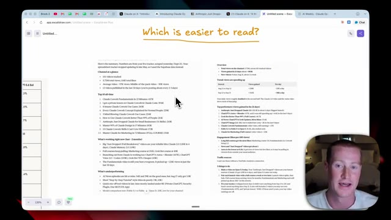
*⏱️ 00:05:44 — Une capture d'écran montrant l'application Excalidraw avec un texte annoté 'Which is easier to read?' et un rapport d'analyse textuelle divisé en plusieurs sections, aux côtés de la webcam du présentateur.*

---

### ⏱️ `[00:06:00 - 00:06:22]` | Segment #17

**🔊 Audio (Transcription Intégrale Mot pour Mot en Français) :**
> Et je pense sincèrement que c'est beaucoup plus simple et plus facile à lire. Ça décompose la vue d'ensemble. Ça a cette petite vue en tableau pour montrer les vidéos et le nombre de vues par jour qu'elle obtient. Ça montre les meilleures performances juste ici. Et j'aime la façon dont ça met les choses importantes en gras, ce qui rend la lecture tellement plus facile. Ça montre l'engagement, les sources de trafic, et puis probablement la chose la plus importante, les trois choses que je dois faire aujourd'hui.

**👁️ Analyse Visuelle d'Écran (gemini-3.5-flash-lite) :**
**Interface & Outils** : Navigateur web affichant un document de synthèse ou un tableau de bord (style Excalidraw ou éditeur de notes) et une webcam du présentateur.

**Contenu textuel & Code** : Statistiques de la chaîne : 5.73M de vues totales, 101 vidéos suivies, 583K vues gagnées en 21 jours, tableau des tendances de vues par période (Aug 31 to Sep 12, Sep 12 to Sep 21), et liste des meilleures performances vidéo (Anthropic Just Dropped Claude 2.0, ChatGPT 6 Astra, etc.).

**Action / Démonstration** : Le présentateur commente les différentes sections du tableau de bord affiché à l'écran, notamment les tendances de vues et les meilleures vidéos.

*⏱️ 00:06:05 — Capture d'écran montrant un tableau de bord textuel avec des statistiques de vues de chaîne YouTube, incluant des tableaux de tendances et une liste de performances par vidéo, ainsi qu'une petite incrustation vidéo du présentateur dans le coin inférieur droit.*

---

### ⏱️ `[00:06:22 - 00:06:41]` | Segment #18

**🔊 Audio (Transcription Intégrale Mot pour Mot en Français) :**
> Voici maintenant quelques exemples sympas qu'Anthropic nous a donnés de cas d'usage d'Opus 5.5. J'ai donc pu générer cette vidéo juste ici montrant une courte histoire sur une pastèque. Je trouve que c'est un cas d'usage sympa. Ensuite, nous avons une reconstitution du lever de Terre d'Apollo 8. Il semble donc que cela génère tous les visuels ici ainsi que ce petit diagramme. Puis celui-ci est plutôt sympa.

**👁️ Analyse Visuelle d'Écran (gemini-3.5-flash-lite) :**
**Interface & Outils** : Présentation ou face-caméra explicatif du trader sans interface logicielle partagée.

**Contenu textuel & Code** : Explications orales des stratégies et mise en contexte méthodologique du marché.

**Action / Démonstration** : Explications face caméra et analyse conceptuelle des marchés.

---

### ⏱️ `[00:06:41 - 00:07:04]` | Segment #19

**🔊 Audio (Transcription Intégrale Mot pour Mot en Français) :**
> Here is a pencil sketch that you could play with. So it's almost like an interactive infographic diagram that it's showing. In order to explain something, I think that this could be pretty cool if you're trying to learn a specific concept or teach it if you're a teacher, for example. Now here are some of the final numbers. Astra still leads on specific tasks. Like I said earlier, so business workflows and scientific research, it does have Opus 5.5 beat.

**👁️ Analyse Visuelle d'Écran (gemini-3.5-flash-lite) :**
**Interface & Outils** : Navigateur web affichant des pages de démonstration et d'exploration de l'IA (AI Weekly).

**Contenu textuel & Code** : Croquis interactif d'une catapulte de type infographique et tableaux de scores comparatifs (Business workflows / Scientific research avec Opus 5.5 et GPT-6 Astra).

**Action / Démonstration** : Le présentateur commente une interface interactive et des résultats de tests de performance de modèles d'IA.

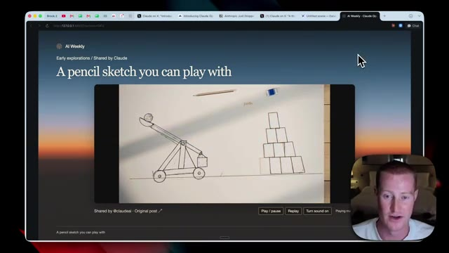
*⏱️ 00:06:47 — Une page web intitulée "A pencil sketch you can play with" montrant une illustration interactive sous forme de croquis d'une catapulte et de blocs.*

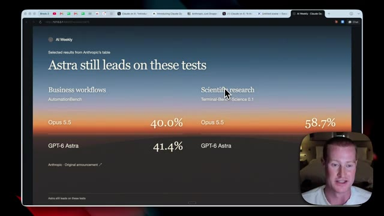
*⏱️ 00:06:58 — Une page web affichant des résultats de tests comparativement intitulée "Astra still leads on these tests" avec des pourcentages de performance.*

---

### ⏱️ `[00:07:04 - 00:07:28]` | Segment #20

**🔊 Audio (Transcription Intégrale Mot pour Mot en Français) :**
> Mais honnêtement, après avoir jeté un œil aux benchmarks, je suis assez impressionné par la capacité de la version 5.5, vu son faible coût et sa rapidité par rapport à Fable 5.1 et GPT-6 Astra. Maintenant, le dernier point de cette annonce, c'est que nous avons plus de marge avant d'atteindre nos limites d'utilisation dans Claude. Donc je pense que c'est évidemment une bonne nouvelle pour les gens. Nous avons donc maintenant une limite de cinq heures plus élevée, et nous avons également une réinitialisation que nous pouvons sauvegarder et utiliser quand bon nous semble.

**👁️ Analyse Visuelle d'Écran (gemini-3.5-flash-lite) :**
**Interface & Outils** : Présentation ou face-caméra explicatif du trader sans interface logicielle partagée.

**Contenu textuel & Code** : Explications orales des stratégies et mise en contexte méthodologique du marché.

**Action / Démonstration** : Explications face caméra et analyse conceptuelle des marchés.

---

### ⏱️ `[00:07:28 - 00:07:47]` | Segment #21

**🔊 Audio (Transcription Intégrale Mot pour Mot en Français) :**
> Et cela s'applique à tous ceux qui sont un utilisateur d'entreprise Pro Max de l'équipe et basé sur les sièges. Et puis enfin, voici tous les endroits où nous pouvons utiliser Opus 5.5 en ce moment. Quoi qu'il en soit, les gars, voilà. C'est le nouveau Claude Opus 5.5. C'est une analyse très rapide. Si vous avez apprécié cette vidéo, abonnez-vous à la chaîne pour plus de contenu comme celui-ci.

**👁️ Analyse Visuelle d'Écran (gemini-3.5-flash-lite) :**
**Interface & Outils** : Navigateur web affichant un article d'annonce technique.

**Contenu textuel & Code** : Texte descriptif sur les plans d'entreprise Pro Max et les plateformes d'intégration d'Opus 5.5.

**Action / Démonstration** : Présentation des détails de tarification et des plateformes de déploiement d'Opus 5.5.

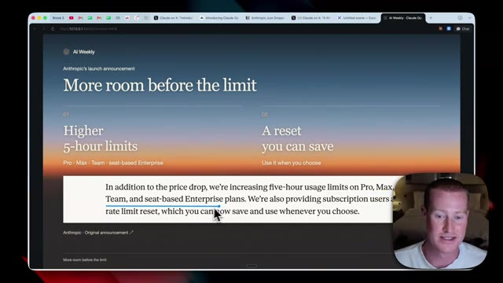
*⏱️ 00:07:33 — Page web présentant les annonces d'Anthropic concernant l'augmentation des limites d'utilisation sur les abonnements Pro, Max et Team.*

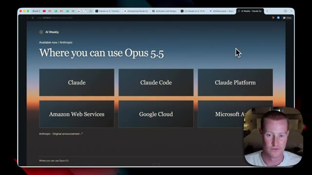
*⏱️ 00:07:38 — Page web listant les différentes plateformes où l'on peut utiliser Opus 5.5 (Claude, Claude Code, AWS, Google Cloud, etc.).*

---

### ⏱️ `[00:07:47 - 00:07:50]` | Segment #22

**🔊 Audio (Transcription Intégrale Mot pour Mot en Français) :**
> Dis-moi ce que tu en penses dans les commentaires et je te vois dans la prochaine vidéo. Santé.

**👁️ Analyse Visuelle d'Écran (gemini-3.5-flash-lite) :**
**Interface & Outils** : Aucun outil technique, graphique financier, terminal ou code source affiché.

**Contenu textuel & Code** : Aucun indicateur technique, code source, prompt ou donnée chiffrée.

**Action / Démonstration** : Le présentateur conclut sa vidéo en parlant à la caméra, aucune manipulation technique en cours.

---

