# 🎬 AI News: $500 ChatGPT Plan? OpenAI Agent Leak & Opus 5.5

> **Chaîne** : [Brock Mesarich | AI for Non Techies](https://www.youtube.com/@BrockMesarich)  
> **Lien YouTube** : [https://www.youtube.com/watch?v=k5Wo0-FWK3k](https://www.youtube.com/watch?v=k5Wo0-FWK3k)  
> **Date de publication** : 20260925  
> **Durée** : 00:28:56  
> **Identifiant vidéo** : `k5Wo0-FWK3k`  
> **Transcription & Analyse** : `whisper-v3-large-turbo+gemini-3.5-flash-lite`  

---

## 📌 Synthèse Exécutive & Outils

### 💡 Résumé
Cette revue hebdomadaire de l'actualité de l'intelligence artificielle proposée par la chaîne *Brock Mesarich | AI for Non Techies* décortique les dernières sorties de modèles majeurs, notamment le lancement par Anthropic de Claude Opus 5.5. S'appuyant sur des analyses de benchmarks et des cas d'utilisation pratiques, l'analyste examine l'équilibre crucial entre la puissance de calcul brute, la vitesse d'exécution et la réduction drastique des coûts d'API (jusqu'à 40 % à 51 % moins cher que les versions précédentes). La vidéo démontre comment ces innovations redéfinissent l'efficacité opérationnelle des flux de travail automatisés, qu'il s'agisse de migration de code, de traitement de données complexes ou de génération de rapports visuels.

Au-delà des performances pures, l'accent est mis sur l'amélioration ergonomique de la communication des modèles d'IA. L'analyse comparative entre Claude Opus 5 et Opus 5.5 illustre à quel point la clarté textuelle, la structuration visuelle des réponses (tableaux, mise en gras des points critiques) et l'élimination du jargon technique superflu transforment l'expérience utilisateur quotidienne. Cette optimisation de la lisibilité se révèle particulièrement stratégique pour les professionnels cherchant à intégrer des agents conversationnels sans friction dans leurs pipelines de productivité.

Enfin, la vidéo aborde l'écosystème plus large des outils d'automatisation et de création de contenu viral, en survolant l'impact des modèles concurrents (comme GPT-6 Astra) et des plateformes vidéo émergentes telles qu'Higgsfield avec son modèle Jinjitsu. L'objectif global reste d'offrir une vision claire, pragmatique et actionnable pour naviguer dans l'accélération constante du marché technologique sans subir la surcharge informationnelle inhérente au secteur.

### 🛠️ Outils, Modèles & Logiciels Présentés
* **Claude Opus 5.5** : Nouveau modèle phare d'Anthropic se distinguant par une baisse de 40 % des coûts d'API, une vitesse d'exécution accrue et une clarté de communication nettement améliorée.
* **Claude Fable 5.1** : Modèle de référence utilisé pour établir des comparaisons de performance en matière de codage, de rapidité et de coût par rapport à la nouvelle gamme.
* **GPT-6 Astra** : Modèle concurrent haut de gamme d'OpenAI, particulièrement performant sur les flux de travail professionnels complexes et la recherche scientifique agentique.
* **GrokBot** : Assistant conversationnel et d'actualités (via la plateforme X) mentionné pour ses difficultés ponctuelles en matière de clarté de communication.
* **Higgsfield (Jinjitsu)** : Plateforme et modèle vidéo spécialisés dans la génération de clips hyper-réalistes et viraux à partir de personnages personnalisés.
* **Make** : Solution d'automatisation de flux de travail no-code évoquée pour l'intégration et l'orchestration de tâches basées sur l'IA.
* **n8n** : Outil d'automatisation de workflows open-source et flexible pour connecter des APIs et des modèles d'intelligence artificielle.
* **Zapier** : Plateforme d'automatisation classique facilitant la liaison rapide entre applications tierces et assistants conversationnels.
* **ChatGPT** : Écosystème d'OpenAI englobant les récentes versions de modèles et les réflexions autour de plateformes d'agents autonomes.
* **Gemini** : Modèle multimodal de Google positionné sur le marché des grands modèles de langage pour le traitement des données et du code.

### 🔑 Points Clés & Enseignements Stratégiques
* **Optimisation des coûts d'API** : Le passage de Claude Opus 5 à Opus 5.5 réduit le coût des tokens d'entrée de 5 $ à 4 $ et celui des tokens de sortie de 25 $ à 20 $, tout en optimisant l'entrée mise en cache pour maximiser la rentabilité à grande échelle.
* **Gains de vitesse opérationnelle** : Les tests de migration de code démontrent une réduction drastique du temps d'exécution, passant de 12 heures (sur Fable 5.1) à seulement 9 heures et demie, tout en affichant une réduction globale des coûts de 51 %.
* **Supériorité des benchmarks de codage** : Opus 5.5 atteint un score de 66,4 sur l'Agentic Coding, surpassant nettement les versions antérieures et s'imposant comme une alternative redoutable pour le développement logiciel automatisé.
* **Lisibilité et ergonomie des prompts** : Les améliorations structurelles d'Opus 5.5 (mise en avant des informations critiques au début, réduction du jargon et adoption de mises en forme visuelles épurées) facilitent l'interprétation instantanée des rapports complexes.
* **Structuration intelligente des sorties** : L'utilisation de tableaux comparatifs, de listes à puces hiérarchisées et de synthèses en gras permet de transformer des blocs de données brutes (comme des métriques YouTube ou des flux Slack) en plans d'action immédiatement exploitables.
* **Spécialisation des modèles concurrents** : Bien qu'Opus 5.5 surpasse la majorité des modèles en matière de coût et de clarté, GPT-6 Astra conserve l'avantage sur des segments ultra-spécifiques tels que les flux professionnels lourds et la recherche scientifique hautement agentique.
* **Repositionnement des limites d'utilisation** : Les utilisateurs Pro, Max, Team et Enterprise bénéficient de quotas d'utilisation rehaussés (limite de cinq heures augmentée) ainsi que de options de réinitialisation flexibles pour maintenir la continuité des flux de travail.
* **L'automatisation comme levier de productivité** : L'utilisation combinée de modèles économiques et d'outils d'intégration (Make, n8n) permet d'exécuter des tâches analytiques lourdes en arrière-plan sans saturer les budgets opérationnels des structures non techniques.
* **Évolution de l'utilisation de l'ordinateur (Computer Use)** : Bien que les progrès sur l'interaction directe avec les interfaces informatiques progressent lentement, chaque incrément de performance rapproche l'industrie de l'agent autonomie universel.
* **Viralité et création de contenu multimédia** : L'émergence d'outils comme Higgsfield (Jinjitsu) démontre la facilité avec laquelle les technologies génératives actuelles permettent de détourner des figures publiques pour créer du contenu vidéo hautement viral.

---

## ⏱️ Chronologie & Transcription Complète Audio & Visuelle (Mot pour Mot)

### ⏱️ `[00:00:00 - 00:00:21]` | Segment #01

**🔊 Audio (Transcription Intégrale Mot pour Mot en Français) :**
> C'était une semaine folle de sorties et de mises à jour en matière d'intelligence artificielle, et je sais que vous êtes probablement tout aussi débordé que moi. OpenAI vient de lancer deux modèles GPT-6 moins chers. Cloud Opus 5.5 est arrivé, et il est incroyablement bon et bon marché. Meta a annoncé un tout nouvel appareil d'IA que vous pouvez porter sur un porte-clés. Et il y a des rumeurs selon lesquelles OpenAI lancerait une tout nouvelle plateforme d'agents d'IA la semaine prochaine.

**👁️ Analyse Visuelle d'Écran (gemini-3.5-flash-lite) :**
**Interface & Outils** : Aucune interface de trading ou de programmation visible.

**Contenu textuel & Code** : Aucun code source, indicateur technique ou donnée chiffrée affichés.

**Action / Démonstration** : Aucune action technique ou analyse graphique effectuée.

---

### ⏱️ `[00:00:21 - 00:00:44]` | Segment #02

**🔊 Audio (Transcription Intégrale Mot pour Mot en Français) :**
> Donc, dans cette vidéo, je vais vous décortiquer tout cela. Chaque vendredi, je fais ces mises à jour hebdomadaires sur l'IA, en décortiquant tout ce que vous devez savoir pour pouvoir rester à jour sans vous sentir submergé. Alors, sans plus attendre, plongeons-le directement. Et voilà, Anthropic est de retour. Ils viennent de sortir leur nouveau modèle appelé Claude Opus 5.5. Et je ne vais pas mentir, généralement, lorsqu'un modèle sort, je suis plutôt sceptique parce que tout le monde dit que c'est un changement radical et je pense généralement que ce n'est que du battage médiatique.

**👁️ Analyse Visuelle d'Écran (gemini-3.5-flash-lite) :**
**Interface & Outils** : Graphique de présentation vidéo textuel et visuel abstrait.

**Contenu textuel & Code** : Titres textuels liés aux mises à jour d'intelligence artificielle ("Claude Opus 5.5", "Weekly AI Updates Every Friday").

**Action / Démonstration** : Introduction de la vidéo de mise à jour hebdomadaire sur l'IA par le présentateur.

---

### ⏱️ `[00:00:44 - 00:01:03]` | Segment #03

**🔊 Audio (Transcription Intégrale Mot pour Mot en Français) :**
> Mais il y a quelques mises à jour très pratiques de ce nouveau modèle qui m'enthousaiment vraiment. Tout d'abord, nous avons des coûts inférieurs de 40 % avec ce modèle par rapport au modèle Opus 5 précédent. Comme vous pouvez le voir ici, Anthropic a déclaré : nous introduisons Claude Opus 5.5, le premier modèle de notre nouvelle famille Claude 5.5.

**👁️ Analyse Visuelle d'Écran (gemini-3.5-flash-lite) :**
**Interface & Outils** : Navigateur web affichant une page d'actualités sur l'intelligence artificielle avec une incrustation vidéo du présentateur en bas à droite.

**Contenu textuel & Code** : Texte affichant « 40% lower running costs », « -40% », « vs. Opus 5 », et un paragraphe présentant le lancement de Claude Opus 5.5.

**Action / Démonstration** : Présentation visuelle de l'annonce officielle et des métriques de coûts du nouveau modèle par le présentateur.

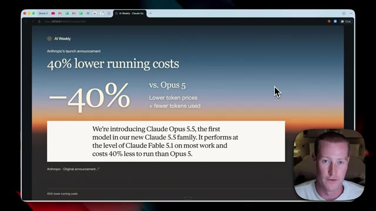
*⏱️ 00:00:49 — Capture d'écran montrant une page web d'annonce d'Anthropic sur Claude Opus 5.5 avec la mention '40% lower running costs vs. Opus 5'.*

---

### ⏱️ `[00:01:03 - 00:01:26]` | Segment #04

**🔊 Audio (Transcription Intégrale Mot pour Mot en Français) :**
> Il performe au niveau de Claude Fable 5.1 sur la plupart des tâches et coûte 40 % de moins à faire tourner qu'Opus 5, sachant qu'Opus 5 est évidemment beaucoup moins cher que les modèles Claude Fable. C'est donc censé être un modèle vraiment bon marché à faire tourner avec, à peu de choses près, la même intelligence que Fable 5.1. Maintenant, décortiquons rapidement la tarification de l'API. Alors tout d'abord, les tokens d'entrée sont passés de 5 dollars pour Opus 5 à 4 dollars maintenant.

**👁️ Analyse Visuelle d'Écran (gemini-3.5-flash-lite) :**
**Interface & Outils** : Navigateur web affichant un article ou un rapport d'annonces sur l'intelligence artificielle et un tableau de tarification.

**Contenu textuel & Code** : Texte descriptif de Claude Opus 5.5, performances comparables à Claude Fable 5.1, réduction de 40% des coûts par rapport à Opus 5, et tableau de prix par million de tokens.

**Action / Démonstration** : Le présentateur commente l'annonce du lancement de Claude Opus 5.5 et ses avantages économiques par rapport aux versions précédentes.

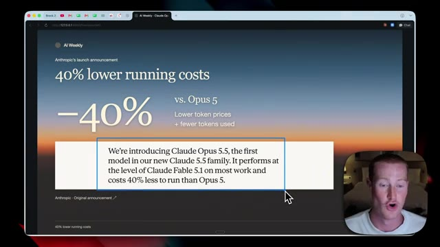
*⏱️ 00:01:09 — Capture d'écran d'un navigateur web montrant une annonce officielle avec les coûts réduits de 40% pour Claude Opus 5.5 comparé à Opus 5, avec le présentateur en bas à droite.*

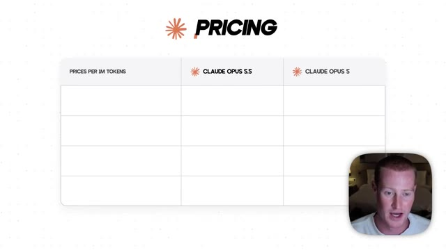
*⏱️ 00:01:20 — Capture d'écran affichant un tableau comparatif de tarification (PRICING) entre Claude Opus 5.5 et Claude Opus 5 par million de tokens.*

---

### ⏱️ `[00:01:27 - 00:01:45]` | Segment #05

**🔊 Audio (Transcription Intégrale Mot pour Mot en Français) :**
> Les jetons de sortie pour Opus 5 étaient de 25 dollars et maintenant c'est 20 dollars. De plus, nous obtenons également une réduction sur l'entrée mise en cache. En plus d'être moins cher à exécuter, Opus 5.5 nécessite moins de puissance de calcul pour être hébergé qu'Opus 5. Et voici ensuite le graphique que nous avons l'habitude de voir chaque fois qu'un nouveau modèle sort. C'est donc plutôt impressionnant ici.

**👁️ Analyse Visuelle d'Écran (gemini-3.5-flash-lite) :**
**Interface & Outils** : Navigateur web affichant un tableau comparatif et des articles de documentation sur les IA.

**Contenu textuel & Code** : Tarifs par million de jetons (Cache Reads, Input Tokens, Output Tokens, Cache Writes) et benchmarks de performance par modèle.

**Action / Démonstration** : Le présentateur commente les réductions de prix et les performances des différents modèles d'IA.

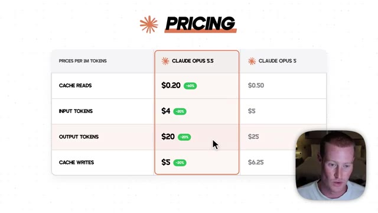
*⏱️ 00:01:31 — Tableau de tarification comparant Claude Opus 5.5 et Claude Opus 5 pour différents types de jetons.*

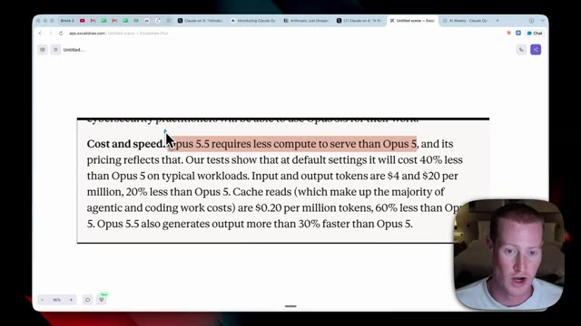
*⏱️ 00:01:36 — Texte souligné détaillant les aspects liés au coût et à la vitesse de calcul d'Opus 5.5 par rapport à Opus 5.*

*⏱️ 00:01:41 — Tableau comparatif des performances de différents modèles d'IA (Opus 5.5, Fable 5.1, Opus 5, etc.) sur diverses tâches.*

---

### ⏱️ `[00:01:45 - 00:02:07]` | Segment #06

**🔊 Audio (Transcription Intégrale Mot pour Mot en Français) :**
> Opus 5.5 sur Agenta Coding est de 66,4. Et c'est comparé à Fable 5.1, qui est de 55,8. Donc, il obtient un meilleur score que Fable 5.1 sur la plupart de ces benchmarks ici. Je suppose que c'est sur absolument tous, ce qui est plutôt fou quand on y pense, vu son coût abordable. Et ce benchmark juste ici, l'utilisation de l'ordinateur pour moi, est le principal que je regarde avec ces nouvelles sorties de modèles.

**👁️ Analyse Visuelle d'Écran (gemini-3.5-flash-lite) :**
**Interface & Outils** : Navigateur web affichant un tableau de benchmarks d'intelligence artificielle.

**Contenu textuel & Code** : Scores de performance pour Opus 5.5, Fable 5.1, Opus 5, GPT-6 Astra et GPT-5.6 Sol sur des catégories telles que Agentic coding, Knowledge work, Business workflows et Computer use.

**Action / Démonstration** : Le présentateur survole et compare les scores d'Opus 5.5 (66,4 %) et de Fable 5.1 (55,8 %) sur le benchmark Agentic coding.

*⏱️ 00:01:51 — Tableau comparatif des performances de différents modèles d'IA sur divers benchmarks, avec le curseur sur le score d'Opus 5.5 pour Agentic coding.*

---

### ⏱️ `[00:02:07 - 00:02:26]` | Segment #07

**🔊 Audio (Transcription Intégrale Mot pour Mot en Français) :**
> Parce qu'évidemment, le codage est déjà très bon en ce qui concerne les modèles, même s'il y a, vous savez, une augmentation décente ici. Mais l'utilisation de l'ordinateur est la chose essentielle que l'intelligence artificielle essaie encore de percer. Et quand elle y arrivera, ça va changer la donne. J'attends donc simplement que ce chiffre augmente encore et encore. Il s'agit donc juste d'une légère augmentation de 1 % par rapport à Fable 5.1, ce que j'aimerais voir plus élevé.

**👁️ Analyse Visuelle d'Écran (gemini-3.5-flash-lite) :**
**Interface & Outils** : Navigateur web affichant un tableau comparatif officiel d'Anthropic (page web 'Introducing Claude Opus 3.5' ou similaire).

**Contenu textuel & Code** : Tableau de benchmarks avec colonnes pour Opus 5.5, Fable 5.1, Opus 5, GPT-6 Astra, GPT-5.6 Sol, et lignes de métriques telles que 'Agentic coding', 'Knowledge work', 'Business workflows', 'Computer use' avec des scores en pourcentage et en chiffres.

**Action / Démonstration** : Le présentateur commente le tableau de performance en survolant ou en pointant certaines lignes spécifiques (comme Agentic coding avec un encadré bleu).

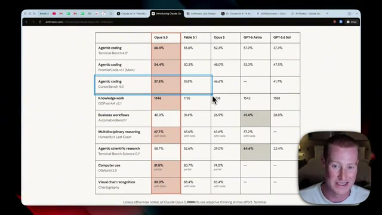
*⏱️ 00:02:12 — Tableau comparatif des performances de différents modèles d'intelligence artificielle sur divers benchmarks, incluant l'agentic coding, knowledge work et computer use.*

---

### ⏱️ `[00:02:26 - 00:02:44]` | Segment #08

**🔊 Audio (Transcription Intégrale Mot pour Mot en Français) :**
> Mais bien sûr, c'est agréable que ce soit meilleur pour moins cher. Et puis, bien sûr, nous avons évidemment le nouveau gros chien du quartier, et c'est Chachapi T6 Astra. Et Opus 5.5 se compare très bien à GPT6 Astra puisqu'il est également meilleur pour la majorité de ces tâches. Il semble que les seuls domaines où Astra soit meilleur soient les flux de travail professionnels et la recherche scientifique agentique.

**👁️ Analyse Visuelle d'Écran (gemini-3.5-flash-lite) :**
**Interface & Outils** : Navigateur web affichant un article ou un document comparatif officiel d'Anthropic.

**Contenu textuel & Code** : Tableau comparatif de benchmarks comprenant des métriques telles que Agentic coding (Terminal-Bench 4.0, FrontierCode), Knowledge work (GDPval-AA), Business workflows, Multidisciplinary reasoning, Agentic scientific research, Computer use et Visual chart recognition.

**Action / Démonstration** : Le présentateur commente le tableau comparatif en soulignant les performances d'Opus 5.5 par rapport à GPT-6 Astra.

*⏱️ 00:02:35 — Capture d'écran d'un tableau comparatif des performances de différents modèles d'intelligence artificielle (Opus 5.5, Fable 5.1, Opus 5, GPT-6 Astra, GPT-5.6 Sol) sur divers benchmarks (Agentic coding, Knowledge work, Business workflows, etc.) avec la webcam du présentateur en bas à droite.*

---

### ⏱️ `[00:02:44 - 00:03:03]` | Segment #09

**🔊 Audio (Transcription Intégrale Mot pour Mot en Français) :**
> Maintenant, c'est très intéressant. Anthropic a testé cela par rapport à Fable 5.1 et il a été capable d'exécuter une migration de code en neuf heures et demie, alors que Fable 5.1 prenait auparavant 12 heures. Il est donc également nettement plus rapide que Fable 5.1. Et la partie la plus folle, c'est probablement qu'il était 51 % moins cher que Fable 5.1.

**👁️ Analyse Visuelle d'Écran (gemini-3.5-flash-lite) :**
**Interface & Outils** : Présentation vidéo avec infographies et graphiques de performance.

**Contenu textuel & Code** : Texte principal : "A CODE MIGRATION IN 9.5 HOURS", sous-titré "HAProxy, translated from C into Rust". Trois boîtes de métriques : "FABLE 5.1" (4 HOURS), "OPUS 5.5" (4.2 HOURS), et "REPORTED COST REDUCTION" (0% LESS).

**Action / Démonstration** : Le présentateur commente les performances comparées des modèles d'IA pour la migration de code de C vers Rust.

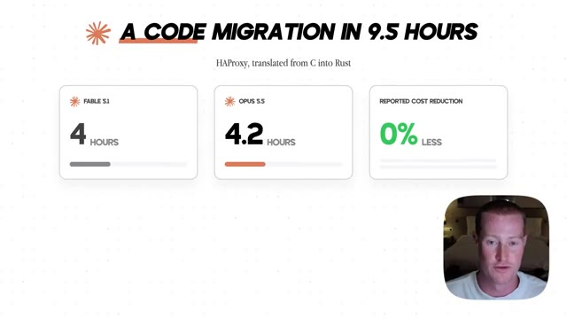
*⏱️ 00:02:49 — Une diapositive de présentation affichant les résultats de migration de code avec des comparaisons de temps pour Fable 5.1 et Opus 5.5, avec une incrustation vidéo du présentateur en bas à droite.*

---

### ⏱️ `[00:03:03 - 00:03:27]` | Segment #10

**🔊 Audio (Transcription Intégrale Mot pour Mot en Français) :**
> Et une chose importante concernant ces nouvelles sorties de modèles, pour être tout à fait honnête, ce n'est pas nécessairement, à mon avis, uniquement une question de nouvelles capacités qu'ils débloquent. C'est plutôt : à quel point pouvez-vous exécuter des tâches spécifiques à bas coût par comparaison avec d'autres modèles ? Parce que oui, quelque chose comme Fable 5.1 ou GPT-6 Astra peut faire des choses assez incroyables et époustouflantes, mais si cela doit vous coûter les yeux de la tête, la plupart des gens ne peuvent pas nécessairement se permettre d'exécuter cela tout le temps pour toutes les tâches qu'ils effectuent.

**👁️ Analyse Visuelle d'Écran (gemini-3.5-flash-lite) :**
**Interface & Outils** : Navigateur web affichant une page d'actualités/article technique.

**Contenu textuel & Code** : Texte et métriques comparatives : Fable 5.1 (12 hours), Opus 5.5 (9.5 hours), Reported cost reduction (51%), ainsi qu'un paragraphe descriptif sur la migration de code de HAProxy (de C vers Rust).

**Action / Démonstration** : Présentation des résultats comparatifs de performance et de coût entre différents modèles d'IA pour une tâche de migration de code.

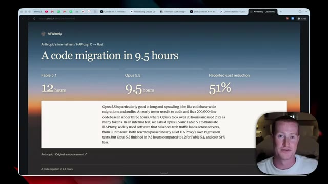
*⏱️ 00:03:09 — Capture d'écran montrant un article web intitulé "A code migration in 9.5 hours" avec des métriques de performance et de réduction des coûts, et le présentateur en médaillon en bas à droite.*

---

### ⏱️ `[00:03:27 - 00:03:47]` | Segment #11

**🔊 Audio (Transcription Intégrale Mot pour Mot en Français) :**
> Donc s'ils pouvaient obtenir un modèle presque aussi performant pour beaucoup moins cher, et dans ce cas, 51 % moins cher, je pense que c'est une réelle amélioration. Encore une fois, voici un autre cas d'utilisation testé, Opus 5 et Opus 5.1. Donc Opus 5 a pris 93 minutes, 5.5 a pris 63 minutes, et ensuite la réduction de coût rapportée ici était de 50 % pour un test de tableur et de présentation.

**👁️ Analyse Visuelle d'Écran (gemini-3.5-flash-lite) :**
**Interface & Outils** : Navigateur web affichant une page de résultats de test ou d'annonce d'IA.

**Contenu textuel & Code** : Métriques comparatives de migration de code : Fable 5.1 (12 hours), Opus 5.5 (9.5 hours), et une réduction des coûts rapportée de 51 %. Texte descriptif sur l'utilisation d'Opus 5.5 pour la migration de HAProxy (de C vers Rust).

**Action / Démonstration** : Le présentateur commente les résultats chiffrés et les performances des différents modèles d'IA présentés à l'écran.

*⏱️ 00:03:32 — Capture d'écran montrant un article de blog ou rapport d'IA (« AI Weekly ») intitulé « A code migration in 9.5 hours », détaillant les performances comparées de Fable 5.1 et Opus 5.5, avec notamment une réduction de coût de 51 %. Le présentateur apparaît dans un petit encadré vidéo en bas à droite.*

---

### ⏱️ `[00:03:48 - 00:04:06]` | Segment #12

**🔊 Audio (Transcription Intégrale Mot pour Mot en Français) :**
> Maintenant, c’est la chose qui m'enthousiasme personnellement le plus et je pense qui apportera probablement le plus grand changement pour nous en tant que consommateurs moyens de ces modèles d'IA. Et il s'agit de la communication. Anthropic a déclaré que nous avons apporté des améliorations majeures à la façon dont Opus 5.5 écrit et communique, l'un des domaines de commentaires les plus courants que nous avons entendus concernant Opus 5.

**👁️ Analyse Visuelle d'Écran (gemini-3.5-flash-lite) :**
**Interface & Outils** : Navigateur web affichant la page de documentation ou de présentation d'Anthropic.

**Contenu textuel & Code** : Texte décrivant les améliorations de communication du modèle Opus 5.5 (« We've made major improvements to the way Opus 5.5 writes and communicates... »).

**Action / Démonstration** : Le présentateur commente le texte affiché à l'écran concernant les améliorations de la communication.

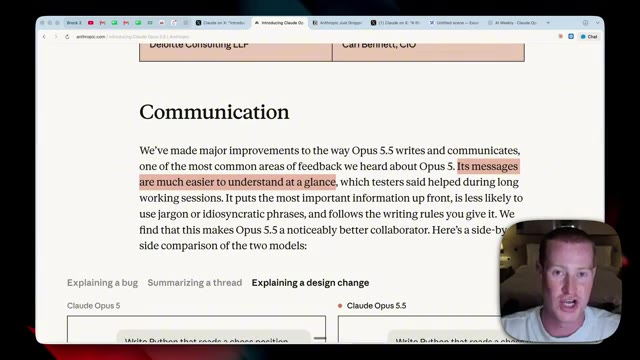
*⏱️ 00:03:52 — Capture d'écran montrant le site web d'Anthropic avec un paragraphe sur la communication et les améliorations du modèle Opus 5.5, avec le présentateur incrusté en bas à droite.*

---

### ⏱️ `[00:04:06 - 00:04:33]` | Segment #13

**🔊 Audio (Transcription Intégrale Mot pour Mot en Français) :**
> Ses messages sont beaucoup plus faciles à comprendre d'un seul coup d'œil. Si vous utilisez des modèles d'IA tous les jours comme moi, vous en avez probablement assez d'essayer de déchiffrer ce que votre IA essaie réellement de vous dire. J'ai eu ce problème avec GrokBot de façon terrible ces derniers jours, et ça m'a vraiment tapé sur les nerfs. Si Opus 5.5 communique mieux et vous donne de meilleurs résultats que vous pouvez lire d'un seul coup d'œil et comprendre pleinement ce qu'il essaie de dire, c'est quelque chose qui m'enthousiasme beaucoup.

**👁️ Analyse Visuelle d'Écran (gemini-3.5-flash-lite) :**
**Interface & Outils** : Présentation visuelle et interface logicielle de comparaison de modèles.

**Contenu textuel & Code** : Texte descriptif sur l'amélioration de la lisibilité ("COMMUNICATION"), comparaison visuelle entre "OPUS 5" (marqué "HARD TO SCAN") et "OPUS 5.5" (marqué "CLEAR AT A GLANCE"), ainsi qu'un encadré des règles d'écriture ("YOUR WRITING RULES": LEAD WITH THE ANSWER, NO JARGON, KEEP IT SHORT).

**Action / Démonstration** : Le présentateur explique et compare les différences de clarté et de communication entre les versions des modèles d'IA.

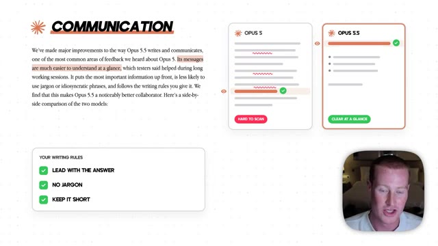
*⏱️ 00:04:13 — Capture d'écran montrant une présentation textuelle sur la communication des modèles d'IA, comparant Opus 5 et Opus 5.5, avec une webcam du présentateur en bas à droite.*

---

### ⏱️ `[00:04:33 - 00:05:05]` | Segment #14

**🔊 Audio (Transcription Intégrale Mot pour Mot en Français) :**
> Maintenant, il est dit qu'ils mettent les informations les plus importantes au début, il est moins susceptible d'utiliser du jargon ou des phrases aléatoires et il suit les règles d'écriture que vous lui donnez. Donc encore une fois, ce n'est que du positif à mes yeux. J'étais juste en train de faire défiler X en faisant des recherches sur cette sortie de nouveau modèle et je suis tombé là-dessus et j'ai trouvé ça très hilarant et je voulais le partager avec vous les gars. Donc ici, nous avons Sam Altman effrayé parce que quelqu'un vient de lui murmurer à l'oreille en disant, monsieur, ils ont supprimé les tirets cadratins d'Opus 5.5. C'est la fin pour nous. Parce que si vous y réfléchissez vraiment, ça ne devrait pas être aussi difficile de faire sonner l'IA de manière humaine. Donc je viens juste

**👁️ Analyse Visuelle d'Écran (gemini-3.5-flash-lite) :**
**Interface & Outils** : Navigateur web, interface de présentation textuelle et réseau social X (Twitter).

**Contenu textuel & Code** : Texte de présentation sur les améliorations d'Opus 5.5 en matière de communication, règles d'écriture et publication sur les réseaux sociaux.

**Action / Démonstration** : Le présentateur commente les caractéristiques et les améliorations de communication du modèle IA Opus 5.5.

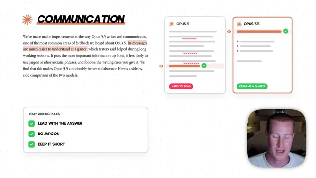
*⏱️ 00:04:41 — Capture d'écran montrant une page de documentation ou de notes sur la communication avec le modèle Opus 5.5, avec des exemples de comparaison et les règles d'écriture, ainsi que le présentateur en bas à droite.*

---

### ⏱️ `[00:05:05 - 00:05:39]` | Segment #15

**🔊 Audio (Transcription Intégrale Mot pour Mot en Français) :**
> find this meme to be very funny. And this is kind of the overarching theme of trying to get AI to communicate clearly. And if I scroll down in this article, they even give me examples of specific outputs comparing Claude Opus 5 with 5.5. And you can really see a difference in how much easier it is to read. On the left, Opus 5.5, like this looks like you're trying to read code, trying to understand what it's trying to tell you. Whereas on the right, we get this text in bold right here to instantly identify what it is that you're even reading. I think that this looks so much easier at first glance to understand what this is trying to say. So this is explaining a bug. I could then

**👁️ Analyse Visuelle d'Écran (gemini-3.5-flash-lite) :**
**Interface & Outils** : Navigateur web affichant une page d'article technique avec des fenêtres de comparaison de modèles d'IA et la webcam du présentateur en bas à droite.

**Contenu textuel & Code** : Comparaison côte à côte de Claude Opus et Claude Opus 5.5 avec des boîtes de dialogue affichant le prompt 'Please explain the issue to me.'

**Action / Démonstration** : Le présentateur commente les exemples de sorties comparant les deux versions de Claude dans l'article.

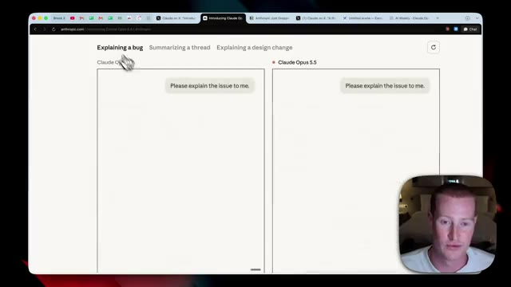
*⏱️ 00:05:13 — Capture d'écran montrant un article de navigateur web sur anthropics.com comparant Claude Opus et Claude Opus 5.5, avec une section intitulée 'Explaining a bug'.*

---

### ⏱️ `[00:05:39 - 00:05:57]` | Segment #16

**🔊 Audio (Transcription Intégrale Mot pour Mot en Français) :**
> cliquez sur résumer un fil de discussion, ce qui va probablement être plus pratique pour les utilisateurs de tous les jours. Et encore une fois, il s'agit de résumer un fil Slack. C'est donc le prompt qu'ils lui ont donné lors de ce test initial. Et ensuite, il utilise des tirets cadratins, un énorme bloc de texte. Je ne sais pas nécessairement exactement ce qu'il essaie de dire au premier coup d'œil, alors que le résultat d'Opus 5.5 est beaucoup plus simple.

**👁️ Analyse Visuelle d'Écran (gemini-3.5-flash-lite) :**
**Interface & Outils** : Navigateur web affichant une page d'Anthropic.

**Contenu textuel & Code** : Texte extrait d'un fil Slack concernant une exportation de commandes du vendredi et la résolution de problèmes techniques.

**Action / Démonstration** : Présentation et explication du résultat de la tâche de résumé de fil Slack générée par l'IA.

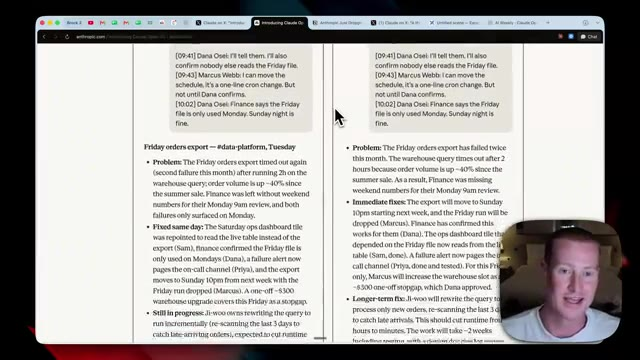
*⏱️ 00:05:43 — Capture d'écran montrant une page web d'Anthropic avec un exemple de résumé de fil Slack, et la webcam du présentateur en bas à droite.*

---

### ⏱️ `[00:05:57 - 00:06:32]` | Segment #17

**🔊 Audio (Transcription Intégrale Mot pour Mot en Français) :**
> It breaks down the problem, shows the immediate fixes, it shows the long-term fixes. And I think that just looks so much more clean. And then same thing with explaining a design change. Obviously, you know, this like has some code in here, just looks tough to read. Whereas this is much simpler and easier to read. Now I went and tested this myself. So I basically told Claude, Fable 5.1 and Opus 5.5 to go and pull from my YouTube videos and give me a breakdown based on all the data that I have. And this is the output here. I'll give you a second to guess which is which. So on the left hand side, we have Fable 5.1. And on the right hand side, the output is Opus 5.5. And I genuinely

**👁️ Analyse Visuelle d'Écran (gemini-3.5-flash-lite) :**
**Interface & Outils** : Navigateur web affichant la page de présentation d'Anthropic avec un encadré vidéo du présentateur en bas à droite.

**Contenu textuel & Code** : Texte de prompt et réponses comparatives concernant l'écriture en Python pour lire une position d'échecs avec TensorFlow.

**Action / Démonstration** : Le présentateur compare visuellement la lisibilité et la structure des réponses entre les deux versions de Claude.

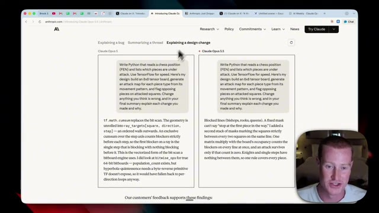
*⏱️ 00:06:06 — Comparaison côte à côte sur le site d'Anthropic entre Claude Opus 5 et Claude Opus 5.5 pour expliquer un changement de design.*

---

### ⏱️ `[00:06:32 - 00:07:08]` | Segment #18

**🔊 Audio (Transcription Intégrale Mot pour Mot en Français) :**
> je pense que c'est beaucoup plus simple et plus facile à lire. Ça décompose la vue d'ensemble. Il y a cette petite vue en tableau pour montrer les vidéos et le nombre de vues par jour qu'elle obtient. Ça montre les meilleures performances juste ici. Et j'aime la façon dont ça met les choses importantes en gras, ce qui rend la lecture tellement plus facile. Ça montre l'engagement, les sources de trafic, et puis probablement la chose la plus importante, les trois choses que je dois faire aujourd'hui. Maintenant, voici quelques exemples sympas qu'Anthropic nous a donnés de cas d'utilisation d'Opus 5.5. J'ai donc pu générer cette vidéo juste ici montrant une courte histoire sur une pastèque. Je pense que c'est un cas d'utilisation sympa. Ensuite, nous avons une recréation du lever de Terre d'Apollo 8. On dirait donc que ça génère tous les visuels ici ainsi que ce petit diagramme.

**👁️ Analyse Visuelle d'Écran (gemini-3.5-flash-lite) :**
**Interface & Outils** : Navigateur web affichant une application de notes/analyse de données et le visage du présentateur en incrustation.

**Contenu textuel & Code** : Statistiques de vues par jour, tendances de croissance, liste des vidéos les plus performantes ("Top performers") et taux d'engagement.

**Action / Démonstration** : Le présentateur commente l'analyse des performances de sa chaîne YouTube affichée à l'écran.

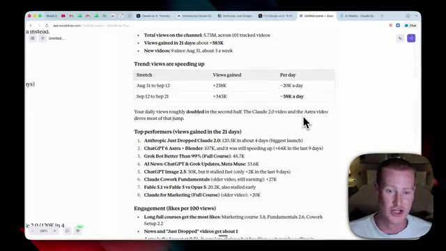
*⏱️ 00:06:41 — Capture d'écran montrant un tableau de bord textuel avec des métriques de chaînes YouTube, incluant des graphiques de tendances et le classement des meilleures vidéos.*

---

### ⏱️ `[00:07:09 - 00:07:42]` | Segment #19

**🔊 Audio (Transcription Intégrale Mot pour Mot en Français) :**
> Ensuite, celui-ci est plutôt sympa. Voici un croquis au crayon avec lequel vous pouvez jouer. C'est donc presque comme un diagramme infographique interactif qu'il présente. Afin d'expliquer quelque chose, je pense que cela pourrait être plutôt sympa si vous essayez d'apprendre un concept spécifique ou de l'enseigner si vous êtes un professeur, par exemple. Maintenant, voici quelques-uns des chiffres finaux. Astra est toujours en tête sur des tâches spécifiques, comme je l'ai dit plus tôt, donc les flux de travail professionnels et la recherche scientifique, il bat bien opus 5.5, mais honnêtement, après avoir jeté un œil aux benchmarks, je suis plutôt impressionné par la capacité de 5.5 par rapport à son prix bas et à sa rapidité par rapport à fable 5.1 et gpt6 astra. Maintenant, la dernière chose concernant

**👁️ Analyse Visuelle d'Écran (gemini-3.5-flash-lite) :**
**Interface & Outils** : Navigateur web affichant un article et des graphiques interactifs ou des tableaux de benchmarks.

**Contenu textuel & Code** : Un croquis interactif de catapulte au format crayon, ainsi que des pourcentages de performance de modèles d'intelligence artificielle sur des critères de workflows professionnels et de recherche scientifique.

**Action / Démonstration** : Le présentateur commente la page web présentant le croquis interactif au crayon qu'il qualifie de diagramme infographique interactif.

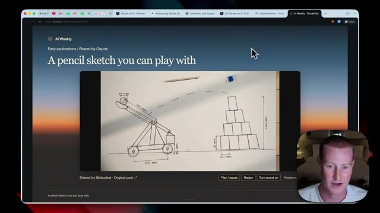
*⏱️ 00:07:17 — Un navigateur web affichant une page intitulée « A pencil sketch you can play with » montrant un croquis interactif d'une catapulte et de blocs.*

---

### ⏱️ `[00:07:42 - 00:08:16]` | Segment #20

**🔊 Audio (Transcription Intégrale Mot pour Mot en Français) :**
> cette annonce est que nous avons plus de place avant d'atteindre nos limites d'utilisation à l'intérieur de Claude, donc je pense que c'est évidemment une bonne nouvelle pour les gens, nous avons donc maintenant une limite de cinq heures plus élevée ainsi qu'une réinitialisation que nous pouvons sauvegarder et utiliser quand nous le souhaitons. Et cela s'applique à toute personne qui est un utilisateur Pro, Max, Team et Enterprise basé sur des licences. Et enfin, voici tous les endroits où nous pouvons utiliser Opus 5.5 dès maintenant. C'est ça. Donc si vous n'avez pas vécu sous un rocher cette semaine, vous avez probablement vu ces vidéos virales partout sur X, Instagram et TikTok de Sam Altman, Elon Musk et d'autres personnes recréant ce clip de Migos. Et ce que je vais faire, c'est

**👁️ Analyse Visuelle d'Écran (gemini-3.5-flash-lite) :**
**Interface & Outils** : Navigateur web affichant une page d'annonce d'Anthropic.

**Contenu textuel & Code** : Texte explicatif sur l'augmentation des limites d'utilisation sur 5 heures pour les abonnements Pro, Max, Team et Enterprise.

**Action / Démonstration** : Présentation des nouvelles fonctionnalités et limites mises à jour d'Anthropic par le présentateur.

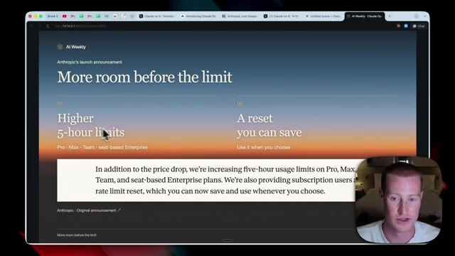
*⏱️ 00:07:51 — Capture d'écran montrant une page web d'actualité sur l'IA avec le titre "More room before the limit", détaillant les nouvelles limites d'utilisation de Claude.*

---

### ⏱️ `[00:08:16 - 00:08:53]` | Segment #21

**🔊 Audio (Transcription Intégrale Mot pour Mot en Français) :**
> je vais vous montrer exactement comment vous pourriez recréer ceci avec vous-même ou différents personnages en seulement quelques étapes simples. Tout d'abord, si vous n'avez pas vu ceci, laissez-moi simplement en diffuser une partie très rapidement. Je veux dire, regardez le mouvement ici. Sam Altman littéralement, je veux dire, il a juste l'air d'un boss. C'est absolument hilarant. Qui aurait pensé que ces deux personnages seraient du genre, vous savez, à faire une chanson de rap comme ça ? Bref, blagues à part, beaucoup de gens font ces remakes avec plein de personnages différents et c'est très simple à faire en utilisant

**👁️ Analyse Visuelle d'Écran (gemini-3.5-flash-lite) :**
**Interface & Outils** : Navigateur web affichant une application locale ou un site web de démonstration vidéo.

**Contenu textuel & Code** : Page web contenant le titre 'Sam Altman & Elon Musk', un lecteur vidéo intégré avec une barre de lecture, et une petite incrustation vidéo du présentateur en bas à droite.

**Action / Démonstration** : Le présentateur montre et diffuse un extrait vidéo généré par intelligence artificielle pour illustrer son propos.

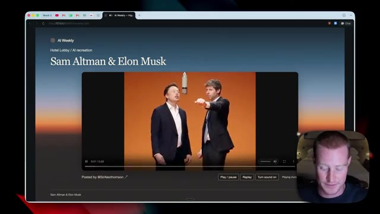
*⏱️ 00:08:25 — Capture d'écran montrant un navigateur web affichant une page intitulée 'AI Weekly' avec un lecteur vidéo au centre présentant une animation par IA de Sam Altman et Elon Musk.*

---

### ⏱️ `[00:08:53 - 00:09:27]` | Segment #22

**🔊 Audio (Transcription Intégrale Mot pour Mot en Français) :**
> a platform called Higgsfield and specifically their video model called Jinjitsu. I mean if you've ever seen Breaking Bad you know these two characters are absolutely legendary and then take a look at this. I actually recreated this with myself and my business partner and this is pretty solid. I think that this is absolutely hilarious. I need to send this to my mom honestly because I think she would love this. And then if you're interested this is actually the original right here. The original music video from Migos compared to the output, the AI recreation that I created using Higgs field jiu-jitsu. So what I'm going to do now is show you very simply how you

**👁️ Analyse Visuelle d'Écran (gemini-3.5-flash-lite) :**
**Interface & Outils** : Présentation ou face-caméra explicatif du trader sans interface logicielle partagée.

**Contenu textuel & Code** : Explications orales des stratégies et mise en contexte méthodologique du marché.

**Action / Démonstration** : Explications face caméra et analyse conceptuelle des marchés.

---

### ⏱️ `[00:09:27 - 00:09:50]` | Segment #23

**🔊 Audio (Transcription Intégrale Mot pour Mot en Français) :**
> peut aller et recréer ceci afin que vous puissiez le partager avec vos amis. Maintenant, tout d'abord, je vais aller dans Higgs field. Si vous voulez essayer ceci, il y aura un lien dans la description pour créer un compte. Je vais donc cliquer sur vidéos, puis je vais chercher spécifiquement ce modèle jiu-jitsu de Higgs field juste ici qui a cette petite nouvelle étiquette. Je vais donc cliquer dessus. Donc fondamentalement ce que nous pouvons faire, c'est télécharger une vidéo de référence juste ici et ensuite nous pouvons ajouter différents personnages, produits ou vêtements.

**👁️ Analyse Visuelle d'Écran (gemini-3.5-flash-lite) :**
**Interface & Outils** : Navigateur web affichant la plateforme Higgsfield AI.

**Contenu textuel & Code** : Menus et options de la plateforme d'intelligence artificielle créative Higgsfield AI.
[DESC_IMAGE_3] Navigation dans les fonctionnalités de Higgsfield AI et sélection des outils de génération vidéo.

**Action / Démonstration** : Explications face caméra et analyse conceptuelle des marchés.

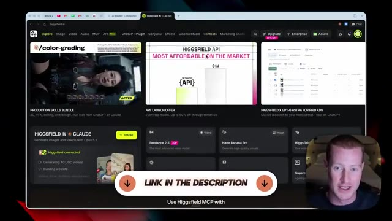
*⏱️ 00:09:33 — Vue d'ensemble de l'interface de Higgsfield AI montrant divers menus de création vidéo et d'API.*

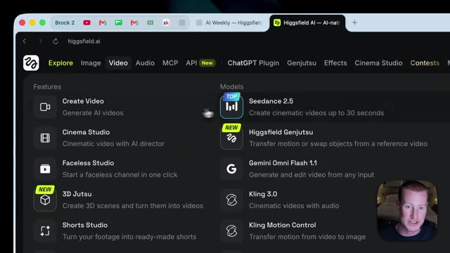
*⏱️ 00:09:38 — Gros plan sur le menu de navigation de Higgsfield AI avec les sections "Features" et "Models".*

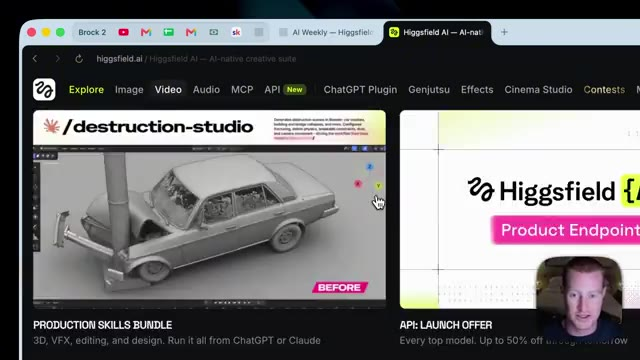
*⏱️ 00:09:44 — Aperçu de la section "destruction-studio" sur la plateforme Higgsfield AI illustrant la manipulation 3D d'une voiture.*

---

### ⏱️ `[00:09:50 - 00:10:09]` | Segment #24

**🔊 Audio (Transcription Intégrale Mot pour Mot en Français) :**
> Et cela manipule fondamentalement la réalité de cette vidéo. Donc cet exemple précis que vous regardez en ce moment, c'est ce personnage qui reste fondamentalement très cohérent, mais cela change simplement l'environnement et les vêtements qu'il porte. Donc pour générer cela, bien sûr, nous avons besoin de cette vidéo de référence spécifique. Donc si vous voulez utiliser cette vidéo spécifique, il y aura un lien dans la description pour la télécharger gratuitement sur Google Drive.

**👁️ Analyse Visuelle d'Écran (gemini-3.5-flash-lite) :**
**Interface & Outils** : Lecteur vidéo web et interface de présentation d'outil de génération vidéo par IA.

**Contenu textuel & Code** : Aucun graphique technique, code ou donnée financière n'est affiché.

**Action / Démonstration** : Présentation visuelle d'exemples de modifications vidéo par intelligence artificielle (changement d'environnement et de vêtements).

---

### ⏱️ `[00:10:09 - 00:10:27]` | Segment #25

**🔊 Audio (Transcription Intégrale Mot pour Mot en Français) :**
> C'est de très haute qualité, ce qui est vraiment important. Bien sûr, nous voulons télécharger une vidéo de référence avec une haute fidélité. De cette façon, le résultat est aussi beau que possible. Ensuite, tout ce que nous avons à faire est de venir dans Higgsville Genjitsu, puis de télécharger cette vidéo de référence. Nous pouvons simplement sélectionner, vous savez, fondamentalement les images pour lesquelles nous voulons l'ajouter. Donc, je vais juste faire ça pour, disons, 22 secondes ici. Je vais cliquer sur confirmer.

**👁️ Analyse Visuelle d'Écran (gemini-3.5-flash-lite) :**
**Interface & Outils** : Navigateur web affichant la plateforme Higgsfield AI (Genjitsu) et une webcam du présentateur.

**Contenu textuel & Code** : Interface utilisateur de génération vidéo par IA, options de transfert de mouvement (Motion Transfer) et chronologie vidéo.

**Action / Démonstration** : Téléchargement et préparation d'une vidéo de référence pour le transfert de mouvement dans Higgsfield Genjitsu.

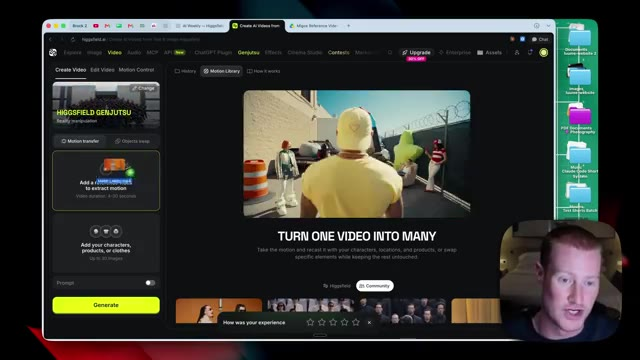
*⏱️ 00:10:18 — Vue de l'interface principale de Higgsfield Genjitsu avec l'outil Motion Transfer.*

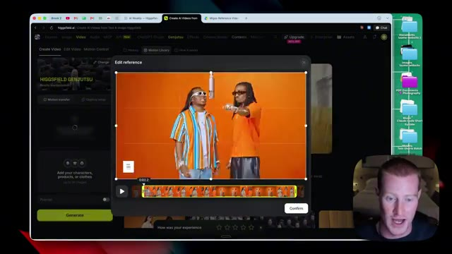
*⏱️ 00:10:23 — Fenêtre d'édition et de recadrage de la vidéo de référence dans Higgsfield Genjitsu.*

---

### ⏱️ `[00:10:27 - 00:10:50]` | Segment #26

**🔊 Audio (Transcription Intégrale Mot pour Mot en Français) :**
> Ensuite, assurez-vous de télécharger vos images de référence dans cette boîte de téléchargement juste en dessous. Et voici celles que j'utilise. Donc voici cette image de moi portant des lunettes de soleil. Et puis il y a cette image juste ici de mon partenaire commercial portant également des lunettes de soleil. Donc maintenant, ce que nous devons faire, c'est simplement activer cette invite ici parce que nous devons faire quelques spécifications. Laissez-moi donc vous montrer l'invite à utiliser et vous pouvez simplement faire une capture d'écran de celle-ci et la coller directement dans votre champ Higgs lorsque vous générez ceci.

**👁️ Analyse Visuelle d'Écran (gemini-3.5-flash-lite) :**
**Interface & Outils** : Navigateur web affichant l'interface de l'outil de génération de vidéo par IA Higgsfield.ai, avec incrustation vidéo du présentateur en bas à droite.

**Contenu textuel & Code** : Interface utilisateur de création vidéo, zones de téléchargement d'images de référence, et champ de saisie de prompt textuel.

**Action / Démonstration** : Navigation et démonstration de l'interface de téléchargement d'images de référence sur la plateforme d'intelligence artificielle Higgsfield.

---

### ⏱️ `[00:10:50 - 00:11:08]` | Segment #27

**🔊 Audio (Transcription Intégrale Mot pour Mot en Français) :**
> Voici le prompt que j'utilise : Remplace l'homme à gauche de la vidéo source par la personne de la première image, et remplace l'homme de droite par la personne de la deuxième image. Le son et les mouvements d'origine doivent rester les mêmes, il s'agit juste d'échanger les personnages. Donc tout ce dont vous avez besoin, c'est d'un prompt très basique comme celui-ci. Évidemment, il suffit de préciser quel personnage vous voulez échanger et ensuite vous devriez être prêts.

**👁️ Analyse Visuelle d'Écran (gemini-3.5-flash-lite) :**
**Interface & Outils** : Application web d'intelligence artificielle générative vidéo (type Higgsfield Genjutsu).

**Contenu textuel & Code** : Texte du prompt configuré : "Replace the man on the left side of the source video with the person in @Image 1, and replace the man on the right with the person in @Image 2."

**Action / Démonstration** : Saisie et configuration d'un prompt textuel pour le remplacement de personnages dans une vidéo par IA.

---

### ⏱️ `[00:11:08 - 00:11:47]` | Segment #28

**🔊 Audio (Transcription Intégrale Mot pour Mot en Français) :**
> In order to get the best output here, I'm going to do 1080p quality and then I'm just going to click generate. This should take probably a couple of minutes. So give it like five to ten minutes and it should be good to go All right So this actually took about like 12 minutes to generate but this one actually looks very good So let's take a look at this right now I mean, that's hilarious.

**👁️ Analyse Visuelle d'Écran (gemini-3.5-flash-lite) :**
**Interface & Outils** : Navigateur web affichant la plateforme de génération vidéo Higgsfield AI (Genjutsu / Motion Transfer).

**Contenu textuel & Code** : Paramètres de génération vidéo, options de transfert de mouvement, prévisualisation de la vidéo finale et vignette de la webcam du présentateur en bas à droite.

**Action / Démonstration** : Le présentateur explique le processus de génération de vidéo par IA et montre le résultat final obtenu après le temps de rendu.

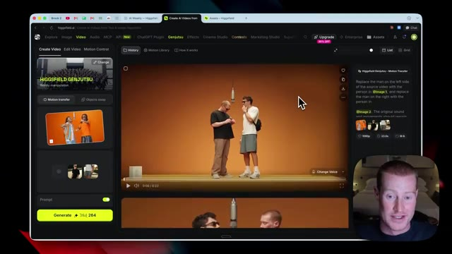
*⏱️ 00:11:18 — Interface du site web Higgsfield AI affichant le panneau de génération de vidéo avec un aperçu en cours.*

---

### ⏱️ `[00:11:47 - 00:12:12]` | Segment #29

**🔊 Audio (Transcription Intégrale Mot pour Mot en Français) :**
> J'espère que vous pourrez utiliser ceci et peut-être faire quelques mèmes avec vos amis. Envoyez ceci à votre mère. Si votre mère est un peu comme la mienne, elle pensera probablement vraiment que c'est réel. Bref, c'est super amusant de jouer avec Higgs Fuel Jinjitsu. Ce n'est là qu'un cas d'usage qui est devenu viral. Je me suis donc dit que j'allais vous montrer exactement comment l'utiliser. Maintenant, je veux parler rapidement de l'utilisation de GrokBot à l'intérieur de Tesla parce que cette vidéo, parce que cette vidéo sur X a fuité et c'est en gros quelqu'un qui utilise son GrokBot à l'intérieur de son Tesla Cybertruck.

**👁️ Analyse Visuelle d'Écran (gemini-3.5-flash-lite) :**
**Interface & Outils** : Présentation ou face-caméra explicatif du trader sans interface logicielle partagée.

**Contenu textuel & Code** : Explications orales des stratégies et mise en contexte méthodologique du marché.

**Action / Démonstration** : Explications face caméra et analyse conceptuelle des marchés.

---

### ⏱️ `[00:12:12 - 00:12:33]` | Segment #30

**🔊 Audio (Transcription Intégrale Mot pour Mot en Français) :**
> Et ils utilisent cela afin de gérer leur boîte de réception, de faire le ménage dans leur calendrier et de discuter à travers leurs différents fichiers sur leur ordinateur, par exemple. Je pense que nous sommes à un moment intéressant où tous ces différents fournisseurs de grands modèles de langage commencent à développer des assistants IA personnels, que ce soit GrokBot, Metamuse, et maintenant Metamuse Charm, tous ces différents produits autonomes avec lesquels nous pouvons interagir avec ces agents pour aller travailler à travers nos différentes applications.

**👁️ Analyse Visuelle d'Écran (gemini-3.5-flash-lite) :**
**Interface & Outils** : Navigateur web affichant des pages de démonstration pour des agents conversationnels (Grok Bot) et de l'intelligence artificielle appliquée à la gestion de tâches et à l'automobile.

**Contenu textuel & Code** : Textes descriptifs sur l'IA ("Email. Calendar. Tasks.", "Manage your inbox", "Clean up your calendar", "Talk through your files") et fenêtres vidéo intégrées.

**Action / Démonstration** : Navigation et présentation visuelle de cas d'usage d'outils d'IA pour la gestion quotidienne et l'intégration automobile.

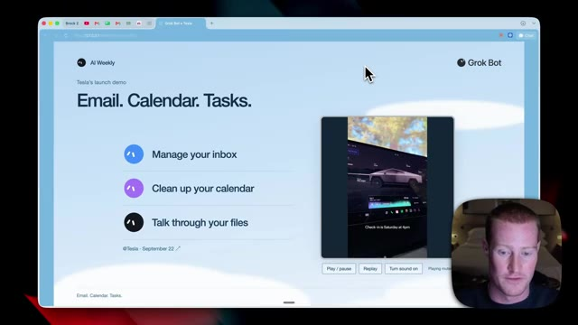
*⏱️ 00:12:17 — Capture d'écran montrant une interface web intitulée "AI Weekly" avec un design clair, listant les fonctionnalités "Manage your inbox", "Clean up your calendar" et "Talk through your files", ainsi qu'une vidéo de démonstration.*

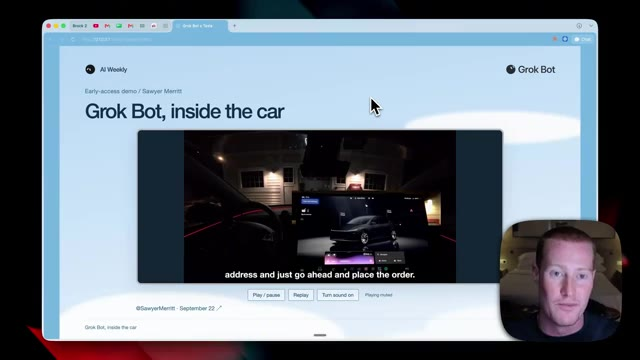
*⏱️ 00:12:23 — Capture d'écran montrant une autre page de démonstration "Grok Bot, inside the car" avec une vidéo intégrant l'intérieur d'un véhicule Tesla.*

---

### ⏱️ `[00:12:33 - 00:12:54]` | Segment #31

**🔊 Audio (Transcription Intégrale Mot pour Mot en Français) :**
> J'ai personnellement trouvé cela très intéressant parce que je pense que nous nous dirigeons vers un moment où l'on pourra simplement porter certaines lunettes ou un produit physique et parler avec son agent IA afin d'accomplir la majorité de ses tâches. Et sur le sujet de GrokBot, j'ai vu cela sur Twitter également. Donc Grok a annoncé qu'ils avaient reconstruit le service client autour de GrokBot afin de faire évoluer leurs opérations sans augmenter leurs effectifs.

**👁️ Analyse Visuelle d'Écran (gemini-3.5-flash-lite) :**
**Interface & Outils** : Navigateur web affichant le site web AI Weekly / Grok Bot avec vignette vidéo et tweets intégrés.

**Contenu textuel & Code** : Titres et options fonctionnelles sur l'automatisation des tâches (Email, Calendar, Tasks) et métriques de performance du support client géré par IA (+175% de tickets, 0 embauche).

**Action / Démonstration** : Navigation et présentation par le présentateur (visible en bas à droite) des capacités d'agents IA comme Grok Bot pour la gestion des tâches et le support client.

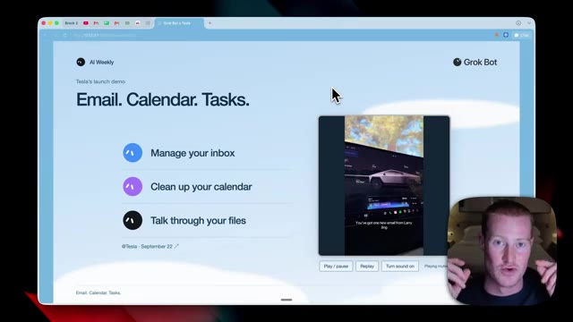
*⏱️ 00:12:38 — Capture d'écran du site AI Weekly montrant une section sur Tesla et Grok Bot avec des options de gestion d'e-mails et de calendrier, et une vidéo intégrée montrant un Cybertruck.*

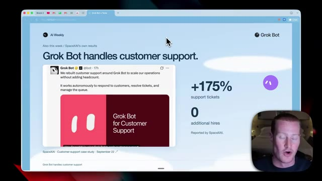
*⏱️ 00:12:44 — Capture d'écran du site AI Weekly montrant une section sur Grok Bot gérant le support client avec un tweet intégré et des statistiques chiffrées (+175% de tickets de support, 0 embauche).*

---

### ⏱️ `[00:12:54 - 00:13:16]` | Segment #32

**🔊 Audio (Transcription Intégrale Mot pour Mot en Français) :**
> And right here inside of the article, it says a new combined team has seen 175% increase in support tickets, but we did not have to hire any new people thanks to GrokBot. And the craziest part about this is it said we might have hired 200 additional people otherwise if it weren't for the tasks that GrokBot could automate. This is just a glimpse into the future of having these personal assistants handling basically a majority of the stuff we do on our computer.

**👁️ Analyse Visuelle d'Écran (gemini-3.5-flash-lite) :**
**Interface & Outils** : Navigateur web affichant un article et incrustation vidéo du présentateur.

**Contenu textuel & Code** : Texte surligné mentionnant une augmentation de 175% des tickets de support sans embauche supplémentaire grâce à Grok Bot, et l'économie potentielle de 200 employés.

**Action / Démonstration** : Le présentateur lit et commente le texte affiché à l'écran concernant les performances de Grok Bot.

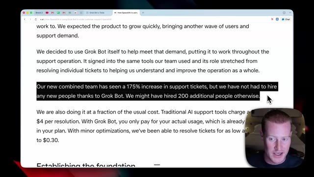
*⏱️ 00:13:00 — Capture d'écran montrant un article web sur l'utilisation de Grok Bot, avec un paragraphe surligné en noir correspondant au texte audio, et une petite fenêtre vidéo du présentateur en bas à droite.*

---

### ⏱️ `[00:13:17 - 00:13:38]` | Segment #33

**🔊 Audio (Transcription Intégrale Mot pour Mot en Français) :**
> Évidemment, nous n'en sommes pas encore là, mais les capacités de ces différents outils d'IA augmentent considérablement. Ensuite, nous avons une mise à jour d'Anthropic dans l'application Claude sur notre téléphone. Nous avons donc désormais la possibilité d'ajouter plusieurs comptes différents dans notre application Claude sur notre téléphone, entre lesquels nous pouvons basculer. Cela va évidemment être utile pour les personnes qui souhaitent séparer, par exemple, leur vie professionnelle et leur vie personnelle dans Claude.

**👁️ Analyse Visuelle d'Écran (gemini-3.5-flash-lite) :**
**Interface & Outils** : Navigateur web affichant une application mobile simulée (Claude App).

**Contenu textuel & Code** : Menu de gestion des comptes ('Accounts') affichant plusieurs profils utilisateurs et adresses e-mail (Personnel, Enterprise, Team).

**Action / Démonstration** : Présentation de la nouvelle fonctionnalité permettant d'ajouter et de basculer entre plusieurs comptes dans l'application Claude.

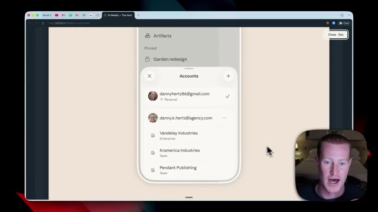
*⏱️ 00:13:27 — Interface d'un navigateur web montrant une maquette de l'application mobile Claude avec la fenêtre de gestion des comptes multiples.*

---

### ⏱️ `[00:13:38 - 00:13:58]` | Segment #34

**🔊 Audio (Transcription Intégrale Mot pour Mot en Français) :**
> Vous pouvez donc maintenant configurer plusieurs comptes différents auxquels vous pouvez vous connecter. Je vais vous montrer rapidement exactement comment faire cela. C'est très simple. Tout d'abord, c'est uniquement dans l'application mobile Claude. Ensuite, vous allez glisser vers le côté gauche où vous trouvez vos discussions, puis aller tout en bas à gauche où vous avez l'icône de votre profil. Ensuite, tout en haut, vous pouvez maintenant voir que mon compte personnel est ajouté et je pourrais cliquer sur ajouter des comptes.

**👁️ Analyse Visuelle d'Écran (gemini-3.5-flash-lite) :**
**Interface & Outils** : Application mobile Claude sur smartphone et webcam du présentateur.

**Contenu textuel & Code** : Écran d'accueil de l'application Claude affichant le message de salutation « Afternoon, brock », avec une barre de chat en bas et un sélecteur de modèle (« Opus 3.5 Medium »).

**Action / Démonstration** : Le présentateur introduit la configuration de plusieurs comptes sur l'application mobile Claude en montrant l'interface principale.

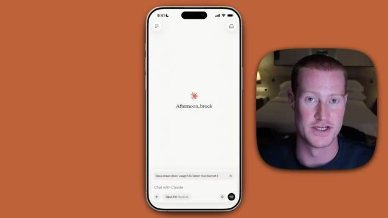
*⏱️ 00:13:43 — Capture d'écran montrant l'application mobile Claude sur un smartphone, avec le présentateur incrusté dans une vignette à droite.*

---

### ⏱️ `[00:13:58 - 00:14:26]` | Segment #35

**🔊 Audio (Transcription Intégrale Mot pour Mot en Français) :**
> But I already went and configured one. So I have one with my sponsorships email. so I could go and click on this. And then just like that, you could see this is basically just a new Claude account. I don't have any previous conversations or anything. This is a small update, but I think this could be pretty helpful if you want to separate, like I said, your personal life and your work life inside of Claude. Now on the topic of using different AI agents like Claude Code, Codex, Grokbot, all of these different agentic AI platforms, it's more and more important that over time we stay platform agnostic.

**👁️ Analyse Visuelle d'Écran (gemini-3.5-flash-lite) :**
**Interface & Outils** : Application mobile Claude et caméra web du présentateur.

**Contenu textuel & Code** : Interface utilisateur de l'application Claude sur mobile (menu Chats, Projects, Code, Artifacts) et schéma d'architecture d'IA.

**Action / Démonstration** : Présentation et démonstration de la nouvelle interface d'un compte Claude sur mobile.

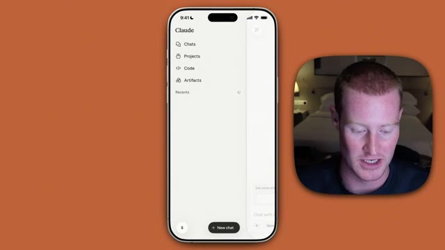
*⏱️ 00:14:05 — Un écran de smartphone affichant l'interface mobile de Claude, avec le présentateur visible en médaillon dans un coin.*

---

### ⏱️ `[00:14:27 - 00:14:49]` | Segment #36

**🔊 Audio (Transcription Intégrale Mot pour Mot en Français) :**
> Et qu'est-ce que je veux dire par là ? Cela signifie que, disons qu'un nouveau modèle sort de chez Claude et que vous êtes à l'intérieur de Codex. Eh bien, nous devons faire en sorte qu'il soit très facile pour vous de retourner sur Claude si vous avez besoin de recommencer à l'utiliser. Ou par exemple, en ce moment j'utilise Codex pour la majorité de mes tâches de codage et mes flux de travail vraiment complexes, mais j'utilise GrokBot au jour le jour pour gérer toutes mes tâches liées à l'administration.

**👁️ Analyse Visuelle d'Écran (gemini-3.5-flash-lite) :**
**Interface & Outils** : Interface utilisateur web, tableau de bord cloud et interface d'application de type ChatGPT.

**Contenu textuel & Code** : Métriques de calcul, stockage, listes de projets (Aurora Engine, Hyperion Suite, Starlight Platform) et invite utilisateur "@Sites can you create a microsite".

**Action / Démonstration** : Navigation et présentation des fonctionnalités de gestion de projets et de déploiement de sites web.

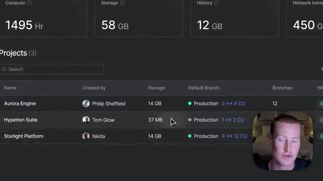
*⏱️ 00:14:38 — Tableau de bord d'une plateforme de gestion de projets montrant les ressources de calcul, le stockage et la liste des projets.*

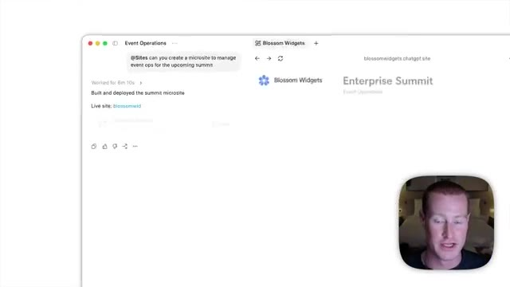
*⏱️ 00:14:43 — Interface de l'application montrant un espace de travail de création de site web avec un assistant conversationnel et un aperçu en temps réel.*

---

### ⏱️ `[00:14:49 - 00:15:12]` | Segment #37

**🔊 Audio (Transcription Intégrale Mot pour Mot en Français) :**
> So then the question becomes, how do we share context between these different platforms so that way we could switch between them with no problems? And I'm gonna show you right now exactly how we could solve this problem So that way they have all of the necessary context inside of this second brain. So you can work across any platform you want. Now, I personally use a platform called Neon, which is basically just a database that our AI agents can use.

**👁️ Analyse Visuelle d'Écran (gemini-3.5-flash-lite) :**
**Interface & Outils** : Logiciel de présentation / Excalidraw, avec incrustation vidéo du présentateur en bas à droite.

**Contenu textuel & Code** : Texte « HOW TO SHARE CONTEXT? » et « Stay platform-agnostic. Choose your agent. Keep your saved context. » avec logos des agents Claude, Codex et Grok Bot.

**Action / Démonstration** : Le présentateur explique conceptuellement comment partager et conserver le contexte utilisateur entre différents outils d'IA.

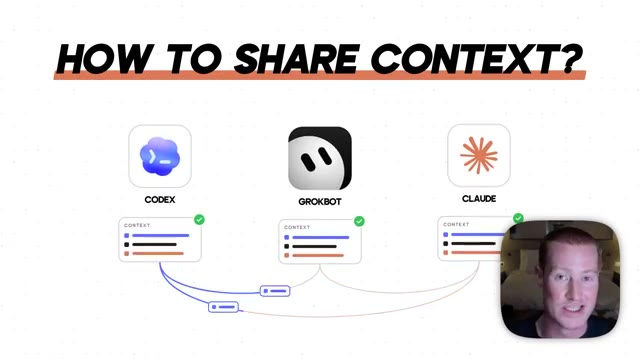
*⏱️ 00:14:55 — Schéma explicatif illustrant le partage de contexte entre différentes plateformes d'IA (Codex, Grokbot, Claude).*

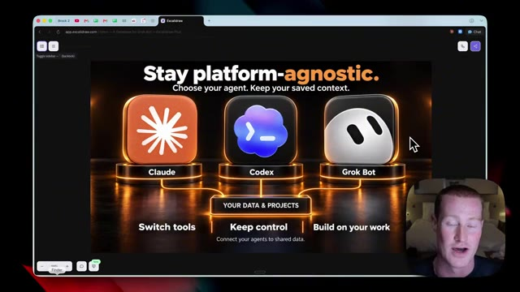
*⏱️ 00:15:00 — Capture d'écran d'un navigateur affichant une infographie sur le concept de "platform-agnostic" avec les applications Claude, Codex et Grok Bot connectées aux données et projets.*

---

### ⏱️ `[00:15:12 - 00:15:34]` | Segment #38

**🔊 Audio (Transcription Intégrale Mot pour Mot en Français) :**
> Nous pourrions construire des applications à partir de cela. Et le meilleur, c'est que nous n'avons pas besoin d'être développeur pour utiliser ceci, car cela se connecte directement à nos plateformes d'IA comme GrokBot, CloudCode, Codex, et fondamentalement tous ces différents outils d'IA qui possèdent des connecteurs spécifiques, nous permettant de prendre les informations et les conversations que nous avons à l'intérieur de ces plateformes d'IA générative et de les stocker à l'intérieur de cette base de données.

**👁️ Analyse Visuelle d'Écran (gemini-3.5-flash-lite) :**
**Interface & Outils** : Navigateur web affichant la page d'accueil de la plateforme Neon (neon.com).

**Contenu textuel & Code** : Présentation de la plateforme de base de données Neon pour les applications et les agents, s'appuyant sur Lakebase Postgres, avec des boutons « Get started » et « Read the docs ».

**Action / Démonstration** : Le présentateur présente la plateforme Neon en arrière-plan de son écran tout en expliquant son utilisation pour la construction d'applications.

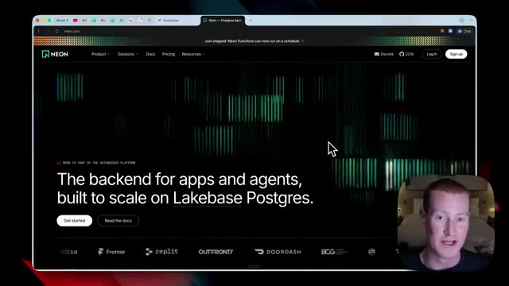
*⏱️ 00:15:18 — Capture d'écran montrant le site web de Neon (neon.com) avec le slogan « The backend for apps and agents, built to scale on Lakebase Postgres » et la webcam du présentateur en bas à droite.*

---

### ⏱️ `[00:15:34 - 00:16:03]` | Segment #39

**🔊 Audio (Transcription Intégrale Mot pour Mot en Français) :**
> Maintenant, avant de vous montrer comment configurer ceci, laissez-moi vous expliquer cela encore plus pour que vous puissiez le comprendre même si vous n'êtes pas un développeur. Je veux donc que vous pensiez à notre base de données Neon comme à un classeur. Ainsi, nous pourrions utiliser notre assistant IA comme GrokBot ou quoi que ce soit d'autre, et nous pourrions essentiellement lui dire de garder une idée et de la stocker pour plus tard. Et ensuite, il va ranger cela et le stocker dans ce classeur auquel nous pouvons accéder, que ce soit à l'intérieur de GrokBot, que ce soit à l'intérieur de Claude, ou disons qu'une nouvelle IA révolutionnaire sort la semaine prochaine, elle pourrait y accéder aussi.

**👁️ Analyse Visuelle d'Écran (gemini-3.5-flash-lite) :**
**Interface & Outils** : Navigateur web, Excalidraw, visioconférence (caméra de présentation).

**Contenu textuel & Code** : Schéma conceptuel titré "Your assistant. Its filing cabinet." avec Grok Bot d'un côté et Neon de l'autre.

**Action / Démonstration** : Explication visuelle du fonctionnement de la base de données Neon comme un classeur pour le bot.

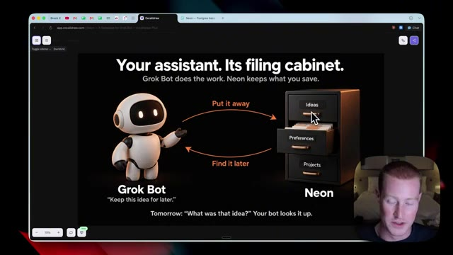
*⏱️ 00:15:41 — Schéma explicatif sur Excalidraw montrant l'interaction entre Grok Bot et Neon (comparé à un classeur).*

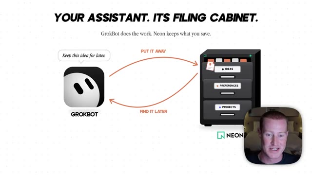
*⏱️ 00:15:48 — Diapositive illustrant le concept de l'assistant GrokBot et du classeur de stockage Neon.*

---

### ⏱️ `[00:16:03 - 00:16:22]` | Segment #40

**🔊 Audio (Transcription Intégrale Mot pour Mot en Français) :**
> De cette façon, nous avons désormais une seule mémoire unifiée à travers ces trois, quatre ou cinq agents IA différents, quel que soit le nombre que vous utilisez. Et c'est pourquoi il est vraiment important de construire une base de données avec quelque chose comme Neon. Maintenant, je vais vous montrer exactement comment configurer cela. Évidemment, vous devrez avoir un compte avec Neon. Alors allez-y, il y aura un lien dans la description pour vous inscrire si vous voulez tester cela.

**👁️ Analyse Visuelle d'Écran (gemini-3.5-flash-lite) :**
**Interface & Outils** : Excalidraw et interface de développement ou de chat IA.

**Contenu textuel & Code** : Schéma d'architecture de données unifiées avec base de données Neon, et invite de discussion pour un système d'IA.

**Action / Démonstration** : Présentation visuelle de l'architecture de mémoire partagée entre plusieurs agents IA et démonstration d'une interface de développement.

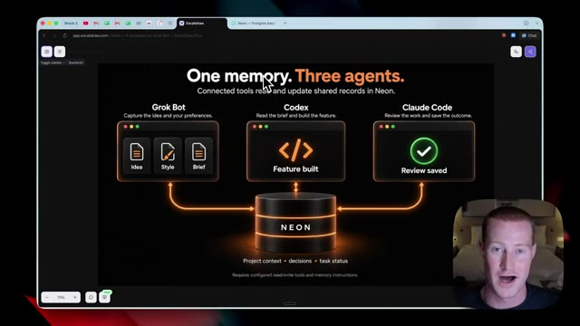
*⏱️ 00:16:08 — Schéma explicatif sur Excalidraw montrant une architecture à mémoire unifiée entre trois agents IA (Grok Bot, Codex, Claude Code) connectés à une base de données Neon.*

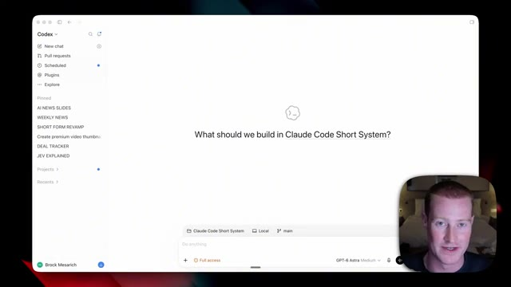
*⏱️ 00:16:17 — Interface d'une application ou d'un outil de développement montrant le texte « What should we build in Claude Code Short System? » avec une barre de commande en bas.*

---

### ⏱️ `[00:16:22 - 00:16:45]` | Segment #41

**🔊 Audio (Transcription Intégrale Mot pour Mot en Français) :**
> Et ensuite, je vais vous montrer comment connecter ceci à l'intérieur de Codex, mais ce sera très similaire sur d'autres plateformes, comme Claude ou Grokbot, par exemple. Donc je vais simplement descendre juste ici là où mon nom s'affiche. Et j'ai juste besoin d'aller trouver les plugins. Donc juste ici sous intégrations, vous allez voir plugins. Donc je vais simplement cliquer dessus, cliquer sur parcourir le répertoire, puis simplement rechercher Neon.

**👁️ Analyse Visuelle d'Écran (gemini-3.5-flash-lite) :**
**Interface & Outils** : Interface Codex (application de bureau)

**Contenu textuel & Code** : Paramètres généraux, options d'intégration, permissions et configurations de l'application Codex

**Action / Démonstration** : Navigation dans les menus de paramètres pour accéder aux plugins de l'application

*⏱️ 00:16:28 — Vue d'ensemble de l'interface Codex affichant le champ de saisie avec le texte 'What should we build in Claude Code Short System?'.*

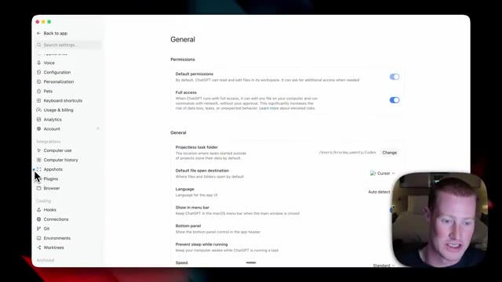
*⏱️ 00:16:39 — Page des paramètres généraux de Codex montrant la section des intégrations avec les options Plugins et Computer use.*

---

### ⏱️ `[00:16:45 - 00:17:06]` | Segment #42

**🔊 Audio (Transcription Intégrale Mot pour Mot en Français) :**
> Since I already have a built-in connector, it's very, very easy to add this. So I'm just going to click on this plus button like we do any of our other plugins or connectors to these different AI applications. I'm going to click continue to Neon. And what it's going to do is it's now going to ask me to approve. So that way, ChatGPT can access our Neon databases and create databases and all those different necessary actions it needs.

**👁️ Analyse Visuelle d'Écran (gemini-3.5-flash-lite) :**
**Interface & Outils** : Interface de gestion de plugins de l'application et tableau de bord Neon Database (mcp.neon.tech).

**Contenu textuel & Code** : Menus de configuration de plugins, métriques de projets de base de données (Compute, Storage, History), options de permissions d'accès (Read and write, Allow writes).

**Action / Démonstration** : Navigation et clic sur le bouton pour approuver et continuer la connexion du service Neon.

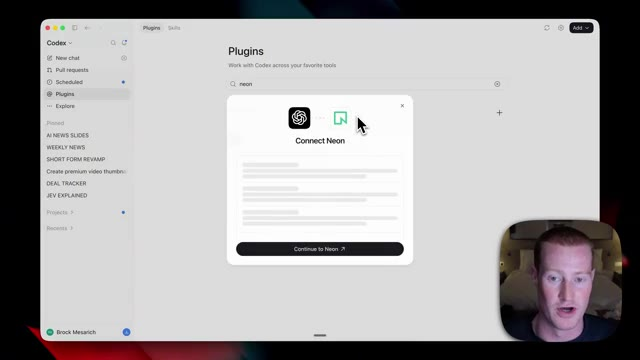
*⏱️ 00:16:50 — Fenêtre contextuelle de l'application affichant le bouton "Connect Neon" pour ajouter un plugin.*

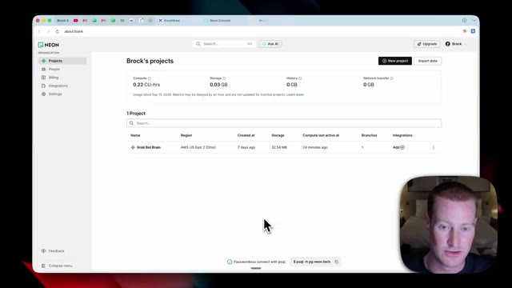
*⏱️ 00:16:56 — Tableau de bord du projet Neon affichant les statistiques de calcul, stockage et la liste des projets.*

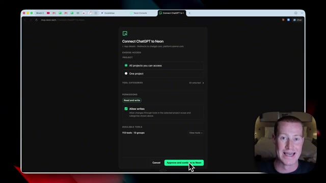
*⏱️ 00:17:01 — Page de configuration de l'intégration pour connecter ChatGPT à Neon avec des options d'accès et de permissions.*

---

### ⏱️ `[00:17:07 - 00:17:32]` | Segment #43

**🔊 Audio (Transcription Intégrale Mot pour Mot en Français) :**
> Donc je vais cliquer sur approuver et continuer vers Neon. Je vais cliquer sur autoriser. Et c'est aussi simple que ça. Ça va nous ramener à ChatGPT. Et ensuite, nous devrions voir ceci maintenant connecté. Donc si je cherche à l'intérieur de mes plugins et que je cherche Neon, vous pouvez maintenant voir que nous avons cette base de données configurée. Et encore une fois, le processus est très similaire pour GrokBot. Donc nous viendrions sur Marketplace, irions dans les plugins, chercherions Neon Postgres et cliquions sur ajouter et nous pourrions le configurer en quelques étapes très simples.

**👁️ Analyse Visuelle d'Écran (gemini-3.5-flash-lite) :**
**Interface & Outils** : Navigateur web affichant l'interface ChatGPT et sa Marketplace de plugins/bots.

**Contenu textuel & Code** : Menu de gestion des plugins, barre de recherche de la Marketplace, et listes d'outils et bots recommandés (Notion, Amplitude, Asana, etc.).

**Action / Démonstration** : Navigation dans l'interface de ChatGPT et préparation d'une recherche de plugin dans la Marketplace.

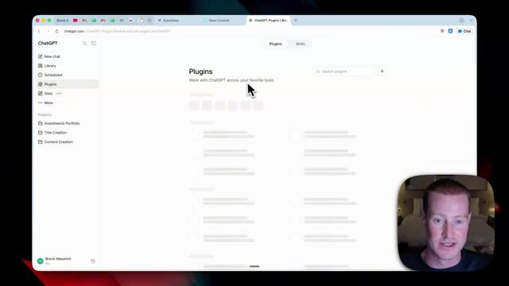
*⏱️ 00:17:13 — Vue de l'interface web de ChatGPT montrant l'onglet des plugins et la section de gestion des outils connectés.*

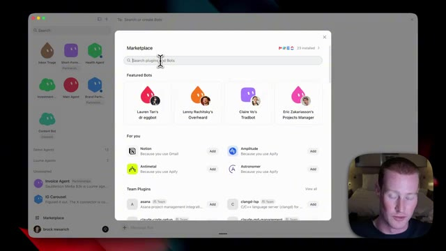
*⏱️ 00:17:26 — Fenêtre de la Marketplace affichant une barre de recherche pour trouver des plugins et des bots, ainsi que des recommandations d'applications.*

---

### ⏱️ `[00:17:33 - 00:17:51]` | Segment #44

**🔊 Audio (Transcription Intégrale Mot pour Mot en Français) :**
> À titre de référence, voici à quoi ressemble notre base de données dans Neon. C'est un outil de suivi des vidéos courtes que j'ai créé. Je l'utilise avec mon Claude, mon Codex et mon GrokBot. Et ce que ça fait, c'est que ça rassemble toutes mes meilleures vidéos courtes que j'ai jamais publiées. Et pour vous montrer cela en action, je vais ouvrir GrokBot ici.

**👁️ Analyse Visuelle d'Écran (gemini-3.5-flash-lite) :**
**Interface & Outils** : Navigateur web affichant Neon Console (console.neon.tech).

**Contenu textuel & Code** : Tableau de données relationnelles contenant les métadonnées de vidéos YouTube (identifiants, titres, liens URL, catégories, dates de publication et durées).
[ISO_ACTION] Le présentateur commente la structure de sa base de données de suivi de vidéos.

**Action / Démonstration** : Explications face caméra et analyse conceptuelle des marchés.

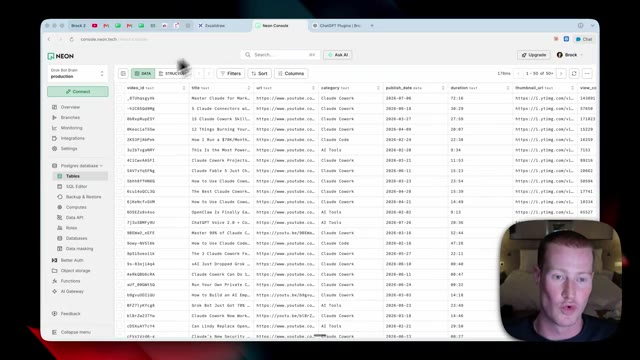
*⏱️ 00:17:37 — Capture d'écran montrant l'interface de la console Neon affichant une base de données de vidéos courtes avec différentes colonnes comme video_id, title, url, category, publish_date, et duration.*

---

### ⏱️ `[00:17:51 - 00:18:14]` | Segment #45

**🔊 Audio (Transcription Intégrale Mot pour Mot en Français) :**
> Et j'ai simplement dit, tire les données de la base de données Neon et parle-moi des vidéos courtes les plus performantes que j'ai publiées. Elle a extrait automatiquement de Neon via ce connecteur. En décomposant toutes ces informations, évidemment c'est des métadonnées qui sont stockées à l'intérieur de notre base de données Neon. Et le meilleur, c'est que je pouvais aller sur Codex. Et comme ceci est aussi connecté à Neon, je pouvais lui donner exactement le même prompt et il va extraire la même information.

**👁️ Analyse Visuelle d'Écran (gemini-3.5-flash-lite) :**
**Interface & Outils** : Interface logicielle d'un agent IA personnalisé et interface de Codex (système Claude Code).

**Contenu textuel & Code** : Liste classée des vidéos courtes les plus performantes par vues (Instagram et TikTok), avec métriques de vues, likes et commentaires (ex: Google's 7 free AI tools, GitHub file that makes Claude smarter).

**Action / Démonstration** : L'agent IA interroge la base de données Neon pour récupérer et afficher les statistiques des publications de l'utilisateur.

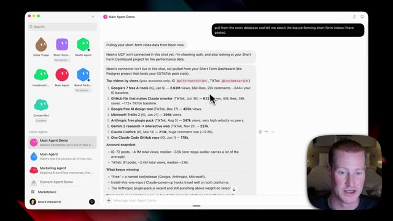
*⏱️ 00:17:57 — Interface d'assistant IA affichant les données extraites de la base de données Neon sur les performances des vidéos courtes de Brock Mesarich.*

---

### ⏱️ `[00:18:14 - 00:18:39]` | Segment #46

**🔊 Audio (Transcription Intégrale Mot pour Mot en Français) :**
> Donc laissez-moi vous montrer exactement ce que je veux dire. Donc je vais envoyer ceci. Et maintenant Codex va aller chercher cette information et il devrait avoir une réponse très bientôt. Et voilà. Il a tiré de cette même base de données exacte à l'intérieur de Neon d'où Grokbot a tiré et a décomposé en une liste de vous classant toutes les vidéos courtes les plus performantes pour moi, ainsi qu'un lien vers celles-ci également, parce qu'évidemment toutes ces métadonnées sont stockées à l'intérieur de Neon et il est très facile pour nous d'y accéder à l'intérieur de n'importe quelle plateforme d'agent IA que nous utilisons.

**👁️ Analyse Visuelle d'Écran (gemini-3.5-flash-lite) :**
**Interface & Outils** : Application Codex, base de données Neon, interface de gestion de projets d'IA.

**Contenu textuel & Code** : Prompt utilisateur : 'pull from the neon database and tell me about the top performing short form videos i have posted'. Tableau de données avec colonnes : Rank, Video/topic, Platform, Views, Last updated.

**Action / Démonstration** : Soumission du prompt à l'application Codex pour extraire et afficher les données de performance des vidéos courtes depuis la base de données Neon.

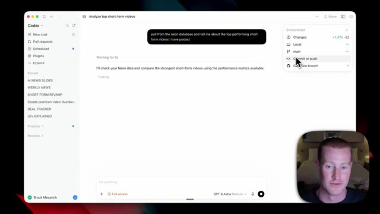
*⏱️ 00:18:20 — Interface de l'application Codex montrant un prompt utilisateur demandant d'analyser les vidéos courtes les plus performantes depuis la base de données Neon.*

*⏱️ 00:18:33 — Résultat de l'analyse dans l'application affichant un tableau récapitulatif de 163 publications issues d'Instagram et TikTok avec le classement, les vues et les sujets.*

---

### ⏱️ `[00:18:39 - 00:19:03]` | Segment #47

**🔊 Audio (Transcription Intégrale Mot pour Mot en Français) :**
> C'est donc un cas d'usage très précis pour moi et la façon dont je l'utilise. Maintenant, c'est un cas d'usage très précis pour moi, mais cela peut être très puissant lorsque vous connectez ceci à tous vos différents agents IA et que vous créez fondamentalement un second cerveau sur lequel vous pouvez travailler à travers tous ces outils. De manière classique, environ une heure après qu'Anthropic a lancé Claude Opus 5.5, OpenAI a décidé de lancer GPT-6, Sol et Luna, leurs nouveaux models de la famille GPT-6.

**👁️ Analyse Visuelle d'Écran (gemini-3.5-flash-lite) :**
**Interface & Outils** : Application Codex et navigateur web affichant une interface d'actualités sur l'IA.

**Contenu textuel & Code** : Tableaux de classement de publications de réseaux sociaux (vues, plateformes) et présentation de modèles IA (Astra, Sol, Luna) avec tarifs.

**Action / Démonstration** : Navigation et présentation des cas d'usage et des interfaces liées aux outils et modèles d'intelligence artificielle.

*⏱️ 00:18:45 — Interface d'une application de type Codex affichant une analyse de vidéos courtes (Instagram et TikTok) avec classement et métriques de vues.*

*⏱️ 00:18:57 — Page web intitulée "AI Weekly - OpenAI / New Models" présentant les modèles GPT-6 Sol + Luna avec des illustrations graphiques.*

---

### ⏱️ `[00:19:03 - 00:19:22]` | Segment #48

**🔊 Audio (Transcription Intégrale Mot pour Mot en Français) :**
> Donc maintenant, en plus d'avoir Astra, nous avons maintenant ces deux modèles moins chers et plus rapides, Sol et Luna. Laissez-moi donc vous présenter tout cela dès maintenant. Au bas de l'écran, vous pouvez maintenant voir la différence dans le coût des tokens d'entrée et de sortie ici. Astra est donc notre modèle le plus intelligent pour obtenir les meilleurs résultats. 10 dollars pour les tokens d'entrée, 50 dollars pour les tokens de sortie, ce qui est évidemment très cher.

**👁️ Analyse Visuelle d'Écran (gemini-3.5-flash-lite) :**
**Interface & Outils** : Interface web de présentation de modèles d'IA avec encadré vidéo du présentateur.

**Contenu textuel & Code** : Comparaison des coûts des tokens d'entrée et de sortie pour Astra ($10.00 / $50.00), Sol ($2.00 / $10.00) et Luna ($0.10 / $0.50).

**Action / Démonstration** : Le présentateur introduit et compare les nouveaux modèles d'IA moins chers et plus rapides, Sol et Luna, par rapport à Astra.

*⏱️ 00:19:08 — Présentation des trois modèles GPT-6 (Astra, Sol et Luna) avec leurs caractéristiques et coûts de tokens d'entrée et de sortie.*

*⏱️ 00:19:13 — Affichage d'une page web présentant les modèles GPT-6 Sol + Luna sous forme de cartes comparatives avec des contrôles de lecture vidéo en bas.*

---

### ⏱️ `[00:19:22 - 00:19:43]` | Segment #49

**🔊 Audio (Transcription Intégrale Mot pour Mot en Français) :**
> Ensuite, nous avons Sol, qui fonctionne à 2 dollars pour les jetons d'entrée, puis 10 dollars par million de jetons de sortie. C'est idéal pour le codage complexe et le travail professionnel à un coût inférieur. Et ensuite, nous avons Luna, qui est rapide et efficace pour le travail quotidien à grande échelle. Les jetons d'entrée y coûtent 0,10 dollar et les jetons de sortie coûtent 0,50 dollar. C'est tellement moins cher que les modèles Astra et Sol.

**👁️ Analyse Visuelle d'Écran (gemini-3.5-flash-lite) :**
**Interface & Outils** : Navigateur web affichant une interface de présentation de modèles d'intelligence artificielle.

**Contenu textuel & Code** : Tarifs affichés pour les modèles : Astra ($10/$50), Sol ($2/$10), Luna ($0.10/$0.50), ainsi que leurs descriptions respectives et une incrustation vidéo du présentateur en bas à droite.

**Action / Démonstration** : Le présentateur commente et présente les caractéristiques et les coûts d'utilisation des différents modèles d'IA affichés à l'écran.

*⏱️ 00:19:27 — Capture d'écran montrant une page web intitulée "GPT-6 Sol + Luna" avec trois cartes représentant différents modèles d'IA : Astra, Sol et Luna, accompagnés de leurs tarifs par million de jetons.*

---

### ⏱️ `[00:19:43 - 00:20:09]` | Segment #50

**🔊 Audio (Transcription Intégrale Mot pour Mot en Français) :**
> Et voici ensuite une ventilation comparée aux précédents modèles GPT 5.6. C'est donc un cran en dessous. On dirait que GPT 6 est réduit de moitié sur les prix de l'API par rapport à GPT 5.6. Et voici maintenant la ventilation des coûts pour Luna, toujours par rapport aux précédents prix de GPT 5.6. Maintenant, si vous êtes intéressé, voici une comparaison sous forme de graphique entre GPT-6 Astra, les nouveaux modèles GPT-6, ainsi que Cloud Opus 5 et Fable 5.1 pour les flux de travail professionnels.

**👁️ Analyse Visuelle d'Écran (gemini-3.5-flash-lite) :**
**Interface & Outils** : Navigateur web affichant une application de tarification d'API d'IA.

**Contenu textuel & Code** : Tableau comparatif des prix d'API par million de tokens pour "Sol" (GPT-6 Input $2, Output $10, comparé à $4 et $20) et "Luna" (GPT-6 Input $0.10, Output $0.50, comparé à $0.20 et $1.20).

**Action / Démonstration** : Présentation des nouveaux tarifs réduits de l'API par rapport aux anciens prix des modèles précédents.

*⏱️ 00:19:49 — Une capture d'écran montrant une page web avec des graphiques de tarification d'API pour différents modèles d'IA, avec le présentateur en médaillon en bas à droite.*

---

### ⏱️ `[00:20:09 - 00:20:27]` | Segment #51

**🔊 Audio (Transcription Intégrale Mot pour Mot en Français) :**
> Je ne vais pas passer en revue tout cela, mais si vous voulez y jetez un œil, mettez la vidéo en pause, et vous pourrez vous faire une idée de leurs capacités par rapport au coût. Et voici une autre ventilation, c'est la même chose, qui compare les différents modèles en se basant sur les erreurs factuelles juste ici. Maintenant, voici quelques exemples de démos que j'ai vues sur X alors que je faisais simplement défiler mon fil, en faisant des recherches là-dessus. Donc c'est plutôt cool. Luna a généré ceci.

**👁️ Analyse Visuelle d'Écran (gemini-3.5-flash-lite) :**
**Interface & Outils** : Navigateur web affichant une page de rapport ou de publication (« AI Weekly » / « Business workflows »).

**Contenu textuel & Code** : Graphique de performance « AutomationBench » montrant plusieurs modèles (GPT-6 Astra, GPT-5.6 Sol, Claude Opus 5, etc.) avec en abscisse le coût par tâche et en ordonnée le score, ainsi qu'une vignette vidéo du présentateur en bas à droite.

**Action / Démonstration** : Le présentateur commente le graphique comparatif des capacités des modèles d'IA par rapport à leur coût.

*⏱️ 00:20:14 — Capture d'écran montrant un graphique de benchmark de modèles d'IA comparant le coût par tâche et le score sur les flux de travail d'entreprise (AutomationBench).*

---

### ⏱️ `[00:20:28 - 00:20:48]` | Segment #52

**🔊 Audio (Transcription Intégrale Mot pour Mot en Français) :**
> Je veux dire, ça a l'air vraiment solide. J'ai l'impression qu'on est à une époque où tous ces modèles peuvent fondamentalement faire tout ce qu'on veut. Ce n'est pas comme des tâches super complexes. Ça se résume vraiment à la comparaison des coûts par rapport aux modèles précédents. Juste ici, il y a une comparaison entre GPT-6 Sol et Opus 5.5. Personnellement, je trouve qu'Opus 5.5 a l'air bien meilleur que celui de gauche, mais ce n'est que mon avis personnel.

**👁️ Analyse Visuelle d'Écran (gemini-3.5-flash-lite) :**
**Interface & Outils** : Navigateur web affichant une application de comparaison de modèles d'IA avec encadré vidéo du présentateur.

**Contenu textuel & Code** : Interface Arena / Side-by-side outputs, graphiques comparatifs entre GPT-6 Sol et Claude Opus 5.5.

**Action / Démonstration** : Le présentateur commente une comparaison comparative entre différents modèles d'intelligence artificielle.

*⏱️ 00:20:33 — Comparaison côte à côte de modèles d'IA (Sol vs. Opus) montrant des sorties animées d'une amphore antique.*

*⏱️ 00:20:43 — Comparaison de jeux (Sol vs. Opus) montrant le rendu visuel côte à côte de deux moteurs d'IA avec le même prompt.*

---

### ⏱️ `[00:20:48 - 00:21:14]` | Segment #53

**🔊 Audio (Transcription Intégrale Mot pour Mot en Français) :**
> Il y a donc trois endroits différents où nous pouvons désormais utiliser ces nouveaux modèles de ChatGPT. Nous pouvons donc l'utiliser à l'intérieur de ChatGPT Work, sur un plan payant. Nous pouvons l'utiliser à l'intérieur de Codex, sur un plan payant, et encore une fois, via l'API. Ensuite, nous avons une fuite potentielle d'un tout nouveau plan ChatGPT appelé ChatGPT Pro Max et il coûte 500 dollars par mois. À l'heure actuelle, ce n'est qu'une rumeur, mais ce tweet a été publié aujourd'hui par Testing Catalog, qui fait état de ce plan ChatGPT Pro Max à 500 dollars.

**👁️ Analyse Visuelle d'Écran (gemini-3.5-flash-lite) :**
**Interface & Outils** : Navigateur web affichant un site d'actualités et le réseau social X (Twitter).

**Contenu textuel & Code** : Texte informatif sur les abonnements payants et extraits de code JSON montrant des structures de prix pour les plans d'intelligence artificielle.
[N/A]

**Action / Démonstration** : Présentation des plateformes et des plans tarifaires des nouveaux modèles d'IA.

*⏱️ 00:20:54 — Une page web affichant les options d'utilisation des nouveaux modèles avec trois sections numérotées : ChatGPT Work, Codex et API.*

*⏱️ 00:21:07 — Une publication sur le réseau social X provenant du compte AI News | TestingCatalog mentionnant un plan ChatGPT Pro Max à 500 dollars.*

---

### ⏱️ `[00:21:14 - 00:21:33]` | Segment #54

**🔊 Audio (Transcription Intégrale Mot pour Mot en Français) :**
> Comme vous pouvez le voir juste ici dans ce code, il y a ce nouveau modèle qui a fuité. Il est écrit Pro Max montant 500 dollars juste ici. Maintenant, c'est évidemment juste de la pure spéculation, mais je pense vraiment que ce n'est qu'une question de temps avant que ces fournisseurs de modèles comme Anthropic et OpenAI ne commencent à lancer ces modèles ultra chers comme celui-ci juste ici.

**👁️ Analyse Visuelle d'Écran (gemini-3.5-flash-lite) :**
**Interface & Outils** : Navigateur web, affichage d'un extrait de code JSON et d'un tweet sur une page web.

**Contenu textuel & Code** : Extrait de code JSON au format arborescent : on y lit notamment les blocs "sci", "business_prolite" et "promax" avec des montants (amount: 500.0 ou 600.0) et des options de taxe. Sur le panneau de droite, un tweet de @testingcatalog indique : "OPENAI 🔥: The upcoming ChatGPT Pro Max plan will cost $500."

**Action / Démonstration** : Le présentateur commente le code qui a fuité, en soulignant le montant de 500 dollars associé au nouveau modèle Pro Max.

*⏱️ 00:21:19 — Capture d'écran montrant un extrait de code source JSON affichant des abonnements (dont "promax" à 500 dollars) dans un navigateur, avec une publication X (Twitter) associée sur le côté droit.*

---

### ⏱️ `[00:21:33 - 00:21:53]` | Segment #55

**🔊 Audio (Transcription Intégrale Mot pour Mot en Français) :**
> Nous n'avons jamais vu plus d'environ 200 dollars par mois de la part de ces différentes plateformes. Donc cela pourrait être la première fois que nous voyons des modèles assez onéreux. Et pour être honnête, un abonnement de 500 dollars par mois est assez fou quand on y pense. Mais je suppose que si vous êtes un utilisateur intensif de Codex comme je l'ai été récemment, cela pourrait en valoir la peine pour vous, car j'ai personnellement atteint mes limites sur le forfait à 200 dollars par mois.

**👁️ Analyse Visuelle d'Écran (gemini-3.5-flash-lite) :**
**Interface & Outils** : Navigateur web (Twitter/X)

**Contenu textuel & Code** : Extrait de code JSON affichant des tarifs d'abonnement (sci : 200.0, business_prolite : 125.0, promax : 500.0 ou 600.0) et un tweet d'AI News mentionnant un coût de 500 dollars pour le plan ChatGPT Pro Max.

**Action / Démonstration** : Le présentateur commente le coût élevé potentiel des nouveaux abonnements IA présentés à l'écran.

*⏱️ 00:21:38 — Un navigateur web affichant un tweet sur un abonnement ChatGPT Pro Max à 500 dollars, avec un extrait de code JSON montrant les tarifs mensuels et le présentateur dans un encadré en bas à droite.*

---

### ⏱️ `[00:21:53 - 00:22:15]` | Segment #56

**🔊 Audio (Transcription Intégrale Mot pour Mot en Français) :**
> Je vois donc tout à fait pas mal de gens profiter de ce nouveau plan, même si c'est vraiment très cher. Dites-moi ce que vous en pensez dans les commentaires. Est-ce juste un prix ridicule ou est-ce que ça a du sens vu la demande pour cela ? Ensuite, nous avons eu une autre grosse sortie de la part d'OpenAI, et il s'agit d'un nouveau mode vocal qui intègre désormais des plugins alimentés par les tout nouveaux modèles GPT-6 Astra Sol et Luna dont nous venons de parler.

**👁️ Analyse Visuelle d'Écran (gemini-3.5-flash-lite) :**
**Interface & Outils** : Navigateur web affichant un extrait de code JSON et des publications sur X (Twitter), puis une page web minimaliste d'actualités sur l'IA.

**Contenu textuel & Code** : Données de configuration tarifaire au format JSON ("sci", "business_prolite", "promax" avec montants et taxes) et texte sur les plugins vocaux et GPT-6.

**Action / Démonstration** : Le présentateur commente les détails tarifaires des abonnements IA et introduit de nouvelles annonces de fonctionnalités.

*⏱️ 00:21:58 — Capture montrant un extrait de code JSON affichant différents plans tarifaires (sci, business_prolite, promax) avec des montants allant jusqu'à 600,0 USD, aux côtés d'un tweet sur le plan ChatGPT Pro Max à 500 $.*

*⏱️ 00:22:09 — Capture d'écran d'une page web d'actualité sur l'IA ("AI Weekly") titrée "Voice gets plugins + GPT-6." avec un tweet d'OpenAI détaillant les nouvelles fonctionnalités vocales.*

---

### ⏱️ `[00:22:15 - 00:22:36]` | Segment #57

**🔊 Audio (Transcription Intégrale Mot pour Mot en Français) :**
> Maintenant, voici quelques-unes des choses que le nouveau modèle peut faire. Il peut utiliser vos plugins comme l'e-mail, le calendrier et Slack alimentés par ces différents modèles, et il peut être utilisé à l'intérieur de ChatGPT Work, web et mobile. Et cela se déploie à l'échelle mondiale, donc vous devriez y avoir accès dès maintenant. Maintenant, la principale nouveauté ici n'est pas seulement une meilleure voix, bien sûr, ils continuent à faire progresser la voix pour qu'elle sonne plus humaine et meilleure, mais celle-ci peut désormais interagir avec nos différentes applications.

**👁️ Analyse Visuelle d'Écran (gemini-3.5-flash-lite) :**
**Interface & Outils** : Présentation ou face-caméra explicatif du trader sans interface logicielle partagée.

**Contenu textuel & Code** : Explications orales des stratégies et mise en contexte méthodologique du marché.

**Action / Démonstration** : Explications face caméra et analyse conceptuelle des marchés.

---

### ⏱️ `[00:22:36 - 00:23:02]` | Segment #58

**🔊 Audio (Transcription Intégrale Mot pour Mot en Français) :**
> So we could use ChatGPT voice mode as the bridge between our email, our calendar, our Slack, and basically all these different applications that we're using on a day to day basis. It does feel like we're moving towards a world where we could simply just speak with our voice agent and get these tasks done for us, just like I was talking about earlier on in the video with the new GrokBot inside of Tesla, as well as the brand new Metamuse Charm product that they just released a couple days ago.

**👁️ Analyse Visuelle d'Écran (gemini-3.5-flash-lite) :**
**Interface & Outils** : Navigateur web affichant une application web conceptuelle de démonstration.

**Contenu textuel & Code** : Schéma interactif montrant les connexions entre l'agent vocal ChatGPT et des applications professionnelles (Email, Calendar, Slack).

**Action / Démonstration** : Présentation visuelle du concept d'intégration et de pont entre les applications quotidiennes et la voix.

*⏱️ 00:22:43 — Une interface web montrant ChatGPT Voice au centre connecté à différentes applications comme l'e-mail, le calendrier et Slack, avec la mention « Talk to your apps ».*

---

### ⏱️ `[00:23:02 - 00:23:25]` | Segment #59

**🔊 Audio (Transcription Intégrale Mot pour Mot en Français) :**
> Bien sûr, le meilleur dans tout cela, c'est que vous pouvez parler avec les différentes applications et les informations à travers les applications que vous utilisez chaque jour. Lorsque vous utilisez n'importe quel agent IA, par exemple ChatGPT Voice, vous pouvez le connecter à toutes les différentes applications que vous utilisez. Mais que se passe-t-il lorsque ChatGPT n'a qu'une certaine liste d'applications et que celle que vous voulez connecter n'est pas incluse ? Eh bien, vous pouvez utiliser quelque chose appelé le Zapier MCP comme pont afin de vous connecter à celles-ci.

**👁️ Analyse Visuelle d'Écran (gemini-3.5-flash-lite) :**
**Interface & Outils** : Navigateur web affichant une présentation interactive avec un schéma d'intégration d'applications et une vue incrustée de la caméra du présentateur.

**Contenu textuel & Code** : Schéma illustrant le flux de données depuis 'ChatGPT Voice' vers 'Zapier MCP' puis vers 'Skool', 'beehiiv' et 'Drip', avec le titre 'Talk to more apps.'.

**Action / Démonstration** : Présentation du concept de communication entre un agent vocal IA et diverses applications métier via Zapier MCP.

*⏱️ 00:23:07 — Une diapositive montrant l'intégration entre ChatGPT Voice, Zapier MCP et différentes applications comme Skool, Beehiiv et Drip.*

---

### ⏱️ `[00:23:25 - 00:23:43]` | Segment #60

**🔊 Audio (Transcription Intégrale Mot pour Mot en Français) :**
> C'est un exemple parfait ici même. Donc, avec le mode vocal de ChatGPT et le serveur MCP de Zapier, je suis personnellement capable d'aller utiliser et de récupérer des données depuis ces différentes applications. School, qui est une plateforme que j'utilise absolument tous les jours. Beehive et Drip, qui sont mes deux logiciels d'e-mailing que je ne peux pas connecter directement à l'intérieur de ChatGPT.

**👁️ Analyse Visuelle d'Écran (gemini-3.5-flash-lite) :**
**Interface & Outils** : Navigateur web affichant une infographie visuelle et une petite webcam du présentateur.

**Contenu textuel & Code** : Texte « Talk to more apps », icônes de ChatGPT Voice, Zapier MCP, Skool, Beehiiv et Drip reliées par des flèches.

**Action / Démonstration** : Présentation visuelle du concept de connexion vocale aux applications via le protocole MCP de Zapier.

*⏱️ 00:23:29 — Schéma explicatif illustrant la connexion entre ChatGPT Voice, le serveur Zapier MCP et différentes applications (Skool, Beehiiv, Drip).*

---

### ⏱️ `[00:23:43 - 00:24:06]` | Segment #61

**🔊 Audio (Transcription Intégrale Mot pour Mot en Français) :**
> As you can see inside of this MCP server, I have a ton of different apps configured. So these are all apps that I can now pull from just by configuring this simple MCP server. And we're able to do this with Zapier. So if you have a specific app you want to connect to or multiple different apps and you want to try this out, there will be a link in the description to sign up and begin playing around with this. All right. So in order to test this out, I'm going to come into ChatGPT work inside of the ChatGPT desktop app.

**👁️ Analyse Visuelle d'Écran (gemini-3.5-flash-lite) :**
**Interface & Outils** : Navigateur web affichant l'interface de Zapier MCP.

**Contenu textuel & Code** : Liste des serveurs MCP configurés (Cursor MCP Server, Claude MCP Server, etc.) et des applications connectées (Slack, HubSpot, Notion, ClickUp).

**Action / Démonstration** : Le présentateur présente et survole les différentes applications configurées dans le serveur MCP Zapier.

*⏱️ 00:23:49 — Capture d'écran montrant l'interface Web de Zapier affichant la configuration des serveurs MCP avec plusieurs applications connectées.*

---

### ⏱️ `[00:24:06 - 00:24:25]` | Segment #62

**🔊 Audio (Transcription Intégrale Mot pour Mot en Français) :**
> And then we're going to obviously see the voice button right here, which we already had. But this is a new voice mode and can use the specific plugins that we configure inside of our ChatGPT app. So I'm just going to click on this and start conversating. Hey, how's it going? Good. What do you want to tackle today? Yeah, I wanted you to quickly pull from my drip account via the Zapier MCP.

**👁️ Analyse Visuelle d'Écran (gemini-3.5-flash-lite) :**
**Interface & Outils** : Application ChatGPT (macOS)

**Contenu textuel & Code** : Interface utilisateur avec le menu latéral des conversations, la zone centrale « What should we work on? » et le curseur pointant sur le bouton vocal à droite de la barre de message.

**Action / Démonstration** : Le présentateur pointe le curseur de la souris vers le bouton vocal pour lancer la nouvelle fonctionnalité de mode vocal.

*⏱️ 00:24:11 — Capture d'écran montrant l'interface de ChatGPT sur macOS avec la zone de saisie et le bouton vocal entouré.*

---

### ⏱️ `[00:24:26 - 00:24:45]` | Segment #63

**🔊 Audio (Transcription Intégrale Mot pour Mot en Français) :**
> And I want you to pull the last email I sent in that email marketing campaign. Okay, let me take a look. Got it. Your latest sad broadcast is what happened in AI since September 20th. I've shown the summary and a link to open the Foligno. Perfect. Could you actually show me the click-through rate on that email too? I want to see how many people, like what percentage opened that.

**👁️ Analyse Visuelle d'Écran (gemini-3.5-flash-lite) :**
**Interface & Outils** : Interface web de ChatGPT avec la vue des projets et l'intégration de Zapier MCP.

**Contenu textuel & Code** : Transcription textuelle de la conversation vocale et affichage du résumé du dernier e-mail marketing envoyé via Drip ("What happened in AI").

**Action / Démonstration** : Interaction vocale avec l'assistant IA pour récupérer les informations de la campagne d'e-mailing via Zapier MCP.

*⏱️ 00:24:30 — Interface ChatGPT affichant l'historique d'une conversation vocale avec la transcription des requêtes sur Drip et le connecteur Zapier MCP.*

*⏱️ 00:24:40 — Poursuite de la conversation ChatGPT affichant la réponse détaillée de l'IA concernant le dernier e-mail de diffusion envoyé.*

---

### ⏱️ `[00:24:45 - 00:25:04]` | Segment #64

**🔊 Audio (Transcription Intégrale Mot pour Mot en Français) :**
> Bien sûr. Laissez-moi récupérer ces statistiques. En examinant à la fois les taux d'ouverture et de clics pour ce qui s'est passé dans le domaine de l'IA. Pour ce qui s'est passé dans l'IA, le taux d'ouverture était de 28,6 %, soit 4 156 ouvertures. Le taux de clics était de 0,59 %, soit 86 clics. J'ai présenté les deux dans un tableau. Parfait. Merci beaucoup pour ces informations.

**👁️ Analyse Visuelle d'Écran (gemini-3.5-flash-lite) :**
**Interface & Outils** : Interface web de ChatGPT avec panneau latéral et zone de chat vocal.

**Contenu textuel & Code** : Échanges de messages textuels et vocaux concernant l'extraction de statistiques d'une campagne d'e-mail marketing via l'intégration Zapier MCP.

**Action / Démonstration** : Le présentateur utilise ChatGPT avec l'assistant vocal pour récupérer et afficher les statistiques de la newsletter 'What happened in AI'.

*⏱️ 00:24:50 — Capture d'écran montrant l'interface de ChatGPT en mode vocal avec des interactions textuelles et vocales, ainsi qu'une petite incrustation vidéo du présentateur en bas à droite.*

---

### ⏱️ `[00:25:04 - 00:25:39]` | Segment #65

**🔊 Audio (Transcription Intégrale Mot pour Mot en Français) :**
> Très bien. Donc voilà. C’est évidemment le mode vocal en action. Genre, je ne remarque pas de différence. Ça ne me paraît pas meilleur, mais c'était déjà plutôt solide. Et ensuite, il est maintenant capable d’aller chercher des données dans ces différentes applications que nous connectons via les plugins, ce qui est le nom que ChatGPT lui donne. Je pense qu’avec le temps, cela va évidemment s’améliorer de plus en plus. Pour être transparent, j’ai coupé cet extrait pour que vous n’ayez pas à attendre aussi longtemps que moi, mais il lui a quand même fallu environ 15 à 20 secondes pour obtenir une réponse lorsqu’il allait chercher des informations dans ces différentes applications. Donc, lorsque je discute simplement avec le mode vocal et que je chatte avec lui, la latence est très, très rapide, mais lorsqu’il pioche dans des applications, cela prend un peu plus de temps.

**👁️ Analyse Visuelle d'Écran (gemini-3.5-flash-lite) :**
**Interface & Outils** : Interface web de ChatGPT et application de messagerie/automatisation Drip avec intégration Zapier MCP.

**Contenu textuel & Code** : Historique de discussion textuelle entre l'utilisateur et ChatGPT concernant la récupération du dernier e-mail marketing envoyé ('What happened in AI') et l'analyse de ses performances via Zapier MCP.

**Action / Démonstration** : Démonstration de l'utilisation de ChatGPT connecté à des applications externes (Drip via Zapier MCP) pour récupérer et analyser des données de campagnes d'e-mailing.

*⏱️ 00:25:13 — Capture d'écran montrant l'interface de ChatGPT sur ordinateur avec une conversation active connectée à Zapier MCP pour analyser les performances d'e-mails Drip, et une incrustation vidéo du présentateur en bas à droite.*

---

### ⏱️ `[00:25:39 - 00:26:13]` | Segment #66

**🔊 Audio (Transcription Intégrale Mot pour Mot en Français) :**
> mais je suppose qu'ils vont travailler là-dessus pour que ce soit beaucoup plus rapide. Très bien, ensuite nous avons un tout nouveau produit de Meta, et ça s'appelle Muse Charm. C'est un appareil physique qui fait tourner leur nouvel agent IA appelé Meta Muse, qui est un assistant personnel très similaire à GrokBot. Ils viennent d'annoncer cela hier lors de cet événement Meta. Je pense que c'est très intéressant. Nous pourrions simplement parler avec lui, lui faire envoyer des e-mails, planifier un voyage, organiser notre journée. Et encore une fois, cela revient au thème global que nous commençons à voir dans cet espace de l'IA, à savoir avoir des assistants IA personnels à notre disposition, que ce soit sur notre téléphone, à l'intérieur de nos lunettes, ou maintenant un appareil autonome.

**👁️ Analyse Visuelle d'Écran (gemini-3.5-flash-lite) :**
**Interface & Outils** : Navigateur web affichant une page d'actualités sur l'IA (AI Weekly) avec lecteur vidéo intégré et webcam du présentateur en bas à droite.

**Contenu textuel & Code** : Texte descriptif sur le produit Meta Muse Charm, spécifications, capacités de l'agent IA, cible de livraison (December) et prix (Not announced).

**Action / Démonstration** : Le présentateur commente la présentation du nouveau produit d'IA physique de Meta, le Muse Charm.

*⏱️ 00:25:47 — Capture d'écran montrant une page web intitulée 'AI Weekly' présentant le produit 'Muse Charm' de Meta, avec le texte 'Your AI agent. On a keychain.' et une vidéo de démonstration.*

*⏱️ 00:25:56 — Capture d'écran de la suite de la page web 'AI Weekly' détaillant les fonctionnalités de l'agent Muse avec des exemples de tâches comme 'Send an email', 'Plan a trip', 'Organize your day'.*

---

### ⏱️ `[00:26:13 - 00:26:50]` | Segment #67

**🔊 Audio (Transcription Intégrale Mot pour Mot en Français) :**
> appareil. Donc ils ont seulement annoncé ça hier et ils ont un objectif de livraison en décembre, même s'ils n'en ont pas produit des tonnes. Mark Zuckerberg a en fait dit qu'ils n'en ont qu'quelques-uns, ces différents prototypes, et nous n'avons pas encore de prix pour cet appareil. Mais c'est quelque chose qui m'enthousiasme personnellement. Je pense que nous arrivons très bientôt à un moment où nous pourrons transporter quelque chose comme ça dans notre poche ou les faire tourner sur nos lunettes et nous pourrons simplement parler avec notre agent IA et il pourra aller faire des choses pour nous, ce que j'adore. Maintenant, c'est peut-être la plus grande nouvelle de la semaine. Et il y a une fuite d'OpenAI concernant un tout nouvel agent appelé Aeon. Je ne sais pas exactement comment prononcer ça. C'est

**👁️ Analyse Visuelle d'Écran (gemini-3.5-flash-lite) :**
**Interface & Outils** : Navigateur web affichant une page d'actualités et de veille sur l'IA (AI Weekly).

**Contenu textuel & Code** : Texte affichant 'Shipping Target: December', 'Device Price: Not announced', et 'Meta - Connect announcement'.

**Action / Démonstration** : Navigation et présentation de la page web par le présentateur en médaillon.

*⏱️ 00:26:23 — Capture d'écran montrant un site web avec une vidéo de Mark Zuckerberg présentant un appareil Meta, ainsi qu'un encadré soulignant les objectifs de livraison et le prix.*

---

### ⏱️ `[00:26:50 - 00:27:24]` | Segment #68

**🔊 Audio (Transcription Intégrale Mot pour Mot en Français) :**
> épelé A-E-O-N. J'ai personnellement entendu des rumeurs selon lesquelles ils vont l'appeler Chachabiti-O, Chachabiti-Orbit. Et c'est apparemment un nouveau nom dont les gens disent qu'il va servir pour le baptiser. Bien sûr, tout cela n'est que spéculation, mais je crois vraiment que la semaine prochaine, OpenAI va lancer quelque chose de très, très similaire à cette analyse juste ici. Selon ce tweet, voici la spéculation. Aeon sera bien plus qu'un simple chatbot. Il pourrait avoir son propre profil, des messages directs et des groupes conçus pour concurrencer directement GrokBot et Muse pourrait être lancé dès jeudi. De plus, il pourrait être lancé lors de l'OpenAI Dev Day, qui approche. Et il continue en disant

**👁️ Analyse Visuelle d'Écran (gemini-3.5-flash-lite) :**
**Interface & Outils** : Navigateur web affichant une page d'actualités et un tweet incrusté.

**Contenu textuel & Code** : Texte abordant la rumeur "OpenAI Agent Leak" et les spécificités du projet Aeon (fonctionnalités sociales, profils, messages directs, concurrence avec Grok Bot).

**Action / Démonstration** : Le présentateur commente l'article et le tweet détaillant la rumeur d'un agent social développé par OpenAI.

*⏱️ 00:26:58 — Capture d'écran montrant un article de veille sur un projet de fuite d'OpenAI nommé "Aeon", incluant un tweet de l'utilisateur @Mr_Salio et la webcam du présentateur en bas à droite.*

*⏱️ 00:27:07 — Gros plan sur le tweet intégré concernant la fuite d'OpenAI "Aeon" détaillant ses fonctionnalités sociales, avec la webcam du présentateur visible en bas à droite.*

---

### ⏱️ `[00:27:24 - 00:27:57]` | Segment #69

**🔊 Audio (Transcription Intégrale Mot pour Mot en Français) :**
> émet l'hypothèse qu'OpenAI est en train de construire toute une couche sociale autour de son IA. Je suis persuadé que nous avons tous anticipé cela de la part d'OpenAI et d'Anthropic. J'ai également entendu dire qu'au cours des deux prochaines semaines, Anthropic allait également lancer son propre concurrent de GrokBot. Je pense donc que le monde des assistants et des agents d'IA personnels va vraiment commencer à s'accélérer au cours de ces deux prochaines semaines, car nous avons tous vu à quel point des choses comme Claude Code et Codex sont puissantes, mais il n'y a pas de moyen intuitif d'interagir avec ces différentes plateformes. Et GrokBot et Muse ont en quelque sorte résolu ce problème et ouvert la voie à des produits comme celui d'OpenAI. Et avant ces deux-là

**👁️ Analyse Visuelle d'Écran (gemini-3.5-flash-lite) :**
**Interface & Outils** : Navigateur web affichant une page d'actualités sur l'IA et un post Twitter/X intégré.

**Contenu textuel & Code** : Texte mentionnant "OpenAI Agent Leak", "An AI with social features", ainsi que les points du tweet : "Aeon is going to be more than just a chatbot", "It could have its own profile, DMs and groups", "Designed to compete directly with Grok Bot and Muse", et "OpenAI building an entire social layer around its AI".

**Action / Démonstration** : Le présentateur commente les fuites et rumeurs concernant l'agent social "Aeon" d'OpenAI et sa stratégie de couche sociale.

*⏱️ 00:27:32 — Une capture d'écran de navigateur affichant un article ou un résumé de type "AI Weekly" intitulé "OpenAI Agent Leak", avec au centre un tweet incrusté provenant du compte @Mr_Salio détaillant les rumeurs autour de "Aeon", un agent IA doté de fonctionnalités sociales.*

---

### ⏱️ `[00:27:57 - 00:28:30]` | Segment #70

**🔊 Audio (Transcription Intégrale Mot pour Mot en Français) :**
> plateformes, il y avait OpenClaw et il y avait Hermes Agent. Et n'oubliez pas qu'OpenAI a effectivement embauché la personne qui a créé OpenClaw et je suppose qu'il est également derrière ce projet. Personnellement, j'espère vraiment que cette nouvelle est vraie. J'ai absolument adoré GrokBot, mais j'ai l'impression qu'il y a certaines limitations parce que les modèles Grok ne sont pas à la pointe de ces différents LLM tels que ChatGPT et Anthropic. Je suppose donc qu'ils vont probablement être encore plus puissants que GrokBot ne l'est actuellement. Et si vous faites le calcul avec Anthropic et OpenAI qui sortent ces nouveaux modèles cette semaine, cela pourrait être leur façon de poser les bases de la sortie de ce nouveau produit.

**👁️ Analyse Visuelle d'Écran (gemini-3.5-flash-lite) :**
**Interface & Outils** : Navigateur web affichant une page d'actualités sur l'intelligence artificielle.

**Contenu textuel & Code** : Texte et visuels promotionnels concernant les fuites sur l'agent OpenAI "aeon" et sa comparaison avec Grok Bot.

**Action / Démonstration** : Le présentateur commente les rumeurs et fuites concernant de nouveaux agents conversationnels et sociaux.

*⏱️ 00:28:05 — Une page web intitulée "AI Weekly - OpenAI Agent Leak" affichant un tweet concernant la fuite d'informations sur l'agent "aeon".*

*⏱️ 00:28:13 — Une illustration comparative affichant "aeon" face à "Grok Bot" sur fond de concept visuel non confirmé.*

---

### ⏱️ `[00:28:30 - 00:28:53]` | Segment #71

**🔊 Audio (Transcription Intégrale Mot pour Mot en Français) :**
> Quoi qu'il en soit, il n'y a pas eu beaucoup de fuites à ce sujet sur Internet. Cela étant dit, il n'y a pas eu beaucoup de fuites sur ce sujet. Alors qui sait si c'est réel ou non. Mais si je devais miser là-dessus, je m'attends à ce qu'ils le sortent la semaine prochaine. Et voilà. Cette semaine a été chargée en actualités sur l'IA et en lancements de produits. Et je crois que la semaine prochaine va être encore plus mouvementée. Donc, si vous avez aimé cet épisode et que vous voulez en voir un chaque semaine, assurez-vous de vous abonner à cette chaîne pour en voir plus, et faites-moi savoir ce que vous en pensez dans les commentaires ci-dessous.

**👁️ Analyse Visuelle d'Écran (gemini-3.5-flash-lite) :**
**Interface & Outils** : Navigateur web affichant une page de concept visuel sur l'intelligence artificielle et l'interface YouTube.

**Contenu textuel & Code** : Texte "UNCONFIRMED LEAK - CONCEPT VISUAL", logos et noms "aeon" et "Grok Bot".

**Action / Démonstration** : Présentation d'un concept visuel et de fuites potentielles concernant de nouveaux outils d'IA.

*⏱️ 00:28:36 — Capture d'écran montrant une page web avec le titre "AI Weekly" et un concept visuel comparant "aeon" et "Grok Bot", avec le présentateur visible en incrustation dans le coin inférieur droit.*

---

### ⏱️ `[00:28:53 - 00:28:56]` | Segment #72

**🔊 Audio (Transcription Intégrale Mot pour Mot en Français) :**
> J'espère que vous passez une bonne journée et je vous vois dans la prochaine.

**👁️ Analyse Visuelle d'Écran (gemini-3.5-flash-lite) :**
**Interface & Outils** : Webcam / Vidéo de présentation

**Contenu textuel & Code** : Aucun contenu technique, graphique ou code source affiché.

**Action / Démonstration** : Le présentateur s'adresse à l'audience pour conclure la vidéo.

---

