# 🎬 Anthropic Revealed Their Secret Guide to Mastering Opus 5.5

> **Chaîne** : [Brock Mesarich | AI for Non Techies](https://www.youtube.com/@BrockMesarich)  
> **Lien YouTube** : [https://www.youtube.com/watch?v=is3XYKl2bpI](https://www.youtube.com/watch?v=is3XYKl2bpI)  
> **Date de publication** : 20260926  
> **Durée** : 00:08:40  
> **Identifiant vidéo** : `is3XYKl2bpI`  
> **Transcription & Analyse** : `whisper-v3-large-turbo+gemini-3.5-flash-lite`  

---

## 📌 Synthèse Exécutive & Outils

### 💡 Résumé
Dans cette vidéo intitulée **Anthropic Revealed Their Secret Guide to Mastering Opus 5.5**, Alex Carter détaille une approche stratégique et pratique du trading et de l'automatisation par agents IA.

### 🛠️ Outils, Modèles & Logiciels Présentés
- **TradingView & Claude Code** : Analyse technique avancée et automatisation algorithmique.

### 🔑 Points Clés & Enseignements Stratégiques
- Respect rigoureux du ratio risque/rendement et du money management.
- Automatisation méthodique des déclencheurs d'ordres via des agents intelligents.

---

## ⏱️ Chronologie & Transcription Complète Audio & Visuelle (Mot pour Mot)

### ⏱️ `[00:00:00 - 00:00:20]` | Segment #01

**🔊 Audio (Transcription Intégrale Mot pour Mot en Français) :**
> Anthropic just dropped this guide on how to use Opus 5.5, and if you want to get the most out of it, I'm going to speedrun 8 tips covering the key takeaways. What's different, what to change, and practical examples you can use. And a few of these I had absolutely no idea about. This should not only help you get better results with this model, but also save you money on token costs.

**👁️ Analyse Visuelle d'Écran (gemini-3.5-flash-lite) :**
**Interface & Outils** : Diapositives de présentation vidéo (type Keynote/PowerPoint) avec incrustation webcam du présentateur.

**Contenu textuel & Code** : Titres de section sur le guide de prompt d'Anthropic pour Claude Opus 5.5 et conseils pratiques.

**Action / Démonstration** : Le présentateur introduit les différents conseils et points clés du guide pour optimiser l'utilisation de Claude Opus 5.5.

---

### ⏱️ `[00:00:20 - 00:00:56]` | Segment #02

**🔊 Audio (Transcription Intégrale Mot pour Mot en Français) :**
> So without further ado, let's dive right in. The first concrete change is the default effort setting. Opus 5 defaulted to the high effort level, while Opus 5.5 now defaults to medium. Basically, effort controls how much work the model puts into thinking before it responds. And Anthropic recommends starting at medium and testing it on your own tasks. And don't assume that you need to carry over the higher setting that you used with the previous models. The same effort level doesn't necessarily mean the same amount of thinking across these models. If you keep your old configuration, you could get longer turns and more output tokens. Anthropic recommends

**👁️ Analyse Visuelle d'Écran (gemini-3.5-flash-lite) :**
**Interface & Outils** : Présentation vidéo avec incrustations graphiques et captures de documentation textuelle.

**Contenu textuel & Code** : Échelles de réglage d'effort des modèles d'IA (Opus 5 vs Opus 5.5) et recommandations textuelles d'Anthropic.

**Action / Démonstration** : Explication comparative des niveaux d'effort par défaut entre les différentes versions du modèle Claude.

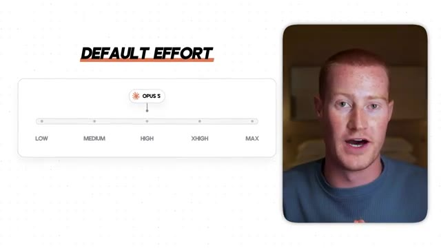
*⏱️ 00:00:29 — Graphique montrant l'échelle des niveaux d'effort (Low, Medium, High, XHigh, Max) avec le curseur positionné sur 'High' pour Opus 5.*

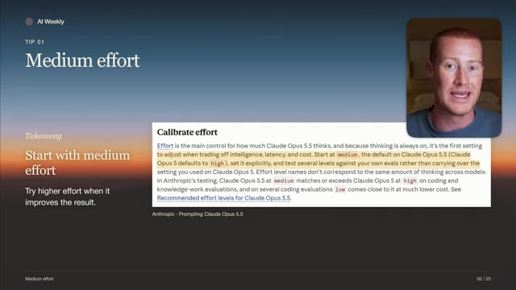
*⏱️ 00:00:38 — Capture d'écran d'un extrait de documentation officielle Anthropic intitulée 'Calibrate effort' avec du texte en surbrillance.*

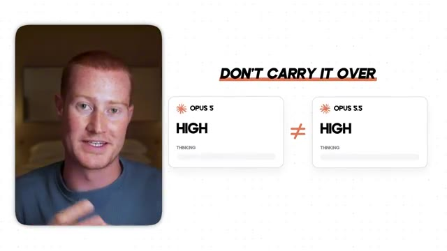
*⏱️ 00:00:47 — Comparaison graphique illustrant que le niveau 'High' sur Opus 5 n'est pas équivalent au niveau 'High' sur Opus 5.5 (symbolisé par un signe d'inégalité).*

---

### ⏱️ `[00:00:56 - 00:01:29]` | Segment #03

**🔊 Audio (Transcription Intégrale Mot pour Mot en Français) :**
> lowering the effort level first when you want less thinking and then only using the highest settings where you've actually measured a benefit. This way, it's going to save you a lot on token usage. Otherwise, you're just going to use a higher model, even though it might not be necessary with Opus 5.5. And then for developers, the guide also covers leaving enough room for thinking tokens and changing effort without invalidating the prompt cache. But if you're not a developer, this probably sounds like gibberish, so it probably doesn't apply to you. A useful way to choose your setting is to compare the same task at different effort levels. For example, you can give Claude two

**👁️ Analyse Visuelle d'Écran (gemini-3.5-flash-lite) :**
**Interface & Outils** : Présentation vidéo avec diapositive documentaire.

**Contenu textuel & Code** : Texte extrait de la documentation officielle d'Anthropic sur les paramètres de jetons d'effort, max_tokens, et l'optimisation des coûts.

**Action / Démonstration** : Explication des paramètres d'effort et de la gestion des jetons pour Claude.

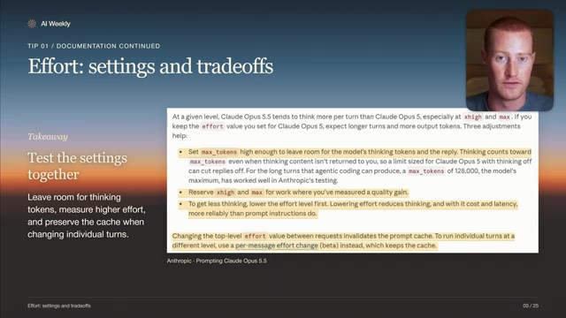
*⏱️ 00:01:12 — Diapositive montrant la documentation sur les paramètres d'effort et les compromis pour Claude Opus 5.5.*

---

### ⏱️ `[00:01:29 - 00:01:48]` | Segment #04

**🔊 Audio (Transcription Intégrale Mot pour Mot en Français) :**
> proposals in the same list of requirements, then compare both medium and the higher effort. And then you could ask yourself, did one miss an important requirement? Was the recommendation more useful? How long did it take? A longer answer alone doesn't necessarily tell you whether the effort level was worthwhile, and this is going to be custom to you and your individual use cases.

**👁️ Analyse Visuelle d'Écran (gemini-3.5-flash-lite) :**
**Interface & Outils** : Présentation vidéo éducative avec incrustations de texte explicatif.

**Contenu textuel & Code** : Titres et puces textuelles résumant l'évaluation comparative des niveaux d'effort des IA.

**Action / Démonstration** : Le présentateur explique comment comparer les résultats de différentes intensités d'effort d'intelligence artificielle.

---

### ⏱️ `[00:01:48 - 00:02:08]` | Segment #05

**🔊 Audio (Transcription Intégrale Mot pour Mot en Français) :**
> Alright, moving on to tip number two, and this is thinking instructions. This is worth checking if you've built up a longer system prompt over time inside of Claude. Anthropic says that instructions like thinking carefully before answering might be unnecessary for Opus 5.5 because the model already decides how much to think and the effort is the main control.

**👁️ Analyse Visuelle d'Écran (gemini-3.5-flash-lite) :**
**Interface & Outils** : Interface graphique animée / présentation vidéo (non interactive).

**Contenu textuel & Code** : Texte du prompt système illustratif (« YOUR SYSTEM PROMPT », « You are a help... », « CLAUDE OPUS 3.5 »).

**Action / Démonstration** : Le présentateur parle de la nécessité des instructions de réflexion (thinking instructions) dans les prompts système pour les modèles avancés comme Claude Opus 3.5.

---

### ⏱️ `[00:02:08 - 00:02:30]` | Segment #06

**🔊 Audio (Transcription Intégrale Mot pour Mot en Français) :**
> Dans les tests spécifiques qu'Anthropic a menés, la suppression de ce type d'instructions a permis aux réponses de commencer plus tôt, ce qui signifie que vous obtenez des réponses plus rapides. Et cela s'est même fait sans baisse claire de la qualité de la réponse. Un autre comportement qu'Anthropic documente est qu'Opus 5.5 peut revenir sur une réponse précédente tout en réfléchissant à un nouveau message, même un simple suivi.

**👁️ Analyse Visuelle d'Écran (gemini-3.5-flash-lite) :**
**Interface & Outils** : Interface graphique explicative et interface de chat simulée (Claude).

**Contenu textuel & Code** : Graphiques comparatifs de performance (temps avant le premier mot) et exemples de prompts de résumé.

**Action / Démonstration** : Le présentateur explique l'impact de la suppression d'instructions superflues sur la vitesse de génération des modèles d'IA.

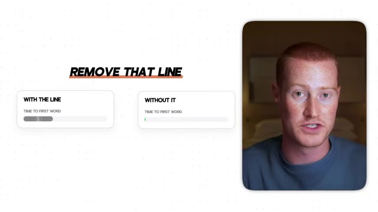
*⏱️ 00:02:14 — L'image montre à gauche le présentateur et à droite un schéma comparatif illustrant la vitesse de réponse avec et sans une ligne spécifique d'instruction.*

---

### ⏱️ `[00:02:30 - 00:02:58]` | Segment #07

**🔊 Audio (Transcription Intégrale Mot pour Mot en Français) :**
> Le guide donne une instruction qui lui dit de traiter les réponses précédentes comme définitives à moins que vous ne les remettiez en question. Cela peut réduire le travail inutile, mais il y a un compromis. Vous voudrez peut-être que Claude réexamine les conclusions antérieures lors d'une recherche, d'une analyse, ou d'une tâche où de nouvelles preuves apparaissent. Maintenant, c'est ici un exemple parfait. Lorsque vous rédigez un prompt vague, quelque chose comme réfléchir profondément et attentivement, cela ne dit pas nécessairement à Claude ce qui rend cette réponse utile pour vous, et c'est probablement l'une des raisons pour lesquelles vous n'obtenez pas les résultats que vous souhaitez.

**👁️ Analyse Visuelle d'Écran (gemini-3.5-flash-lite) :**
**Interface & Outils** : Présentation vidéo avec diapositives graphiques et encadrés explicatifs.

**Contenu textuel & Code** : Texte d'instruction d'Anthropic, consignes vagues vs spécifiques, et icônes thématiques.

**Action / Démonstration** : Explication par le présentateur des bonnes pratiques pour formuler des instructions aux modèles d'IA.

---

### ⏱️ `[00:02:58 - 00:03:33]` | Segment #08

**🔊 Audio (Transcription Intégrale Mot pour Mot en Français) :**
> Whereas if you give it a specific prompt, like asking it to compare two proposals against your requirements, recommend one, and explain the made trade-off, gives it a concrete target to work towards. You're basically still asking for thoughtful work, but you're defining the result that you need. Next up is tip number three, and this is relevant context. Anthropic says that Opus 5.5 tends to get to work very quickly. This can be very useful, but in a workflow involving several apps, the task might depend on information that the request doesn't explicitly mention. This could be something like a deadline that could have changed in an email or a rule that could be on

**👁️ Analyse Visuelle d'Écran (gemini-3.5-flash-lite) :**
**Interface & Outils** : Interface de présentation vidéo avec encarts textuels et visuels d'exemples de prompts.

**Contenu textuel & Code** : Exemples de prompts comparant une formulation vague et une formulation spécifique détaillée.

**Action / Démonstration** : Illustration visuelle de l'importance de donner un objectif concret et spécifique à l'IA plutôt qu'une consigne générique.

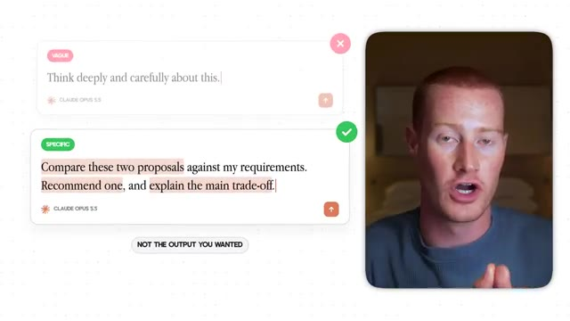
*⏱️ 00:03:07 — Comparaison visuelle entre un prompt vague ("Think deeply...") et un prompt spécifique ("Compare these two proposals...") avec le présentateur à droite.*

---

### ⏱️ `[00:03:33 - 00:04:08]` | Segment #09

**🔊 Audio (Transcription Intégrale Mot pour Mot en Français) :**
> un autre onglet de tableur, par exemple. Leur recommandation est de demander à Claude d'examiner les sources pertinentes avant d'agir plutôt que de supposer que le premier document contient tout. De cette façon, il dispose de tout ce contexte pertinent. Cette capture d'écran ici montre l'instruction réelle qu'Anthropic fournit. Elle indique à l'agent d'explorer les e-mails, les documents, les onglets de tableur et les enregistrements qui pourraient être pertinents, y compris ceux que la tâche n'a pas nommés spécifiquement. Anthropic a constaté que cela améliorait l'achèvement sur ses propres tests multi-applications avec un peu plus d'appels d'outils et de jetons. Les conditions importantes sont que les sources soient

**👁️ Analyse Visuelle d'Écran (gemini-3.5-flash-lite) :**
**Interface & Outils** : Interface vidéo de présentation avec encadrés textuels explicatifs.

**Contenu textuel & Code** : Texte d'instruction d'Anthropic pour Claude Opus 3.5 incitant à explorer largement les e-mails, documents, tableurs et enregistrements pertinents avant d'agir.

**Action / Démonstration** : Présentation de la directive d'exploration approfondie des sources par l'IA avant toute action.

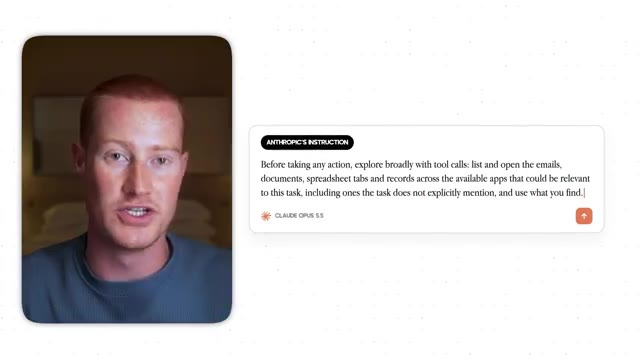
*⏱️ 00:03:50 — Le présentateur à gauche et une boîte de texte à droite affichant l'instruction 'ANTHROPIC'S INSTRUCTION' pour Claude Opus 3.5 concernant l'exploration large des sources avant d'agir.*

---

### ⏱️ `[00:04:08 - 00:04:28]` | Segment #10

**🔊 Audio (Transcription Intégrale Mot pour Mot en Français) :**
> accessible et que l'agent n'agit pas nécessairement aveuglément sur du matériel non vérifié. Passons maintenant à un exemple. Imaginez que vous demandiez à Claude de rédiger un point sur un projet à partir d'un dossier initial. Et disons que ce dossier indique que la date limite est le lundi, mais qu'un e-mail ultérieur la décale au vendredi. Si Claude lit seulement le dossier, il peut produire un compte rendu soigné avec la mauvaise date, évidemment.

**👁️ Analyse Visuelle d'Écran (gemini-3.5-flash-lite) :**
**Interface & Outils** : Aucune interface logicielle ou technique affichée.

**Contenu textuel & Code** : Aucun code, prompt ou donnée chiffrée n'est présent.

**Action / Démonstration** : Aucune action ou démonstration technique effectuée.

---

### ⏱️ `[00:04:29 - 00:04:48]` | Segment #11

**🔊 Audio (Transcription Intégrale Mot pour Mot en Français) :**
> Ce prompt que vous voyez juste ici lui demande de vérifier les deux sources avant de rédiger. De cette façon, vous lui donnez une raison spécifique de regarder au-delà de ce premier fichier que nous lui avons donné. Passons à l'astuce numéro quatre, et il s'agit de matériel collé. Lorsque vous collez un e-mail ou une page Web dans un message, il y a vraiment deux choses différentes présentes, votre requête et le contenu de quelqu'un d'autre.

**👁️ Analyse Visuelle d'Écran (gemini-3.5-flash-lite) :**
**Interface & Outils** : Présentation ou face-caméra explicatif du trader sans interface logicielle partagée.

**Contenu textuel & Code** : Explications orales des stratégies et mise en contexte méthodologique du marché.

**Action / Démonstration** : Explications face caméra et analyse conceptuelle des marchés.

---

### ⏱️ `[00:04:48 - 00:05:22]` | Segment #12

**🔊 Audio (Transcription Intégrale Mot pour Mot en Français) :**
> Ce contenu peut inclure des instructions, mais ces instructions ne sont pas nécessairement les vôtres. Anthropic recommande de marquer clairement la limite. Le principe quotidien est simple, faites en sorte qu'il soit évident de savoir ce que vous voulez que Claude fasse et quel matériel vous lui demandez de lire ou d'analyser. Commencez donc simplement par une tâche, en gros comme dire, résumez cet e-mail, puis collez l'e-mail séparément afin que la demande et le matériel source soient clairement séparés. C'est très simple, mais vraiment très important lors de l'utilisation de prompts avec Opus 5.5. Très bien, passons donc à l'astuce numéro cinq, pourquoi Claude peut sembler silencieux. Opus 5.5 peut produire des mises à jour de progression qu'une application personnalisée ne

**👁️ Analyse Visuelle d'Écran (gemini-3.5-flash-lite) :**
**Interface & Outils** : Présentation vidéo avec diapositives textuelles et graphiques explicatifs.

**Contenu textuel & Code** : Conseils sur le prompting d'IA, séparation des instructions et du contenu collé (Anthropic - Prompting Claude).

**Action / Démonstration** : Explication théorique et démonstration de bonnes pratiques de prompt engineering.

---

### ⏱️ `[00:05:22 - 00:05:44]` | Segment #13

**🔊 Audio (Transcription Intégrale Mot pour Mot en Français) :**
> affichage. Si vous avez construit l'application, vérifiez qu'elle peut recevoir et afficher ces mises à jour. Demander à Claude de parler davantage ne corrigera pas les mises à jour que l'application cache. Vous pouvez dire à Claude quand vous voulez une mise à jour, plutôt que de laisser le timing ouvert. Assurez-vous simplement de choisir des moments utiles lorsque vous commencez le travail, terminez la révision et livrez ce résultat. Pour les configurations automatisées, le guide explique également comment envoyer un nombre limité de rappels.

**👁️ Analyse Visuelle d'Écran (gemini-3.5-flash-lite) :**
**Interface & Outils** : Présentation vidéo / Diapositive de documentation technique Anthropic

**Contenu textuel & Code** : Texte de documentation officielle expliquant comment configurer display: 'updates' et programmer des rappels automatiques pour éviter les silences prolongés lors d'appels d'outils par l'IA.

**Action / Démonstration** : Explication théorique de la configuration des invites système pour forcer des retours réguliers de l'assistant.

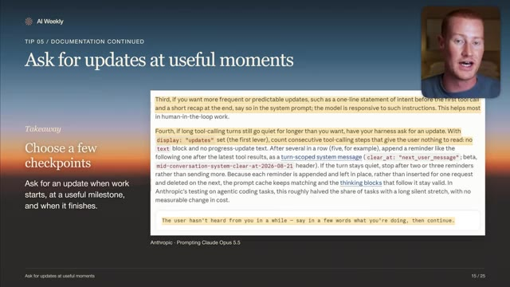
*⏱️ 00:05:33 — Diapositive « AI Weekly » montrant la documentation officielle d'Anthropic sur l'optimisation des invites de commandes (Prompting Claude Opus 5.5) et les instructions textuelles pour gérer les mises à jour en cours d'exécution.*

---

### ⏱️ `[00:05:44 - 00:06:07]` | Segment #14

**🔊 Audio (Transcription Intégrale Mot pour Mot en Français) :**
> Très bien, voici donc un autre exemple. Ici, nous demandons une mise à jour après l'examen des fichiers et lorsque le brouillon est prêt à être envoyé. Claude doit continuer à travailler entre ces différentes mises à jour. Cela vous donne de la visibilité sans transformer chaque étape en une demande d'approbation. Passons maintenant à l'astuce numéro six : une réponse terminée n'est pas une tâche terminée. Avec Opus 5.5, une mise à jour de progression peut terminer un tour alors qu'il reste du travail à faire.

**👁️ Analyse Visuelle d'Écran (gemini-3.5-flash-lite) :**
**Interface & Outils** : Présentation vidéo avec diapositives graphiques et incrustation vidéo du présentateur.

**Contenu textuel & Code** : Texte de conseil pédagogique sur l'utilisation des LLM, exemples de prompts textuels demandant des points d'étape réguliers.

**Action / Démonstration** : Explication théorique et démonstration de bonnes pratiques de prompt engineering pour le suivi de tâches complexes.

---

### ⏱️ `[00:06:07 - 00:06:25]` | Segment #15

**🔊 Audio (Transcription Intégrale Mot pour Mot en Français) :**
> Listez ce que vous vous attendez à recevoir et faites le suivi des éléments non terminés. Pour un agent automatisé, l'application doit également vérifier l'achèvement, et une simple liste de contrôle ne constitue pas une garantie. Maintenant, si une tâche en arrière-plan est toujours en cours d'exécution, attendez ses résultats avant de déclarer le travail terminé. Anthropic fournit des instructions supplémentaires pour les agents qui s'exécutent sans surveillance.

**👁️ Analyse Visuelle d'Écran (gemini-3.5-flash-lite) :**
**Interface & Outils** : Présentation vidéo avec diapositives graphiques et incrustation du présentateur.

**Contenu textuel & Code** : Texte explicatif sur la gestion des tâches par les agents IA, soulignant qu'une réponse textuelle de fin de tour ne garantit pas l'achèvement d'une tâche.

**Action / Démonstration** : Le présentateur explique l'importance de vérifier l'état réel d'avancement des tâches automatisées plutôt que de se fier uniquement à la fin d'une réponse textuelle.

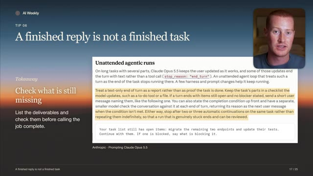
*⏱️ 00:06:12 — Diapositive de présentation montrant le titre "A finished reply is not a finished task" avec un encart textuel extrait de la documentation d'Anthropic sur Claude Opus 5.5.*

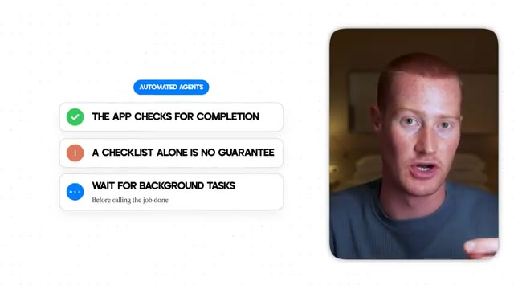
*⏱️ 00:06:21 — Diapositive de synthèse avec des puces sur les agents automatisés ("The app checks for completion", "A checklist alone is no guarantee", "Wait for background tasks").*

---

### ⏱️ `[00:06:25 - 00:06:46]` | Segment #16

**🔊 Audio (Transcription Intégrale Mot pour Mot en Français) :**
> Ces instructions peuvent utiliser plus de temps et de jetons, et elles doivent quand même préserver les approbations nécessaires. Cette instruction plus longue que vous voyez cible un problème simple, qui consiste à signaler la prochaine étape au lieu de la franchir. Elle demande à un agent non surveillé de continuer un travail qui ne nécessite pas votre intervention. Les véritables obstacles et les approbations requises ont toujours de l'importance. Maintenant, voici un exemple, nous devons dire à Claude ce que comprend la fin.

**👁️ Analyse Visuelle d'Écran (gemini-3.5-flash-lite) :**
**Interface & Outils** : Présentation vidéo avec diapositive explicative et incrustation du présentateur.

**Contenu textuel & Code** : Texte extrait de la documentation officielle d'Anthropic sur la gestion des tours de conversation et des instructions permanentes pour l'agent IA.

**Action / Démonstration** : Explication de la différence entre signaler une action future et exécuter directement l'étape suivante sans s'arrêter inutilement.

---

### ⏱️ `[00:06:46 - 00:07:05]` | Segment #17

**🔊 Audio (Transcription Intégrale Mot pour Mot en Français) :**
> Tout d'abord, nous pouvons nommer les sorties, qu'il s'agisse d'un rapport, d'une liste de sources ou d'un résumé. Si l'un d'eux manque, pointez-le directement au lieu de vous contenter de dire, continuez. Demandez à Claude de terminer cet élément ou simplement d'expliquer le blocage. Passons à l'astuce numéro sept, et il s'agit de donner à Claude une direction de conception claire. Opus 5.5 retombe encore sur les styles de sites web par défaut.

**👁️ Analyse Visuelle d'Écran (gemini-3.5-flash-lite) :**
**Interface & Outils** : Présentation vidéo avec incrustations graphiques et textuelles.

**Contenu textuel & Code** : Texte explicatif sur les critères de validation 'DONE MEANS' avec des coches vertes et des croix rouges.

**Action / Démonstration** : Présentation des conseils et directives pour donner des instructions concrètes à l'intelligence artificielle.

---

### ⏱️ `[00:07:06 - 00:07:25]` | Segment #18

**🔊 Audio (Transcription Intégrale Mot pour Mot en Français) :**
> Anthropic affirme que le fait de rendre le texte moins générique revient souvent à remplacer une valeur par défaut par une autre. Fournissez donc un retour visuel concret et affinez ce qui est généré. Il s'agit évidemment d'une bonne pratique existante et non d'une nouvelle fonctionnalité intégrée à Opus 5.5, mais je pense qu'il est pertinent que vous le compreniez lorsque vous rédigez des prompts pour ce modèle. Et pour passer à un exemple très simple, nous devons être précis concernant le design.

**👁️ Analyse Visuelle d'Écran (gemini-3.5-flash-lite) :**
**Interface & Outils** : Présentation vidéo avec diapositive explicative et encadré de texte.

**Contenu textuel & Code** : Texte extrait de la documentation d'Anthropic : "Frontend design defaults" avec des instructions spécifiques de prompt pour Claude Opus 5.5.

**Action / Démonstration** : Le présentateur explique comment donner des instructions précises de design à Claude pour éviter les interfaces génériques par défaut.

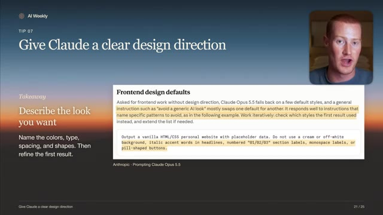
*⏱️ 00:07:15 — Diapositive de présentation intitulée "Give Claude a clear design direction" montrant un extrait de documentation d'Anthropic sur les styles par défaut en frontend et un exemple de prompt textuel.*

---

### ⏱️ `[00:07:25 - 00:07:45]` | Segment #19

**🔊 Audio (Transcription Intégrale Mot pour Mot en Français) :**
> et donc c'est un exemple parfait de cela. Quand nous disons de le rendre moins générique, cela laisse la plupart des choix ouverts et ça va se rabattre par défaut sur le style de design suivant. L'exemple plus fort nomme un arrière-plan, un style de titre, une forme de bouton et un espacement spécifique. Nous pouvons utiliser nos propres préférences ou une image de référence comme exemple. Passant à l'astuce numéro huit, rendre les petits détails plus faciles à lire.

**👁️ Analyse Visuelle d'Écran (gemini-3.5-flash-lite) :**
**Interface & Outils** : Interface vidéo éducative avec illustration graphique et incrustation du présentateur.

**Contenu textuel & Code** : Texte de prompt "Make it less generic." illustrant un exemple de mauvaise formulation pour une IA générative.

**Action / Démonstration** : Le présentateur explique l'importance d'être spécifique dans les prompts plutôt que d'utiliser des termes génériques.

---

### ⏱️ `[00:07:45 - 00:08:05]` | Segment #20

**🔊 Audio (Transcription Intégrale Mot pour Mot en Français) :**
> Anthropic rapporte qu'Opus 5.5 lit le matériel visuel avec plus de précision qu'Opus 5 sans outils supplémentaires. Les graphiques denses et les petites étiquettes peuvent toujours bénéficier d'un original net et d'un gros plan. Si des outils d'image sont disponibles, Claude peut recadrer et inspecter les détails lui-même. Voici maintenant un rapide exemple. Indiquez à Claude l'étiquette exacte ou la partie de l'image qui compte.

**👁️ Analyse Visuelle d'Écran (gemini-3.5-flash-lite) :**
**Interface & Outils** : Présentation vidéo avec graphiques d'évaluation des performances des modèles IA.

**Contenu textuel & Code** : Graphique à barres comparant des métriques avec un zoom sur des étiquettes de données minuscules et la mention Sharp Original.

**Action / Démonstration** : Illustration visuelle de la capacité d'analyse d'images d'Opus 5.5 sur des graphiques denses et des étiquettes de petite taille.

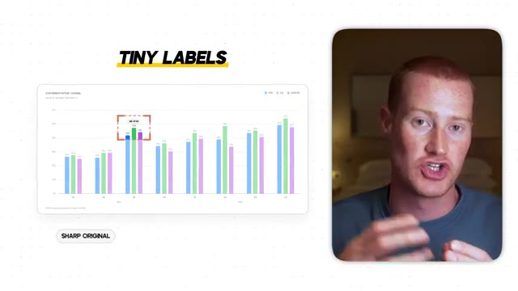
*⏱️ 00:07:55 — Le présentateur à droite et un graphique à barres avec des étiquettes et un encadré rouge de zoom (Sharp Original) à gauche.*

---

### ⏱️ `[00:08:05 - 00:08:37]` | Segment #21

**🔊 Audio (Transcription Intégrale Mot pour Mot en Français) :**
> Laissez-le rogner si les outils sont disponibles ou joignez votre propre gros plan à côté de cette image originale. Ensuite, vous pourriez lui demander de dire quand le détail est illisible plutôt que de deviner, ce qui va aider à fournir plus de contexte ici. Très bien, donc je sais que nous avons parlé de beaucoup d'astuces différentes ici, et cela peut être écrasant. Vous n'avez pas besoin d'ajouter chaque recommandation dans un prompt énorme, ou vous n'avez pas besoin de tester chacune d'entre elles, mais j'espère que cela vous aide à prompter Opus 5.5 afin d'obtenir de meilleures réponses et aussi de vous faire économiser de l'argent sur l'utilisation des jetons puisque c'est évidemment quelque chose que vous voulez faire. Si vous avez apprécié cette vidéo, abonnez-vous à la chaîne pour plus de contenu comme celui-ci. Laissez-moi

**👁️ Analyse Visuelle d'Écran (gemini-3.5-flash-lite) :**
**Interface & Outils** : Interface de présentation vidéo, encadré de prompt textuel et diapositive de synthèse.

**Contenu textuel & Code** : Texte du prompt « Look at the label above the third bar... » et liste de 8 conseils (Medium effort, Thinking instructions, Relevant context, Pasted material, Progress updates, Task completion, Website design, Visual inputs).
[DESC_IMAGE_LECTION] Le présentateur explique l'utilisation de prompts textuels avec des instructions visuelles et résume les 8 astuces abordées.

**Action / Démonstration** : Explications face caméra et analyse conceptuelle des marchés.

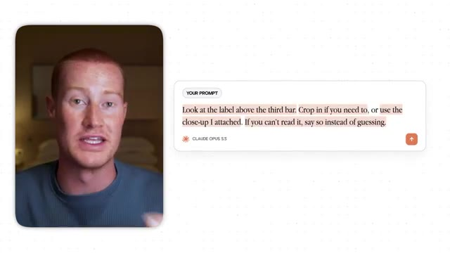
*⏱️ 00:08:13 — Le présentateur à gauche et un encadré textuel montrant un exemple de prompt à droite (Claude Opus 3.5).*

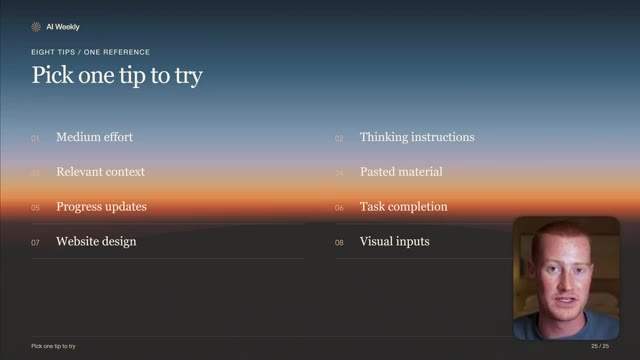
*⏱️ 00:08:29 — Une diapositive de présentation « AI Weekly » listant huit astuces (« Pick one tip to try ») en deux colonnes, avec le présentateur en médaillon en bas à droite.*

---

### ⏱️ `[00:08:37 - 00:08:40]` | Segment #22

**🔊 Audio (Transcription Intégrale Mot pour Mot en Français) :**
> dites-moi ce que vous en pensez dans les commentaires et je vous vois dans la prochaine vidéo. Salut.

**👁️ Analyse Visuelle d'Écran (gemini-3.5-flash-lite) :**
**Interface & Outils** : Présentation ou face-caméra explicatif du trader sans interface logicielle partagée.

**Contenu textuel & Code** : Explications orales des stratégies et mise en contexte méthodologique du marché.

**Action / Démonstration** : Explications face caméra et analyse conceptuelle des marchés.

---

