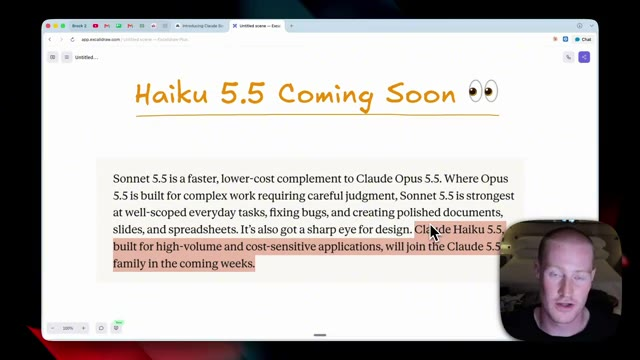
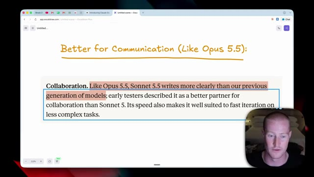
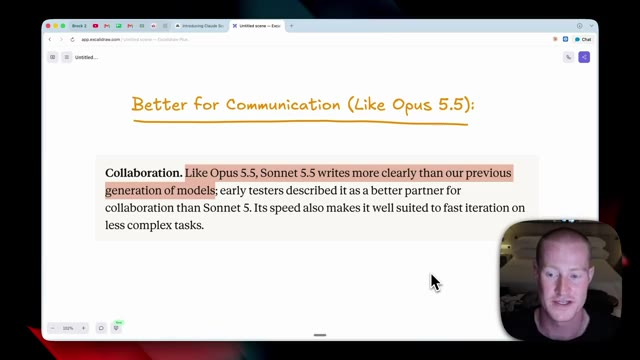
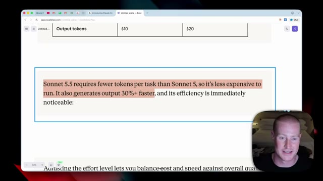
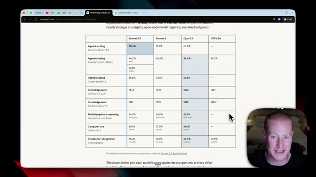
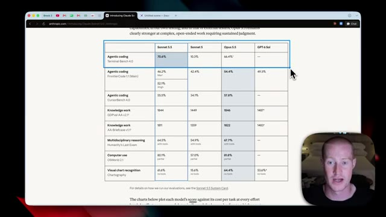
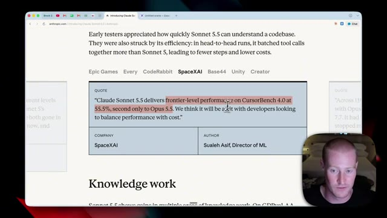
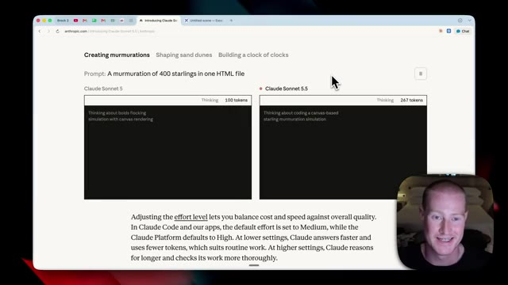
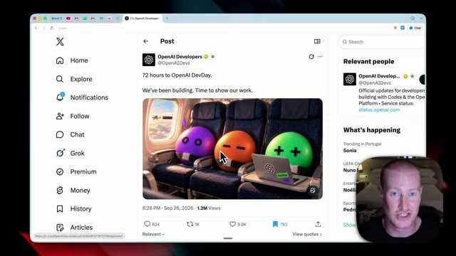
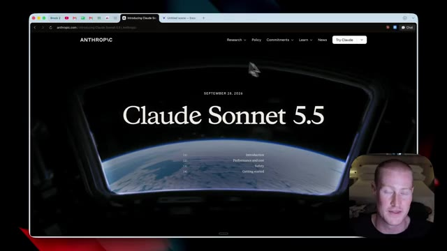

# 🎬 Anthropic Just Dropped Claude Sonnet 5.5 (MAJOR UPGRADE)

> **Chaîne** : [Brock Mesarich | AI for Non Techies](https://www.youtube.com/@BrockMesarich)  
> **Lien YouTube** : [https://www.youtube.com/watch?v=pAkG5PstlYI](https://www.youtube.com/watch?v=pAkG5PstlYI)  
> **Date de publication** : 20260928  
> **Durée** : 00:07:12  
> **Identifiant vidéo** : `pAkG5PstlYI`  
> **Transcription & Analyse** : `whisper-v3-large-turbo+gemini-3.5-flash-lite`  

---

## 📌 Synthèse Exécutive & Outils

### 💡 Résumé
Dans cette vidéo intitulée **Anthropic vient de lancer Claude Sonnet 5.5 (MAJEURE MISE À JOUR)**, Alex Carter détaille une approche stratégique et pratique du trading et de l'automatisation par agents IA.

### 🛠️ Outils, Modèles & Logiciels Présentés
- **TradingView & Claude Code** : Analyse technique avancée et automatisation algorithmique.

### 🔑 Points Clés & Enseignements Stratégiques
- Respect rigoureux du ratio risque/rendement et du money management.
- Automatisation méthodique des déclencheurs d'ordres via des agents intelligents.

---

## ⏱️ Chronologie & Transcription Complète Audio & Visuelle (Mot pour Mot)

### ⏱️ `[00:00:00 - 00:00:26]` | Segment #01

**🔊 Audio (Transcription Intégrale Mot pour Mot en Français) :**
> Anthropic est de retour avec un nouveau modèle. Ils viennent de lancer Claude Sonnet 5.5, juste quelques jours après avoir sorti Opus 5.5. Et comme toujours, dans cette vidéo, je vais décortiquer toutes les nouveautés de ce modèle. Je vais faire vite et aller droit au but pour que vous puissiez gagner du temps. Sans plus attendre, plongeons-noisi dedans. Ce que je vais faire dans cette vidéo, c'est analyser cet article juste ici qu'Anthropic nous a fourni et vous donner les principaux points importants qui comptent pour vous, afin que vous puissiez gagner du temps sans avoir à parcourir tout ceci et essayer de le déchiffrer par vous-même.

**👁️ Analyse Visuelle d'Écran (gemini-3.5-flash-lite) :**
**Interface & Outils** : Présentation ou face-caméra explicatif du trader sans interface logicielle partagée.

**Contenu textuel & Code** : Explications orales des stratégies et mise en contexte méthodologique du marché.

**Action / Démonstration** : Explications face caméra et analyse conceptuelle des marchés.

---

### ⏱️ `[00:00:26 - 00:00:51]` | Segment #02

**🔊 Audio (Transcription Intégrale Mot pour Mot en Français) :**
> Si vous voulez vraiment y jeter un œil vous-même, il y aura un lien dans la description pour le faire. Maintenant, première chose importante, Anthropic a présenté Claude Sonnet 5.5, le deuxième modèle de la famille Claude 5.5, puisqu'ils viennent de sortir Opus 5.5 il y a tout juste quelques jours, et il est très, très performant, et j'ai été impressionné par lui. Ils poursuivent en disant que c' qu'il s'agit d'une nette amélioration par rapport au Sonnet 5, et qu'il fonctionne 30 % plus rapidement, et qu'il coûte jusqu'à 30 % moins cher pour la plupart des travaux.

**👁️ Analyse Visuelle d'Écran (gemini-3.5-flash-lite) :**
**Interface & Outils** : Présentation ou face-caméra explicatif du trader sans interface logicielle partagée.

**Contenu textuel & Code** : Explications orales des stratégies et mise en contexte méthodologique du marché.

**Action / Démonstration** : Explications face caméra et analyse conceptuelle des marchés.

---

### ⏱️ `[00:00:51 - 00:01:29]` | Segment #03

**🔊 Audio (Transcription Intégrale Mot pour Mot en Français) :**
> En plus de cela, Anthropic a laissé entendre que Haiku 5.5 sortira probablement au cours des deux prochaines semaines, ce qui en fera le troisième modèle de la famille 5.5. Si vous ne connaissez pas les modèles Claude Haiku, ils sont principalement conçus pour les applications à haut volume et sensibles aux coûts, c'est donc leur modèle le moins cher et, de toute évidence, le moins performant. Cependant, nous devrions assister à une assez mise à niveau importante de ce modèle au cours des prochaines semaines, ce qui m'enthousiasme. Passons maintenant à la première grande mise à niveau de Sonnet 5.5, qui concerne la collaboration et, plus important encore, la communication avec ce modèle. Anthropic a donc indiqué que, tout comme Opus 5.5, Sonnet 5.5 écrit

**👁️ Analyse Visuelle d'Écran (gemini-3.5-flash-lite) :**
**Interface & Outils** : Navigateur web affichant l'application Excalidraw ou un document similaire avec un texte descriptif.

**Contenu textuel & Code** : Texte présentant les modèles Claude (Sonnet 5.5, Opus 5.5 et Claude Haiku 5.5 pour les applications à haut volume et sensibles aux coûts).

**Action / Démonstration** : Le présentateur commente le texte affiché à l'écran concernant la sortie prochaine de Haiku 5.5.

*⏱️ 00:01:01 — Capture d'écran montrant un navigateur web affichant une page avec le titre "Haiku 5.5 Coming Soon" et un paragraphe sur les modèles Claude d'Anthropic, avec la webcam du présentateur incrustée en bas à droite.*

---

### ⏱️ `[00:01:29 - 00:02:08]` | Segment #04

**🔊 Audio (Transcription Intégrale Mot pour Mot en Français) :**
> plus clairement que notre génération précédente de modèles. Les premiers testeurs le décrivent comme un bien meilleur partenaire de collaboration que Sonnet 5. Sa vitesse le rend également très bien adapté à l'itération rapide sur des tâches complexes. C'est donc une chose que j'ai vraiment remarquée en utilisant Opus 5.5 et j'ai vu beaucoup d'autres personnes en parler. Il est très doué pour communiquer. On n'a pas l'impression de devoir déchiffrer exactement ce qu'il essaie de vous dire. Et cela résout un très gros problème lorsqu'il s'agit de travailler avec des grands modèles de langage. Donc, ici même, se trouve un exemple parfait côte à côte de Claude Opus 5 par rapport à Claude Opus 5.5 décortiquant ce problème spécifique en ce

**👁️ Analyse Visuelle d'Écran (gemini-3.5-flash-lite) :**
**Interface & Outils** : Navigateur web affichant l'interface d'Excalidraw.

**Contenu textuel & Code** : Texte affiché : "Collaboration. Like Opus 5.5, Sonnet 5.5 writes more clearly than our previous generation of models; early testers described it as a better partner for collaboration than Sonnet 5. Its speed also makes it well suited to fast iteration on less complex tasks."

**Action / Démonstration** : Le présentateur commente le texte affiché à l'écran concernant les capacités de communication et de collaboration du modèle.

*⏱️ 00:01:38 — Une capture d'écran montrant une page de l'application Excalidraw avec le titre "Better for Communication (Like Opus 5.5):" et un paragraphe de texte souligné, ainsi qu'une incrustation vidéo du présentateur en bas à droite.*

---

### ⏱️ `[00:02:08 - 00:02:42]` | Segment #05

**🔊 Audio (Transcription Intégrale Mot pour Mot en Français) :**
> ici. Et il est très évident que celui de droite, Claude Opus 5.5, est beaucoup plus concis et facile à comprendre au premier coup d'œil. Maintenant, ce sont évidemment de superbes nouvelles car cela arrive maintenant sur Sonnet 5.5, qui va être moins cher qu'Opus 5.5, même si Opus est plutôt rentable. Voici donc une comparaison côte à côte entre Sonnet 5.5 et Opus 5.5. Pour les lectures en cache, ils sont tous les deux à 20 cents par million de jetons. Sonnet 5.5 coûte la moitié du prix d'Opus 5.5 en ce qui concerne les écritures en cache. Les jetons d'entrée, c'est la moitié du prix. Et pour les jetons de sortie,

**👁️ Analyse Visuelle d'Écran (gemini-3.5-flash-lite) :**
**Interface & Outils** : Navigateur web affichant l'application Excalidraw, avec l'encadré vidéo du présentateur en bas à droite.

**Contenu textuel & Code** : Texte surligné expliquant que Sonnet 5.5 écrit plus clairement que la génération précédente, améliorant la collaboration par rapport à Sonnet 5.

**Action / Démonstration** : Le présentateur commente le texte affiché à l'écran concernant les performances de communication de Sonnet 5.5.

*⏱️ 00:02:16 — Une page Excalidraw affichant le titre manuscrit 'Better for Communication (Like Opus 5.5):' ainsi qu'un texte sur la collaboration avec le modèle Sonnet 5.5.*

---

### ⏱️ `[00:02:42 - 00:03:16]` | Segment #06

**🔊 Audio (Transcription Intégrale Mot pour Mot en Français) :**
> c'est aussi moitié moins cher. Donc ça devient plutôt rentable par rapport à Opus 5.5. Et comme je l'ai dit, celui-là était déjà plutôt efficace. Ensuite, Anthropic affirme que Sonnet 5.5 nécessite moins de jetons par tâche que Sonnet 5, donc son utilisation coûte moins cher. Et il génère aussi des résultats 30 % plus rapidement, et son efficacité se remarque immédiatement. C'est quelque chose qu'on commence à observer partout avec toutes ces sorties de nouveaux modèles. On a vraiment l'impression qu'ils deviennent beaucoup plus efficaces en matière de consommation de jetons. Et c'est quelque chose qui résout un problème majeur pour nous, les consommateurs d'intelligence artificielle, parce que ce n'est pas comme si ces modèles n'étaient pas capables

**👁️ Analyse Visuelle d'Écran (gemini-3.5-flash-lite) :**
**Interface & Outils** : Navigateur web affichant l'application Excalidraw et une webcam incrustée.

**Contenu textuel & Code** : Texte surligné en orange : "Sonnet 5.5 requires fewer tokens per task than Sonnet 5, so it's less expensive to run. It also generates output 30%+ faster, and its efficiency is immediately noticeable:". Un tableau avec l'en-tête "Output tokens" et les montants "$10" et "$20".

**Action / Démonstration** : Le présentateur explique et commente le texte affiché à l'écran concernant les performances et les coûts du modèle Sonnet 5.5.

*⏱️ 00:02:50 — Un tableau comparatif et un texte explicatif sur l'interface Excalidraw, avec la vidéo du présentateur en bas à droite.*

---

### ⏱️ `[00:03:16 - 00:03:53]` | Segment #07

**🔊 Audio (Transcription Intégrale Mot pour Mot en Français) :**
> plus maintenant. Il s'agit plutôt de savoir à quel point ils sont efficaces lorsqu'il s'agit du coût que va représenter une tâche donnée. Maintenant, bien sûr, le coût est important, mais cela ne veut pas dire grand-chose si ce n'est pas très capable. Eh bien, le voici comparé à Sonnet 5, Opus 5.5, et ChatGPT 6 vendu. Ce qui ressort vraiment ici, c'est de regarder la différence de codage agentique entre Sonnet 5.5 et Sonnet 5. 5.5 est à 70,6 %, alors que Sonnet 5 était à 10,3 %. Tant de gens se plaignaient des capacités de Sonnet 5. Donc, cela ressemble vraiment à une mise à niveau significative quand il s'agit de beaucoup

**👁️ Analyse Visuelle d'Écran (gemini-3.5-flash-lite) :**
**Interface & Outils** : Navigateur web affichant une page de documentation officielle (site anthropic.com).

**Contenu textuel & Code** : Tableau de benchmarks affichant des pourcentages et scores pour des catégories telles que 'Agentic coding', 'Knowledge work', 'Multidisciplinary reasoning', 'Computer use', et 'Visual chart recognition'.

**Action / Démonstration** : Le présentateur commente le tableau comparatif affiché à l'écran.

*⏱️ 00:03:26 — Tableau comparatif des performances de différents modèles d'IA (Sonnet 5.5, Sonnet 5, Opus 5.5, GPT-6 Sol) sur diverses tâches.*

---

### ⏱️ `[00:03:53 - 00:04:29]` | Segment #08

**🔊 Audio (Transcription Intégrale Mot pour Mot en Français) :**
> de ces benchmarks ici, que je vais parcourir. Ensuite, vous pouvez voir qu'Opus 5,5 est à 66,4 %. Il obtient même un score supérieur de 4 % au tout nouveau modèle Opus 5,5. Et si vous allez jusqu'au bout de la liste ici, il surpasse évidemment Sonnet 5 sur tous ces différents benchmarks avec une marge significative. Et ensuite, si vous le comparez à Opus 5,5, Opus 5,5 reste meilleur dans tout le reste, à part pour le codage agentique. C'est donc très intéressant pour moi qu'il soit si bon en codage agentique. Je me demande pourquoi. En parlant de codage, décortiquons cela encore plus. Il est écrit ici qu'à effort élevé sur Frontier Code, il obtient 10 points de plus que

**👁️ Analyse Visuelle d'Écran (gemini-3.5-flash-lite) :**
**Interface & Outils** : Navigateur web affichant une page de documentation officielle (Anthropic).

**Contenu textuel & Code** : Tableau de benchmarks affichant des pourcentages de réussite et scores (Agentic coding, Knowledge work, Multidisciplinary reasoning, Computer use, Visual chart recognition) avec une incrustation vidéo du présentateur en bas à droite.

**Action / Démonstration** : Le présentateur commente et survole le tableau comparatif des modèles d'IA.

*⏱️ 00:04:02 — Tableau comparatif des performances de différents modèles d'IA sur plusieurs benchmarks (Sonnet 5.5, Sonnet 5, Opus 5.5, GPT-5 Sol).*

---

### ⏱️ `[00:04:29 - 00:05:01]` | Segment #09

**🔊 Audio (Transcription Intégrale Mot pour Mot en Français) :**
> Sonnet 5 avec le même paramètre. Et voici le plus fou, à environ un quinzième du coût par tâche. Le coût de ceci baisse donc de manière significative. Et le plus fou là-dedans, c'est qu'Epic Games a écrit cette citation à propos du code de Sonnet 5.5. Ils ont dit que lors des premiers tests d'Epic, Claude Sonnet 5.5 a atteint le même niveau de qualité que l'on attendrait d'un modèle de catégorie supérieure. Et cela ne vient pas seulement de quelqu'un qui code au feeling pour un jeu et montre une démo sur Twitter. Cela vient de l'entreprise Epic Games. C'est assez fou si l'on y réfléchit vraiment. Le directeur du machine learning chez SpaceX AI

**👁️ Analyse Visuelle d'Écran (gemini-3.5-flash-lite) :**
**Interface & Outils** : Présentation ou face-caméra explicatif du trader sans interface logicielle partagée.

**Contenu textuel & Code** : Explications orales des stratégies et mise en contexte méthodologique du marché.

**Action / Démonstration** : Explications face caméra et analyse conceptuelle des marchés.

---

### ⏱️ `[00:05:01 - 00:05:38]` | Segment #10

**🔊 Audio (Transcription Intégrale Mot pour Mot en Français) :**
> a même dit que Claude Sonnet 5.5 offre des performances de niveau frontalier sur Cursor Bench 4.0 à 55 %, devancé seulement par Opus 5.5 qui vient de sortir. Nous pensons qu'il fera un tabac auprès des développeurs qui cherchent à concilier performance et coûts. Et encore une fois, c'est le thème principal qui se dégage ici. Il ne s'agit pas nécessairement de savoir à quel point ces modèles sont capables, car ils sont très capables, et ce, depuis un certain temps déjà, mais plutôt s'ils peuvent le faire à un prix qui ne va pas ruiner les consommateurs ordinaires comme vous et moi. Anthropic a tout de même affirmé qu'il est environ 30 % plus rapide que Claude Sonnet 5. Voici donc une analyse en direct du temps qu'il faut, entre le moment où on lui donne une invite et celui où il écrit le

**👁️ Analyse Visuelle d'Écran (gemini-3.5-flash-lite) :**
**Interface & Outils** : Navigateur web affichant la page de présentation officielle d'Anthropic sur Claude Sonnet 5.5 et webcam du présentateur en bas à droite.

**Contenu textuel & Code** : Texte de citation souligné : "Claude Sonnet 5.5 delivers frontier-level performance on CursorBench 4.0 at 55.5%, second only to Opus 5.5." et test comparatif de tokens de réflexion ("Thinking: 100 tokens" vs "267 tokens").

**Action / Démonstration** : Le présentateur commente le test de performance de Claude Sonnet 5.5 sur CursorBench et les capacités de réflexion des différents modèles.

*⏱️ 00:05:10 — Capture d'écran du navigateur affichant le site web d'Anthropic avec une citation mettant en avant les performances de Claude Sonnet 5.5 sur CursorBench 4.0 à 55,5 %.*

*⏱️ 00:05:29 — Capture d'écran du navigateur montrant une comparaison visuelle entre Claude Sonnet 5 et Claude Sonnet 5.5 avec le prompt d'une simulation de murmuration d'étourneaux.*

---

### ⏱️ `[00:05:38 - 00:06:03]` | Segment #11

**🔊 Audio (Transcription Intégrale Mot pour Mot en Français) :**
> code pour générer réellement un fichier HTML juste ici. Donc il semble évidemment que Claude Sonnet 5.5 consomme ces jetons beaucoup plus rapidement. C'est très rapide en ce qui concerne le code et attendons de voir le résultat. Donc il semble que Sonnet 5.5 ait terminé. Cette petite animation fonctionne maintenant avec ces poissons qui nagent autour dans cette page HTML, tandis que nous avons toujours Claude Sonnet 5 de l'autre côté qui code ceci, cela semble effectivement beaucoup plus rapide que Sonnet 5.

**👁️ Analyse Visuelle d'Écran (gemini-3.5-flash-lite) :**
**Interface & Outils** : Présentation ou face-caméra explicatif du trader sans interface logicielle partagée.

**Contenu textuel & Code** : Explications orales des stratégies et mise en contexte méthodologique du marché.

**Action / Démonstration** : Explications face caméra et analyse conceptuelle des marchés.

---

### ⏱️ `[00:06:03 - 00:06:36]` | Segment #12

**🔊 Audio (Transcription Intégrale Mot pour Mot en Français) :**
> Maintenant, je vais faire une prédiction en ce moment même. Donc, OpenAI a sa journée des développeurs demain, et j'ai la forte conviction qu'ils vont lancer leur propre agent IA, un agent IA personnel, similaire à Muse et GrokBot demain. Et si l'histoire se répète, ce qui est le cas, ces entreprises d'IA aiment jouer à la corde raide. Quand une entreprise sort quelque chose, l'autre sort une nouveauté très similaire juste quelques jours plus tard pour attirer tous les regards et les tourner vers ses propres produits. Donc, à mon avis, après qu'OpenAI aura sorti ceci demain, Anthropic va probablement sortir le sien plus tard cette semaine ou peut-être la semaine prochaine. Et si vous reliez les points,

**👁️ Analyse Visuelle d'Écran (gemini-3.5-flash-lite) :**
**Interface & Outils** : Navigateur web affichant la plateforme X (Twitter).

**Contenu textuel & Code** : Un post de @OpenAIDevs disant « 72 hours to OpenAI DevDay. We've been building. Time to show our work. » avec une image générée montrant des personnages sphériques (violet, orange, vert) attachés sur des sièges d'avion.

**Action / Démonstration** : Le présentateur commente l'annonce imminente de l'OpenAI DevDay et les teasers publiés sur les réseaux sociaux.

*⏱️ 00:06:11 — Capture d'écran montrant un tweet du compte officiel @OpenAIDevs sur la plateforme X (Twitter) concernant l'OpenAI DevDay, avec une image illustrant trois sphères colorées dans un avion.*

---

### ⏱️ `[00:06:37 - 00:06:56]` | Segment #13

**🔊 Audio (Transcription Intégrale Mot pour Mot en Français) :**
> cela est logique parce qu'Anthropic lance des modèles comme Opus 5.5 et maintenant Sonnet 5.5 qui sont bien meilleurs pour communiquer. Et c'est un timing parfait avant de lancer un agent assistant personnel que les gens vont utiliser pour communiquer sans cesse. Encore une fois, ce ne sont que mes deux centimes. Prenez cela avec des pincettes. Dites-moi ce que vous en pensez dans les commentaires.

**👁️ Analyse Visuelle d'Écran (gemini-3.5-flash-lite) :**
**Interface & Outils** : Présentation ou face-caméra explicatif du trader sans interface logicielle partagée.

**Contenu textuel & Code** : Explications orales des stratégies et mise en contexte méthodologique du marché.

**Action / Démonstration** : Explications face caméra et analyse conceptuelle des marchés.

---

### ⏱️ `[00:06:56 - 00:07:12]` | Segment #14

**🔊 Audio (Transcription Intégrale Mot pour Mot en Français) :**
> Penses-tu que ce soit le cas ? Parce que j'ai la forte conviction que c'est ce qui se passe. Et voilà. C'est un résumé super rapide du nouveau modèle Claude Sonnet 5.5. J'ai hâte de le tester et de le mettre à l'épreuve sur cette chaîne YouTube. Donc, si vous voulez plus de vidéos comme celle-ci, abonnez-vous à la chaîne. Dites-moi ce que vous en pensez dans les commentaires et je vous vois dans la prochaine vidéo. À la vôtre.

**👁️ Analyse Visuelle d'Écran (gemini-3.5-flash-lite) :**
**Interface & Outils** : Navigateur web affichant le site web d'Anthropic (anthropic.com).

**Contenu textuel & Code** : Texte affichant "Claude Sonnet 5.5", la date "SEPTEMBER 28, 2026", ainsi que les sections de la page : Introduction, Performance and cost, Safety, Getting started.

**Action / Démonstration** : Présentation visuelle de la page web du nouveau modèle d'intelligence artificielle par le créateur.

*⏱️ 00:07:00 — Capture d'écran montrant le site officiel d'Anthropic avec la page de présentation du modèle Claude Sonnet 5.5, avec le présentateur en incrustation vidéo en bas à droite.*

---

