# 🎬 ChatGPT Dots are Here… GPT 6.1 Sol, ChatGPT Spaces & More

> **Chaîne** : [Brock Mesarich | AI for Non Techies](https://www.youtube.com/@BrockMesarich)  
> **Lien YouTube** : [https://www.youtube.com/watch?v=XdMwDbKBiIw](https://www.youtube.com/watch?v=XdMwDbKBiIw)  
> **Date de publication** : 20260929  
> **Durée** : 00:08:27  
> **Identifiant vidéo** : `XdMwDbKBiIw`  
> **Transcription & Analyse** : `whisper-v3-large-turbo+gemini-3.5-flash-lite`  

---

## 📌 Synthèse Exécutive & Outils

### 💡 Résumé
Cette intervention de la chaîne *Brock Mesarich | AI for Non Techies* décortique les annonces majeures de l'OpenAI DevDay, marquant un tournant décisif dans l'automatisation des flux de travail, la gestion d'agents autonomes et l'optimisation des coûts d'infrastructure pour les professionnels. L'analyse se concentre sur le lancement de **ChatGPT Dots**, des assistants personnels proactifs capables d'interagir via la voix, les SMS, Slack et des environnements cloud sécurisés, redéfinissant la manière dont les utilisateurs non techniques pilotent des tâches complexes à distance. 

Sur le plan économique et architectural, la vidéo met en lumière l'introduction du modèle **ChatGPT 6.1 Sol**, une alternative hautement performante et 80 % moins onéreuse que le modèle phare Astra, ainsi qu'un nouveau forfait élite à 500 dollars par mois conçu pour lever les barrières d'utilisation intensive. En parallèle, l'intégration de **ChatGPT Space** et de la nouvelle **API Decisions** illustre la volonté d'OpenAI de unérer les espaces de travail collaboratifs à la manière de Notion tout en accélérant drastiquement l'exécution des agents autonomes (« computer-use »).

### 🛠️ Outils, Modèles & Logiciels Présentés
* **ChatGPT Dots** : Assistant personnel IA proactif capable d'agir en arrière-plan, joignable par téléphone, SMS, e-mail et Slack.
* **ChatGPT 6.1 Sol** : Modèle de pointe ultra-économique, affichant un coût réduit de 80 % par rapport à l'Astra tout en conservant une intelligence quasi équivalente.
* **ChatGPT Astra** : Modèle haut de gamme d'OpenAI servant de référence comparative en termes de performances et de tarification (10 $ par million de jetons d'entrée).
* **ChatGPT Space** : Espace de travail collaboratif unifié inspiré de Notion, permettant de centraliser les équipes et les agents Dots.
* **Codex** : Plateforme d'exécution de code et de projets techniques intégrée aux flux de travail des agents Dots.
* **API Decisions** : Nouvelle interface de programmation permettant aux agents de prendre des décisions contextuelles ultra-rapides, optimisant l'utilisation automatisée des ordinateurs.
* **GrokBot / Grok** : Assistant conversationnel et concurrent direct d'OpenAI, utilisé par l'analyste comme outil quotidien de référence.
* **Metamuse** : Plateforme d'agents IA concurrents offrant des fonctionnalités d'automatisation similaires.
* **Make & Zapier** : Outils d'automatisation et d'intégration de flux de travail sans code (mentionnés dans le profil contextuel de la chaîne).
* **Claude (Sonnet 5.5 / Opus 5.5)** : Modèles concurrents d'Anthropic soumis à une cadence de sortie extrêmement rapide sur le marché.

### 🔑 Points Clés & Enseignements Stratégiques
1. **Évolution vers l'autonomie proactive** : Les assistants « Dots » ne réagissent plus seulement aux invites textuelles, mais anticipent les besoins en analysant de manière autonome les e-mails, les messages Slack et les flux de travail sans intervention humaine continue.
2. **Optimisation drastique des coûts d'infrastructure** : Le modèle **GPT 6.1 Sol** redéfinit l'économie des applications IA en baissant les coûts à 2 $ par million de jetons d'entrée et 10 $ pour les sorties, rendant l'inférence à grande échelle beaucoup plus accessible.
3. **Architecture Cloud isolée** : L'utilisation d'un ordinateur dans le cloud permet aux agents d'exécuter des tâches lourdes (navigation web, manipulation d'applications tierces) de manière isolée, libérant ainsi les ressources de la machine physique de l'utilisateur.
4. **Granularité des permissions de sécurité** : Pour contrer les risques d'exécutions incontrôlées, la configuration des Dots exige la définition préalable de permissions strictes et de valider des approbations pour les actions critiques.
5. **Modèle tarifaire dissocié pour les interactions conversationnelles** : Les échanges textuels et vocaux de base avec un premier Dot sont inclus sans surcoût dans les abonnements Pro/Business et ne décomptent pas les quotas d'utilisation, contrairement aux tâches exécutées via Codex.
6. **Mise à l'échelle pour les super-utilisateurs** : Le nouveau forfait à 500 $ par mois supprime les limitations standards de cinq heures et multiplie par 25 la capacité d'utilisation, répondant aux exigences des traders et analystes intensifs.
7. **Accélération de l'exécution graphique (Computer-Use)** : Grâce à l'**API Decisions**, les goulets d'étranglement liés à la lenteur des clics et de la navigation visuelle par les IA sont drastiquement réduits, permettant une exécution quasi instantanée des tâches sur interfaces web.
8. **Convergence des espaces de travail** : **ChatGPT Space** tente d'unifier la gestion de projets collaborative (type Notion) et l'interaction directe avec les agents IA, bien que sa complexité opérationnelle nécessite une évaluation rigoureuse de son utilité au quotidien.
9. **Guerre de cadence technologique** : La concurrence féroce entre OpenAI et Anthropic (sorties de modèles toutes les deux semaines) impose aux professionnels d'adopter une veille technologique agile pour maintenir un avantage compétitif dans leurs automatisations.
10. **Stratégie d'écosystème unifié** : Préférer un écosystème centralisé (comme OpenAI avec ses Dots) plutôt que des solutions fragmentées (Grok, Metamuse) permet de centraliser les flux de données et de maximiser la cohérence des outils de productivité.

---

## ⏱️ Chronologie & Transcription Complète Audio & Visuelle (Mot pour Mot)

### ⏱️ `[00:00:00 - 00:00:36]` | Segment #01

**🔊 Audio (Transcription Intégrale Mot pour Mot en Français) :**
> OpenAI vient tout juste de sortir son tout nouvel assistant IA personnel appelé Dots, qui est propulsé par les modèles ChatGPT6 Astra. Ils viennent également de sortir ChatGPT6.1 Sol, qui est leur tout dernier modèle coûtant un cinquième du prix de GPT6 Astra, avec une intelligence presque équivalente à celle d'Astra. Nous avons aussi droit à une toute nouvelle plateforme appelée ChatGPT Space, qui est très, très intéressante et dont nous allons parler plus tard dans cette vidéo. Et ils ont même sorti un forfait à 500 $ par mois qui offre 25 fois plus d'utilisation que le forfait Plus. Donc, dans cette vidéo, je vais vous détailler tout ce qui s'est passé lors de la DevDay et qui compte pour vous en tant que non-technique. Alors sans plus attendre, plongeons directement dans le vif du sujet. Très bien,

**👁️ Analyse Visuelle d'Écran (gemini-3.5-flash-lite) :**
**Interface & Outils** : Navigateur web lis

**Contenu textuel & Code** : Explications orales des stratégies et mise en contexte méthodologique du marché.

**Action / Démonstration** : Explications face caméra et analyse conceptuelle des marchés.

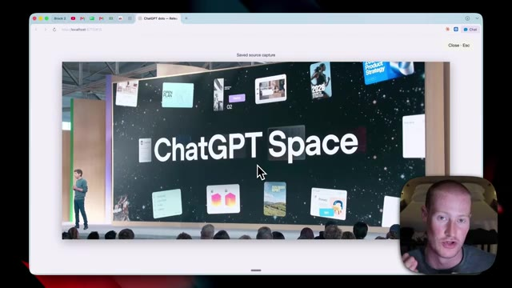
*⏱️ 00:00:18 — Navigateur web diffusant une conférence de présentation OpenAI avec le titre "ChatGPT Space" projeté sur scène.*

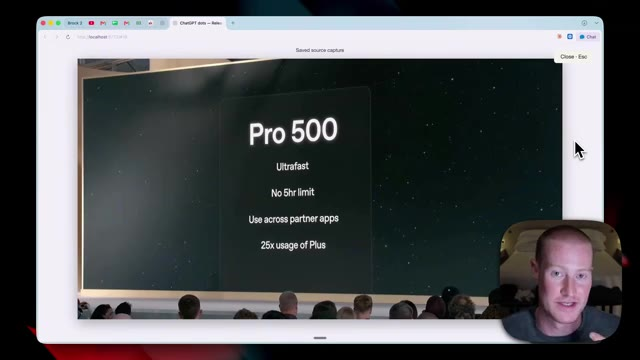
*⏱️ 00:00:27 — Diapositive de présentation vidéo affichant les caractéristiques de l'offre "Pro 500" d'OpenAI.*

---

### ⏱️ `[00:00:36 - 00:00:57]` | Segment #02

**🔊 Audio (Transcription Intégrale Mot pour Mot en Français) :**
> Donc, premièrement, nous avons évidemment leur tout nouveau produit appelé Dots. C'est leur assistant IA personnel qui est un concurrent de choses comme GrokBot et Metamuse que nous avons vues au cours du dernier mois. Personnellement, j'utilise GrokBot comme mon outil principal au quotidien tous les jours, en plus d'utiliser codecs à côté pour mes flux de travail plus spécifiques que je veux exécuter.

**👁️ Analyse Visuelle d'Écran (gemini-3.5-flash-lite) :**
**Interface & Outils** : Navigateur web (page "AI Weekly" / annonce OpenAI DevDay).

**Contenu textuel & Code** : Titre principal « Meet your always-on agent. », visuel avec l'inscription « dots » et des personnages colorés, mentions textuelles « dots - ChatGPT Space - GPT-6.1 Sol - Pro 500 » et « OpenAI introduces dots ».

**Action / Démonstration** : Présentation du nouveau produit d'agent IA permanent « Dots » mentionné dans l'extrait audio.

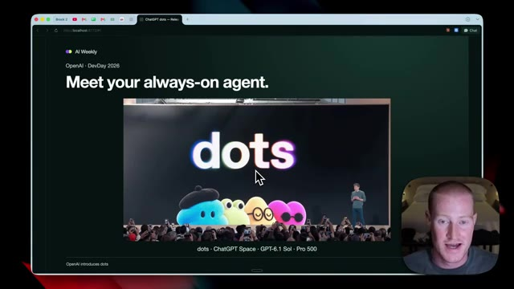
*⏱️ 00:00:41 — Page web de présentation montrant l'annonce d'OpenAI DevDay pour le nouvel assistant IA « dots » avec la mention « Meet your always-on agent ».*

---

### ⏱️ `[00:00:57 - 00:01:17]` | Segment #03

**🔊 Audio (Transcription Intégrale Mot pour Mot en Français) :**
> Je suis donc très excité de tester ce produit car je préférerais rester au sein de l'écosystème d'OpenAI plutôt que d'utiliser Grok, étant donné qu'il s'agit de modèles de pointe plutôt que de devoir utiliser les modèles de Grok qui, à mon sens, sont un peu limités. Juste ici, c'est la vidéo de démonstration qu'ils ont montrée lorsqu'ils ont annoncé ceci. Survolons donc rapidement. En gros, les « dots » sont ces assistants personnels que nous créons.

**👁️ Analyse Visuelle d'Écran (gemini-3.5-flash-lite) :**
**Interface & Outils** : Navigateur web affichant une page de présentation de produit OpenAI.

**Contenu textuel & Code** : Texte de présentation de l'agent "dots" et interface de lecture vidéo.

**Action / Démonstration** : Navigation et visionnage d'une vidéo de démo produit sur une page web.

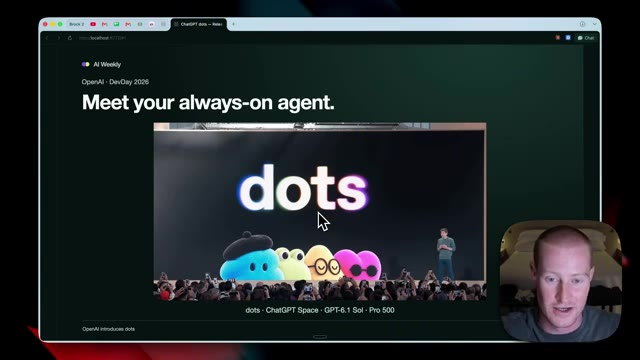
*⏱️ 00:01:02 — Capture d'écran montrant une page web avec le titre "Meet your always-on agent" et une vidéo de présentation du produit "dots" d'OpenAI.*

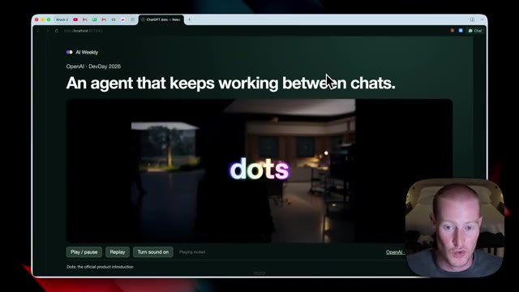
*⏱️ 00:01:12 — Capture d'écran montrant la suite de la page web avec le texte "An agent that keeps working between chats" et un lecteur vidéo intégré.*

---

### ⏱️ `[00:01:18 - 00:01:36]` | Segment #04

**🔊 Audio (Transcription Intégrale Mot pour Mot en Français) :**
> Ils ont ce joli petit design ici, qui, honnêtement, ressemble au style de design qu'ils ont juste volé à GrokBot. Mais cette dame juste ici parle avec ses points. Et un truc vraiment cool là-dedans, c'est que non seulement nous pouvons échanger des messages avec eux via l'application ChatChapiti, mais nous pouvons en fait carrément leur parler au téléphone.

**👁️ Analyse Visuelle d'Écran (gemini-3.5-flash-lite) :**
**Interface & Outils** : Navigateur web (Google Chrome) exécutant une page locale (`http://localhost...`) intitulée "ChatGPT dots - Release...", intégrant un lecteur vidéo pour le concept "OpenAI DevDay 2026".

**Contenu textuel & Code** : Titre affiché : "OpenAI · DevDay 2026 - An agent that keeps working between chats.", boutons de contrôle vidéo (Play/pause, Replay, Turn sound on), avatars animés colorés représentant les agents "Dots".

**Action / Démonstration** : Visionnage et commentaire de la vidéo de démonstration/concept d'OpenAI présentant les agents autonomes persistants ("Dots") capables d'opérer en continu en arrière-plan.

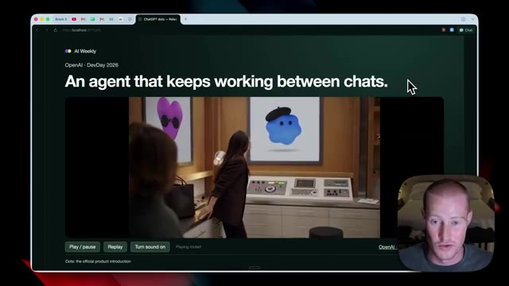
*⏱️ 00:01:22 — Navigateur web affichant la vidéo de présentation "OpenAI · DevDay 2026 - An agent that keeps working between chats", montrant une femme face à des agents IA représentés sous forme de bulles animées ("Dots").*

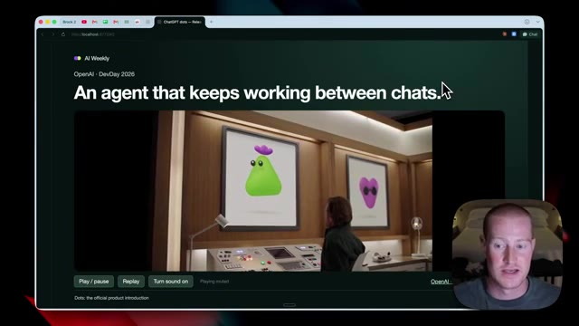
*⏱️ 00:01:31 — Interface web montrant la vidéo de démonstration avec un avatar IA en forme de goutte verte stylisée ("Dot") affiché dans un cadre mural.*

---

### ⏱️ `[00:01:36 - 00:02:08]` | Segment #05

**🔊 Audio (Transcription Intégrale Mot pour Mot en Français) :**
> Donc nous pourrions appeler notre dot, nous pourrions envoyer un texto à notre dot par SMS, nous pouvons envoyer un e-mail à notre dot, nous pourrions l'ajouter dans des messages Slack. Toutes ces différentes façons de communiquer sont maintenant possibles avec notre assistant personnel. Et la chose qui m'enthousiasme le plus, c'est que j'ai le sentiment qu'au fil du temps, ils vont sortir un produit matériel que nous pourrions utiliser pour communiquer avec notre agent au lieu d'avoir à porter notre téléphone. Maintenant, ceci juste ici est un exemple de l'interface de ChatGPT Dots. Je n'y ai pas encore accès. Sinon, je le testerais. Je le couvrirai dans les prochains jours lorsque j'aurai accès sur cette chaîne. Alors assurez-vous de vous abonner.

**👁️ Analyse Visuelle d'Écran (gemini-3.5-flash-lite) :**
**Interface & Outils** : Navigateur web affichant une page de présentation de projet d'agent IA et des maquettes d'applications mobiles.

**Contenu textuel & Code** : Texte de présentation 'An agent that keeps working between chats' et interfaces de messagerie sur smartphone avec des bulles de texte.

**Action / Démonstration** : Le présentateur commente les différentes méthodes de communication possibles avec l'assistant personnel (texte, e-mail, Slack).

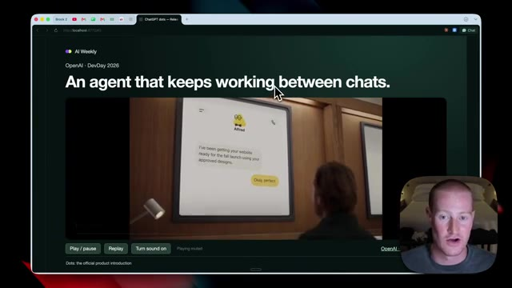
*⏱️ 00:01:44 — Capture d'écran montrant le navigateur avec le titre 'An agent that keeps working between chats' et une vidéo intégrée avec le personnage Alfred.*

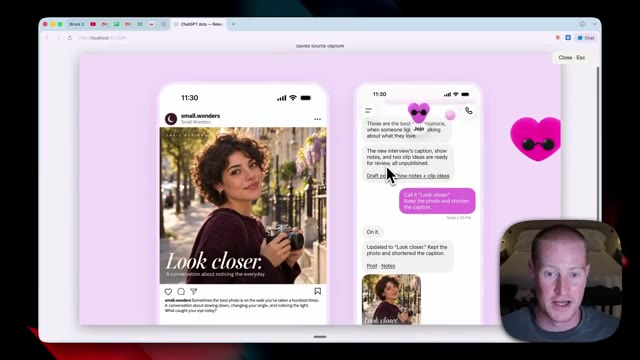
*⏱️ 00:02:00 — Capture d'écran montrant une interface mobile avec deux smartphones côte à côte illustrant des interactions textuelles avec un assistant dot.*

---

### ⏱️ `[00:02:08 - 00:02:43]` | Segment #06

**🔊 Audio (Transcription Intégrale Mot pour Mot en Français) :**
> Sur le côté droit, se trouve notre petite interface ici. Et cela ressemble, très, très fort à GrokBot. Nous avons notre petite icône ici en haut, où nous pouvons nommer nos agents spécifiques. Ce n'est pas comme Metamuse, où nous n'avons qu'un seul agent, nous pouvons configurer chaque agent spécialiste individuel pour des tâches données. Ce n'est rien de révolutionnaire si vous connaissez des plateformes comme GrokBot et Metamuse si vous les avez testées au cours des deux dernières semaines, mais les « dots » sont fondamentalement capables d'être proactifs et de travailler même lorsque nous ne communiquons pas avec eux. Donc, ici même dans cet exemple sur scène, cela montre qu'Alfred, le « dot » de Sam Altman, dit : bonjour, Sam.

**👁️ Analyse Visuelle d'Écran (gemini-3.5-flash-lite) :**
**Interface & Outils** : Navigateur web affichant des pages de présentation de concepts d'applications et de keynotes.

**Contenu textuel & Code** : Maquettes d'interfaces mobiles et présentations visuelles de concepts d'agents conversationnels.

**Action / Démonstration** : Navigation et présentation de visuels d'interfaces utilisateur et de concepts d'applications.

---

### ⏱️ `[00:02:44 - 00:03:18]` | Segment #07

**🔊 Audio (Transcription Intégrale Mot pour Mot en Français) :**
> J'ai déjà rattrapé ton Slack et ton e-mail. Rien d'urgent, juste trois choses à regarder quand tu arriveras à ton bureau. Donc en gros, c'est proactif. C'est capable de faire un suivi avec toi. Nous avons l'habitude d'utiliser le chat, GPT et des codecs et de devoir lui donner une invite. Donc maintenant qu'on peut réellement lui envoyer des messages et qu'il peut être proactif pendant qu'on n'est pas nécessairement en train d'interagir avec lui, c'est la principale différence ici. Parlons maintenant rapidement de la façon dont fonctionnent les points et de l'infrastructure qui se cache derrière. Donc en gros, nous avons notre point, qui est l'endroit où nous interagissons avec lui. Et cela utilise quelques éléments différents. Il utilise des codecs, il utilise ChatGPT Work et un navigateur cloud le long

**👁️ Analyse Visuelle d'Écran (gemini-3.5-flash-lite) :**
**Interface & Outils** : Navigateur web (interface de présentation vidéo local / AI Weekly).

**Contenu textuel & Code** : Messages texte de l'assistant Alfred, schéma d'architecture des agents IA ("Your dot - Ongoing responsibility", "Codex - Code + software", "ChatGPT Work - Documents + analysis", "Cloud computing - Browser + apps").

**Action / Démonstration** : Explication théorique et visuelle du passage d'un modèle d'IA réactif à des agents virtuels proactifs ("dots") gérant des responsabilités continues et exécutant des flux de travail.

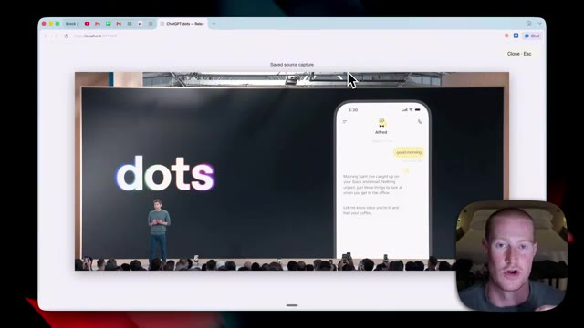
*⏱️ 00:02:52 — Présentation vidéo du concept "dots" d'OpenAI affichant une interface mobile où un assistant virtuel nommé Alfred envoie un résumé proactif des e-mails et messages Slack reçus.*

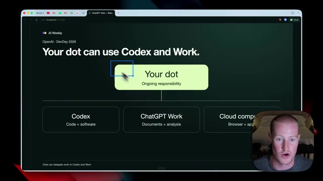
*⏱️ 00:03:10 — Diagramme schématique expliquant le fonctionnement de "Your dot", capable de déléguer des tâches à Codex (code et logiciels), ChatGPT Work (documents et analyses) et au Cloud computing.*

---

### ⏱️ `[00:03:18 - 00:03:55]` | Segment #08

**🔊 Audio (Transcription Intégrale Mot pour Mot en Français) :**
> avec les applications auxquelles nous nous sommes connectés. En gros, il est capable d'aller utiliser Codex sans que nous ayons besoin d'être dans l'application Codex. Nous pouvons simplement discuter avec notre dot et il est capable d'aller effectuer des actions sur les projets sur lesquels nous travaillons à l'intérieur de Codex. Et encore une fois, tout comme RockBot, il dispose d'un ordinateur dans le cloud, ce qui, si vous ne savez pas ce que cela signifie, signifie essentiellement qu'il a une zone désignée où il peut aller travailler qui n'est pas sur votre appareil physique. De cette façon, vous pouvez lui faire parcourir Instagram, par exemple, une fois que vous lui avez donné une connexion à Instagram, au lieu de s'exécuter sur votre propre ordinateur, il s'exécute dans le cloud. Vous pouvez donc continuer à utiliser votre ordinateur pendant qu'il effectue cette tâche.

**👁️ Analyse Visuelle d'Écran (gemini-3.5-flash-lite) :**
**Interface & Outils** : Navigateur Web présentant une diapositive explicative sur l'écosystème OpenAI / ChatGPT dots.

**Contenu textuel & Code** : Diagramme avec le nœud central « Your dot (Ongoing responsibility) » relié à « Codex (Code + software) », « ChatGPT Work (Documents + analysis) » et « Cloud computer (Browser + app) ».

**Action / Démonstration** : Explication théorique de la capacité de l'agent (« dot ») à communiquer et exécuter des actions dans Codex sans intervention directe de l'utilisateur.

*⏱️ 00:03:27 — Schéma explicatif sur écran montrant comment l'agent IA (« dot ») délègue des tâches à Codex, ChatGPT Work et Cloud computer.*

---

### ⏱️ `[00:03:55 - 00:04:14]` | Segment #09

**🔊 Audio (Transcription Intégrale Mot pour Mot en Français) :**
> C'est fondamentalement ce que nous avons déjà à l'intérieur de Codex. Si vous avez utilisé cette plateforme ainsi que le travail de ChatGPT. Ce n'est donc pas nécessairement quelque chose de nouveau, mais ces trois éléments constituent nos points ChatGPT. Maintenant, bien sûr, les gens vont poser des questions sur les permissions et la sécurité derrière tout cela ? Est-ce sûr de l'exécuter ? Est-ce que ça va aller envoyer un SMS à votre ex-femme pour lui dire qu'elle vous manque ?

**👁️ Analyse Visuelle d'Écran (gemini-3.5-flash-lite) :**
**Interface & Outils** : Navigateur web affichant une présentation ou un site web avec une incrustation vidéo du présentateur en bas à droite.

**Contenu textuel & Code** : Schéma textuel : 'Your dot' (Ongoing responsibility) relié à trois blocs : 'Codex' (Code + software), 'ChatGPT Work' (Documents + analysis) et 'Cloud computing'.

**Action / Démonstration** : Le curseur de la souris survole l'option 'ChatGPT Work' pendant que le présentateur parle des fonctionnalités de Codex et ChatGPT.

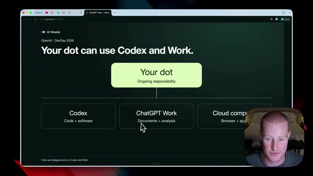
*⏱️ 00:04:00 — Capture d'écran montrant une interface de navigateur web avec un schéma intitulé 'Your dot can use Codex and Work.', illustrant la répartition des tâches entre Codex, ChatGPT Work et Cloud computing.*

---

### ⏱️ `[00:04:14 - 00:04:33]` | Segment #10

**🔊 Audio (Transcription Intégrale Mot pour Mot en Français) :**
> Des choses comme ça, vous ne voulez pas que votre IA les fasse. Nous sommes donc capables de définir des permissions spécifiques avant de déléguer des tâches. Nous pourrions ainsi la connecter uniquement aux applications que nous voulons utiliser. Nous pourrions ensuite lui demander d'exiger une approbation pour les actions immédiates si nous ne voulons pas qu'elle agisse de manière incontrôlée, ce que la plupart des gens vont préférer faire. Parlons maintenant rapidement de la tarification avec ChatGPT.

**👁️ Analyse Visuelle d'Écran (gemini-3.5-flash-lite) :**
**Interface & Outils** : Navigateur web affichant une interface de présentation de fonctionnalités d'IA (OpenAI DevDay).

**Contenu textuel & Code** : Texte explicatif sur les permissions : "Connect only the apps it needs", "Local computer access starts turned off", et "Require approval for important actions".

**Action / Démonstration** : Le présentateur explique l'importance de configurer les permissions et de limiter l'accès de l'IA aux applications nécessaires.

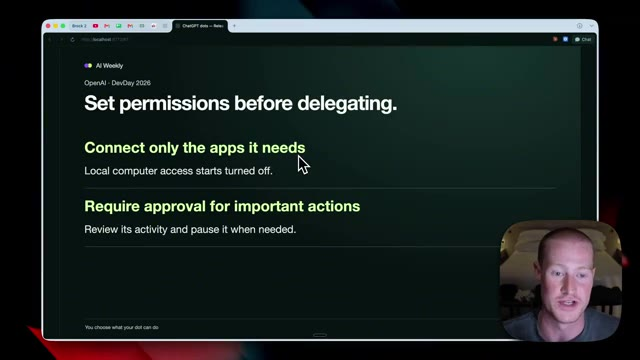
*⏱️ 00:04:19 — Capture d'écran montrant une page web avec le titre "Set permissions before delegating" et des options de configuration pour l'IA, avec la vidéo du présentateur en incrustation dans le coin inférieur droit.*

---

### ⏱️ `[00:04:33 - 00:05:06]` | Segment #11

**🔊 Audio (Transcription Intégrale Mot pour Mot en Français) :**
> C'est très, très surprenant et ce sera une excellente nouvelle pour pratiquement tout le monde. Notre premier Dot est inclus dans notre forfait Pro ou Business Premium sans coût supplémentaire. Il est disponible 24h/24 et 7j/7 pour parler, vous aider à réfléchir et rester au fait de ce qui compte. Les conversations avec vos Dots ChatGPT ne sont pas décomptées de vos limites d'utilisation de ChatGPT. Maintenant, là où il utilise nos crédits, c'est lorsque vous demandez à votre Dot de lancer ou de gérer des tâches dans Codex ou dans le travail ChatGPT, alors celles-ci vont évidemment être décomptées de nos limites d'utilisation, ce qui est tout à fait logique. Mais si nous faisons simplement la conversation en retour

**👁️ Analyse Visuelle d'Écran (gemini-3.5-flash-lite) :**
**Interface & Outils** : Navigateur web affichant une page d'information d'OpenAI sur les "dots" avec la caméra du présentateur en incrustation.

**Contenu textuel & Code** : Texte de documentation officielle décrivant l'offre, la tarification et les quotas des "dots" sur ChatGPT.

**Action / Démonstration** : Le présentateur fait défiler une page web officielle et surligne des passages clés pour les expliquer aux spectateurs.

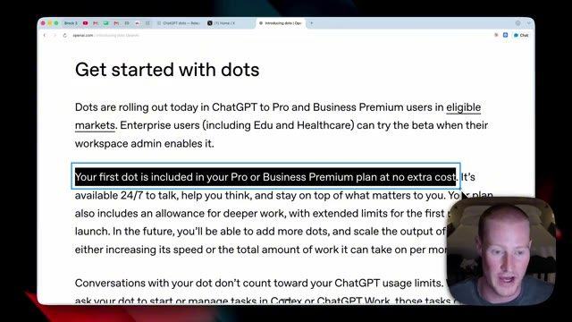
*⏱️ 00:04:42 — Page web officielle montrant les conditions d'utilisation et l'inclusion du premier Dot dans les forfaits Pro ou Business Premium.*

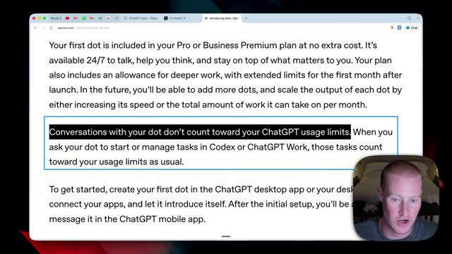
*⏱️ 00:04:50 — Suite du texte officiel sur la page web, détaillant que les conversations avec le dot ne comptent pas dans les limites d'utilisation de ChatGPT.*

---

### ⏱️ `[00:05:06 - 00:05:40]` | Segment #12

**🔊 Audio (Transcription Intégrale Mot pour Mot en Français) :**
> et aller-retour avec les dots, cela ne nous facturera pas. Ensuite, probablement la deuxième plus grande partie de cette sortie, à mon avis, est ChatGPT Space. C'est essentiellement un nouvel espace de travail dans lequel vous pouvez travailler non seulement avec votre équipe, mais aussi avec ces dots de ChatGPT. C'est donc presque un environnement de travail unifié qu'ils essaient de nous inciter à utiliser. Maintenant, personnellement, je n'ai pas encore accès à ChatGPT Space ni aux dots, mais ceci juste ici est une démo en direct de ce à quoi cela ressemble. Et cela ressemble beaucoup à Notion. D'après ce que j'ai compris en regardant cette démo initiale, il semble qu'ils essaient de créer un espace unifié comme Notion à la fois pour les membres de notre équipe et

**👁️ Analyse Visuelle d'Écran (gemini-3.5-flash-lite) :**
**Interface & Outils** : Navigateur web, interface de présentation et espace de travail collaboratif (ChatGPT Space).

**Contenu textuel & Code** : Texte de présentation sur les espaces de travail partagés entre les équipes et les agents ("dots"), ainsi qu'une interface documentée avec des sections FAQ.

**Action / Démonstration** : Présentation et explication du nouveau concept "ChatGPT Space" par le créateur.

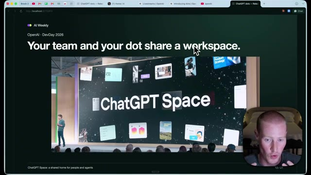
*⏱️ 00:05:14 — Capture d'écran du navigateur montrant une présentation avec le titre "Your team and your dot share a workspace" et l'image d'une conférence affichant "ChatGPT Space".*

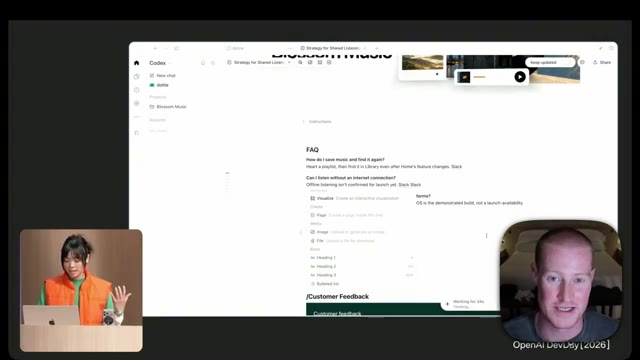
*⏱️ 00:05:31 — Interface d'un espace de travail collaboratif de type documentation avec une FAQ sur la musique et une vue sur une présentatrice en bas à gauche et le présentateur en bas à droite.*

---

### ⏱️ `[00:05:40 - 00:06:14]` | Segment #13

**🔊 Audio (Transcription Intégrale Mot pour Mot en Français) :**
> nous-mêmes pour interagir. Donc par exemple, juste ici, son point Chachabiti a créé ce petit tableau de bord avec un diagramme de rétroaction. Elle est également capable ensuite d'étiqueter son point juste ici afin d'aller faire des modifications sur cette page spécifique. Dès le départ, après avoir vu la démonstration de ceci, je ne sais pas exactement comment j'aime cela. Il semble effectivement que cela pourrait devenir excessivement complexe. Je préférerais largement communiquer avec mon point Chachabiti dans un fil de discussion textuel comme je pourrais le faire avec GrokBot. Je serai donc curieux de voir si c'est quelque chose que je vais réellement utiliser au jour le jour. Maintenant, en passant au nouveau modèle qui est sorti, nous avons GPT 6.1 SOL, qui est désormais 80 % moins cher que GPT 6 Astra.

**👁️ Analyse Visuelle d'Écran (gemini-3.5-flash-lite) :**
**Interface & Outils** : Application de prise de notes/collaboration (style Codex/Notion) et messagerie d'équipe.

**Contenu textuel & Code** : Graphique de rétroaction client ("Customer Feedback") montrant des métriques (Playlist loading, Sessions, Other UX questions, Invitations) au fil des heures.

**Action / Démonstration** : Navigation et présentation d'un tableau de bord interactif avec diagramme de rétroaction et sections FAQ intégrées.

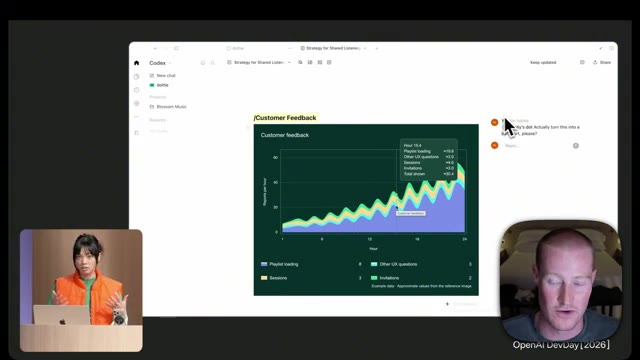
*⏱️ 00:05:48 — Interface d'un outil de documentation ou de notes affichant un diagramme de rétroaction (Customer Feedback) avec des graphiques en aires empilées.*

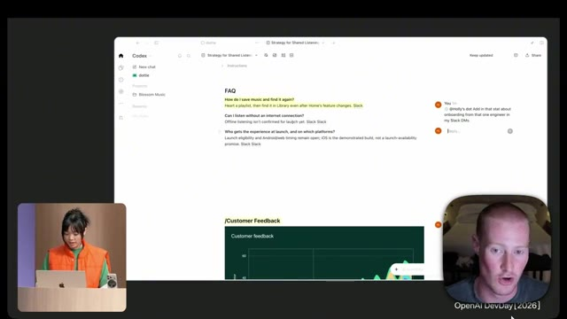
*⏱️ 00:05:57 — Section FAQ d'une page de documentation textuelle avec des sections de questions-réponses et le graphique du tableau de bord visible en bas.*

---

### ⏱️ `[00:06:14 - 00:06:48]` | Segment #14

**🔊 Audio (Transcription Intégrale Mot pour Mot en Français) :**
> Et OpenAI dit même que c'est presque au même niveau d'intelligence qu'Astra 6. Voici un aperçu des prix. Nous avons donc 2 dollars par million de jetons d'entrée sur GPT 6.1 SOL, alors qu'Astra est à 10 dollars. Pour les entrées mises en cache, nous avons 0,10 dollar contre 1 dollar. Et ensuite pour la sortie, nous avons 10 dollars par rapport à 50 dollars sur GPT-6 Astra. Maintenant, à ce stade, il devient incroyablement difficile de suivre tous ces nouveaux modèles, car Anthropic a littéralement sorti Sonnet 5.5 hier. Et quelques jours avant cela, ils ont sorti Opus 5.5. Il semble qu'à la fois OpenAI et Anthropic sortent un nouveau

**👁️ Analyse Visuelle d'Écran (gemini-3.5-flash-lite) :**
**Interface & Outils** : Navigateur web affichant une présentation de diapositive ("AI Weekly - OpenAI DevDay").

**Contenu textuel & Code** : Tarifs d'API par million de jetons : GPT-6.1 Sol (Input: $2.00, Cached Input: $0.10, Output: $10.00) versus GPT-6 Astra (Input: $10.00, Cached Input: $1.00, Output: $50.00) ; réductions affichées de -80% sur l'input/output et -90% sur l'input en cache.

**Action / Démonstration** : Comparaison visuelle des coûts d'API et analyse de la réduction tarifaire de GPT-6.1 Sol face à GPT-6 Astra.

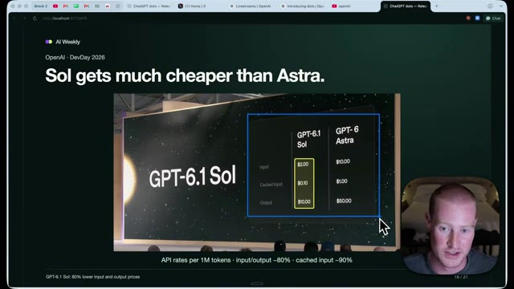
*⏱️ 00:06:23 — Diapositive montrant un tableau comparatif des coûts d'API entre GPT-6.1 Sol et GPT-6 Astra pour 1 million de jetons.*

---

### ⏱️ `[00:06:48 - 00:07:19]` | Segment #15

**🔊 Audio (Transcription Intégrale Mot pour Mot en Français) :**
> modèle littéralement genre toutes les deux semaines à ce stade. Donc seul le temps nous dira si c'est réellement un modèle aussi capable pour pas cher, même si OpenAI affirme que ce sera le cas. Maintenant, où est-ce disponible ? C'est disponible dans ChatGPT Work, Codex et l'API dès aujourd'hui pour tous les utilisateurs Plus, Pro, Business et Enterprise. Ensuite, nous avons un nouveau plan à 500 $ par mois au sein de ChatGPT, ce qui m'enthousiasme personnellement. Je vais définitivement passer au forfait supérieur aujourd'hui. Avec ce plan, nous obtenons le nouveau modèle ultra-rapide, qui est également sorti lors du DevDay. Nous n'avons aucune limite de cinq heures.

**👁️ Analyse Visuelle d'Écran (gemini-3.5-flash-lite) :**
**Interface & Outils** : Navigateur web / Support de présentation ("AI Weekly" - OpenAI DevDay).

**Contenu textuel & Code** : - Tarifs par million de tokens pour GPT-6.1 Sol vs GPT-6 Astra (Input: 2.00$ vs 10.00$, Cached input: 0.10$ vs 1.00$, Output: 10.00$ vs 50.00$).
- Informations d'accès : Offres Plus, Pro, Business, Enterprise, Edu, Codex et API.

**Action / Démonstration** : Présentation synthétique des coûts d'API et des conditions d'accès aux nouveaux modèles OpenAI.

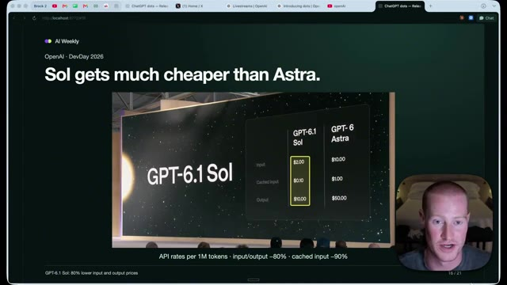
*⏱️ 00:06:56 — Diapositive montrant un tableau comparatif des coûts de l'API entre GPT-6.1 Sol et GPT-6 Astra avec des réductions de prix affichées.*

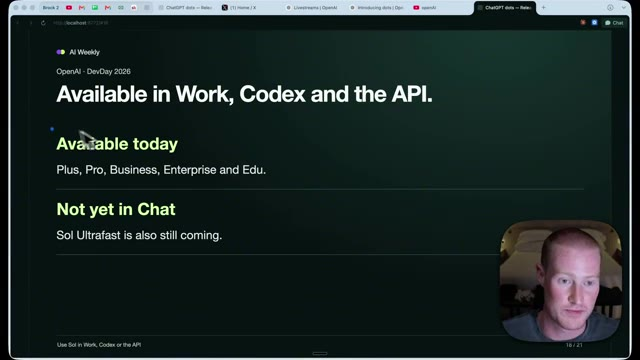
*⏱️ 00:07:03 — Diapositive détaillant les canaux de disponibilité actuels (Work, Codex, API, Plus, Pro, Business) et les versions à venir.*

---

### ⏱️ `[00:07:19 - 00:07:53]` | Segment #16

**🔊 Audio (Transcription Intégrale Mot pour Mot en Français) :**
> Nous pourrions l'utiliser sur l'ensemble de nos applications partenaires et cela représente 25 fois l'utilisation du forfait Plus. Ensuite, celui-ci devient un tout petit peu technique, mais je veux en parler très rapidement. Ils ont donc également publié la nouvelle API Decisions, qui est très similaire à JEV, qui fait fureur dans le monde entier depuis ces deux dernières semaines. C'est une nouvelle façon pour nos agents IA de prendre des décisions très, très rapidement. Et en retour, cela signifie que l'utilisation de l'ordinateur peut être bien meilleure. Donc, comme vous pouvez le voir à l'écran ici même, nous avons notre API Decisions qui fonctionne et utilise l'ordinateur afin d'aller réserver un vol pour nous. Et comme vous pouvez le voir, c'est extrêmement rapide. Si vous avez déjà

**👁️ Analyse Visuelle d'Écran (gemini-3.5-flash-lite) :**
**Interface & Outils** : Présentation vidéo / Écran de conférence

**Contenu textuel & Code** : Texte affichant "Decisions API" et "In preview" sur un écran géant de conférence.

**Action / Démonstration** : Le présentateur commente la nouvelle API Decisions présentée lors de l'événement.

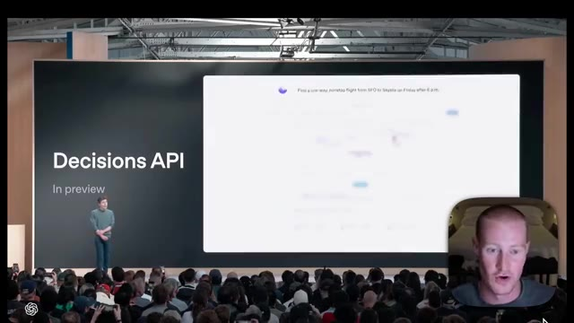
*⏱️ 00:07:27 — Capture d'écran montrant une diapositive de présentation avec le texte "Decisions API" et "In preview", ainsi qu'une illustration floue d'interface. Le présentateur apparaît dans une incrustation vidéo en bas à droite.*

---

### ⏱️ `[00:07:53 - 00:08:27]` | Segment #17

**🔊 Audio (Transcription Intégrale Mot pour Mot en Français) :**
> utilisé l'utilisation précédente de l'ordinateur. C'est très lent lorsqu'il s'agit de prendre des décisions sur les boutons sur lesquels cliquer, sur la façon d'utiliser des interfaces spécifiques. Cela devrait donc faire une grande différence en ce qui concerne l'utilisation de l'ordinateur et l'exécution de nos différents agents d'IA à l'intérieur de ChatGPT. Très bien, ce sont donc les principales choses que je voulais aborder à propos de l'OpenAI Dev Day. C'est arrivé il y a environ une heure. Je suis très impatient de commencer à tester à la fois le GPT 6.1 SOL de ChatGPT DOT. Je vais passer au forfait à 500 dollars par mois et vous faire savoir si je rencontre toujours des limites d'utilisation. Mais bref, si vous avez apprécié cette vidéo, abonnez-vous pour en voir plus et j'ai hâte de vous voir dans la prochaine.

**👁️ Analyse Visuelle d'Écran (gemini-3.5-flash-lite) :**
**Interface & Outils** : Navigateur web affichant une retransmission vidéo de keynote tech (OpenAI / événement de présentation).

**Contenu textuel & Code** : Titres de fonctionnalités présentées ("Decisions API", "GPT-6.1", "Ultrafast", "Agents API", "ChatGPT Space", "Pro 500").

**Action / Démonstration** : Présentation de nouvelles fonctionnalités et API lors d'une conférence de type keynote avec le présentateur en incrustation vidéo (webcam).

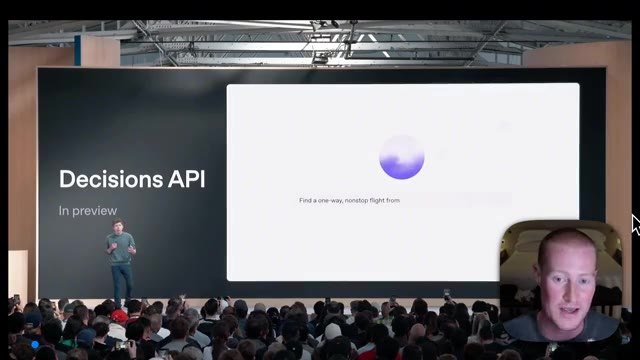
*⏱️ 00:08:02 — Capture montrant l'écran de présentation avec le titre "Decisions API" et une interface en cours de démonstration devant un public.*

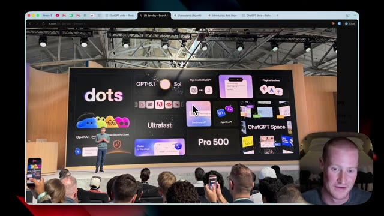
*⏱️ 00:08:10 — Capture montrant une vue d'ensemble de la keynote avec le logo "dots" et plusieurs fonctionnalités affichées sur grand écran.*

---

