# 🎬 I Tested Sonnet 5.5 vs Opus 5.5 (WILD RESULTS)

> **Chaîne** : [Brock Mesarich | AI for Non Techies](https://www.youtube.com/@BrockMesarich)  
> **Lien YouTube** : [https://www.youtube.com/watch?v=pn08Kdp998Y](https://www.youtube.com/watch?v=pn08Kdp998Y)  
> **Date de publication** : 20260929  
> **Durée** : 00:08:55  
> **Identifiant vidéo** : `pn08Kdp998Y`  
> **Transcription & Analyse** : `whisper-v3-large-turbo+gemini-3.5-flash-lite`  

---

## 📌 Synthèse Exécutive & Outils

### 💡 Résumé

Cette vidéo, présentée par Brock Mesarich sur la chaîne *AI for Non Techies*, propose une analyse comparative rigoureuse et empirique des performances, des coûts et des temps de génération de plusieurs modèles d'intelligence artificielle de pointe d'Anthropic (Claude Sonnet 5, Sonnet 5.5, Opus 5.5 et Fable 5.1). À travers un test exigent consistant à générer un jeu vidéo tridimensionnel interactif de type « monde ouvert » à partir d'un prompt unique et structuré, l'expérimentateur évalue la robustesse du code, la cohérence visuelle, la physique des mouvements et l'ergonomie globale des environnements produits.

Au-delà de la simple comparaison créative, cette démarche méthodologique s'apparente à un stress-test quantitatif appliqué aux LLM (Large Language Models), mesurant l'efficacité algorithmique sous contraintes complexes. Les métriques financières et temporelles sont passées au crible : chaque modèle est évalué sur sa consommation de jetons (tokens d'entrée/sortie, lectures et écritures en cache) ainsi que sur sa vitesse d'exécution. Les résultats démontrent qu'un modèle de nouvelle génération comme Claude Sonnet 5.5 surpasse parfois ses homologues plus onéreux en termes de rapport qualité-prix et d'optimisation des performances graphiques et logiques.

Cette analyse fournit aux développeurs, aux architectes de solutions automatisées et aux ingénieurs de prompt des indicateurs précieux pour arbitrer entre complexité de calcul, latence d'exécution et maîtrise budgétaire. Elle illustre parfaitement l'importance d'un étalonnage (benchmarking) rigoureux avant d'intégrer des LLM au cœur de pipelines d'automatisation ou de production logicielle complexes.

### 🛠️ Outils, Modèles & Logiciels Présentés

* **Claude Sonnet 5** : Modèle de base antérieur d'Anthropic, économique mais affichant des lacunes prononcées en matière de cohérence logique et de rendu graphique lors de tâches de codage complexes.
* **Claude Sonnet 5.5** : Dernier modèle d'Anthropic testé comme la solution au meilleur rapport qualité-prix, offrant des graphismes dynamiques de haute qualité, des animations fluides et une vitesse d'exécution optimisée pour un coût modéré.
* **Opus 5.5** : Modèle haut de gamme orienté vers la haute intelligence, caractérisé par des coûts opérationnels et des temps de génération nettement plus élevés pour un rendu visuel solide et stable.
* **Fable 5.1** : Modèle de pointe d'Anthropic représentant le summum de la capacité de raisonnement, affichant le coût par exécution le plus élevé mais souffrant de micro-bugs de mouvement malgré une esthétique soignée.
* **Prompt Engineering** : Méthodologie fondamentale utilisée pour structurer rigoureusement les instructions de génération du monde 3D, en imposant une planification préalable de l'architecture et une organisation stricte du code.

### 🔑 Points Clés & Enseignements Stratégiques

* **Étanchéité des contraintes de prompt** : L'utilisation d'un prompt hautement structuré et séquentiel est indispensable pour guider les LLM vers la production de code propre et fonctionnel sur des architectures complexes.
* **Analyse comparative du coût par jeton** : Claude Sonnet 5.5 bénéficie d'une tarification agressive, notamment avec des écritures en cache réduites à 2,50 $ par million de jetons et des jetons d'entrée fixés à 2 $.
* **Arbitrage performance vs coût** : Opus 5.5 s'avère environ dix fois plus cher que Sonnet 5 (11,95 $) sans pour autant surclasser systématiquement Sonnet 5.5 sur des tâches de rendu dynamique.
* **Optimisation de la vitesse d'exécution** : Sonnet 5.5 combine une vitesse accrue de 30 % par rapport aux versions antérieures et un temps de génération maîtrisé (36 minutes et 43 secondes pour un monde 3D complexe).
* **Ratio complexité/temps de calcul** : Fable 5.1, bien qu'étant le modèle le plus intelligent et le plus cher (17,45 $), présente des temps de génération comparables à Opus 5.5 (environ 40 minutes) tout en conservant des imperfections de mouvement.
* **Gestion des états et de la physique** : Les modèles de dernière génération (Sonnet 5.5) démontrent une supériorité flagrante dans la gestion des éléments interactifs (lapins en mouvement, poissons, dynamiques de l'eau et cycle jour/nuit).
* **Réduction de la dette technique générative** : Un modèle optimisé (Sonnet 5.5) produit moins de bugs de collision (comme passer à travers les lacs) que ses prédécesseurs, minimisant ainsi les efforts de debugging post-génération.
* **Importance du benchmarking empirique** : Tester les LLM en conditions réelles (ici via la génération de jeux vidéo) permet d'identifier précisément les goulets d'étranglement avant d'industrialiser des solutions automatisées.
* **Impact du niveau d'effort maximal** : Tous les modèles ont été testés sous un même niveau d'effort élevé garantissant l'équité des comparaisons en matière de profondeur de calcul et de consommation de ressources.
* **Maîtrise du budget de développement** : Pour les créateurs et développeurs, l'arbitrage entre Sonnet 5.5 (9,02 $) et Fable 5.1 (17,45 $) met en lumière l'inefficacité d'utiliser systématiquement le modèle le plus cher lorsque le rapport qualité-prix du modèle intermédiaire est supérieur.

---

## ⏱️ Chronologie & Transcription Complète Audio & Visuelle (Mot pour Mot)

### ⏱️ `[00:00:00 - 00:00:31]` | Segment #01

**🔊 Audio (Transcription Intégrale Mot pour Mot en Français) :**
> Anthropic vient de lancer Claude Sonnet 5.5, quelques jours seulement après Opus 5.5. Et si vous êtes comme moi, vous êtes probablement curieux de voir la différence de capacités entre ces différents modèles. Dans cette vidéo, je vais donc générer un jeu vidéo complet avec Claude Sonnet 5, Sonnet 5.5, Opus 5.5 et Fable 5.1. Je vais également analyser le coût exact et le temps nécessaire pour chacun de ces modèles. Ainsi, à la fin de cette vidéo, vous comprendrez la différence de capacités ainsi que le prix entre ces différents modèles. Alors, sans plus attendre, plongeons dans le vif du sujet.

**👁️ Analyse Visuelle d'Écran (gemini-3.5-flash-lite) :**
**Interface & Outils** : Navigateur web affichant l'application de dessin et de tableaux blancs Excalidraw (app.excalidraw.com).

**Contenu textuel & Code** : Tableau comparatif des modèles d'IA ("THE SCORECARD") avec les colonnes "MODEL", "TIME" et "COST", et les lignes "Sonnet 5", "Sonnet 5.5", "Opus 5.5" et "Fable 5.1".

**Action / Démonstration** : Présentation du tableau comparatif des performances et des coûts des différents modèles d'IA d'Anthropic pour évaluer leurs capacités de génération de code.

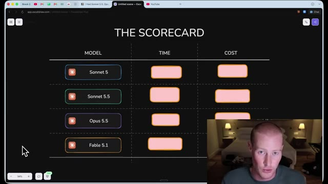
*⏱️ 00:00:16 — Capture d'écran d'un tableau comparatif intitulé "THE SCORECARD" sur Excalidraw, listant les modèles Sonnet 5, Sonnet 5.5, Opus 5.5 et Fable 5.1 avec des colonnes TIME et COST, tandis qu'une petite incrustation vidéo montre le présentateur en bas à droite.*

---

### ⏱️ `[00:00:32 - 00:01:09]` | Segment #02

**🔊 Audio (Transcription Intégrale Mot pour Mot en Français) :**
> Très bien. Alors tout d'abord, parlons de l'affirmation et de ce à quoi nous pouvons nous attendre. Donc Anthropic, dans l'article de sortie, Anthropic a fondamentalement dit que c'est une nette mise à niveau par rapport à Sonnet 5.5. Il tourne 30 % plus vite et coûte jusqu'à 30 % moins cher pour la plupart du travail. Maintenant, parlons rapidement de la ventilation des coûts. Donc lorsque nous comparons Sonnet 5.5 et Opus 5.5, nous pouvons voir une grande différence de prix ici. Donc sur les lectures en cache par 1 million de jetons d'entrée, c'est en fait le même prix à 20 centimes, pour les écritures en cache, c'est moitié moins cher, donc au lieu d'être à cinq dollars comme Claude Opus 5, c'est deux dollars et cinquante centimes, et ensuite pour les jetons d'entrée, c'est deux dollars contre les quatre.

**👁️ Analyse Visuelle d'Écran (gemini-3.5-flash-lite) :**
**Interface & Outils** : Navigateur web affichant une application de type tableau blanc / notes (Excalidraw).

**Contenu textuel & Code** : Texte de présentation de Claude Sonnet 5.5 et tableau de tarification par million de tokens (Cache reads, Cache writes, Input tokens, Output tokens).

**Action / Démonstration** : Le présentateur commente les performances, la vitesse et la structure tarifaire du modèle.

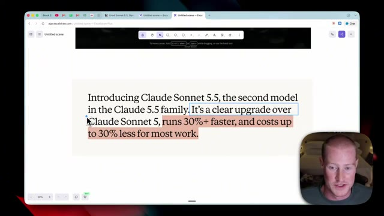
*⏱️ 00:00:41 — Capture montrant un texte sur l'introduction de Claude Sonnet 5.5 avec des portions de texte surlignées.*

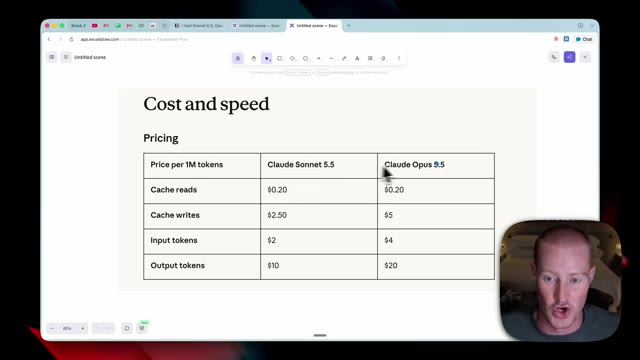
*⏱️ 00:00:50 — Tableau comparatif des prix et de la vitesse entre Claude Sonnet 5.5 et Claude Opus 9.5.*

---

### ⏱️ `[00:01:09 - 00:01:45]` | Segment #03

**🔊 Audio (Transcription Intégrale Mot pour Mot en Français) :**
> dollars pour Opus 5.5 et ensuite à nouveau nous voyons cela doublé ici sur les jetons de sortie. Sonnet 5.5 coûte dix dollars tandis qu'Opus 5.5 coûte vingt dollars. Maintenant, c'est une affirmation importante ici, ils ont basically dit que Sonnet 5.5 nécessite moins de jetons par tâche que Sonnet 5, donc c'est moins cher à exécuter, et il génère aussi jusqu'à 30 % plus rapidement. C'est donc quelque chose que nous allons réellement tester en temps réel dans cette vidéo. Ceci étant dit, plongeons-le directement. Le prompt que nous allons utiliser est celui-ci. En gros, nous allons générer un monde tridimensionnel un peu similaire à Minecraft, par exemple. Et nous avons ici quelques contraintes strictes. Nous détaillons spécifiquement

**👁️ Analyse Visuelle d'Écran (gemini-3.5-flash-lite) :**
**Interface & Outils** : Navigateur web affichant un tableau de tarification et des notes textuelles sur une interface de type Excalidraw, avec la webcam du présentateur en incrustation.

**Contenu textuel & Code** : Tarifs par million de jetons pour les modèles d'IA (Cache reads, Cache writes, Input tokens, Output tokens) et spécifications d'un prompt de test de performance 3D.

**Action / Démonstration** : Le présentateur explique et compare les coûts des différents modèles d'IA et détaille les exigences d'un benchmark de génération de code.

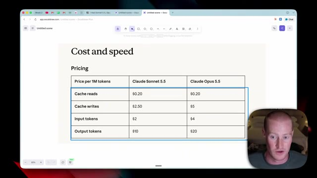
*⏱️ 00:01:18 — Tableau comparatif des coûts par million de jetons entre Claude Sonnet 5.5 et Claude Opus 5.5, affichant les tarifs pour les lectures de cache ($0.20), les écritures de cache ($2.50 vs $5), les jetons d'entrée ($2 vs $4) et de sortie ($10 vs $20).*

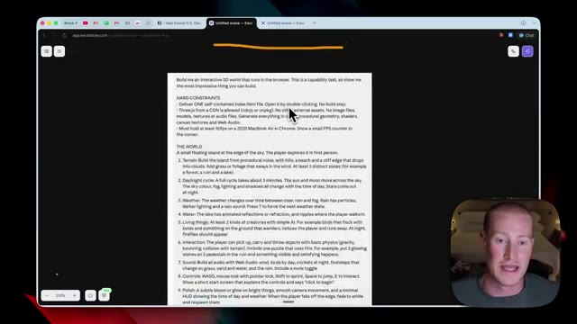
*⏱️ 00:01:36 — Document textuel détaillé affichant des contraintes de test de capacité (« Hard Constraints ») pour construire un monde 3D interactif exécutable dans le navigateur.*

---

### ⏱️ `[00:01:45 - 00:02:09]` | Segment #04

**🔊 Audio (Transcription Intégrale Mot pour Mot en Français) :**
> ce que nous voulons que le monde soit en un tas d'étapes différentes. Nous avons réellement décomposé la façon de travailler. Donc nous voulions planifier l'architecture avant d'écrire le code, garder le code organisé, et ainsi de suite. C'est donc un prompt que nous donnons à chacun de ces modèles. Alors allons-y et testons-les dès maintenant. Très bien. Voici donc celui que Sonnet 5 a généré. Nous allons passer par chacun de ceux-ci de manière incrémentielle. Commençons donc par celui-ci. Très bien. Nous avons donc ce petit jeu sympa ici. Ce n'est rien de fou ?

**👁️ Analyse Visuelle d'Écran (gemini-3.5-flash-lite) :**
**Interface & Outils** : Navigateur web Chrome, tableau blanc virtuel Excalidraw (app.excalidraw.com), démo interactive WebGL/Three.js exécutée en local.

**Contenu textuel & Code** : Texte de prompt système pour IA (contraintes techniques Three.js, rendu 50 FPS, cycle jour/nuit, météo, physique), commandes utilisateur (WASD, E, Espace, Shift, T, R).

**Action / Démonstration** : Explication de la structure des consignes envoyées aux modèles d'IA et démonstration du résultat d'un monde 3D généré exécuté dans le navigateur.

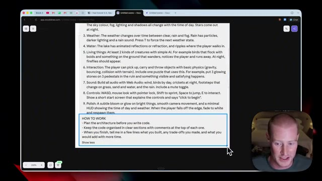
*⏱️ 00:01:51 — Zoom dans l'outil Excalidraw sur la section "HOW TO WORK" du prompt, détaillant les consignes de planification d'architecture et de structuration du code.*

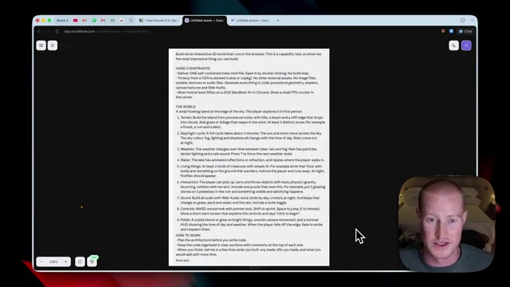
*⏱️ 00:01:57 — Vue globale du prompt d'évaluation dans Excalidraw décrivant les spécifications d'un monde 3D interactif à générer avec Three.js.*

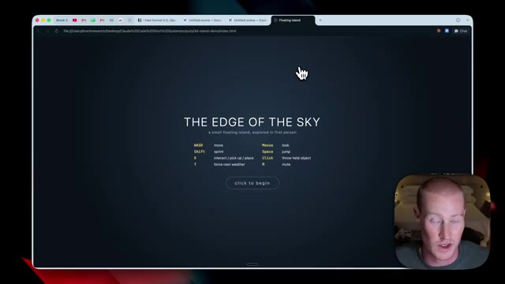
*⏱️ 00:02:03 — Écran de démarrage de la démo web 3D "THE EDGE OF THE SKY" ouverte dans le navigateur à partir d'un fichier index.html local, affichant la configuration des commandes.*

---

### ⏱️ `[00:02:09 - 00:02:31]` | Segment #05

**🔊 Audio (Transcription Intégrale Mot pour Mot en Français) :**
> C'est un peu comme un monde dans le style de Minecraft, je ne pense pas que ce soit génial, mais évidemment nous pouvons nous déplacer ici. Je pense que notre objectif est en fait de saisir ces éléments. Donc oui, donc ce que nous devons faire, c'est venir ici et je pense que nous devons attraper ces petites choses et nous ne... je ne sais pas nécessairement quel est notre objectif. Je pense que nous devons l'emmener quelque part mais je n'en suis pas tout à fait sûr. Vous pouvez voir qu'il y a de la neige qui tombe même s'il n'y a pas de nuages.

**👁️ Analyse Visuelle d'Écran (gemini-3.5-flash-lite) :**
**Interface & Outils** : Navigateur web affichant une application 3D locale (démo d'île flottante HTML) et webcam du présentateur en bas à droite.

**Contenu textuel & Code** : Environnement 3D interactif avec affichage du nombre d'images par seconde (FPS) et indicateurs d'interaction utilisateur ('E to pick up').

**Action / Démonstration** : Navigation et exploration interactive d'un monde virtuel 3D généré par code.

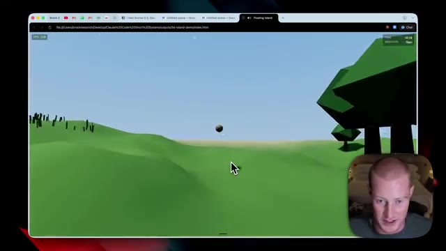
*⏱️ 00:02:15 — Vue d'un monde virtuel 3D style Minecraft avec un paysage vallonné et des arbres polygonaux verts, le présentateur apparaissant en incrustation.*

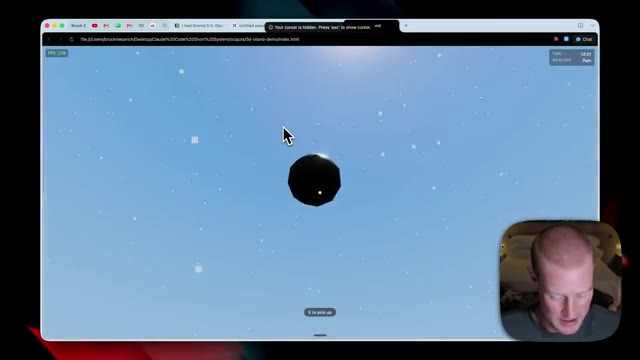
*⏱️ 00:02:20 — Gros plan sur un objet sphérique sombre flottant dans l'environnement 3D avec l'interface indiquant 'E to pick up'.*

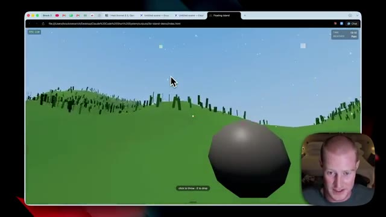
*⏱️ 00:02:26 — Vue montrant l'interaction avec l'objet sphérique et le sol texturé vert dans le prototype 3D.*

---

### ⏱️ `[00:02:32 - 00:03:04]` | Segment #06

**🔊 Audio (Transcription Intégrale Mot pour Mot en Français) :**
> Nous avons un petit lac par ici et voyons si je peux aller dans le lac. Eh bien oh, devine quoi, je ne peux pas aller dans le lac. Je pourrais aller en dessous. Donc ça bugue pas mal. Ouais, ce n'est pas génial. Je dirai que je pense que d'autres résultats vont être beaucoup mieux. Laisse-moi venir par ici et essayer de saisir cette petite orbe. Ouais, je ne sais pas vraiment quoi faire avec ça, mais je veux dire que c'est un point de départ sympa. Ce n'est pas ça. Maintenant, en termes de prix pour Sonic 5, décomposons cela ainsi que le temps que ça a pris pour générer. Tout d'abord, c'était 1,59 $ pour générer, ce qui est très bon marché par rapport à ces autres modèles. Vous allez voir que ça devient beaucoup plus cher que ça. Et puis pour le temps,

**👁️ Analyse Visuelle d'Écran (gemini-3.5-flash-lite) :**
**Interface & Outils** : Navigateur web affichant une application 3D locale et l'outil de tableau blanc Excalidraw.

**Contenu textuel & Code** : Modèles d'IA listés (Sonnet 5, Sonnet 5.5, Opus 5.5, Fable 5.1) avec une métrique de coût affichée à 1,59$.

**Action / Démonstration** : Test d'interaction et de collision dans l'environnement 3D, puis navigation vers le tableau comparatif des modèles.

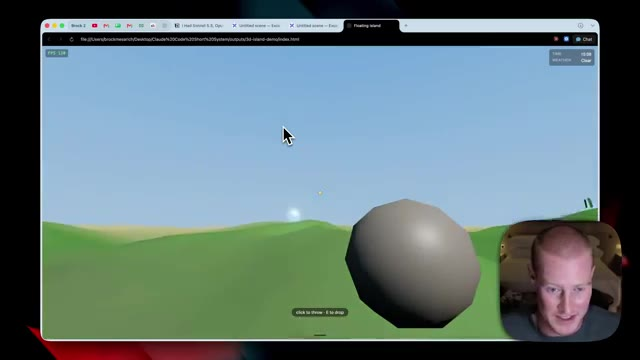
*⏱️ 00:02:40 — Démonstration 3D d'une application web montrant un paysage vallonné avec une grosse sphère grise au premier plan.*

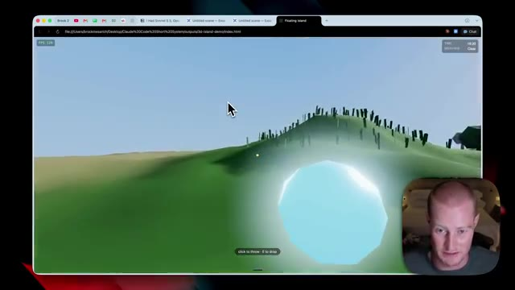
*⏱️ 00:02:48 — Vue de la scène 3D montrant un plan d'eau lumineux (lac) intégré dans le paysage virtuel.*

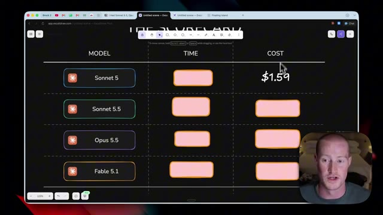
*⏱️ 00:02:56 — Tableau comparatif sur Excalidraw intitulé 'THE SCORECARD' listant différents modèles d'IA, le temps et le coût.*

---

### ⏱️ `[00:03:04 - 00:03:41]` | Segment #07

**🔊 Audio (Transcription Intégrale Mot pour Mot en Français) :**
> Cela a pris sept minutes et six secondes, ce qui est plutôt rapide dans l'ensemble des choses. Et une chose que je tiens à mentionner, c'est que nous avons tout cela au niveau d'effort élevé. Ils fonctionnent donc tous au même niveau d'effort, juste par souci de transparence. Très bien, passons à Opus 5, nous avons ce petit monde ici. Je vais donc simplement cliquer sur commencer. Évidemment, nous pouvons nous déplacer avec notre souris et tout le reste. D'accord, celui-ci a l'air vraiment bien. Il s'agit d'Opus 5.5, qui est sorti la semaine dernière. C'généralement bien meilleur que Sonic 5. Je ne vais pas mentir. Je trouve que cela a vraiment l'air très bien. Je pourrais même lancer les pierres. Je pourrais venir ici et ramasser ce petit orbe, qui est, je crois, le but de ce jeu. Il me suffit de trouver un endroit pour

**👁️ Analyse Visuelle d'Écran (gemini-3.5-flash-lite) :**
**Interface & Outils** : Navigateur web affichant une application de tableau blanc (Excalidraw) et un environnement 3D interactif dans le navigateur.

**Contenu textuel & Code** : Tableau comparatif avec les modèles Sonnet 5, Sonnet 5.5, Opus 5.5 et Fable 5.1, incluant des métriques de temps et de coût.
[DESC_IMAGE_3] Le présentateur présente les résultats comparatifs des différents modèles d'IA.

**Action / Démonstration** : Explications face caméra et analyse conceptuelle des marchés.

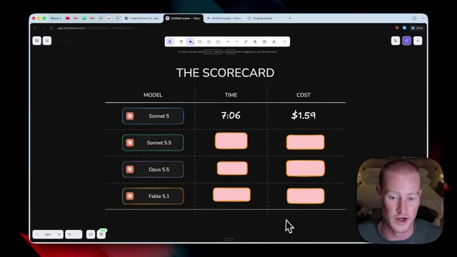
*⏱️ 00:03:13 — Un tableau comparatif intitulé "THE SCORECARD" affichant les modèles d'IA, le temps d'exécution (7:06) et le coût ($1.59) pour le modèle Sonnet 5.*

---

### ⏱️ `[00:03:41 - 00:04:15]` | Segment #08

**🔊 Audio (Transcription Intégrale Mot pour Mot en Français) :**
> amener ça à. Ouais, ça a l'air vraiment bien. Honnêtement, je pense que le monde est très cohérent. En gros, c'est comme si les objets ne bougeaient pas avant, avec le précédent, tu pouvais voir que, genre, le lac, je pouvais aller sous le lac, alors qu'avec celui-ci, je pense que je pourrais réellement aller à l'intérieur, donc allons juste par ici et testons ça. Ouais, donc je peux en quelque sorte aller dans le lac, euh, même si, genre, ça bug un tout petit peu quand je suis à l'intérieur, c'est quand même un niveau au-dessus du précédent, rien de fou, mais je trouve que les graphismes ont l'air vraiment bien, et puis les mouvements, évidemment, avec ce personnage, sont très bien aussi, et je peux juste lancer cette petite distorsion, donc ouais, je suis plutôt

**👁️ Analyse Visuelle d'Écran (gemini-3.5-flash-lite) :**
**Interface & Outils** : Navigateur web affichant une application ou un jeu 3D interactif.

**Contenu textuel & Code** : Environnement 3D de type low-poly avec des collines verdoyantes, des arbres, de l'herbe et un plan d'eau.

**Action / Démonstration** : Exploration visuelle et test d'un monde virtuel généré ou interactif.

---

### ⏱️ `[00:04:15 - 00:04:47]` | Segment #09

**🔊 Audio (Transcription Intégrale Mot pour Mot en Français) :**
> impressionné par celui-ci. Et vous pouvez voir maintenant le brouillard qui arrive. Je veux dire, c'est pratiquement comme Minecraft. C'est plutôt cool. Bref, c'est super. Allons-y pour évaluer celui-ci sur le coût et le temps que ça a pris. Très bien. Donc Opus 5.5 a coûté, roulement de tambours s'il vous plaît, 11 dollars et 95 cents. Donc c'était à peu près, ou peu importe ce que donne le calcul, je ne suis pas très fort en maths, mais environ 10 fois plus cher que Sonnet 5. Et cela a pris 41 minutes et 47 secondes. Donc ça a pris pas mal de temps par rapport à Sonnet 5, ce qui, je suppose, est logique puisque c'est beaucoup plus intelligent

**👁️ Analyse Visuelle d'Écran (gemini-3.5-flash-lite) :**
**Interface & Outils** : Navigateur web affichant un tableau blanc Excalidraw.

**Contenu textuel & Code** : Tableau comparatif avec les colonnes MODEL, TIME et COST, listant des modèles comme Sonnet 5, Sonnet 5.5, Opus 5.5, et Fable 5.1 avec des valeurs de coût et de temps.

**Action / Démonstration** : Évaluation et affichage du tableau de bord comparant le temps d'exécution et les coûts des différents modèles d'IA.

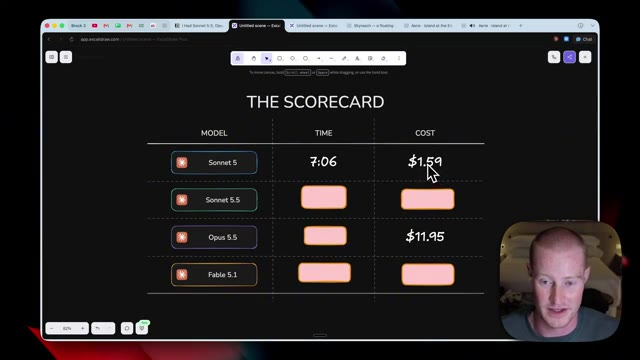
*⏱️ 00:04:31 — Tableau comparatif sur Excalidraw intitulé 'THE SCORECARD' affichant les métriques de temps et de coût pour différents modèles d'IA.*

---

### ⏱️ `[00:04:47 - 00:05:24]` | Segment #10

**🔊 Audio (Transcription Intégrale Mot pour Mot en Français) :**
> modèle. Passons à Fable 5.1 et testons celui-ci. Entrons dans le monde pour Fable 5.1, cliquons pour commencer, et c'est parti. D'accord, c'est la même chose. Nous pouvons venir ramasser la roche. Ça a l'air super. L'ombre de la roche a l'air plutôt cool. Mon personnage se déplace assez facilement. On dirait que ça bugue un tout petit peu quand j'essaie de marcher ici. Donc pour une raison quelconque, vous pouvez voir l'écran trembler un petit peu. J'aime le fait d'avoir ajouté ces petites, comme ces petites ruines ici, mais ouais, pour une raison quelconque, ça n'a pas l'air génial en termes de mouvement. Voyons, je pense aussi que je pourrais lancer la roche, ouais, je suis capable de lancer la roche.

**👁️ Analyse Visuelle d'Écran (gemini-3.5-flash-lite) :**
**Interface & Outils** : Navigateur web affichant un jeu vidéo interactif 3D nommé Fable 5.1.

**Contenu textuel & Code** : Environnement de jeu en 3D avec éléments textuels (« Find the three runes », « CLICK throw », « E drop »).

**Action / Démonstration** : Exploration du monde virtuel et manipulation d'objets (roche) au sein du jeu Fable 5.1.

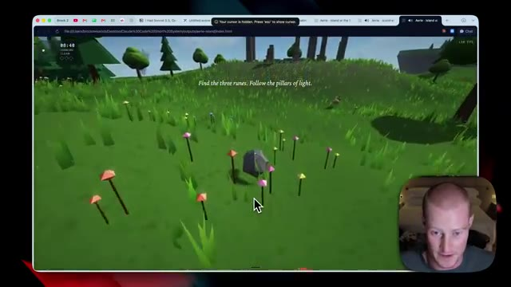
*⏱️ 00:04:56 — Image 1 (00:04:56) : Le jeu Fable 5.1 s'ouvre avec un personnage sur un terrain verdoyant, un rocher au premier plan et du texte à l'écran indiquant 'Find the three runes. Follow the pillars of light.'*

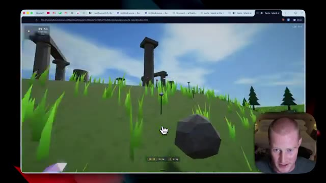
*⏱️ 00:05:06 — Image 2 (00:05:06) : Vue rapprochée d'un rocher dans le jeu Fable 5.1 avec des instructions textuelles en bas de l'écran ('CLICK throw', 'E drop') et le présentateur visible en bas à droite.*

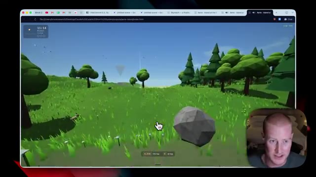
*⏱️ 00:05:15 — Image 3 (00:05:15) : Le personnage évolue dans un paysage forestier du jeu Fable 5.1 sous un ciel clair, montrant les interactions avec les objets du monde virtuel.*

---

### ⏱️ `[00:05:24 - 00:05:50]` | Segment #11

**🔊 Audio (Transcription Intégrale Mot pour Mot en Français) :**
> nous avons notre petite orbe ici, testons l'eau rapidement après avoir remis ceci en place, alors viens ici, entre dans l'eau, euh on dirait qu'elle ne bugue pas dans l'eau comme les deux précédentes, donc c'est bien, euh ouais, celle-ci est plutôt solide et un truc cool, si vous regardez en haut à gauche de mon écran, ça montre quand le soleil se couche. Donc on dirait que l'après-midi arrive, ça montre le temps qui avance progressivement. Ouais, celle-ci est plutôt solide.

**👁️ Analyse Visuelle d'Écran (gemini-3.5-flash-lite) :**
**Interface & Outils** : Navigateur web affichant une application 3D interactive (fichier HTML local).

**Contenu textuel & Code** : Interface de simulation 3D avec affichage de l'heure, de la météo et des commandes à l'écran (Click: throw, E: drop).

**Action / Démonstration** : Test des interactions physiques dans l'environnement 3D virtuel (eau, objets).

---

### ⏱️ `[00:05:50 - 00:06:19]` | Segment #12

**🔊 Audio (Transcription Intégrale Mot pour Mot en Français) :**
> Je pense que c'est l'un des meilleurs que nous ayons générés jusqu'à présent. Très bien. Donc, pour la ventilation des coûts sur Fable 5.1, jetons un œil à cela maintenant. Donc, pour le coût, c'était de 17,45 dollars, ce qui est beaucoup plus cher que Sonic 5. Évidemment, c'est environ 6 dollars, 5,5 dollars de plus qu'Opus 5.5 également, ce qui est normal. C'est un modèle plus performant, plus intelligent. C'est leur plus haut niveau en matière d'intelligence. Et puis, nous avons maintenant 40 minutes et 30 secondes, ce qui est intéressant.

**👁️ Analyse Visuelle d'Écran (gemini-3.5-flash-lite) :**
**Interface & Outils** : Excalidraw / Interface de tableau blanc virtuel.

**Contenu textuel & Code** : Tableau comparatif "THE SCORECARD" avec les modèles Sonnet 5 ($1.59, 7:06), Opus 5.5 ($11.95, 41:47), et Fable 5.1 ($17.45).

**Action / Démonstration** : Présentation comparative des coûts et des temps de génération de différents modèles d'IA sur un tableau blanc numérique.

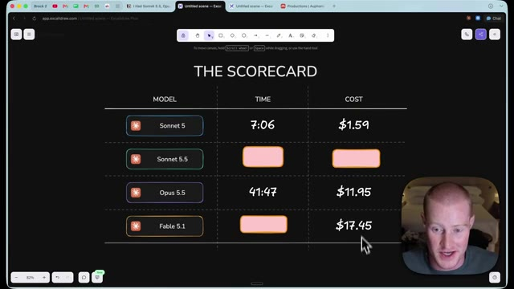
*⏱️ 00:05:57 — Tableau de bord comparatif affichant les modèles, le temps et le coût, avec le curseur sur Fable 5.1 à 17,45 dollars.*

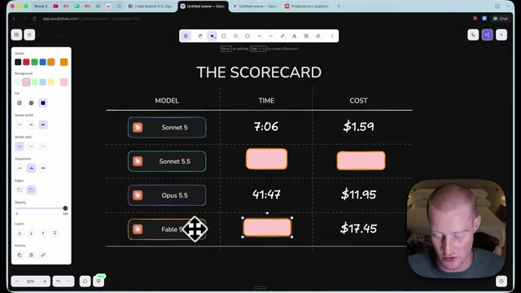
*⏱️ 00:06:12 — Le présentateur manipule le tableau de bord Excalidraw, sélectionnant une cellule vide pour le modèle Fable 5.1.*

---

### ⏱️ `[00:06:20 - 00:06:56]` | Segment #13

**🔊 Audio (Transcription Intégrale Mot pour Mot en Français) :**
> Cela a en fait pris moins de temps qu'Opus 5.5. Pourtant, cela a pris pas mal de temps, 40 minutes et 30 secondes par rapport à Sonnet 5, qui n'a pris que sept minutes et six secondes. Pour notre test final, nous avons le résultat de Claude Sonnet 5.5. Allons-y donc et jetons un œil. Très bien, voici à quoi ressemble notre monde. Je trouve que c'est vraiment incroyable. Personnellement, je pense que c'est peut-être le monde le plus beau, enfin celui qui a le meilleur aspect. Évidemment, nous pourrions nous déplacer et il n'y a pas de mouvements bizarres en cours. Nous avons ces petits lapins qui bondissent partout. La pluie arrive en ce moment même. Je pourrais même aller dans l'eau juste ici. Il y a des poissons qui nagent partout. Je veux dire, je suis

**👁️ Analyse Visuelle d'Écran (gemini-3.5-flash-lite) :**
**Interface & Outils** : Navigateur web affichant un jeu 3D interactif (application web locale).

**Contenu textuel & Code** : Interface d'accueil d'un jeu vidéo généré ("Skyreach") avec commandes clavier affichées et graphismes 3D low-poly.

**Action / Démonstration** : Navigation et présentation du résultat visuel et jouable du test de génération de code.

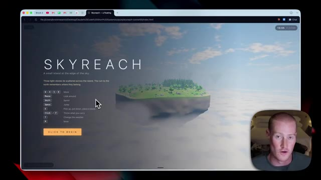
*⏱️ 00:06:29 — Écran titre du jeu "Skyreach" affiché dans un navigateur web, avec le menu de démarrage et les instructions de contrôle.*

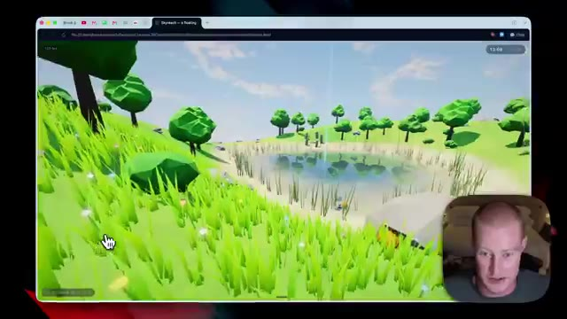
*⏱️ 00:06:38 — Vue de gameplay à la première personne dans l'environnement 3D du jeu Skyreach, montrant une prairie verdoyante et une petite mare.*

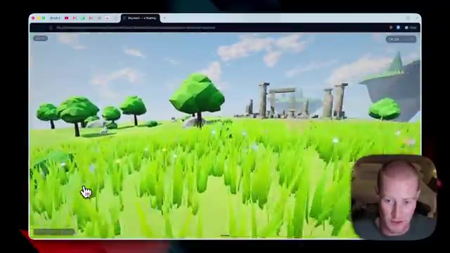
*⏱️ 00:06:47 — Exploration de l'environnement 3D avec des ruines de colonnes en pierre au loin et une végétation stylisée.*

---

### ⏱️ `[00:06:56 - 00:07:16]` | Segment #14

**🔊 Audio (Transcription Intégrale Mot pour Mot en Français) :**
> franchement assez impressionné par ça. C'est censé être le modèle le moins cher du marché à part genre Claude Opus 5. Je crois que c'est exactement le même prix mais genre ça a l'air mieux à mon avis que le résultat de Fable 5.1. C'est assez dingue. Je pourrais balancer ça. Tu peux voir qu'il fait plus sombre dehors. Cet univers a l'air plutôt bien. Et encore une fois, les mouvements ici sont super.

**👁️ Analyse Visuelle d'Écran (gemini-3.5-flash-lite) :**
**Interface & Outils** : Navigateur web affichant une application 3D interactive (WebGL / HTML5) avec webcam incrustée.

**Contenu textuel & Code** : Environnement virtuel 3D low-poly (arbres, herbe, rochers, ciel), compteur de performance et instructions de jeu à l'écran.

**Action / Démonstration** : Navigation et test interactif d'un environnement 3D généré par une intelligence artificielle.

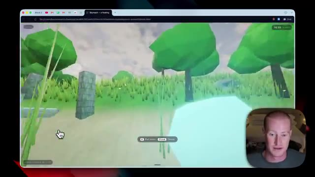
*⏱️ 00:07:01 — Vue d'un environnement 3D low-poly de type jeu vidéo affiché dans un navigateur web, avec le visage du présentateur en incrustation en bas à droite.*

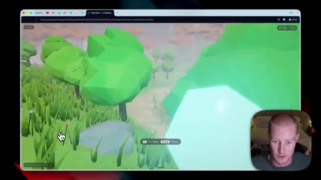
*⏱️ 00:07:06 — Navigation rapprochée dans le même univers virtuel en 3D low-poly arborant des arbres verts et un ciel nuageux.*

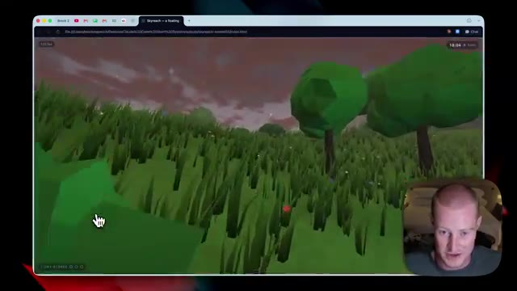
*⏱️ 00:07:11 — Autre angle de vue dans le décor 3D généré, montrant des herbes hautes et un ciel crépusculaire.*

---

### ⏱️ `[00:07:16 - 00:07:50]` | Segment #15

**🔊 Audio (Transcription Intégrale Mot pour Mot en Français) :**
> Il n'y a rien de mal ici. Donc ouais, c'est assez fou. C'est honnêtement mon résultat préféré que nous ayons. Allons donc voir le prix et le temps qu'il a fallu pour générer ceci. Très bien, donc en termes de coût, cela n'a coûté que 9,02 dollars par rapport à Opus 5,5, qui est à 11,95 cents. Fable 5,1 est à 17,45 dollars. Et encore une fois, je pense que c'est probablement le meilleur résultat que nous avons obtenu ici pour très bon marché comparativement. Ensuite, si nous passons au temps, cela a été généré en 36 minutes et 43 secondes. C'est le deuxième plus rapide de tous. Il y a un saut significatif à partir de

**👁️ Analyse Visuelle d'Écran (gemini-3.5-flash-lite) :**
**Interface & Outils** : Navigateur web affichant un tableau récapitulatif sur l'application Excalidraw, avec la webcam du présentateur en incrustation.

**Contenu textuel & Code** : Tableau comparatif avec les colonnes MODEL, TIME et COST : Sonnet 5 (7:06, $1.59), Sonnet 5.5 (champ vide pour le temps, $9.02), Opus 5.5 (41:47, $11.95), Fable 5.1 (40:30, $17.45).

**Action / Démonstration** : Le présentateur présente et commente le tableau comparatif des coûts et des temps de génération des différents modèles d'IA.

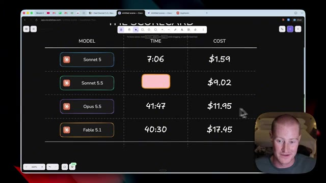
*⏱️ 00:07:33 — Tableau comparatif sur Excalidraw affichant les performances, le temps et le coût de différents modèles d'IA (Sonnet 5, Sonnet 5.5, Opus 5.5, Fable 5.1).*

---

### ⏱️ `[00:07:50 - 00:08:15]` | Segment #16

**🔊 Audio (Transcription Intégrale Mot pour Mot en Français) :**
> De Sonnet 5 à Sonnet 5.5 et ensuite ces autres modèles ici. C'est très bon pour le montant de temps qu'il a fallu pour générer ceci et le coût de sortie. Je suis très, très impressionné. Et juste pour vous montrer à nouveau les sorties ici au cas où vous ne vous souvenez pas. C'est ce que Sonnet 5 a généré. Ça avait l'air très, très mauvais en comparaison avec les autres. Nous avons Opus 5.5. Ça avait l'air plutôt solide. Rien de fou ici. Et ensuite nous avons Fable 5.1. Ça avait l'air très, très bon, mais les mouvements étaient tout à fait faux.

**👁️ Analyse Visuelle d'Écran (gemini-3.5-flash-lite) :**
**Interface & Outils** : Navigateur web, Excalidraw (application de tableau blanc numérique).

**Contenu textuel & Code** : Tableau des scores des modèles d'IA : Sonnet 5 (7:06, $1.59), Sonnet 5.5 (36:43, $9.02), Opus 5.5 (41:47, $11.95), Fable 5.1 (40:30, $17.45) et environnements graphiques 3D basse résolution (paysages avec arbres et plans d'eau).

**Action / Démonstration** : Le présentateur présente et compare les temps de génération et les coûts des différents modèles d'intelligence artificielle.

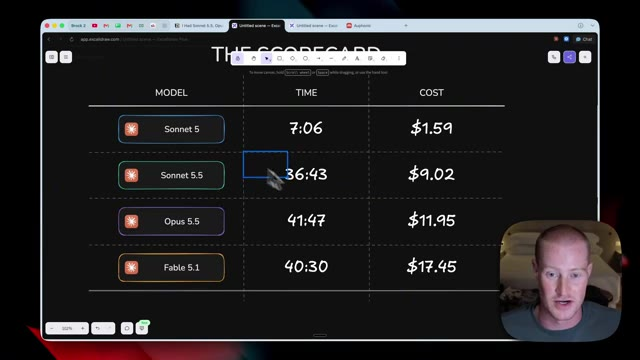
*⏱️ 00:07:57 — Tableau comparatif (The Scorecard) affichant les performances des modèles d'IA (Sonnet 5, Sonnet 5.5, Opus 5.5, Fable 5.1) avec le temps et le coût.*

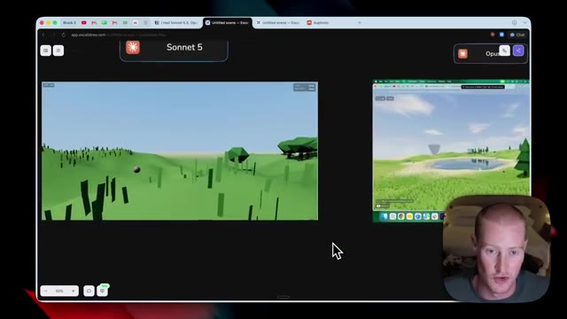
*⏱️ 00:08:03 — Interface Excalidraw montrant des captures d'écran comparatives de l'environnement virtuel généré par les différents modèles d'IA.*

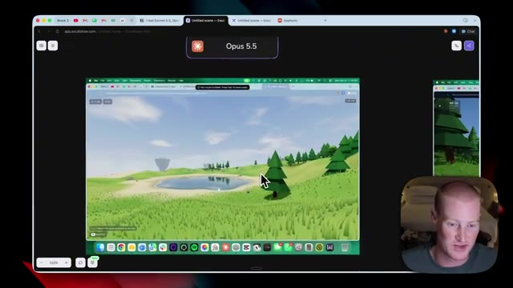
*⏱️ 00:08:09 — Vue rapprochée de l'environnement virtuel en 3D généré par le modèle Opus 5.5 dans l'interface Excalidraw.*

---

### ⏱️ `[00:08:15 - 00:08:48]` | Segment #17

**🔊 Audio (Transcription Intégrale Mot pour Mot en Français) :**
> Et puis Sonnet 5.5, qui est le meilleur dans l'ensemble. Les couleurs sont très vives. Il y avait des lapins qui sautaient partout. Ça avait l'air très dynamique. Et les mouvements étaient parfaits avec ce résultat ici. Bref, les gars, voilà, c'est fait. C'est la ventilation des coûts pour tous ces différents modèles. Je sais que ce n'est peut-être pas la chose la plus pratique. Tout le monde ne va pas générer des jeux vidéo avec ces modèles, mais c'est un bon moyen de tester leur capacité face à une tâche de codage complexe comme celle-ci, en voyant combien de temps cela prend et la ventilation des coûts. J'espère donc que cette vidéo vous a apporté quelque chose. Et si vous voulez donner un coup de main à un pote, vu que j'ai payé de ma poche pour tester tout ça,

**👁️ Analyse Visuelle d'Écran (gemini-3.5-flash-lite) :**
**Interface & Outils** : Navigateur web, interface de tableau blanc Excalidraw et lecteur vidéo de démonstration.

**Contenu textuel & Code** : Tableau comparatif des performances et des coûts des modèles d'IA : Sonnet 5 ($1.59), Sonnet 5.5 ($9.02), Opus 5.5 ($11.95), Fable 5.1 ($17.45).

**Action / Démonstration** : Présentation et ventilation finale des coûts et des performances des différents modèles d'intelligence artificielle testés.

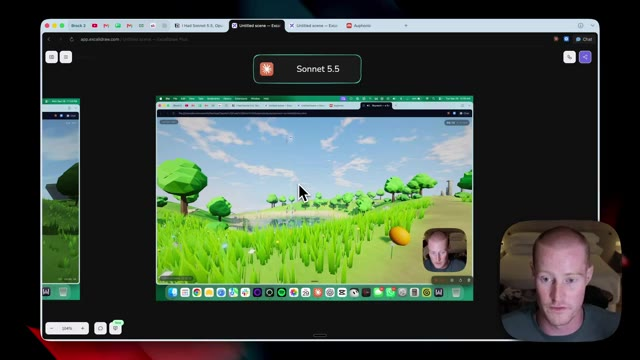
*⏱️ 00:08:24 — Capture montrant l'interface Excalidraw avec une démonstration vidéo en cours de lecture affichant un paysage virtuel en 3D généré par le modèle Sonnet 5.5, avec la webcam du présentateur en bas à droite.*

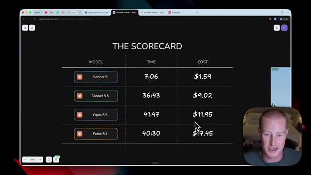
*⏱️ 00:08:32 — Capture montrant un tableau récapitulatif ("THE SCORECARD") sur Excalidraw présentant les modèles (Sonnet 5, Sonnet 5.5, Opus 5.5, Fable 5.1), le temps d'exécution et les coûts associés.*

---

### ⏱️ `[00:08:48 - 00:08:54]` | Segment #18

**🔊 Audio (Transcription Intégrale Mot pour Mot en Français) :**
> abonnez-vous simplement à la chaîne pour plus de vidéos de ce genre. Cela étant dit, j'apprécie que vous soyez restés jusqu'à la fin et je vous vois dans la prochaine. Santé.

**👁️ Analyse Visuelle d'Écran (gemini-3.5-flash-lite) :**
**Interface & Outils** : Navigateur web affichant un tableau blanc collaboratif (Excalidraw).

**Contenu textuel & Code** : Tableau avec les colonnes MODEL, TIME et COST pour différents modèles : Sonnet 5 (7:06, $1.59), Sonnet 5.5 (36:43, $9.02), Opus 5.5 (41:47, $11.95) et Fable 5.1 (40:30, $17.45).

**Action / Démonstration** : Présentation du tableau récapitulatif des coûts et du temps d'exécution des modèles d'intelligence artificielle.

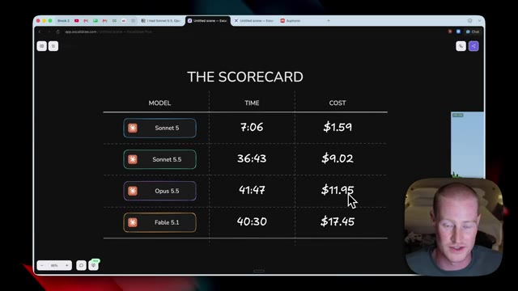
*⏱️ 00:08:50 — Tableau comparatif (The Scorecard) affichant les performances, temps d'exécution et coûts de différents modèles d'IA.*

---

