# 🎬 ChatGPT Space = ULTIMATE AI Second Brain

> **Chaîne** : [Brock Mesarich | AI for Non Techies](https://www.youtube.com/@BrockMesarich)  
> **Lien YouTube** : [https://www.youtube.com/watch?v=rWw0HggLtGI](https://www.youtube.com/watch?v=rWw0HggLtGI)  
> **Date de publication** : 20260930  
> **Durée** : 00:14:13  
> **Identifiant vidéo** : `rWw0HggLtGI`  
> **Transcription & Analyse** : `whisper-v3-large-turbo+gemini-3.5-flash-lite`  

---

## 📌 Synthèse Exécutive & Outils

### 💡 Résumé

Dans cette vidéo présentée sur la chaîne de Brock Mesarich, l'analyse se concentre sur les récentes annonces de la DevDay d'OpenAI, et plus particulièrement sur le lancement de **ChatGPT Space** et de l'assistant **Codex**. Conçu pour servir de véritable « second cerveau » unifié, cet outil redéfinit la collaboration homme-machine et le flux de travail en regroupant en un seul endroit des espaces de travail cloisonnés (comme la gestion de marque ou d'agence), des tableaux de bord interactifs et des agents d'intelligence artificielle autonomes. L'Démonstration met en lumière la puissance de l'intégration native d'applications tierces et de plugins au sein de l'écosystème OpenAI.

L'analyste démontre l'efficacité opérationnelle de ces technologies à travers des cas pratiques de génération de contenu et d'automatisation créative. En combinant des commandes textuelles, des agents vocaux et des outils spécialisés de génération visuelle (comme l'intégration de plugins vidéo et d'imagerie), il devient possible d'orchestrer des campagnes marketing complexes de bout en bout — de la création de miniatures YouTube optimisées à la production de clips publicitaires dynamiques comparables à des rendus de style Apple. Cette approche illustre la transition d'une IA conversationnelle isolée vers une IA agissante, capable d'exécuter des tâches multi-étapes et de structurer des assets multimédias directement dans des pages de projets dédiées.

Au-delà de la simple génération de contenu, la vision présentée met en exergue l'impact de l'automatisation avancée sur la productivité des créateurs et des entreprises non-techniques. L'utilisation conjointe des espaces de travail et des agents cloud permet de rationaliser des processus autrefois chronophages, réduisant la friction entre l'idéation et l'exécution finale. Cette mutation technologique offre aux professionnels un levier stratégique puissant pour scaler leurs opérations créatives et publicitaires avec un minimum d'intervention manuelle, transformant l'interface de chat traditionnelle en un véritable hub opérationnel centralisé.

### 🛠️ Outils, Modèles & Logiciels Présentés

* **ChatGPT Space** : Hub collaboratif unifié permettant d'interagir entre membres d'équipe et agents IA, de visualiser des tableaux de bord et de structurer des projets en pages et sous-pages.
* **Codex** : Assistant IA avancé fonctionnant dans une fenêtre contextuelle cloud, capable d'exécuter des tâches complexes, de manipuler des fichiers et de piloter des générateurs d'images et de vidéos.
* **GPT-6.1** : Modèle de langage multimodal de pointe d'OpenAI offrant des performances accrues en matière de raisonnement et d'exécution de requêtes complexes.
* **ChatGPT Image 2.5** : Moteur de génération et de retouche d'images d'OpenAI utilisé pour créer et itérer sur des visuels graphiques et des miniatures.
* **Higgsfield (Plugin/MCP)** : Outil spécialisé intégré à l'écosystème ChatGPT pour la génération automatisée de vidéos publicitaires et de contenus animés pour les réseaux sociaux.
* **Make** : Plateforme d'automatisation de workflows no-code mentionnée dans le contexte global de l'écosystème d'intelligence artificielle et d'intégration de données.
* **n8n** : Outil d'automatisation open-source avancé pour la création de pipelines de données et l'interconnexion d'agents IA.
* **Zapier** : Logiciel d'automatisation standard permettant de lier différentes applications SaaS entre elles pour fluidifier les flux de travail.
* **Claude** : Modèle linguistique concurrent développé par Anthropic, reconnu pour ses capacités de traitement textuel étendu.
* **Grok** : Modèle d'intelligence artificielle développé par xAI, intégré aux écosystèmes conversationnels en temps réel.
* **Gemini** : Suite de modèles multimodaux développés par Google pour l'analyse de données et la génération de contenu.

### 🔑 Points Clés & Enseignements Stratégiques

* **Architecture par Espaces (Hubs)** : Segmentation des activités personnelles et professionnelles (ex: marque YouTube vs agence marketing) via des espaces de travail étanches pour maximiser l'organisation et le focus contextuel.
* **Structuration Hiérarchique des Projets** : Utilisation de pages mères et de sous-pages dynamiques à l'intérieur de ChatGPT Space pour classer rigoureusement les assets multimédias, les scripts et les données de campagnes.
* **Intégration Native des Plugins (Designated Plugins)** : Capacité d'installer et d'invoquer directement des applications tierces (comme Higgsfield) au sein même de l'interface conversationnelle sans rupture de flux.
* **Exécution Multi-Modale via Codex** : Utilisation de la bulle contextuelle Codex pour déclencher des actions en arrière-plan (génération d'images, création de vidéos) tout en continuant à interagir dans l'espace de travail.
* **Ingénierie de Prompt Contextuelle (@mentions)** : Utilisation ciblée de la syntaxe `@` (ex: `@Higgsfield`) pour router explicitement les requêtes vers l'outil ou l'agent spécialisé adéquat au sein de l'espace.
* **Automatisation de la Chaîne de Production Visuelle** : Passage fluide de l'analyse d'une image de référence (produit source) à la production en série de déclinaisons publicitaires pour divers formats (Stories Instagram, Reels, flux d'actualité).
* **Mode Vocal Interactif** : Exploitation de l'interface vocale de ChatGPT pour piloter les modifications en temps réel sur les assets générés, offrant une alternative mains libres efficace au clavier.
* **Standardisation des Formats Publicitaires** : Capacité pour l'agent IA d'analyser les contraintes de dimensionnement et de structurer automatiquement les livrables selon les spécificités des différentes plateformes sociales.
* **Génération de Rendu Haut de Gamme** : Capacité à produire des concepts vidéo sophistiqués (style démonstration de produits Apple) à partir de simples instructions textuelles et d'images de base.
* **Gestion Centralisée des Actifs Générés** : Automatisation de l'intégration des fichiers finaux (images, vidéos) directement dans les pages du projet, évitant le recours systématique aux téléchargements manuels et aux manipulations sur le bureau.
* **Synergie Humain-Agent IA** : Collaboration itérative où l'utilisateur affine la vision stratégique (ex: « faire éclater le soleil un peu plus en flammes ») tandis que l'IA exécute la complexité technique sous-jacente.
* **Montée en Puissance des Outils No-Code / IA** : Remplacement des processus de design traditionnels (comme l'utilisation de logiciels complexes il y a six mois) par des prompts conversationnels instantanés, abaissant drastiquement la barrière technique à l'entrée.

---

## ⏱️ Chronologie & Transcription Complète Audio & Visuelle (Mot pour Mot)

### ⏱️ `[00:00:00 - 00:00:19]` | Segment #01

**🔊 Audio (Transcription Intégrale Mot pour Mot en Français) :**
> OpenAI vient de lancer une toute nouvelle façon d'interagir avec l'intelligence artificielle appelée ChatGPT Space. Je ne vais pas mentir, au début je détestais ça, mais après l'avoir utilisé, je vois beaucoup de potentiel ici. Un potentiel qu'on ne peut pas vraiment voir tant qu'on ne l'utilise pas de la bonne manière. OpenAI a également apporté quelques changements majeurs à l'application ChatGPT qui m'enthousiasment beaucoup et que je vais vous montrer également.

**👁️ Analyse Visuelle d'Écran (gemini-3.5-flash-lite) :**
**Interface & Outils** : AUCUNE

**Contenu textuel & Code** : AUCUNE

**Action / Démonstration** : AUCUNE

---

### ⏱️ `[00:00:19 - 00:00:38]` | Segment #02

**🔊 Audio (Transcription Intégrale Mot pour Mot en Français) :**
> Donc dans cette vidéo, je vais décortiquer ce qu'est ChatGPT Space, comment l'utiliser, et plus important encore, si ça vaut la peine que vous l'utilisiez. Alors sans plus tarder, plongeons directement dans le vif du sujet. Pour le contexte, si vous ne le savez pas, OpenAI a eu sa journée des développeurs hier où ils ont sorti environ 20 produits différents. Beaucoup d'entre eux sont des outils pour développeurs, mais il y en a quelques-uns qui sont importants pour nous, les consommateurs moyens.

**👁️ Analyse Visuelle d'Écran (gemini-3.5-flash-lite) :**
**Interface & Outils** : Navigateur web affichant la page officielle d'OpenAI.

**Contenu textuel & Code** : Titres et texte de présentation concernant les annonces du DevDay 2026 d'OpenAI.

**Action / Démonstration** : Navigation et défilement sur la page web pour illustrer les annonces d'OpenAI.

---

### ⏱️ `[00:00:38 - 00:01:02]` | Segment #03

**🔊 Audio (Transcription Intégrale Mot pour Mot en Français) :**
> Alors laissez-moi vous décomposer cela très simplement en environ 30 secondes. Si vous voulez la vidéo complète à ce sujet, je l'ai postée hier. Vous pouvez aller voir ça. Tout d'abord, ils ont sorti DOTS, qui sont un nouvel assistant IA personnel que nous pourrions utiliser, qui utilisent des codecs, un ordinateur dans le cloud, et qui peuvent fondamentalement accomplir des tâches pour nous. Et nous pouvons lui envoyer des SMS comme une personne normale. Ensuite, nous avons les plugins ChatGPT, qui permettent aux développeurs d'intégrer leurs applications directement dans l'application ChatGPT, ce que je vais d'ailleurs vous montrer plus tard dans cette vidéo.

**👁️ Analyse Visuelle d'Écran (gemini-3.5-flash-lite) :**
**Interface & Outils** : Navigateur web affichant le site officiel d'OpenAI et webcam du présentateur en bas à droite.

**Contenu textuel & Code** : Texte descriptif sur les agents IA 'Dots', les options GPT-5.1 Sol et la personnalisation des plugins dans ChatGPT.

**Action / Démonstration** : Navigation et présentation du site web par le présentateur commentant les nouveautés d'OpenAI.

---

### ⏱️ `[00:01:02 - 00:01:24]` | Segment #04

**🔊 Audio (Transcription Intégrale Mot pour Mot en Français) :**
> Et ensuite ChatGPT Space, qui est la principale chose dont je vais parler dans cette vidéo, une toute nouvelle façon d'interagir à la fois avec les membres de votre équipe et vos agents IA comme ChatGPT Dots. Ils ont également annoncé un abonnement ChatGPT à 500 dollars par mois, dont j'ai parlé dans cette vidéo précédente également. Maintenant, parlons rapidement de ce qu'est ChatGPT Space avant de vous montrer une démonstration de moi en train de l'utiliser et ce que j'aime et déteste à ce sujet.

**👁️ Analyse Visuelle d'Écran (gemini-3.5-flash-lite) :**
**Interface & Outils** : Navigateur web affichant le site officiel d'OpenAI et les pages de présentation de ChatGPT Space.

**Contenu textuel & Code** : Documentation textuelle et visuels d'interface décrivant les fonctionnalités collaboratives de ChatGPT Space et des abonnements Pro/Enterprise.

**Action / Démonstration** : Navigation et défilement sur le site web d'OpenAI pour illustrer les nouveautés présentées lors du DevDay.

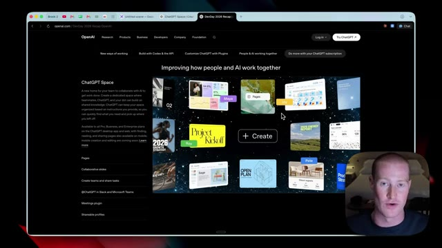
*⏱️ 00:01:07 — Page web présentant l'interface 'ChatGPT Space' avec des aperçus de collaboration entre humains et agents IA.*

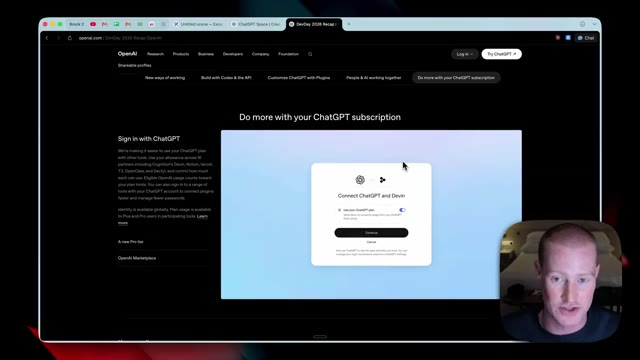
*⏱️ 00:01:13 — Page web montrant la fenêtre de connexion et d'intégration 'Connect ChatGPT and Devin' pour l'abonnement avancé.*

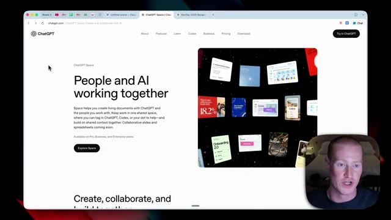
*⏱️ 00:01:18 — Page web présentant la fonctionnalité 'People and AI working together' pour créer des documents partagés avec ChatGPT.*

---

### ⏱️ `[00:01:24 - 00:01:48]` | Segment #05

**🔊 Audio (Transcription Intégrale Mot pour Mot en Français) :**
> Nous pourrions interagir avec cela entre les membres de notre équipe et nos agents IA. Cela nous permet de créer et de collaborer ensemble. Nous pourrions visualiser n'importe quoi sur des tableaux de bord à l'intérieur de ces sites ChatGPT. Et plus important encore, nous pourrions permettre à nos points ChatGPT de travailler également à l'intérieur de ces espaces unifiés. Maintenant, votre prochaine question est probablement de savoir qui a accès à cela. Donc, si vous êtes un utilisateur pro, un utilisateur professionnel, un utilisateur d'entreprise sur le web, sur ordinateur et sur mobile, vous aurez accès à cela.

**👁️ Analyse Visuelle d'Écran (gemini-3.5-flash-lite) :**
**Interface & Outils** : Navigateur web affichant la page officielle de présentation de ChatGPT Space.

**Contenu textuel & Code** : Texte descriptif sur les fonctionnalités collaboratives d'IA, les options de tableaux de bord et les conditions d'accès (Pro, Business, Enterprise).

**Action / Démonstration** : Navigation et défilement sur la page web de présentation des nouvelles fonctionnalités de ChatGPT.

---

### ⏱️ `[00:01:48 - 00:02:08]` | Segment #06

**🔊 Audio (Transcription Intégrale Mot pour Mot en Français) :**
> Maintenant, assez parlé de ça. Laissez-moi vous montrer exactement à quoi cela ressemble à l'intérieur de l'application de bureau ChatGPT. Donc, première chose, je veux vous faire une visite rapide de la nouvelle interface à l'intérieur de ChatGPT, car elle est tout à fait différente. Donc, tout d'abord, nous avons ChatGPT. Nous pouvons basculer entre le mode chat et le mode travail. Nous avons ensuite notre bulle de chat normale ici avec laquelle nous pouvons interagir.

**👁️ Analyse Visuelle d'Écran (gemini-3.5-flash-lite) :**
**Interface & Outils** : Application de bureau ChatGPT

**Contenu textuel & Code** : Barre latérale avec historique des discussions, options de chat et de travail ("Chat", "Work"), et champ de saisie central avec le texte "Ready when you are."

**Action / Démonstration** : Présentation de la nouvelle interface de l'application de bureau ChatGPT.

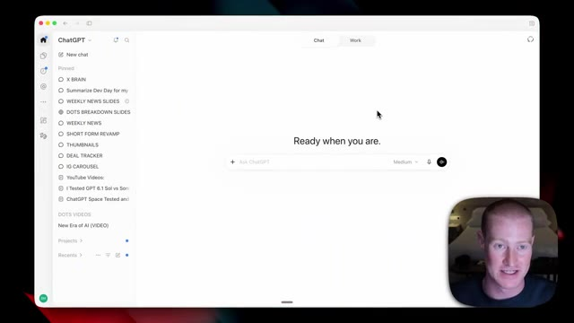
*⏱️ 00:01:53 — Capture d'écran montrant l'interface principale de l'application de bureau ChatGPT avec une barre latérale listant les discussions épinglées et le texte "Ready when you are" au centre.*

---

### ⏱️ `[00:02:08 - 00:02:28]` | Segment #07

**🔊 Audio (Transcription Intégrale Mot pour Mot en Français) :**
> Nous avons nos conversations épinglées sur le côté gauche. Et ensuite, je pourrais basculer entre ChatGPT et Codex. Donc si je passe sur Codex, ce sera exactement la même chose. Nous pourrions travailler à l'intérieur de nos projets et dossiers ici même. Et nous avons même accès à notre modèle unique GPT 6.1, qui vient juste de sortir hier à la DevDay également. Maintenant, ce sur quoi nous allons nous concentrer ici, c'est cette petite icône de page.

**👁️ Analyse Visuelle d'Écran (gemini-3.5-flash-lite) :**
**Interface & Outils** : Application web Codex et interface de chat type ChatGPT.

**Contenu textuel & Code** : Menus de navigation latérale avec conversations épinglées ("X BRAIN", "SUMMARIZE DEV DAY", etc.), sélection de projets et sélecteur de modèle "GPT-6.1 Sol High".

**Action / Démonstration** : Basculement entre les interfaces de chat et de projets Codex, et mise en avant du sélecteur de modèle d'IA.

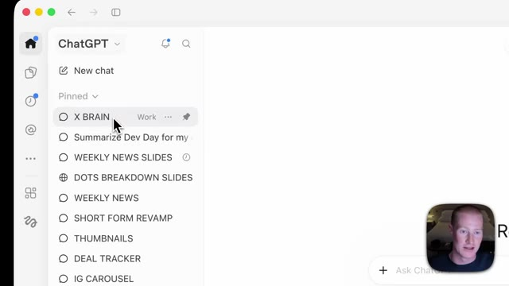
*⏱️ 00:02:13 — Interface ChatGPT avec le panneau latéral gauche montrant les conversations épinglées, avec le curseur pointant sur "X BRAIN".*

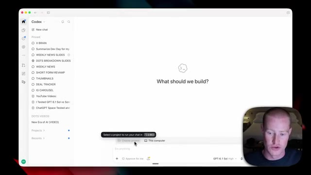
*⏱️ 00:02:18 — Interface basculée sur "Codex" montrant les options pour choisir un projet ou travailler sur l'ordinateur, avec la question centrale "What should we build?".*

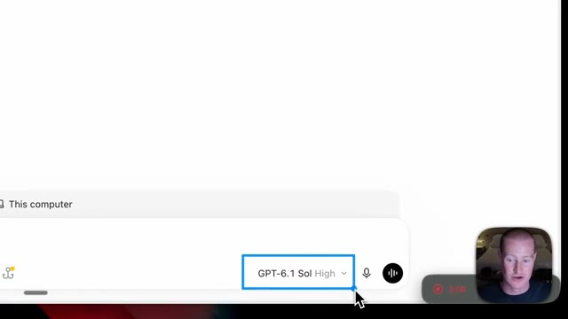
*⏱️ 00:02:23 — Gros plan sur la sélection du modèle de langage en bas de l'interface, affichant "GPT-6.1 Sol High".*

---

### ⏱️ `[00:02:28 - 00:02:49]` | Segment #08

**🔊 Audio (Transcription Intégrale Mot pour Mot en Français) :**
> Et ça, c'est l'espace ChatGPT. Et si j'ouvre mon espace, nous allons voir quelques choses différentes. Maintenant, si je clique sur ce bouton « tout », c'est fondamentalement notre tableau de bord dans l'ensemble de notre espace ChatGPT. Sur le côté gauche, nous avons un tas d'actifs différents. Ce sont toutes les différentes pages que j'ai créées. Et ne vous inquiétez pas, je sais que cela a l'air et semble probablement accablant.

**👁️ Analyse Visuelle d'Écran (gemini-3.5-flash-lite) :**
**Interface & Outils** : Interface web de ChatGPT Space (navigateur).

**Contenu textuel & Code** : Document de travail structuré comprenant des idées de titres ("Title Ideas"), une introduction ("Hook"), et des listes à puces. Le menu latéral gauche affiche des catégories telles que "New page", "All", "Pages", "Sites", "Images", ainsi que des sections "Pinned" et "Recents".

**Action / Démonstration** : Navigation et présentation de l'interface et des fonctionnalités de l'espace ChatGPT par le présentateur.

*⏱️ 00:02:33 — Capture d'écran montrant l'interface utilisateur de ChatGPT Space avec un panneau latéral à gauche listant divers actifs et documents, et un espace de travail textuel à droite intitulé "ChatGPT Space Tested and Explained (Notion Killer)". Le présentateur apparaît dans un encadré vidéo en bas à droite.*

---

### ⏱️ `[00:02:49 - 00:03:07]` | Segment #09

**🔊 Audio (Transcription Intégrale Mot pour Mot en Français) :**
> Genre, quelle est la différence entre un espace et une page et tous ces différents mots à la mode ? Donc, décomposons rapidement tous les concepts que vous devez comprendre sur l'espace Chatboti dès maintenant pour que vous puissiez comprendre le reste de cette vidéo. Très bien, donc la première chose que nous devons comprendre, c'est que nous avons différents espaces. Et un espace, c'est fondamentalement juste un hub qui a quelques éléments en dessous.

**👁️ Analyse Visuelle d'Écran (gemini-3.5-flash-lite) :**
**Interface & Outils** : Interface utilisateur de gestion de notes/documents (type espace de travail ou wiki) avec barre latérale de navigation et liste de fichiers.

**Contenu textuel & Code** : Liste de fichiers et pages tels que "YouTube Videos", "I Tested GPT 6.1", "Product Ads", "index.html", et "Weekly update", avec la source "AI for Non-Techies".

**Action / Démonstration** : Navigation et présentation des différents concepts et éléments de l'espace de travail à l'écran.

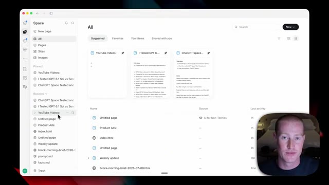
*⏱️ 00:02:53 — Capture d'écran montrant l'interface d'un espace de travail logiciel (Space) avec une vue d'ensemble des pages et documents récents, ainsi qu'une incrustation vidéo du présentateur en bas à droite.*

---

### ⏱️ `[00:03:07 - 00:03:26]` | Segment #10

**🔊 Audio (Transcription Intégrale Mot pour Mot en Français) :**
> Donc personnellement, j'ai créé deux espaces. J'en ai un qui s'appelle AI for non-techies, qui regroupe tout ce qui concerne ma marque YouTube. Et j'en ai un autre qui s'appelle Loom Media, qui regroupe tout ce qui concerne mon agence de marketing d'influence. Ce sont donc deux zones désignées qui sont séparées l'une de l'autre, ce qui fait que je recommande de créer plusieurs espaces pour votre vie personnelle par rapport à votre vie professionnelle, par exemple.

**👁️ Analyse Visuelle d'Écran (gemini-3.5-flash-lite) :**
**Interface & Outils** : Excalidraw / Navigateur web

**Contenu textuel & Code** : Schéma annoté avec les textes 'The Different Concepts', 'Spaces', 'AI for Non-Techies' et 'Luume Media'.
[DESC_IMAGE_1] Présentation visuelle de la structure des différents espaces de travail à l'aide d'un schéma explicatif.

**Action / Démonstration** : Explications face caméra et analyse conceptuelle des marchés.

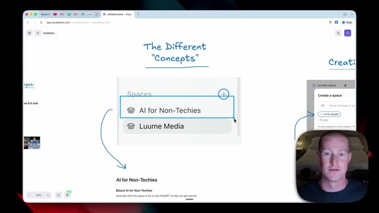
*⏱️ 00:03:12 — Capture d'écran montrant l'interface d'Excalidraw avec un schéma explicatif illustrant la création d'espaces différents, incluant les sections 'AI for Non-Techies' et 'Luume Media', avec la vidéo du présentateur en bas à droite.*

---

### ⏱️ `[00:03:26 - 00:03:53]` | Segment #11

**🔊 Audio (Transcription Intégrale Mot pour Mot en Français) :**
> Et maintenant à l'intérieur de cet espace, voilà à quoi cela ressemble. À l'intérieur de mon espace IA pour non-techniciens, nous avons cette brève description de ce pour quoi cet espace va être créé. Je dois donc encore remplir ceci. Vous pouvez donc voir que je dois décrire cela. Mais c'est fondamentalement là que nous décomposons, d'accord, voici le centre névralgique pour ce secteur spécifique de ma vie ou de mon entreprise, et nous pouvons fournir un contexte pour cela. Ensuite, à l'intérieur de nos espaces, nous avons quelques éléments. Nous avons des pages et nous avons des sous-pages.

**👁️ Analyse Visuelle d'Écran (gemini-3.5-flash-lite) :**
**Interface & Outils** : Navigateur web affichant l'application Excalidraw Plus.

**Contenu textuel & Code** : Texte 'AI for Non-Techies', 'About AI for Non-Techies', et une suggestion d'invite pour ChatGPT.

**Action / Démonstration** : Le présentateur montre l'interface d'un espace de travail et explique la description à compléter.

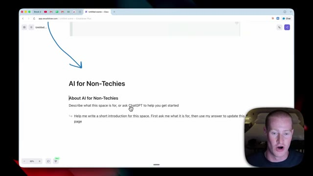
*⏱️ 00:03:33 — Une page Excalidraw intitulée 'AI for Non-Techies' avec une section de description à remplir et une incitation à utiliser ChatGPT.*

---

### ⏱️ `[00:03:53 - 00:04:17]` | Segment #12

**🔊 Audio (Transcription Intégrale Mot pour Mot en Français) :**
> Ceci est ma page de vidéos YouTube, et en dessous, j'ai quelques sous-pages. J'ai évidemment ces différentes vidéos, sur lesquelles, si je clique, cela m'amène à une vue plus détaillée de cette vidéo. Maintenant, l'une des choses vraiment géniales dans l'espace ChatGPT, c'est que vous pouvez voir en bas à droite de mon écran, j'ai en fait Codex d'ouvert. C'est donc la petite fenêtre Codex que je peux déclencher à tout moment. Cela fonctionne à l'intérieur de l'un de mes dossiers dans lesquels je travaille dans Codex.

**👁️ Analyse Visuelle d'Écran (gemini-3.5-flash-lite) :**
**Interface & Outils** : Présentation ou face-caméra explicatif du trader sans interface logicielle partagée.

**Contenu textuel & Code** : Explications orales des stratégies et mise en contexte méthodologique du marché.

**Action / Démonstration** : Explications face caméra et analyse conceptuelle des marchés.

---

### ⏱️ `[00:04:17 - 00:04:53]` | Segment #13

**🔊 Audio (Transcription Intégrale Mot pour Mot en Français) :**
> C'est principalement ainsi que j'utilise ChatGPT en ce moment via Codex. Donc ce que je pourrais faire, c'est travailler avec cette page spécifique. Donc par exemple, je vais juste venir ici et dire, je veux que tu génères une autre vignette très similaire à celle-ci. Cependant, je veux que tu fasses éclater le soleil un peu plus en flammes. Maintenant, ce que notre Codex va faire ici, c'est simplement prendre cette vignette. Il va ensuite la régénérer avec ChatGPT image 2.5 et il va automatiquement l'ajouter à mes vignettes juste ici. Très bien, alors voilà, maintenant nous avons cette image ajoutée juste en dessous de ma vignette précédente, qui, je trouve, est bien meilleure. Nous avons évidemment le soleil qui brille un peu plus, donc vous pouvez commencer à voir comment nous devenons interactifs avec à la fois Codex et ChatGPT.

**👁️ Analyse Visuelle d'Écran (gemini-3.5-flash-lite) :**
**Interface & Outils** : Application de prise de notes/espace de travail et panneau de chat latéral de type ChatGPT.

**Contenu textuel & Code** : Texte de prompt de modification d'image de vignette ('I want you to generate another thumbnail...'), listes d'idées de vidéos YouTube et images de vignettes comparatives.

**Action / Démonstration** : Saisie d'un prompt dans l'interface de chat pour générer une variante de vignette basée sur la page active.

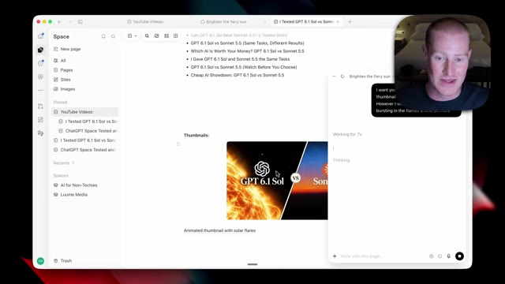
*⏱️ 00:04:35 — Interface de prise de notes ou espace de travail affichant une page web avec des listes de titres et une image de vignette comparative, ainsi qu'un panneau de chat latéral.*

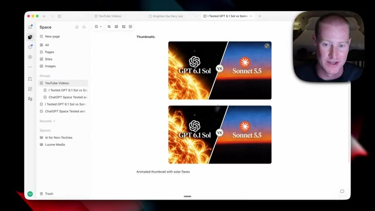
*⏱️ 00:04:44 — Vue de l'espace de travail montrant deux vignettes similaires avec des graphiques comparant 'GPT 6.1 Sol' et 'Sonnet 5.5'.*

---

### ⏱️ `[00:04:53 - 00:05:26]` | Segment #14

**🔊 Audio (Transcription Intégrale Mot pour Mot en Français) :**
> inside of our spaces. I'm going to create a new page from scratch and build this out so you can see exactly how this works in real time. So I'm going to come over click on new page and I'm going to call this product ads and I'm simply going to upload a few reference images here. So we have this little product. We have a sunbump can and let's say that we want to generate product ads from this image right here. This is the reference image we want to use. And one really cool thing about our pages is we could use the specific plugins we have connected to ChatGPT so we could use the different applications inside of our spaces. Now the specific app I'm going to use is Higgsfield.

**👁️ Analyse Visuelle d'Écran (gemini-3.5-flash-lite) :**
**Interface & Outils** : Présentation ou face-caméra explicatif du trader sans interface logicielle partagée.

**Contenu textuel & Code** : Explications orales des stratégies et mise en contexte méthodologique du marché.

**Action / Démonstration** : Explications face caméra et analyse conceptuelle des marchés.

---

### ⏱️ `[00:05:26 - 00:06:00]` | Segment #15

**🔊 Audio (Transcription Intégrale Mot pour Mot en Français) :**
> So I'm going to use this to take that image and generate different videos that we could use for social media posts inside of our space. So I'm going to do is I'm going to come to Higgsfield. If you want to try this out, there will be a link in the description to set this up yourself as well. So I'm going to click on install Higgsfield plugin. I'm going to click on open ChatGPT. And now just like this, I have the Higgsfield plugin installed. One really cool thing they added to ChatGPT yesterday at DevDay is they added designated plugin. So what this means is different products can build directly into ChatGPT. So if you see on the left hand side of the screen, we have this Higgs field icon. If I click on this, we could open up this interface right here,

**👁️ Analyse Visuelle d'Écran (gemini-3.5-flash-lite) :**
**Interface & Outils** : Navigateur web affichant le site officiel et l'interface de plugin de Higgsfield.

**Contenu textuel & Code** : Boutons d'installation, description des capacités du plugin (création de publicités, vidéos et images promotionnelles) et exemples visuels de produits.
[DESC_IMAGE_3] Navigation dans l'interface de Higgsfield pour présenter les différentes options de création et de génération visuelle.

**Action / Démonstration** : Présentation et navigation sur la plateforme Higgsfield pour l'intégration de la génération vidéo et d'images dans un flux de travail marketing.

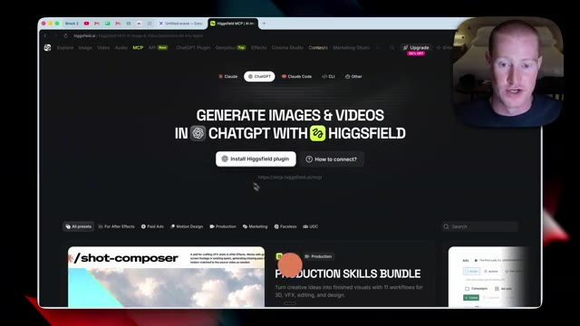
*⏱️ 00:05:34 — Page web du site Higgsfield affichant le titre 'Generate images & videos in ChatGPT with Higgsfield' avec un bouton d'installation du plugin.*

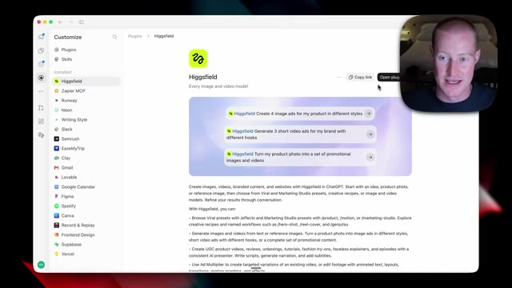
*⏱️ 00:05:43 — Interface de configuration et de description du plugin Higgsfield montrant les fonctionnalités et les options d'intégration.*

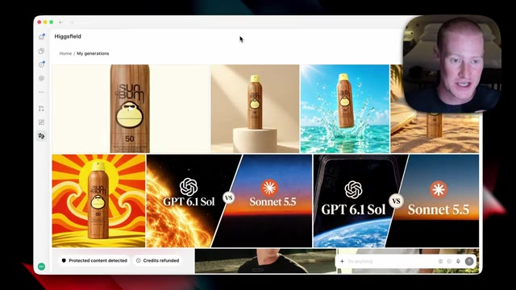
*⏱️ 00:05:52 — Galerie de générations de visuels publicitaires et de produits utilisant la plateforme Higgsfield, avec des aperçus d'images et de vidéos.*

---

### ⏱️ `[00:06:00 - 00:06:36]` | Segment #16

**🔊 Audio (Transcription Intégrale Mot pour Mot en Français) :**
> which shows all of my different Higgs field generated assets. So now that we have Higgs field downloaded, what I could do is I could come to the chat and I could say, Hey, so I want you to take this image of this sun bum bottle and create multiple different product ads that we could use for social media. These are going to be used for Instagram stories and different Instagram posts. So I want you to get creative to create these visual assets using Higgs field. So what I'm going to do is just type in at Higgs field so it knows to use Higgs field and then I'm going to send this off. It's going to go and use this application to generate these images and then it will automatically paste them back into this page right here. All right so what Codex did is it went and generated

**👁️ Analyse Visuelle d'Écran (gemini-3.5-flash-lite) :**
**Interface & Outils** : Interface utilisateur de type application de chat IA ou assistant virtuel.

**Contenu textuel & Code** : Barre de saisie avec le texte indicatif « Work with this page... » et des boutons pour choisir un projet ou importer depuis l'ordinateur.

**Action / Démonstration** : Le curseur est positionné dans la zone de texte pour rédiger une consigne ou un prompt destiné à l'IA.

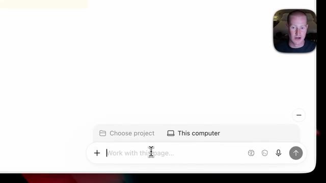
*⏱️ 00:06:09 — Interface de chat avec une barre de saisie de texte et des options de sélection de fichiers ou de projets.*

---

### ⏱️ `[00:06:36 - 00:07:10]` | Segment #17

**🔊 Audio (Transcription Intégrale Mot pour Mot en Français) :**
> ces différentes images ici. Donc nous avons maintenant, je crois, six images différentes de ce "sunbun". Celles-ci ont l'air honnêtement incroyables, avant nous aurions dû les générer dans Canva il y a environ six mois. Donc elles ont vraiment, vraiment l'air très bien et donc ce que je pourrais faire maintenant, c'est en fait lui demander d'aller les ajouter à cette page, car pour l'instant, il les a pour ainsi dire ajoutées à un fichier zip que je dois aller télécharger sur mon bureau. Mais je vais simplement venir ici et dire, hé, je veux que tu ailles en fait les ajouter à cette page de publicités de produits. Je veux que tu ajoutes les publicités générées par texte. Et puis en dessous, tu pourrais ajouter les images. Très bien. Donc maintenant nous avons tous ces différents éléments générés et

**👁️ Analyse Visuelle d'Écran (gemini-3.5-flash-lite) :**
**Interface & Outils** : Présentation ou face-caméra explicatif du trader sans interface logicielle partagée.

**Contenu textuel & Code** : Explications orales des stratégies et mise en contexte méthodologique du marché.

**Action / Démonstration** : Explications face caméra et analyse conceptuelle des marchés.

---

### ⏱️ `[00:07:10 - 00:07:28]` | Segment #18

**🔊 Audio (Transcription Intégrale Mot pour Mot en Français) :**
> ajoutés à notre page à l'intérieur de notre espace Chachapiti. Donc ça détaille la disposition réelle pour chacun des Donc nous avons notre story Instagram. Nous avons notre fil d'actualité Instagram heure dorée pour la story Instagram et ensuite le fil d'actualité Instagram. Et puis évidemment, comme vous pouvez le voir, ça détaille le format d'image. Donc nous savons lequel nous devrions publier sur lequel. Je veux dire, ceux-là ont l'air vraiment solides.

**👁️ Analyse Visuelle d'Écran (gemini-3.5-flash-lite) :**
**Interface & Outils** : Navigateur web, outil de productivité ou de documentation de type Notion/Space.

**Contenu textuel & Code** : Dispositions de story Instagram (9:16) et de fil d'actualité Instagram (4:5) pour des annonces de produits ("Poolside Pop" avec le texte "Sun's Out, Bum's Out").

**Action / Démonstration** : Présentation de la disposition des différents formats d'images générés par l'IA pour les réseaux sociaux.

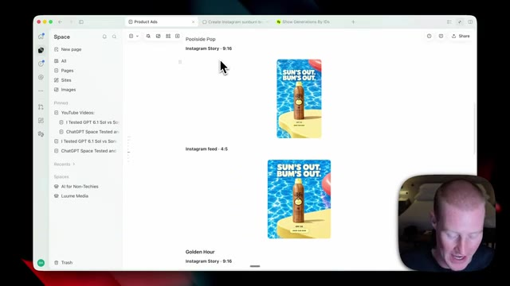
*⏱️ 00:07:14 — Vue d'une application de type espace de travail ou gestion de projet montrant des modèles de publications Instagram pour des produits, avec une webcam du présentateur en bas à droite.*

---

### ⏱️ `[00:07:28 - 00:08:01]` | Segment #19

**🔊 Audio (Transcription Intégrale Mot pour Mot en Français) :**
> Now, what we could do is I could come back to our little codex bubble right here and say, all right, I want you to take this product and I want you to now turn it into an Apple product style video. On top of that, I want you to generate another video with Higgs field, taking the bottom the image that you generated showing your son's sidekick and turn this into a video as well in the same style as that asset you generated. So I'm just going to give it that prompt. Again, I'm just going to tag at Higgsfield so it knows to use the Higgsfield MCP here. And it's going to go and generate those assets and then add it again to this page inside of Spaces. All right. So a few

**👁️ Analyse Visuelle d'Écran (gemini-3.5-flash-lite) :**
**Interface & Outils** : Application web collaborative ou outil de productivité avec assistant IA intégré.

**Contenu textuel & Code** : Texte de prompt détaillé demandant de créer une vidéo de style Apple à partir d'une image de produit et d'utiliser Higgsfield.

**Action / Démonstration** : Saisie d'un prompt textuel pour générer des vidéos publicitaires automatisées via l'assistant IA.

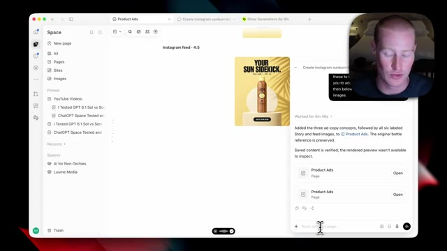
*⏱️ 00:07:36 — Interface d'un espace de travail montrant la génération de publicités de produits (Product Ads) avec un aperçu visuel d'une crème solaire 'Sun Bum'.*

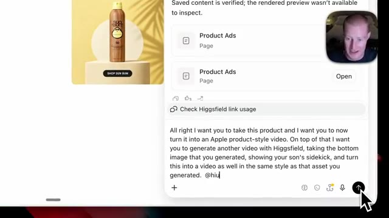
*⏱️ 00:07:53 — Gros plan sur un panneau de chat où l'utilisateur saisit un prompt textuel demandant de transformer l'image du produit en vidéo publicitaire de style Apple et d'utiliser Higgsfield.*

---

### ⏱️ `[00:08:01 - 00:08:19]` | Segment #20

**🔊 Audio (Transcription Intégrale Mot pour Mot en Français) :**
> minutes plus tard, Higgsfield a généré ces vidéos pour nous. Comme vous pouvez le voir en bas à droite de notre écran dans notre petite bulle codex, il a ajouté cette coche. Cela signifie donc que cette tâche est terminée et a été ajoutée à notre page. De plus, une chose que je n'ai même pas mentionnée, c'est que je pourrais cliquer sur le mode vocal et nous pouvons interagir avec lui de cette façon afin d'apporter des modifications. Maintenant, allons-y et cliquons sur ceux-ci.

**👁️ Analyse Visuelle d'Écran (gemini-3.5-flash-lite) :**
**Interface & Outils** : Présentation ou face-caméra explicatif du trader sans interface logicielle partagée.

**Contenu textuel & Code** : Explications orales des stratégies et mise en contexte méthodologique du marché.

**Action / Démonstration** : Explications face caméra et analyse conceptuelle des marchés.

---

### ⏱️ `[00:08:19 - 00:08:39]` | Segment #21

**🔊 Audio (Transcription Intégrale Mot pour Mot en Français) :**
> So if I click on this, it's gonna bring us to this page. It looks like we can't preview here, but instead I could just download this to my desktop. All right, so here is the first one. This is that Apple product demo styled video that I wanted to generate. It shows our sunbump can. This is obviously very good. It looks in the Apple style. So that's pretty cool. And then here is our second demo right here.

**👁️ Analyse Visuelle d'Écran (gemini-3.5-flash-lite) :**
**Interface & Outils** : Navigateur web affichant un explorateur de fichiers et un lecteur vidéo intégré.

**Contenu textuel & Code** : Fichier vidéo nommé 'apple-inspired-product-film.mp4' présentant un produit publicitaire de type crème solaire Sun Bum.
[DESC_IMAGE_1] Interface montrant une page web avec un message indiquant l'impossibilité de prévisualiser le fichier.

**Action / Démonstration** : Navigation dans un gestionnaire de fichiers pour visionner et présenter des vidéos publicitaires générées par IA.

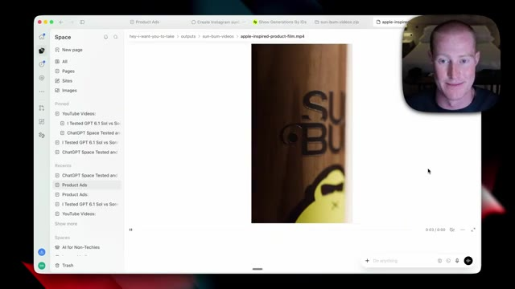
*⏱️ 00:08:29 — Lecteur vidéo montrant un plan rapproché sur le logo et la texture d'une bouteille de crème solaire Sun Bum dans une vidéo publicitaire de style Apple.*

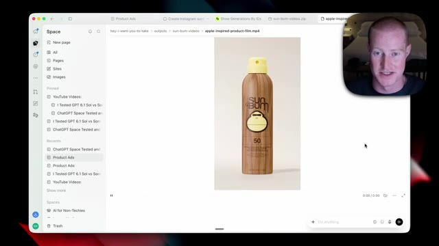
*⏱️ 00:08:34 — Lecteur vidéo affichant la vue complète d'une bouteille de crème solaire Sun Bum avec finition imitation bois dans la publicité générée.*

---

### ⏱️ `[00:08:39 - 00:09:15]` | Segment #22

**🔊 Audio (Transcription Intégrale Mot pour Mot en Français) :**
> Encore une fois, c'est dans exactement le même style qu'avant. Nous avons les ombres de palmier qui bougent. C'est plutôt cool. C'est quelque chose qu'on pourrait balancer sur nos stories Instagram, par exemple. Je tiens à souligner qu'on peut aussi accéder à toutes ces informations directement depuis notre espace ChatTript dans le navigateur. Donc, tout au long de cette vidéo, j'ai travaillé dans l'application de bureau, mais cela va aussi s'afficher sur l'application web. Donc, si je viens dans les espaces, vous voyez bien qu'on a toutes ces différentes pages sur lesquelles on a travaillé tout au long de cette vidéo. Donc, si je clique sur annonces de produits, toutes ces publicités de produits que nous avons créées se trouvent également ici pour que nous puissions les consulter à tout moment. Je crois aussi que cela est en train d'être déployé pour les utilisateurs mobiles. Cependant, je n'y ai pas accès sur mon

**👁️ Analyse Visuelle d'Écran (gemini-3.5-flash-lite) :**
**Interface & Outils** : Navigateur web, interface de type ChatGPT Spaces.

**Contenu textuel & Code** : Liste de documents et notes de travail (« YouTube Videos », « Product Ads », etc.).

**Action / Démonstration** : Présentation de l'interface et navigation dans l'espace de travail.

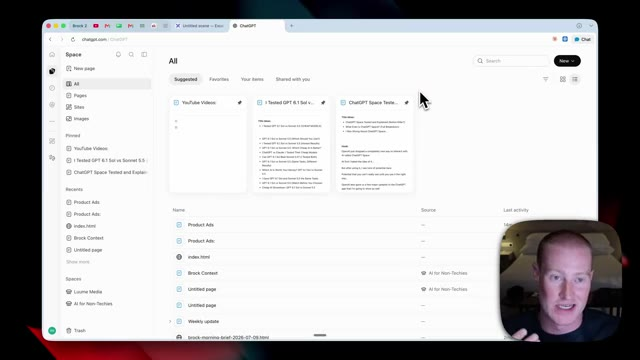
*⏱️ 00:08:48 — Capture d'écran montrant l'interface d'un navigateur web affichant une application type ChatGPT / espace de travail avec des documents et des notes, et la webcam du présentateur en bas à droite.*

---

### ⏱️ `[00:09:15 - 00:09:47]` | Segment #23

**🔊 Audio (Transcription Intégrale Mot pour Mot en Français) :**
> phone yet for some reason. So we should over time be able to see our spaces from our mobile app as well. Higgsfield is just one of hundreds and even thousands of different plugins inside of ChatGPT. And when we combine our plugins with ChatGPT space, this is where it can become very powerful because we could pull from all the different applications that we're using in order to create internal dashboards. Now let's say you go through and you can't find the app that you want to connect to even though there are a bunch of different apps that we could add inside of Chachapiti natively. Well there is a workaround so let me show you that right now. You can use something

**👁️ Analyse Visuelle d'Écran (gemini-3.5-flash-lite) :**
**Interface & Outils** : Interface web de ChatGPT / Codex affichant la section des plugins.

**Contenu textuel & Code** : Liste des plugins disponibles (Bitly, ClickUp, Docusign, Firecrawl, Google Drive, Gusto, invideo, Miro, etc.) et barre de recherche.

**Action / Démonstration** : Navigation et présentation des différents plugins intégrables à la plateforme.

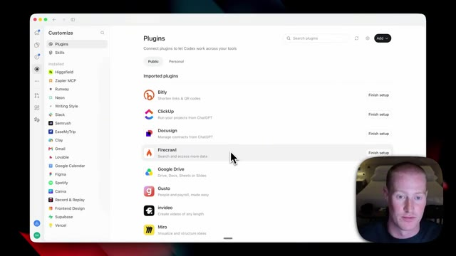
*⏱️ 00:09:23 — Capture d'écran montrant l'interface des plugins avec une liste d'intégrations disponibles et configurables.*

---

### ⏱️ `[00:09:47 - 00:10:20]` | Segment #24

**🔊 Audio (Transcription Intégrale Mot pour Mot en Français) :**
> appelé le Zapier MCP, qui est quelque chose que j'utilise personnellement tous les jours. Je veux que vous pensiez à cela comme à un pont entre l'espace ChatGPT ou vos agents IA et toutes les différentes applications que vous utilisez, car le Zapier MCP se connecte à plus de 9 000 applications différentes, donc il y a de fortes chances que celle que vous voulez connecter soit incluse dedans. Et c'est très simple à utiliser. Afin de vous montrer ce que je veux decir — ce que je veux dire, j'ai ce serveur MCP configuré à l'intérieur de Zapier et j'ai un tas d'applications différentes connectées, dont l'une est Drip. C'est mon logiciel de marketing par e-mail et il n'y a aucun moyen pour moi de le connecter à ChatGPT à moins d'utiliser quelque chose comme le Zapier MCP.

**👁️ Analyse Visuelle d'Écran (gemini-3.5-flash-lite) :**
**Interface & Outils** : Navigateur web, Excalidraw, interface de configuration d'applications IA.

**Contenu textuel & Code** : Schéma visuel "ChatGPT Space + Zapier MCP" et liste des applications connectées avec compteurs d'actions.

**Action / Démonstration** : Présentation du fonctionnement du pont Zapier MCP et des applications accessibles par l'agent IA.

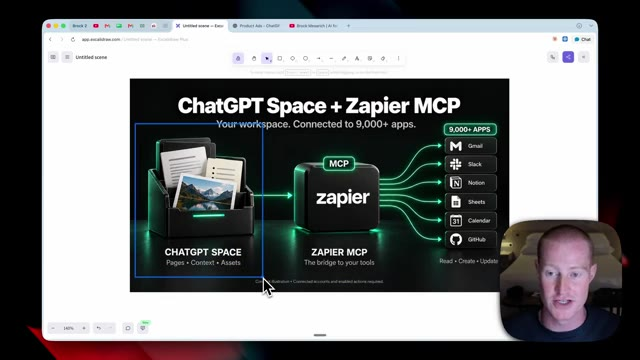
*⏱️ 00:09:55 — Schéma explicatif montrant le pont entre ChatGPT Space et Zapier MCP pour connecter plus de 9000 applications.*

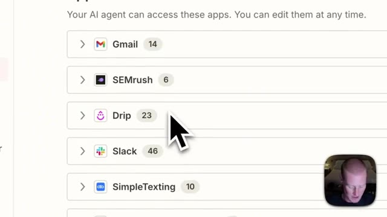
*⏱️ 00:10:12 — Interface listant les applications connectées à l'agent IA (Gmail, SEMrush, Drip, Slack, SimpleTexting).*

---

### ⏱️ `[00:10:20 - 00:10:44]` | Segment #25

**🔊 Audio (Transcription Intégrale Mot pour Mot en Français) :**
> And what I did is I had ChatGPT create this separate newsletter stats page that you're looking at right here inside of my ChatGPT space. And what this does is it gives me a daily breakdown on everything that's going on inside of my newsletter campaigns. So it shows the latest newsletter that went out. It shows when it was sent. It shows the TLDR breaking down all the stats so I could see the click-through rate and the open rate. I could see the amount of people that are unsubscribing.

**👁️ Analyse Visuelle d'Écran (gemini-3.5-flash-lite) :**
**Interface & Outils** : Interface web de ChatGPT / Espace de travail de notes ou de gestion de contenu.

**Contenu textuel & Code** : Métriques de newsletter : dernier envoi ("Sonnet 5.5 against the rest"), taux d'ouverture (3 781 ouvertures, soit 25,51 %), clics, désinscriptions, et tableau récapitulatif des performances.

**Action / Démonstration** : Le présentateur commente la page de statistiques générée par ChatGPT et présente les indicateurs clés de ses campagnes d'e-mailing.

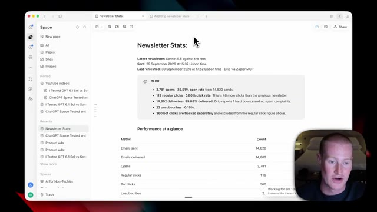
*⏱️ 00:10:26 — Capture d'écran montrant l'interface d'un espace ChatGPT affichant une page dédiée aux statistiques d'une newsletter ("Newsletter Stats").*

---

### ⏱️ `[00:10:45 - 00:11:21]` | Segment #26

**🔊 Audio (Transcription Intégrale Mot pour Mot en Français) :**
> I could even see the amount of bot clicks that have been tracked from this as well. It then pulled up this little table here with a breakdown for me. So this is an amazing visual for me to look at. And Chachupiti Space was able to do this with access to Drip from the Zapier MCP. If you guys want to try this app here, MCP, there will be a link in the description to sign up to do this yourself. But I wanted to show this as a perfect example of how you could take the apps you're using and then create separate pages inside of your Chachupiti space because now we have all this information that we could either view inside of here at any given time and this is now context that our agent can use as a second brain, so to say. All right, so I want to now talk about why

**👁️ Analyse Visuelle d'Écran (gemini-3.5-flash-lite) :**
**Interface & Outils** : Application de notes / espace de travail en ligne (Space / Notion-like)

**Contenu textuel & Code** : Tableau de statistiques de newsletter avec les colonnes : Snapshot in Lisbon time, Newsletter, Opens, Regular clicks, Unsubscribes. On y lit les données pour la newsletter "Sonnet 5.5 against the rest" (3 781 ouvertures, 119 clics réguliers, 22 désabonnement).

**Action / Démonstration** : Le présentateur commente le tableau de répartition des statistiques de la newsletter généré via l'intégration Zapier MCP.

*⏱️ 00:10:54 — Capture d'écran montrant l'interface d'un tableau de bord de type application de notes ou espace de travail (Space), affichant des statistiques de newsletter avec un tableau de données chiffrées, ainsi qu'une petite fenêtre vidéo du présentateur en bas à droite.*

---

### ⏱️ `[00:11:21 - 00:11:54]` | Segment #27

**🔊 Audio (Transcription Intégrale Mot pour Mot en Français) :**
> J'ai utilisé Notion par le passé de manière assidue et voici pourquoi je pense que l'espace ChatGPT pourrait être l'alternative que je cherche depuis des ans. Décomposons donc rapidement la façon dont mon Notion est configuré afin que vous puissiez avoir une idée de la raison pour je vais probablement faire la transition vers l'espace ChatGPT. Je pense qu'il y a tellement de fonctionnalités différentes à l'intérieur de Notion qui sont superflues. J'aime juste faire simple. J'ai donc mon pôle principal, qui s'appelle AI for non-techies, qui dans ce cas sellerait maintenant un espace. Et puis à l'intérieur de ce pôle, j'ai ensuite différentes sous-pages. Donc pour mes finances, j'ai une sous-page spécifique pour le suivi financier, les investissements mensuels, les informations de virement, tout ce truc-là.

**👁️ Analyse Visuelle d'Écran (gemini-3.5-flash-lite) :**
**Interface & Outils** : Navigateur web affichant une application de notes ou de tableaux blancs (Notion / Excalidraw).

**Contenu textuel & Code** : Page intitulée "AI For Non-Techies" contenant des liens vers des sous-pages financières ("Money Tracker", "Monthly Investments", etc.) annotées avec des flèches manuscrites.

**Action / Démonstration** : Le présentateur montre et explique la structure de ses sous-pages dans son espace de travail.

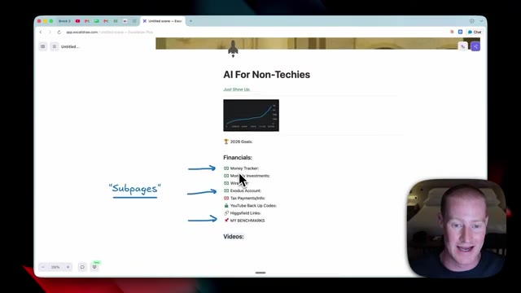
*⏱️ 00:11:46 — Capture d'écran d'une page web (interface style Notion/Excalidraw) intitulée "AI For Non-Techies" avec des sections financières et des annotations manuscrites "Subpages" pointées par des flèches bleues.*

---

### ⏱️ `[00:11:54 - 00:12:14]` | Segment #28

**🔊 Audio (Transcription Intégrale Mot pour Mot en Français) :**
> these are all separate sub pages that I've created. And this is what my video system looks like. I have different sub pages for all the videos that I work on with my video ideas. And then inside of those video sub pages, this is what it looks like. So I'll have my title ideas. I have my thumbnail ideas that I add inside of here. But one thing with Notion is I have to download an image, upload it into Notion myself.

**👁️ Analyse Visuelle d'Écran (gemini-3.5-flash-lite) :**
**Interface & Outils** : Application de notes et gestion de projet visuelle.

**Contenu textuel & Code** : Listes de sous-pages de gestion personnelle et professionnelle, listes d'idées de titres de vidéos et de miniatures.

**Action / Démonstration** : Navigation et présentation de l'arborescence des pages de projets vidéo de l'orateur.

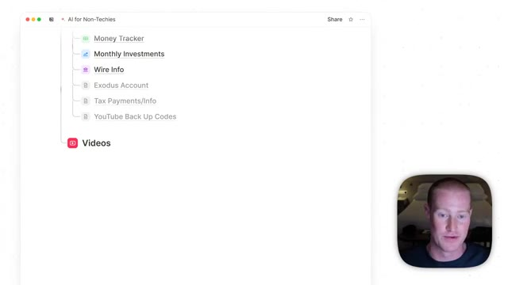
*⏱️ 00:11:59 — Interface de prise de notes montrant une liste de sous-pages (Money Tracker, Monthly Investments, etc.) et une section 'Videos'.*

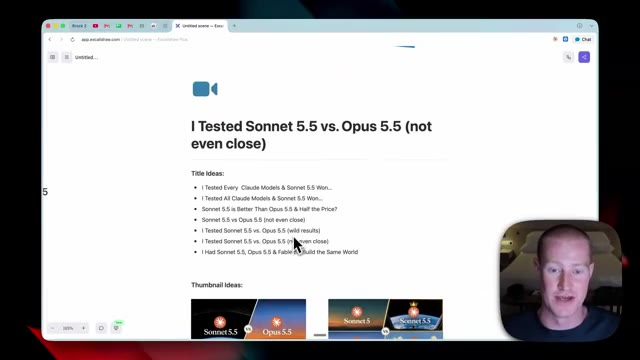
*⏱️ 00:12:04 — Page de projet vidéo détaillée avec des propositions de titres ('Title Ideas') et des concepts de miniatures ('Thumbnail Ideas').*

---

### ⏱️ `[00:12:14 - 00:12:37]` | Segment #29

**🔊 Audio (Transcription Intégrale Mot pour Mot en Français) :**
> Whereas inside of ChatTript spaces, I had ChatTript generate this image right here and it automatically uploads this into my space. It really does feel like ChatGPT space is an AI native second brain instead of having to use something like Notion like I've talked about in this video. So we obviously have people, which is you and your team, and we have our AI agents and how we're going to collaborate with them.

**👁️ Analyse Visuelle d'Écran (gemini-3.5-flash-lite) :**
**Interface & Outils** : Interface de ChatGPT Space et application web de gestion de notes/contenu.

**Contenu textuel & Code** : Affichage d'une page de projet YouTube, d'une image générée par l'IA intitulée « GPT 6.1 Sol vs Sonnet 5.5 » et de scripts textuels.

**Action / Démonstration** : Présentation de la fonctionnalité d'intégration automatique des images générées par l'IA dans l'espace de travail.

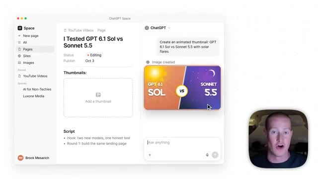
*⏱️ 00:12:20 — Capture d'écran montrant l'interface de ChatGPT Space avec un panneau latéral, une page de gestion de projet YouTube et un volet de discussion avec une image générée automatiquement.*

---

### ⏱️ `[00:12:37 - 00:12:58]` | Segment #30

**🔊 Audio (Transcription Intégrale Mot pour Mot en Français) :**
> Donc avec le temps, nous allons avoir besoin d'une interface ou d'une plateforme avec laquelle nous pourrons collaborer avec toutes ces personnes différentes et ces agents IA. Et on a presque l'impression que l'espace de ChatGPT est tout à fait cela. Et je peux voir la vision d'OpenAI à long terme. À l'intérieur de nos espaces, nous avons tout le contexte pertinent. Nous avons nos différentes pages. Nous avons un contexte de projet qui inclut les projets sur lesquels nous travaillons à l'intérieur de nos ordinateurs via codex.

**👁️ Analyse Visuelle d'Écran (gemini-3.5-flash-lite) :**
**Interface & Outils** : Schéma explicatif sur fond blanc.

**Contenu textuel & Code** : Blocs "PEOPLE" (You, Your team), un bloc central point d'interrogation, et un bloc "AI AGENTS" (Codex, ChatGPT Dots).

**Action / Démonstration** : Le présentateur explique la vision d'une plateforme de collaboration entre humains et agents IA.

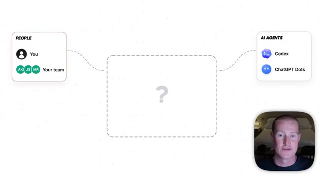
*⏱️ 00:12:42 — Schéma conceptuel montrant l'interaction entre les humains (People), une plateforme centrale avec un point d'interrogation, et les agents IA (AI Agents), avec la webcam du présentateur en bas à droite.*

---

### ⏱️ `[00:12:59 - 00:13:19]` | Segment #31

**🔊 Audio (Transcription Intégrale Mot pour Mot en Français) :**
> Et tout ceci est du contexte que nous pourrions fournir à la fois aux personnes qui travaillent au sein de nos entreprises et à nos agents IA qui travaillent également. Je veux parler rapidement d'un exemple afin que vous puissiez voir le futur potentiel de ceci. Maintenant, disons que vous interagissez avec votre ChatGPT et que vous vouliez générer une image de produit pour une campagne comme nous venons de le faire un peu plus tôt dans la vidéo. Et disons que nous générons ceci pour un client marketing.

**👁️ Analyse Visuelle d'Écran (gemini-3.5-flash-lite) :**
**Interface & Outils** : Schéma conceptuel / infographie logicielle (ChatGPT Space) avec le présentateur en incrustation vidéo en bas à droite.

**Contenu textuel & Code** : Diagramme montrant l'interaction entre "PEOPLE" (utilisateurs et équipe), un espace centralisé "ChatGPT Space" contenant des pages, notes, images, titres et dossiers de contexte de projet, et "AI AGENTS" (Codex, ChatGPT Dots).

**Action / Démonstration** : Présentation visuelle et explication de l'architecture collaborative future entre les collaborateurs humains et les agents d'intelligence artificielle.

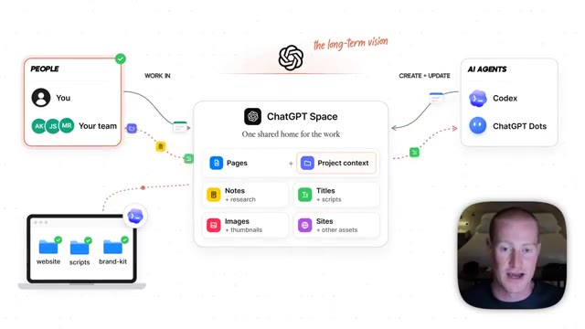
*⏱️ 00:13:04 — Un schéma conceptuel illustrant la vision à long terme d'un espace de travail partagé entre humains et agents IA autour de ChatGPT.*

---

### ⏱️ `[00:13:19 - 00:13:37]` | Segment #32

**🔊 Audio (Transcription Intégrale Mot pour Mot en Français) :**
> Votre document ChatGPT peut aller générer les images et les ressources vidéo et vous les renvoyer par chat. Mais disons que vous souhaitez le partager avec votre équipe afin d'obtenir une approbation avant de l'envoyer à un client. Eh bien, votre document peut désormais pratiquement juste publier ceci dans votre espace ChatGPT sur une page particulière. Et de cette façon, votre équipe peut l'examiner avant de l'envoyer à un client.

**👁️ Analyse Visuelle d'Écran (gemini-3.5-flash-lite) :**
**Interface & Outils** : Interface utilisateur de type chat IA et graphiques explicatifs animés.

**Contenu textuel & Code** : Mockup d'interface de chat pour la génération d'images, brief de campagne et flux de validation d'équipe.

**Action / Démonstration** : Illustration visuelle du workflow de création d'actifs marketing et de leur soumission pour approbation à l'équipe.

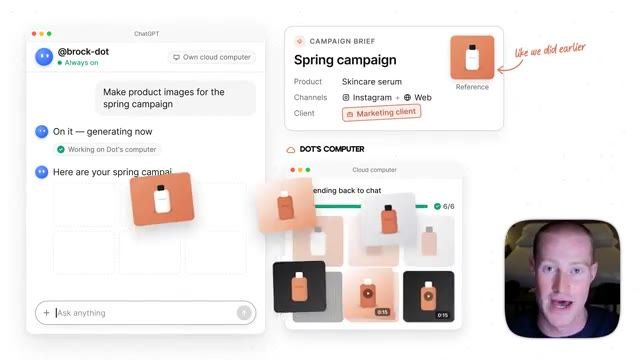
*⏱️ 00:13:23 — Interface graphique montrant un assistant virtuel générant des images de produits pour une campagne de printemps, avec le présentateur en médaillon.*

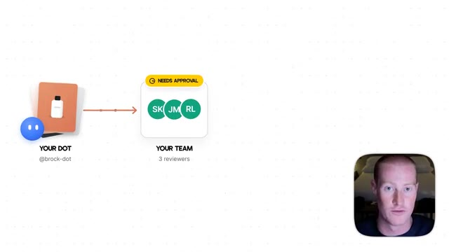
*⏱️ 00:13:28 — Schéma illustrant le processus de validation d'un document par l'équipe (« Needs approval », 3 reviewers), avec le présentateur en médaillon.*

---

### ⏱️ `[00:13:38 - 00:13:57]` | Segment #33

**🔊 Audio (Transcription Intégrale Mot pour Mot en Français) :**
> Et en plus de ça, vous pouvez faire en sorte que votre document génère ensuite un site ChatGPT, qui peut fondamentalement être juste un site web que vous pourriez envoyer au client avec un briefing contenant tous ces différents actifs qu'il a générés pour eux dans une vue professionnelle. Et il est capable de faire cela parce que votre équipe, vous-même et votre agent IA utilisez tous l'espace ChatGPT comme cet espace de travail unifié pour tout le monde.

**👁️ Analyse Visuelle d'Écran (gemini-3.5-flash-lite) :**
**Interface & Outils** : Interface de site web hébergé sur une URL personnalisée (.chatgpt.site) et schéma d'espace de travail.

**Contenu textuel & Code** : Brief de campagne marketing, objectifs, audience, canaux (Instagram, TikTok, email), calendrier et galerie d'actifs générés (visuels et vidéos).

**Action / Démonstration** : Présentation d'un site web client généré automatiquement par l'IA contenant le résumé et les livrables d'une campagne marketing.

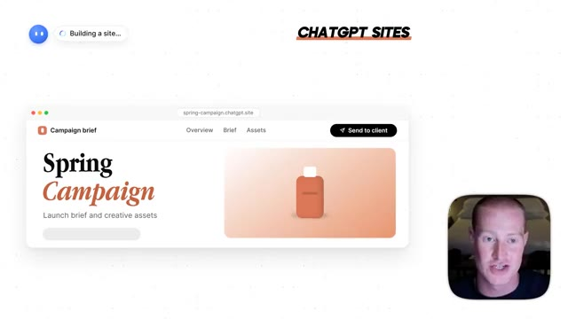
*⏱️ 00:13:42 — Aperçu partiel d'un site web généré affichant le titre « Spring Campaign » avec un visuel de produit.*

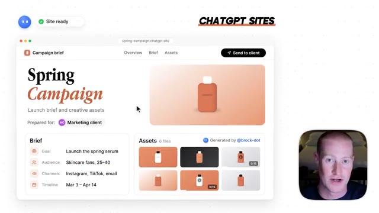
*⏱️ 00:13:47 — Affichage complet du site web de présentation de campagne « Spring Campaign » avec le briefing, les cibles, les canaux et les différents actifs créatifs générés.*

---

### ⏱️ `[00:13:57 - 00:14:13]` | Segment #34

**🔊 Audio (Transcription Intégrale Mot pour Mot en Français) :**
> Now, I know a lot of people don't want to change up the systems that they're already building, but I do think long-term that this is going to be a very interesting product, and I like it more and more every time I use it. Anyways, if you guys enjoyed this video, leave a like, comment what you think, subscribe for more content like this, and I'll see you in the next video. Cheers.

**👁️ Analyse Visuelle d'Écran (gemini-3.5-flash-lite) :**
**Interface & Outils** : Interface utilisateur et page YouTube de la chaîne.

**Contenu textuel & Code** : Éléments d'interface logicielle et miniatures de vidéos YouTube sur l'intelligence artificielle.

**Action / Démonstration** : Navigation et présentation de fin de vidéo incitant à s'abonner.

---

