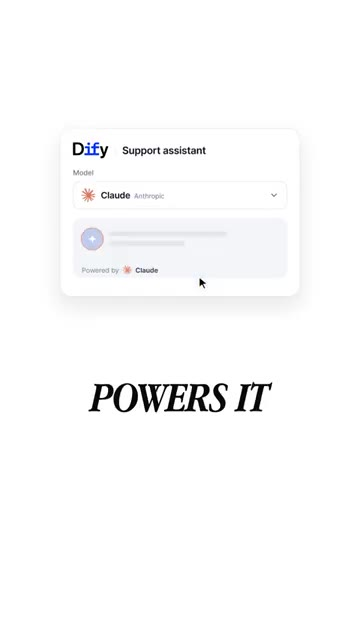

# 🎬 This Free Repo Builds a Support Agent From Your Docs

> **Chaîne** : [Brock Mesarich | AI for Non Techies](https://www.youtube.com/@BrockMesarich)  
> **Lien YouTube** : [https://www.youtube.com/watch?v=cXP4_UfnL_4](https://www.youtube.com/watch?v=cXP4_UfnL_4)  
> **Date de publication** : 20261001  
> **Durée** : 00:00:33  
> **Identifiant vidéo** : `cXP4_UfnL_4`  
> **Transcription & Analyse** : `whisper-v3-large-turbo+gemini-3.5-flash-lite`  

---

## 📌 Synthèse Exécutive & Outils

### 💡 Résumé
La vidéo met en lumière l'émergence d'outils open-source puissants permettant de démocratiser l'intelligence artificielle générative sans nécessiter de compétences en programmation. Au cœur de cette démonstration se trouve le dépôt GitHub **Dify**, une plateforme cumulant plus de 100 000 étoiles, conçue pour transformer des bases documentaires existantes en agents conversationnels autonomes et précis. Grâce à une interface visuelle en "drag-and-drop", les entreprises peuvent ingérer leurs propres guides et documentations techniques pour alimenter un agent de support, éliminant ainsi les risques d'hallucination inhérents aux grands modèles de langage (LLM) grâce à une stricte limitation des réponses au contexte fourni.

Dans une perspective d'analyste en automatisation et en IA appliquée, cette approche s'apparente à l'implémentation de pipelines RAG (*Retrieval-Augmented Generation*) sans friction, transposables à l'ingénierie financière ou au traitement de données de marché non structurées. L'utilisation d'interfaces no-code/low-code connectées à des modèles de pointe (tels que ceux de OpenAI, Anthropic ou Google) permet aux équipes opérationnelles de prototyper, tester et déployer des flux de travail intelligents en quelques minutes. La possibilité de sélectionner dynamiquement le moteur d'IA sous-jacent offre une flexibilité critique pour optimiser le ratio coût/latence/précision des assistants déployés.

Cette méthodologie s'inscrit dans un écosystème plus large d'automatisation (croisant des plateformes comme n8n, Make ou Zapier) où l'IA ne se contente plus de générer du contenu de manière isolée, mais devient un agent décisionnel ancré dans la base de connaissances propriétaire d'une organisation. Pour les professionnels cherchant à industrialiser leurs processus ou à structurer des flux de support client robustes, l'adoption de telles architectures représente un levier immédiat de gain d'efficacité opérationnelle et de réduction de la charge cognitive des équipes.

### 🛠️ Outils, Modèles & Logiciels Présentés
* **Dify** : Dépôt GitHub open-source permettant de construire visuellement des agents conversationnels et des applications basées sur des LLM à partir de documents propriétaires.
* **ChatGPT (OpenAI)** : Modèle de langage de pointe pouvant être sélectionné comme moteur conversationnel sous-jacent pour propulser l'agent de support.
* **Claude (Anthropic)** : Modèle d'intelligence artificielle hautement performant en matière de traitement contextuel et d'analyse documentaire, intégrable dans l'architecture.
* **Gemini (Google)** : Modèle multimodal de grande capacité offert comme alternative pour alimenter les flux de traitement de l'agent.
* **Grok** : Modèle d'intelligence artificielle conversationnelle mentionné dans l'écosystème global des options de modélisation.
* **n8n** : Plateforme d'automatisation de flux de travail (*workflow automation*) no-code/low-code pour interconnecter des applications et des IA.
* **Make** : Outil d'intégration et d'automatisation visuelle permettant de orchestrer des processus complexes entre différentes API.
* **Zapier** : Solution cloud d'automatisation facilitant la connexion rapide entre des bases de données documentaires et des interfaces de messagerie.

### 🔑 Points Clés & Enseignements Stratégiques
* **Gouvernance des données et RAG strict** : L'utilisation de documents internes propriétaires contraint le modèle à puiser exclusivement dans une base de connaissances vérifiée, réduisant à néant les risques d'hallucination commerciale ou technique.
* **Abstraction de la complexité technique (No-Code)** : La conception d'agents conversationnels complexes par simple glisser-déposer (*drag-and-drop*) permet aux profils non techniques de déployer des architectures d'IA avancées sans écrire une seule ligne de code.
* **Agilité multi-modèles** : La liberté de basculer entre différents moteurs d'IA (ChatGPT, Claude, Gemini) permet d'optimiser les performances, les coûts d'inférence et la pertinence sémantique selon la spécificité des documents ingérés.
* **Phase de test sandbox intégrée** : L'obligation de tester l'agent dans un environnement de pré-production sécurisé avant toute mise en production garantit l'expérience utilisateur et protège la marque face aux clients finaux.
* **Industrialisation du support client** : Transformation des centres d'aide statiques et des FAQ textuelles en interfaces conversationnelles dynamiques, augmentant considérablement l'engagement et la satisfaction des utilisateurs.
* **Modularité des architectures open-source** : L'adoption d'un dépôt GitHub open-source confère une totale souveraineté sur les données hébergées et sr l'infrastructure par rapport aux solutions SaaS purement propriétaires.
* **Synergie avec l'écosystème d'automatisation** : Les concepts de flux présentés s'intègrent naturellement dans des architectures plus larges pilotées par des outils comme n8n ou Make pour déclencher des actions suite aux interactions de l'agent.
* **Réduction drastique du Time-to-Market** : Le passage de la documentation brute à un assistant conversationnel opérationnel est réduit de plusieurs semaines de développement à quelques minutes de configuration visuelle.
* **Scalabilité de la connaissance** : Centraliser l'ensemble des guides d'entreprise dans un agent unique permet de diffuser l'information de manière homogène et instantanée, 24h/24 et 7j/7.
* **Optimisation des coûts opérationnels** : Automatiser le premier niveau de support à l'aide de documents existants décharge les équipes humaines des requêtes récurrentes et à faible valeur ajoutée.

---

## ⏱️ Chronologie & Transcription Complète Audio & Visuelle (Mot pour Mot)

### ⏱️ `[00:00:00 - 00:00:30]` | Segment #01

**🔊 Audio (Transcription Intégrale Mot pour Mot en Français) :**
> Vous pouvez désormais transformer vos documents d'aide en un agent de support IA avec un seul dépôt GitHub gratuit. Il s'appelle Dify et il a plus de 100 000 étoiles. Vous téléchargez les guides de votre entreprise, puis l'IA répond aux questions des clients en les utilisant. De cette façon, elle n'invente rien, elle puise dans ce que vous avez déjà écrit. Et vous n'avez pas besoin de coder, vous construisez le tout en glissant des boîtes sur un écran. Vous choisissez même quel modèle d'IA l'alimente, puis vous le testez vous-même avant qu'aucun client ne le voie. Ainsi, le centre d'aide que vous avez déjà écrit devient quelque chose à qui les gens peuvent réellement parler.

**👁️ Analyse Visuelle d'Écran (gemini-3.5-flash-lite) :**
**Interface & Outils** : Interface GitHub et interface utilisateur de l'application Dify.

**Contenu textuel & Code** : Statistiques GitHub du dépôt langgenius/dify (157.4k étoiles, 24.8k forks) et sélection du modèle Claude (Anthropic) dans l'assistant Dify.

**Action / Démonstration** : Présentation du projet open-source Dify et de son intégration avec un modèle de langage (Claude).

*⏱️ 00:00:07 — Capture d'écran montrant le dépôt GitHub de Dify avec ses statistiques (157.4k étoiles) et le présentateur en bas.*

*⏱️ 00:00:22 — Capture d'écran de l'interface de Dify montrant l'assistant de support propulsé par Claude (Anthropic).*

---

### ⏱️ `[00:00:30 - 00:00:32]` | Segment #02

**🔊 Audio (Transcription Intégrale Mot pour Mot en Français) :**
> Si vous voulez essayer cela, commentez Defy, et je vous enverrai le dépôt.

**👁️ Analyse Visuelle d'Écran (gemini-3.5-flash-lite) :**
**Interface & Outils** : Vidéo de présentation verticale (format type Reels/Shorts)

**Contenu textuel & Code** : Logo textuel "Dify" et sous-titre "this out"

**Action / Démonstration** : Présentation du sujet par le créateur en face caméra

---

