# 🎬 AI News: ChatGPT Dots, Major Grok Bot Upgrades, GPT Sol 6.1 (+ more)

> **Chaîne** : [Brock Mesarich | AI for Non Techies](https://www.youtube.com/@BrockMesarich)  
> **Lien YouTube** : [https://www.youtube.com/watch?v=uOq7CQHNAoY](https://www.youtube.com/watch?v=uOq7CQHNAoY)  
> **Date de publication** : 20261002  
> **Durée** : 00:38:54  
> **Identifiant vidéo** : `uOq7CQHNAoY`  
> **Transcription & Analyse** : `whisper-v3-large-turbo+gemini-3.5-flash-lite`  

---

## 📌 Synthèse Exécutive & Outils

### 💡 Résumé

Cette semaine a été marquée par une accélération sans précédent dans le paysage de l'intelligence artificielle, caractérisée par des lancements majeurs d'OpenAI et d'Anthropic qui redéfinissent l'efficacité opérationnelle et l'automatisation des flux de travail. L'animateur de la chaîne *Brock Mesarich | AI for Non Techies* décortique ces nouveautés pour faire gagner un temps précieux aux professionnels, en se concentrant sur l'optimisation des assistants personnels, la réduction drastique des coûts d'inférence et l'amélioration de l'exécution autonome des tâches via le cloud. 

Au cœur de ces annonces, OpenAI a dévoilé « ChatGPT Dots », un nouvel assistant personnel proactif capable de communiquer multicanal (SMS, appels téléphoniques, courriels, Slack) et de s'exécuter en arrière-plan dans un environnement cloud sécurisé. Cette capacité d'action autonome s'appuie désormais sur une infrastructure technique renforcée, incluant le nouveau modèle économique « GPT 6.1 Sol » qui réduit les coûts de 80 % par rapport à l'Astra, ainsi qu'une API de décisions ultrarapide optimisant l'utilisation des ordinateurs virtuels pour des flux de travail complexes.

### 🛠️ Outils, Modèles & Logiciels Présentés

* **ChatGPT Dots** : Assistant IA personnel et proactif d'OpenAI capable d'interagir via SMS, appels, emails et Slack tout en travaillant de manière autonome dans le cloud.
* **GPT 6.1 Sol** : Modèle d'intelligence artificielle économique d'OpenAI, affichant des performances proches d'Astra pour un coût réduit de 80 % (2 $ par million de jetons d'entrée).
* **ChatGPT Space** : Nouvel espace de travail unifié de type Notion conçu pour la collaboration en équipe et l'intégration directe des agents IA.
* **Claude Sonnet 5.5** : Modèle linguistique ultra-puissant et économique développé par Anthropic, sorti en concurrence directe des nouveautés d'OpenAI.
* **Claude Opus 5.5** : Modèle haut de gamme d'Anthropic axé sur les raisonnements complexes et les tâches à forte valeur ajoutée.
* **GrokBot** : Assistant IA concurrent développé par xAI, servant de référence en matière d'ergonomie et d'interaction quotidienne.
* **Metamuse** : Plateforme d'agent conversationnel utilisée pour comparer les architectures d'assistants personnels spécialisés.
* **Codex** : Environnement d'exécution et de développement d'OpenAI permettant aux agents d'interagir avec des projets techniques dans le cloud.
* **ChatGPT Work** : Version professionnelle de l'écosystème OpenAI intégrée aux flux de travail d'entreprise et aux applications partenaires.
* **Make & Zapier** : Outils d'automatisation et d'intégration de flux de travail interconnectés avec les API des différents modèles présentés.

### 🔑 Points Clés & Enseignements Stratégiques

* **Proactivité des agents** : Les nouveaux assistants (comme ChatGPT Dots) évoluent du mode réactif (attente d'une invite) vers le mode proactif, capables d'analyser les boîtes de réception et les outils de communication pour effectuer des bilans sans sollicitation.
* **Communication multicanal centralisée** : L'intégration des assistants à des canaux variés (téléphone, SMS, Slack, emails) permet une gestion unifiée de la productivité personnelle et professionnelle.
* **Isolation sécurisée dans le cloud** : L'utilisation d'un « ordinateur dans le nuage » permet aux agents d'exécuter des tâches lourdes ou de naviguer sur le web (ex. Instagram) sans monopoliser la ressource physique de l'utilisateur.
* **Granularité des autorisations** : La mise en place de barrières de sécurité et d'approbations obligatoires avant toute action immédiate est indispensable pour éviter les erreurs d'exécution automatisée.
* **Modèle tarifaire des Dots** : Les interactions textuelles de base avec les Dots sont incluses sans frais supplémentaires dans les forfaits Pro et Business, préservant ainsi les quotas d'utilisation principaux.
* **Arbitrage coût-performance (GPT 6.1 Sol)** : Avec un coût d'entrée abaissé à 2 dollars par million de jetons et des entrées en cache à 0,10 dollar, le modèle Sol démocratise l'accès à des performances quasi-Astra pour les applications à grande échelle.
* **Offre haut de gamme dédiée** : Le nouveau forfait à 500 dollars par mois supprime la limite des cinq heures, multiplie l'utilisation par 25 et donne accès aux modèles ultrarapides pour les utilisateurs intensifs.
* **Accélération via l'API de décisions** : La nouvelle API de décisions imite les architectures de pointe (type JEV) pour éliminer les temps de latence lors de l'utilisation automatisée d'interfaces graphiques (comme la réservation de vols).
* **Complexité des environnements de travail unifiés** : Des outils comme ChatGPT Space rappellent l'ergonomie de Notion mais risquent d'alourdir inutilement les flux de travail par rapport à un simple fil de discussion textuel.
* **Rythme effréné des sorties industrielles** : La concurrence agressive entre OpenAI et Anthropic (sorties de modèles hebdomadaires) oblige les analystes et utilisateurs à adopter une veille stratégique continue pour rester compétitifs.

---

## ⏱️ Chronologie & Transcription Complète Audio & Visuelle (Mot pour Mot)

### ⏱️ `[00:00:00 - 00:00:37]` | Segment #01

**🔊 Audio (Transcription Intégrale Mot pour Mot en Français) :**
> C'était la plus grande semaine de lueurs d'IA de cette année, et votre vie est trop courte pour rester assis à faire toutes ces recherches vous-même. Donc dans cet épisode, je vais décortiquer tout ce que vous devez savoir afin de vous faire gagner du temps. OpenAI a balancé Chachapiti Dots, Space, et un nouveau modèle GPT 6.1 Soul qui est au niveau d'Astra pour un cinquième du prix. XAI a sorti Team Grokbots. Anthropic a balancé Claude Sonnet 5.5, qui est incroyablement puissant pour très bon marché. Chaque vendredi, je décortique les principales sorties d'IA pour que vous puissiez rester à jour sans être submergé. Alors prenez un café, installez-vous confortablement, et c'est parti. OpenAI vient de lancer sa toute nouvelle IA personnelle

**👁️ Analyse Visuelle d'Écran (gemini-3.5-flash-lite) :**
**Interface & Outils** : Interface utilisateur de création de bot et calendrier mensuel.

**Contenu textuel & Code** : Texte 'Create new Team Bot' avec une icône de création '+' et un calendrier du mois de septembre avec des dates cerclées.

**Action / Démonstration** : Interaction avec l'interface pour créer un nouveau bot d'équipe et mise en avant de dates spécifiques sur le calendrier.

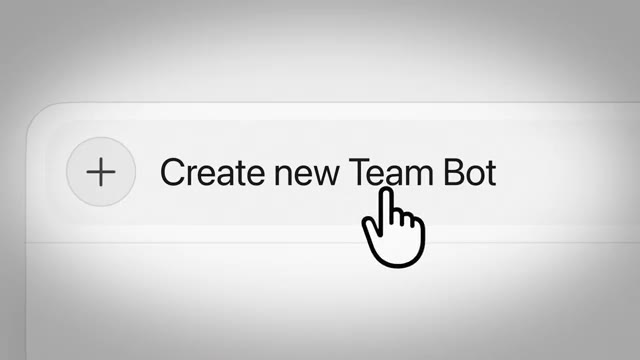
*⏱️ 00:00:18 — Interface épurée affichant un bouton avec le texte 'Create new Team Bot' et une icône de curseur en forme de main.*

*⏱️ 00:00:27 — Page de calendrier du mois de septembre montrant une grille avec plusieurs dates dont certaines sont entourées de rouge.*

---

### ⏱️ `[00:00:37 - 00:00:56]` | Segment #02

**🔊 Audio (Transcription Intégrale Mot pour Mot en Français) :**
> assistant appelé Dots qui est propulsé par les modèles ChatGPT6 Astra. Ils viennent aussi de lancer ChatGPT6.1 Sol, qui est leur tout nouveau modèle qui coûte cinq fois moins cher que le GPT6 Astra avec une intelligence proche du niveau d'Astra. Nous avons également une toute nouvelle plateforme appelée ChatGPT Space, qui est très, très intéressante et dont nous allons parler plus tard dans cette vidéo.

**👁️ Analyse Visuelle d'Écran (gemini-3.5-flash-lite) :**
**Interface & Outils** : Navigateur web affichant une interface de présentation ("ChatGPT Space")

**Contenu textuel & Code** : Interface graphique montrant un écran de présentation avec le logo "ChatGPT Space" et divers widgets/éléments visuels.

**Action / Démonstration** : Navigation et présentation de la nouvelle interface de plateforme par le présentateur.

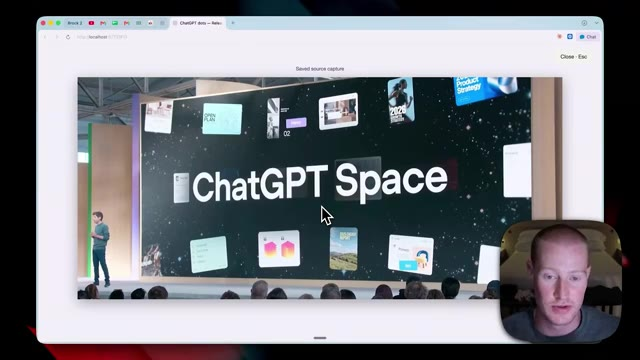
*⏱️ 00:00:51 — Capture d'écran d'un navigateur affichant une interface de présentation intitulée "ChatGPT Space" avec le présentateur en encart.*

---

### ⏱️ `[00:00:56 - 00:01:22]` | Segment #03

**🔊 Audio (Transcription Intégrale Mot pour Mot en Français) :**
> Et ils ont même sorti un forfait à 500 dollars par mois qui offre 25 fois l'utilisation de Plus. Très bien, alors premièrement, nous avons évidemment leur tout nouveau produit appelé Dots. C'est leur assistant IA personnel qui est un concurrent de choses comme GrokBot et Metamuse que nous avons vus au cours du dernier mois. Personnellement, j'utilise GrokBot comme mon outil principal de tous les jours, chaque jour, en plus d'utiliser Codex en parallèle pour mes flux de travail plus spécifiques que je souhaite exécuter.

**👁️ Analyse Visuelle d'Écran (gemini-3.5-flash-lite) :**
**Interface & Outils** : Navigateur web affichant une page de présentation de produit OpenAI.

**Contenu textuel & Code** : Texte "Meet your always-on agent", titre "dots", et visuels des personnages mascottes de l'assistant IA.

**Action / Démonstration** : Présentation du nouveau produit "dots" d'OpenAI par le présentateur.

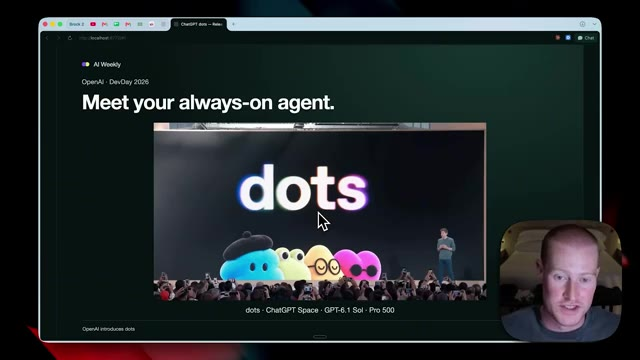
*⏱️ 00:01:03 — Capture d'écran montrant un site web de présentation avec le titre "Meet your always-on agent" et le logo de "dots" d'OpenAI.*

---

### ⏱️ `[00:01:22 - 00:01:58]` | Segment #04

**🔊 Audio (Transcription Intégrale Mot pour Mot en Français) :**
> Je suis donc très excité de tester ce produit car je préférerais rester au sein de l'écosystème d'OpenAI plutôt que d'utiliser Grok, dans la mesure où il s'agit de modèles de niveau supérieur plutôt que d'avoir à utiliser les modèles Grok qui, selon moi, sont un peu limités. Juste ici se trouve la vidéo de démo qu'ils ont montrée lorsqu'ils ont annoncé cela. Survolons-la rapidement. En gros, les « dots » sont ces assistants personnels que nous créons. Ils ont ce petit design mignon ici, qui, honnêtement, donne l'impression qu'ils ont simplement volé ce style de design à GrokBot. Mais cette dame juste ici est en train de parler avec ses « dots ». Et une partie vraiment sympa là-dedans, c'est que non seulement nous pouvons envoyer des SMS avec eux via l'application ChatChapiti,

**👁️ Analyse Visuelle d'Écran (gemini-3.5-flash-lite) :**
**Interface & Outils** : Navigateur web affichant une page de présentation de produit IA, lecteur vidéo intégré.

**Contenu textuel & Code** : Titre de la page "An agent that keeps working between chats", interface de lecture vidéo avec contrôles (Play/pause, Replay, Turn sound on), et graphiques illustratifs du produit.

**Action / Démonstration** : Navigation sur la page web pour présenter et illustrer le produit d'intelligence artificielle OpenAI.

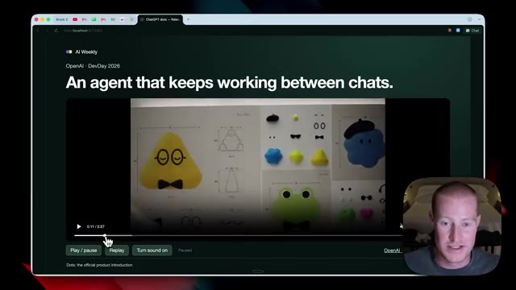
*⏱️ 00:01:40 — Capture d'écran d'un navigateur affichant une page web "AI Weekly" avec une vidéo de démonstration intitulée "An agent that keeps working between chats", et la webcam du présentateur en incrustation.*

---

### ⏱️ `[00:01:58 - 00:02:21]` | Segment #05

**🔊 Audio (Transcription Intégrale Mot pour Mot en Français) :**
> mais nous pourrions réellement parler avec ceux-ci par téléphone. Donc nous pourrions appeler notre dot, nous pourrions envoyer un SMS à notre dot, nous pouvons envoyer un courriel à notre dot, nous pourrions l'ajouter dans des messages Slack. Toutes ces différentes manières de communiquer sont désormais possibles avec notre assistant personnel. Et la chose qui m'enthousiasme le plus, c'est que j'ai l'impression qu'avec le temps, ils vont sortir un produit matériel que nous pourrions utiliser pour communiquer avec notre agent au lieu d'avoir à porter notre téléphone.

**👁️ Analyse Visuelle d'Écran (gemini-3.5-flash-lite) :**
**Interface & Outils** : Navigateur web affichant une page sur localhost avec un lecteur vidéo et une incrustation vidéo du présentateur en bas à droite.

**Contenu textuel & Code** : Texte "An agent that keeps working between chats", "AI Weekly", "OpenAI • DevDay 2026", ainsi qu'une vidéo intégrée avec des boutons "Play / pause", "Replay", "Turn sound on".

**Action / Démonstration** : Le présentateur commente une page web présentant un agent conversationnel doté de capacités d'interaction multi-plateforme.

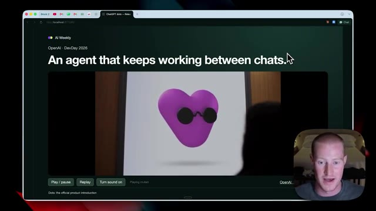
*⏱️ 00:02:04 — Capture d'écran montrant un article de blog intitulé "An agent that keeps working between chats" avec une vidéo illustrant un personnage violet portant des lunettes rondes.*

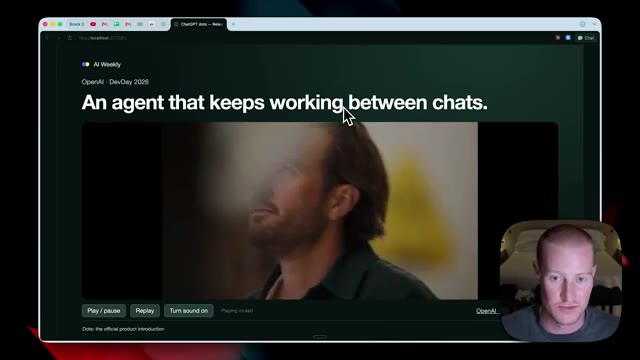
*⏱️ 00:02:09 — Capture d'écran montrant la suite de la vidéo dans le même article de blog, affichant un personnage ou une scène en mouvement.*

---

### ⏱️ `[00:02:21 - 00:02:42]` | Segment #06

**🔊 Audio (Transcription Intégrale Mot pour Mot en Français) :**
> Maintenant, ceci juste ici est un exemple de l'interface de ChatTriBT Dots. Je n'y ai pas encore accès. Sinon, je l'essaierais. Je vais en parler dans les prochains jours lorsque j'en aurai l'accès sur cette chaîne. Assurez-vous donc de vous abonner. Sur le côté droit se trouve notre petite interface ici. Et cela ressemble beaucoup, beaucoup à GrokBot. Nous avons notre petite icône ici en haut où nous pouvons nommer nos agents spécifiques.

**👁️ Analyse Visuelle d'Écran (gemini-3.5-flash-lite) :**
**Interface & Outils** : Navigateur web affichant une interface logicielle / de démonstration mobile (ChatTriBT Dots).

**Contenu textuel & Code** : Maquettes d'applications mobiles illustrant des interfaces de discussion et de publication de photos (profil "small.wonders" avec des messages texte et des bulles roses).

**Action / Démonstration** : Présentation visuelle de l'interface par le présentateur qui commente l'outil à l'écran.

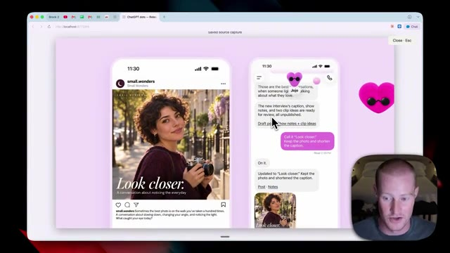
*⏱️ 00:02:26 — Capture d'écran montrant une page web avec une interface de démonstration affichant deux maquettes d'écrans de smartphone sur fond rose, ainsi qu'une petite fenêtre vidéo du présentateur en bas à droite.*

---

### ⏱️ `[00:02:42 - 00:03:01]` | Segment #07

**🔊 Audio (Transcription Intégrale Mot pour Mot en Français) :**
> Ce n'est pas comme Metamuse, où nous n'avons qu'un seul agent. Nous pouvons configurer chaque agent spécialiste individuel pour des tâches données. Ce ne sera rien de révolutionnaire si vous êtes familier avec des plateformes comme GrokBot et Metamuse, si vous les avez testées au cours des deux dernières semaines, mais les "dots" sont fondamentalement capables d'être proactifs et de travailler même lorsque nous ne communiquons pas avec eux.

**👁️ Analyse Visuelle d'Écran (gemini-3.5-flash-lite) :**
**Interface & Outils** : Navigateur web affichant une page de présentation de projet UI/UX (Metamuse ou application similaire) avec incrustation vidéo du présentateur en bas à droite.

**Contenu textuel & Code** : Maquettes d'interfaces mobiles illustrant des agents IA interagissant sous forme de chat et de publications gérées automatiquement.

**Action / Démonstration** : Le présentateur commente l'interface et les fonctionnalités d'agents multiples montrées à l'écran.

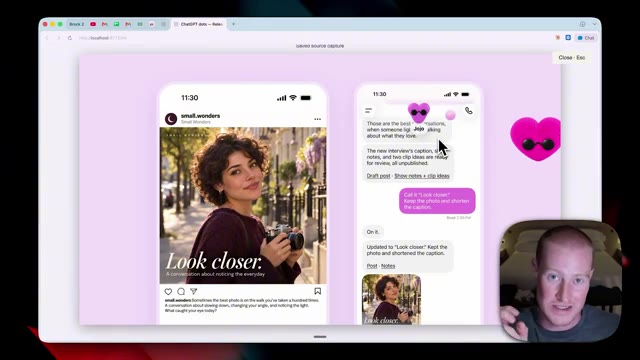
*⏱️ 00:02:47 — Capture montrant une interface mobile avec un flux de type réseau social et une discussion textuelle par agent conversationnel, sur fond rose pastel.*

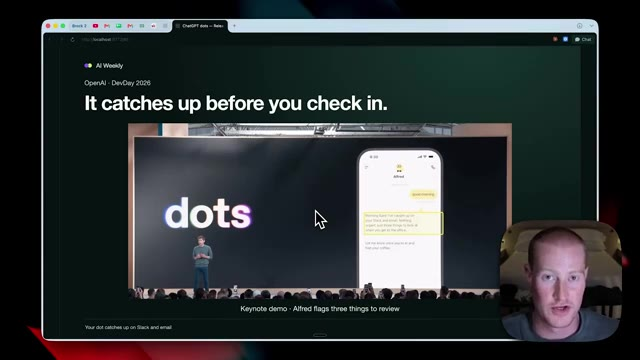
*⏱️ 00:02:52 — Capture affichant un article ou une page de présentation intitulée « AI Weekly » avec la mention « OpenAI - DevDay 2026 » et une photo de keynote montrant le logo « dots ».*

---

### ⏱️ `[00:03:02 - 00:03:38]` | Segment #08

**🔊 Audio (Transcription Intégrale Mot pour Mot en Français) :**
> Donc juste ici, dans cet exemple sur scène, ça montre que le point d'Alfred, le point de Sam Altman, est en train de dire, bonjour Sam. Je me suis déjà mis à jour sur ton Slack et ton email, rien d'urgent, juste trois choses à regarder quand tu arriveras à ton bureau. Donc en gros, c'est proactif. C'est capable de faire un suivi avec toi. Nous avons l'habitude d'utiliser ChatGPT et Codex et de devoir lui donner une invite. Donc maintenant que nous pouvons réellement envoyer des SMS avec lui et qu'il peut être proactif pendant que nous ne sommes pas nécessairement en train d'interagir avec lui, c'est la principale différence ici. Maintenant, parlons rapidement de la façon dont fonctionnent les points et de l'infrastructure derrière tout ça. Donc en gros, nous avons notre point, qui est l'endroit où nous interagissons avec lui. Et cela utilise quelques choses différentes. Cela utilise Codex. C'est en train d'utiliser

**👁️ Analyse Visuelle d'Écran (gemini-3.5-flash-lite) :**
**Interface & Outils** : Navigateur web affichant une présentation de type "AI Weekly" / "OpenAI DevDay".

**Contenu textuel & Code** : Schéma avec un encadré central "Your dot" connecté à Codex (Code + software), ChatGPT Work (Documents + analysis) et Cloud compute.

**Action / Démonstration** : Le présentateur commente l'architecture et les capacités des agents autonomes connectés à différents outils.

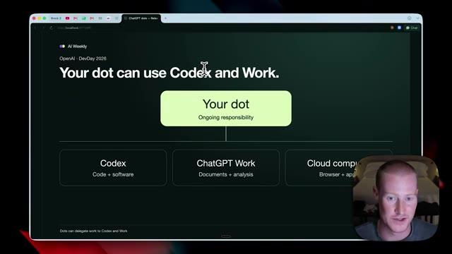
*⏱️ 00:03:29 — Diapositive montrant un schéma organisationnel avec les intégrations "Codex" et "ChatGPT Work".*

---

### ⏱️ `[00:03:38 - 00:04:11]` | Segment #09

**🔊 Audio (Transcription Intégrale Mot pour Mot en Français) :**
> Le travail de ChatGPT et un navigateur dans le nuage ainsi que les applications auxquelles nous sommes connectés. En gros, il est capable de partir et d'utiliser Codex sans que nous ayons besoin d'être à l'intérieur de l'application Codex. Nous pouvons simplement discuter avec notre point et il est capable d'aller effectuer des actions à travers les projets sur lesquels nous travaillons à l'intérieur de Codex. Et encore une fois, tout comme Rockbott, il possède un ordinateur dans le nuage, ce qui, si vous ne savez pas ce que cela signifie, signifie essentiellement qu'il dispose d'une zone désignée où il peut aller travailler et qui n'est pas sur votre appareil physique. De cette façon, vous pouvez lui demander d'aller parcourir Instagram, par exemple, une fois que vous lui avez donné une connexion à Instagram, au lieu qu'il s'exécute sur

**👁️ Analyse Visuelle d'Écran (gemini-3.5-flash-lite) :**
**Interface & Outils** : Navigateur web affichant une diapositive de présentation interactive avec webcam du présentateur en bas à droite.

**Contenu textuel & Code** : Schéma explicatif montrant l'interaction entre "Your dot", "Codex (Code + software)", "ChatGPT Work (Documents + analysis)" et "Cloud computer (Browser + apps)".

**Action / Démonstration** : Le présentateur explique comment l'assistant central ("Your dot") peut déléguer des tâches à différents outils spécialisés (Codex, ChatGPT Work, Cloud computer).

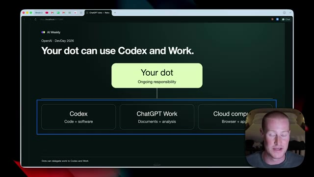
*⏱️ 00:03:46 — Capture d'écran montrant une présentation avec le titre "Your dot can use Codex and Work" illustrant un organigramme reliant "Your dot" à "Codex", "ChatGPT Work" et "Cloud computer".*

---

### ⏱️ `[00:04:11 - 00:04:39]` | Segment #10

**🔊 Audio (Transcription Intégrale Mot pour Mot en Français) :**
> votre propre ordinateur, il s'exécute dans le cloud. Vous pouvez donc continuer à utiliser votre ordinateur pendant qu'il effectue cette tâche. C'est fondamentalement ce que nous avons déjà à l'intérieur de Codex. Si vous avez utilisé cette plateforme ainsi que le travail de ChatGPT. Ce n'est donc pas nécessairement quelque chose de nouveau, mais ces trois éléments constituent nos points ChatGPT. Maintenant, bien sûr, les gens vont poser des questions sur les autorisations et la sécurité derrière tout cela. Est-ce sûr à exécuter ? Est-ce qu'il va envoyer un SMS à votre ex-femme pour lui dire qu'elle vous manque. Des choses comme ça que vous ne voulez pas que votre IA fasse.

**👁️ Analyse Visuelle d'Écran (gemini-3.5-flash-lite) :**
**Interface & Outils** : Navigateur web affichant une interface de présentation de type OpenAI / AI Weekly.

**Contenu textuel & Code** : Schéma avec 'Your dot', 'Codex (Code + software)', 'ChatGPT Work (Documents + analysis)' et 'Cloud computer'.

**Action / Démonstration** : Le présentateur explique l'utilisation de Codex et de ChatGPT Work à travers une interface de démonstration.

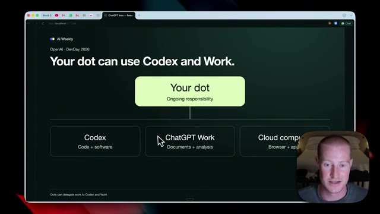
*⏱️ 00:04:18 — Capture d'écran montrant une interface de présentation avec un schéma intitulé 'Your dot can use Codex and Work' et le présentateur incrusté en bas à droite.*

---

### ⏱️ `[00:04:39 - 00:05:10]` | Segment #11

**🔊 Audio (Transcription Intégrale Mot pour Mot en Français) :**
> Donc nous sommes capables de définir des autorisations spécifiques avant de déléguer des tâches. Donc nous pourrions le connecter uniquement aux applications que nous voulons utiliser. Nous pourrions ensuite lui faire exiger une approbation pour les actions immédiates si nous ne voulons pas qu'il fasse n'importe quoi, ce que la plupart des gens vont préférer faire. Maintenant, parlons rapidement de la tarification avec Chachapiti Dots. C'est très, très surprenant et ce sera une bonne nouvelle pour pratiquement tout le monde. Notre premier point est inclus dans notre forfait pro ou business premium sans frais supplémentaires. Il est disponible 24h/24 et 7j/7 pour parler, vous aider à réfléchir et rester à jour sur ce qui compte.

**👁️ Analyse Visuelle d'Écran (gemini-3.5-flash-lite) :**
**Interface & Outils** : Navigateur web affichant une page web explicative et une interface utilisateur d'OpenAI.

**Contenu textuel & Code** : Texte de présentation sur la configuration des autorisations, la gestion des applications connectées et les conditions d'utilisation des 'dots' dans ChatGPT.

**Action / Démonstration** : Navigation et lecture commentée d'une page web de documentation sur les fonctionnalités et les permissions des assistants IA.

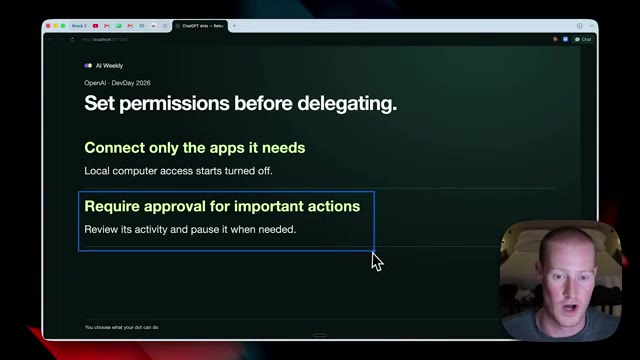
*⏱️ 00:04:47 — Capture d'écran montrant une page web avec le titre 'Set permissions before delegating.' et des options sur les applications et l'approbation des actions.*

---

### ⏱️ `[00:05:11 - 00:05:35]` | Segment #12

**🔊 Audio (Transcription Intégrale Mot pour Mot en Français) :**
> Les conversations avec vos ChatGPT DOTs ne comptent pas dans vos limites d'utilisation de ChatGPT. En revanche, là où cela utilise nos crédits, c'est lorsque vous demandez à votre DOT de démarrer ou de gérer des tâches à l'intérieur de Codex ou de ChatGPT Work, alors là, cela va évidemment compter dans nos limites d'utilisation, ce qui est tout à fait logique. Mais si nous faisons simplement des va-et-vient de discussion avec les DOTs, cela ne nous facture pas. Ensuite, probablement la deuxième plus grande partie de cette annonce, selon moi, c'est ChatGPT Space.

**👁️ Analyse Visuelle d'Écran (gemini-3.5-flash-lite) :**
**Interface & Outils** : Navigateur web affichant une page d'information OpenAI et fenêtre PiP (Picture-in-Picture) de la webcam du présentateur.

**Contenu textuel & Code** : Texte officiel sur les limites d'utilisation : "Conversations with your dot don't count toward your ChatGPT usage limits. When you ask your dot to start or manage tasks in Codex or ChatGPT Work, those tasks count toward your usage limits as usual."

**Action / Démonstration** : Le présentateur lit à l'écran et commente les règles de facturation et d'utilisation des quotas concernant les ChatGPT Dots et Codex/ChatGPT Work.

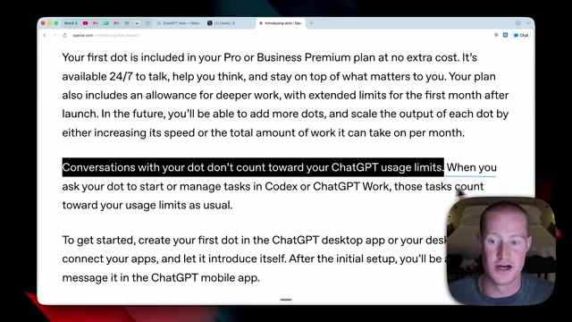
*⏱️ 00:05:17 — Capture d'écran montrant une page web officielle d'OpenAI (openai.com) détaillant les conditions d'utilisation des "dots", avec un texte en surbrillance lu par le présentateur (dont la webcam apparaît en incrustation en bas à droite).*

---

### ⏱️ `[00:05:36 - 00:05:56]` | Segment #13

**🔊 Audio (Transcription Intégrale Mot pour Mot en Français) :**
> Il s'agit fondamentalement d'un nouvel espace de travail dans lequel vous pouvez collaborer non seulement avec votre équipe, mais aussi avec ces points ChatGPT. C'est donc presque un environnement de travail unifié dans lequel ils essaient de nous inciter à travailler. Maintenant, je n'ai personnellement pas encore accès à l'espace ChatGPT ni aux points, mais ceci est une démonstration en direct de ce à quoi cela ressemble. Et cela ressemble beaucoup à Notion.

**👁️ Analyse Visuelle d'Écran (gemini-3.5-flash-lite) :**
**Interface & Outils** : Navigateur web, interface de présentation et outil de collaboration de type espace de travail.

**Contenu textuel & Code** : Texte du titre sur le partage d'espace de travail, affichage de l'événement OpenAI DevDay 2026, sections de documents, et graphiques de feedback client.

**Action / Démonstration** : Présentation du nouvel environnement de travail unifié intégrant des agents d'IA et des espaces collaboratifs partagés.

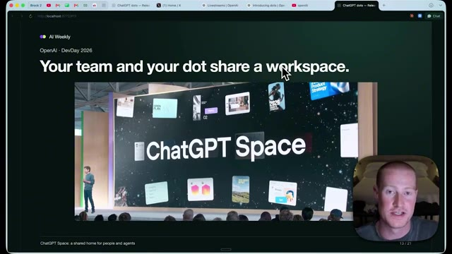
*⏱️ 00:05:41 — Capture d'écran montrant une présentation avec le titre "Your team and your dot share a workspace" et une image de la conférence OpenAI DevDay 2026 présentant "ChatGPT Space".*

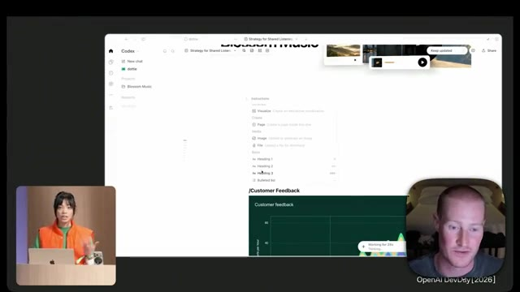
*⏱️ 00:05:51 — Interface d'un espace de travail collaboratif affichant un document de projet avec des options de mise en forme, des graphiques de retours clients et une incrustation vidéo de la présentation.*

---

### ⏱️ `[00:05:56 - 00:06:31]` | Segment #14

**🔊 Audio (Transcription Intégrale Mot pour Mot en Français) :**
> D'après ce que j'ai compris en regardant cette première démo, j'ai l'impression qu'ils essaient de créer un espace unifié comme Notion, à la fois pour les membres de notre équipe et pour nous-mêmes, afin qu'on puisse interagir. Donc, par exemple, juste ici, son point ChatGPT a créé ce petit tableau de bord avec un diagramme de retours. Elle peut aussi taguer son point juste ici afin d'aller faire des modifications sur cette page spécifique. Dès le départ, après avoir vu la démo de ceci, je ne sais pas exactement si j'aime ça. On dirait bien que ça pourrait devenir excessivement complexe. Je préférerais largement communiquer avec mon point ChatGPT dans un fil de discussion textuel, comme je pourrais le faire avec GrokBot. Je serai donc curieux de voir si c'est quelque chose que je vais réellement utiliser au jour le jour. Passons maintenant au nouveau modèle.

**👁️ Analyse Visuelle d'Écran (gemini-3.5-flash-lite) :**
**Interface & Outils** : Interface de type éditeur de documents collaboratifs et espace de travail propulsé par l'IA (semblable à Notion/Codex).

**Contenu textuel & Code** : Graphique de données sur les retours clients (Customer Feedback) avec légendes (Playlist loading, Sessions, etc.) et prompts de chat associés.

**Action / Démonstration** : Navigation et démonstration d'un espace de travail unifié combinant prise de notes, FAQ textuelle et graphiques générés dynamiquement par l'IA.

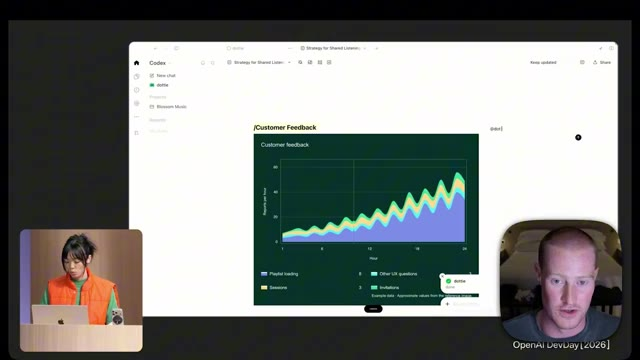
*⏱️ 00:06:04 — Interface de type Notion montrant un graphique de retours clients (Customer Feedback) généré par un assistant IA nommé dottie.*

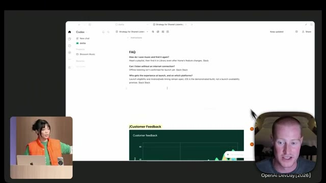
*⏱️ 00:06:13 — Vue de l'interface montrant une section FAQ textuelle avec des questions et réponses relatives au produit.*

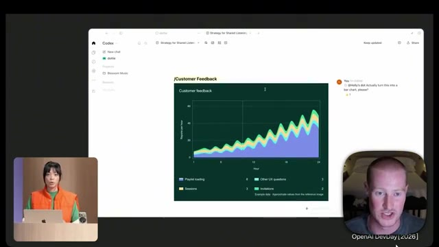
*⏱️ 00:06:22 — Affichage du panneau latéral de chat interactif où un utilisateur demande à l'assistant de transformer le graphique en diagramme en barres.*

---

### ⏱️ `[00:06:31 - 00:06:57]` | Segment #15

**🔊 Audio (Transcription Intégrale Mot pour Mot en Français) :**
> qui est sorti, nous avons le GPT 6.1 SOL, qui est maintenant 80 % moins cher que le GPT 6 Astra. Et OpenAI affirme même qu'il est presque au même niveau d'intelligence que l'Astra 6. Voici un récapitulatif des prix. Donc, nous avons 2 dollars par million de jetons d'entrée sur le GPT 6.1 SOL, alors que l'Astra est à 10 dollars. Pour les entrées en cache, nous avons 0,10 dollar contre 1 dollar. Et enfin pour la sortie, nous avons 10 dollars comparés à 50 dollars sur le GPT 6 Astra.

**👁️ Analyse Visuelle d'Écran (gemini-3.5-flash-lite) :**
**Interface & Outils** : Navigateur web affichant une diapositive de présentation et une webcam du présentateur dans le coin inférieur droit.

**Contenu textuel & Code** : Tableau comparatif des tarifs pour 1M de jetons : GPT-6.1 Sol (Input: $2.00, Cached Input: $0.10, Output: $10.00) vs GPT-6 Astra (Input: $10.00, Cached Input: $1.00, Output: $50.00). Texte : "Sol gets much cheaper than Astra" et "API rates per 1M tokens - input/output -80% - cached input -90%".

**Action / Démonstration** : Le présentateur commente le récapitulatif des prix des nouveaux modèles OpenAI affiché à l'écran.

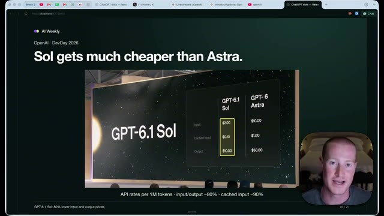
*⏱️ 00:06:38 — Une diapositive de présentation montrant une comparaison des prix entre le GPT-6.1 Sol et le GPT-6 Astra lors d'un événement OpenAI DevDay 2026.*

---

### ⏱️ `[00:06:57 - 00:07:20]` | Segment #16

**🔊 Audio (Transcription Intégrale Mot pour Mot en Français) :**
> Maintenant, à ce stade-ci, il devient incroyablement difficile de suivre tous ces nouveaux modèles, car Anthropic a littéralement sorti Sonnet 5.5 hier. Et quelques jours avant cela, ils ont sorti Opus 5.5. On a l'impression qu'à ce stade, tant OpenAI que Anthropic sortent un nouveau modèle littéralement une semaine sur deux. Seul le temps nous dira donc s'il s'agit réellement d'un modèle aussi performant et bon marché, même si OpenAI affirme que ce sera le cas.

**👁️ Analyse Visuelle d'Écran (gemini-3.5-flash-lite) :**
**Interface & Outils** : Navigateur web affichant une présentation de diapositive avec vidéo en incrustation (PiP).

**Contenu textuel & Code** : Tableau comparatif des tarifs API par million de tokens entre GPT-6.1 Sol et GPT-6 Astra (Input: 2.00$ vs 10.00$, Cached Input: 0.10$ vs 1.00$, Output: 10.00$ vs 50.00%).

**Action / Démonstration** : Présentation des réductions de prix et des nouveaux modèles d'OpenAI par l'intervenant.

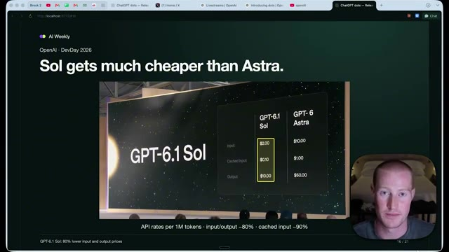
*⏱️ 00:07:03 — Capture d'écran montrant une présentation 'AI Weekly' sur OpenAI DevDay 2026, comparant les prix des modèles GPT-6.1 Sol et GPT-6 Astra avec le présentateur en médaillon.*

---

### ⏱️ `[00:07:20 - 00:07:42]` | Segment #17

**🔊 Audio (Transcription Intégrale Mot pour Mot en Français) :**
> Maintenant, où est-ce que c'est disponible ? C'est disponible dans ChatGPT Work, Codex et l'API à compter d'aujourd'hui pour tous les utilisateurs Plus Pro, business et entreprise. Ensuite, nous avons un nouveau forfait à 500 dollars par mois dans ChatGPT, qui m'enthousiasme personnellement. Je vais définitivement faire la mise à niveau aujourd'hui. Sur ce forfait, nous obtenons le nouveau modèle ultra-rapide, qui a également été publié lors de la DevDay. Nous n'avons pas de limite de cinq heures.

**👁️ Analyse Visuelle d'Écran (gemini-3.5-flash-lite) :**
**Interface & Outils** : Navigateur web affichant une diapositive de présentation sombre avec texte vert et blanc, et un encadré vidéo du présentateur en bas à droite.

**Contenu textuel & Code** : Texte listant les forfaits concernés (Plus, Pro, Business, Enterprise et Edu) et les plateformes de disponibilité.

**Action / Démonstration** : Le présentateur commente les informations textuelles affichées à l'écran concernant la disponibilité des outils.

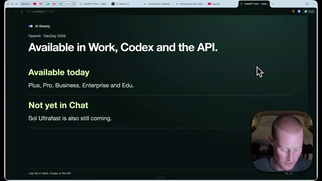
*⏱️ 00:07:25 — Une diapositive de présentation montrant la disponibilité des fonctionnalités avec les sections 'Available in Work, Codex and the API', 'Available today' et 'Not yet in Chat'.*

---

### ⏱️ `[00:07:42 - 00:08:06]` | Segment #18

**🔊 Audio (Transcription Intégrale Mot pour Mot en Français) :**
> Nous pourrions l'utiliser sur l'ensemble de nos applications partenaires, et c'ensuit une utilisation multipliée par 25 du forfait Plus. Ensuite, celui-ci devient un peu plus technique, mais je veux en parler très rapidement. Ils ont également publié la nouvelle API de décisions, qui est très similaire à JEV, qui a fait sensation dans le monde entier ces deux dernières semaines. Il s'agit d'une nouvelle façon pour nos agents d'intelligence artificielle de prendre des décisions très, très rapidement. Et en retour, cela signifie que l'utilisation de l'ordinateur peut être bien meilleure.

**👁️ Analyse Visuelle d'Écran (gemini-3.5-flash-lite) :**
**Interface & Outils** : Écran de présentation lors d'une conférence, avec une petite fenêtre incrustée du présentateur en bas à droite.

**Contenu textuel & Code** : Texte 'Decisions API', 'In preview', et une interface utilisateur simulant une requête de vol ('Find a one-way, nonstop flight from SFO to Seattle on Friday').

**Action / Démonstration** : Présentation de la nouvelle API de décisions d'OpenAI lors d'une keynote devant un public.

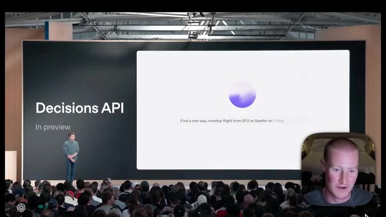
*⏱️ 00:07:48 — Une diapositive de présentation affichant le titre 'Decisions API' avec la mention 'In preview', accompagnée d'une démonstration visuelle d'une interface de recherche de vol.*

---

### ⏱️ `[00:08:06 - 00:08:41]` | Segment #19

**🔊 Audio (Transcription Intégrale Mot pour Mot en Français) :**
> Donc, comme vous pouvez le voir à l'écran juste ici, nous avons notre API de décisions qui s'exécute et utilise l'utilisation de l'ordinateur afin d'aller réserver un vol pour nous. Et comme vous pouvez le voir, c'est extrêmement rapide. Si vous avez déjà utilisé une version précédente de l'utilisation de l'ordinateur, c'est très lent lorsqu'il s'agit de prendre des décisions sur les boutons sur lesquels cliquer, sur la façon d'utiliser des interfaces spécifiques. Cela devrait donc faire une grande différence en ce qui concerne l'utilisation de l'ordinateur et l'exécution de nos différents agents d'IA dans ChatGPT. Très bien, ce sont donc les principaux sujets que je voulais aborder de la part d'OpenAI DevDay. Je suis très enthousiaste à l'idée de commencer à tester à la fois ChatGPT DOTS GPT 6.1 SOL. Je vais passer au forfait de 500 dollars par mois et

**👁️ Analyse Visuelle d'Écran (gemini-3.5-flash-lite) :**
**Interface & Outils** : Écran de présentation de conférence (OpenAI DevDay) et navigateur web.

**Contenu textuel & Code** : Interface utilisateur affichant la recherche automatisée d'un vol aller simple de SFO à Seattle avec des filtres spécifiques.

**Action / Démonstration** : Démonstration de l'utilisation automatisée d'un ordinateur pour réserver un vol via l'API de décisions.

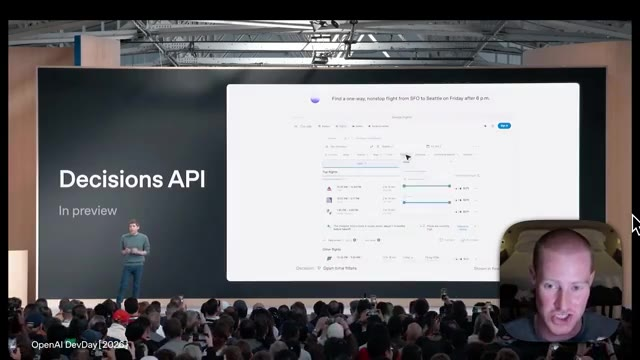
*⏱️ 00:08:15 — Présentation de l'API de décisions (Decisions API) lors d'une conférence OpenAI DevDay, montrant une interface de recherche de vol automatisée.*

---

### ⏱️ `[00:08:41 - 00:09:14]` | Segment #20

**🔊 Audio (Transcription Intégrale Mot pour Mot en Français) :**
> je vais vous dire si je continue à me heurter à mes limites d'utilisation. L'une des plus grandes annonces de la DevDay d'OpenAI a été complètement ignorée. Chat devrait être Team Space. C'est une nouvelle façon d'interagir avec l'intelligence artificielle et nos équipes. Et je ne vais pas mentir, j'étais très sceptique au début, mais je commence à vraiment aimer ça. Donc ce que je vais faire, c'est vous expliquer exactement ce que c'est et comment l'utiliser. Ils ont sorti environ 20 produits différents. Beaucoup sont des outils pour développeurs, mais il y en a quelques-uns qui sont importants pour nous, les consommateurs moyens. Laissez-moi donc vous expliquer cela très simplement en 30 secondes environ. Tout d'abord, ils ont sorti les GPTs, qui sont une nouvelle intelligence artificielle personnelle

**👁️ Analyse Visuelle d'Écran (gemini-3.5-flash-lite) :**
**Interface & Outils** : Présentation ou face-caméra explicatif du trader sans interface logicielle partagée.

**Contenu textuel & Code** : Explications orales des stratégies et mise en contexte méthodologique du marché.

**Action / Démonstration** : Explications face caméra et analyse conceptuelle des marchés.

---

### ⏱️ `[00:09:14 - 00:09:47]` | Segment #21

**🔊 Audio (Transcription Intégrale Mot pour Mot en Français) :**
> assistant that we could use that use codecs a cloud computer and can basically just perform tasks for us and we could text it like a normal person next we have chatubt plugins which allows developers to build their apps directly into the chatubt app which i'm actually going to show you later on in this video and then chatubt space which is the main thing that i'm going to talk about in this video a completely new way to interact with both your team members and your agents like chatubt dots they also announced a 500 per month chatubt subscription which i talk about in that previous video as well. Now let's quickly talk about what ChatGPT space is before I

**👁️ Analyse Visuelle d'Écran (gemini-3.5-flash-lite) :**
**Interface & Outils** : Présentation ou face-caméra explicatif du trader sans interface logicielle partagée.

**Contenu textuel & Code** : Explications orales des stratégies et mise en contexte méthodologique du marché.

**Action / Démonstration** : Explications face caméra et analyse conceptuelle des marchés.

---

### ⏱️ `[00:09:47 - 00:10:22]` | Segment #22

**🔊 Audio (Transcription Intégrale Mot pour Mot en Français) :**
> vous montrer une démo de moi l'utilisant, ce que j'aime et ce que je déteste à son sujet. Nous pourrions interagir avec ceci entre nos membres d'équipe et nos agents IA. Cela nous permet de créer et de collaborer ensemble. Nous pourrions visualiser n'importe quoi sur des tableaux de bord à l'intérieur de ces sites ChatGPT. Et plus important encore, nous pourrions permettre à nos points ChatGPT de travailler également à l'intérieur de ces espaces unifiés. Maintenant, votre prochaine question est probablement de savoir qui a accès à ceci ? Donc, si vous êtes un utilisateur pro, un utilisateur professionnel, et un utilisateur d'entreprise sur le web, le bureau et le mobile, vous aurez accès à ceci. Maintenant, assez parlé de ça. Laissez-moi vous montrer exactement à quoi cela ressemble à l'intérieur de l'application de bureau ChatGBT. Donc, première chose, je veux donner

**👁️ Analyse Visuelle d'Écran (gemini-3.5-flash-lite) :**
**Interface & Outils** : Navigateur web affichant le site officiel de ChatGPT Space.

**Contenu textuel & Code** : Texte descriptif sur les fonctionnalités de collaboration en équipe, les agents IA 'dots' et la disponibilité sur différentes plateformes.

**Action / Démonstration** : Le présentateur fait défiler la page web pour illustrer les fonctionnalités présentées dans la vidéo.

---

### ⏱️ `[00:10:22 - 00:10:57]` | Segment #23

**🔊 Audio (Transcription Intégrale Mot pour Mot en Français) :**
> tu une visite guidée rapide de la nouvelle interface à l'intérieur de ChatGPT parce qu'elle a l'air assez différente. Donc tout d'abord, nous avons ChatGPT. Nous pouvons basculer entre le mode chat et le mode travail. Nous avons ensuite notre bulle de chat normale ici avec laquelle nous pouvons interagir. Nous avons nos conversations épinglées sur le côté gauche. Et puis je peux basculer entre ChatGPT et Codex. Donc si je passe à Codex, ce sera exactement la même chose. Nous pouvons travailler à l'intérieur de nos projets et dossiers ici. Et nous avons même accès à notre modèle unique GPT 6.1, qui vient de sortir hier à la DevDay également. Maintenant, ce sur quoi nous allons nous concentrer ici, c'est cette petite icône de page, et c'est l'espace ChatGPT. Et si je

**👁️ Analyse Visuelle d'Écran (gemini-3.5-flash-lite) :**
**Interface & Outils** : Interface utilisateur web de ChatGPT.

**Contenu textuel & Code** : Options de bascule Chat/Work, liste des chats épinglés, sélecteur de modèle IA (GPT-6.1 Sol High) et zone de saisie.

**Action / Démonstration** : Visite guidée et présentation des différentes sections et options de la nouvelle interface ChatGPT par le présentateur.

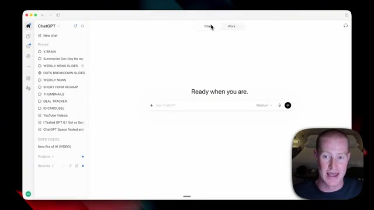
*⏱️ 00:10:31 — Vue d'ensemble de la nouvelle interface de ChatGPT montrant le sélecteur de mode Chat/Work et la zone de saisie.*

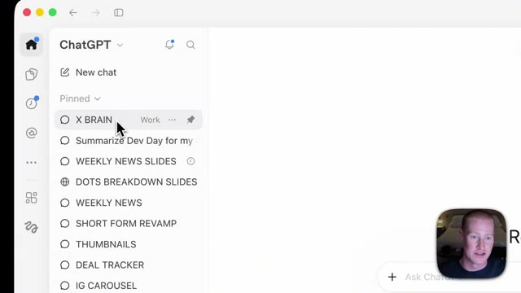
*⏱️ 00:10:40 — Gros plan sur la barre latérale gauche de l'interface ChatGPT avec les éléments épinglés et le menu de navigation.*

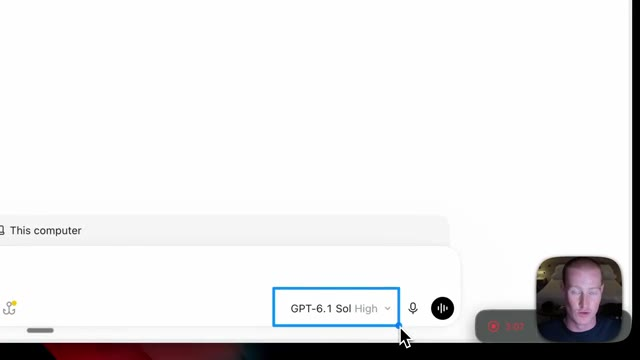
*⏱️ 00:10:48 — Zoom sur le menu de sélection de modèle et de configuration au niveau de la zone de saisie (GPT-6.1 Sol High).*

---

### ⏱️ `[00:10:57 - 00:11:30]` | Segment #24

**🔊 Audio (Transcription Intégrale Mot pour Mot en Français) :**
> ouvrez mon espace, nous allons voir quelques éléments différents. Maintenant, si je clique sur ce bouton "tous", c'est fondamentalement notre tableau de bord pour l'ensemble de notre espace ChatGPT. Sur le côté gauche, nous avons tout un tas d'actifs différents. Ce sont toutes les différentes pages que j'ai créées. Et ne vous inquiétez pas, je sais que cela a l'air et semble probablement intimidant. Genre, quelle est la différence entre un espace et une page et tous ces différents mots à la mode ? Alors décomposons rapidement tous les concepts que vous devez comprendre sur l'espace ChatGPT dès maintenant afin que vous puissiez comprendre le reste de cette vidéo. Très bien, donc la première chose que nous devons comprendre, c'est que nous avons différents espaces.

**👁️ Analyse Visuelle d'Écran (gemini-3.5-flash-lite) :**
**Interface & Outils** : Interface web de gestion d'espace de travail (style Notion/ChatGPT).

**Contenu textuel & Code** : Tableau de bord affichant la section "All" avec des suggestions de pages, des listes de fichiers récents et une barre latérale avec les différentes pages et actifs.

**Action / Démonstration** : Navigation et présentation du tableau de bord global de l'espace ChatGPT par le présentateur.

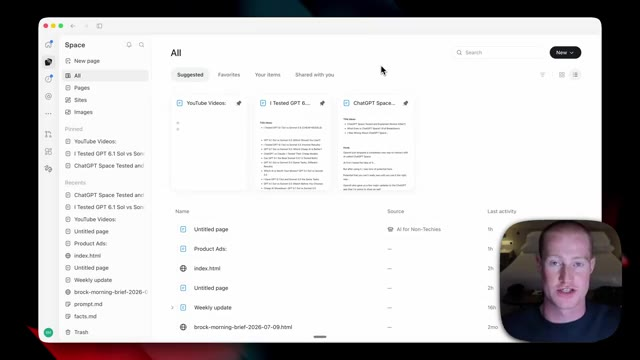
*⏱️ 00:11:05 — Capture d'écran montrant l'interface d'un espace de travail de type ChatGPT avec un tableau de bord général et un menu latéral.*

---

### ⏱️ `[00:11:30 - 00:12:03]` | Segment #25

**🔊 Audio (Transcription Intégrale Mot pour Mot en Français) :**
> Et un espace, c'est fondamentalement juste un carrefour qui comporte quelques éléments en dessous. Donc personnellement, j'ai créé deux espaces. J'en ai un qui s'appelle AI for non-techies, qui regroupe tout ce qui concerne ma marque YouTube. Et puis j'en ai un autre qui s'appelle Loom Media, qui regroupe tout ce qui concerne mon agence de marketing d'influence. Ce sont donc deux zones désignées qui sont séparées l'une de l'autre, ce qui fait que je recommande de créer plusieurs espaces pour votre vie personnelle par rapport à votre vie professionnelle, par exemple. Et maintenant, à l'intérieur de cet espace, voici à quoi cela ressemble. À l'intérieur de mon espace AI for non-techies, nous avons cette courte description de ce pour quoi cet espace va être créé. Donc j'ai encore

**👁️ Analyse Visuelle d'Écran (gemini-3.5-flash-lite) :**
**Interface & Outils** : Excalidraw (navigateur web)

**Contenu textuel & Code** : Schéma textuel et visuel intitulé « The Different Concepts », affichant les éléments de menu « Spaces » avec les options « AI for Non-Techies » et « Luume Media », ainsi qu'une fenêtre de création d'espace.

**Action / Démonstration** : Présentation et explication de la structure des espaces de travail et de la création de nouveaux espaces.

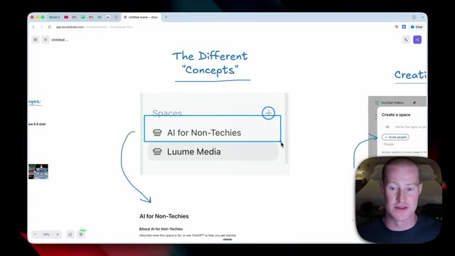
*⏱️ 00:11:38 — Capture d'écran montrant l'application Excalidraw avec un schéma explicatif sur les « Spaces », illustrant les espaces « AI for Non-Techies » et « Luume Media », avec la webcam du présentateur incrustée en bas à droite.*

---

### ⏱️ `[00:12:03 - 00:12:39]` | Segment #26

**🔊 Audio (Transcription Intégrale Mot pour Mot en Français) :**
> pour remplir ceci afin que vous puissiez voir, je dois décrire cela. Mais c'est fondamentalement là que nous décomposons, d'accord, voici le centre pour ce secteur spécifique de ma vie ou de mon entreprise. Et nous pouvons fournir un contexte pour cela. Ensuite, à l'intérieur de nos espaces, nous avons quelques éléments. Nous avons des pages et nous avons des sous-pages. Ceci, ici même, est la page vidéo de mon YouTube. Et en dessous, j'ai quelques sous-pages. J'ai donc évidemment ces différentes vidéos, sur lesquelles si je clique, cela m'amène à une vue plus détaillée de cette vidéo. Maintenant, l'une des choses vraiment géniales à propos de l'espace de Chachabuti, c'est que vous pouvez voir en bas à droite de mon écran, j'ai en fait Codex d'ouvert. C'est donc le petit Codex

**👁️ Analyse Visuelle d'Écran (gemini-3.5-flash-lite) :**
**Interface & Outils** : Navigateur web, interface Excalidraw / outil de productivité en ligne

**Contenu textuel & Code** : Texte affiché : 'AI for Non-Techies', 'About AI for Non-Techies', 'Describe what this space is for, or ask ChatGPT to help you get started', avec une option d'aide interactive.

**Action / Démonstration** : Le présentateur montre l'interface de travail et explique comment structurer et documenter un espace ou un projet.

*⏱️ 00:12:12 — Capture d'écran montrant l'interface d'un navigateur web avec une application de type tableau blanc ou prise de notes (Excalidraw ou similaire), affichant le titre 'AI for Non-Techies' ainsi qu'une section de description et un curseur en forme de main. Le présentateur apparaît dans un encadré vidéo en bas à droite.*

---

### ⏱️ `[00:12:39 - 00:13:10]` | Segment #27

**🔊 Audio (Transcription Intégrale Mot pour Mot en Français) :**
> fenêtre que je pouvais déclencher à tout moment. Cela fonctionne à l'intérieur de l'un de mes dossiers dans lequel je travaille dans Codex. C'est principalement ainsi que j'utilise Chachabuti à ce stade via Codex. Donc ce que je pourrais faire, c'est que je pourrais travailler avec cette page spécifique. Donc par exemple, je vais juste venir ici et dire, je veux que tu génères une autre vignette très similaire à celle-ci. Cependant, je veux que tu fasses éclater le soleil en flammes un peu plus. Maintenant, ce que notre codex va faire ici, c'est simplement prendre cette vignette. Il va ensuite la régénérer avec Chatubut image 2.5 et il va ensuite l'ajouter automatiquement à mes vignettes juste ici. Très bien, alors voilà.

**👁️ Analyse Visuelle d'Écran (gemini-3.5-flash-lite) :**
**Interface & Outils** : Application de prise de notes et d'IA (type Notion avec intégration d'agent IA).

**Contenu textuel & Code** : Texte de notes de projet listant des tests (« GPT 6.1 Sol vs Sonnet 5.5 », « Thumbnails ») et interface de discussion avec l'IA affichant des messages en cours de traitement (« Working for 7s », « I'll check the reference thumbnail... », « Thinking »).

**Action / Démonstration** : Navigation et interaction avec l'assistant IA intégré dans un dossier de projet pour modifier des éléments visuels ou générer du contenu.

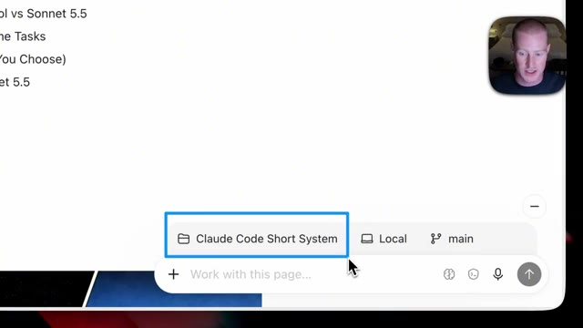
*⏱️ 00:12:47 — Gros plan sur une interface d'application montrant une barre de saisie contextuelle avec le dossier « Claude Code Short System » et le champ « Work with this page... ».*

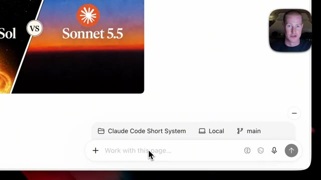
*⏱️ 00:12:54 — Vue légèrement dézoomée de la même interface avec la barre de saisie de texte active en bas de page.*

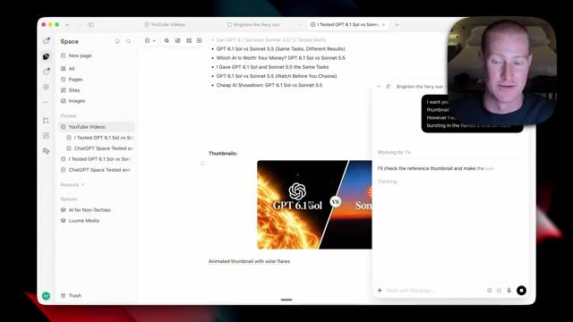
*⏱️ 00:13:02 — Vue globale de l'espace de travail avec un panneau latéral à gauche, une page de notes de projet au centre montrant des comparaisons « GPT 6.1 Sol vs Sonnet 5.5 » et une fenêtre de chat contextuelle ouverte à droite.*

---

### ⏱️ `[00:13:10 - 00:13:45]` | Segment #28

**🔊 Audio (Transcription Intégrale Mot pour Mot en Français) :**
> Maintenant, nous avons cette image ajoutée juste en dessous de ma miniature précédente, qui, je trouve, a un bien meilleur rendu. Nous avons évidemment le soleil qui brille un peu plus, de sorte que vous pouvez commencer à voir comment nous interagissons à la fois avec les codes de Chatubut à l'intérieur de nos espaces. Je vais créer une nouvelle page à partir de zéro et l'élaborer pour que vous puissiez voir exactement comment cela fonctionne en temps réel. Je vais donc venir ici, cliquer sur nouvelle page, et je vais appeler ceci annonces de produits. Et je vais simplement télécharger quelques images de référence ici. Nous avons donc ce petit produit, nous avons une canette de Sun Bum. Et disons que nous voulons générer des annonces de produits à partir de cette image juste ici. C'est l'image de référence que nous voulons utiliser. Et une chose vraiment cool avec nos pages, c'est que nous pouvons utiliser les plugins spécifiques que nous avons.

**👁️ Analyse Visuelle d'Écran (gemini-3.5-flash-lite) :**
**Interface & Outils** : Présentation ou face-caméra explicatif du trader sans interface logicielle partagée.

**Contenu textuel & Code** : Explications orales des stratégies et mise en contexte méthodologique du marché.

**Action / Démonstration** : Explications face caméra et analyse conceptuelle des marchés.

---

### ⏱️ `[00:13:45 - 00:14:21]` | Segment #29

**🔊 Audio (Transcription Intégrale Mot pour Mot en Français) :**
> connecté à ChatGPT. Donc nous pourrions utiliser les différentes applications à l'intérieur de nos espaces. Maintenant, l'application spécifique que je vais utiliser est Higgsfield. Donc je vais utiliser ceci pour prendre cette image et générer différentes vidéos que nous pourrions utiliser pour des publications sur les réseaux sociaux à l'intérieur de notre espace. Donc ce que je vais faire, c'est que je vais venir sur Higgsfield. Si vous voulez essayer ceci, il y habrá un lien dans la description pour le configurer vous-même également. Donc je vais cliquer sur installer le plugin Higgsfield. Je vais cliquer sur ouvrir ChatGPT. Et maintenant, juste comme ça, j'ai le plugin Higgsfield installé. Une chose vraiment cool qu'ils ont ajoutée à ChatGPT hier lors de la DevDay, c'est qu'ils ont ajouté des plugins désignés. Donc ce que cela signifie, c'est que différents produits peuvent s'intégrer directement dans ChatGPT. Donc si

**👁️ Analyse Visuelle d'Écran (gemini-3.5-flash-lite) :**
**Interface & Outils** : Navigateur web affichant le site officiel de Higgsfield (higgsfield.ai) et l'interface de l'application Codex.

**Contenu textuel & Code** : Page de présentation du plugin Higgsfield pour ChatGPT, avec un bouton d'installation et des options de préréglages.

**Action / Démonstration** : Le présentateur présente la plateforme Higgsfield qu'il va utiliser pour générer des vidéos à partir d'une image.

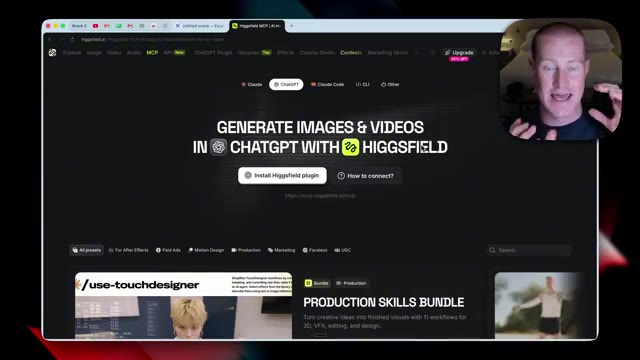
*⏱️ 00:13:54 — Capture d'écran montrant le site web de Higgsfield avec le titre "GENERATE IMAGES & VIDEOS IN CHATGPT WITH HIGGSFIELD".*

---

### ⏱️ `[00:14:21 - 00:14:52]` | Segment #30

**🔊 Audio (Transcription Intégrale Mot pour Mot en Français) :**
> vous voyez sur le côté gauche de l'écran nous avons cette icône Higgs field si je clique dessus nous pouvons ouvrir cette interface juste ici qui montre tous mes différents éléments générés par Higgs field donc maintenant que nous avons téléchargé Higgs field ce que je peux faire c'est venir dans le chat et je peux dire hé donc je veux que tu prennes cette image de cette bouteille Sun Bum et que tu crées plusieurs publicités de produits différentes que nous pourrons utiliser pour les médias sociaux celles-ci vont être utilisées pour les stories Instagram et différentes publications Instagram donc je veux que tu sois créatif pour créer ces éléments visuels en utilisant Higgs field. Donc ce que je vais faire c'est simplement taper arobase Higgs field. Pour qu'il sache qu'il doit utiliser Higgs field.

**👁️ Analyse Visuelle d'Écran (gemini-3.5-flash-lite) :**
**Interface & Outils** : Interface web de Higgsfield

**Contenu textuel & Code** : Galerie de contenus générés par IA et champ de saisie de texte.

**Action / Démonstration** : Navigation dans l'historique des générations et interaction avec l'interface.

---

### ⏱️ `[00:14:53 - 00:15:27]` | Segment #31

**🔊 Audio (Transcription Intégrale Mot pour Mot en Français) :**
> Et ensuite, je vais envoyer ceci. Ça va aller utiliser cette application pour générer ces images. Et ensuite, ça va les coller automatiquement de retour dans cette page juste ici. Très bien. Donc, ce que Codex a fait, c'est qu'il est allé générer ces différentes images ici. Nous avons donc maintenant, je crois, six images différentes de cette « sunbomb ». Celles-ci ont l'air honnêtement incroyables, avant, nous aurions dû les générer dans Canva il y a environ six mois. Celles-ci sont donc vraiment, vraiment bien. Et donc, ce que je pourrais faire maintenant, c'est que je pourrais en fait lui demander d'aller les ajouter à cette page, car pour l'instant, ça les a fondamentalement ajoutées à un fichier zip que je dois aller télécharger sur mon bureau. Mais je vais simplement venir ici et dire : « Hé, je veux que tu ailles en fait les ajouter à ce produit ».

**👁️ Analyse Visuelle d'Écran (gemini-3.5-flash-lite) :**
**Interface & Outils** : Navigateur web affichant une application de productivité / espace de travail IA (type Notion ou similaire) avec intégration de chat et d'outils d'automatisation.

**Contenu textuel & Code** : Un message de prompt destiné à générer des publicités pour les réseaux sociaux à partir d'une image de bouteille de crème solaire, avec une vignette de génération en bas à gauche et la webcam du présentateur en haut à droite.

**Action / Démonstration** : Le présentateur montre l'utilisation d'un agent ou d'un flux automatisé pour envoyer une image et un prompt à une application externe (Higgsfield) afin de générer des visuels publicitaires.

*⏱️ 00:15:01 — Capture d'écran montrant une interface de type espace de travail avec un panneau de chat à gauche affichant un prompt textuel lié à la génération d'images publicitaires, et à droite une page intitulée 'Product Ads' contenant l'image initiale d'une bouteille de crème solaire.*

---

### ⏱️ `[00:15:27 - 00:15:49]` | Segment #32

**🔊 Audio (Transcription Intégrale Mot pour Mot en Français) :**
> page de publicités. Je veux que vous ajoutiez les publicités générées par texte. Et puis en dessous, vous pourriez ajouter les images. Très bien. Donc maintenant, nous avons toutes ces différentes ressources générées et ajoutées à notre page à l'intérieur de notre espace Chachapiti. Donc cela détaille la disposition réelle pour chacun d'eux. Nous avons donc notre story Instagram. Nous avons notre flux Instagram « golden hour » pour la story Instagram et ensuite le flux Instagram.

**👁️ Analyse Visuelle d'Écran (gemini-3.5-flash-lite) :**
**Interface & Outils** : Application web de gestion de projet / espace de travail de type ChatGPT Spaces / interface de génération d'images publicitaires.

**Contenu textuel & Code** : Texte de prompt détaillé pour la création de publicités de produits solaires, listes de formats Instagram (1080x1920, 1080x1350) et images publicitaires générées par IA.

**Action / Démonstration** : Présentation et visualisation des ressources publicitaires générées et intégrées dans l'espace de travail.

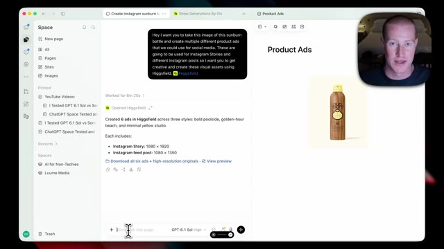
*⏱️ 00:15:33 — Interface d'un espace de travail montrant un prompt textuel pour créer des publicités de produits solaires, avec l'image d'une bouteille de crème solaire sur le côté droit et la webcam du présentateur dans un coin.*

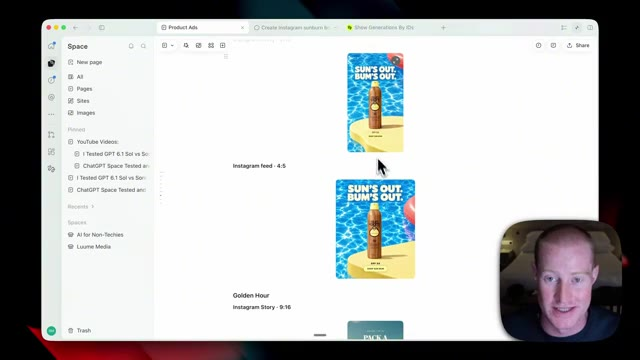
*⏱️ 00:15:38 — Interface présentant plusieurs visuels publicitaires générés pour Instagram (Story et Feed) mettant en vedette une bouteille de crème solaire au bord d'une piscine avec le texte "Sun's out, bum's out".*

---

### ⏱️ `[00:15:49 - 00:16:17]` | Segment #33

**🔊 Audio (Transcription Intégrale Mot pour Mot en Français) :**
> And then obviously, as you can see, it breaks down the aspect ratio. So we know which one we should post to which. I mean, these look really solid. Now, what we could do is I could come back to our little codex bubble right here and say, all right, I want you to take this product and I want you to now turn it into an Apple product style video. On top of that, I want you to generate another video with Higgs field, taking the bottom image that you generated showing your son sidekick and turn this into a video as well in the same style as that asset you generated.

**👁️ Analyse Visuelle d'Écran (gemini-3.5-flash-lite) :**
**Interface & Outils** : Navigateur web affichant une application de productivité / espace de travail IA (type Notion ou similaire).

**Contenu textuel & Code** : Visuels publicitaires de produits, légendes de formats (ex: "Instagram feed - 4:5"), et logs d'exécution de l'assistant IA.

**Action / Démonstration** : Présentation des différents formats d'images générés et démonstration de l'interaction avec le module IA.

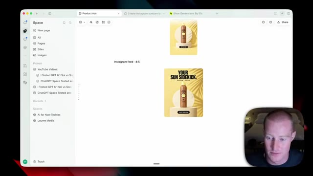
*⏱️ 00:15:56 — Interface d'un espace de travail montrant des visuels publicitaires générés pour les réseaux sociaux, avec des formats adaptés pour Instagram.*

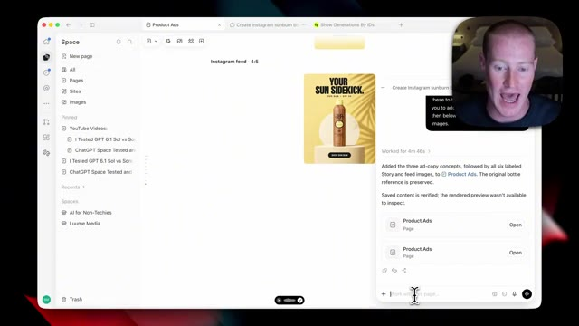
*⏱️ 00:16:03 — Le même espace de travail avec le panneau de chat latéral ouvert à droite, affichant l'historique et les actions de l'assistant IA.*

---

### ⏱️ `[00:16:17 - 00:16:39]` | Segment #34

**🔊 Audio (Transcription Intégrale Mot pour Mot en Français) :**
> Donc, je vais simplement lui donner cette consigne. Encore une fois, je vais juste identifier Higgsfield pour qu'il sache qu'il doit utiliser le MCP de Higgsfield ici. Et il va aller générer ces éléments, puis les ajouter à nouveau à cette page à l'intérieur de Spaces. Très bien, donc quelques minutes plus tard, Higgsfield a généré ces vidéos pour nous. Comme vous pouvez le voir en bas à droite de notre écran dans notre petite bulle de codex, il a ajouté cette coche. Cela signifie donc que cette tâche est terminée et a été ajoutée à notre page.

**👁️ Analyse Visuelle d'Écran (gemini-3.5-flash-lite) :**
**Interface & Outils** : Interface de l'application de productivité et de gestion de contenu Spaces avec assistant IA intégré.

**Contenu textuel & Code** : Prompts textuels pour la génération vidéo avec Higgsfield et descriptions de séquences publicitaires (Apple inspired product film, Your Sun Sidekick motion ad).

**Action / Démonstration** : Soumission d'une consigne textuelle à l'assistant IA pour générer des vidéos promotionnelles à partir d'éléments visuels existants.

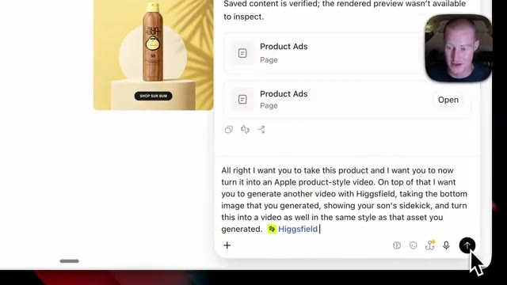
*⏱️ 00:16:23 — Saisie d'un prompt détaillé intégrant le MCP de Higgsfield pour transformer une image de produit en vidéo publicitaire de style Apple.*

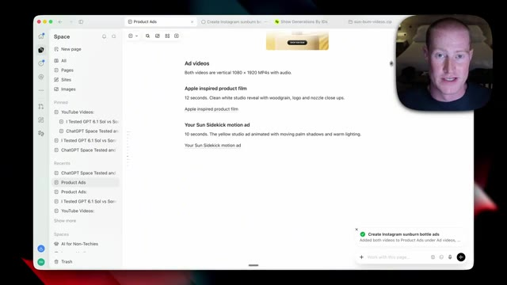
*⏱️ 00:16:28 — Affichage de la page de projet dans l'application Spaces, montrant la génération réussie et l'intégration de vidéos publicitaires au format vertical 1080x1920 MP4.*

---

### ⏱️ `[00:16:39 - 00:16:58]` | Segment #35

**🔊 Audio (Transcription Intégrale Mot pour Mot en Français) :**
> Also, one thing I didn't even mention is I could click on voice mode and we can interact with it this way in order to make changes. Now, let's go ahead and click on these. So if I click on this, it's gonna bring us to this page. It looks like we can't preview here, but instead I could just download this to my desktop. All right, so here is the first one. This is that Apple product demo styled video that I wanted to generate.

**👁️ Analyse Visuelle d'Écran (gemini-3.5-flash-lite) :**
**Interface & Outils** : Interface web d'assistant IA / plateforme de création de contenu multimédia (Space).

**Contenu textuel & Code** : Fichier vidéo généré nommé "apple-inspired-product-film.mp4" dans un espace de travail cloud, avec options de téléchargement et de lecture.

**Action / Démonstration** : Le présentateur commente l'interaction vocale possible et navigue vers le fichier généré, montrant la prévisualisation et les options de téléchargement de la vidéo publicitaire.

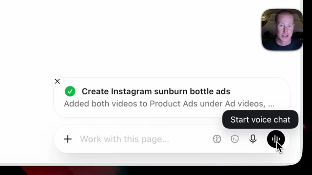
*⏱️ 00:16:44 — Gros plan sur l'interface avec la bulle d'aide "Start voice chat" au-dessus du bouton micro et l'invite de tâche "Create Instagram sunburn bottle ads".*

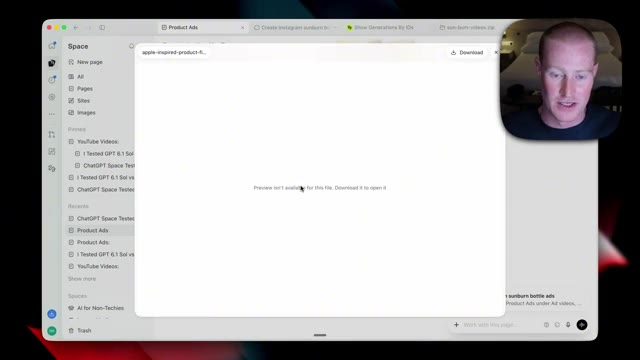
*⏱️ 00:16:48 — Affichage d'une fenêtre pop-up indiquant "Preview isn't available for this file. Download it to open it" avec un bouton de téléchargement en haut à droite.*

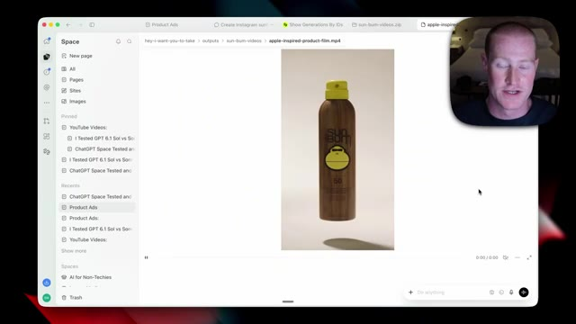
*⏱️ 00:16:53 — Visualisation d'une vidéo générée montrant une bouteille de spray solaire Sun Bum avec un design inspiré d'Apple sur fond neutre.*

---

### ⏱️ `[00:16:58 - 00:17:19]` | Segment #36

**🔊 Audio (Transcription Intégrale Mot pour Mot en Français) :**
> Choisis notre canette de crème solaire Sunbump. C'est évidemment très bien. Ça a le style Apple. C'est donc plutôt cool. Et voici notre deuxième démo juste ici. Encore une fois, c'est exactement dans le même style qu'avant. Nous avons les ombres de palmier qui bougent. C'est plutôt cool. C'est quelque chose qu'on pourrait publier directement dans nos stories Instagram, par exemple. Je tiens à souligner qu'on peut aussi accéder à toutes ces informations directement dans notre espace ChatDBT dans le navigateur.

**👁️ Analyse Visuelle d'Écran (gemini-3.5-flash-lite) :**
**Interface & Outils** : Interface web de gestion de projets et d'espaces de travail / lecteur vidéo intégré.

**Contenu textuel & Code** : Fichiers vidéo de démonstration de produits publicitaires et arborescence de dossiers.

**Action / Démonstration** : Présentation de la première démo vidéo publicitaire au style épuré.

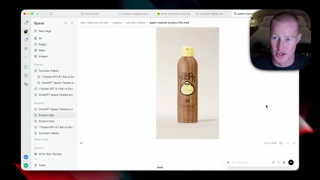
*⏱️ 00:17:03 — L'image montre le présentateur présentant une vidéo de démonstration d'un produit (une canette Sunbum style Apple) sur une interface de type espace de travail.*

---

### ⏱️ `[00:17:19 - 00:17:40]` | Segment #37

**🔊 Audio (Transcription Intégrale Mot pour Mot en Français) :**
> Donc tout au long de cette vidéo, j'ai travaillé à l'intérieur de l'application de bureau, mais cela va aussi s'afficher sur l'application Web également. Donc si je viens dans les espaces, vous pouvez évidemment voir que nous avons toutes ces différentes pages sur lesquelles nous avons travaillé tout au long de cette vidéo. Donc si je clique sur publicités de produits, toutes ces publicités de produits que nous avons créées se trouvent ici aussi pour que nous puissions les consulter à tout moment. Je crois aussi que cela est en train d'être déployé pour les utilisateurs mobiles également.

**👁️ Analyse Visuelle d'Écran (gemini-3.5-flash-lite) :**
**Interface & Outils** : Interface web de ChatGPT dans un navigateur web, avec une webcam du présentateur en bas à droite.

**Contenu textuel & Code** : Liste des pages et des dossiers de projets récents, notamment « YouTube Videos », « Product Ads » et « Brock Context ».

**Action / Démonstration** : Le présentateur montre l'application web pour illustrer la synchronisation des espaces de travail avec l'application de bureau.

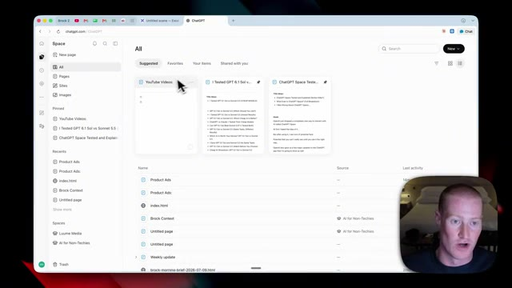
*⏱️ 00:17:24 — Capture d'écran montrant l'application web ChatGPT affichant l'interface des « Spaces » avec différentes pages de projets et dossiers.*

---

### ⏱️ `[00:17:40 - 00:18:03]` | Segment #38

**🔊 Audio (Transcription Intégrale Mot pour Mot en Français) :**
> Cependant, je n'ai pas encore accès à cela sur mon téléphone pour une raison quelconque. Nous devrions donc, avec le temps, pouvoir voir nos espaces depuis notre application mobile également. Higgsfield n'est que l'un des centaines, voire des milliers de plugins différents au sein de ChatDBT. Et lorsque nous combinons nos plugins avec l'espace ChatDBT, c'est là que cela peut devenir très puissant, car nous pouvons puiser dans toutes les différentes applications que nous utilisons afin de créer des tableaux de bord internes.

**👁️ Analyse Visuelle d'Écran (gemini-3.5-flash-lite) :**
**Interface & Outils** : Navigateur web affichant l'interface de ChatGPT (espace de travail/Spaces).

**Contenu textuel & Code** : Document contenant du texte de support ("SUN BUM - SPF 50"), des appels à l'action ("SHOP SUN BUM") et des visuels publicitaires pour Instagram (Story 9:16, Feed 4:5).

**Action / Démonstration** : Le présentateur navigue dans l'interface web de ChatGPT pour illustrer la création et la gestion d'un espace de travail de projets publicitaires.

*⏱️ 00:17:46 — Capture d'écran montrant l'interface d'un espace de travail ChatGPT affichant des exemples de publicités de produits (images de crème solaire "SUN BUM") avec des sections de texte et d'images, ainsi qu'une incrustation vidéo du présentateur en bas à droite.*

---

### ⏱️ `[00:18:03 - 00:18:38]` | Segment #39

**🔊 Audio (Transcription Intégrale Mot pour Mot en Français) :**
> Maintenant, disons que vous parcourez et que vous ne trouvez pas l'application à laquelle vous voulez vous connecter, même s'il y a un tas d'applications différentes que nous pourrions ajouter à l'intérieur de ChatGPT de manière native, eh bien, il y a une solution de contournement, alors laissez-moi vous montrer cela dès maintenant. Vous pouvez utiliser quelque chose appelé le MCP Zapier, qui est quelque chose que j'utilise personnellement tous les jours. Je veux que vous pensiez à cela comme à un pont entre l'espace de ChatGPT ou vos agents IA et toutes les différentes applications que vous utilisez, parce que le MCP Zapier se connecte à plus de 9 000 applications différentes, donc il y a fort à parier que celle que vous voulez connecter sera incluse dedans, et c'est très simple à utiliser. Afin de vous montrer ce que je veux decir — ce que je veux dire, j'ai ce serveur MCP configuré à l'intérieur de Zapier et j'ai un tas d'applications différentes connectées,

**👁️ Analyse Visuelle d'Écran (gemini-3.5-flash-lite) :**
**Interface & Outils** : Interface de configuration logicielle et tableau blanc Excalidraw.

**Contenu textuel & Code** : Liste de plugins (Bitly, ClickUp, Docusign, Firecrawl, Google Drive, etc.) et schéma visuel du pont Zapier MCP vers différentes applications (Gmail, Slack, Notion, Sheets, Calendar, GitHub).

**Action / Démonstration** : Navigation dans l'interface de configuration des plugins et présentation d'un schéma conceptuel d'intégration.

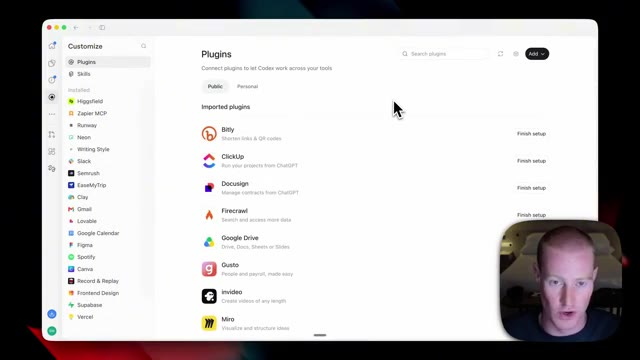
*⏱️ 00:18:12 — Interface de personnalisation affichant une liste de plugins disponibles et installés, avec le présentateur en médaillon.*

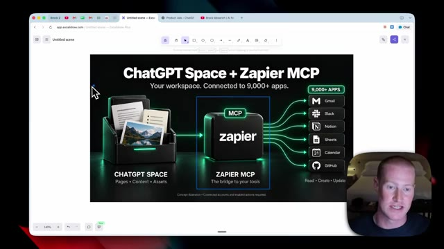
*⏱️ 00:18:21 — Schéma explicatif illustrant le concept de ChatGPT Space combiné avec Zapier MCP pour connecter plus de 9 000 applications.*

---

### ⏱️ `[00:18:39 - 00:19:13]` | Segment #40

**🔊 Audio (Transcription Intégrale Mot pour Mot en Français) :**
> l'un d'entre eux est Drip. C'est mon logiciel de marketing par e-mail et il n'y a aucun moyen pour moi de le connecter à ChatDBT à moins d'utiliser quelque chose comme le MCP Zapier. Et ce que j'ai fait, c'est que j'ai demandé à ChatDBT de créer cette page de statistiques de newsletter séparée que vous regardez ici, à l'intérieur de mon espace ChatDBT. Et ce que cela fait, c'est que cela me donne un compte rendu quotidien de tout ce qui se passe à l'intérieur de mes campagnes de newsletter. Ça montre donc la dernière newsletter qui a été envoyée. Ça montre quand elle a été envoyée. Ça montre le TLDR qui détaille toutes les statistiques pour que je puisse voir le taux de clics et le taux d'ouverture. Je peux voir le nombre de personnes qui se désabonnent. Je peux même voir le montant

**👁️ Analyse Visuelle d'Écran (gemini-3.5-flash-lite) :**
**Interface & Outils** : Application de type espace de travail / notes et navigateur web.

**Contenu textuel & Code** : Page intitulée 'Newsletter Stats' affichant des métriques détaillées d'e-mailing (taux d'ouverture, clics, livrabilité, désabonnements) connectées via Zapier MCP.

**Action / Démonstration** : Présentation de la page de statistiques de newsletter créée et connectée via l'intégration MCP Zapier.

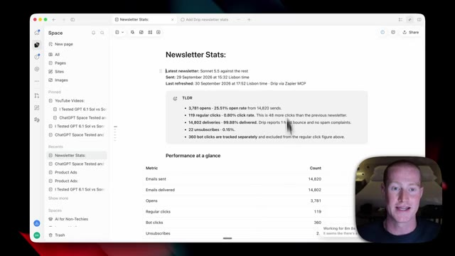
*⏱️ 00:18:47 — Capture d'écran montrant une page web de statistiques de newsletter générée automatiquement et intégrée dans une application de type espace de travail (Space).*

---

### ⏱️ `[00:19:13 - 00:19:45]` | Segment #41

**🔊 Audio (Transcription Intégrale Mot pour Mot en Français) :**
> de clics de bots qui ont été suivis à partir de cela également. Il a ensuite fait apparaître ce petit tableau ici avec une ventilation pour moi. C'est donc un visuel incroyable à regarder pour moi, et l'espace ChatGPT a pu faire cela avec l'accès à Drip depuis le MCP de Zapier. Si vous voulez essayer le MCP de Zapier, il y aura un lien dans la description pour vous inscrire et le faire vous-même. Mais je voulais montrer ceci comme un exemple parfait de la façon dont vous pouvez prendre les applications que vous utilisez et ensuite créer des pages séparées à l'intérieur de votre espace ChatGPT, car maintenant nous avons toutes ces informations que nous pouvons soit consulter ici à tout moment, et c'est maintenant un contexte que notre agent peut utiliser comme un second cerveau.

**👁️ Analyse Visuelle d'Écran (gemini-3.5-flash-lite) :**
**Interface & Outils** : Application web / Interface de type espace de travail (ChatGPT Space) avec panneau latéral et caméra du présentateur en bas à droite.

**Contenu textuel & Code** : Un tableau de ventilation des statistiques de newsletter intitulé "Daily changes" avec les colonnes Snapshot in Lisbon time, Newsletter, Opens (3,781), Regular clicks (119), et Unsubscribes (22).

**Action / Démonstration** : Le présentateur commente le tableau de ventilation généré automatiquement par l'espace IA à partir des données de Drip via Zapier MCP.

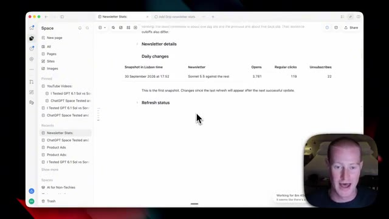
*⏱️ 00:19:21 — Capture d'écran montrant l'interface d'un espace de travail (type ChatGPT Space ou application de notes) avec un tableau de statistiques de newsletter.*

---

### ⏱️ `[00:19:45 - 00:20:18]` | Segment #42

**🔊 Audio (Transcription Intégrale Mot pour Mot en Français) :**
> pour ainsi dire. Très bien, alors je veux maintenant parler de la raison pour laquelle j'ai utilisé Notion par le passé de manière assidue et pourquoi je pense que l'espace ChatGPT pourrait être l'alternative que je cherche depuis des années. Décomposons donc rapidement la façon dont mon Notion est configuré afin que vous puissiez vous faire une idée de la raison pour je vais probablement faire la transition vers l'espace ChatGPT. Je pense qu'il y a tellement de fonctionnalités différentes dans Notion qui sont superflues. J'aime simplement faire simple. J'ai donc mon pôle principal, qui s'appelle AI for Non-Techies, qui dans ce cas s'appellerait désormais un espace. Et puis à l'intérieur de ce pôle, j'ai différentes sous-pages. Donc pour mes finances, j'ai une sous-page spécifique pour l'argent

**👁️ Analyse Visuelle d'Écran (gemini-3.5-flash-lite) :**
**Interface & Outils** : Notion, Excalidraw, ChatGPT Space

**Contenu textuel & Code** : Schéma d'architecture de notes et d'organisation de contenu (Main Hub, sous-pages financières, idées de vidéos, indicateurs).

**Action / Démonstration** : Le présentateur explique la structure de son espace Notion et l'alternative potentielle avec ChatGPT Space.

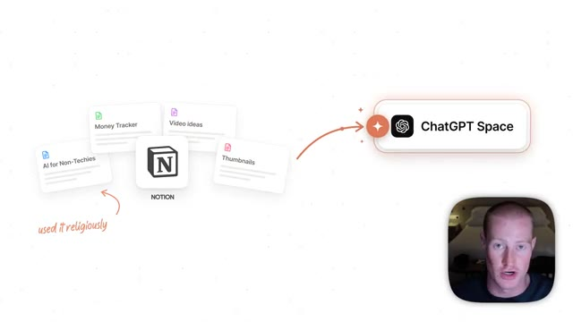
*⏱️ 00:19:54 — Schéma explicatif montrant l'application Notion entourée de ses sous-pages et reliée par une flèche à l'espace ChatGPT, avec le présentateur en médaillon.*

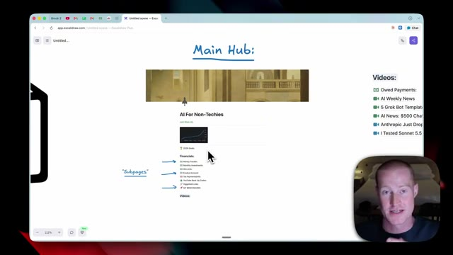
*⏱️ 00:20:10 — Capture d'écran d'un schéma Excalidraw illustrant le 'Main Hub' de Notion avec ses sous-pages et des listes de vidéos, et le présentateur en bas à droite.*

---

### ⏱️ `[00:20:18 - 00:20:41]` | Segment #43

**🔊 Audio (Transcription Intégrale Mot pour Mot en Français) :**
> tracker, investissements mensuels, informations bancaires, tout ça. Ce sont toutes des sous-pages séparées que j'ai créées. Et voici à quoi ressemble mon système vidéo. J'ai différentes sous-pages pour toutes les vidéos sur lesquelles je travaille avec mes idées de vidéos. Et ensuite, à l'intérieur de ces sous-pages vidéo, voici à quoi ça ressemble. Donc, j'aurai mes idées de titres. J'ai mes idées de miniatures que j'ajoute à l'intérieur d'ici. Mais un truc avec Notion, c'est que je dois télécharger une image, la téléverser moi-même dans Notion.

**👁️ Analyse Visuelle d'Écran (gemini-3.5-flash-lite) :**
**Interface & Outils** : Application Notion et outil de planification / mindmapping (type Notion ou Obsidian / interface web).

**Contenu textuel & Code** : Liste de sous-pages ('Financials', 'Money Tracker', 'Monthly Investments', 'Wire Info') et titre de page avec des idées de vidéos (« I Tested Sonnet 5.5 vs. Opus 5.5 »).

**Action / Démonstration** : Présentation de la structure de l'espace de travail et des différentes catégories de pages.

*⏱️ 00:20:24 — Capture d'écran montrant l'arborescence des sous-pages financières dans Notion avec l'intervenant en médaillon.*

*⏱️ 00:20:29 — Capture d'écran montrant les idées de titres et de miniatures pour des vidéos de test de modèles d'IA.*

---

### ⏱️ `[00:20:41 - 00:21:03]` | Segment #44

**🔊 Audio (Transcription Intégrale Mot pour Mot en Français) :**
> Alors qu'à l'intérieur de ChatGPT Spaces, j'ai fait générer cette image par ChatGPT juste ici et il la télécharge automatiquement dans mon espace. On a vraiment l'impression que ChatGPT Space est un second cerveau natif dopé à l'IA au lieu de devoir utiliser quelque chose comme Notion dont j'ai parlé dans cette vidéo. Nous avons donc évidemment des personnes, c'est-à-dire vous et votre équipe, et nous avons nos agents IA et la façon dont nous allons collaborer avec eux.

**👁️ Analyse Visuelle d'Écran (gemini-3.5-flash-lite) :**
**Interface & Outils** : Application de type Notion/Second Cerveau (ChatGPT Space) avec panneau de chat intégré.

**Contenu textuel & Code** : Interface utilisateur de gestion de contenu avec génération d'images par IA et notes textuelles.

**Action / Démonstration** : Démonstration de la génération et de l'intégration automatique d'une image générée par ChatGPT dans un espace de travail.

*⏱️ 00:20:47 — Interface de ChatGPT Space montrant une page de gestion de projet YouTube avec une image générée par IA et un panneau de discussion latéral.*

---

### ⏱️ `[00:21:03 - 00:21:25]` | Segment #45

**🔊 Audio (Transcription Intégrale Mot pour Mot en Français) :**
> Donc, avec le temps, nous allons avoir besoin d'une interface ou d'une plateforme avec laquelle nous pourrons collaborer avec toutes ces personnes et agents d'IA différents. Et on a presque l'impression que l'espace ChatGPT est tout désigné pour cela. Et je peux voir la vision d'OpenAI à long terme. À l'intérieur de nos espaces, nous avons tout le contexte pertinent. Nous avons nos différentes pages. Nous avons le contexte du projet qui inclut les projets sur lesquels nous travaillons à l'intérieur de nos ordinateurs via codex.

**👁️ Analyse Visuelle d'Écran (gemini-3.5-flash-lite) :**
**Interface & Outils** : Schéma graphique conceptuel / Présentation vidéo

**Contenu textuel & Code** : Boîtes textuelles 'People' (You, Your team avec initiales AK, JS, MR) et 'AI Agents' (Codex, ChatGPT Dots) connectées à un cadre central vide contenant un point d'interrogation.

**Action / Démonstration** : Le présentateur explique la vision à long terme d'une plateforme unifiée de collaboration entre humains et agents d'intelligence artificielle.

*⏱️ 00:21:09 — Schéma conceptuel montrant la collaboration entre les humains ('People' avec 'You' et 'Your team') et les agents d'IA ('AI Agents' avec 'Codex' et 'ChatGPT Dots') reliés par un bloc central d'interrogation, avec la webcam du présentateur en bas à droite.*

---

### ⏱️ `[00:21:25 - 00:21:44]` | Segment #46

**🔊 Audio (Transcription Intégrale Mot pour Mot en Français) :**
> Et tout cela est du contexte que nous pourrions fournir à la fois aux personnes travaillant au sein de nos entreprises et à nos agents d'IA qui travaillent également. Anthropic est de retour avec un nouveau modèle. Ils viennent de lancer Claude Sonnet 5.5 juste quelques jours après avoir sorti Opus 5.5. Et comme toujours, dans cette vidéo, je vais décrypter tout ce qui est nouveau avec ce modèle. Je vais être rapide et aller droit au but afin que vous puissiez gagner du temps.

**👁️ Analyse Visuelle d'Écran (gemini-3.5-flash-lite) :**
**Interface & Outils** : Diapositive de présentation graphique / Éditeur de diapositives.

**Contenu textuel & Code** : Texte affiché : "Claude Sonnet 5.5" et "Weekly Update #3".

**Action / Démonstration** : Présentation du sujet du nouveau modèle d'Anthropic par le présentateur.

*⏱️ 00:21:35 — Diapositive de présentation textuelle affichant le titre du sujet abordé : "Claude Sonnet 5.5 - Weekly Update #3".*

---

### ⏱️ `[00:21:44 - 00:22:18]` | Segment #47

**🔊 Audio (Transcription Intégrale Mot pour Mot en Français) :**
> Sans plus attendre, plongeons-noisi directement. Ce que je vais faire dans cette vidéo, c'est analyser cet article juste ici qu'Anthropic nous a donné et simplement nous donner les principaux points importants qui comptent pour vous afin que vous puissiez économiser votre temps sans avoir à parcourir tout ça et essayer de déchiffrer cela par vous-même. Anthropic a présenté Claude Sonnet 5.5, le deuxième modèle de la famille Claude 5.5, puisqu'ils viennent de sortir Opus 5.5 il y a tout juste quelques jours, et il est très, très capable, et j'ai été impressionné par lui. Ils continuent en disant que c'est une nette amélioration par rapport à Sonnet 5, et qu'il fonctionne 30 % plus rapidement, et qu'il coûte jusqu'à 30 % de moins pour la plupart des travaux. En même temps que cela,

**👁️ Analyse Visuelle d'Écran (gemini-3.5-flash-lite) :**
**Interface & Outils** : Navigateur web affichant une application de tableau blanc collaboratif (Excalidraw) et un article d'analyse sur l'IA, avec webcam du présentateur.

**Contenu textuel & Code** : Texte sur l'introduction de Claude Sonnet 5.5, spécifications de vitesse et de coût, sections sur Haiku 5.5 et tableaux de tarification.

**Action / Démonstration** : Le présentateur navigue et zoome sur les notes visuelles résumant le rapport d'Anthropic pour en extraire les points clés.

*⏱️ 00:21:53 — Vue d'ensemble d'une interface de notes visuelles (Excalidraw) présentant des articles sur les nouveaux modèles d'IA Claude 5.5, avec le présentateur en incrustation vidéo en bas à droite.*

*⏱️ 00:22:01 — Gros plan sur un extrait de texte sur l'introduction de Claude Sonnet 5.5 soulignant les gains de performance (+30% plus rapide, -30% de coût), avec le présentateur incrusté en bas à droite.*

---

### ⏱️ `[00:22:18 - 00:22:36]` | Segment #48

**🔊 Audio (Transcription Intégrale Mot pour Mot en Français) :**
> Anthropic a laissé entendre que Haiku 5.5 sortira probablement au cours des deux prochaines semaines, ce qui en fera le troisième modèle de la famille 5.5. Si vous ne connaissez pas les modèles Claude Haiku, ils sont principalement conçus pour des applications à haut volume et sensibles aux coûts. C'est donc leur modèle le moins cher et, évidemment, le moins performant.

**👁️ Analyse Visuelle d'Écran (gemini-3.5-flash-lite) :**
**Interface & Outils** : Présentation ou face-caméra explicatif du trader sans interface logicielle partagée.

**Contenu textuel & Code** : Explications orales des stratégies et mise en contexte méthodologique du marché.

**Action / Démonstration** : Explications face caméra et analyse conceptuelle des marchés.

---

### ⏱️ `[00:22:36 - 00:22:56]` | Segment #49

**🔊 Audio (Transcription Intégrale Mot pour Mot en Français) :**
> Cependant, nous devrions assister à une assez grande mise à niveau de ce modèle au cours des prochaines semaines, ce qui m'enthousiasme. Passons maintenant à la première grande mise à niveau de Sonnet 5.5, et il s'agit de la collaboration et, plus important encore, de la communication avec ce modèle. Anthropic a donc déclaré que, comme Opus 5.5, Sonnet 5.5 écrit plus clairement que notre génération précédente de modèles.

**👁️ Analyse Visuelle d'Écran (gemini-3.5-flash-lite) :**
**Interface & Outils** : Présentation ou face-caméra explicatif du trader sans interface logicielle partagée.

**Contenu textuel & Code** : Explications orales des stratégies et mise en contexte méthodologique du marché.

**Action / Démonstration** : Explications face caméra et analyse conceptuelle des marchés.

---

### ⏱️ `[00:22:56 - 00:23:28]` | Segment #50

**🔊 Audio (Transcription Intégrale Mot pour Mot en Français) :**
> Les premiers testeurs le décrivent comme un bien meilleur partenaire de collaboration que Sonnet 5. Sa vitesse le rend également très bien adapté pour une itération rapide sur des tâches complexes. C'est donc une chose que j'ai vraiment remarquée en utilisant Opus 5.5, et j'ai vu beaucoup d'autres personnes en parler. Il est très doué pour communiquer. On n'a pas l'impression de devoir déchiffrer exactement ce qu'il essaie de vous dire. Et cela résout un très gros problème lorsqu'il s'agit de travailler avec des grands modèles de langage. Voici donc un exemple parfait comparatif côte à côte de Claude Opus 5 par rapport à Claude Opus 5.5 qui décortique

**👁️ Analyse Visuelle d'Écran (gemini-3.5-flash-lite) :**
**Interface & Outils** : Navigateur web affichant l'application Excalidraw.

**Contenu textuel & Code** : Texte affiché : "Better for Communication (Like Opus 5.5):" et un paragraphe sur la collaboration ("Like Opus 5.5, Sonnet 5.5 writes more clearly than our previous generation of models...").

**Action / Démonstration** : Le présentateur commente le texte affiché à l'écran concernant les performances des modèles d'IA en matière de collaboration.

*⏱️ 00:23:04 — Capture d'écran montrant une page Excalidraw avec du texte manuscrit et un paragraphe encadré concernant les capacités de communication et de collaboration du modèle d'IA, avec la webcam du présentateur en bas à droite.*

---

### ⏱️ `[00:23:28 - 00:23:51]` | Segment #51

**🔊 Audio (Transcription Intégrale Mot pour Mot en Français) :**
> ce problème précis ici même. Et il est très évident que celui de droite, Claude Opus 5.5, est beaucoup plus concis et facile à comprendre au premier coup d'œil. Maintenant, ce sont évidemment de superbes nouvelles car cela arrive maintenant sur Sonnet 5.5, qui va être moins cher qu'Opus 5.5, même si Opus est plutôt rentable. Voici donc une analyse comparative côte à côte entre Sonnet 5.5 et Opus 5.5.

**👁️ Analyse Visuelle d'Écran (gemini-3.5-flash-lite) :**
**Interface & Outils** : Navigateur web affichant l'outil de dessin collaboratif Excalidraw, avec un encadré bleu sur la partie droite.

**Contenu textuel & Code** : Texte comparatif sur l'analyse d'un bug de facturation Python, avec des blocs de code et des explications textuelles détaillées.

**Action / Démonstration** : Le présentateur compare visuellement les deux blocs de texte pour montrer la concision et la lisibilité accrue de la version de droite.

*⏱️ 00:23:34 — Capture d'écran montrant l'interface d'Excalidraw avec une comparaison de deux blocs de texte issus d'analyses de code générées par des IA.*

---

### ⏱️ `[00:23:51 - 00:24:10]` | Segment #52

**🔊 Audio (Transcription Intégrale Mot pour Mot en Français) :**
> Pour les lectures en cache, ils sont tous les deux à 20 centimes par million de jetons. Sonnet 5.5 coûte la moitié du prix d'Opus 5.5 en ce qui concerne les écritures en cache. Pour les jetons d'entrée, c'est moitié prix. Et pour les jetons de sortie, c'est aussi moitié prix. Cela devient donc plutôt rentable par rapport à Opus 5.5. Et comme je l'ai dit, celui-ci était déjà plutôt efficace.

**👁️ Analyse Visuelle d'Écran (gemini-3.5-flash-lite) :**
**Interface & Outils** : Navigateur web affichant un tableau comparatif (Excalidraw ou outil similaire) et webcam du présentateur.

**Contenu textuel & Code** : Tableau de tarification par million de tokens : Cache reads ($0.20 pour les deux), Cache writes ($2.50 vs $5), Input tokens ($2 vs $4), Output tokens ($10 vs $20).

**Action / Démonstration** : Le présentateur explique et compare les différents tarifs des modèles d'IA présentés dans le tableau.

*⏱️ 00:23:56 — Tableau comparatif des coûts et vitesses entre Claude Sonnet 5.5 et Claude Opus 5.5 affiché sur un navigateur web.*

---

### ⏱️ `[00:24:10 - 00:24:37]` | Segment #53

**🔊 Audio (Transcription Intégrale Mot pour Mot en Français) :**
> Ensuite, Anthropix affirme que Sonnet 5.5 nécessite moins de jetons par tâche que Sonnet 5, ce qui le rend moins coûteux à exécuter, et il génère également des résultats 30 % plus rapidement et son efficacité est immédiatement perceptible. C’est quelque chose que nous commençons à observer de manière générale avec toutes ces différentes sorties de modèles. Il semble bien qu'ils deviennent beaucoup plus efficaces en matière de consommation de jetons, et c'est quelque chose qui résout un problème majeur pour nous, consommateurs d'intelligence artificielle, car ce n'est pas comme si ces modèles n'étaient plus capables.

**👁️ Analyse Visuelle d'Écran (gemini-3.5-flash-lite) :**
**Interface & Outils** : Navigateur web avec l'application Excalidraw.

**Contenu textuel & Code** : Texte affiché : « Sonnet 5.5 requires fewer tokens per task than Sonnet 5, so it's less expensive to run. It also generates output 30%+ faster, and its efficiency is immediately noticeable: »

**Action / Démonstration** : Le présentateur commente le texte affiché à l'écran concernant la réduction des jetons et l'augmentation de la vitesse de Sonnet 5.5.

*⏱️ 00:24:17 — Capture d'écran montrant un texte surligné en rouge sur l'interface Excalidraw, décrivant les performances et l'efficacité de Sonnet 5.5, avec une incrustation vidéo du présentateur en bas à droite.*

---

### ⏱️ `[00:24:37 - 00:25:00]` | Segment #54

**🔊 Audio (Transcription Intégrale Mot pour Mot en Français) :**
> Il s'agit plutôt de savoir à quel point ils sont efficaces lorsqu'il s'agit du coût que cela va représenter pour une tâche donnée. Maintenant, bien sûr, le coût est important, mais cela ne veut pas vraiment dire grand-chose si ce n'est pas très performant. Eh bien, le voici comparé à Sonnet 5, Opus 5.5, et ChatGPT 6 vendu. Ce qui ressort vraiment ici, c'est la différence de programmation agentique entre Sonnet 5.5 et Sonnet 5.

**👁️ Analyse Visuelle d'Écran (gemini-3.5-flash-lite) :**
**Interface & Outils** : Présentation ou face-caméra explicatif du trader sans interface logicielle partagée.

**Contenu textuel & Code** : Explications orales des stratégies et mise en contexte méthodologique du marché.

**Action / Démonstration** : Explications face caméra et analyse conceptuelle des marchés.

---

### ⏱️ `[00:25:00 - 00:25:21]` | Segment #55

**🔊 Audio (Transcription Intégrale Mot pour Mot en Français) :**
> 5,5 est à 70,6 %, alors que Sonnet 5 était à 10,3 %. Tant de personnes se plaignaient des capacités de Sonnet 5. Donc, cela ressemble vraiment à une mise à niveau significative en ce qui concerne un bon nombre de ces benchmarks ici, que je vais passer en revue. Ensuite, vous pouvez voir qu'Opus 5,5 est à 66,4 %. Il obtient même un score supérieur de 4 % au tout nouveau modèle Opus 5,5.

**👁️ Analyse Visuelle d'Écran (gemini-3.5-flash-lite) :**
**Interface & Outils** : Navigateur web affichant un tableau de benchmarks d'Anthropic.

**Contenu textuel & Code** : Tableau comparatif avec les scores : Agentic coding (Terminal-Bench 4.0) avec Sonnet 5.5 à 70,6% et Sonnet 5 à 10,3%. D'autres métriques incluent FrontierCode, CursorBench, GDPval-AA, et OSWorld.

**Action / Démonstration** : Le présentateur commente le tableau et survole une cellule avec le curseur pour mettre en évidence les résultats de performance entre les différentes versions de modèles.

*⏱️ 00:25:05 — Tableau comparatif des performances de différents modèles d'IA (Sonnet 5.5, Sonnet 5, Opus 5.5, GPT-6 Sol) sur divers benchmarks (Agentic coding, Knowledge work, etc.), affiché sur une page web avec le présentateur en médaillon en bas à droite.*

---

### ⏱️ `[00:25:22 - 00:25:47]` | Segment #56

**🔊 Audio (Transcription Intégrale Mot pour Mot en Français) :**
> Et si vous allez jusqu'au bout de la liste ici, il surpasse évidemment de loin Sonnet 5 sur tous ces différents critères de référence, et ce de manière significative. Et ensuite, si vous le comparez à Opus 5.5, Opus 5.5 est toujours meilleur dans tous les autres domaines, à l'exception de ce codage Agenta. C'est donc très intéressant pour moi qu'il soit si bon en codage Agenta. Je me demande pourquoi. En parlant de codage, analysons cela encore plus en détail. Il est donc indiqué ici qu'à effort élevé sur Frontier Code, il obtient 10 points de plus que Sonnet 5 avec le même réglage.

**👁️ Analyse Visuelle d'Écran (gemini-3.5-flash-lite) :**
**Interface & Outils** : Navigateur web affichant le site d'Anthropic et la documentation sur Claude Sonnet 5.5.

**Contenu textuel & Code** : Tableau de benchmarks détaillant les scores en agentic coding, knowledge work, multidisciplinary reasoning et computer use.

**Action / Démonstration** : Le présentateur commente le tableau comparatif en soulignant les performances supérieures de Sonnet 5.5 par rapport à Sonnet 5.

*⏱️ 00:25:28 — Tableau comparatif des performances des différents modèles d'IA (Sonnet 5.5, Sonnet 5, Opus 5.5, GPT-5 Sol) selon divers critères.*

---

### ⏱️ `[00:25:47 - 00:26:19]` | Segment #57

**🔊 Audio (Transcription Intégrale Mot pour Mot en Français) :**
> Et voici le plus fou, à environ un quinzième du coût par tâche. Le coût de tout cela diminue donc considérablement. Et le plus fou dans tout ça, c'est qu'Epic Games a écrit cette citation à propos du codage de Sonnet 5,5. Ils ont déclaré que lors des premiers tests d'Epic, Claude Sonnet 5,5 atteignait le même niveau de qualité que l'on attend d'un modèle de catégorie supérieure. Et cela ne vient pas seulement de quelqu'un qui code au feeling pour un jeu et montre une démonstration sur Twitter. Cela vient de l'entreprise Epic Games. C'est assez fou quand on y pense vraiment. Le directeur du machine learning chez SpaceX AI a même déclaré que Claude Sonnet 5,5

**👁️ Analyse Visuelle d'Écran (gemini-3.5-flash-lite) :**
**Interface & Outils** : Navigateur web affichant une page d'article ou de documentation d'Anthropic (anthropic.com).

**Contenu textuel & Code** : Citation textuelle d'Epic Games (attribuée à Daniel Vogel, Chief Operating Officer) louant les capacités de Claude Sonnet 5.5 sur des milliers de lignes de code et d'architecture système.

**Action / Démonstration** : Le présentateur commente le texte affiché à l'écran concernant les retours d'Epic Games sur le modèle.

*⏱️ 00:25:55 — Capture d'écran montrant le site web d'Anthropic avec un encadré mettant en avant une citation d'Epic Games concernant les performances de Claude Sonnet 5.5, avec la webcam du présentateur en incrustation dans le coin inférieur droit.*

---

### ⏱️ `[00:26:19 - 00:26:54]` | Segment #58

**🔊 Audio (Transcription Intégrale Mot pour Mot en Français) :**
> offre des performances de niveau supérieur sur Cursor Bench 4.0 à 55 %, devancé uniquement par Opus 5.5 qui vient de sortir. Nous pensons que ce sera un succès auprès des développeurs cherchant à concilier performance et coûts. Et encore une fois, c'est le thème principal qui se dégage ici. Il ne s'agit pas nécessairement de savoir à quel point ces modèles sont capables, car ils le sont beaucoup et le sont depuis un certain temps déjà, mais peuvent-ils le faire à un prix qui ne va pas ruiner les consommateurs ordinaires comme vous et moi ? Anthropic a tout de même affirmé qu'il est environ 30 % plus rapide que Claude Sonnet 5. Voici donc une analyse en direct du temps qu'il faut, entre le moment où on lui donne une invite, l'écriture du code, et la génération effective d'un fichier HTML.

**👁️ Analyse Visuelle d'Écran (gemini-3.5-flash-lite) :**
**Interface & Outils** : Navigateur web affichant le site d'Anthropic.

**Contenu textuel & Code** : Texte d'article, citations d'utilisateurs (SpaceXAI), scores de performance sur CursorBench 4.0 et comparaisons de génération de tokens.

**Action / Démonstration** : Le présentateur commente les performances, les scores aux benchmarks et le compromis coût-performance des nouveaux modèles IA.

*⏱️ 00:26:28 — Capture d'écran d'un article web d'Anthropic montrant un témoignage sur Claude Sonnet 5.5, avec le curseur soulignant une citation concernant ses performances et son coût.*

*⏱️ 00:26:45 — Capture d'écran du site web d'Anthropic illustrant une comparaison de prompts entre Claude Sonnet 5 et Sonnet 5.5, avec des blocs de code et de réflexion (tokens).*

---

### ⏱️ `[00:26:54 - 00:27:30]` | Segment #59

**🔊 Audio (Transcription Intégrale Mot pour Mot en Français) :**
> file right here. So looks like obviously Claude Sonnet 5.5 is burning through these tokens much faster. This is very fast when it comes to coding and let's wait and see the output. So it looks like Sonnet 5.5 is done. This little animation is now working with these like fish swimming around in this HTML page. Whereas we still have Claude Sonnet 5 over here coding this. It does seem to be much faster than Sonnet 5. Now I'm going to make a prediction right now. So OpenAI tomorrow has Dev Day and I have some pretty high conviction that they are going to be releasing their own AI agent, AI personal agent similar to Muse and Grokbot tomorrow. And if history repeats itself, which

**👁️ Analyse Visuelle d'Écran (gemini-3.5-flash-lite) :**
**Interface & Outils** : Navigateur web affichant une page d'Anthropic avec des comparaisons de modèles d'IA et le présentateur en médaillon.

**Contenu textuel & Code** : Page web présentant des comparatifs de performance entre versions de Claude (Sonnet 5 vs 5.5) sur un prompt de génération de code HTML d'animation.

**Action / Démonstration** : Le présentateur commente la vitesse de génération des tokens et le rendu visuel de l'animation de Claude Sonnet 5.5 par rapport à la version précédente.

*⏱️ 00:27:03 — Comparaison côte à côte entre Claude Sonnet 5 générant du code et Claude Sonnet 5.5 affichant une animation fluide de vol d'étourneaux.*

---

### ⏱️ `[00:27:30 - 00:28:05]` | Segment #60

**🔊 Audio (Transcription Intégrale Mot pour Mot en Français) :**
> c'est le cas, ces entreprises d'IA adorent jouer à la tire-fesses. Quand une entreprise lance quelque chose, l'autre sort une nouveauté très similaire juste quelques jours plus tard pour attirer tous les regards sur ses propres produits. Donc à mon avis, après qu'OpenAI aura lancé ça demain, Anthropic va sans doute sortir le sien plus tard cette semaine ou peut-être la semaine prochaine. Et si on relie les points, tout s'explique parce qu'Anthropic sort des modèles comme Opus 5.5 et maintenant Sonnet 5.5 qui sont bien meilleurs pour communiquer et c'est un timing parfait avant de lancer un agent assistant personnel que les gens vont utiliser pour communiquer sans cesse. Encore une fois, c'est juste mon

**👁️ Analyse Visuelle d'Écran (gemini-3.5-flash-lite) :**
**Interface & Outils** : Navigateur web affichant la plateforme X (Twitter)

**Contenu textuel & Code** : Publication officielle d'OpenAI Developers : « 72 hours to OpenAI DevDay. We've been building. Time to show our work. » avec une illustration associée.

**Action / Démonstration** : Navigation et affichage d'un tweet d'annonce concernant l'événement OpenAI DevDay.

*⏱️ 00:27:39 — Capture d'écran montrant le fil d'actualité de la plateforme X (anciennement Twitter) avec un post du compte officiel OpenAI Developers annonçant le « 72 hours to OpenAI DevDay » accompagné d'une image humoristique de petites sphères colorées dans un avion.*

---

### ⏱️ `[00:28:05 - 00:28:25]` | Segment #61

**🔊 Audio (Transcription Intégrale Mot pour Mot en Français) :**
> pour deux sous. Prenez cela avec des pincettes. Dites-moi ce que vous en pensez dans les commentaires. Pensez-vous que ce soit le cas ? Parce que j'ai la forte conviction que c'est ce qui est en train de se produire. Maintenant, le prompt que nous allons utiliser est celui-ci. En gros, nous allons générer un monde tridimensionnel un peu similaire à Minecraft, par exemple, et nous avons ici des contraintes strictes. Nous détaillons précisément ce que nous voulons que soit le monde en un tas d'étapes différentes.

**👁️ Analyse Visuelle d'Écran (gemini-3.5-flash-lite) :**
**Interface & Outils** : Navigateur web, plateforme X (Twitter), Excalidraw.

**Contenu textuel & Code** : Texte du prompt détaillant les contraintes techniques pour générer un monde 3D en JavaScript (Three.js, FPS, performances sur MacBook Air, etc.).

**Action / Démonstration** : Le présentateur commente le prompt affiché à l'écran concernant les capacités de test d'un modèle d'IA.

*⏱️ 00:28:20 — Capture d'un navigateur affichant un document Excalidraw contenant les contraintes d'un prompt pour créer un monde 3D interactif.*

---

### ⏱️ `[00:28:25 - 00:28:45]` | Segment #62

**🔊 Audio (Transcription Intégrale Mot pour Mot en Français) :**
> Nous avons réellement décomposé la façon de travailler. Donc nous voulions planifier l'architecture avant d'écrire le code, garder le code organisé, et ainsi de suite. C'est donc une consigne que nous donnons à chacun de ces modèles. Allons donc tester tout cela dès maintenant. Très bien, voici donc celle que Sonnet 5 a générée. Nous allons examiner chacune d'elles progressivement. Commençons donc par celle-ci. Très bien, nous avons donc ce petit jeu sympa ici.

**👁️ Analyse Visuelle d'Écran (gemini-3.5-flash-lite) :**
**Interface & Outils** : Navigateur web affichant une application locale HTML et webcam du présentateur en incrustation.

**Contenu textuel & Code** : Texte de description d'un projet de monde 3D interactif avec commandes clavier (WASD, Shift, E, T, etc.).

**Action / Démonstration** : Navigation et lancement de la démonstration du projet 3D dans le navigateur.

*⏱️ 00:28:40 — L'écran de démarrage d'un jeu ou d'une application web nommé "THE EDGE OF THE SKY" avec les instructions de contrôle et un bouton "click to begin".*

---

### ⏱️ `[00:28:45 - 00:29:19]` | Segment #63

**🔊 Audio (Transcription Intégrale Mot pour Mot en Français) :**
> Ce n’est pas un truc de fou ? C’est un peu comme un monde dans le style de Minecraft. Je ne trouve pas ça génial, mais évidemment on peut se déplacer ici. Je crois que notre but est en fait de saisir ces éléments. Mais ouais, du coup ce qu’on doit faire c’est venir ici et je pense qu’on doit attraper ces petites choses et on ne... je ne sais pas forcément quel est notre but. Je pense qu’on doit l’emmener quelque part mais je ne suis pas tout à fait sûr, tu peux voir qu’il y a de la neige qui tombe même s’il n’y a pas de nuages. On a un petit lac par ici et voyons si je peux aller dans le lac. Oh, je suppose que je ne peux pas aller dans le lac. Je peux passer en dessous. Donc ça bugue pas mal. Ouais, ce n’est pas génial. Je dois dire que je pense que d’autres rendus vont être beaucoup mieux. Laisse-moi venir par ici et essayer d’attraper ce petit orbe. Ouais, je ne sais pas vraiment quoi faire avec ça.

**👁️ Analyse Visuelle d'Écran (gemini-3.5-flash-lite) :**
**Interface & Outils** : Présentation ou face-caméra explicatif du trader sans interface logicielle partagée.

**Contenu textuel & Code** : Explications orales des stratégies et mise en contexte méthodologique du marché.

**Action / Démonstration** : Explications face caméra et analyse conceptuelle des marchés.

---

### ⏱️ `[00:29:19 - 00:29:40]` | Segment #64

**🔊 Audio (Transcription Intégrale Mot pour Mot en Français) :**
> Mais je veux dire que c'est un bon point de départ. Ce n'est pas mal. Maintenant, en ce qui concerne la tarification de Sonic 5, décomposons cela ainsi que le temps qu'il a fallu pour générer. Tout d'abord, c'était 1,59 $ à générer, ce qui est très bon marché par rapport à ces autres modèles. Vous allez voir que ça devient beaucoup plus cher que ça. Et puis pour le temps, cela a pris sept minutes et six secondes, ce qui est plutôt rapide dans l'ensemble des choses.

**👁️ Analyse Visuelle d'Écran (gemini-3.5-flash-lite) :**
**Interface & Outils** : Application de tableau blanc Excalidraw dans un navigateur web avec incrustation vidéo du présentateur en bas à droite.

**Contenu textuel & Code** : Tableau avec les lignes Sonnet 5, Sonnet 5.5, Opus 5.5 et Fable 5.1, accompagnés de cases de temps et de coûts masquées par des rectangles roses.

**Action / Démonstration** : Le présentateur commente le tableau comparatif et survole les éléments de coût et de temps des différents modèles d'intelligence artificielle.

*⏱️ 00:29:24 — Tableau comparatif intitulé 'THE SCORECARD' montrant les colonnes Model, Time et Cost pour différents modèles d'IA.*

---

### ⏱️ `[00:29:40 - 00:30:13]` | Segment #65

**🔊 Audio (Transcription Intégrale Mot pour Mot en Français) :**
> Et une chose que je tiens à mentionner, c'est que nous avons tous ceux-ci avec un niveau d'effort élevé. Ils fonctionnent donc tous au même niveau d'effort, juste pour plus de transparence. Très bien, passons à Opus 5, nous avons ce petit monde ici. Donc je vais juste cliquer sur commencer, évidemment nous pouvons nous déplacer avec notre souris et tout le reste. D'accord, celui-ci a l'air vraiment bien. C'est Opus 5.5, qui est sorti la semaine dernière. Ça a l'air beaucoup mieux que Sonic 5. Je ne vais pas mentir, je trouve que ça a vraiment l'air très bien. Je pourrais même lancer les pierres, je pourrais venir ici et ramasser cette petite orbe, ce qui est, je pense, le but de ce jeu. Je dois juste trouver un endroit où l'apporter. Oui, ça a l'air vraiment bien.

**👁️ Analyse Visuelle d'Écran (gemini-3.5-flash-lite) :**
**Interface & Outils** : Navigateur web affichant un jeu 3D interactif local, webcam du présentateur.

**Contenu textuel & Code** : Interface utilisateur d'un jeu de simulation/exploration (titre "Aerie", contrôles clavier/souris, compteur de FPS).

**Action / Démonstration** : Exploration d'un monde virtuel 3D généré par une intelligence artificielle, démonstration des fonctionnalités du jeu.

---

### ⏱️ `[00:30:13 - 00:30:45]` | Segment #66

**🔊 Audio (Transcription Intégrale Mot pour Mot en Français) :**
> Honnêtement, je pense que le monde est très cohérent, en gros, comme si les objets ne bougeaient pas. Avec le précédent, vous pouviez voir que, genre, le lac, je pouvais aller sous le lac, alors que celui-ci, je pense que je pourrais vraiment aller à l'intérieur, donc allons juste par ici et testons ça. Ouais, donc je peux en quelque sorte aller dans le lac, même si ça bug un petit peu quand je suis à l'intérieur, c'est quand même un niveau au-dessus du précédent, rien de fou, mais je pense que les graphismes ont l'air vraiment bien et puis les mouvements, évidemment avec ce personnage, sont très bons aussi et je peux juste lancer cette petite distorsion, donc ouais, je suis plutôt impressionné par celui-ci et vous pouvez voir maintenant que le brouillard arrive, je pense que c'est en gros comme Minecraft, c'est plutôt cool de toute façon c'est

**👁️ Analyse Visuelle d'Écran (gemini-3.5-flash-lite) :**
**Interface & Outils** : Navigateur web affichant une application 3D interactive et un flux vidéo du présentateur en incrustation (webcam).

**Contenu textuel & Code** : Environnement virtuel en basse résolution (low poly) avec des textures d'herbe, des pins, un ciel bleu et des éléments interactifs (sphère lumineuse).

**Action / Démonstration** : Navigation et test de la physique de l'environnement virtuel en passant à travers l'eau et en explorant le décor.

*⏱️ 00:30:21 — Vue générale d'une scène 3D stylisée générée par IA avec des collines verdoyantes, des arbres et une sphère lumineuse bleue.*

*⏱️ 00:30:29 — Navigation sous le niveau d'un plan d'eau dans l'environnement virtuel 3D interactif.*

*⏱️ 00:30:37 — Exploration rapprochée d'une colline herbeuse et arborée au sein de la simulation 3D.*

---

### ⏱️ `[00:30:45 - 00:31:20]` | Segment #67

**🔊 Audio (Transcription Intégrale Mot pour Mot en Français) :**
> Super. Allons-y pour évaluer celui-ci sur le coût et le temps que cela a pris. Très bien. Donc Opus 5.5 a coûté, roulement de tambours s'il vous plaît, 11 dollars et 95 cents. C'était donc environ 10 fois, ou peu importe le calcul, je ne suis pas doué en maths, mais environ 10 fois plus cher que Sonnet 5. Et cela a pris 41 minutes et 47 secondes. Cela a pris pas mal de temps par rapport à Sonnet 5, ce qui, je suppose, est logique puisque c'est un modèle beaucoup plus intelligent. Passons à Fable 5.1 et testons celui-ci. Plongeons dans le monde de Fable 5.1, cliquez pour commencer et c'est parti, d'accord, même chose, nous venons ici, choisissons

**👁️ Analyse Visuelle d'Écran (gemini-3.5-flash-lite) :**
**Interface & Outils** : Excalidraw (application de dessin et de tableau blanc en ligne).

**Contenu textuel & Code** : Tableau des scores ('THE SCORECARD') listant les modèles 'Sonnet 5', 'Sonnet 5.5', 'Opus 5.5' et 'Fable 5.1' avec les colonnes MODEL, TIME et COST ; les valeurs visibles sont Sonnet 5 ($1.59, 7:06) et Opus 5.5 ($11.95).

**Action / Démonstration** : Le présentateur présente et commente le tableau comparatif des coûts et des temps d'exécution des différents modèles d'intelligence artificielle.

*⏱️ 00:30:54 — Tableau comparatif intitulé 'THE SCORECARD' montrant le temps et le coût pour différents modèles d'IA, avec Opus 5.5 affichant un coût de 11,95 $ et Sonnet 5 affichant 7:06 et 1,59 $.*

---

### ⏱️ `[00:31:20 - 00:31:54]` | Segment #68

**🔊 Audio (Transcription Intégrale Mot pour Mot en Français) :**
> prends le rocher, ça a l'air super, l'ombre du rocher a l'air plutôt cool, mon personnage se déplace assez facilement, on dirait que ça bugue un tout petit petit peu quand j'essaie de marcher ici, donc pour une raison quelconque, on peut voir cet écran trembler un peu, j'aime bien qu'il ait ajouté ces petites, comme ces petites ruines ici, mais ouais, pour une raison quelconque, ça n'a pas l'air terrible en termes de mouvement, voyons, je pense aussi que je pourrais lancer le rocher, ouais, je suis capable de lancer le rocher, nous avons notre petit orbe par ici, testons l'eau rapidement après avoir repris celui-ci, alors viens par ici. Il entre à l'intérieur de l'eau. On dirait que ça ne bugue pas à l'intérieur de l'eau comme les deux précédents. Donc c'est bien. Ouais, celui-ci est plutôt solide. Et un truc qui est cool, c'est si

**👁️ Analyse Visuelle d'Écran (gemini-3.5-flash-lite) :**
**Interface & Outils** : Navigateur web affichant une application 3D interactive et webcam du présentateur.

**Contenu textuel & Code** : Environnement 3D low-poly avec un terrain herbeux, des arbres et un rocher manipulable.

**Action / Démonstration** : Test des interactions physiques, manipulation et lancer d'objets dans le jeu 3D.

*⏱️ 00:31:28 — Vue dans le navigateur d'un jeu vidéo en 3D avec un rocher au premier plan et le présentateur en incrustation vidéo.*

*⏱️ 00:31:37 — Le présentateur manipule le rocher dans l'environnement virtuel 3D près d'un point d'eau.*

*⏱️ 00:31:46 — Gros plan sur le rocher jeté dans l'eau au sein de l'application web 3D.*

---

### ⏱️ `[00:31:54 - 00:32:31]` | Segment #69

**🔊 Audio (Transcription Intégrale Mot pour Mot en Français) :**
> tu vois en haut à gauche de mon écran, ça montre quand le soleil se couche. Donc on dirait que l'après-midi arrive, ça montre le temps qui avance par incréments. Ouais, celui-ci est plutôt solide. Je pense que c'est l'un des meilleurs qu'on a générés jusqu'à présent. Très bien. Alors pour la ventilation des coûts sur Fable 5.1, jetons un œil à ça maintenant. Donc pour le coût, c' était de 17,45 dollars, ce qui est beaucoup plus cher que Sonnet 5, évidemment. C'est environ 6 dollars, 5,5 dollars de plus qu'Opus 5.5 aussi, ce qui est normal. C'est un modèle plus capable, plus intelligent. C'est leur plus haut niveau en matière d'intelligence. Et puis maintenant nous avons 40 minutes et 30 secondes, ce qui est intéressant.

**👁️ Analyse Visuelle d'Écran (gemini-3.5-flash-lite) :**
**Interface & Outils** : Navigateur web, Excalidraw (tableau blanc en ligne), interface de rendu 3D.

**Contenu textuel & Code** : Tableau comparatif de modèles d'IA avec des colonnes "MODEL", "TIME" et "COST" affichant des données chiffrées (ex: Sonnet 5 à 7:06 et $1.59, Opus 5.5 à 41:47 et $11.95).

**Action / Démonstration** : Présentation comparative des performances, du temps d'exécution et des coûts de différents modèles d'intelligence artificielle.

*⏱️ 00:32:03 — Capture d'écran montrant un rendu 3D interactif dans un navigateur web représentant un paysage vallonné avec des arbres et des éléments de jeu, avec la webcam du présentateur en bas à droite.*

*⏱️ 00:32:12 — Capture d'écran d'un tableau comparatif intitulé "THE SCORECARD" sur Excalidraw, évaluant différents modèles d'IA (Sonnet 5, Sonnet 5.5, Opus 5.5, Fable 5.1) selon le temps et le coût.*

*⏱️ 00:32:21 — Capture d'écran similaire à la précédente montrant le tableau "THE SCORECARD" sur Excalidraw, avec un menu de configuration et de style visible sur le panneau de gauche.*

---

### ⏱️ `[00:32:31 - 00:32:50]` | Segment #70

**🔊 Audio (Transcription Intégrale Mot pour Mot en Français) :**
> Cela a en fait pris moins de temps qu'Opus 5.5. Malgré tout, cela a pris pas mal de temps, 40 minutes et 30 secondes par rapport à Sonnet 5, qui n'a pris que sept minutes et six secondes. Pour notre test final, nous avons le résultat de Claude Sonnet 5.5. Très bien, voici donc à quoi ressemble notre monde. Je trouve que cela a l'air incroyable, en fait. Personnellement, je pense que c'est peut-être le monde le plus réussi, le plus beau.

**👁️ Analyse Visuelle d'Écran (gemini-3.5-flash-lite) :**
**Interface & Outils** : Navigateur web, outil de tableau blanc (Excalidraw) et application web interactive 3D Skyreach.

**Contenu textuel & Code** : Tableau de score comparatif avec temps et coûts ($1.59, $11.95, $17.45) et interface de jeu 3D interactif.

**Action / Démonstration** : Présentation des résultats comparatifs et démonstration du projet généré par Claude Sonnet 5.5.

*⏱️ 00:32:36 — Tableau comparatif (The Scorecard) affichant les modèles, le temps d'exécution et les coûts pour Sonnet 5, Sonnet 5.5, Opus 5.5 et Fable 5.1.*

*⏱️ 00:32:41 — Interface du jeu ou application web « Skyreach » montrant l'écran d'accueil avec les contrôles et les instructions.*

*⏱️ 00:32:45 — Vue en 3D à l'intérieur de l'application « Skyreach » montrant un paysage avec de l'herbe et des arbres générés.*

---

### ⏱️ `[00:32:51 - 00:33:16]` | Segment #71

**🔊 Audio (Transcription Intégrale Mot pour Mot en Français) :**
> Évidemment, nous pourrions nous déplacer et il n'y a pas de mouvements bizarre en cours. Nous avons ces petits lapins qui saignent partout — qui sautillent partout. La pluie commence à tomber en ce moment même. Je pourrais même aller dans l'eau juste ici. Il y a des poissons qui nagent autour. Je veux dire, je suis sincèrement assez impressionné par ça. C'est prétendument le modèle le moins cher du marché, à part genre Claude Opus 5. Je crois que c'est exactement le même prix. Mais genre, ça a l'air mieux, à mon avis, que le rendu de Fable 5.1. C'est assez dingue.

**👁️ Analyse Visuelle d'Écran (gemini-3.5-flash-lite) :**
**Interface & Outils** : Navigateur web affichant une application ou un jeu 3D interactif (Skyreach), avec une webcam du présentateur en incrustation.

**Contenu textuel & Code** : Environnement 3D généré par IA, herbe stylisée, arbres low-poly, effets météorologiques (pluie) et éléments interactifs (eau, objets lumineux).
[DESC_IMAGE_3] Navigation et exploration interactive du monde virtuel en 3D par le présentateur.

**Action / Démonstration** : Explications face caméra et analyse conceptuelle des marchés.

*⏱️ 00:32:57 — Vue générale d'un monde virtuel low-poly avec des arbres verts, une colline et un plan d'eau, le présentateur apparaissant en incrustation.*

*⏱️ 00:33:03 — Gros plan sur la surface de l'eau dans le jeu vidéo avec un effet de pluie et des reflets de paysage.*

*⏱️ 00:33:09 — Vue en contre-plongée dans l'herbe du jeu avec des objets lumineux au premier plan et le présentateur en bas à droite.*

---

### ⏱️ `[00:33:16 - 00:33:54]` | Segment #72

**🔊 Audio (Transcription Intégrale Mot pour Mot en Français) :**
> Je pourrais lancer ça. Vous pouvez voir qu'il fait de plus en plus nuit dehors. Ce monde a l'air plutôt bien. Et encore une fois, les mouvements ici sont super. Il n'y a rien à redire ici. Donc oui, c'est assez fou. C'est honnêtement notre meilleur résultat. Alors allons voir les tarifs et le temps qu'il a fallu pour générer ceci. Très bien. Donc en termes de coût, cela n'a coûté que 9,02 dollars par rapport à Opus 5.5, qui est à 11,95 dollars. Fable 5.1 est à 17,45 dollars. Et encore une fois, je pense que c'est probablement le meilleur résultat que nous ayons obtenu ici pour un prix comparativement très bas. Ensuite, si l'on regarde le temps, cela a été généré en 36 minutes et 43 secondes. C'est le deuxième plus rapide de tous.

**👁️ Analyse Visuelle d'Écran (gemini-3.5-flash-lite) :**
**Interface & Outils** : Navigateur web affichant un tableau comparatif (Excalidraw).

**Contenu textuel & Code** : Tableau "THE SCORECARD" comparant les modèles Sonnet 5, Sonnet 5.5, Opus 5.5 et Fable 5.1 en termes de temps (TIME) et de coût (COST).

**Action / Démonstration** : Le présentateur passe en revue le tableau récapitulatif des performances, des temps de calcul et des coûts des différents modèles.

*⏱️ 00:33:35 — Tableau comparatif Excalidraw présentant les temps d'exécution et les coûts pour différents modèles d'IA.*

---

### ⏱️ `[00:33:54 - 00:34:28]` | Segment #73

**🔊 Audio (Transcription Intégrale Mot pour Mot en Français) :**
> Il y a un saut significatif de Sonnet 5 à Sonnet 5.5, puis à ces autres modèles ici. C'障害 est très bon pour le laps de temps qu'il a fallu pour générer ceci et le coût de sortie. Je suis très, très impressionné. Et juste pour vous montrer à nouveau, les résultats ici au cas où vous ne vous en souvenez pas, c'est ce que Sonnet 5 a généré. Ça avait l'air très, très mauvais par rapport aux autres. Nous avons Opus 5.5. Ça avait l'air plutôt solide. Rien de fou ici. Et ensuite nous avons Fable 5.1. Ça avait l'air très, très bien, mais les mouvements étaient assez décalés. Et puis Sonnet 5.5, qui est le meilleur dans l'ensemble. Les couleurs sont très vives. Il y avait des lapins qui sautaient partout. Ça avait l'air très dynamique et les mouvements étaient

**👁️ Analyse Visuelle d'Écran (gemini-3.5-flash-lite) :**
**Interface & Outils** : Application Excalidraw dans un navigateur web affichant un tableau comparatif et des rendus visuels 3D.

**Contenu textuel & Code** : Tableau de métriques (Modèle, Temps, Coût) : Sonnet 5 (7:06, $1.59), Sonnet 5.5 (36:43, $9.02), Opus 5.5 (41:47, $11.95), Fable 5.1 (40:30, $17.45).

**Action / Démonstration** : Le présentateur présente et compare les performances, les temps de génération et les coûts des différents modèles d'IA.

*⏱️ 00:34:03 — Tableau comparatif (The Scorecard) affichant les modèles (Sonnet 5, Sonnet 5.5, Opus 5.5, Fable 5.1), leur temps de génération et leur coût.*

*⏱️ 00:34:11 — Démonstration visuelle en 3D d'un paysage généré par le modèle Sonnet 5.*

*⏱️ 00:34:20 — Démonstration visuelle en 3D d'un paysage avec des piliers de lumière généré par le modèle Fable 5.1.*

---

### ⏱️ `[00:34:28 - 00:34:56]` | Segment #74

**🔊 Audio (Transcription Intégrale Mot pour Mot en Français) :**
> parfait avec cette sortie ici. Quoi qu'il en soit les gars, voilà, c'est la répartition des coûts pour tous ces différents modèles. Je sais que ce n'est peut-être pas la chose la plus pratique, tout le monde ne va pas générer des jeux vidéo avec ces modèles, mais c'est un bon moyen de tester leur capacité face à une tâche de codage complexe comme celle-ci, en voyant combien de temps cela prend et la répartition des coûts. Donc ensuite, nous avons une toute nouvelle mise à jour de l'équipe de GrokBot. Nous avons maintenant des équipes GrokBot qui sont des agents IA spécifiques que nous pouvons utiliser et avec lesquels nous pouvons travailler au sein de notre équipe.

**👁️ Analyse Visuelle d'Écran (gemini-3.5-flash-lite) :**
**Interface & Outils** : Application de tableau blanc (Excalidraw) affichée dans un navigateur web avec incrustation vidéo du présentateur.

**Contenu textuel & Code** : Tableau comparatif des modèles d'IA (Sonnet 5, Sonnet 5.5, Opus 5.5, Fable 5.1) détaillant le temps d'exécution (7:06, 36:43, 41:47, 40:30) et le coût en dollars ($1.59, $9.02, $11.95, $17.45).

**Action / Démonstration** : Le présentateur commente le tableau comparatif des coûts et des temps de calcul des différents modèles d'intelligence artificielle.

*⏱️ 00:34:35 — Un tableau intitulé "THE SCORECARD" affichant les performances, les temps de génération et les coûts de différents modèles d'IA, avec le présentateur en médaillon vidéo en bas à droite.*

---

### ⏱️ `[00:34:56 - 00:35:18]` | Segment #75

**🔊 Audio (Transcription Intégrale Mot pour Mot en Français) :**
> Je pense personnellement que l'équipe de SpaceX assure un max avec ces nouvelles versions de GrokBot. J'ai adoré ce produit et je préfère personnellement cela à Chachabiti Dots, pour lequel tout le monde perd la boule. Alors, passons en revue très rapidement à quoi ressemble cette nouvelle équipe GrokBot pour que vous puissiez bien comprendre cela et commencer à l'utiliser vous-même. Maintenant, il s'agit d'un bot ou agent partagé qui propose des discussions privées individuelles que vous pouvez partager avec toute votre équipe.

**👁️ Analyse Visuelle d'Écran (gemini-3.5-flash-lite) :**
**Interface & Outils** : Navigateur Web affichant l'application Grok Bot Teams.

**Contenu textuel & Code** : Texte de démonstration « Keep our pipeline sheet current... » et notification concernant « Rolodex is live for your team ».

**Action / Démonstration** : Présentation et navigation sur l'interface de l'application Grok Bot Teams.

*⏱️ 00:35:02 — Capture d'écran montrant l'interface Web de « Grok Bot Teams » sur un navigateur, avec une bulle de texte interactive et le présentateur visible en incrustation.*

---

### ⏱️ `[00:35:19 - 00:35:54]` | Segment #76

**🔊 Audio (Transcription Intégrale Mot pour Mot en Français) :**
> Dans leur article d'annonce ici, ils ont dit, bien que le bot soit partagé, les conversations de chaque personne avec lui restent privées. Le bot conserve un contexte et des mémoires séparés pour chaque utilisateur tout en s'appuyant sur les compétences partagées au sein de l'équipe. Nous pourrions donc créer des compétences que toute notre équipe peut utiliser à travers ces bots Grok d'équipe. Mais bien sûr, tout le contexte individuel et les conversations précédentes restent propres à chaque utilisateur. Les équipes peuvent également collaborer avec un bot d'équipe dans Slack. Tout le monde peut poser des questions, apporter du contexte et voir ses réponses. Et je veux rapidement vous montrer ce visuel pour vous aider à mieux comprendre cela si ce concept n'est pas tout à fait clair pour vous. Donc sur la gauche, nous avons notre équipe.

**👁️ Analyse Visuelle d'Écran (gemini-3.5-flash-lite) :**
**Interface & Outils** : Navigateur web affichant une page d'annonce (Grok Bot - Team Bots).

**Contenu textuel & Code** : Texte explicatif : "Although the Bot is shared, each person's conversations with it remain private. The Bot keeps separate context and memories for each user while drawing on the skills shared across the team."

**Action / Démonstration** : Le présentateur commente le texte affiché à l'écran concernant la confidentialité et le partage des conversations du bot.

*⏱️ 00:35:27 — Capture d'écran montrant la page web d'annonce de Grok Bot avec un paragraphe mis en surbrillance en jaune au centre, et la vidéo du présentateur dans un encadré en bas à droite.*

---

### ⏱️ `[00:35:54 - 00:36:31]` | Segment #77

**🔊 Audio (Transcription Intégrale Mot pour Mot en Français) :**
> Ce sont des personnes physiques qui travaillent au sein de notre entreprise, par exemple. Chacune d'entre elles dispose de sa propre conversation privée ou partagée sur Slack. Ensuite, nous avons au milieu notre robot d'équipe partagé. Et à l'intérieur de ce robot, nous avons plusieurs choses. Nous avons nos fichiers partagés, nos instructions et nos compétences. De cette façon, ce robot d'équipe partagé peut effectuer des tâches spécifiques pour nous. Et ensuite, ce robot d'équipe est connecté à nos différents outils. Il utilise nos différentes applications et plugins, des API tierces et toutes les données approuvées que nous lui fournissons. Considérez donc cela comme une plaque tournante sur laquelle votre équipe peut travailler pour des tâches spécialisées. Vous pourriez également avoir des robots d'équipe spécialisés. Un bon exemple de ceci est un robot marketing.

**👁️ Analyse Visuelle d'Écran (gemini-3.5-flash-lite) :**
**Interface & Outils** : Schéma conceptuel / Diagramme explicatif

**Contenu textuel & Code** : Architecture d'un bot d'équipe partagé, flux de requêtes et d'outils connectés (Apps, API, données approuvées)

**Action / Démonstration** : Présentation visuelle de l'architecture et des interactions entre les utilisateurs, le bot d'équipe et les outils connectés.

*⏱️ 00:36:04 — Schéma explicatif montrant un bot d'équipe partagé relié à des chats Slack et des fichiers d'instructions.*

*⏱️ 00:36:22 — Zoom sur la section des outils connectés du schéma illustrant les intégrations et API tierces.*

---

### ⏱️ `[00:36:31 - 00:37:05]` | Segment #78

**🔊 Audio (Transcription Intégrale Mot pour Mot en Français) :**
> Voici l'un des exemples que XAI nous a donnés pour GrokBot. C'est un bot que toute notre équipe peut utiliser et avec lequel elle peut converser pour examiner des brouillons par rapport à vos directives de marque, préparer quelque chose comme des modifications de site Web et un aperçu, et il peut nous donner l'approbation finale, donc il nous enverrait un message avant d'aller publier ce site Web pour nous. Je pense personnellement que c'est un excellent ajout. Je pense que l'équipe de GrokBot ajoute de très bonnes fonctionnalités à ce produit pour en faire probablement le meilleur assistant IA personnel incontournable sur le marché. Le principal problème avec lui en ce moment, c'est qu'il est lié à l'obligation d'utiliser les modèles Grok qui ne sont pas nécessairement à la pointe de l'intelligence des modèles, mais je le pense vraiment

**👁️ Analyse Visuelle d'Écran (gemini-3.5-flash-lite) :**
**Interface & Outils** : Navigateur web affichant une interface de présentation de Grok Bot (Marketing Bot).

**Contenu textuel & Code** : Texte descriptif des fonctionnalités du Marketing Bot : « Review drafts against your brand guidelines », « Prepare website changes and a preview » et « You give final sign-off ».

**Action / Démonstration** : Présentation d'un exemple concret d'utilisation de Grok Bot fourni par xAI.

*⏱️ 00:36:40 — Capture d'écran montrant l'interface d'un exemple pratique de Grok Bot pour le marketing, avec les fonctionnalités listées à droite et un encadré de prévisualisation à gauche.*

---

### ⏱️ `[00:37:05 - 00:37:39]` | Segment #79

**🔊 Audio (Transcription Intégrale Mot pour Mot en Français) :**
> comme cette fonctionnalité et je suis impatient de la tester et de partager mon expérience sur cette chaîne. Maintenant, nous avons une autre sortie intéressante de GrokBot et ils ont introduit quelque chose appelé le bot principal. C'est une description ainsi que la carte que nous allons voir lorsque nous nous connecterons à GrokBot maintenant et cela va nous demander de créer ou d'utiliser un bot existant comme notre bot principal. Juste ici, il est dit que le bot principal fait votre travail de manière proactive, fait office de référence pour les tâches quotidiennes, débloque votre travail et prend de vos nouvelles lorsque vous avez besoin d'aide. Je n'ai pas encore configuré ceci mais je vais le faire dès maintenant pour que vous puissiez voir cela mais d'après mon hypothèse initiale après avoir vu ceci, j'ai l'impression que c'est notre chef

**👁️ Analyse Visuelle d'Écran (gemini-3.5-flash-lite) :**
**Interface & Outils** : Navigateur web affichant un outil ou un tableau de bord en ligne.

**Contenu textuel & Code** : Texte de présentation du "Primary Bot" et boutons d'action ("Use an existing Bot", "Create Primary Bot").

**Action / Démonstration** : Présentation d'une nouvelle fonctionnalité logicielle par le présentateur.

*⏱️ 00:37:13 — Une page web affichant une interface de présentation intitulée "Introducing Primary Bot", avec des options pour utiliser ou créer un robot principal.*

---

### ⏱️ `[00:37:39 - 00:38:08]` | Segment #80

**🔊 Audio (Transcription Intégrale Mot pour Mot en Français) :**
> de personnel GrokBot que beaucoup d'entre nous ont déjà préconfiguré. Pour ma part, j'ai un chef de cabinet ou un agent principal à qui je parle, qui délègue ensuite des tâches spécialisées à mes autres agents. Et donc, il semble que ce soit cela, pour nous permettre d'interagir plus facilement avec un seul agent spécifique au lieu d'avoir à nous rendre auprès de nos agents individuels. Et cela peut devenir un peu confus. Très bien, donc dans mon compte, tout ce que j'ai fait, c'est cliquer sur ce bouton de création de bot principal. Et puis ça m'a amené directement ici. Il y a cette nouvelle petite icône GrokBot. Il est dit, hé, je suis GrokBot. Je suis nouveau ici.

**👁️ Analyse Visuelle d'Écran (gemini-3.5-flash-lite) :**
**Interface & Outils** : Navigateur web affichant une interface logicielle et un outil de visioconférence.

**Contenu textuel & Code** : Texte d'introduction du Primary Bot : "Primary Bot does work proactively. It is your go-to for everyday tasks, unblocks your work, and checks in when it needs your help." Boutons "Use an existing Bot" et "Create Primary Bot".

**Action / Démonstration** : Le présentateur explique le concept de bot principal ou chef de cabinet chargé de déléguer des tâches à d'autres agents.

*⏱️ 00:37:46 — Capture d'écran montrant une interface de présentation d'un agent virtuel nommé "Primary Bot", avec des boutons pour utiliser un bot existant ou en créer un nouveau, ainsi que la webcam du présentateur en bas à droite.*

---

### ⏱️ `[00:38:08 - 00:38:40]` | Segment #81

**🔊 Audio (Transcription Intégrale Mot pour Mot en Français) :**
> Je suis là pour être votre agent principal. Je peux gérer vos autres bots. Confiez-moi n'importe quelle tâche. Je m'assurerai qu'elle parvienne au bon bot. Maintenant, afin de tester cela, laissez-moi simplement dire, hé, je veux que vous alliez extraire quelques informations de l'agent de partenariats de marque de démonstration. Et ce que ça va faire, c'est maintenant communiquer avec mon autre agent. Et c'est parti. Il a communiqué avec ma démo de partenariats de marque, qui est mon faux agent. Ce ne sont pas de véritables informations ici, c'est à des fins de démonstration, mais il est allé communiquer avec lui. Donc, si vous avez déjà un chef de cabinet ou un agent principal, cela ne vous sera probablement pas utile. Mais ils ont ajouté cette fonctionnalité pour simplifier la configuration de ce principal pour les gens

**👁️ Analyse Visuelle d'Écran (gemini-3.5-flash-lite) :**
**Interface & Outils** : Interface de gestion d'agents IA (application de type bureau ou web).

**Contenu textuel & Code** : Messages de démonstration du Grok Bot se présentant comme l'agent principal ("I'm here to be your primary bot. I can manage your other bots..."), ainsi qu'une liste d'agents (Health Agent, Finance App, Brand Partnerships, Content Bot, Invoice Agent).

**Action / Démonstration** : Navigation et affichage des messages d'interaction avec le Grok Bot.

*⏱️ 00:38:16 — Interface de l'application montrant une discussion avec le Grok Bot et une liste de différents agents dans le panneau latéral gauche.*

---

### ⏱️ `[00:38:40 - 00:38:54]` | Segment #82

**🔊 Audio (Transcription Intégrale Mot pour Mot en Français) :**
> l'agent eux-mêmes. Quelle semaine de folie avec toutes ces différentes sorties de produits d'intelligence artificielle et ces actualités de la part de toutes ces différentes entreprises d'intelligence artificielle. Si vous avez apprécié cette vidéo, abonnez-vous pour en voir d'autres comme celle-ci. Je fais ça tous les vendredis sans exception. Dites-moi ce que vous en pensez dans les commentaires et je vous vois dans la prochaine vidéo.

**👁️ Analyse Visuelle d'Écran (gemini-3.5-flash-lite) :**
**Interface & Outils** : YouTube (page de chaîne et lecteur vidéo).

**Contenu textuel & Code** : Miniatures de vidéos YouTube sur l'intelligence artificielle (ChatGPT, Meta, Blender, Grok).

**Action / Démonstration** : Présentation de la chaîne YouTube et incitation à l'abonnement en fin de vidéo.

---

