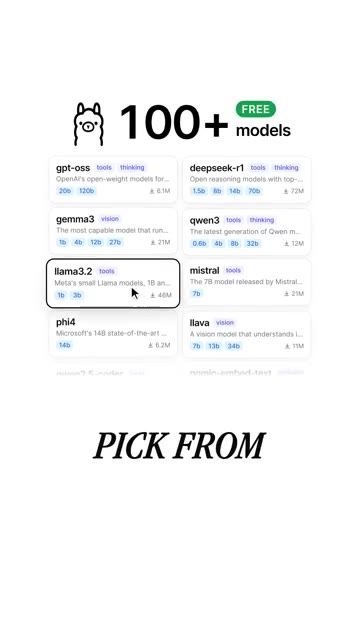

# 🎬 This Free Tool Lets You Use Open Models Locally

> **Chaîne** : [Brock Mesarich | AI for Non Techies](https://www.youtube.com/@BrockMesarich)  
> **Lien YouTube** : [https://www.youtube.com/watch?v=HzWlDNTMVmU](https://www.youtube.com/watch?v=HzWlDNTMVmU)  
> **Date de publication** : 20261007  
> **Durée** : 00:00:27  
> **Identifiant vidéo** : `HzWlDNTMVmU`  
> **Transcription & Analyse** : `whisper-v3-large-turbo+gemini-3.5-flash-lite`  

---

## 📌 Synthèse Exécutive & Outils

### 💡 Résumé
Cette intervention de la chaîne *Brock Mesarich | AI for Non Techies* met en lumière une révolution majeure pour l'automatisation et la sécurisation des données sensibles : l'exécution de modèles de langage (LLM) open source en local via l'outil **Ollama**. En s'affranchissant des infrastructures cloud tierces (telles que ChatGPT, Claude, Gemini ou Grok), les utilisateurs peuvent désormais traiter des volumes massifs de données confidentielles — comme des historiques de trading, des carnets d'ordres ou des notes stratégiques — directement sur leur propre machine, garantissant une confidentialité totale et une latence réseau nulle. 

Bien que la vidéo originale s'adresse à un public non technique, les implications pour le trading quantitatif et l'automatisation des flux de travail sont colossales. En combinant l'écosystème local d'Ollama avec des moteurs d'orchestration no-code/low-code comme **n8n** ou **Make**, il devient possible d'architecturer des pipelines de données hautement sécurisés. Ces systèmes peuvent analyser des flux financiers en temps réel, exécuter du *prompt engineering* avancé et déclencher des stratégies algorithmiques sans exposer la propriété intellectuelle ou les métriques de performance à des API externes.

Cette approche marque un tournant vers la souveraineté technologique des traders et des développeurs d'agents autonomes. L'accès à plus de 100 modèles open source interchangeables permet d'adapter finement le rapport entre puissance de calcul et complexité de la tâche, qu'il s'agisse de résumer des rapports macroéconomiques, d'analyser le sentiment de marchés ou d'automatiser l'exécution d'ordres via des webhooks sécurisés, le tout sans dépendre de la tarification ou des politiques de modération des géants de la tech.

### 🛠️ Outils, Modèles & Logiciels Présentés
* **Ollama** : Dépôt open source et moteur d'exécution permettant de télécharger et de faire tourner des LLM directement en local sur sa propre machine avec une simple ligne de commande.
* **ChatGPT** : Modèle de langage propriétaire d'OpenAI fonctionnant dans le cloud, souvent utilisé comme référence comparative mais présentant des limites en matière de confidentialité des données.
* **Claude** : Assistant conversationnel avancé d'Anthropic basé sur le cloud, reconnu pour ses capacités de traitement de textes longs mais soumis à des contraintes d'API externes.
* **Gemini** : Suite de modèles multimodaux de Google hébergée dans le cloud, intégrée aux écosystèmes de données d'entreprise.
* **Grok** : Modèle d'intelligence artificielle développé par xAI, axé sur l'accès en temps réel aux données de la plateforme X (anciennement Twitter).
* **n8n** : Outil d'automatisation de flux de travail (workflow automation) open-source et auto-hégeable, idéal pour connecter des modèles locaux à des sources de données financières.
* **Make** : Plateforme d'intégration et d'automatisation no-code puissante permettant de lier différentes applications SaaS et API entre elles.
* **Zapier** : Solution cloud standard d'automatisation de tâches, utile pour connecter des déclencheurs et des actions à travers des centaines d'applications logicielles.

### 🔑 Points Clés & Enseignements Stratégiques
* **Souveraineté et confidentialité des données** : L'exécution locale via Ollama garantit qu'aucune donnée propriétaire (stratégies de trading, codes sources, historiques de transactions) ne transite par des serveurs tiers.
* **Élimination des coûts d'API** : Le recours à des modèles open source locaux supprime la facturation à l'usage (pay-per-token) inhérente aux solutions cloud comme OpenAI ou Anthropic pour les gros volumes de données.
* **Diversité et flexibilité des modèles** : L'accès à un catalogue de plus de 100 modèles open source permet d'ajuster le choix de l'IA en fonction de la tâche spécifique (vitesse d'exécution vs. complexité logique).
* **Indépendance vis-à-vis de la connectivité** : Le traitement local fonctionne *offline*, éliminant les risques d'interruption de service liés aux pannes de serveurs des fournisseurs cloud ou aux limitations de débit (*rate limits*).
* **Interfaçage avec l'automatisation** : Bien qu'exécuté localement, un modèle Ollama peut être intégré dans des architectures d'automatisation via des scripts ou des connecteurs compatibles avec des outils comme **n8n**.
* **Traitement de documents non structurés** : Capacité native à ingérer, rechercher et synthétiser des années de notes, de journaux de trading ou de rapports de recherche sans contrainte de taille de contexte externe.
* **Optimisation du *Prompt Engineering*** : Possibilité d'itérer et d'affiner des prompts complexes de manière illimitée et gratuite pour le rétrofit de stratégies quantitatives.
* **Substitution rapide des modèles** : Si un modèle open source ne donne pas satisfaction sur une tâche d'analyse financière spécifique, il peut être remplacé instantanément par une simple commande de téléchargement.
* **Sécurité des backtests et loguage** : Protection des secrets d'algorithmes et des paramètres de *risk management* contre le pistage des données par les grandes entreprises technologiques.
* **Personnalisation et Fine-Tuning** : Les modèles locaux ouvrent la voie à un futur entraînement sur des données financières propriétaires hautement spécialisées sans violer la conformité réglementaire (RGPD, secrets industriels).

---

## ⏱️ Chronologie & Transcription Complète Audio & Visuelle (Mot pour Mot)

### ⏱️ `[00:00:00 - 00:00:27]` | Segment #01

**🔊 Audio (Transcription Intégrale Mot pour Mot en Français) :**
> Plus de 100 000 personnes ont démarré ce dépôt GitHub gratuit. Il fait tourner l'intelligence artificielle directement sur votre propre ordinateur. Ça s'appelle Ollama. Vous téléchargez un modèle avec une seule commande, puis il s'exécute directement sur votre machine. Ainsi, vos fichiers privés ne quittent jamais votre ordinateur. Disons que vous avez des années de notes de réunion, vous pouvez les rechercher et les résumer sans aucun besoin de cloud. Le meilleur, c'est qu'il y a plus de 100 modèles gratuits parmi lesquels choisir. Si vous n'aimez pas l'un d'eux, échangez-le simplement contre un autre. Si vous voulez utiliser votre propre IA privée, commentez Ollama et je vous enverrai le dépôt.

**👁️ Analyse Visuelle d'Écran (gemini-3.5-flash-lite) :**
**Interface & Outils** : Interface web de sélection de modèles IA (Ollama)

**Contenu textuel & Code** : Liste de modèles d'IA gratuits (gpt-oss, deepseek-r1, gemma3, qwen3, llama3.2, mistral, phi4, llava) avec leurs tailles et nombres de téléchargements.

**Action / Démonstration** : Sélection interactive du modèle llama3.2 à l'aide d'un curseur de souris.

*⏱️ 00:00:20 — Interface graphique présentant une liste de modèles d'intelligence artificielle gratuits disponibles sur Ollama, avec un curseur pointant sur "llama3.2".*

---

